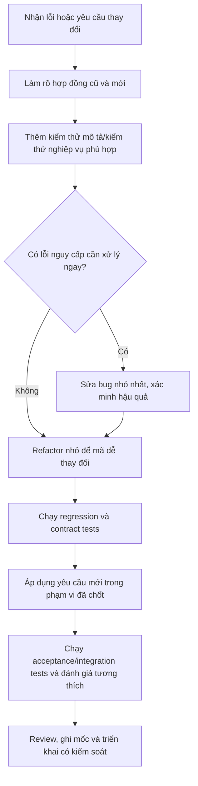

# Phân biệt tái cấu trúc, sửa lỗi và thay đổi yêu cầu

Một lập trình viên đổi một phương thức Java dài thành ba phương thức nhỏ và thấy kiểm thử vẫn xanh: đó có thể là **tái cấu trúc** (*refactoring*). Một người khác thay điều kiện `> 500_000` thành `>= 500_000` vì quy định đã có từ trước yêu cầu tính đúng ngưỡng: đó là **sửa lỗi** (*bug fixing*). Đến tháng sau, bộ phận sản phẩm quyết định miễn phí giao nhanh cho một nhóm khách mới: đó là **thay đổi yêu cầu**, ngay cả khi chỉ cần sửa một câu `if`.

Ba công việc đều có thể tác động đến cùng một tệp mã. Tuy nhiên, **mục tiêu, căn cứ xác định đúng/sai, loại kiểm thử và ảnh hưởng tới người sử dụng** rất khác nhau. Nếu gộp tất cả vào nhãn “refactor”, nhóm có thể vô tình thay đổi hành vi mà không cập nhật hợp đồng, hoặc giữ nguyên một lỗi đang tồn tại vì hiểu nhầm “refactor phải giữ mọi thứ”.

Trong chương **Tái cấu trúc** thuộc module **CODE_QUALITY_FUNDAMENTALS**, chúng ta học cách phân loại thay đổi dựa trên **hợp đồng và hành vi quan sát được**, rồi lựa chọn cách triển khai có bằng chứng để mã nguồn ngày càng **đáng tin cậy, dễ hiểu và dễ thay đổi**.

## 1. Ba loại thay đổi: cùng sửa mã, khác mục tiêu

| Tiêu chí | **Tái cấu trúc (refactoring)** | **Sửa lỗi (bug fixing)** | **Thay đổi yêu cầu (requirements change)** |
| --- | --- | --- | --- |
| Mục đích | Cải thiện cấu trúc nội bộ, cách diễn đạt, ranh giới trách nhiệm | Đưa triển khai đang sai về đúng hợp đồng đã được xác nhận | Thay đổi hợp đồng mà hệ thống phải đáp ứng |
| Hành vi công khai dự kiến | **Giữ nguyên** trong phạm vi hợp đồng | **Cố ý đổi** ở những trường hợp trước đây sai | **Cố ý đổi** theo quyết định mới |
| Căn cứ kiểm tra | Hành vi trước/sau phù hợp cùng hợp đồng | Đặc tả đã có + bằng chứng lỗi + test hồi quy | Đặc tả mới, tiêu chí chấp nhận và tác động tương thích |
| Ví dụ | Tách biểu thức phí thành phương thức thuần, không đổi kết quả | Sửa lỗi không tính đúng ngưỡng miễn phí | Thêm chính sách miễn phí giao nhanh cho một nhóm khách |
| Rủi ro chính | Vô tình đổi hành vi hoặc tác dụng phụ | Sửa sai nguyên nhân, tạo hồi quy | Hiểu sai yêu cầu mới, phá client và dữ liệu cũ |
| Dấu hiệu hoàn thành | Mã dễ hiểu/thay đổi hơn; hợp đồng cũ vẫn được bảo vệ | Ca lỗi trước đây thất bại, sau sửa đạt; không phá ca khác | Kịch bản mới đạt, tương thích và migration đã xử lý |

**Điểm phân biệt không phải số dòng thay đổi.** Một lần đổi tên lớn có thể là refactor; một ký tự `=` thêm vào điều kiện có thể là sửa lỗi; một hằng số đổi giá trị có thể là thay đổi sản phẩm đáng kể.

### 1.1. Tái cấu trúc không phải “sửa cho đẹp” bằng mọi giá

Refactoring là quá trình thay đổi **cấu trúc nội bộ** để mã dễ hiểu, dễ kiểm thử hoặc dễ mở rộng mà không cố ý làm khác những gì bên gọi đang được hứa. Ví dụ:

- Đặt tên `amountDueVnd` thay cho `x` trong phương thức private.
- Tách phép tính thuần khỏi việc ghi cơ sở dữ liệu.
- Thay các nhánh lặp bằng một chính sách có trách nhiệm rõ, **khi đã xác nhận chúng thật sự cùng nghĩa**.
- Giảm sự phụ thuộc vào lớp hạ tầng cụ thể thông qua ranh giới hợp đồng phù hợp.
- Tách một phương thức dài thành các bước mang tên nghiệp vụ, vẫn giữ nguyên thứ tự tác dụng phụ quan trọng.

Refactor không đồng nghĩa với “lúc nào cũng tách lớp” hoặc “càng ít dòng càng tốt”. Cấu trúc mới chỉ có ích nếu giảm chi phí hiểu và thay đổi **trong thực tế**, thay vì thêm quá nhiều mức gián tiếp.

### 1.2. Sửa lỗi là thay đổi hành vi có căn cứ

Một lỗi (*bug*) là sai khác giữa hành vi hiện tại và điều hệ thống **đã phải làm**. Ví dụ, hợp đồng đã chốt là miễn phí khi `amountDueVnd >= 500_000`, nhưng code dùng `>`.

Sửa lỗi cần:

1. Chứng minh **hành vi thực tế** lệch khỏi yêu cầu đã tồn tại.
2. Tạo ca kiểm thử có dữ liệu gây lỗi, tốt nhất kiểm thử thất bại trước khi sửa.
3. Sửa nguyên nhân ở nơi sở hữu quy tắc hoặc dữ liệu.
4. Kiểm tra đường thành công, trường hợp biên, tác dụng phụ và các luồng có liên quan.

Không thể gọi việc này là “refactor thuần” vì kết quả tại `500_000` **có chủ ý thay đổi**.

### 1.3. Thay đổi yêu cầu là đổi điều được cam kết

Khi sản phẩm quyết định “từ phiên bản mới, thành viên đạt 1.000.000 VND được miễn phí giao nhanh”, hành vi cũ có thể vẫn hoàn toàn đúng với hợp đồng cũ. Thay đổi này cần:

- Người chịu trách nhiệm xác nhận quy tắc mới, ngưỡng, thời điểm áp dụng và ngoại lệ.
- Cập nhật đặc tả, bảng quyết định, tài liệu API và tiêu chí chấp nhận.
- Phân tích tương thích với đơn đã tạo, client cũ và dữ liệu lưu trữ.
- Viết kiểm thử cho cả chính sách mới và các trường hợp phải tiếp tục theo chính sách cũ.

Nếu bỏ bước xác nhận yêu cầu và chỉ thay một hằng số trong mã, không có căn cứ để nói kết quả mới là đúng.

## 2. Thế nào là “hành vi được giữ nguyên”?

Muốn xác định có phải refactor hay không, phải trả lời **hành vi nào được xem là hợp đồng**. Bên gọi không nhất thiết quan tâm số helper private hoặc dùng vòng lặp hay Stream, nhưng có thể quan tâm:

- Giá trị trả về, kiểu dữ liệu và đơn vị.
- Ngoại lệ, mã lỗi và điều kiện từ chối đầu vào.
- Trạng thái lưu trữ sau thành công hoặc thất bại.
- Tác dụng phụ như ghi DB, gọi dịch vụ ngoài, gửi email, phát sự kiện.
- Tính nguyên tử, tính duy nhất dưới đồng thời và khả năng thử lại.
- Schema JSON, thứ tự công bố dữ liệu, mức tương thích API.
- Các cam kết phi chức năng đã công bố, ví dụ giới hạn độ trễ, tải hoặc bộ nhớ.

Một sự thay đổi chỉ có thể coi là **giữ hành vi trong phạm vi đã xác định**. Không nên hứa “hoàn toàn không khác biệt trong mọi quan sát” nếu thay đổi cả thuật toán, dữ liệu thời gian hoặc nhiều luồng.

### 2.1. Quan sát bên ngoài và chi tiết nội bộ

| Thay đổi | Thường có thể là refactor? | Cần kiểm tra thêm |
| --- | --- | --- |
| Đổi tên helper `private calculateFee` | Có | Không ảnh hưởng tên được dùng qua reflection hoặc framework |
| Đổi `for` thành Stream để tính toán | Có, nếu tương đương | Thứ tự, ngoại lệ, side effect và hiệu năng theo hợp đồng |
| Tách một lớp lớn thành các lớp trách nhiệm rõ | Có | Không đổi đường gọi công khai hoặc hợp đồng trạng thái |
| Đổi tên field `totalChargeVnd` trong JSON trả client | **Không** nếu phá hợp đồng JSON | Phiên bản API, mapping, client cũ |
| Đổi loại ngoại lệ của phương thức công khai | Không mặc nhiên | Client đang bắt ngoại lệ nào? |
| Chuyển gửi email từ trước commit sang sau commit | Thường đổi ngữ nghĩa tác dụng phụ | Kết quả khi lỗi, retry và yêu cầu nghiệp vụ |
| Tối ưu truy vấn SQL | Có thể | Kết quả, thứ tự dữ liệu, isolation và thời gian đáp ứng |
| Đổi giới hạn giá trị tối đa theo sản phẩm | Không | Đây là yêu cầu mới hoặc sửa lỗi tùy đặc tả trước đó |

**Ngoại lệ quan trọng:** một tên phương thức private có thể là “nội bộ” đối với người dùng Java bình thường nhưng lại được framework gọi bằng reflection. Nếu sự phụ thuộc đó là một phần môi trường thực, việc đổi tên cần được kiểm tra như một thay đổi có thể quan sát.

### 2.2. Bảo toàn hợp đồng khác với chép lại mọi lỗi hiện có

Khi mã cũ có hành vi sai, có hai loại kỳ vọng:

1. **Kỳ vọng mô tả hiện trạng:** hệ thống *đang làm gì*, kể cả lỗi.
2. **Kỳ vọng chuẩn tắc:** hệ thống *được yêu cầu phải làm gì*.

Ví dụ code cũ dùng `>` và trả 15.000 VND tại đúng 500.000 VND. Một kiểm thử mô tả hiện trạng (*characterization test*) có thể ghi nhận điều đó để bảo vệ quá trình di chuyển cấu trúc. Nhưng nếu đặc tả đã yêu cầu `>=`, kiểm thử ấy **không được coi là câu trả lời nghiệp vụ đúng**.

Cách làm có căn cứ là **tách bước bảo toàn hiện trạng để đổi cấu trúc** và **bước sửa lỗi được xác nhận**, ghi rõ test nào là mô tả hiện trạng và test nào xác nhận hợp đồng. Nếu lỗi gây rủi ro nghiêm trọng, có thể ưu tiên sửa lỗi trước; điều quan trọng là không âm thầm trộn hai mục tiêu khiến khó review.

## 3. Cây quyết định phân loại thay đổi

Khi thấy một đoạn mã cần chỉnh sửa, có thể đi qua luồng hỏi sau:

```mermaid
flowchart TD
    A["Đề xuất sửa mã"] --> B{"Có thay đổi hành vi quan sát được theo hợp đồng?"}
    B -- "Không, đã có bằng chứng" --> C["Tái cấu trúc"]
    B -- "Có" --> D{"Hành vi cũ trái với hợp đồng đã chốt?"}
    D -- "Có" --> E["Sửa lỗi"]
    D -- "Không, hợp đồng mới được phê duyệt" --> F["Thay đổi yêu cầu"]
    D -- "Chưa rõ" --> G["Làm rõ đặc tả và nguồn kỳ vọng trước"]
    G --> B
    C --> H["Giữ regression/contract tests"]
    E --> I["Thêm test tái hiện lỗi và chống hồi quy"]
    F --> J["Thêm acceptance tests, xem phiên bản và dữ liệu"]
```



Cây quyết định là **công cụ lập luận**, không phải máy phân loại tuyệt đối. Một pull request có thể chứa cả ba loại thay đổi. Khi đó nên phân biệt **phần nào thuộc từng mục tiêu**, tách commit hoặc PR nếu khả thi và đảm bảo lịch sử thay đổi dễ truy vết.

### 3.1. Nếu không có đặc tả thì sao?

Không có đặc tả rõ ràng không khiến mọi hành vi của mã cũ tự động trở thành chuẩn. Khi gặp khoảng trống:

1. Thu thập ví dụ đang sử dụng và hành vi của hệ thống cũ.
2. Đối chiếu quy định nghiệp vụ, tài liệu và kỳ vọng của client.
3. Nêu rõ trường hợp biên, lỗi, tác dụng phụ, tương thích.
4. Đề nghị người có thẩm quyền **quyết định chính sách**.
5. Ghi lựa chọn và thiết kế test oracle trước khi thay đổi hành vi.

Nếu buộc phải bảo trì trong lúc chưa có quyết định, có thể tạm giữ hành vi hiện tại để tránh hồi quy và ghi đây là **giả định tạm thời**, không gọi nó là chân lý nghiệp vụ.

## 4. Ví dụ xuyên suốt: chính sách phí giao hàng

Giả sử nhóm đã xác nhận hợp đồng của một phép tính báo giá đơn giản:

| Mã quy tắc | Điều kiện | Kết quả |
| --- | --- | --- |
| R1 | Tiền hàng `subtotal` và voucher không âm; voucher không vượt subtotal | Nếu vi phạm, ném `IllegalArgumentException` |
| R2 | Tiền sau giảm giá = subtotal trừ voucher | Trả đúng `amountDueVnd` |
| R3 | Giao nhanh | Phí giao 30.000 VND |
| R4 | Giao tiêu chuẩn, thành viên, `amountDueVnd >= 500_000` | Phí giao bằng 0 |
| R5 | Các trường hợp giao tiêu chuẩn còn lại | Phí giao 15.000 VND |
| R6 | Tổng trả = tiền sau giảm + phí giao | Dùng số nguyên VND; không im lặng tràn `long` |
| R7 | Không có thay đổi trạng thái ngoài | Phép tính không ghi DB, gửi email hoặc phát sự kiện |

Đây là **quy tắc giả định cho bài học**, không phải quy định của một cửa hàng thật. Ta dùng **cùng một bảng** để phân biệt refactor, sửa bug và thay yêu cầu.

### 4.1. Phiên bản trước: đúng hợp đồng nhưng hơi khó đọc

Tệp `ShippingQuotes.java`, Java 17:

```java
package com.example.refactoring;

import java.util.Objects;

public final class ShippingQuotes {
    private static final long FREE_THRESHOLD_VND = 500_000L;

    public enum DeliverySpeed { STANDARD, EXPRESS }

    public record Request(
            long merchandiseSubtotalVnd,
            long voucherDiscountVnd,
            boolean member,
            DeliverySpeed speed) {}

    public record Quote(
            long amountDueVnd,
            long shippingFeeVnd,
            long totalChargeVnd) {}

    private ShippingQuotes() {}

    public static Quote quote(Request request) {
        Objects.requireNonNull(request, "request");

        if (request.merchandiseSubtotalVnd() < 0
                || request.voucherDiscountVnd() < 0
                || request.voucherDiscountVnd()
                > request.merchandiseSubtotalVnd()) {
            throw new IllegalArgumentException("invalid amounts");
        }
        Objects.requireNonNull(request.speed(), "speed");

        long payable = request.merchandiseSubtotalVnd()
                - request.voucherDiscountVnd();

        long fee;
        if (request.speed() == DeliverySpeed.EXPRESS) {
            fee = 30_000L;
        } else {
            if (request.member()) {
                if (payable >= FREE_THRESHOLD_VND) {
                    fee = 0L;
                } else {
                    fee = 15_000L;
                }
            } else {
                fee = 15_000L;
            }
        }

        long total = Math.addExact(payable, fee);
        return new Quote(payable, fee, total);
    }
}
```

Phương thức vẫn tuân theo chính sách: phí giao nhanh luôn 30.000 VND; đúng mốc 500.000 VND được miễn cho thành viên giao tiêu chuẩn; dữ liệu sai bị từ chối; `Math.addExact` bảo vệ khỏi tràn số khi cộng tổng.

Mùi cục bộ là **các nhánh lồng sâu và hai lần viết `15_000L`**, cộng với tên biến `fee`/`payable` ít nhất quán với kiểu dữ liệu trả về. Mục tiêu refactor là làm logic dễ đọc hơn **mà không thay chính sách**.

### 4.2. Phiên bản sau: tách cách tính, giữ nguyên kết quả

Đây là **toàn bộ tệp `ShippingQuotes.java` sau refactor**, thay thế phiên bản trước chứ không dùng đồng thời hai bản cùng tên lớp:

```java
package com.example.refactoring;

import java.util.Objects;

public final class ShippingQuotes {
    private static final long FREE_THRESHOLD_VND = 500_000L;
    private static final long STANDARD_FEE_VND = 15_000L;
    private static final long EXPRESS_FEE_VND = 30_000L;

    public enum DeliverySpeed { STANDARD, EXPRESS }

    public record Request(
            long merchandiseSubtotalVnd,
            long voucherDiscountVnd,
            boolean member,
            DeliverySpeed speed) {}

    public record Quote(
            long amountDueVnd,
            long shippingFeeVnd,
            long totalChargeVnd) {}

    private ShippingQuotes() {}

    public static Quote quote(Request request) {
        Objects.requireNonNull(request, "request");

        if (request.merchandiseSubtotalVnd() < 0
                || request.voucherDiscountVnd() < 0
                || request.voucherDiscountVnd()
                > request.merchandiseSubtotalVnd()) {
            throw new IllegalArgumentException("invalid amounts");
        }
        Objects.requireNonNull(request.speed(), "speed");

        long amountDueVnd = request.merchandiseSubtotalVnd()
                - request.voucherDiscountVnd();

        long shippingFeeVnd = calculateShippingFeeVnd(
                amountDueVnd, request.member(), request.speed());

        long totalChargeVnd =
                Math.addExact(amountDueVnd, shippingFeeVnd);

        return new Quote(
                amountDueVnd, shippingFeeVnd, totalChargeVnd);
    }

    private static long calculateShippingFeeVnd(
            long amountDueVnd, boolean member, DeliverySpeed speed) {

        return switch (speed) {
            case EXPRESS -> EXPRESS_FEE_VND;
            case STANDARD ->
                    member && amountDueVnd >= FREE_THRESHOLD_VND
                            ? 0L : STANDARD_FEE_VND;
        };
    }
}
```

Những thay đổi cấu trúc:

- Đặt tên hằng số phí giao thay cho hai giá trị số lặp.
- Đưa việc chọn phí sang helper `private` có tên rõ.
- Dùng `switch` trên enum thay cho nhánh lồng sâu.
- Đặt tên `amountDueVnd`, `shippingFeeVnd`, `totalChargeVnd` nhất quán với giá trị nghiệp vụ.

**Những điều không thay đổi theo thiết kế:** chữ ký phương thức công khai, các kiểu dữ liệu, thứ tự từ chối đầu vào, giá trị trả về, trường hợp tràn số và việc không có tác dụng phụ.

Nếu sau refactor ta vô tình đổi `>=` thành `>`, đó không còn là một refactor giữ hành vi; nó là **hồi quy**. Nếu đồng thời cố ý thêm miễn phí giao nhanh, đó là **thay đổi yêu cầu bị trộn vào refactor**.

### 4.3. Kiểm thử hành vi cho cả trước và sau

Tệp `ShippingQuotesTest.java` dùng JUnit 5, đặt cùng package:

```java
package com.example.refactoring;

import static org.junit.jupiter.api.Assertions.assertEquals;
import static org.junit.jupiter.api.Assertions.assertThrows;

import org.junit.jupiter.api.Test;
import org.junit.jupiter.params.ParameterizedTest;
import org.junit.jupiter.params.provider.CsvSource;

class ShippingQuotesTest {
    @ParameterizedTest
    @CsvSource({
        "STANDARD, true,  499999, 0,      499999, 15000, 514999",
        "STANDARD, true,  500000, 0,      500000,     0, 500000",
        "STANDARD, true,  500001, 0,      500001,     0, 500001",
        "STANDARD, false, 500000, 0,      500000, 15000, 515000",
        "EXPRESS,  true,  500000, 0,      500000, 30000, 530000",
        "STANDARD, true,  600000, 100000, 500000,     0, 500000",
        "STANDARD, true,  600000, 100001, 499999, 15000, 514999"
    })
    void quoteMatchesApprovedRules(
            ShippingQuotes.DeliverySpeed speed,
            boolean member,
            long subtotalVnd,
            long voucherVnd,
            long expectedDueVnd,
            long expectedFeeVnd,
            long expectedTotalVnd) {

        var request = new ShippingQuotes.Request(
                subtotalVnd, voucherVnd, member, speed);

        var actual = ShippingQuotes.quote(request);

        assertEquals(new ShippingQuotes.Quote(
                expectedDueVnd, expectedFeeVnd, expectedTotalVnd),
                actual);
    }

    @Test
    void invalidAmountsAreRejected() {
        assertThrows(IllegalArgumentException.class,
                () -> ShippingQuotes.quote(new ShippingQuotes.Request(
                        -1L, 0L, true,
                        ShippingQuotes.DeliverySpeed.STANDARD)));

        assertThrows(IllegalArgumentException.class,
                () -> ShippingQuotes.quote(new ShippingQuotes.Request(
                        100_000L, 100_001L, true,
                        ShippingQuotes.DeliverySpeed.STANDARD)));
    }

    @Test
    void nullSpeedIsRejected() {
        assertThrows(NullPointerException.class,
                () -> ShippingQuotes.quote(new ShippingQuotes.Request(
                        100_000L, 0L, true, null)));
    }

    @Test
    void overflowIsRejectedRatherThanReturningWrongTotal() {
        assertThrows(ArithmeticException.class,
                () -> ShippingQuotes.quote(new ShippingQuotes.Request(
                        Long.MAX_VALUE, 0L, false,
                        ShippingQuotes.DeliverySpeed.EXPRESS)));
    }
}
```

Các trường hợp kiểm thử tập trung vào **hành vi và hợp đồng đã chốt**, không vào việc `calculateShippingFeeVnd` có tồn tại, có gọi đúng một lần hoặc trong phương thức có bao nhiêu câu `if`. Vì vậy cùng một bộ kiểm thử có thể được dùng khi kiểm tra **cả hai phiên bản** lớp ở hai thời điểm khác nhau.

**Lưu ý:** đây là ví dụ mã và kiểm thử để học; không khẳng định đã biên dịch hoặc chạy JUnit trong repository. Mã này là phép tính thuần, nên chưa cần kiểm thử database, giao dịch hoặc mạng; khi đưa vào API có I/O cần thêm kiểm thử ở ranh giới đó.

### 4.4. Vì sao test xanh chưa đủ để bảo đảm refactor an toàn?

Một vài trường hợp sai khác vẫn có thể bị bỏ sót:

- Test không bao phủ đúng giá trị biên hoặc loại đầu vào hiếm.
- Test oracle dựa vào kết quả cũ sai chứ không dựa trên yêu cầu.
- Có phụ thuộc ngầm vào tên helper, thứ tự gọi hoặc cấu hình framework.
- Thay đổi thuật toán làm thay đổi thứ tự tác dụng phụ, tính nguyên tử hoặc tính ổn định đồng thời.
- Tác vụ có yêu cầu hiệu năng mà unit test không kiểm tra.

Vì vậy **chạy lại test là bằng chứng cần thiết nhưng không phải bằng chứng duy nhất**. Cần review diff, phân tích các nhánh quan trọng và chọn kiểm tra bổ sung theo rủi ro.

## 5. Tình huống thứ hai: sửa bug không phải refactor

Giả sử một phiên bản khác của mã có điều kiện sau:

```java
// Phiên bản sai so với hợp đồng R4:
case STANDARD ->
        member && amountDueVnd > FREE_THRESHOLD_VND
                ? 0L : STANDARD_FEE_VND;
```

Hợp đồng đã xác nhận **từ 500.000 VND trở lên**. Với thành viên, giao tiêu chuẩn và `amountDueVnd = 500_000L`, đoạn trên trả **15.000 VND**, trong khi kết quả đúng là **0 VND**.

Sửa:

```java
// Sửa lỗi: bao gồm chính giá trị ngưỡng.
case STANDARD ->
        member && amountDueVnd >= FREE_THRESHOLD_VND
                ? 0L : STANDARD_FEE_VND;
```

Chỉ thêm một dấu `=` nhưng hành vi tại ngưỡng **cố ý thay đổi**. Đó là **bug fix** theo R4, không phải refactor. Nếu nhóm dùng bộ test ở phần 4.3, ca `500_000` làm bộ kiểm thử thất bại trước sửa và đạt sau sửa, theo đúng loại bằng chứng cần có.

### 5.1. Sửa bug nên bắt đầu từ trường hợp thất bại

Một vòng sửa lỗi hữu ích:

1. **Ghi lỗi quan sát:** đầu vào, môi trường, kết quả thực tế, kết quả mong đợi.
2. **Xác nhận nguồn kỳ vọng:** yêu cầu R4 có hiệu lực từ trước khi lỗi xuất hiện.
3. **Tạo kiểm thử tái hiện:** ca đúng ngưỡng thất bại trên mã bị lỗi.
4. **Sửa ở nguyên nhân phù hợp:** dấu so sánh trong thành phần sở hữu chính sách.
5. **Chạy ca lân cận:** 499.999, 500.000, 500.001; thành viên/không thành viên; giao tiêu chuẩn/giao nhanh.
6. **Rà soát các nơi dùng:** báo giá và chốt đơn có cùng chính sách không?
7. **Ghi ảnh hưởng dữ liệu nếu cần:** khách từng bị tính dư phí có cần đối soát hay xử lý hậu quả không?

Ở hệ thống thanh toán, một fix tính đúng phí cho **đơn mới** không tự sửa những khoản đã thu sai trong lịch sử. Nếu có hậu quả thực tế, cần xác định phạm vi dữ liệu và quy trình hoàn/đối soát riêng.

### 5.2. Nếu hiện trạng sai nhưng test cũ đang xanh

Có thể test cũ đã viết:

```java
// Test mô tả hành vi cũ sai theo R4:
assertEquals(15_000L, feeAtExactly500000Vnd);
```

Không nên để test ấy ngăn sửa bug vì coi mọi hành vi cũ là “hợp đồng”. Cần xác minh **nguồn đúng độc lập** rồi cập nhật test thành kỳ vọng 0. Có thể giữ chú thích lịch sử trong issue hoặc test regression ghi rõ vì sao đã đổi, không cần tiếp tục bảo vệ kết quả sai.

Ngược lại, nếu chưa biết mốc 500.000 được tính hay không, **đừng tự nhận đó là bug**. Lúc này thiếu đặc tả; phải có quyết định nghiệp vụ trước khi định nghĩa đáp án đúng.

## 6. Tình huống thứ ba: yêu cầu mới, dù code cũ hoàn toàn đúng

Giả sử R3 đang nói “giao nhanh luôn 30.000 VND”. Sản phẩm phê duyệt quy tắc mới:

> Đối với **đơn mới** từ một thời điểm hiệu lực được xác định, thành viên có `amountDueVnd >= 1_000_000` được miễn phí giao nhanh. Các đơn cũ giữ nguyên giá và điều kiện đã chốt.

Trong hợp đồng mới, R3 không còn đúng cho mọi giao nhanh. Đây là một **thay đổi yêu cầu** vì hệ thống phải cung cấp hành vi khác so với hợp đồng trước đó.

Một đoạn thay đổi trong helper có thể là:

```java
case EXPRESS ->
        member && amountDueVnd >= 1_000_000L
                ? 0L : EXPRESS_FEE_VND;
```

Đây chỉ là **mảnh mã minh họa biểu thức mới**. Triển khai đầy đủ cần xác định **thời điểm hiệu lực**, đơn nào áp dụng, giá đã chốt có được giữ, và cách khôi phục báo giá cũ. Nếu quy tắc phụ thuộc thời điểm, không nên chỉ thay hằng số toàn cục rồi tính lại mọi đơn lịch sử như thể chính sách luôn như vậy.

### 6.1. Cần làm gì ngoài sửa câu `switch`?

| Công việc | Lý do |
| --- | --- |
| Chốt thời điểm bắt đầu, múi giờ và phạm vi áp dụng | Đơn mới và đơn đã chốt có thể dùng chính sách khác |
| Cập nhật đặc tả R3 và bảng quyết định | Có test oracle mới, không chỉ kết quả của code |
| Bổ sung ca tại 999.999 / 1.000.000 / 1.000.001 VND | Bảo vệ ngưỡng mới |
| Kiểm tra giao nhanh với thành viên và không thành viên | Không ảnh hưởng các nhóm không thuộc ưu đãi |
| Cân nhắc versioning hoặc lưu snapshot giá | Tránh đổi tổng tiền của đơn đã xác nhận |
| Kiểm tra client hiển thị báo giá và chốt đơn | Client hiểu rõ giá nào đang được áp dụng |
| Đánh giá tác dụng tới báo cáo, hoàn tiền và dữ liệu cũ | Không thay đổi ngầm các phép tính quá khứ |

Nếu yêu cầu mới thật ra chỉ muốn **sửa cách diễn đạt văn bản** mà hành vi không đổi, chưa chắc cần sửa code. Ngược lại, nếu một thay đổi code tuy nhỏ nhưng làm thay đổi dữ liệu người dùng quan sát được, nó cần được xử lý như thay đổi hành vi.

### 6.2. Phân biệt lỗi cũ với yêu cầu mới bằng mốc thời gian

Cùng một diff:

```diff
- return amountDueVnd > 500_000L;
+ return amountDueVnd >= 500_000L;
```

có thể mang hai ý nghĩa:

- **Sửa lỗi:** từ trước yêu cầu đã nói “từ 500.000 VND”, nhưng lập trình dùng sai `>`.
- **Đổi yêu cầu:** trước đây sản phẩm chính thức quy định “lớn hơn 500.000”, nay mới quyết định “từ 500.000 trở lên”.

Vì vậy **chỉ nhìn diff không đủ để phân loại thay đổi**. Cần nhìn **lịch sử hợp đồng có hiệu lực**, người chấp thuận quy tắc và dữ liệu bị ảnh hưởng.

## 7. Cách kết hợp ba loại thay đổi mà vẫn dễ kiểm soát

Thực tế một tính năng có thể vừa khó đọc vừa có bug, và sản phẩm đồng thời muốn đổi chính sách. Không nhất thiết luôn tách thành ba pull request, nhưng phải **tách được ý định và bằng chứng**.

### 7.1. Thứ tự tham khảo khi rủi ro được kiểm soát



Sơ đồ là **một chiến lược có thể điều chỉnh**. Không nên trì hoãn hotfix rủi ro cao chỉ để hoàn thành refactor đẹp. Nếu refactor bắt buộc để tiếp cận logic bị lỗi, cần giới hạn thật nhỏ và giữ bằng chứng ở mỗi bước.

### 7.2. Dùng commit/PR có mục đích rõ

Một chuỗi minh họa:

| Thay đổi | Loại | Mô tả nên có trong lịch sử |
| --- | --- | --- |
| Đặt tên hằng số, tách `calculateShippingFeeVnd` | Refactor | Không đổi quy tắc, các test cũ vẫn được dùng |
| Thay `>` bằng `>=` theo R4 cũ | Bug fix | Có ca lỗi đúng ngưỡng thất bại trước sửa |
| Thêm miễn phí giao nhanh cho thành viên đạt 1.000.000 | Requirements change | Có quyết định sản phẩm, test mới và phạm vi áp dụng |
| Bổ sung contract test giữ tương thích JSON | Test/verification | Bảo vệ client trong quá trình đổi triển khai |

Cách chia này giúp review tìm nguyên nhân hồi quy. Nếu thay đổi chính sách bị lỗi, có thể xem riêng commit/PR đổi yêu cầu thay vì phải đọc một diff khổng lồ vừa đổi định dạng, vừa đổi cấu trúc, vừa đổi thuật toán.

**Không ép tách máy móc.** Một bug fix một dòng đi kèm test và đổi tên biến nhỏ có thể nằm trong một PR dễ hiểu; điều cần thiết là người review **thấy rõ phần nào thay hành vi**.

## 8. Kiểm thử nào phù hợp với từng loại thay đổi?

| Loại | Kiểm thử ưu tiên | Kỳ vọng khi có khác biệt |
| --- | --- | --- |
| Refactor phép tính thuần | Unit test theo hợp đồng, ca biên và lỗi đầu vào | Cùng đầu vào, cùng kết quả/hành vi lỗi |
| Refactor code có DB | Unit + integration test transaction, mapping và trạng thái | Không đổi dữ liệu quan sát được sau thành công/lỗi |
| Refactor API | Contract test schema/mã lỗi, E2E quan trọng | Client cũ không bị phá |
| Bug fix quy tắc | Test tái hiện lỗi, case lân cận, regression | Ca bị lỗi đổi từ sai thành đúng |
| Bug fix concurrency | Kiểm thử cạnh tranh, invariant, adapter thật | Không còn double booking/lost update trong phạm vi kiểm chứng |
| Thay yêu cầu | Acceptance tests mới, test tương thích/version/migration | Hành vi mới đúng, hành vi cũ còn được bảo vệ nếu phải tương thích |
| Thay đổi phi chức năng | Load/performance/resource tests cùng workload | Đạt mục tiêu mới và không phá các giới hạn hiện hữu |

### 8.1. “Test trước và sau cùng xanh” là cần nhưng chưa đủ

Nếu bộ kiểm thử không chứa ca `500_000`, thay đổi `>=` thành `>` có thể vẫn xanh. Nếu test dùng mock và chỉ xác nhận lời gọi helper, việc thay đổi tính phí thật có thể không được phát hiện. Nếu refactor đổi thứ tự commit DB và gửi sự kiện, unit test của phép tính sẽ không biết.

Vì vậy cần:

- Test oracle độc lập với triển khai.
- Dữ liệu biên, đầu vào không hợp lệ, trạng thái sau lỗi.
- Kiểm thử ở ranh giới đã thay đổi: DB, HTTP, hàng đợi, thời gian, đồng thời.
- Review cấu trúc/chiều phụ thuộc và quyết định nghiệp vụ.
- Xác nhận những điều **chưa được kiểm thử**, không diễn giải test xanh thành bảo đảm tuyệt đối.

### 8.2. Characterization test khác acceptance test

**Characterization test** ghi lại hành vi đang diễn ra trong hệ thống cũ, giúp giảm rủi ro khi thay cấu trúc mà chưa hiểu hết code. Nó hữu ích với hệ thống thiếu tài liệu.

**Acceptance test** xác nhận hành vi **được yêu cầu**. Nếu hiện trạng đang sai, hai loại test có thể có kết quả kỳ vọng khác nhau.

| Trường hợp | Test mô tả hiện trạng | Test theo hợp đồng |
| --- | --- | --- |
| Code cũ dùng `> 500_000` | Đúng 500.000 → tính 15.000 | Đúng 500.000 → miễn phí nếu R4 đã quy định `>=` |
| Refactor tạm thời để dễ cô lập lỗi | Có thể giữ hành vi cũ ở bước này | Test hợp đồng còn đỏ, được ghi rõ |
| Sửa bug sau đó | Test mô tả lỗi cũ cần thay hoặc bỏ | Test hợp đồng phải xanh |

Không nên giữ một test mô tả bug như **quality gate vĩnh viễn** chống lại việc sửa bug. Cũng không nên xóa mọi characterization test trước khi đủ hiểu những hành vi đang có client phụ thuộc.

## 9. Cẩn trọng với hành vi lỗi và tác dụng phụ

Ở code có trạng thái, phân biệt ba loại thay đổi trở nên khó hơn vì kết quả không chỉ là một giá trị trả về.

Giả sử có quy trình:

```text
1. Kiểm tra điều kiện đơn
2. Ghi trạng thái đơn
3. Gọi cổng thanh toán
4. Phát sự kiện xác nhận
```

Một refactor chuyển bước 3 lên trước bước 2 có thể trông như “đổi vị trí lời gọi cho dễ đọc”, nhưng nó làm thay đổi **hậu quả khi một bước bị lỗi**. Nếu cổng thanh toán thu tiền thành công rồi ghi DB thất bại, trạng thái hệ thống khác trước.

### 9.1. Ma trận tác dụng phụ trước và sau

| Điểm lỗi | Hợp đồng cần làm rõ | Nếu refactor đổi thứ tự, rủi ro |
| --- | --- | --- |
| Đầu vào không hợp lệ | Không ghi trạng thái và không thu tiền | Validation bị chuyển xuống sau tác dụng phụ |
| DB rollback | Không commit dữ liệu thuộc transaction | Gọi hệ thống ngoài không tự được rollback |
| Cổng thanh toán timeout | Kết quả có thể chưa rõ; tra cứu theo request ID | Retry với ID mới tạo thanh toán lặp |
| Phát sự kiện thất bại | Đơn đã chốt cần cơ chế phát lại | Làm mất thông báo hoặc gửi trùng |
| Hai lời gọi cùng lúc | Không được tạo hai khoản thu cho một thao tác logic | Đổi khóa hoặc transaction làm mất bảo đảm |

Một refactor có thể giữ **kết quả cuối cùng trong ca thành công** nhưng phá **hợp đồng khi thất bại**. Vì vậy cần kiểm tra cả success path, failure path, trạng thái và side effect.

### 9.2. Khi thay đổi cách xử lý lỗi là bug fix hay requirements change?

Ví dụ API đang trả `500 Internal Server Error` cho yêu cầu không đủ hàng.

- Nếu hợp đồng **đã quy định** lỗi nghiệp vụ tương ứng phải là phản hồi từ chối có nghĩa (chẳng hạn `409 Conflict` trong thiết kế cụ thể), đổi cách báo là **bug fix**.
- Nếu trước đây API **chính thức hứa** một định dạng lỗi và nay sản phẩm muốn đổi sang định dạng mới, đó là **thay đổi hợp đồng**, cần kiểm tra client.
- Nếu chỉ tách logic kiểm tra mà giữ mã lỗi/body/trạng thái đã hứa, đó có thể là **refactor**.

Một mã HTTP hoặc tên ngoại lệ không tự trả lời câu hỏi; phải có **hợp đồng trước và sau**.

## 10. Refactor an toàn theo những bước nhỏ và có điểm dừng

Một quy trình có thể áp dụng trong dự án Java:

### Bước 1 — Ghi mục tiêu thay đổi

Ví dụ: “Giảm nhánh lồng trong `ShippingQuotes.quote`, không đổi quy tắc R1–R7 và không đổi public API”. Đây là **tiêu chí đánh giá**, không phải khẩu hiệu “làm sạch”.

### Bước 2 — Chốt hợp đồng quan sát được

Ghi input, output, lỗi, side effect và phạm vi đồng thời. Nếu nghi ngờ code hiện sai, đánh dấu trường hợp chưa rõ để không trộn sửa bug vào refactor một cách âm thầm.

### Bước 3 — Xây dựng bằng chứng trước

Dùng unit test cho quy tắc, contract/integration test cho ranh giới bị tác động, characterization test để hiểu hành vi cũ khi đặc tả thiếu. Không cần viết hàng nghìn test trước mỗi lần đổi tên private, nhưng thay đổi có rủi ro phải có điểm kiểm chứng tương xứng.

### Bước 4 — Thực hiện một phép chuyển đổi dễ review

Đổi tên có ý nghĩa, tách một helper, dời một phép tính thuần, bỏ một nhánh trùng. Không vội di chuyển đồng thời mọi file, đổi framework, cập nhật DB và đổi chính sách.

### Bước 5 — Kiểm tra ngay sau bước chuyển

Đọc diff, chạy những kiểm tra liên quan và đối chiếu hợp đồng. Khi thất bại, khoanh vùng: lỗi do cách chuyển cấu trúc, do test gắn vào helper private, hay do hợp đồng trước đó sai?

### Bước 6 — Ghi lại kết quả và giới hạn

Review mã có dễ hiểu hơn không, trách nhiệm có rõ hơn không, dependency có được cải thiện không; những nguy cơ nào còn thiếu test. Đừng chỉ báo “giảm 40 dòng mã”.

### Bước 7 — Khi cần đổi hành vi, chuyển sang mục tiêu khác

Nếu phát hiện bug hoặc requirement mới, ghi rõ quyết định, test oracle và tác động tương thích. Thực hiện thay đổi hành vi như một bước có thể truy vết.

### 10.1. Điều gì là một “điểm dừng” tốt?

Sau một bước refactor tốt, repository nên có thể được hiểu và kiểm tra: mã biên dịch, các test liên quan đạt trong điều kiện kiểm chứng, diff có mục đích rõ. Không nên để nhiều ngày trong trạng thái “đang dở một tá thay đổi cùng lúc, chưa thể chạy test”.

Đây là **nguyên tắc giảm rủi ro**, không phải đòi hỏi mỗi thao tác phím đều phải tạo commit. Khi cần sửa tên public method qua nhiều tệp, có thể thực hiện như một lát cắt thống nhất để dự án luôn biên dịch được.

## 11. Ví dụ phân loại những thay đổi dễ nhầm

| Thay đổi đề xuất | Phân loại có thể đúng | Điều kiện quyết định |
| --- | --- | --- |
| Đổi `private getFee` thành `calculateShippingFeeVnd` | Refactor | Không có client/framework phụ thuộc tên cũ |
| Đổi `List` thành `Set` để loại bản ghi trùng | Bug fix hoặc requirements change | Trùng trước đây là sai hay nay mới bị cấm? |
| Thêm `@NotNull` cho trường JSON | Bug fix hoặc requirements change | Trước đó null có hợp lệ theo hợp đồng không? |
| Bỏ một lần gọi DB bằng cache | Có thể là refactor/tối ưu | Tính mới của dữ liệu và các yêu cầu phi chức năng có được giữ? |
| Chuyển `double` sang `BigDecimal` để tính tiền | Có thể là bug fix, refactor hoặc thay yêu cầu | Trước đó đã có sai số trái hợp đồng, hay thay quy tắc làm tròn? |
| Đổi `>` thành `>=` ở ngưỡng nghiệp vụ | Bug fix hoặc requirements change | Hợp đồng trước đây quy định thế nào? |
| Tách `OrderService` thành domain và adapter | Refactor | Hành vi công khai, lỗi và transaction giữ đúng |
| Đổi `HTTP 200` thành `HTTP 201` | Bug fix hoặc requirements change | Hợp đồng hiện hành và client có cam kết gì? |
| Tối ưu thuật toán làm p99 giảm | Có thể là refactor/tối ưu | Không đổi kết quả, lỗi, thứ tự/tác dụng phụ; mục tiêu tốc độ có thay đổi không? |
| Thêm một bước xác nhận của người dùng | Requirements change | Luồng nghiệp vụ được sản phẩm chấp thuận đổi |

Bảng cố ý dùng cụm **“có thể”**. Phân loại thay đổi cần **ngữ cảnh hợp đồng**, không chỉ cú pháp của đoạn diff.

## 12. Những ngộ nhận phổ biến

| Ngộ nhận | Vì sao không chính xác | Cách nhìn phù hợp |
| --- | --- | --- |
| “Refactor là bất kỳ việc gì làm code đẹp hơn.” | Có thể vô tình đổi đầu ra, lỗi hoặc side effect | Đặt tiêu chí giữ hành vi trước |
| “Sửa một dòng thì chắc là refactor nhỏ.” | Một ký tự có thể đổi chính sách tính tiền | Xem tác động hành vi, không đếm dòng |
| “Mã cũ đang làm thế nào thì đó là hợp đồng.” | Mã có thể đang có bug, thiếu đặc tả | Phân biệt hiện trạng và kỳ vọng được chấp thuận |
| “Test cũ xanh nghĩa là giữ hành vi chắc chắn.” | Test có thể thiếu biên và ranh giới tích hợp | Bổ sung oracle, ca lỗi và review |
| “Characterization test phải giữ mãi.” | Có thể đang mã hóa bug cũ | Dùng để hiểu/bảo toàn tạm thời, sửa khi chốt hợp đồng |
| “Thay yêu cầu chỉ là sửa giá trị hằng số.” | Có thể ảnh hưởng đơn cũ, client, phiên bản và dữ liệu | Phân tích vòng đời chính sách và tương thích |
| “Bug fix không cần quan tâm cấu trúc.” | Sửa sai nơi có thể tạo nhiều bản sao hoặc hồi quy | Xác định nơi sở hữu quy tắc, test các đường gọi |
| “Tách phương thức không thể đổi hành vi.” | Có thể đổi thứ tự evaluation, exception và side effect | Kiểm tra toàn bộ hợp đồng quan sát được |
| “Tối ưu hiệu năng chắc chắn là refactor.” | Có thể thay thứ tự, độ chính xác, tài nguyên và SLO | Đo ranh giới và xác minh ngữ nghĩa |
| “Cứ refactor toàn bộ trước khi sửa bug.” | Có thể trì hoãn hotfix và mở rộng rủi ro | Chọn thứ tự theo mức độ nghiêm trọng và bằng chứng |

## 13. Bài tập vận dụng: sửa dịch vụ hoàn tiền

Một hệ thống có phương thức `refund(orderId, amountVnd, requestId)`. Hợp đồng **đang có hiệu lực** quy định:

- Chỉ đơn đã thanh toán mới được hoàn tiền.
- `amountVnd` phải dương và không vượt số tiền còn được hoàn.
- Cùng `requestId` cho cùng yêu cầu không được tạo khoản hoàn thứ hai.
- Sau khi gửi lệnh đến cổng thanh toán mà mất phản hồi, kết quả có thể **chưa rõ**; client phải đối soát trước khi gửi lệnh mới.
- Một đơn đã hoàn đủ tiền không được hoàn thêm.

Trong code hiện tại, phương thức `refund` dài 180 dòng, gồm điều kiện rối, trừ số tiền còn hoàn, ghi DB, gọi cổng thanh toán và gửi email. Khách hàng phản ánh đôi khi bị hoàn tiền trùng sau timeout. Nhóm sản phẩm đồng thời muốn **cho phép hoàn tiền một phần nhiều lần**, nhưng điều kiện mới chỉ áp dụng cho đơn phát sinh sau một mốc xác định.

Hãy hoàn thành:

1. **Phân loại thay đổi:** tách `refund` thành các helper có tên rõ, chống tạo hoàn tiền trùng theo `requestId`, thêm quyền hoàn nhiều lần là refactor, bug fix hay thay yêu cầu? Giải thích theo hợp đồng.
2. **Truy vấn đặc tả:** nêu ít nhất sáu câu hỏi cần chốt, gồm giới hạn tổng hoàn, trạng thái sau timeout, tính duy nhất của request ID, xử lý yêu cầu cạnh tranh, thời điểm áp dụng chính sách mới và trách nhiệm gửi email.
3. **Viết bảng quyết định:** ít nhất sáu hàng cho đơn chưa thanh toán, `amountVnd = 0`, vượt hạn mức, hoàn thành công, retry cùng ID và kết quả chưa rõ.
4. **Đề xuất đường thay đổi từng bước:** khi nào cần characterization test, khi nào cần regression test tái hiện lỗi, khi nào thực hiện refactor và khi nào cập nhật acceptance criteria.
5. **Thiết kế kiểm thử:** ít nhất hai unit test cho bất biến số tiền, hai integration test cho transaction/idempotency, một contract test cho trạng thái `PENDING/UNKNOWN` và một test đối soát sau mất phản hồi.
6. **Đánh giá tương thích:** nếu chính sách mới chỉ áp dụng cho đơn mới, cách nào ngăn việc tính lại đơn cũ theo chính sách mới?
7. **Mẫu mô tả PR:** tách phần giữ hành vi, phần sửa bug và phần đổi yêu cầu; nêu dữ liệu và hệ thống nào phải theo dõi sau triển khai.

**Hướng tự đối chiếu:** tách helper mà giữ nguyên kết quả/lỗi/tác dụng phụ là refactor. Nếu từ trước đã hứa một `requestId` không tạo hai khoản hoàn, sửa lỗi xử lý trùng là bug fix. Nếu trước đây chính sách hợp lệ không cho hoàn nhiều lần và nay mới cho, đó là thay đổi yêu cầu cần thời điểm hiệu lực. Timeout không chứng minh khoản hoàn chưa xảy ra; kiểm thử phải quan sát **tác dụng phụ và trạng thái bền vững**, không chỉ mã lỗi. Refactor không thể thay thế cơ chế idempotency, transaction và đối soát.

## 14. Ghi nhớ

- **Refactor** chủ đích cải thiện cấu trúc nhưng giữ nguyên hành vi thuộc phạm vi hợp đồng.
- **Bug fix** cố ý thay đổi hành vi sai để đáp ứng **yêu cầu đã tồn tại**.
- **Requirements change** cố ý thay đổi điều hệ thống phải làm theo **quyết định mới**.
- **Chỉ nhìn diff không phân loại được thay đổi**; cần biết hợp đồng trước/sau và nguồn kỳ vọng.
- **Bảo toàn hành vi bao gồm cả lỗi và tác dụng phụ**, không chỉ kết quả trả về ở ca thành công.
- **Characterization test và acceptance test có mục tiêu khác nhau**; không biến bug cũ thành quy tắc bất biến.
- **Thực hiện thay đổi theo lát cắt có bằng chứng**, tách mục đích trong lịch sử và chọn kiểm thử ở đúng ranh giới.
- **Đổi yêu cầu phải xét thời điểm hiệu lực, phiên bản, dữ liệu lịch sử và client** để tránh thay đổi ngầm các cam kết cũ.

Một thay đổi chất lượng không được đánh giá chỉ bằng việc mã ngắn hơn hay có ít câu `if` hơn. Nó phải cho thấy **điều gì được giữ, điều gì cố ý sửa, điều gì mới được yêu cầu, và bằng chứng nào chứng minh từng lời khẳng định ấy**. Phân biệt rõ ba loại thay đổi giúp nhóm kiểm soát rủi ro và cải thiện khả năng sửa đổi mã nguồn một cách bền vững.
