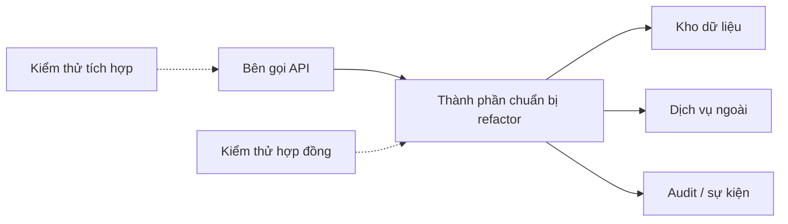
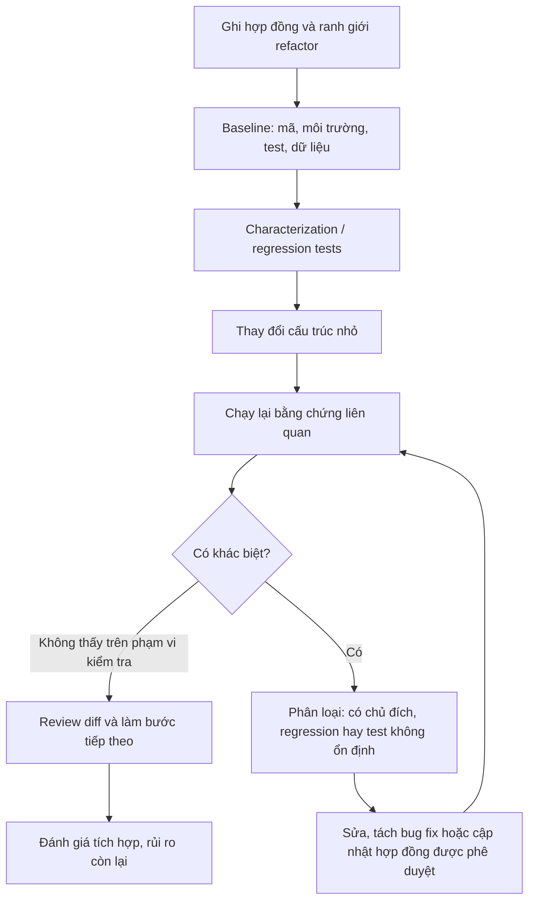

# Chuẩn bị bằng chứng trước khi thay đổi mã

> **Chương:** Tái cấu trúc  
> **Học phần:** CODE_QUALITY_FUNDAMENTALS — Hiểu những thuộc tính quyết định mã nguồn có đáng tin cậy, dễ hiểu và dễ thay đổi hay không.

Một lập trình viên nhìn thấy phương thức tính phí dài, nhiều nhánh `if` và một số hằng số chưa có tên. Họ muốn tách phương thức để dễ đọc, dễ kiểm thử. Sau khi sửa, toàn bộ code biên dịch, một vài bài test vẫn xanh, nhưng một số đơn ở đúng ngưỡng miễn phí giao hàng lại bị tính khác trước. Đó là một thay đổi nghiệp vụ hay lỗi phát sinh từ refactor? Có ai biết hành vi cũ và yêu cầu đúng là gì không?

**Refactoring (tái cấu trúc mã)** là cải thiện cấu trúc bên trong mà **không chủ ý thay đổi hành vi quan sát được** theo hợp đồng đã xác định. Muốn có cơ sở nói rằng một refactor an toàn, nhóm cần chuẩn bị **bằng chứng trước khi chỉnh mã**: mã đang làm gì, bên ngoài có thể quan sát điều gì, các bất biến và đường lỗi nào phải giữ, test nào có thể phát hiện sai lệch, và điều gì hiện vẫn chưa chắc chắn.

Điểm quan trọng là **hành vi hiện tại không nhất thiết là hành vi đúng**. Một bài kiểm thử mô tả phần mềm đang hoạt động ra sao có thể rất hữu ích để phát hiện thay đổi ngoài ý muốn, nhưng nó không tự trở thành bằng chứng rằng nghiệp vụ phải hoạt động như vậy. Phải phân biệt **characterization test** (kiểm thử ghi nhận hành vi hiện tại), **regression test** (bảo vệ hành vi được chấp nhận) và **yêu cầu/hợp đồng** (nguồn xác định hành vi mong muốn).

Sau bài học, bạn có thể:

- Xác định ranh giới refactor và những hành vi cần bảo toàn trước khi sửa mã.
- Thu thập baseline đáng tin cậy: phiên bản mã, kết quả build/test, đầu vào biên, hợp đồng API, trạng thái và tác dụng phụ.
- Viết characterization test Java/JUnit 5 có khả năng phát hiện thay đổi ngoài ý muốn.
- Phân biệt việc ghi nhận một lỗi tồn tại từ trước với việc cố tình giữ lỗi ấy vĩnh viễn.
- Lên kế hoạch refactor nhỏ, kiểm tra trước/sau và nhận diện các khoảng trống bằng chứng còn lại.

## 1. Vì sao phải có bằng chứng trước khi refactor?

Đổi tên biến cục bộ có thể ít rủi ro. Nhưng “tách một phương thức dài” có thể vô tình:

- Đổi thứ tự `null` check và gây `NullPointerException` ở tình huống trước đây xử lý được.
- Đổi `>` thành `>=` và làm khác kết quả ở giá trị biên.
- Bỏ mất ngoại lệ hoặc thay một lỗi truy vấn bằng danh sách rỗng.
- Thực hiện lời gọi ghi dữ liệu hoặc phát sự kiện nhiều hơn một lần.
- Đổi thứ tự phần tử trả về, thời điểm làm tròn tiền hoặc thời điểm cập nhật trạng thái.
- Đưa một phần mã sang thread khác, làm thay đổi thứ tự và tính nhất quán.
- Thay cách lấy cấu hình, đồng hồ hoặc locale mặc định, khiến đầu ra phụ thuộc môi trường.

Những sai lệch này có thể không được phát hiện nếu nhóm chỉ xem diff có gọn hơn hay không.

**Bằng chứng trước thay đổi** làm rõ ba câu hỏi khác nhau:

| Câu hỏi | Bằng chứng cần có | Câu trả lời chưa được phép suy ra |
| --- | --- | --- |
| **Mã hiện đang làm gì?** | Characterization tests, log có kiểm soát, ví dụ đầu vào/đầu ra, kết quả chạy hiện tại | Hành vi đang thấy chắc chắn là đúng nghiệp vụ |
| **Mã phải làm gì?** | Hợp đồng API, yêu cầu nghiệp vụ, quy tắc dữ liệu, quyết định đã được phê duyệt | Có test xanh nghĩa là mọi yêu cầu đã được bảo vệ |
| **Bản sửa có giữ được những điều cần giữ?** | So sánh trước/sau trên cùng điều kiện, test hồi quy, kiểm thử tích hợp | Không có khác biệt trong vài test nghĩa là không còn rủi ro |

Refactor thường không thêm tính năng mới. Tuy vậy, việc sửa cấu trúc có thể chạm tới những đường thực thi hiếm gặp. Chuẩn bị bằng chứng giúp chọn cách thay đổi phù hợp với **rủi ro và phạm vi**, thay vì chỉ dựa vào trực giác.

## 2. Xác định phạm vi và hợp đồng trước khi đọc từng dòng

Hãy bắt đầu từ **ranh giới mà người sử dụng có thể quan sát**, không chỉ từ tên hàm sẽ chỉnh.

Đối với một phương thức nghiệp vụ Java, nên ghi rõ:

| Khía cạnh | Câu hỏi trước refactor | Ví dụ |
| --- | --- | --- |
| **Đầu vào** | Miền hợp lệ, đơn vị, giá trị `null`, tiền điều kiện? | Tổng tiền sau giảm giá không âm, đơn vị VND |
| **Kết quả** | Kiểu, ý nghĩa, trường hợp rỗng, thứ tự? | Tổng tiền báo giá gồm phí giao hàng |
| **Ngoại lệ** | Khi nào ném lỗi; loại và nguyên nhân gì? | Đầu vào âm bị từ chối; cộng tràn số ném lỗi |
| **Tác dụng phụ** | Có ghi DB, phát sự kiện, cập nhật cache? | Tạo đơn có thể lưu bản ghi và gửi thông báo |
| **Thứ tự thực hiện** | Thứ tự ghi dữ liệu hoặc kiểm tra điều kiện có quan trọng? | Kiểm tra quyền trước khi tiết lộ dữ liệu |
| **Trạng thái** | Có bất biến hoặc trạng thái chuyển tiếp cần giữ? | Đơn đã thanh toán không được quay lại trạng thái chưa tạo |
| **Tính lặp lại** | Có thể gọi lại sau lỗi, chạy song song không? | Yêu cầu thanh toán cần idempotency phù hợp |
| **Tương thích** | Có caller, DTO, schema hoặc phiên bản khác? | API công khai có client chưa nâng cấp |
| **Phi chức năng** | Có thời gian đáp ứng, tài nguyên, bảo mật đáng kể? | Giới hạn thời gian xử lý tệp tải lên |

Không nhất thiết mọi refactor nhỏ đều cần một bảng dài. Nhưng **mức chuẩn bị phải tương xứng rủi ro**: sửa phép tính tiền, phân quyền hoặc trạng thái thanh toán cần thận trọng hơn việc format một đoạn code thuần.

### 2.1. Vẽ ranh giới tác động



Sơ đồ nhắc rằng một thay đổi bên trong `S` có thể ảnh hưởng những cam kết với caller **và** những tác dụng phụ xuống `D`, `E`, `A`. Tên phương thức và kiểu trả về chỉ mô tả một phần bề mặt hành vi.

### 2.2. Phân loại những điều phải giữ và những điều cần xác minh

Tạo một danh sách ngắn:

- **Phải bảo toàn:** điều đã được xác nhận là hợp đồng, ví dụ đơn hàng có phí đã chốt không được tính lại.
- **Đang quan sát nhưng chưa chắc đúng:** hành vi của mã cũ tại giá trị biên không có trong tài liệu.
- **Có chủ đích thay đổi:** bug fix hoặc quy tắc mới, cần mô tả và kiểm thử riêng.
- **Ngoài phạm vi:** thay đổi database schema, giao diện hay hiệu năng nếu không thuộc mục tiêu refactor hiện tại.

Phân loại này ngăn một lỗi sẵn có vô tình bị coi là “bất biến phải giữ” chỉ vì test vừa ghi nhận nó.

## 3. Lập baseline có thể lặp lại

**Baseline** là mốc tham chiếu của trạng thái trước thay đổi. Một baseline hữu ích phải gắn với đúng phiên bản, điều kiện chạy và kết quả có thể đối chiếu.

| Thông tin | Tại sao cần? |
| --- | --- |
| Commit hoặc định danh bản build | Biết chính xác mã trước refactor |
| Phiên bản JDK, thư viện, plugin và cấu hình | Tránh nhầm thay đổi môi trường với thay đổi mã |
| Test nào đã chạy và kết quả ra sao | Không tuyên bố toàn bộ suite đạt nếu chỉ chạy một lớp |
| Các lỗi test có sẵn hoặc test không ổn định | Không gán nhầm thất bại cũ cho refactor |
| Đầu vào đặc trưng và giá trị biên | Có cơ sở so sánh những nhánh quan trọng |
| Schema/dữ liệu/múi giờ/locale khi có liên quan | Kết quả có thể phụ thuộc môi trường |
| Cảnh báo static analysis/coverage khi dùng | Biết phạm vi quan sát trước/sau, không chỉ số đếm |
| Những ràng buộc chưa có bằng chứng | Tránh kết luận quá mức khi một đường chưa được kiểm tra |

**Đừng che baseline đỏ.** Nếu suite gốc đã có hai test thất bại, hãy ghi nhận nguyên nhân và phạm vi; không thể dùng việc “sau refactor vẫn có hai test đỏ” làm bằng chứng đủ rằng không có regression. Hai test đỏ có thể đã đổi nguyên nhân, đồng thời một lỗi mới xuất hiện ở nơi khác.

Với phần mềm dùng dữ liệu sản xuất, nên ưu tiên **dữ liệu tổng hợp hoặc dữ liệu đã được xử lý đúng quy định về quyền riêng tư**. Không sao chép credential, thông tin thanh toán hay dữ liệu nhạy cảm vào test fixture chỉ để có ví dụ “thật”.

### 3.1. Không sử dụng test flaky làm cột mốc chắc chắn

Nếu một test phụ thuộc vào `Instant.now()`, cổng mạng hoặc trạng thái singleton bị test khác thay, kết quả có thể đảo ngẫu nhiên giữa hai lần chạy. Trước khi dùng làm bằng chứng refactor, cần tìm cách cố định thời gian, cô lập dữ liệu hoặc điều khiển phụ thuộc.

Thực hiện lại suite nhiều lần có thể giúp **phát hiện** test không ổn định, nhưng không chứng minh mọi race condition đã biến mất. Khi thời gian hạn chế, phải ghi rõ những phép kiểm tra còn thiếu.

## 4. Ví dụ xuyên suốt: một phép tính báo giá chưa được mô tả rõ

Giả sử hệ thống minh họa có chính sách:

- Phí giao hàng tiêu chuẩn **30.000 VND** khi chưa đạt ngưỡng miễn phí.
- Phí giao nhanh **50.000 VND**, không hưởng miễn phí tiêu chuẩn.
- Chính sách **mong muốn**: tổng tiền hàng sau giảm giá **từ 500.000 VND trở lên** được miễn phí tiêu chuẩn.
- Đầu vào âm là không hợp lệ; tổng tiền được biểu diễn bằng `long` VND.
- Phương thức tính tổng không ghi dữ liệu và không gọi mạng.

Các con số là **giả định phục vụ bài học**, không phải quy định của một ứng dụng cụ thể.

### 4.1. Mã hiện hành có một khác biệt ở ngưỡng

```java
// LegacyShippingQuote.java — phiên bản TRƯỚC refactor
public final class LegacyShippingQuote {
    public long quoteTotalVnd(
            long subtotalAfterDiscountVnd,
            boolean express) {
        if (subtotalAfterDiscountVnd < 0L) {
            throw new IllegalArgumentException("Negative subtotal");
        }
        if (express) {
            return Math.addExact(subtotalAfterDiscountVnd, 50_000L);
        }
        if (subtotalAfterDiscountVnd > 500_000L) {
            return subtotalAfterDiscountVnd;
        }
        return Math.addExact(subtotalAfterDiscountVnd, 30_000L);
    }
}
```

Đoạn mã thực hiện các hành vi **có thể quan sát**:

1. Tổng tiền âm làm phát sinh `IllegalArgumentException` trước khi tính phí.
2. Giao nhanh cộng 50.000 VND.
3. Giao tiêu chuẩn chỉ miễn phí khi tiền hàng **lớn hơn** 500.000 VND.
4. Dùng `Math.addExact(...)`; nếu cộng phí tràn `long`, phương thức ném `ArithmeticException` thay vì trả giá trị tràn.
5. Không có lời gọi repository hoặc HTTP trong đoạn mã minh họa.

Điểm 3 **khác với yêu cầu mong muốn**: tại đúng 500.000 VND, mã hiện tại vẫn cộng 30.000 VND. Nếu ta đồng thời trích hàm và sửa `>` thành `>=`, làm sao review biết phần nào là refactor giữ hành vi và phần nào là sửa lỗi nghiệp vụ?

**Cách an toàn:** ghi nhận hành vi đang tồn tại, xác minh quy tắc đúng với người có trách nhiệm, sau đó tách rõ thay đổi cấu trúc khỏi thay đổi hợp đồng.

## 5. Characterization test: ghi nhận mã đang làm gì

*Characterization test* dùng để **mô tả những gì mã hiện tại đang thực hiện**, đặc biệt khi mã cũ thiếu đặc tả hoặc test. Đây là một kỹ thuật thu thập bằng chứng, **không phải cách xác nhận mọi hành vi hiện tại đều nên được giữ mãi mãi**.

Với `LegacyShippingQuote`, có thể tạo bộ JUnit 5 sau trước khi sửa mã:

```java
import static org.junit.jupiter.api.Assertions.assertEquals;
import static org.junit.jupiter.api.Assertions.assertThrows;

import org.junit.jupiter.api.Test;

class LegacyShippingQuoteCharacterizationTest {
    private final LegacyShippingQuote quote = new LegacyShippingQuote();

    @Test
    void belowThresholdCurrentlyPaysStandardFee() {
        assertEquals(529_999L, quote.quoteTotalVnd(499_999L, false));
    }

    @Test
    void atThresholdCurrentlyPaysStandardFee() {
        // Bằng chứng hành vi CŨ; cần đối chiếu lại với yêu cầu.
        assertEquals(530_000L, quote.quoteTotalVnd(500_000L, false));
    }

    @Test
    void aboveThresholdCurrentlyGetsFreeStandardShipping() {
        assertEquals(500_001L, quote.quoteTotalVnd(500_001L, false));
    }

    @Test
    void expressShippingCurrentlyChargesItsOwnFee() {
        assertEquals(550_000L, quote.quoteTotalVnd(500_000L, true));
    }

    @Test
    void negativeSubtotalIsRejected() {
        assertThrows(IllegalArgumentException.class,
                () -> quote.quoteTotalVnd(-1L, false));
    }

    @Test
    void arithmeticOverflowIsRejected() {
        assertThrows(ArithmeticException.class,
                () -> quote.quoteTotalVnd(Long.MAX_VALUE, true));
    }
}
```

Các tên test có từ **Currently** hoặc ghi chú **hành vi CŨ** để không ngụ ý rằng việc thu phí tại đúng ngưỡng là yêu cầu nghiệp vụ. Bộ test cho biết:

- Trên những đầu vào đã nêu, mã hiện hành tạo các kết quả tương ứng.
- Khi refactor chỉ thay cấu trúc, một khác biệt về giá trị hoặc ngoại lệ trong các trường hợp này sẽ bị phát hiện.
- Vẫn cần tìm hiểu **vì sao** một kết quả tồn tại và nó có đúng yêu cầu không.

### 5.1. Không “đóng băng” lỗi cũ vô thời hạn

Nếu đặc tả xác nhận “từ 500.000 VND trở lên”, test `atThresholdCurrentlyPaysStandardFee` là **hồ sơ điều tra** cho lỗi đang có. Nó có thể được dùng trong giai đoạn refactor giữ hành vi, nhưng khi sửa bug có chủ đích, phải **thay kỳ vọng** và cập nhật cách đặt tên:

```java
@Test
void standardShippingIsFreeExactlyAtThreshold() {
    // Test nghiệp vụ MONG MUỐN, dùng sau khi sửa điều kiện.
    assertEquals(500_000L,
            new LegacyShippingQuote().quoteTotalVnd(500_000L, false));
}
```

Hai test về cùng đầu vào với hai kỳ vọng **mâu thuẫn** không nên cùng được coi là test chấp nhận cho một phiên bản sản phẩm. Hãy lưu dấu vết quyết định qua issue, commit hoặc tài liệu thay đổi; đổi bộ test khi chuyển từ **ghi nhận hiện trạng** sang **bảo vệ hành vi mới đã được phê duyệt**.

### 5.2. Test có assertion phải có ý nghĩa

Test sau không cung cấp nhiều bằng chứng:

```java
@Test
void quoteDoesNotThrowForAnOrdinaryAmount() {
    new LegacyShippingQuote().quoteTotalVnd(600_000L, false);
}
```

Nó chỉ gián tiếp xác nhận lời gọi không ném ngoại lệ. Nếu hàm âm thầm trả 0, vẫn xanh. Một characterization test tốt phải ghi nhận **giá trị hoặc tác dụng phụ quan trọng**, không chỉ thực thi đường đi.

## 6. Refactor từng bước, giữ nguyên hành vi đã quan sát

Sau khi có test, có thể trích logic tính phí thành một phương thức riêng mà **chưa đổi điều kiện biên**.

```java
// LegacyShippingQuote.java — phiên bản SAU refactor cấu trúc.
// Đây là phiên bản thay thế, không đặt cùng lúc với lớp cũ.
public final class LegacyShippingQuote {
    private static final long STANDARD_FEE_VND = 30_000L;
    private static final long EXPRESS_FEE_VND = 50_000L;
    private static final long FREE_STANDARD_THRESHOLD_VND = 500_000L;

    public long quoteTotalVnd(
            long subtotalAfterDiscountVnd,
            boolean express) {
        if (subtotalAfterDiscountVnd < 0L) {
            throw new IllegalArgumentException("Negative subtotal");
        }
        long feeVnd = calculateFeeVnd(subtotalAfterDiscountVnd, express);
        return Math.addExact(subtotalAfterDiscountVnd, feeVnd);
    }

    private static long calculateFeeVnd(long subtotalVnd, boolean express) {
        if (express) {
            return EXPRESS_FEE_VND;
        }
        return subtotalVnd > FREE_STANDARD_THRESHOLD_VND
                ? 0L
                : STANDARD_FEE_VND;
    }
}
```

So với bản cũ, thay đổi này:

- Đặt tên cho các mức phí và ngưỡng.
- Tách tính phí thành `calculateFeeVnd(...)`.
- Gom phép cộng tổng về một vị trí.
- **Giữ `>`**, tức giữ kết quả cũ ở đúng 500.000 VND trong giai đoạn refactor.
- Giữ việc kiểm tra đầu vào âm và phép cộng `Math.addExact(...)`.

Chạy lại những test characterization cho bản refactor sẽ giúp tìm khác biệt trong các ca đã ghi. Nếu tất cả đạt, có thể nói **những hành vi được kiểm tra đã được giữ**, không nên kết luận rằng **mọi hành vi trên toàn bộ miền đầu vào đã được chứng minh tương đương**.

### 6.1. Bước sửa lỗi nghiệp vụ phải được phân biệt rõ

Sau khi người sở hữu chính sách xác nhận ngưỡng đúng là **từ 500.000 VND trở lên**, sửa:

```java
return subtotalVnd >= FREE_STANDARD_THRESHOLD_VND
        ? 0L
        : STANDARD_FEE_VND;
```

Lúc này, kết quả tại đúng ngưỡng đổi **có chủ đích** từ 530.000 xuống 500.000 VND. Đây là **bug fix**, không phải refactor giữ hành vi. Cần cập nhật test biên theo hợp đồng mới, xem xét báo giá/đơn đang xử lý và làm rõ chính sách có tác động tới dữ liệu lịch sử không.

Một lịch sử thay đổi dễ review có thể ghi:

```text
Commit A: Characterize và refactor phép tính báo giá, giữ hành vi cũ.
Commit B: Sửa điều kiện ngưỡng từ > thành >= theo đặc tả,
          cập nhật regression test và tài liệu liên quan.
```

Không bắt buộc tách thành đúng hai commit trong mọi trường hợp. Nhưng **ý định và bằng chứng của hai loại thay đổi phải phân biệt được**, đặc biệt ở phần tính tiền, phân quyền hoặc dữ liệu nhạy cảm.

## 7. Test hiện có, characterization và oracle: dùng đúng loại bằng chứng

*Test oracle* là căn cứ xác định kết quả mong đợi. Tùy mục tiêu, oracle có thể đến từ những nguồn khác nhau:

| Loại bằng chứng | Kết quả mong đợi lấy từ đâu? | Phù hợp để làm gì? | Giới hạn |
| --- | --- | --- | --- |
| **Characterization test** | Quan sát phiên bản hiện hành | Phát hiện thay đổi hành vi ngoài ý muốn khi tái cấu trúc mã cũ | Có thể ghi lại cả lỗi hiện tại |
| **Regression test theo yêu cầu** | Đặc tả nghiệp vụ, hợp đồng đã xác nhận | Bảo vệ hành vi được chấp nhận và bug fix | Chỉ bao phủ những ca được thiết kế |
| **Property-based test** | Bất biến độc lập với cài đặt | Kiểm tra miền đầu vào rộng với thuộc tính có ý nghĩa | Thuộc tính quá yếu có thể bỏ sót sai lệch |
| **Golden master / snapshot** | Đầu ra tham chiếu đã ghi lại | So sánh đầu ra lớn, khó mô tả hết bằng từng assertion | Dễ ghi nhận nhiễu hoặc hành vi sai |
| **Differential test** | Hai triển khai được chạy trên cùng input | Tìm sai khác giữa phiên bản trước và sau | Không tự cho biết phiên bản nào đúng |
| **Integration/contract test** | Hợp đồng giữa các thành phần hoặc kết quả lưu/đọc thực | Phát hiện sai cách kết nối, dữ liệu và tác dụng phụ | Có thể chậm, phụ thuộc môi trường |

### 7.1. Tránh oracle dựa trên chính mã đang kiểm tra

Ví dụ yếu:

```java
long expected = new LegacyShippingQuote()
        .quoteTotalVnd(500_000L, false);
long actual = new LegacyShippingQuote()
        .quoteTotalVnd(500_000L, false);
assertEquals(expected, actual);
```

Đoạn test này gọi cùng thuật toán ở hai phía. Nếu cả hai lần cùng trả một kết quả sai, test vẫn đạt.

Trong characterization, một giá trị như **530.000 VND** phải được **ghi nhận độc lập tại baseline** (và biết đó là hành vi hiện tại), thay vì mỗi lần chạy lại gọi chính hàm đang kiểm thử để tạo kỳ vọng mới.

### 7.2. Không sửa snapshot chỉ để test xanh

Nếu sau refactor một snapshot thay đổi, cần hỏi:

1. Sự khác biệt đến từ logic nào?
2. Đó là thay đổi chủ đích hay ngoài phạm vi?
3. Giá trị cũ và mới có ý nghĩa nghiệp vụ gì?
4. Có yếu tố biến thiên như thời gian, thứ tự phần tử hoặc định danh ngẫu nhiên không?

Chỉ sau khi hiểu diff mới nên cập nhật snapshot. Việc chấp nhận tất cả snapshot mới theo máy có thể biến regression thành “hành vi chuẩn” mà không ai review.

## 8. Thu thập bằng chứng tại các điểm khó nhìn thấy

Đối với mã không thuần, kết quả trả về có thể đúng trong khi tác dụng phụ đã bị thay đổi. Cần xác định **những quan sát ngoài giá trị trả về**.

### 8.1. Tác dụng phụ: lưu dữ liệu và phát sự kiện

Giả sử một use case có hợp đồng:

```text
Tạo báo giá thành công:
1. Tính tổng tiền theo chính sách hiện hành.
2. Lưu đúng một bản ghi báo giá.
3. Chỉ sau khi lưu thành công mới phát tín hiệu "đã tạo báo giá".

Tính phí thất bại:
- Không lưu bản ghi.
- Không phát tín hiệu thành công.
```

Refactor có thể đổi thứ tự `save()` và `publish()`, hoặc gọi một thao tác hai lần. Để kiểm chứng, có thể dùng fake ghi nhận sự kiện trong test:

```java
import java.util.ArrayList;
import java.util.List;

final class RecordingEffects {
    private final List<String> events = new ArrayList<>();

    void saveQuote(String quoteId) {
        events.add("save:" + quoteId);
    }

    void publishCreated(String quoteId) {
        events.add("publish:" + quoteId);
    }

    List<String> events() {
        return List.copyOf(events);
    }
}
```

Một kiểm thử cho luồng điều phối có thể đối chiếu danh sách:

```java
assertEquals(
        List.of("save:Q-1", "publish:Q-1"),
        effects.events());
```

Đây là **minh họa cách quan sát tác dụng phụ**: `RecordingEffects` chưa phải triển khai giao tiếp với database hay message broker thật. Test tích hợp vẫn cần được cân nhắc khi thứ tự lưu/phát sự kiện phải được bảo đảm giữa các hệ thống có thể lỗi độc lập.

### 8.2. API công khai và dữ liệu được tuần tự hóa

Khi đổi cấu trúc lớp, các thay đổi tưởng “nội bộ” có thể ảnh hưởng:

- Tên field JSON nếu serializer dựa vào getter.
- Kiểu hoặc thứ tự trường trong hợp đồng truyền dữ liệu.
- Kiểu ngoại lệ hoặc HTTP status khi một lỗi xảy ra.
- Tính mutable/immutable của đối tượng trả về.
- Thứ tự collection khi API đã cam kết thứ tự.
- Binary/source compatibility khi thư viện Java được nhiều module sử dụng.

Trước refactor, nên ghi một vài mẫu request/response và hợp đồng API quan trọng, hoặc dùng contract test phù hợp. **Không nên dựa vào cấu trúc nội bộ của framework làm hợp đồng nếu ứng dụng chưa thực sự công bố điều đó**.

### 8.3. Cơ sở dữ liệu và chuyển trạng thái

Với mã cập nhật dữ liệu:

| Điều cần ghi nhận | Ví dụ |
| --- | --- |
| Điều kiện trước thao tác | Đơn ở trạng thái `DRAFT`, chưa bị khóa |
| Dữ liệu thay đổi | Trạng thái thành `CONFIRMED`, phí đã chốt không đổi |
| Dữ liệu không được thay đổi | Không sửa tổng tiền của đơn khác |
| Hành vi khi lỗi | Nếu validation thất bại, không ghi một phần dữ liệu |
| Tính đồng thời | Hai yêu cầu xác nhận đơn không tạo hai bản thanh toán |

Transaction, rollback và idempotency phải được đánh giá theo hạ tầng thật. Một unit test với in-memory fake không thể chứng minh database có cùng tính nguyên tử hay cách ly.

## 9. Làm phụ thuộc bên ngoài có thể kiểm soát trong test

Refactor mã dựa vào đồng hồ, random, hệ thống file hoặc mạng khó đánh giá nếu đầu vào không ổn định.

### 9.1. Ví dụ đồng hồ được truyền tường minh

Giả sử một chính sách ưu đãi hết hạn tại một `Instant`:

```java
// OfferEligibility.java
import java.time.Clock;
import java.time.Instant;
import java.util.Objects;

public final class OfferEligibility {
    private final Clock clock;

    public OfferEligibility(Clock clock) {
        this.clock = Objects.requireNonNull(clock, "clock");
    }

    public boolean isActiveUntil(Instant expiresAt) {
        Objects.requireNonNull(expiresAt, "expiresAt");
        return Instant.now(clock).isBefore(expiresAt);
    }
}
```

Trong test, dùng `Clock.fixed(...)`:

```java
import static org.junit.jupiter.api.Assertions.assertFalse;
import static org.junit.jupiter.api.Assertions.assertTrue;

import java.time.Clock;
import java.time.Instant;
import java.time.ZoneOffset;
import org.junit.jupiter.api.Test;

class OfferEligibilityTest {
    private static final Instant NOW =
            Instant.parse("2026-01-01T10:00:00Z");

    @Test
    void offerIsActiveBeforeExpiry() {
        OfferEligibility eligibility = new OfferEligibility(
                Clock.fixed(NOW, ZoneOffset.UTC));

        assertTrue(eligibility.isActiveUntil(NOW.plusSeconds(1)));
    }

    @Test
    void offerHasExpiredAtExactExpiry() {
        OfferEligibility eligibility = new OfferEligibility(
                Clock.fixed(NOW, ZoneOffset.UTC));

        assertFalse(eligibility.isActiveUntil(NOW));
    }
}
```

Đây là cách **cô lập nguồn thời gian**, giúp test chạy lại với cùng điều kiện. Tuy nhiên, nếu mã cũ dùng thời gian thật, việc chuyển sang injected `Clock` tự nó cũng là một thay đổi cấu trúc cần kiểm tra **nguồn đồng hồ trong production** và ý nghĩa thời hạn.

### 9.2. Khi nào dùng mock, fake hoặc thực thi thật?

| Loại phụ thuộc | Bằng chứng nhanh cho unit test | Bằng chứng bổ sung khi rủi ro cao |
| --- | --- | --- |
| Đồng hồ | `Clock.fixed(...)` | Kiểm tra múi giờ và cấu hình khi triển khai |
| Repository | Fake hoặc mock theo hợp đồng | Integration test với DB và transaction thật |
| HTTP client | Stub phản hồi thành công/lỗi/timeout | Contract test và môi trường tích hợp |
| Hệ thống file | Thư mục tạm riêng cho test | Test quyền truy cập, kích thước, đường dẫn thực |
| Message broker | Fake ghi nhận sự kiện | Test phát/nhận, retry, duplicate và thứ tự khi phù hợp |

Không cần mock mọi thứ. Quá nhiều mock gắn test vào **thứ tự gọi nội bộ** không thuộc hợp đồng có thể làm refactor vô hại trở nên khó thực hiện. Hãy ưu tiên xác minh **kết quả có ý nghĩa ở ranh giới**; chỉ cố định thứ tự gọi khi thứ tự ấy thật sự là cam kết.

## 10. Coverage, mutation testing và static analysis hỗ trợ ra sao?

Khi chuẩn bị, nên biết bài kiểm thử hiện có **nhìn thấy những gì** và **bỏ trống những gì**:

| Tín hiệu | Hữu ích để | Không đủ để kết luận |
| --- | --- | --- |
| **Line coverage** | Tìm dòng chưa được test thực thi | Đầu ra và ngoại lệ đã được assert đúng |
| **Branch coverage** | Tìm nhánh còn chưa đi qua | Giá trị biên và điều kiện kết hợp đã đủ |
| **Mutation testing** | Kiểm tra test có phát hiện một số biến đổi lỗi không | Mọi lỗi thực tế đều được phát hiện |
| **Static analysis** | Tìm mẫu code đáng ngờ, null, tài nguyên và cấu trúc | Không có warning nghĩa là đúng nghiệp vụ |
| **Review hợp đồng** | Xác nhận điều gì phải giữ và điều gì phải sửa | Tự động chứng minh mọi đường thực thi đúng |
| **Test tích hợp** | Xác minh các thành phần cộng tác trên đường đã chọn | Bảo đảm mọi điều kiện mạng/DB hoặc đồng thời |

Ví dụ, bộ test chỉ có:

```java
assertEquals(600_000L,
        quote.quoteTotalVnd(600_000L, false));
```

thì sẽ không phát hiện đổi `>` thành `>=` trong ví dụ trên. Để làm rõ rủi ro, hãy bổ sung **499.999**, **500.000**, **500.001**; các ca này nói nhiều hơn về ngưỡng so với một tỷ lệ coverage tổng.

**Không dùng mutation score hoặc warning count làm thước đo duy nhất của sự sẵn sàng refactor.** Quan trọng hơn là test có bảo vệ được hợp đồng và đường thất bại có ảnh hưởng cao hay không.

## 11. Cách so sánh trước/sau mà không che giấu sai khác

Khi đã chuẩn bị baseline, hãy tiến hành refactor theo chu kỳ nhỏ:



### 11.1. Ghi rõ “không thấy sai khác” đang nói về điều gì

Một báo cáo tốt:

> Refactor đã được kiểm tra với sáu trường hợp báo giá đã ghi nhận, bao gồm đầu vào âm, tràn số và ngưỡng; các kết quả quan sát được không thay đổi. Chưa kiểm thử môi trường HTTP và dữ liệu lịch sử.

Một báo cáo quá mức:

> Refactor hoàn toàn an toàn vì test xanh.

Khác biệt nằm ở **phạm vi chứng cứ**. Một kiểm thử chỉ khẳng định những điều mà nó đã quan sát và thực sự kiểm tra.

### 11.2. Xem diff theo từng ý định

Nếu một patch vừa di chuyển logic, đổi cấu trúc dữ liệu, nâng thư viện và sửa quy tắc nghiệp vụ, reviewer phải đánh giá nhiều nguyên nhân cùng lúc. Hãy cân nhắc tách:

1. Tăng bằng chứng (test, baseline, làm rõ hợp đồng).
2. Refactor giữ hành vi.
3. Bug fix hoặc thay đổi chức năng được mô tả riêng.
4. Thay đổi tích hợp/triển khai nếu cần.

Tách như vậy không bảo đảm không có lỗi, nhưng giúp **truy vết tại sao kết quả thay đổi** và thu nhỏ phạm vi điều tra khi test thất bại.

## 12. Khi không thể tạo đầy đủ test trước refactor

Trong hệ thống cũ, đôi khi một phương thức phụ thuộc DB, singleton, đồng hồ, file cố định hoặc dịch vụ không sẵn có để test. Không nên vì vậy tuyên bố “không thể chuẩn bị bằng chứng”.

Một số chiến lược theo mức độ:

- **Characterization ở ranh giới cao hơn:** gọi API qua test tích hợp có dữ liệu riêng; ghi nhận kết quả và trạng thái quan sát được.
- **Dựng seam nhỏ:** tách một điểm lấy thời gian hoặc adapter giao tiếp để thay phụ thuộc trong test. Chính seam này phải được review và xác minh là không chủ ý đổi hành vi.
- **Bổ sung log có kiểm soát:** ghi trường hợp đầu vào/nhánh kết quả không nhạy cảm để hiểu đường chạy, nhưng không dùng log là bằng chứng duy nhất.
- **Đọc và đối chiếu dữ liệu lịch sử:** kiểm tra mẫu dữ liệu giao dịch được phép sử dụng, chú ý tính bảo mật và phiên bản chính sách.
- **Giới hạn phạm vi refactor:** nếu chưa thể kiểm chứng tác dụng phụ, tránh gộp một lần nhiều thay đổi có rủi ro cao.
- **Review cặp hoặc review theo chuyên môn:** xác minh các giả định và hành vi chưa có test.

Điều cần tránh là lấy **một vài test đơn vị được tạo từ mock** để suy ra rằng thao tác phân tán qua DB và hàng đợi đã được bảo vệ đầy đủ.

### 12.1. Chấp nhận khoảng trống phải minh bạch

Nếu một đường đi chưa có thể test, ghi rõ:

```text
Phạm vi refactor: tách phép tính báo giá thuần.
Đã xác minh: ca biên, ngoại lệ, tổng tiền, test caller của checkout.
Chưa xác minh: luồng gửi thông báo của batch trong môi trường thật.
Rủi ro còn lại: có thể khác thứ tự phát sự kiện ở luồng batch.
Biện pháp: không thay mã batch trong đợt này; lên test tích hợp riêng.
```

Đây là ví dụ **cách lập hồ sơ rủi ro**, không phải một kết quả kiểm thử đã được thực hiện. Cách diễn đạt trung thực giúp người quyết định biết phần nào đã được bảo vệ.

## 13. Những sai lầm thường gặp khi chuẩn bị bằng chứng

### 13.1. “Mã cũ chạy lâu rồi nên hành vi nào cũng đúng”

Hệ thống tồn tại lâu có thể chứa lỗi chưa gặp hoặc được người dùng xử lý thủ công. Characterization hữu ích để hiểu hiện trạng, nhưng cần đối chiếu với đặc tả, dữ liệu và nhu cầu nghiệp vụ.

### 13.2. “Tạo snapshot mới sau refactor là xong”

Nếu kỳ vọng được tạo từ chính phiên bản mới, test có thể ghi nhận luôn regression. Trước khi thay, phải có **mốc tham chiếu**; sau khi thay, phải review sự khác biệt.

### 13.3. “Coverage cao nghĩa là đã có đủ bằng chứng”

Coverage cho biết mã được thực thi, không bảo đảm assertion có khả năng phân biệt kết quả đúng/sai. Các ca biên hoặc đường thất bại có ý nghĩa thường quan trọng hơn một con số tổng.

### 13.4. “Đổi cấu trúc nên tiện thể sửa mọi bug thấy được”

Sửa bug là việc tốt khi có căn cứ, nhưng trộn nhiều thay đổi hành vi vào một refactor làm khó đánh giá. Nên ghi rõ bug fix, kỳ vọng mới và test phân biệt với hành vi cũ.

### 13.5. “Test xanh sau refactor chứng minh không đổi hành vi”

Chỉ có thể nói **những ca được kiểm tra không phát hiện sai khác**. Đường chưa test, concurrency, dữ liệu lịch sử và phụ thuộc ngoài có thể vẫn gây rủi ro.

### 13.6. “Mock tất cả để test nhanh thì đủ”

Mock giúp cô lập đơn vị logic, nhưng có thể tạo kỳ vọng gắn với chi tiết gọi nội bộ hoặc bỏ qua lỗi hợp đồng thực. Cần chọn mức unit/integration/contract test theo đường rủi ro.

### 13.7. “Bằng chứng chỉ là kết quả test pass/fail”

Đối với phép tính tiền, đầu vào/đầu ra và ngoại lệ quan trọng; với thao tác có side effect, cần trạng thái trước/sau, số lần gọi, tính nguyên tử và phản ứng sau lỗi. **Loại bằng chứng phải khớp loại hành vi**.

### 13.8. “Có lỗi từ trước nên có thể bỏ qua mọi test đỏ”

Các thất bại cũ phải được ghi nhận và phân loại. Một refactor tạo thêm lỗi mới có thể bị che giữa các lỗi đã có; khi baseline không ổn định, cần giảm phạm vi hoặc tăng kiểm tra có mục tiêu.

## 14. Checklist trước khi bấm nút refactor

| Câu hỏi | Điều tối thiểu nên có |
| --- | --- |
| **Mục tiêu refactor là gì?** | Một thay đổi cấu trúc rõ, tránh trộn tính năng |
| **Ranh giới hành vi ở đâu?** | API, đầu vào, đầu ra, lỗi và tác dụng phụ |
| **Điều gì đã được xác nhận là hợp đồng?** | Đặc tả/đơn vị dữ liệu/quy tắc biên đáng tin |
| **Điều gì chỉ là hành vi hiện tại?** | Characterization test hoặc ghi nhận quan sát, không tự coi là yêu cầu |
| **Baseline gắn với phiên bản nào?** | Commit/build, cấu hình và kết quả test đã chạy |
| **Test hiện có ổn định và đúng phạm vi?** | Có kết quả trước thay đổi, không che flaky test |
| **Các đường quan trọng có được kiểm tra?** | Biên, đầu vào sai, lỗi phụ thuộc, thứ tự tác dụng phụ khi cần |
| **Có kiểm thử nơi gọi và ranh giới ngoài không?** | Không chỉ test lớp được tách mà bỏ cách caller truyền dữ liệu |
| **Dữ liệu nhạy cảm được bảo vệ?** | Fixture/test logs không chứa secrets hoặc dữ liệu trái phép |
| **Có thể so sánh đầu ra trước/sau?** | Dữ liệu mẫu, snapshot đã review hoặc test độc lập |
| **Có kế hoạch xử lý khác biệt?** | Phân loại bug fix chủ đích, regression, lỗi baseline |
| **Đã xác định khoảng trống bằng chứng?** | Nêu rõ rủi ro chưa thể xác minh |

Nếu trả lời được những câu hỏi chính, nhóm có cơ sở tốt hơn để đổi cấu trúc mà không làm mất hợp đồng. **Không nhất thiết hoàn thành mọi kỹ thuật cho mọi refactor**: điều quan trọng là cân đối mức chuẩn bị với mức rủi ro.

## 15. Bài tập áp dụng

Một ứng dụng có phương thức:

```java
long calculateFinalPriceVnd(
        long originalPriceVnd,
        long discountVnd,
        boolean premiumCustomer) {

    long afterDiscount = originalPriceVnd - discountVnd;
    if (premiumCustomer && afterDiscount > 1_000_000L) {
        return afterDiscount - 20_000L;
    }
    return afterDiscount;
}
```

Nhóm muốn refactor thành `DiscountPolicy` và `FinalPriceCalculator`. Tài liệu hiện có chỉ ghi: “Khách premium được giảm thêm **20.000 VND khi giá sau giảm giá đạt ít nhất 1.000.000 VND**”. Chưa xác định cách xử lý giá/chiết khấu âm, chiết khấu lớn hơn giá, phép trừ tràn số và cách lưu giá đã chốt trên hóa đơn.

Thực hiện:

1. **Phân loại thông tin:** đâu là hành vi đang có, đâu là yêu cầu mong muốn, và đâu còn thiếu hợp đồng? Đặc biệt, điều kiện `>` có khớp cụm “đạt ít nhất” không?
2. **Lập bảng baseline:** với đầu vào sau giảm giá **999.999**, **1.000.000**, **1.000.001 VND**, chọn giá gốc và giảm giá tương ứng; ghi kết quả hiện tại cho premium và non-premium.
3. Viết **characterization tests** cho mã cũ ở ba điểm biên và một trường hợp đầu vào bất thường. Đánh dấu rõ test nào chỉ ghi nhận hiện trạng.
4. Viết một **regression test theo yêu cầu** cho trường hợp premium đúng 1.000.000 VND; giải thích vì sao test này có thể đỏ trước khi bug fix.
5. Xác định **tiền điều kiện** còn cần làm rõ: giá âm, giảm giá âm, giảm giá vượt giá, tràn số. Không tự coi kết quả âm là hợp lệ chỉ vì code hiện tại trả về `long`.
6. Đề xuất hai bước thay đổi: **refactor giữ hành vi cũ** rồi **sửa ngưỡng từ `>` thành `>=`** với bằng chứng riêng. Nêu cách xử lý test characterization cũ khi quy tắc mới được duyệt.
7. Giả sử gọi phương thức này nằm trong luồng lưu đơn và gửi sự kiện. Hãy chỉ ra những bằng chứng về **thứ tự và số lần tác dụng phụ** cần ghi nhận trước khi chuyển mã.
8. Nếu phải kiểm tra thêm dữ liệu hóa đơn lịch sử, tại sao không nên gọi chính sách giá hiện tại để tính lại giá đã thu?
9. Chọn hai chỉ số hoặc kỹ thuật bổ trợ ngoài “test pass” để xem những khoảng trống kiểm thử. Nêu rõ giới hạn của từng chỉ số.
10. Viết một đoạn báo cáo refactor ngắn, chính xác, phân biệt **đã xác minh**, **thay đổi chủ đích** và **chưa xác minh**.

**Gợi ý:** một lời giải tốt không cần nhiều framework. Nó cần cho người review nhìn thấy **có căn cứ nào để giữ hành vi cũ, căn cứ nào để đổi hành vi theo yêu cầu và vùng rủi ro nào cần kiểm tra thêm**.

## Ghi nhớ

Trước khi refactor, hãy chuẩn bị **bằng chứng về hành vi hiện tại và hợp đồng phải giữ**, không chỉ chuẩn bị một danh sách file cần sửa. Characterization tests giúp khám phá mã cũ; regression tests bảo vệ yêu cầu đã xác nhận; baseline gắn với phiên bản và điều kiện chạy giúp đối chiếu trước/sau; kiểm thử tích hợp và kiểm tra tác dụng phụ giúp nhìn ra rủi ro ngoài giá trị trả về. **Refactor là thay đổi cấu trúc không chủ ý đổi hành vi; bug fix là thay đổi hành vi có căn cứ.** Phân biệt rõ hai mục tiêu, ghi nhận các khoảng trống và dùng test phù hợp giúp thay đổi mã một cách có kiểm soát, thay vì chỉ hy vọng code sau khi dọn đẹp sẽ tự động đúng.
