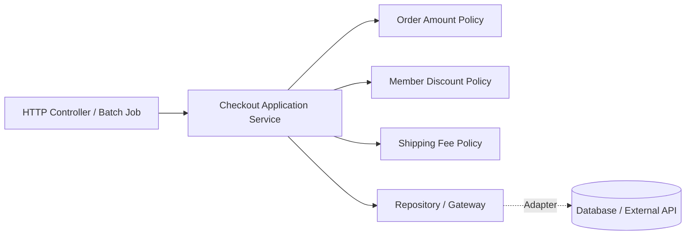
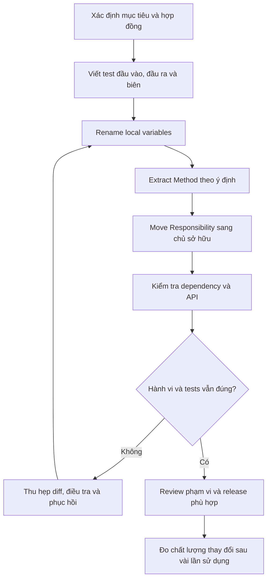

# Tách phương thức, đổi tên và di chuyển trách nhiệm theo mục tiêu

## 1. Tái cấu trúc để giải quyết trở ngại cụ thể, không phải để code “trông đẹp hơn”

Một phương thức có thể dài nhưng vẫn diễn đạt được một thuật toán thống nhất. Một lớp khác có thể chỉ 50 dòng nhưng gánh cả chính sách nghiệp vụ, cách lưu database và chi tiết gửi thông báo. Nếu chỉ nhìn số dòng rồi quyết định tách phương thức, đổi tên hay tạo thêm class, nhóm dễ tăng số điểm phải đọc mà không làm code đáng tin cậy hơn.

Trong module `CODE_QUALITY_FUNDAMENTALS`, người học tìm hiểu **những thuộc tính quyết định mã nguồn có đáng tin cậy, dễ hiểu và dễ thay đổi hay không**. Bài thuộc chương **Tái cấu trúc** này tập trung vào ba kỹ thuật phổ biến:

1. **Tách phương thức** (*Extract Method*): đặt tên và cô lập một bước xử lý có ý nghĩa.
2. **Đổi tên** (*Rename*): làm rõ khái niệm, hành vi, đơn vị và tác dụng phụ.
3. **Di chuyển trách nhiệm** (*Move Method / Move Responsibility*): đặt quy tắc hoặc thao tác ở thành phần sở hữu đúng dữ liệu và quyết định.

Điểm chung là chữ **“theo mục tiêu”**. Không phải mọi chỗ dài đều cần tách; không phải tên nào ngắn cũng cần đổi; không phải mọi quy tắc đều cần một interface mới. Trước khi sửa, phải trả lời:

> Người đọc đang hiểu nhầm điều gì? Người sửa phải chạm quá nhiều nơi vì sao? Hợp đồng hoặc bất biến nào đang khó bảo vệ? Sau tái cấu trúc, bằng chứng nào cho thấy vấn đề ấy đã giảm?

Một thay đổi tốt có thể làm code ngắn hơn, nhưng **giá trị chính** là giảm công suy luận và rủi ro khi chỉnh sửa, đồng thời giữ được hành vi đã cam kết.

### Mục tiêu học tập

Sau bài này, bạn có thể:

- Phân biệt **tái cấu trúc giữ nguyên hành vi quan sát được** với **thay đổi nghiệp vụ** hoặc **thay đổi hợp đồng API**.
- Xác định ranh giới tách phương thức dựa trên một ý định và một mức trừu tượng nhất quán.
- Đổi tên để diễn đạt ý định, đơn vị, trạng thái và hành vi có tác dụng phụ mà không vô tình phá caller cũ.
- Chuyển quy tắc về thành phần chịu trách nhiệm, hạn chế coupling và tránh tạo lớp trung gian vô nghĩa.
- Thực hiện ví dụ Java 17 từ một phương thức tính tổng đơn hàng dài thành các bước/policy có tên rõ.
- Viết JUnit 5 bảo vệ trường hợp biên, exception, số học chính xác và hợp đồng cũ.
- Lập quy trình refactor từng bước, review diff và quyết định khi nào **không** nên refactor.

## 2. “Giữ nguyên hành vi” có nghĩa rộng hơn cùng một kết quả ở ví dụ đơn giản

Một định nghĩa thực dụng của **refactoring** là thay đổi cấu trúc bên trong mã, trong khi **giữ hành vi quan sát được theo hợp đồng hiện hành**. Hành vi quan sát được không chỉ là giá trị trả về của đường chính:

| Khía cạnh cần giữ | Ví dụ thay đổi vô tình |
| --- | --- |
| Kết quả nghiệp vụ | Đúng ngưỡng miễn phí giao hàng trước được miễn, sau lại bị tính phí |
| Điều kiện biên | `>=` bị đổi thành `>` |
| Đầu vào được chấp nhận | Trước chấp nhận danh sách rỗng, sau tự ý ném lỗi |
| Ngoại lệ và thời điểm lỗi | Trước kiểm tra đầu vào ngay, sau gọi database mới thất bại |
| Thứ tự và tác dụng phụ | Trước ghi trạng thái rồi phát sự kiện, sau đổi thứ tự |
| Nullability và kiểu trả về | Trước trả `null` khi không tìm thấy, sau trả `Optional` |
| Đơn vị và làm tròn | Trước xử lý cent, sau vô ý coi thành đơn vị tiền chính |
| Public API | Đổi tên/xóa phương thức khiến caller cũ không biên dịch |
| Tính đồng thời | Tách logic khiến thao tác nguyên tử trở thành đọc-rồi-ghi riêng |
| Hiệu năng theo cam kết | Tách thành nhiều lời gọi I/O làm vượt ngưỡng latency quan trọng |

Không phải mọi chi tiết triển khai đều thuộc hợp đồng. Một test kiểm tra chính xác số lần gọi một helper private có thể thất bại dù hành vi vẫn đúng. Ngược lại, **thứ tự phát sự kiện và điểm commit** có thể thuộc hợp đồng nếu nó bảo vệ tính nhất quán dữ liệu.

Vì thế, trước khi refactor cần biết **điều gì là bất biến** và **điều gì được phép thay đổi**.

### 2.1. Tái cấu trúc khác sửa bug

Giả sử code cũ tính phí miễn giao khi `subtotal > 200.00`, trong khi nghiệp vụ xác nhận đúng ngưỡng `200.00` phải được miễn. Thay `>` thành `>=` là **sửa hành vi sai**, không phải refactor giữ nguyên hành vi.

Có thể thực hiện cùng đợt nếu cần, nhưng nên tách rõ:

1. Viết regression test xác nhận bug theo hợp đồng.
2. Sửa bug, xác nhận test đỏ → xanh.
3. Tách phương thức, đổi tên hoặc di chuyển policy mà **không đổi thêm nghĩa**.
4. Chạy lại test và review diff cấu trúc.

Cách phân biệt này giúp truy vết nguyên nhân và giảm rủi ro “dọn code” làm mất dấu thay đổi nghiệp vụ.

### 2.2. Đổi API công khai là vấn đề tương thích

Đổi tên biến local thường không làm caller ngoài bị ảnh hưởng. Đổi `calculateTotalCents(...)` thành `quoteTotal(...)` lại có thể khiến code của người dùng thư viện không biên dịch, hoặc bytecode đã biên dịch không còn liên kết được. Có thể phải thêm adapter/deprecation và migration.

**Đặt tên tốt hơn không tự cho phép phá hợp đồng đang được hỗ trợ.**

## 3. Xác định mục tiêu trước khi chọn kỹ thuật

Hãy bắt đầu từ triệu chứng quan sát được, không từ một refactoring pattern yêu thích.

| Triệu chứng | Giả thuyết cần kiểm tra | Kỹ thuật có thể phù hợp | Dấu hiệu thành công |
| --- | --- | --- | --- |
| Người đọc phải giải mã các biến `a`, `n`, `f` | Tên không mang ngữ nghĩa/đơn vị | Rename Variable / Parameter | Caller hiểu đúng dữ liệu không cần đọc thân hàm |
| Một phương thức trộn validation, tính toán và I/O | Nhiều mức trừu tượng, khó test riêng | Extract Method, Extract Class | Các bước có tên, test chính sách không cần I/O |
| Sửa một quy tắc phải đổi 3 controller | Quy tắc nằm sai chỗ, bị sao chép | Move Method / Extract Policy | Thay đổi quy tắc ở một điểm có kiểm chứng |
| Logic dùng nhiều trường của class khác | Trách nhiệm có thể đặt sai chủ sở hữu | Move Method hoặc thay ranh giới | Ít truy cập dữ liệu chéo và phụ thuộc vòng |
| Unit test phải dựng cả database chỉ để tính phí | Logic nghiệp vụ bị dính hạ tầng | Tách hàm thuần, chuyển policy | Test giá trị biên chạy độc lập |
| Một helper chỉ chuyển tiếp qua 5 lớp | Abstraction không mang ý nghĩa | Inline Method / Remove Middle Man | Giảm số điểm nhảy khi đọc |
| Thêm tính năng làm thay nhiều module không liên quan | Ranh giới trách nhiệm yếu | Move Responsibility, module boundary | Vùng thay đổi nhỏ hơn, contract rõ hơn |
| Review thường tranh cãi “tại sao có bước này?” | Thiếu ý định, invariant hoặc bối cảnh | Rename, Extract Method, comment về lý do | Người đọc giải thích được hành vi và rủi ro |

Đừng biến bảng này thành công thức cơ học. Có trường hợp chỉ cần **một tên rõ hơn**, không cần tách class. Có trường hợp phải bổ sung test/constraint trước khi dám di chuyển trách nhiệm.

### 3.1. Ba câu hỏi quyết định

- **Giảm công đọc hiểu:** Sau thay đổi, có ít khái niệm phải giữ đồng thời trong đầu hơn không?
- **Giảm phạm vi thay đổi:** Một yêu cầu nghiệp vụ mới có chạm ít nơi hơn mà không che giấu tác dụng phụ không?
- **Giảm nguy cơ sai:** Test, kiểu dữ liệu và ranh giới có bảo vệ quy tắc quan trọng rõ hơn không?

Một refactor chỉ làm điểm complexity của từng method giảm nhưng số class tăng gấp nhiều lần, khiến bug khó truy vết, có thể chưa đạt mục tiêu nào ở trên.

## 4. Bước đầu: khóa hợp đồng bằng bằng chứng phù hợp

Refactor an toàn không nhất thiết đòi coverage 100%, nhưng phải có **bằng chứng đủ mạnh ở nơi có rủi ro**.

### 4.1. Đọc hành vi công khai

Trước khi thay phương thức, ghi lại:

- Ai gọi nó: controller, job, batch, service khác, thư viện ngoài?
- Đầu vào hợp lệ, trường hợp rỗng, `null`, giá trị âm?
- Đầu ra và định dạng, đặc biệt với số tiền, ngày giờ và JSON?
- Ngoại lệ được caller dùng để phân biệt điều gì?
- Có ghi dữ liệu, gửi sự kiện, nhận thanh toán hay gọi mạng không?
- Quy tắc thời gian, thứ tự và transaction nằm ở đâu?
- Có người dùng/phiên bản client cũ cần được hỗ trợ không?

Không tự suy đoán hợp đồng từ một phép toán lạ; có thể đó là bug, workaround, hoặc quy tắc có chủ đích. Nếu hành vi hiện tại mâu thuẫn tài liệu, cần xác nhận với bên sở hữu nghiệp vụ trước khi quyết định **giữ hành vi cũ hay sửa bug**.

### 4.2. Characterization test: mô tả cái đang xảy ra để bảo vệ quá trình đổi cấu trúc

Khi code legacy thiếu test, **characterization tests** giúp ghi nhận hành vi thực của hệ thống ở các trường hợp tiêu biểu. Những test này hữu ích để phát hiện refactor làm thay đổi kết quả, nhưng **không mặc nhiên chứng minh hành vi hiện tại đúng nghiệp vụ**.

Nếu test characterization bộc lộ một kết quả sai, hãy ghi rõ đó là hành vi cũ và tạo test/issue riêng cho kỳ vọng đúng. Đừng sửa expected theo code chỉ để có màu xanh.

### 4.3. Kiểm thử theo nơi phát sinh rủi ro

| Thay đổi dự kiến | Bằng chứng tối thiểu nên cân nhắc |
| --- | --- |
| Rename biến local | Compile + test liên quan; xem những chỗ tham chiếu |
| Extract Method thuần | Unit tests đầu vào/đầu ra, biên, exception |
| Move policy khỏi controller | Unit tests policy + integration/contract test của controller |
| Di chuyển code có transaction | Integration tests và kiểm tra ranh giới commit |
| Đổi class chứa public API | Tương thích source/binary, contract tests và migration plan |
| Đổi serializer/DTO | Tests dữ liệu lịch sử, JSON/schema và consumer cũ |
| Chuyển logic I/O giữa threads | Failure/concurrency tests, latency và tính nhất quán |

**Không test nào có thể chứng minh mọi tình huống**, nhưng test được chọn đúng giúp phát hiện những thay đổi ngoài ý muốn có hậu quả cao.

## 5. Extract Method: tách theo một ý định, không tách theo số dòng

Một ranh giới tách phương thức tốt thường bao quanh một **bước nghiệp vụ hoặc một phép biến đổi nhất quán**, có tên nói lên kết quả.

Trước:

```java
long subtotalCents = 0L;
for (LineItem item : items) {
    subtotalCents = Math.addExact(
            subtotalCents,
            Math.multiplyExact(item.unitPriceCents(), item.quantity()));
}
```

Sau:

```java
long subtotalCents = subtotalOf(items);
```

Nếu `subtotalOf` được triển khai rõ và đặt ở đúng nơi, tên này cho phép caller tập trung vào **ý định** thay vì chi tiết cộng từng dòng. Nhưng nếu helper chỉ là:

```java
long doStepOne(long value) {
    return value;
}
```

thì việc tách không bổ sung tri thức nào.

### 5.1. Nhận diện một nhóm câu lệnh có tính kết dính

Một dấu hiệu tốt là các dòng cùng biến đổi một khái niệm:

- Kiểm tra đầu vào của **một command**.
- Tổng hợp giá trị của **các dòng hàng**.
- Áp dụng **một chính sách chiết khấu**.
- Chọn **mức phí giao hàng**.
- Xây dựng **một thông điệp phản hồi**.

Một dấu hiệu xấu là phương thức được tách vì “đủ 10 dòng”, nhưng trộn những việc không liên quan hoặc cần truyền qua quá nhiều biến tạm.

### 5.2. Tên phải nói lên cái mà caller cần biết

So sánh:

```java
// Mơ hồ: phải mở implementation để hiểu.
doCalculation(items);
checkData(order);
handleResult(response);

// Rõ hơn về ý định:
subtotalOf(items);
validateCheckoutCommand(command);
recordPaymentOutcome(response);
```

Tuy nhiên, `recordPaymentOutcome` chỉ là tên tốt nếu phương thức **thực sự ghi nhận** kết quả. Nếu chỉ kiểm tra và trả enum, tên ghi dữ liệu sẽ gây hiểu lầm. Tên phải phản ánh tác dụng phụ có thật.

### 5.3. Một mức trừu tượng trong phương thức điều phối

Phương thức điều phối dễ đọc khi các dòng chính cùng mô tả **những bước của nghiệp vụ**, không xen hàng chục dòng xử lý chuỗi, SQL hoặc parse JSON.

```java
validateCheckoutCommand(command);
OrderSnapshot order = loadOrderSnapshot(command.orderId());
CheckoutQuote quote = quoteOrder(order);
persistAcceptedCheckout(command.requestId(), quote);
```

Đây là phác thảo kiến trúc, không phải ví dụ chạy độc lập. Cần hiểu ranh giới giao dịch, tính idempotent và lúc nào dữ liệu được xem là đã lưu trước khi chuyển đổi code production. Tách method **không được vô ý di chuyển các thao tác ra khỏi transaction**.

### 5.4. Khi nào không nên tách?

- Đoạn mã rất ngắn và ý nghĩa đã hiển nhiên.
- Helper mới chỉ chuyển tiếp sang một phương thức khác mà không tạo abstraction có ích.
- Phải truyền 10 tham số hoặc dùng trạng thái ẩn chỉ để né một method dài.
- Một thuật toán được hiểu tốt hơn khi các bước ở gần nhau, và tách ra làm khó kiểm tra bất biến.
- Việc tách kéo thêm dependency hoặc I/O vào nơi vốn thuần.

Không chọn “method càng ngắn càng tốt” làm mục tiêu. Chọn **số khái niệm cần suy luận ít hơn, và cấu trúc đúng với trách nhiệm**.

## 6. Rename: tên đúng là một phần của hợp đồng hiểu biết

Tên là giao diện đầu tiên mà người đọc gặp. Một tên làm rõ:

- **Hành động:** tìm, tính, xác nhận, ghi, hủy, phát sự kiện?
- **Đối tượng:** đơn hàng, hóa đơn, số lượng hàng, yêu cầu thanh toán?
- **Đơn vị:** cent, mili giây, số lần, tỷ lệ phần trăm?
- **Kết quả:** tổng trước giảm giá, số tiền sau giảm giá, phí giao hàng?
- **Tác dụng phụ:** phương thức chỉ tra cứu hay thực sự tạo thay đổi?

Ví dụ:

| Tên chưa rõ | Tên gợi ý rõ hơn | Vì sao |
| --- | --- | --- |
| `sum` | `subtotalCents` | Phân biệt tổng tiền hàng với tổng thanh toán |
| `value` | `discountedSubtotalCents` | Không nhầm với giá trước giảm |
| `flag` | `hasMemberDiscount` | Boolean trở thành mệnh đề |
| `time` | `paymentCapturedAt` | Xác định chính xác mốc thời gian |
| `getFee` | `calculateStandardShippingFeeCents` | Diễn đạt phép tính và đơn vị |
| `process` | `recordReservationResult` | Thể hiện đối tượng và tác dụng phụ |
| `id` | `customerId` hoặc `requestId` | Tránh nhầm các loại định danh |

### 6.1. Đổi tên trong phạm vi an toàn

Một cách triển khai:

1. Xác định tên cũ và **ý nghĩa thật** tại các nơi sử dụng.
2. Chọn tên thống nhất với thuật ngữ nghiệp vụ.
3. Dùng công cụ rename có hiểu biểu tượng khi có thể, thay vì tìm-thay chuỗi tùy tiện.
4. Kiểm tra references và nơi tên được dùng dưới dạng chuỗi (reflection, cấu hình, serialization, SQL, script, template).
5. Chạy compile/test và kiểm tra diff tránh đổi cả văn bản không liên quan.

Đổi tên `subtotalCents` thành `amountCents` có thể là bước lùi nếu khái niệm “amount” quá rộng. Tên dài hơn không luôn tốt hơn; cần **đúng, nhất quán và đủ phân biệt**.

### 6.2. Tên tham số, property và tên public API có ranh giới khác nhau

- **Biến local:** thường an toàn hơn, miễn không đổi hành vi do reflection/macro bên ngoài hiếm gặp.
- **Private method:** đa số caller nằm trong phạm vi code kiểm soát; vẫn phải kiểm tra reflection hoặc framework convention nếu có.
- **Public Java method:** đổi tên có thể phá source compatibility và binary linkage.
- **Trường JSON hoặc tên parameter được framework bind:** đổi tên có thể phá API mạng và dữ liệu lịch sử.
- **Cột database, event name, message key:** đổi tên có thể đòi migration và giai đoạn tương thích song song.

Nếu tên public đã gây hiểu nhầm, có thể **thêm API mới với tên rõ** và giữ facade cũ trong thời gian chuyển đổi. Đó là **tiến hóa hợp đồng**, không chỉ rename local.

### 6.3. Đừng đổi tên để che một khái niệm chưa rõ

Nếu đội chưa thống nhất “subtotal” có tính thuế, giảm giá và phí vận chuyển hay không, thay tên sang một từ tiếng Anh khác không giải quyết được gì. Cần xác nhận **mô hình nghiệp vụ**, viết contract/test, rồi mới chọn tên phù hợp.

## 7. Move Responsibility: đặt quy tắc ở nơi có đủ quyền và dữ liệu để thực hiện

Một kỹ thuật quan trọng là **di chuyển trách nhiệm**: để thành phần sở hữu đúng quyết định thực hiện nó, thay vì controller, utility hoặc service khác tự làm hộ.

### 7.1. Nhận diện trách nhiệm bị đặt sai chỗ

Một số dấu hiệu thường gặp:

- Controller chứa nhiều dòng tính giá, giảm giá hoặc quyền truy cập thay vì phối hợp request/response.
- Một service truy cập liên tục dữ liệu nội bộ của class khác để tự tính quy tắc của class đó.
- Một quy tắc cùng nghĩa bị sao chép ở API, batch job và event consumer.
- Mỗi lần đổi chính sách phải sửa nhiều đường gọi không liên quan.
- Một lớp chỉ xử lý “chuyển tiếp” trong khi thành phần khác mới thực sự sở hữu ý nghĩa.
- Code miền nghiệp vụ import trực tiếp SDK email hoặc HTTP của nhà cung cấp.

Những dấu hiệu này là **gợi ý điều tra**, không phải chứng minh tuyệt đối. Một controller nhỏ có vài phép chuyển đổi dữ liệu không nhất thiết sai; một thư viện utility có thể là nơi hợp lý cho hàm thuần không thuộc đối tượng nghiệp vụ nào.

### 7.2. Chọn nơi sở hữu theo sự gắn kết trách nhiệm

Câu hỏi dẫn đường:

- Quy tắc sử dụng dữ liệu và bất biến của đối tượng nào?
- Ai phải thay đổi khi chính sách này thay đổi?
- Phương thức có cần quyền thao tác trạng thái nội bộ của object khác không?
- Việc chuyển đi có làm dependency chạy sai hướng hoặc tạo vòng tham chiếu không?
- Một nơi có thể kiểm thử chính sách mà không phải dựng hạ tầng không?
- Có một khái niệm miền nghiệp vụ đủ ổn định để đặt tên cho policy không?

Ví dụ, quy tắc “thành viên được giảm 10% khi tổng tiền hàng từ 50.000 cent trở lên” có thể thuộc một `MemberDiscountPolicy`, không cần lặp lại ở controller và exporter. Chính sách này **không cần biết** cách ghi đơn hàng hoặc cách gửi email.

### 7.3. Di chuyển trách nhiệm không nhất thiết đồng nghĩa thêm interface

Nếu chỉ có một thuật toán chiết khấu và không có nhu cầu thay implementation động, một class hoặc method thuần với tên rõ có thể đủ. Tạo `DiscountStrategyFactory`, `PolicyProvider` và registry chỉ vì đang refactor có thể thêm coupling và làm khó lần sửa sau.

**Mục tiêu là đưa đúng quyết định về đúng nơi**, không phải tăng số lớp.

### 7.4. Phân biệt domain decision với giao tiếp hạ tầng

Một policy nên trả lời “giảm bao nhiêu?”; repository chịu trách nhiệm “lưu thế nào?”; adapter diễn dịch giao thức bên thứ ba; orchestration điều phối bước xử lý. Khi chuyển trách nhiệm, cần bảo vệ ranh giới:



Sơ đồ chỉ là **một cách tổ chức có thể phù hợp**. Không phải mọi tính năng nhỏ cần toàn bộ các lớp. Quan trọng là nơi quyết định chính sách không phụ thuộc ngược vào framework giao diện hoặc chi tiết kết nối khi không cần thiết.

## 8. Ví dụ xuyên suốt: một phương thức checkout đang gánh nhiều quyết định

Giả sử hệ thống có chính sách **giả định dành cho bài học**:

1. Mỗi dòng hàng có `unitPriceCents` không âm và `quantity` dương.
2. Danh sách dòng hàng phải có ít nhất một phần tử.
3. Tổng tiền hàng là tổng `unitPriceCents × quantity`, tính bằng đơn vị **cent**; nếu tràn phạm vi `long` thì báo lỗi thay vì âm thầm tràn số.
4. Thành viên được giảm **10% của tổng tiền hàng** khi tổng từ **50.000 cent trở lên**. Số cent giảm dùng phép chia nguyên, tức làm tròn xuống theo quy tắc của ví dụ.
5. Phí giao tiêu chuẩn là **3.000 cent** nếu **tổng sau giảm giá nhỏ hơn 30.000 cent**; nếu bằng hoặc lớn hơn thì miễn phí.
6. Tổng phải thanh toán bằng tổng tiền hàng trừ giảm giá rồi cộng phí giao.
7. Phương thức này chỉ **tính toán**, không ghi database hoặc tạo thanh toán.

Đây là quy tắc minh họa, không phải chính sách kinh doanh thực tế. Mọi dữ liệu thuộc cùng đơn vị cent; với sản phẩm đa tiền tệ, cần mô hình tiền tệ và làm tròn phù hợp hơn.

### 8.1. Trước tái cấu trúc: logic đúng nhưng nhiều khái niệm trong một nơi

Đoạn sau là **ảnh chụp trước refactor** của `CheckoutTotals.java`. Nó có chủ đích dùng tên local ngắn và gộp nhiều chính sách trong một phương thức để thấy mục tiêu cải thiện:

```java
import java.util.List;
import java.util.Objects;

public final class CheckoutTotals {
    private CheckoutTotals() {}

    public record LineItem(long unitPriceCents, int quantity) {
        public LineItem {
            if (unitPriceCents < 0 || quantity <= 0) {
                throw new IllegalArgumentException("Invalid line item");
            }
        }
    }

    public static long calculateTotalCents(
            List<LineItem> items, boolean member) {
        Objects.requireNonNull(items, "items");
        if (items.isEmpty()) {
            throw new IllegalArgumentException("items must not be empty");
        }

        long s = 0L;
        for (LineItem i : items) {
            Objects.requireNonNull(i, "line item");
            s = Math.addExact(s,
                    Math.multiplyExact(i.unitPriceCents(), i.quantity()));
        }

        long d = (member && s >= 50_000L) ? s / 10L : 0L;
        long net = Math.subtractExact(s, d);
        long ship = net >= 30_000L ? 0L : 3_000L;

        return Math.addExact(net, ship);
    }
}
```

Phiên bản này không nhất thiết “tệ” với một bài toán rất nhỏ. Nhưng nếu quy tắc thay đổi độc lập theo thành viên, vận chuyển và đường gọi, một phương thức đang chứa ít nhất **ba trách nhiệm**: cộng dòng hàng, quyết định giảm giá, và quyết định phí vận chuyển. Tên `s`, `d`, `net`, `ship` buộc người đọc nhớ ý nghĩa khi đi qua nhiều bước.

Mục tiêu refactor **không phải sửa công thức**. Chúng ta sẽ giữ nguyên public class, public nested record và chữ ký `calculateTotalCents(List<LineItem>, boolean)` để giảm rủi ro đối với caller hiện hữu.

### 8.2. Các ranh giới có thể trích xuất

Trong quá trình đọc phiên bản cũ, ta thấy các bước:

| Cụm logic | Tên rõ nghĩa đề xuất | Trách nhiệm |
| --- | --- | --- |
| Validate list và cộng từng dòng | `LineAmounts.subtotalCents` | Tổng tiền hàng |
| Kiểm tra quyền giảm và chia 10 | `MemberDiscountPolicy.discountCents` | Quy tắc giảm giá thành viên |
| So sánh tổng sau giảm với 30.000 | `StandardShippingFeePolicy.feeCents` | Chính sách vận chuyển |
| Ghép các kết quả | `CheckoutTotals.calculateTotalCents` | Điều phối các bước tính tổng |

Việc tách dựa trên **các lý do thay đổi khác nhau**: điều kiện giảm giá có thể đổi mà phí giao không đổi; cách tính tổng dòng hàng có thể được bảo vệ riêng; policy vận chuyển có thể dùng ở nhiều đường xử lý đã cùng hợp đồng.

## 9. Sau tái cấu trúc: tên rõ, phương thức điều phối nhỏ và trách nhiệm riêng

Sau đây là **ảnh chụp thay thế** của `CheckoutTotals.java`. Không ghép cùng lúc với ảnh chụp “trước refactor” vì cả hai đều khai báo class `CheckoutTotals`. Ví dụ giữ các helper **package-private cùng tệp** để dễ đọc và biên dịch; khi codebase lớn hơn, có thể chuyển các helper thành tệp riêng trong package phù hợp.

```java
import java.util.List;
import java.util.Objects;

public final class CheckoutTotals {
    private CheckoutTotals() {}

    public record LineItem(long unitPriceCents, int quantity) {
        public LineItem {
            if (unitPriceCents < 0 || quantity <= 0) {
                throw new IllegalArgumentException("Invalid line item");
            }
        }
    }

    // Giữ nguyên public API đã có để caller không cần chuyển ngay.
    public static long calculateTotalCents(
            List<LineItem> items, boolean member) {

        long subtotalCents = LineAmounts.subtotalCents(items);
        long discountCents =
                MemberDiscountPolicy.discountCents(subtotalCents, member);
        long discountedSubtotalCents =
                Math.subtractExact(subtotalCents, discountCents);
        long shippingFeeCents =
                StandardShippingFeePolicy.feeCents(discountedSubtotalCents);

        return Math.addExact(discountedSubtotalCents, shippingFeeCents);
    }
}

final class LineAmounts {
    private LineAmounts() {}

    static long subtotalCents(List<CheckoutTotals.LineItem> items) {
        Objects.requireNonNull(items, "items");
        if (items.isEmpty()) {
            throw new IllegalArgumentException("items must not be empty");
        }

        long subtotalCents = 0L;
        for (CheckoutTotals.LineItem lineItem : items) {
            Objects.requireNonNull(lineItem, "line item");
            subtotalCents = Math.addExact(
                    subtotalCents,
                    Math.multiplyExact(
                            lineItem.unitPriceCents(), lineItem.quantity()));
        }
        return subtotalCents;
    }
}

final class MemberDiscountPolicy {
    private MemberDiscountPolicy() {}

    static long discountCents(long subtotalCents, boolean member) {
        return member && subtotalCents >= 50_000L
                ? subtotalCents / 10L
                : 0L;
    }
}

final class StandardShippingFeePolicy {
    private StandardShippingFeePolicy() {}

    static long feeCents(long discountedSubtotalCents) {
        return discountedSubtotalCents >= 30_000L ? 0L : 3_000L;
    }
}
```

### 9.1. Điều gì được cải thiện?

- **Extract Method / Extract Class:** logic cộng tiền, tính giảm và tính phí có nơi riêng với tên giải thích ý định.
- **Rename:** `s` thành `subtotalCents`, `d` thành `discountCents`, `net` thành `discountedSubtotalCents`, `ship` thành `shippingFeeCents`.
- **Move Responsibility:** quy tắc giảm giá và vận chuyển nằm trong các policy chuyên biệt, không chen lẫn vào phương thức điều phối.
- **Hợp đồng công khai giữ nguyên:** `CheckoutTotals.LineItem` và `calculateTotalCents` vẫn có cùng chữ ký và quy tắc validation của ví dụ cũ.
- **Không thêm I/O:** các policy thuần, có thể kiểm thử bằng giá trị cụ thể.
- **Không tự sinh framework:** chỉ dùng class tĩnh nhỏ vì hiện tại chỉ có một biến thể của từng policy.

Đừng mặc định số class nhiều hơn đồng nghĩa dễ bảo trì hơn. Nếu hệ thống không bao giờ có nhu cầu phân tách, phiên bản cũ có thể đủ đơn giản. Tác dụng của ví dụ xuất hiện rõ hơn khi các quy tắc **thường thay đổi độc lập hoặc được dùng chung ở nhiều ngữ cảnh cùng hợp đồng**.

### 9.2. Phải giữ nguyên thứ tự tính toán

Trong chính sách giả định:

1. Tổng tiền hàng.
2. Giảm giá thành viên tính trên **tổng tiền hàng**.
3. Tổng sau giảm.
4. Phí giao hàng tính trên **tổng sau giảm**.
5. Tổng phải thanh toán.

Nếu refactor vô tình tính phí giao trên tổng **trước giảm**, nó sẽ đi ngược ý định của chính sách và **có thể** thay đổi phí trong những cấu hình ngưỡng khác. Việc tách helper làm thứ tự dễ đọc hơn nhưng không tự đảm bảo đúng; cần xác định tình huống nào đủ sức phân biệt hai cách tính bằng test.

**Lưu ý về chính bộ ngưỡng đang minh họa:** giảm giá chỉ áp dụng khi tổng tiền hàng từ 50.000 cent, nên tổng sau giảm vẫn từ 45.000 cent trở lên, cao hơn ngưỡng miễn phí giao hàng 30.000 cent. Với các đầu vào hợp lệ của chính sách này, việc tính phí trước hoặc sau giảm giá **chưa làm thay đổi số phí phải trả**, dù mô hình nghiệp vụ vẫn yêu cầu tính trên tổng sau giảm. Vì vậy không được tuyên bố các test số tiền hiện tại có thể bắt mọi lỗi đảo thứ tự; cần review hợp đồng và thêm test phân biệt khi chính sách/ngưỡng thật sự khiến hai cách tính khác nhau. Không tự sửa ngưỡng chỉ để làm test đỏ trong một refactor giữ nguyên hành vi.

### 9.3. Không đổi quy tắc làm tròn chỉ vì có lớp policy mới

Phép `subtotalCents / 10L` sử dụng chia nguyên với giá trị không âm; đó là **quy tắc làm tròn xuống số cent** đã có trong ví dụ trước. Đổi sang `BigDecimal` rồi làm tròn khác, dù có thể là quyết định nghiệp vụ tốt hơn trong bối cảnh khác, **không còn là refactor giữ hành vi**.

Tương tự, `Math.addExact` và `Math.multiplyExact` ném `ArithmeticException` khi tràn số. Thay bằng toán tử `+`/`*` có thể gây tràn âm thầm và làm sai hợp đồng. Khi di chuyển code phải giữ cả phần xử lý bất thường đó.

## 10. JUnit 5: bảo vệ kết quả nghiệp vụ và các biên quan trọng

Đặt test sau trong `CheckoutTotalsTest.java` và dùng **phiên bản sau refactor** của `CheckoutTotals.java`. Cần JUnit 5 được cấu hình trong dự án để chạy.

```java
import static org.junit.jupiter.api.Assertions.*;

import java.util.List;
import org.junit.jupiter.api.Test;

class CheckoutTotalsTest {
    private static CheckoutTotals.LineItem line(long priceCents) {
        return new CheckoutTotals.LineItem(priceCents, 1);
    }

    @Test
    void chargesShippingJustBelowShippingThreshold() {
        long total = CheckoutTotals.calculateTotalCents(
                List.of(line(29_999L)), false);

        assertEquals(32_999L, total);
    }

    @Test
    void waivesShippingAtExactThreshold() {
        long total = CheckoutTotals.calculateTotalCents(
                List.of(line(30_000L)), false);

        assertEquals(30_000L, total);
    }

    @Test
    void doesNotApplyMemberDiscountBelowDiscountThreshold() {
        long total = CheckoutTotals.calculateTotalCents(
                List.of(line(49_999L)), true);

        assertEquals(49_999L, total);
    }

    @Test
    void appliesMemberDiscountAtExactThreshold() {
        long total = CheckoutTotals.calculateTotalCents(
                List.of(line(50_000L)), true);

        assertEquals(45_000L, total);
    }

    @Test
    void doesNotDiscountNonMemberAtThreshold() {
        long total = CheckoutTotals.calculateTotalCents(
                List.of(line(50_000L)), false);

        assertEquals(50_000L, total);
    }

    @Test
    void retainsIntegerCentRoundingRule() {
        long total = CheckoutTotals.calculateTotalCents(
                List.of(line(50_001L)), true);

        // 10% theo phép chia nguyên: 5.000 cent; tổng 45.001.
        assertEquals(45_001L, total);
    }

    @Test
    void preservesLineItemMultiplication() {
        var lineItems = List.of(
                new CheckoutTotals.LineItem(10_000L, 2),
                new CheckoutTotals.LineItem(10_000L, 1));

        assertEquals(30_000L,
                CheckoutTotals.calculateTotalCents(lineItems, false));
    }

    @Test
    void rejectsEmptyCart() {
        assertThrows(IllegalArgumentException.class,
                () -> CheckoutTotals.calculateTotalCents(List.of(), false));
    }

    @Test
    void rejectsInvalidQuantity() {
        assertThrows(IllegalArgumentException.class,
                () -> new CheckoutTotals.LineItem(10_000L, 0));
    }

    @Test
    void rejectsNullLineList() {
        assertThrows(NullPointerException.class,
                () -> CheckoutTotals.calculateTotalCents(null, false));
    }

    @Test
    void reportsOverflowInsteadOfWrappingAmount() {
        var items = List.of(new CheckoutTotals.LineItem(
                Long.MAX_VALUE, 2));

        assertThrows(ArithmeticException.class,
                () -> CheckoutTotals.calculateTotalCents(items, false));
    }
}
```

Các test cho biết **hành vi mong đợi theo hợp đồng giả định**, thay vì so sánh kết quả với chính cùng implementation. Ví dụ, test tại `30_000L` bảo vệ ngưỡng miễn phí vận chuyển; test tại `50_000L` bảo vệ điều kiện giảm giá; test `50_001L` bảo vệ cách chia nguyên.

### 10.1. So sánh trước/sau mà không mắc bẫy “expected bằng actual”

Trong thực hành refactor, có thể lưu kết quả của phiên bản cũ trên một tập fixture hợp lệ rồi so với phiên bản mới. Tuy nhiên, **nếu phiên bản cũ có bug**, test chỉ so hai bản sẽ bảo tồn bug. Vì thế cần hai loại bằng chứng:

1. **Characterization:** hai phiên bản có cùng kết quả ở những trường hợp đã chấp thuận giữ nguyên.
2. **Specification/regression:** giá trị kỳ vọng độc lập từ quy tắc nghiệp vụ, nhất là trường hợp biên từng có lỗi.

Không tạo expected bằng cách gọi ngay hàm đang được test:

```java
long expected = CheckoutTotals.calculateTotalCents(items, member);
long actual = CheckoutTotals.calculateTotalCents(items, member);
assertEquals(expected, actual); // Hầu như không kiểm chứng điều gì.
```

Trong ví dụ này, **chưa có lệnh build hoặc test thực tế được chạy**; đây là mã hướng dẫn để người học thiết lập và kiểm tra trong dự án phù hợp. Một báo cáo dự án thật chỉ được ghi PASS khi đã chạy test.

### 10.2. Test đơn vị không thay thế test của caller thật

Nếu policy được dùng ở controller, export job và event consumer, unit tests của `CheckoutTotals` mới chứng minh quy tắc ở lớp đó. Cần thêm test ở ranh giới gọi để đảm bảo:

- Caller truyền **tổng tiền đúng đơn vị**.
- Thuế, phí và giảm giá không bị cộng lặp hoặc bỏ sót.
- Định dạng số và JSON không đổi ngoài kế hoạch.
- Dữ liệu cũ được xử lý theo hợp đồng.
- Nếu service có I/O, transaction và lỗi ngoài vẫn được xử lý đúng.

Di chuyển một policy không tự chứng minh mọi đường gọi đã chuyển sang policy đó.

## 11. Tách bước theo từng commit để dễ xác nhận và rollback

Thay một khối lớn ngay lập tức có thể làm reviewer không phân biệt được thay đổi cấu trúc và thay đổi hành vi. Với ví dụ checkout, một trình tự an toàn hơn:

1. **Ghi lại mục tiêu:** “Tách logic cộng, giảm giá và phí giao để mỗi chính sách có nơi thay đổi rõ; giữ nguyên public signature và kết quả.”
2. **Thêm test hành vi trước:** biên giảm giá, biên miễn vận chuyển, dữ liệu rỗng, exception và overflow.
3. **Rename biến local:** `s`, `d`, `net`, `ship` thành tên phản ánh đơn vị và trạng thái; chạy kiểm tra lại.
4. **Extract Method cho tổng tiền hàng:** không đổi thứ tự vòng lặp hoặc cách phát hiện overflow.
5. **Extract logic giảm giá:** bảo toàn `member`, ngưỡng và phép chia nguyên.
6. **Extract logic phí giao:** bảo toàn ngưỡng và việc dùng tổng sau giảm.
7. **Move Responsibility:** đưa các helper đến policy/sở hữu phù hợp, trước mắt vẫn giữ API cũ.
8. **Kiểm tra nơi gọi và package dependency:** không tạo vòng phụ thuộc, không kéo I/O vào policy.
9. **Chạy các tầng test phù hợp:** unit test mới, regression test, contract/integration test của các caller liên quan.
10. **Review diff theo mục tiêu:** mỗi thay đổi có thể giải thích được, không trộn thay đổi quy tắc không liên quan.



Có thể gộp một số bước nếu thay đổi rất nhỏ và dễ kiểm chứng. Điều quan trọng là **giữ một điểm kiểm tra đủ gần với mỗi biến đổi**, không phải tạo commit cho mọi thao tác bàn phím.

### 11.1. Khi cần chuẩn hóa format

Nếu công cụ format làm đổi hàng trăm dòng, nên cân nhắc tách việc format cơ học khỏi refactor nghiệp vụ để diff dễ đọc. Nếu không, một thay đổi điều kiện quan trọng có thể bị chìm trong nhiễu whitespace.

### 11.2. Một bước bất thường có lý do nên được ghi lại

Nếu giữ thứ tự tính phí vận chuyển sau chiết khấu vì một điều khoản hợp đồng, có thể cần comment ngắn **giải thích lý do**, trong khi test bảo vệ giá trị biên. Không cần comment diễn giải “trừ discount rồi cộng shipping” nếu code đã nói rõ điều ấy.

## 12. Di chuyển trách nhiệm qua ranh giới dữ liệu: nơi cần cẩn thận nhất

Kỹ thuật `Move Method` có vẻ cơ học: cắt một đoạn code từ class A sang class B rồi cập nhật lời gọi. Nhưng trong hệ thống có trạng thái, việc di chuyển có thể vô tình thay đổi **ai sở hữu dữ liệu** và **lúc nào thao tác trở nên có hiệu lực**.

### 12.1. Không phá transaction khi tách và di chuyển

Giả sử code cũ làm hai việc trong một transaction:

```java
// Phác thảo: cùng transaction lưu order và outbox event.
orderRepository.save(order);
outboxRepository.append(order.createdEvent());
```

Nếu chuyển `append` sang một service chạy **ngoài transaction**, hệ thống có thể lưu order thành công nhưng mất sự kiện khi tiến trình dừng giữa hai bước. Bản code có thể trông “phân tách trách nhiệm đẹp hơn” nhưng phá bất biến dữ liệu.

Trước khi move code có side effect, xác định:

- Ranh giới transaction bao phủ những thao tác nào?
- Có thể ghi một phần rồi lỗi không?
- Retry với cùng request ID có tạo tác dụng phụ trùng không?
- Callback/event có thể đến trước trạng thái lưu không?
- Cơ chế rollback, outbox hoặc đối soát thuộc về nơi nào?

### 12.2. Không chuyển validation ra sau tác dụng phụ

Từ:

```java
validateQuantity(command.quantity());
repository.reserve(command);
```

sang:

```java
repository.reserve(command);
validateQuantity(command.quantity());
```

không phải refactor tương đương. Input sai có thể đã làm thay đổi dữ liệu trước khi bị từ chối. Tách validation thành helper tốt, nhưng **vị trí thực thi** phải được giữ khi hợp đồng yêu cầu kiểm tra trước side effect.

### 12.3. Đừng để policy mới phụ thuộc vào HTTP hoặc database

Một policy tính phí vốn thuần mà nay tự đọc `System.getenv`, gọi repository hoặc truy vấn cấu hình qua HTTP sẽ khó test và có nhiều failure mode hơn. Nếu quy tắc cần cấu hình, cân nhắc **truyền một value object có kiểm tra** vào policy, hoặc để application service lấy dữ liệu rồi gọi policy.

Ranh giới tốt giảm coupling từ nghiệp vụ xuống hạ tầng; không biến một phép tính thuần thành thao tác có tác dụng phụ mà không ghi hợp đồng.

## 13. Rename và Move trong API công khai: chuyển đổi không phá caller

Đôi khi tên public method thật sự không còn phù hợp, ví dụ `getPrice` nhưng thực tế trả tổng thanh toán sau mọi chính sách. Nếu API đã được sử dụng bên ngoài, đổi tên tại chỗ có thể phá build hoặc ứng dụng đã cài.

Một hướng có kiểm soát là **thêm tên mới và giữ đường cũ ủy quyền**. Ví dụ minh họa cho một thư viện:

```java
public final class CheckoutApi {
    /**
     * Tên API cũ; vẫn trả tổng thanh toán bằng cent.
     */
    @Deprecated(since = "2.0")
    public long getPrice(CheckoutCommand command) {
        return calculatePayableTotalCents(command);
    }

    public long calculatePayableTotalCents(CheckoutCommand command) {
        // Gọi chính sách tính tổng đã được xác nhận.
        return pricingPolicy.quote(command).payableTotalCents();
    }
}
```

Đây là **phác thảo API**, không phải ví dụ chạy độc lập; `CheckoutCommand` và `pricingPolicy` cần được định nghĩa trong dự án. Nó cho thấy hướng di chuyển từ tên mơ hồ sang tên mang đơn vị, không phải một cam kết rằng chỉ cần thêm `@Deprecated` là hoàn tất tương thích.

Những điều cần kiểm tra thêm:

- Caller đã biên dịch cũ có còn thấy class và method với chữ ký cần thiết không?
- Nếu chuyển class/package, có adapter hoặc thư viện bridge phù hợp không?
- Tên method có được gọi qua reflection, expression language hoặc serialization framework không?
- JSON field, event type và database schema có thay đổi không?
- Khi nào có thể gỡ tên cũ, dựa trên **bằng chứng caller đã chuyển** hay chỉ theo dự đoán?
- Có vô tình làm cả tên cũ và tên mới có hai implementation khác nhau không?

Đối với Java, đổi tên public method thường là thay đổi phá tương thích nguồn và có thể phá liên kết bytecode. Vì vậy, **tái cấu trúc nội bộ** và **migration hợp đồng** nên được lên kế hoạch riêng.

### 13.1. Tránh overload mơ hồ chỉ để “hỗ trợ cả hai”

Nếu thêm nhiều overload với các kiểu tham chiếu không liên quan, lời gọi `method(null)` có thể trở nên mơ hồ. Đôi khi **một tên mới rõ ràng** và một adapter cũ là phương án ít bất ngờ hơn hai overload khó phân biệt.

### 13.2. Đừng đổi kiểu trả về lén lút

Thay `Order find(String id)` trả `null` khi không tìm thấy bằng `Optional<Order> find(String id)` là một **thay đổi hợp đồng**, không phải chỉ đổi tên. Cần thêm API chuyển tiếp, test không tìm thấy và lỗi hạ tầng, tài liệu và thời hạn migration nếu caller cũ cần được hỗ trợ.

## 14. Khi refactor tốt có thể bị phá bởi test viết sai mục tiêu

Một test quá gắn với implementation có thể ngăn đúng những refactor đang cần làm:

```java
// Phác thảo test dễ giòn:
verify(checkoutService).doStepA();
verify(checkoutService).doStepB();
verify(checkoutService).doStepC();
```

Nếu A/B/C là helper nội bộ và refactor đổi cách chia bước, test có thể fail dù tổng tiền hoàn toàn đúng. Với tính phí, nên ưu tiên assertion về **tổng tiền, giảm giá, điều kiện biên, lỗi và tác dụng phụ quan trọng**.

Tuy nhiên, nếu trình tự gọi là một bất biến thật — ví dụ phải kiểm tra quyền trước khi trả dữ liệu nhạy cảm, hoặc lưu outbox trong cùng transaction với đơn hàng — thì test về thứ tự và ranh giới có thể rất có giá trị. Không có quy tắc “không bao giờ test interaction”.

### 14.1. Phân tầng test cho thay đổi có ảnh hưởng lớn

| Loại kiểm tra | Bảo vệ điều gì? | Giới hạn |
| --- | --- | --- |
| Unit test policy | Quy tắc tính toán, giá trị biên, rounding, exception | Không chứng minh caller truyền đúng tiền |
| Characterization test | Hành vi đã tồn tại trên fixture cụ thể | Có thể bảo vệ cả bug chưa được xác nhận |
| Contract test | Tên/trạng thái/schema/API mà caller dựa vào | Phụ thuộc phạm vi contract đã định nghĩa |
| Integration test | Ghép service, database, serialization và transaction | Tốn môi trường, không phủ mọi tình huống |
| Failure/concurrency test | Hành vi khi timeout, retry, tranh chấp | Không chứng minh mọi lịch thực thi |
| Profiling/load test | Hành vi tài nguyên/latency dưới tải | Không thay thế kiểm chứng tính đúng đắn |
| Code review | Tên, trách nhiệm, nguy cơ thay đổi, chi phí abstraction | Cần bằng chứng và mục tiêu rõ |

### 14.2. Coverage tăng không có nghĩa refactor thành công

Một cuộc refactor có thể thêm helper và test cho từng getter để coverage tăng, nhưng sửa một quy tắc vẫn phải thay năm nơi. Metric như coverage, complexity và số dòng có thể hỗ trợ phát hiện tín hiệu, nhưng giá trị thực phải được đánh giá qua **khả năng hiểu, phạm vi thay đổi và rủi ro đã giảm**.

## 15. Những sai lầm thường gặp khi dùng ba kỹ thuật

| Sai lầm | Vì sao gây hại | Hướng cải thiện |
| --- | --- | --- |
| Tách phương thức theo ngưỡng dòng máy móc | Tạo nhiều helper không có ý định và tăng số điểm nhảy | Tách theo trách nhiệm và một mức trừu tượng |
| Đặt tên `handle`/`process` cho mọi việc | Người gọi không biết tác dụng phụ hoặc đối tượng | Tên theo hành động, đối tượng và đơn vị |
| Đổi tên nhưng không kiểm tra caller | Phá public API, reflection hoặc JSON binding | Phân loại phạm vi và có migration plan |
| Chuyển code sang class mới mà giữ coupling cũ | Chỉ tăng số class và lời gọi chuyển tiếp | Di chuyển cả trách nhiệm và dữ liệu/hợp đồng cần thiết |
| Gom hai quy tắc giống cú pháp nhưng khác nghĩa | Thay đổi nghiệp vụ sai | Xác nhận tiền trước/sau thuế, status, deadline... |
| Tạo strategy/factory cho một biến thể chưa có | Tăng chi phí hiểu và bảo trì | Dùng class/hàm đơn giản khi đủ |
| Trộn bug fix và refactor diện rộng | Khó xác định nguyên nhân khi test fail | Tách thay đổi hành vi khỏi thay đổi cấu trúc |
| Thay đổi thứ tự side effect | Phá transaction, idempotency hoặc validation | Kiểm tra bất biến, integration/failure tests |
| Refactor không có ca biên | Bug `>`/`>=` hoặc rounding dễ lọt | Test dưới/bằng/trên ngưỡng và dữ liệu bất thường |
| Test kiểm tra số lần gọi helper private | Cản trở thay đổi cấu trúc hợp lệ | Test kết quả/tác dụng phụ theo hợp đồng |
| Đổi model tiền mà quên đơn vị | Trộn cent với đồng hoặc thay rounding | Kiểu có đơn vị, test số học và dữ liệu lịch sử |
| Di chuyển phương thức sang package tạo phụ thuộc vòng | Về sau khó biên dịch và thay đổi module độc lập | Kiểm tra dependency direction trước/sau |
| “Dọn sạch” comment giải thích workaround | Người sau mất lý do của ràng buộc | Giữ ngữ cảnh why và test bảo vệ |
| Refactor vì điểm quality score | Số liệu đẹp lên nhưng khó sửa hơn | Đánh giá số vùng chạm, thời gian review và bug hồi quy |

### 15.1. Tác dụng của comment đúng chỗ

Một đoạn code có điều kiện biên gây ngạc nhiên có thể cần comment giải thích **vì sao ngưỡng bao gồm dấu bằng**, nếu điều đó chưa rõ trong hợp đồng. Không cần comment “gọi hàm giảm giá” cạnh `discountCents(...)` khi tên đã nói rõ hành động.

### 15.2. Đừng refactor ở vùng đang cháy mà bỏ kiểm soát rủi ro

Nếu production đang có sự cố nghiêm trọng, ưu tiên khôi phục hợp đồng và giới hạn tác động. Một cuộc di chuyển trách nhiệm diện rộng trong khi chưa có test, quan sát hoặc rollback có thể làm sự cố khó kiểm soát hơn. Có thể sửa lỗi hẹp trước, thêm regression test rồi lên kế hoạch trả nợ cấu trúc sau.

## 16. Khi nào nên dừng, đo kết quả và không tiếp tục tách nữa?

Một refactor không có “điểm dừng” dễ trở thành dự án theo đuổi sự hoàn hảo. Hãy xác định tiêu chí trước khi bắt đầu.

### 16.1. Điểm dừng gắn với mục tiêu

Ví dụ đặt mục tiêu: “Quy tắc giảm giá thành viên được sửa tại một nơi, không cần dựng controller/database trong unit test, và caller cũ vẫn nhận cùng kết quả”. Khi những điều này đã đạt bằng bằng chứng phù hợp, không nhất thiết tiếp tục tạo thêm interface hoặc class.

Một số tín hiệu dừng tốt:

- Người mới có thể giải thích đường xử lý chính từ các tên đã đặt.
- Các chính sách thay đổi độc lập có vị trí sở hữu rõ.
- Một thay đổi nhỏ không phải sửa nhiều nơi sao chép cùng quy tắc.
- Test bảo vệ kết quả, biên, lỗi và contract mà không khóa chặt implementation.
- Không còn dependency vòng hoặc I/O ngầm ở policy theo phạm vi refactor.
- Public API đang được hỗ trợ vẫn hoạt động hoặc có kế hoạch chuyển đổi được kiểm chứng.
- Chi phí đọc hiểu hoặc rủi ro đã giảm tương xứng với thời gian đầu tư.

### 16.2. Đánh giá sau một vài thay đổi thực tế

Không nên báo “năng suất tăng 50%” chỉ vì PR refactor được merge. Muốn đánh giá, có thể xem:

| Giả thuyết | Bằng chứng sau refactor | Lưu ý |
| --- | --- | --- |
| Sửa giảm giá sẽ ít nơi chạm hơn | Số file thực sự cần đổi cho lần cập nhật policy tiếp theo | Số file chỉ là proxy, còn độ khó yêu cầu |
| Review dễ hơn | Reviewer hiểu rõ giá trị biên và policy khi thay đổi | Cần phản hồi cụ thể, không chỉ ấn tượng |
| Test nhanh và dễ tạo hơn | Không cần database để test tính phí; CI ổn định | Đừng nhầm test unit với bảo đảm tích hợp |
| Hành vi ít hồi quy hơn | Regression tests có ý nghĩa, lỗi được phát hiện trước release | Số incident ít có thể do ít thay đổi |
| Dễ thay hạ tầng hơn | Policy không import adapter ngoài, contract test rõ | Khi có nhu cầu đổi thật mới thấy đủ lợi ích |
| Hiệu năng không bị xấu đi | Benchmark hoặc latency ở workload phù hợp | Không đo nếu phần mã không có ảnh hưởng đáng kể |

Nếu tách thêm một lớp khiến việc đọc một luồng đơn giản phải mở thêm ba file, đó có thể là dấu hiệu đã đi quá mức. **Đơn giản là đủ bảo vệ hành vi và dễ hiểu**, không phải cực tiểu số dòng hay cực đại số abstraction.

### 16.3. Tiêu chí quyết định không refactor

Có thể giữ nguyên cấu trúc nếu:

- Hợp đồng rõ và ít thay đổi.
- Phần mềm chuẩn bị ngừng sử dụng theo kế hoạch đã xác nhận.
- Chi phí chuyển đổi lớn hơn lợi ích có căn cứ trong thời gian còn dùng.
- Hiện chưa có test/quan sát đủ để di chuyển an toàn; cần tạo bằng chứng trước.
- Đề xuất mới chỉ đổi style hoặc tăng số class mà chưa giải quyết vấn đề cụ thể.

Không làm refactor **không** có nghĩa bỏ qua lỗi bảo mật, mất dữ liệu hoặc sai nghiệp vụ đang tồn tại. Các vấn đề ấy vẫn phải được xử lý theo mức tác động.

## 17. Checklist review tách phương thức, đổi tên và di chuyển trách nhiệm

1. **Mục tiêu cụ thể là gì?** Giảm công đọc hiểu, phạm vi sửa hay rủi ro nào?
2. **Hợp đồng nào phải giữ?** Đầu vào, kết quả, exception, đơn vị, rounding, thứ tự, side effect?
3. **Có tách rõ bug fix và refactor không?** Thay đổi hành vi có được đánh dấu riêng?
4. **Test hiện có đủ tin cậy không?** Có biên, dữ liệu sai, overflow, null và caller quan trọng?
5. **Phương thức mới có tên theo ý định không?** Hay chỉ `part1`/`helper2`?
6. **Một phương thức có làm một công việc nhất quán không?** Hay vẫn trộn nhiều mức trừu tượng?
7. **Đổi tên có đúng ngữ nghĩa và đơn vị không?** Tên có nói quá hoặc che tác dụng phụ?
8. **Phạm vi rename có an toàn không?** Public API, reflection, JSON/schema và binary callers đã được kiểm tra?
9. **Trách nhiệm mới thuộc đúng chủ sở hữu không?** Rule nằm ở policy/domain thay vì controller/adapter khi hợp lý?
10. **Có thêm coupling hoặc dependency cycle không?** Move có kéo package theo hướng sai?
11. **Thứ tự xử lý và transaction được giữ không?** Validation, lưu dữ liệu, phát sự kiện và retry?
12. **Test đang bảo vệ hành vi hay chi tiết nội bộ?** Những assertion nào có giá trị thực?
13. **Tại sao abstraction mới cần tồn tại?** Có dữ liệu về thay đổi độc lập, trùng lặp thật hoặc ranh giới I/O?
14. **Bản sửa có tương thích với caller cũ không?** Cần facade và migration plan không?
15. **Diff có đủ nhỏ để review không?** Có tách format, rename, extract và business change?
16. **Có kế hoạch xác minh thực tế không?** Integration/failure tests, metrics và rollback khi có ảnh hưởng production?
17. **Khi nào được xem là xong?** Có tiêu chí dừng gắn với mục tiêu ban đầu không?

## 18. Bài tập tình huống

### Bài 1 — Tách một phương thức theo ý định

Một phương thức `createInvoice` dài 90 dòng vừa chuẩn hóa địa chỉ, cộng tiền dòng hàng, tính thuế, lưu database và gửi email. Hãy xác định nhóm trách nhiệm, đề xuất tên các bước, chọn bước nào có thể tách thành hàm thuần, và nêu những ranh giới transaction/tác dụng phụ phải giữ.

### Bài 2 — Đổi tên để nói đúng đơn vị

API có `setTimeout(long time)`, caller A truyền mili giây còn caller B truyền giây. Hãy nêu vì sao chỉ rename biến local không giải quyết xung đột; đề xuất API dùng `Duration` hoặc tên có đơn vị, cùng chiến lược giữ tương thích nếu API đã public.

### Bài 3 — Di chuyển policy hay tạo utility?

Ba controller tính phí miễn giao bằng các đoạn giống nhau, nhưng một đường dùng giá sau giảm và hai đường dùng giá trước giảm. Hãy xác định điều kiện nào cho phép gom policy, khi nào phải giữ hai chính sách khác nhau, và loại test cần bảo vệ.

### Bài 4 — Refactor hay sửa bug?

Một phương thức cũ dùng `total > 50000` để giảm giá, nhưng tài liệu đã được duyệt ghi giảm **từ 50.000 cent**. Người thực hiện vừa tách phương thức vừa đổi thành `>=` và ghi PR là “pure refactor”. Hãy phân biệt hai loại thay đổi và thiết kế chuỗi RED → GREEN → refactor phù hợp.

### Bài 5 — Test giòn do chi tiết helper

Một test mock xác nhận `calculateSubtotal` được gọi đúng một lần. Sau refactor, method mới dùng phép tổng hợp khác nhưng giá cuối không đổi. Hãy nêu khi nào test cần sửa/bỏ và viết các assertion đúng với hợp đồng tiền, giảm giá và phí vận chuyển.

### Bài 6 — Thay đổi transaction khi chuyển trách nhiệm

Một lớp cũ lưu đơn hàng và bản ghi outbox trong cùng transaction. Nhóm chuyển `appendOutbox` sang background task để “tách class”. Hãy phân tích nguy cơ mất sự kiện, xác định invariant, đề xuất ranh giới phù hợp và integration/failure test cần có.

### Bài 7 — “Tách càng nhiều càng sạch”?

Một hàm 25 dòng rõ nghĩa được chia thành 12 helper `step1` đến `step12`, mỗi helper chỉ có 1–3 dòng. Điểm complexity mỗi method giảm, nhưng người đọc phải mở 6 file. Hãy đánh giá theo mục tiêu chất lượng thực, quyết định giữ/gộp những gì và cách kiểm tra tác động.

### Bài 8 — Caller cũ vẫn cần API

Một thư viện có `calculateTotalCents(List<LineItem>, boolean)`; nhóm muốn đổi thành `quoteCheckout(CheckoutCommand)` trả đối tượng nhiều trường. Hãy phân tích source/binary compatibility, hợp đồng mới, facade chuyển đổi và tiêu chí xóa API cũ. Đâu là refactor nội bộ, đâu là tiến hóa API?

### Bài 9 — Sai lệch do thứ tự tính phí

Sau khi tách policy, code tính shipping fee trước khi trừ giảm giá thành viên. Với **ngưỡng hiện tại** (giảm 10% chỉ từ 50.000 cent, miễn phí giao từ 30.000 cent), hãy chứng minh có hay không một đầu vào hợp lệ làm hai thứ tự tính cho phí giao khác nhau. Giải thích vì sao test xanh chưa chứng minh đầy đủ rằng thiết kế giữ đúng ý định. Tiếp theo, **giả sử một chính sách mới** nâng ngưỡng miễn phí giao lên 48.000 cent nhưng vẫn giảm 10% từ 50.000 cent: hãy viết test cho đơn thành viên 50.000 cent, đối chiếu phí tính trước giảm với phí tính sau giảm, và chỉ ra vì sao đổi ngưỡng là thay đổi nghiệp vụ riêng chứ không phải refactor thuần.

### Bài 10 — Quyết định có refactor hay chưa

Một service cũ gần như không thay đổi trong hai năm và chuẩn bị ngừng hoạt động sau một quý. Một đề xuất muốn viết lại thành 15 class theo pattern mới, trong khi regression tests còn thiếu. Hãy so sánh chi phí/rủi ro, đề xuất bước nhỏ đáng làm và điều kiện khiến quyết định refactor đảo chiều.

Với mỗi bài, hãy trả lời theo cấu trúc **mục tiêu → hợp đồng cần giữ → kỹ thuật chọn hoặc không chọn → cách kiểm thử → rủi ro tương thích/vận hành → tiêu chí hoàn tất**.

## 19. Ghi nhớ

- **Tái cấu trúc phải có mục tiêu:** tách, đổi tên hoặc di chuyển trách nhiệm để giảm công hiểu, phạm vi sửa và nguy cơ lỗi, không để đạt một con số style.
- **Hợp đồng quyết định thế nào là “giữ nguyên hành vi”:** giá trị biên, exception, đơn vị, rounding, tác dụng phụ, thứ tự giao dịch và caller cũ đều có thể quan trọng.
- **Extract Method theo ý định:** tên nêu bước xử lý có ý nghĩa và giúp phương thức điều phối ở một mức trừu tượng nhất quán.
- **Rename theo khái niệm thật:** tên nói đúng dữ liệu, đơn vị, hành động và tác dụng phụ; đổi public API cần cân nhắc tương thích.
- **Move Responsibility theo chủ sở hữu:** policy ở nơi quyết định quy tắc, adapter ở ranh giới hạ tầng, orchestration điều phối; tránh dependency vòng và lớp trung gian vô nghĩa.
- **Không đồng nhất refactor với sửa bug:** thay hành vi phải có lý do, test và review riêng.
- **Test bảo vệ hành vi, không khóa implementation:** ưu tiên trường hợp biên, ngoại lệ, invariant và tác dụng phụ có ý nghĩa.
- **Di chuyển code có side effect cần đặc biệt cẩn thận:** transaction, idempotency, outbox, retry và validation không được vô ý thay đổi.
- **Không tối đa hóa số abstraction:** KISS/YAGNI vẫn áp dụng. Đôi khi đổi một tên rõ hơn tốt hơn tạo bốn class mới.
- **Làm theo bước dễ kiểm chứng:** ghi mục tiêu, bảo vệ behavior, rename, extract, move, chạy kiểm tra rồi đánh giá tác động.
- **Đo giá trị thật sau refactor:** một codebase dễ thay đổi là nơi các yêu cầu tiếp theo ít phải sửa chéo, review dễ hơn và lỗi hồi quy được phát hiện sớm.

Một refactor có giá trị không chỉ khiến mã nguồn “trông gọn” ở thời điểm merge. Nó giúp người tiếp theo **nhìn vào tên để hiểu ý định, tìm đúng nơi để sửa quy tắc, và có bằng chứng rằng những cam kết cũ vẫn được giữ**. Đó là cách tách phương thức, đổi tên và di chuyển trách nhiệm đóng góp cho mã nguồn **đáng tin cậy, dễ hiểu và dễ thay đổi**.
