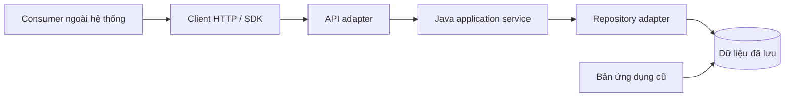
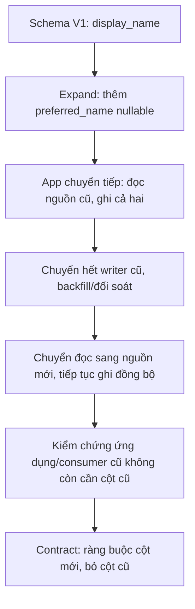

# Kiểm soát thay đổi API và dữ liệu được lưu

Một nhóm muốn đổi tên trường `displayName` thành `preferredName` vì tên mới diễn đạt nghiệp vụ rõ hơn. Trong mã Java, việc đổi tên có thể chỉ mất vài phút nhờ công cụ refactor. Nhưng người dùng API cũ vẫn đang gửi `displayName`; bản ghi trong cơ sở dữ liệu vẫn nằm ở cột `display_name`; một số instance ứng dụng cũ chưa được thay thế. Nếu triển khai phiên bản mới chỉ đọc `preferred_name`, hệ thống có thể không tìm được dữ liệu, ghi đè giá trị cũ hoặc khiến client đang hoạt động thất bại.

Đây là lý do **tái cấu trúc** (*refactoring*) phải kiểm soát các **hợp đồng được quan sát từ bên ngoài** và các **dữ liệu đã tồn tại**. Trong chương **Tái cấu trúc** của **CODE_QUALITY_FUNDAMENTALS**, bài học này tập trung vào cách thay đổi cấu trúc bên trong mà vẫn bảo vệ hành vi đã cam kết. Chủ đề gắn với mục tiêu module: hiểu những thuộc tính quyết định mã nguồn có **đáng tin cậy, dễ hiểu và dễ thay đổi** hay không.

**Nguyên tắc cốt lõi:** sửa cấu trúc nội bộ không đồng nghĩa được phép tự ý đổi API hoặc làm dữ liệu cũ không còn đọc được. Nếu cần thay hợp đồng bên ngoài, đó là **một thay đổi hành vi hoặc migration có chủ đích**, cần kế hoạch tương thích và bằng chứng kiểm chứng riêng.

## Mục tiêu học tập

Sau bài này, bạn có thể:

1. Phân biệt **refactor thuần túy**, thay đổi API và migration dữ liệu đã lưu.
2. Nhận diện các loại tương thích: mã nguồn Java, nhị phân, HTTP/JSON, dữ liệu và tương thích giữa các phiên bản cùng hoạt động.
3. Áp dụng kỹ thuật **expand–migrate–contract** khi đổi tên trường hoặc cấu trúc lưu trữ.
4. Thiết kế adapter và API chuyển tiếp để caller cũ vẫn hoạt động trong thời gian di trú.
5. Xác định thứ tự rollout, điểm có thể rollback và các rủi ro do old/new instances cùng đọc ghi.
6. Viết kiểm thử Java/JUnit 5 và các kiểm tra dữ liệu cần thiết trước khi thu hẹp schema.
7. Lập checklist triển khai giúp tránh mất dữ liệu, sai ngữ nghĩa và phá hợp đồng công khai.

## 1. Phân biệt ba loại thay đổi

**Refactor thuần túy** thay cấu trúc bên trong nhưng giữ nguyên hành vi có thể quan sát theo hợp đồng. Ví dụ, tách phép kiểm tra tên khách hàng từ controller thành một value object mà HTTP response vẫn giữ nguyên.

**Thay đổi API** tác động đến cách consumer gọi và nhận kết quả: chữ ký phương thức, tên endpoint, field JSON, mã lỗi, điều kiện validation hoặc ngữ nghĩa. Nó có thể tương thích hoặc phá tương thích tùy phiên bản consumer.

**Migration dữ liệu được lưu** thay cách biểu diễn hoặc sử dụng dữ liệu đã tồn tại: đổi tên cột, tách bảng, chuyển đơn vị tiền, đổi định dạng thời gian, thay schema sự kiện hoặc dữ liệu cache bền vững.

| Loại thay đổi | Ví dụ | Câu hỏi quan trọng |
| --- | --- | --- |
| Refactor nội bộ | Đưa validation vào `PreferredName`. | Hành vi công khai có giữ nguyên không? |
| API Java | Thêm phương thức `changePreferredName(...)`, giữ `changeDisplayName(...)` tạm thời. | Caller cũ có biên dịch/chạy được không? |
| HTTP/JSON | V2 trả `preferredName` thay vì `displayName`. | Client V1 còn được hỗ trợ thế nào? |
| Cơ sở dữ liệu | Thêm cột `preferred_name`, sau đó bỏ `display_name`. | Bản ghi cũ và instance cũ đọc/ghi ra sao? |
| Dữ liệu có ngữ nghĩa mới | Đổi `amount` từ đồng sang đơn vị nhỏ khác. | Dữ liệu cũ được phân biệt và chuyển đổi chính xác thế nào? |

Một pull request có thể bao gồm cả ba loại thay đổi, nhưng nên **làm rõ từng hợp đồng, từng bước kiểm chứng và thứ tự triển khai**, thay vì gọi chung là “rename cho sạch”.

### Những ranh giới bị ảnh hưởng



Khi mã bên trong APP đổi, có thể chỉ cần unit test nếu hành vi không đổi. Nhưng nếu API, REPO hoặc DB cũng đổi, phải kiểm chứng các **ranh giới có consumer riêng**. Một bảng DB có thể được nhiều bản ứng dụng dùng cùng lúc trong rolling deployment; một JSON field có thể đã được SDK bên ngoài dựa vào từ nhiều năm.

## 2. Tương thích cần được định nghĩa chính xác

**Tương thích** không phải thuộc tính tuyệt đối của một thay đổi. Nó luôn gắn với **ai đang sử dụng**, **phiên bản nào**, **môi trường nào** và **hành vi đã cam kết**.

| Loại tương thích | Câu hỏi | Ví dụ rủi ro |
| --- | --- | --- |
| **Source compatibility** | Mã nguồn caller cũ còn biên dịch được sau khi đổi thư viện không? | Xóa hoặc đổi tên phương thức public. |
| **Binary compatibility** | Bản caller đã biên dịch trước đó còn liên kết/chạy với thư viện mới không? | Đổi JVM method descriptor hoặc xóa phương thức mà bytecode cũ gọi. |
| **Behavioral compatibility** | Với input cũ hợp lệ, kết quả, lỗi và tác dụng phụ còn đúng hợp đồng cũ không? | Giữ chữ ký nhưng đổi `null` thành exception hoặc đổi đơn vị tiền. |
| **Wire/API compatibility** | Request/response HTTP, JSON, gRPC hoặc event có còn được consumer cũ hiểu? | Xóa field JSON, đổi mã lỗi hoặc đổi nghĩa enum. |
| **Stored-data compatibility** | Phiên bản mới có đọc được dữ liệu cũ và ngược lại khi cần không? | Chỉ đọc cột mới khi dữ liệu chưa được backfill. |
| **Deployment compatibility** | Các phiên bản cũ và mới có thể cùng chạy trong giai đoạn chuyển tiếp không? | Instance cũ chỉ ghi cột cũ, instance mới chỉ đọc cột mới. |

**Binary compatibility khác source compatibility.** Một bản thư viện Java có thể cho phép compile lại source cũ nhưng bytecode đã build trước đó vẫn gặp lỗi liên kết nếu descriptor cần thiết bị thay đổi. Việc giữ overload với đúng chữ ký cũ giúp giảm một rủi ro, nhưng cần xác minh trên tập API công khai và quy trình phát hành thực tế.

**Hợp đồng ngữ nghĩa quan trọng hơn tên trường.** Nếu `preferredName` chỉ là tên mới của đúng giá trị cũ, ta có thể bảo toàn ngữ nghĩa. Nếu tên mới đồng thời chuyển từ “tên đầy đủ” sang “tên muốn được gọi”, việc copy dữ liệu cũ không chắc đúng; cần quyết định nghiệp vụ về chuyển đổi và trường hợp không đủ thông tin.

## 3. Ví dụ xuyên suốt: đổi `displayName` thành `preferredName`

Giả sử ứng dụng quản lý hồ sơ khách hàng đang có:

```sql
-- PostgreSQL, schema cũ để minh họa.
CREATE TABLE customer_profiles (
    id BIGINT PRIMARY KEY,
    display_name VARCHAR(200) NOT NULL
);
```

Ứng dụng V1 nhận/trả JSON:

```json
{
  "id": 42,
  "displayName": "Minh Anh"
}
```

Yêu cầu mới: **đổi tên khái niệm trong mã và giao diện V2 thành `preferredName`**, nhưng trong bài này **ngữ nghĩa vẫn là cùng một tên hiển thị**. Việc đổi tên phải không làm mất giá trị của bản ghi đã có và không phá consumer V1 trong thời gian được hỗ trợ.

### Bất biến và giả định ví dụ

1. `id` là định danh khách hàng dương.
2. Tên không được `null` hoặc chỉ gồm khoảng trắng; tối đa 200 ký tự theo quy tắc của ví dụ.
3. Tên được chuẩn hóa bằng cách bỏ khoảng trắng ở hai đầu trước khi ghi.
4. Khi API V1 còn hỗ trợ, `displayName` phải phản ánh **cùng giá trị** với `preferredName` trong phạm vi ngữ nghĩa đã thống nhất.
5. Không được để bản ghi bị mất tên chỉ vì deployment mới và cũ xen kẽ.
6. Dữ liệu tên do khách hàng cung cấp là thông tin cần bảo vệ; không đưa bản ghi thật vào log migration một cách không cần thiết.

Nếu dữ liệu production hiện có chứa tên dài hơn 200 hoặc chỉ có khoảng trắng, **không thể cứ thêm validation rồi tuyên bố refactor giữ nguyên hành vi**. Cần thống kê, xác định ngoại lệ và kế hoạch làm sạch có phê duyệt.

## 4. Đổi API Java mà không phá caller ngay lập tức

Thay vì xóa phương thức cũ, có thể thêm API rõ nghĩa mới và cho phương thức cũ gọi qua nó.

### Value object giữ quy tắc chung

**`PreferredName.java` (Java 17):**

```java
public record PreferredName(String value) {
    public PreferredName {
        if (value == null) {
            throw new IllegalArgumentException("Name is required");
        }
        value = value.strip();
        if (value.isEmpty() || value.length() > 200) {
            throw new IllegalArgumentException("Invalid preferred name");
        }
    }
}
```

Constructor của record chuẩn hóa giá trị và kiểm tra hợp đồng; `record` tạo accessor `value()`. Trong ứng dụng quốc tế, cách tính độ dài bằng `String.length()` là độ dài theo UTF-16 code unit, **không tự động tương đương số ký tự người dùng nhìn thấy hoặc số byte database**. Chính sách độ dài cần thống nhất giữa Java, API và DB; ví dụ này dùng giới hạn đơn giản để tập trung vào vấn đề migration.

### Port của ứng dụng và hai chữ ký

**`ProfileRepository.java`:**

```java
interface ProfileRepository {
    void updatePreferredName(long customerId, String normalizedName);
}
```

**`ProfileService.java`:**

```java
import java.util.Objects;

public final class ProfileService {
    private final ProfileRepository repository;

    public ProfileService(ProfileRepository repository) {
        this.repository = Objects.requireNonNull(repository);
    }

    public void changePreferredName(
            long customerId, PreferredName preferredName) {
        if (customerId <= 0) {
            throw new IllegalArgumentException("Invalid customer ID");
        }
        Objects.requireNonNull(preferredName, "preferredName");
        repository.updatePreferredName(
                customerId, preferredName.value());
    }

    /** @deprecated Dùng changePreferredName thay thế. */
    @Deprecated(since = "2.0", forRemoval = false)
    public void changeDisplayName(long customerId, String displayName) {
        changePreferredName(customerId, new PreferredName(displayName));
    }
}
```

Phương thức cũ còn tồn tại với **đúng tên và kiểu tham số**, nên caller cũ có đường sử dụng trong giai đoạn di trú. `since = "2.0"` chỉ là phiên bản giả định; khi áp dụng thực tế phải dùng phiên bản phát hành tương ứng.

Đây là **adapter ở cấp Java API**. Nó chưa giải quyết vấn đề dữ liệu đang nằm ở cột `display_name`; repository adapter và thứ tự triển khai DB phải được xử lý riêng.

### JUnit 5 xác nhận hành vi cũ và mới

```java
import static org.junit.jupiter.api.Assertions.*;

import java.util.HashMap;
import java.util.Map;
import org.junit.jupiter.api.Test;

class ProfileServiceTest {
    static final class FakeRepository implements ProfileRepository {
        final Map<Long, String> names = new HashMap<>();
        int writes;

        @Override
        public void updatePreferredName(long id, String normalizedName) {
            writes++;
            names.put(id, normalizedName);
        }
    }

    @Test
    void newApiNormalizesAndPersistsName() {
        FakeRepository repo = new FakeRepository();
        ProfileService service = new ProfileService(repo);

        service.changePreferredName(
                42L, new PreferredName("  Minh Anh  "));

        assertEquals("Minh Anh", repo.names.get(42L));
        assertEquals(1, repo.writes);
    }

    @Test
    @SuppressWarnings("deprecation")
    void oldApiDelegatesToSameContract() {
        FakeRepository repo = new FakeRepository();
        ProfileService service = new ProfileService(repo);

        service.changeDisplayName(42L, "  Minh Anh  ");

        assertEquals("Minh Anh", repo.names.get(42L));
        assertEquals(1, repo.writes);
    }

    @Test
    void invalidNameFailsBeforeRepositoryWrite() {
        FakeRepository repo = new FakeRepository();
        ProfileService service = new ProfileService(repo);

        assertThrows(IllegalArgumentException.class,
                () -> service.changePreferredName(
                        42L, new PreferredName(" ")));
        assertEquals(0, repo.writes);
    }

    @Test
    void invalidIdFailsBeforeRepositoryWrite() {
        FakeRepository repo = new FakeRepository();
        ProfileService service = new ProfileService(repo);

        assertThrows(IllegalArgumentException.class,
                () -> service.changePreferredName(
                        0L, new PreferredName("Minh Anh")));
        assertEquals(0, repo.writes);
    }
}
```

Các test bảo vệ **hợp đồng của service**: chuẩn hóa tên, giữ đường gọi cũ và không ghi khi đầu vào sai. Chúng **không xác nhận** một bản JAR đã biên dịch từ trước còn chạy với phiên bản thư viện mới; cần thêm kiểm tra compatibility ở cấp artifact nếu API Java được phát hành như thư viện.

## 5. Thay JSON API: version và adapter trước khi đổi schema ngoài

Nếu HTTP V1 công bố `displayName`, việc đổi field response thành `preferredName` ngay trên endpoint V1 có thể phá client cũ. Một số parser từ chối trường lạ; ngay cả parser linh hoạt vẫn không đọc được trường đã bị xóa.

Để minh họa, có thể giữ **hai adapter response**:

```java
record ProfileDomain(long id, PreferredName preferredName) {}

record ProfileResponseV1(long id, String displayName) {}
record ProfileResponseV2(long id, String preferredName) {}

final class ProfileResponses {
    static ProfileResponseV1 toV1(ProfileDomain profile) {
        return new ProfileResponseV1(
                profile.id(), profile.preferredName().value());
    }

    static ProfileResponseV2 toV2(ProfileDomain profile) {
        return new ProfileResponseV2(
                profile.id(), profile.preferredName().value());
    }
}
```

Ví dụ endpoint khái niệm:

```text
GET /api/v1/profiles/42
  → { "id": 42, "displayName": "Minh Anh" }

GET /api/v2/profiles/42
  → { "id": 42, "preferredName": "Minh Anh" }
```

Đây là **mô tả hợp đồng minh họa**, chưa phải controller hoàn chỉnh. HTTP adapter còn phải xác định mã lỗi, quyền truy cập, validation và serialization cụ thể. Mã `record` không buộc mọi framework tự dùng đúng tên field hoặc hiển thị V1/V2 nếu chưa cấu hình tương ứng.

### Khi nào cần endpoint version mới?

Version mới có ích khi cần thay một phần **hợp đồng công khai** mà consumer cũ không thể xử lý. Nhưng version không phải cách duy nhất. Có thể triển khai chuyển tiếp bằng:

- Giữ tên field cũ trên V1, chỉ dùng tên mới bên trong domain.
- Thêm field mới trong response nếu consumer cũ được phép bỏ qua và có quy tắc xử lý hai field.
- Cung cấp adapter V1/V2 tách biệt với kế hoạch deprecation rõ.

**Tránh trả hai field có thể mâu thuẫn** mà không quy định field nào là nguồn chân lý. Với request chứa cả `displayName` và `preferredName`, nên có quy tắc rõ: từ chối nếu khác nhau, hoặc chỉ cho phép một định dạng tại một phiên bản API. Không tự chọn tùy tiện theo thứ tự parse.

Đừng xóa V1 chỉ vì mọi test của V2 đã xanh. Phải xác định **những consumer đang được hỗ trợ** đã chuyển sang V2 hoặc V1 vẫn được phục vụ qua adapter.

## 6. Vì sao đổi cột DB là một migration, không phải rename đơn giản?

Giả sử DB vẫn có cột `display_name`. Một lệnh:

```sql
-- KHÔNG nên áp dụng trực tiếp nếu bản ứng dụng cũ
-- vẫn đang đọc hoặc ghi display_name.
ALTER TABLE customer_profiles
    RENAME COLUMN display_name TO preferred_name;
```

Trong một môi trường chỉ có một phiên bản ứng dụng và downtime được lên lịch, thao tác rename có thể phù hợp. Nhưng với **rolling deployment**, có khoảng thời gian phiên bản cũ và mới cùng truy cập DB:

- Instance cũ truy vấn `display_name` → thất bại sau khi rename.
- Instance mới truy vấn `preferred_name` → thất bại nếu code mới được triển khai trước schema.
- Transaction đang chạy có thể bị ảnh hưởng bởi khóa schema, migration dài hoặc kết nối chưa cập nhật.

Do đó cần **định nghĩa thứ tự thay đổi và các phiên bản có thể cùng tồn tại**, không chỉ cú pháp SQL.

## 7. Expand–migrate–contract cho dữ liệu đã lưu

Một chiến lược phổ biến là chia thay đổi thành các giai đoạn:

**Expand** — mở rộng schema theo cách không phá mã cũ.  
**Migrate** — đưa dữ liệu và mã gọi sang cấu trúc mới, kiểm chứng kết quả.  
**Contract** — loại bỏ cấu trúc cũ chỉ sau khi không còn consumer phụ thuộc.



### Giai đoạn A — Mở rộng schema tương thích ngược

Ví dụ SQL **theo PostgreSQL**:

```sql
ALTER TABLE customer_profiles
    ADD COLUMN preferred_name VARCHAR(200);
```

Cột mới ban đầu **cho phép `NULL`** vì các bản ghi hiện có chưa có giá trị ở cột này. Instance cũ chỉ biết `display_name` vẫn hoạt động vì cột cũ chưa bị xóa.

**Lưu ý:** ngay cả một `ALTER TABLE` được xem là “thêm cột đơn giản” vẫn có thể đòi khóa metadata, tương tác với transaction đang chạy hoặc gây vấn đề ở DB lớn. Độ an toàn phụ thuộc DB engine, phiên bản, kích thước bảng và tải; cần kiểm tra kế hoạch thực thi/locking trong môi trường phù hợp, không tự coi mọi migration DDL là zero-downtime.

### Giai đoạn B — Mã chuyển tiếp đọc cũ, ghi cả hai

Trong giai đoạn còn **old-only writer** (instance cũ chỉ ghi `display_name`), ta giữ cột cũ là **nguồn đọc có thẩm quyền**. Instance mới có thể ghi hai cột trong cùng transaction:

```sql
-- Ví dụ thao tác update thuộc repository adapter mới.
UPDATE customer_profiles
SET display_name = :name,
    preferred_name = :name
WHERE id = :customer_id;
```

`:name` và `:customer_id` là **placeholder minh họa cho parameter binding** của thư viện truy cập DB, không phải cú pháp được PostgreSQL chấp nhận nguyên văn khi chạy trực tiếp trong SQL console. Trong Java JDBC, dùng `PreparedStatement` và dấu `?` cho các giá trị.

Quan trọng: **cả hai cột nên được cập nhật nguyên tử trong cùng transaction**. Nếu update cột cũ thành công nhưng update cột mới thất bại ở transaction khác, hệ thống có thể tạo ra trạng thái không nhất quán.

Trong giai đoạn này:

- Instance cũ: đọc/ghi `display_name`.
- Instance mới: **đọc `display_name`**, nhưng khi ghi thì cập nhật cả `display_name` và `preferred_name`.
- Chưa coi `preferred_name` là nguồn đọc chính, vì instance cũ vẫn có thể cập nhật riêng cột cũ và khiến giá trị mới bị cũ.

**Cảnh báo quan trọng:** cách chuyển tiếp này dựa trên giả định mọi thao tác ghi tên đều đi qua cùng DB và quy tắc ứng dụng. Nếu có ETL, job nền, trigger, script admin hoặc service khác ghi cột cũ, cũng phải tính chúng là **writer cũ** và lập kế hoạch chuyển đổi.

### Giai đoạn C — Chuyển hết writer cũ và backfill

Sau khi xác nhận không còn writer chỉ ghi `display_name`, có thể đồng bộ dữ liệu cũ sang cột mới. Ví dụ:

```sql
UPDATE customer_profiles
SET preferred_name = display_name
WHERE preferred_name IS DISTINCT FROM display_name;
```

`IS DISTINCT FROM` của PostgreSQL so sánh được cả trường hợp `NULL`. Câu lệnh **có thể chạy lại** và sẽ bỏ qua hàng đã có giá trị bằng nhau; đây là dạng idempotent ở cấp giá trị đối với giả định hai cột phải giống hệt nhau.

Tuy nhiên, **không nên mặc định chạy một `UPDATE` khổng lồ trên bảng production lớn**. Nó có thể tạo log/replication lag, khóa hàng, bloat, áp lực I/O hoặc ảnh hưởng request. Nên cân nhắc:

- Backfill theo **batch ID ổn định**, có giới hạn tốc độ.
- Theo dõi số hàng còn lệch, thời gian transaction và độ trễ replica.
- Thử khả năng dừng/chạy lại sau lỗi.
- Đảm bảo writer đang hoạt động ghi cả hai trường với cùng quy tắc.
- Cân nhắc sự tương tác với MVCC, isolation và lock của DB engine đang dùng.

Nếu trong khi backfill vẫn còn old-only writer, một hàng có thể bị cập nhật ở `display_name` sau khi đã backfill, khiến `preferred_name` cũ đi. **Không được coi backfill một lần là đủ** khi điều kiện này còn tồn tại.

### Giai đoạn D — Đối soát và chuyển nguồn đọc

Kiểm tra độ nhất quán:

```sql
SELECT COUNT(*) AS mismatched_rows
FROM customer_profiles
WHERE preferred_name IS DISTINCT FROM display_name;
```

Kỳ vọng là **0** sau khi không còn old-only writer và đã backfill hết, với giả định hai tên cùng ngữ nghĩa. Cần xem thêm quy tắc null, khoảng trắng, Unicode và những trường hợp dữ liệu legacy không hợp lệ nếu phát hiện từ khảo sát.

Khi đã đạt điều kiện:

- Ứng dụng mới chuyển sang **đọc `preferred_name`**.
- Trong giai đoạn còn muốn hỗ trợ rollback về bản cũ, tiếp tục **ghi cả hai**.
- Có thể thêm metric kiểm tra hai cột lệch và cảnh báo sớm.
- Kiểm tra endpoint V1 vẫn lấy được tên đúng từ domain và adapter dù dữ liệu gốc đang dịch chuyển.

Việc chuyển nguồn đọc nên có điều kiện kiểm chứng riêng; không gộp vô thức vào cùng release với bước xóa cột cũ.

### Giai đoạn E — Thu hẹp schema

Khi mọi reader/writer/ETL/job còn được hỗ trợ đã chuyển, backfill và dữ liệu được xác minh, có thể thêm ràng buộc:

```sql
ALTER TABLE customer_profiles
    ALTER COLUMN preferred_name SET NOT NULL;
```

Sau đó, **trong một đợt phát hành riêng** và khi chắc chắn không còn code nào cần cột cũ:

```sql
ALTER TABLE customer_profiles
    DROP COLUMN display_name;
```

Đây là **bước phá tương thích với binary/code DB cũ**. Sau bước này không thể giả định rollback bằng cách triển khai lại phiên bản ứng dụng cũ: code cũ truy vấn `display_name` sẽ không hoạt động. Khả năng phục hồi cần kế hoạch riêng, có thể là forward-fix, phục hồi schema/dữ liệu qua quy trình an toàn, hoặc rollback khi cột cũ vẫn còn.

Không bắt buộc phải xóa cột ngay khi chuyển đọc thành công. Giữ cột một thời gian có thể là chi phí chấp nhận được nếu đổi lại khả năng rollback hoặc an toàn cho những consumer chưa kịp chuyển.

## 8. Lịch rollout cụ thể và những điểm không được đảo thứ tự

| Bước | Schema | Instance được phép chạy | Nguồn đọc tên | Cách ghi |
| --- | --- | --- | --- | --- |
| 0 — Hiện trạng | Chỉ `display_name` | V1 | `display_name` | Chỉ cột cũ. |
| 1 — Expand | Cả hai, `preferred_name` nullable | V1 và V2 chuyển tiếp | Cột cũ | V1 ghi cũ; V2 ghi cả hai. |
| 2 — Chuyển hết writer | Cả hai | V2 chuyển tiếp | Cột cũ | Mọi writer được hỗ trợ ghi cả hai. |
| 3 — Backfill và kiểm chứng | Cả hai, dữ liệu khớp | V2 chuyển tiếp | Cột cũ | Ghi cả hai; đối soát bằng query. |
| 4 — Chuyển đọc | Cả hai | V2 bản đọc mới | Cột mới | Tiếp tục ghi cả hai nếu cần rollback. |
| 5 — Contract | Cột mới là nguồn bền vững | Bản ứng dụng không còn đọc/ghi cột cũ | Cột mới | Chỉ cột mới. |

**Một điều kiện quan trọng:** bước 4 chỉ an toàn nếu không còn instance hoặc công cụ nào có thể cập nhật **riêng cột cũ**. Nếu vẫn tồn tại writer đó, đọc `preferred_name` có thể trả giá trị cũ dù cả hai cột lúc đầu đã được backfill.

Trong hệ thống có nhiều vùng triển khai, các worker chạy lâu, queue consumer hoặc một số instance khó nâng cấp, đừng chỉ dựa vào “deployment báo completed”. Kiểm tra phiên bản và hành vi **writer thực tế** qua inventory, telemetry hoặc các phép đối soát.

### Có nhất thiết phải dual-write không?

Không phải mọi migration đều phù hợp với dual-write. Một số hệ thống có thể chọn:

- **Database trigger** để đồng bộ hai cột (đổi lại logic ở DB, chi phí và khó quản lý rollback).
- **Một nguồn ghi duy nhất và một view/adapter đọc tương thích**.
- **Đổi trong maintenance window** nếu downtime được phép và ít consumer.
- **Thay đổi qua event/versioned projection** nếu dữ liệu nằm ở nhiều kho.

Hãy chọn theo quy mô và hợp đồng. Dual-write sang **hai hệ thống độc lập** không thể mặc định nguyên tử như cập nhật hai cột trong cùng transaction DB; khi đó cần idempotency, outbox, retry, đối soát hoặc cơ chế nhất quán khác.

## 9. Trường hợp khó hơn: khi dữ liệu đổi cả ý nghĩa

Rename trường theo cùng ngữ nghĩa tương đối đơn giản. Nhưng nhiều migration có thể **không có phép chuyển đổi đúng cho mọi hàng**.

### Chia một trường thành nhiều trường

Ví dụ dữ liệu cũ:

```text
full_name = "Nguyen Thi Minh Anh"
```

Muốn có `given_name` và `family_name`. Không thể luôn tách đúng chỉ bằng vị trí khoảng trắng: cấu trúc tên phụ thuộc ngôn ngữ, văn hóa và cách người dùng nhập. Một phép `split(" ")` có thể tạo dữ liệu sai dù không ném exception.

Phương án có thể bao gồm:

1. Giữ `full_name` để hiển thị trong giai đoạn chuyển tiếp.
2. Thêm trường mới **nullable** hoặc có trạng thái `unverified`.
3. Chỉ điền dữ liệu mới khi có nguồn đáng tin cậy hoặc người dùng xác nhận.
4. Thiết kế UI/API để yêu cầu bổ sung thông tin khi cần.
5. Không xóa dữ liệu cũ trước khi hoàn tất quy tắc chuyển đổi và đối soát.

### Chuyển đơn vị tiền

Một cột `price` kiểu số không nêu đơn vị có thể được hiểu khác nhau giữa các phiên bản. Nếu đổi từ giá lưu bằng đồng sang một đơn vị tiền khác, cần xác định:

- Cột/field nào chứa đơn vị cũ và đơn vị mới?
- Công thức chuyển đổi và làm tròn có **mất thông tin** không?
- Dữ liệu đã chuyển được đánh dấu bằng version hay chưa?
- Cách tránh áp dụng chuyển đổi **hai lần** khi job retry?
- Bản ứng dụng cũ có còn đọc được không?

Ví dụ một hệ thống lưu tiền với các loại tiền tệ khác nhau không thể tự giả định mọi giá trị là “cent”. Đơn vị và quy tắc tính phải được mô tả trong schema, domain type và hợp đồng API, không dựa vào một tên field chung.

### Dữ liệu bền vững không chỉ là bảng SQL

Các đối tượng sau cũng cần kế hoạch tương thích:

| Nơi lưu | Thay đổi dễ gây lỗi | Cơ chế cân nhắc |
| --- | --- | --- |
| Database quan hệ | Đổi cột, constraint, enum, index. | Migration theo phase, backfill, đối soát, rollback plan. |
| JSON trong DB / file | Đổi tên field hoặc định dạng. | Version, decoder hỗ trợ schema cũ, migrator idempotent. |
| Event log / message queue | Consumer đọc lại sự kiện cũ với schema mới. | Event versioning, schema compatibility, upcaster khi thích hợp. |
| Cache bền vững | Đổi key, cấu trúc hoặc TTL. | Namespace/version key, invalidate có kiểm soát, kiểm tra cache miss. |
| Search index / read model | Mapping mới khác tài liệu nguồn. | Reindex có kiểm tra chênh lệch, rebuild có thể lặp lại. |
| Backup / snapshot | Bản snapshot dùng schema cũ. | Thử restore/migration từ backup thật trong môi trường cô lập. |

Đặc biệt với event replay, bản ứng dụng mới phải biết cách xử lý các event **đã phát trong quá khứ** hoặc có cơ chế nâng cấp dữ liệu rõ ràng. Chỉ cập nhật producer hiện tại không làm các event cũ biến mất.

## 10. Tính lặp an toàn, giao dịch và xử lý lỗi giữa chừng

Migration có thể bị dừng khi hệ thống mất kết nối, process crash hoặc hết thời gian chạy. Nếu mỗi lần thử lại nhân đôi dữ liệu hoặc chuyển đổi thêm một lần, một lỗi vận hành bình thường có thể trở thành lỗi dữ liệu nghiêm trọng.

### Thuộc tính cần có của một job backfill

- **Có thể tiếp tục:** có khóa hoặc cursor ổn định và ghi lại tiến độ phù hợp.
- **Có thể chạy lại an toàn:** cùng một hàng không bị chuyển đổi hai lần theo nghĩa sai.
- **Không mất cập nhật:** biết cách tương tác với writer đang chạy.
- **Giới hạn tác động:** batch nhỏ, timeout và ngân sách I/O hợp lý.
- **Quan sát được:** biết tổng số hàng, số còn thiếu, số lỗi, số hàng lệch và tốc độ.
- **Có quy trình xử lý ngoại lệ:** hàng không hợp lệ được phân loại, không âm thầm bỏ đi.

Ví dụ backfill đổi cột tên bằng `SET preferred_name = display_name` có tính chạy lại tương đối đơn giản **khi cùng ngữ nghĩa và mọi writer đã dual-write**. Nhưng nếu migration là “cộng thêm 10 vào số dư” hoặc “nhân 100 để đổi đơn vị”, thực thi lại cùng lệnh có thể làm dữ liệu sai. Khi ấy cần trạng thái version hoặc điều kiện chuyển đổi rõ, không chỉ một câu `UPDATE` lặp.

### Chỉ số dữ liệu đối soát

Với đổi tên cùng ngữ nghĩa, một số kiểm tra có ích:

```sql
-- Số hàng chưa có dữ liệu ở cột mới.
SELECT COUNT(*)
FROM customer_profiles
WHERE preferred_name IS NULL;

-- Số hàng hai cột không khớp sau khi tất cả writer đã dual-write.
SELECT COUNT(*)
FROM customer_profiles
WHERE preferred_name IS DISTINCT FROM display_name;
```

Một kết quả đếm bằng 0 **chưa chứng minh tất cả ứng dụng đang dùng API mới**. Nó chỉ xác nhận điều kiện dữ liệu tại thời điểm truy vấn. Phải bổ sung kiểm tra caller, writer, deployment và hành vi end-to-end.

### Cần backup nhưng backup thôi chưa đủ

Trước migration có khả năng thay đổi mất mát, cần có phương án sao lưu/phục hồi phù hợp với RPO/RTO của hệ thống. Tuy nhiên, việc “đã có backup” không thay thế việc **thử restore** và xác định dữ liệu nào có thể bị mất nếu phục hồi lại trạng thái cũ sau khi hệ thống tiếp tục nhận ghi mới.

## 11. Kiểm thử migration ở nhiều tầng

Một bộ unit test của `PreferredName` có thể xác nhận validation, nhưng không biết cột DB cũ/mới có khớp không. Cần phân tầng bằng chứng.

| Cấp kiểm chứng | Kỳ vọng | Cách thử |
| --- | --- | --- |
| **Domain/unit** | Tên không rỗng, chuẩn hóa đúng, old Java API gọi được. | JUnit 5 với fake repository. |
| **HTTP contract** | V1 còn trả `displayName`, V2 trả `preferredName`; lỗi và quyền không đổi bất ngờ. | Contract test hoặc HTTP integration test. |
| **Repository** | Khi ghi, cả hai cột được cập nhật nguyên tử trong giai đoạn chuyển tiếp. | Integration test với DB cùng loại engine được triển khai. |
| **Migration DDL** | Có thể áp dụng schema mới lên DB cũ có dữ liệu thật về hình dạng. | Migration test từ bản schema trước trên DB cô lập. |
| **Backfill** | Hàng cũ được chuyển đúng, chạy lại không sai, có đường xử lý hàng lỗi. | Fixture đặc trưng, test lặp, test dừng/tiếp tục. |
| **Mixed-version** | V1/V2 cùng chạy không làm mất tên; điểm chuyển nguồn đọc an toàn. | Triển khai thử hỗn hợp, đối soát read/write. |
| **Operational** | Migration không vượt ngưỡng lock, latency, replication lag. | Test tải/diễn tập và quan sát DB. |
| **Rollback/forward-fix** | Có thể thực hiện phương án phục hồi ở từng phase. | Diễn tập trên snapshot cô lập với tình huống có ghi mới. |

### Kiểm thử hai phiên bản API cùng trả dữ liệu nhất quán

Một test thuần Java có thể xác nhận hai adapter response đang biến đổi từ cùng một domain model:

```java
import static org.junit.jupiter.api.Assertions.*;

import org.junit.jupiter.api.Test;

class ProfileResponsesTest {
    @Test
    void v1AndV2ExposeSameNameSemantics() {
        ProfileDomain domain = new ProfileDomain(
                42L, new PreferredName("  Minh Anh  "));

        ProfileResponseV1 v1 = ProfileResponses.toV1(domain);
        ProfileResponseV2 v2 = ProfileResponses.toV2(domain);

        assertEquals(42L, v1.id());
        assertEquals(42L, v2.id());
        assertEquals("Minh Anh", v1.displayName());
        assertEquals("Minh Anh", v2.preferredName());
    }
}
```

Test này chứng minh **mapping trong Java**, không bảo đảm framework JSON thật serialize đúng, endpoint được route chính xác hay DB đã hoàn tất migration. Test tích hợp có HTTP/JSON thật vẫn cần thiết nếu đó là hợp đồng với consumer bên ngoài.

### Kịch bản mixed-version cần thử trước rollout

```text
Given DB đã có cả display_name và preferred_name
And   V1 writer còn hoạt động, V2 chuyển tiếp đọc cột cũ
When  V1 cập nhật tên khách hàng 42 thành "An"
Then  V2 đọc được "An" từ cột cũ
And   việc preferred_name tạm thời khác display_name
      chưa được coi là dữ liệu cuối cùng

Given không còn V1 writer, V2 dual-write đã hoạt động
And   backfill đã hoàn tất
When  kiểm tra tất cả bản ghi
Then  preferred_name == display_name
And   V2 chuyển đọc cột mới vẫn cho kết quả giống nhau
```

Đây là **kịch bản kiểm chứng theo thiết kế chuyển tiếp**, không phải cú pháp test của framework cụ thể. Việc chấp nhận lệch tạm thời trong pha còn V1 writer **không được kéo dài sang pha sau** mà không có đối soát.

### Bộ dữ liệu mẫu phải chứa ca khó

- Tên có khoảng trắng đầu/cuối và ký tự Unicode.
- Giá trị gần giới hạn độ dài, chuỗi rỗng và dữ liệu legacy bất thường.
- Khách hàng không từng được cập nhật sau khi thêm cột mới.
- Các hàng liên tục bị cập nhật trong khi migration chạy.
- Hàng đã chuyển rồi job bị dừng; chạy lại.
- Các tenant/vùng dữ liệu có chính sách khác nhau nếu hệ thống hỗ trợ.

Nếu chỉ thử một hàng `"Alice"` vừa tạo trong schema mới, chưa chứng minh migration đọc được dữ liệu cũ trong trạng thái thực tế.

## 12. Không được thay hợp đồng bằng refactor âm thầm

Có những thay đổi trông giống dọn mã nhưng thực chất làm người gọi quan sát được kết quả khác:

| Thay đổi trông nhỏ | Rủi ro thay đổi hành vi |
| --- | --- |
| Đổi `int` sang `long` trong chữ ký Java. | Method descriptor thay đổi; binary caller cũ có thể không liên kết. |
| Đổi tên JSON field bắt buộc. | Client cũ parse sai hoặc mất dữ liệu. |
| Thay `null` bằng chuỗi rỗng. | Client phân biệt “không biết” và “giá trị có mặt” bị phá. |
| Đổi timezone hoặc định dạng ngày. | Cùng chuỗi giá trị có thể mang thời điểm khác. |
| Đổi hằng số biểu diễn tiền. | Có thể làm mọi bản ghi cũ bị hiểu sai đơn vị. |
| Thêm validation mới cho dữ liệu cũ. | Bản ghi đã tồn tại có thể không nạp được hoặc không sửa được. |
| Chuyển thao tác đồng bộ sang event. | Thời điểm hoàn tất, lỗi và thứ tự xử lý thay đổi. |
| Đổi logic fallback khi upstream lỗi. | Giá trị hoặc tác dụng phụ quan sát được có thể khác. |

Với mỗi thay đổi, cần quyết định: **refactor giữ hành vi**, **sửa một bug đã xác nhận** hay **thay đổi hợp đồng được phê duyệt**? Ba nhãn này có thể chung một đợt phát hành nhưng phải được review và kiểm thử riêng, tránh làm consumer bất ngờ.

## 13. Điều kiện rollback theo từng giai đoạn

Rollback không phải “triển khai lại artifact cũ” trong mọi tình huống. Bản cũ có thể không hiểu dữ liệu do bản mới đã ghi, schema đã bị xóa hoặc event đã phát với cấu trúc mới.

| Giai đoạn | Khả năng quay lại | Điều kiện |
| --- | --- | --- |
| Chỉ thêm cột mới nullable. | Thường dễ hơn. | Bản cũ bỏ qua cột mới; DDL đã kiểm tra tính tương thích. |
| V2 dual-write, còn cột cũ. | Có thể quay lại V1 theo hợp đồng cũ. | V2 vẫn giữ `display_name` đầy đủ, không thêm dữ liệu mà V1 không hiểu. |
| Đã backfill, chưa xóa cột cũ. | Thường vẫn có đường rollback. | Giá trị cũ vẫn đúng và quy tắc ghi/đọc không mâu thuẫn. |
| Đã đổi ngữ nghĩa dữ liệu. | Khó hơn, có thể không đảo ngược. | Cần migration ngược khả thi hoặc forward-fix. |
| Đã xóa cột cũ. | Không thể chỉ chạy V1 binary cũ. | Cần quy trình phục hồi schema/dữ liệu, hoặc triển khai phiên bản sửa mới. |

Ngay cả khi hai cột còn nguyên, rollback có thể không an toàn nếu V2 đã bắt đầu dùng **giá trị mới mà V1 không biểu diễn được**. Ví dụ này cố tình giữ ngữ nghĩa tên giống nhau để giảm rủi ro; với thay đổi domain thật, cần thiết kế độ tương thích sâu hơn.

### Xác định “điểm không thể quay về” trước khi phát hành

Trước bước contract, hãy xác nhận:

1. Các reader/writer cũ, job nền và consumer DB trực tiếp đã hết phụ thuộc.
2. Dữ liệu đã được chuyển và đối soát; không có hàng thất bại chưa xử lý.
3. Các instance mới hoạt động ổn định với cột mới.
4. Có phương án khôi phục/forward-fix đã diễn tập cho hệ thống thực.
5. Người sở hữu dữ liệu và ứng dụng đã chấp thuận thời điểm bỏ cấu trúc cũ.

Một migration **có thể triển khai lại** không có nghĩa nó **có thể đảo ngược**. Hãy phân biệt idempotency với reversibility.

## 14. Quy trình kiểm soát thay đổi API và dữ liệu

### Bước 1 — Ghi rõ phạm vi và nguồn chân lý

Lập danh sách **consumer của API** (Java caller, HTTP clients, event consumers) và **writer/reader của dữ liệu** (ứng dụng, job, ETL, script, hệ thống báo cáo). Không kết luận một cột không còn dùng chỉ vì không còn tham chiếu trong một repository.

### Bước 2 — Định nghĩa hợp đồng trước/sau

Ghi:

- Cấu trúc cũ và mới của Java method/HTTP payload/schema DB.
- Những giá trị có cùng ngữ nghĩa và những giá trị cần chuyển đổi.
- Trường hợp `null`, rỗng, dữ liệu lịch sử và giá trị không hợp lệ.
- Hành vi khi old/new versions cùng hoạt động.
- Thời gian cần giữ API cũ và điều kiện kết thúc.

### Bước 3 — Chọn một chuỗi rollout hợp lệ

Phân chia thành **expand**, **migration** và **contract**. Với hệ thống không chấp nhận downtime, cần thử các thứ tự upgrade/rollback liên quan. Với hệ thống nhỏ có maintenance window, quy trình đơn giản hơn vẫn phải kiểm chứng dữ liệu và khả năng phục hồi.

### Bước 4 — Xây dựng bằng chứng trước khi đổi

Thêm test hành vi hiện có và contract test cho consumer. Thử migration từ **schema cũ có dữ liệu**, không chỉ tạo DB mới từ đầu. Kiểm tra mức độ phù hợp của dữ liệu thật bằng thống kê có kiểm soát, không cần sao chép dữ liệu nhạy cảm vào test.

### Bước 5 — Triển khai và theo dõi từng pha

Mỗi pha phải có điều kiện chuyển tiếp:

- Expand đã hoàn thành, các binary cũ vẫn chạy.
- V2 chuyển tiếp đã hoạt động, writer mới dual-write.
- Old-only writer đã hết; backfill được phép kết thúc.
- Đối soát đạt, cột mới đủ điều kiện thành nguồn đọc.
- Consumer không còn phụ thuộc cấu trúc cũ; mới được contract.

### Bước 6 — Thu dọn tương thích có chủ đích

Sau thời hạn hỗ trợ, có thể bỏ overload Java cũ, endpoint V1 hoặc cột DB cũ **nếu các consumer liên quan thực sự đã chuyển**. Không cần làm cả ba cùng ngày; mỗi hành động phá tương thích có kiểm tra và khả năng rollback riêng.

## 15. Checklist pull request và triển khai

| Câu hỏi kiểm tra | Bằng chứng tối thiểu nên có |
| --- | --- |
| Đây là refactor hay đổi hành vi? | Hợp đồng trước/sau và quyết định thay đổi. |
| Caller Java cũ còn hoạt động? | Test chữ ký/source, binary compatibility nếu phát hành thư viện. |
| HTTP client cũ còn đọc được? | Contract test theo phiên bản đang hỗ trợ. |
| Dữ liệu cũ còn đọc được? | Test nâng schema từ snapshot/fixture schema cũ. |
| Hai phiên bản ứng dụng cùng chạy có an toàn? | Mixed-version test và ma trận đọc/ghi. |
| Migration chạy lại được? | Idempotency/restart test và cơ chế checkpoint. |
| Có nguy cơ ghi đè dữ liệu? | Xác định nguồn chân lý theo pha, kiểm tra writer cũ. |
| Đã kiểm tra dữ liệu legacy bất thường? | Báo cáo thống kê, ca ngoại lệ và chính sách xử lý. |
| Có giới hạn tác động production? | Batch, lock/lag/latency, cảnh báo, điều kiện dừng. |
| Có thể rollback từng pha? | Kế hoạch và diễn tập; biết thời điểm không còn đảo ngược. |
| Có ai còn phụ thuộc schema cũ? | Danh mục consumer, job nền, ETL, dashboard, chủ sở hữu. |
| Đã rõ điều kiện xóa field/cột cũ? | Tiêu chí contract phase, ngày xem lại và người phê duyệt. |

Nếu một ô chưa có câu trả lời, không nhất thiết phải dừng mọi công việc; nhưng phải biết đó là **rủi ro chưa được kiểm soát** và cân nhắc có nên triển khai bước phá tương thích hay không.

## 16. Những sai lầm thường gặp

**“IDE rename thành công nên thay đổi an toàn.”** IDE chỉ sửa những tham chiếu nó biết; JSON field, thư viện đã build, SQL script, báo cáo và service ngoài có thể còn phụ thuộc tên cũ.

**“Schema migration chạy xanh trên DB trống là đủ.”** DB cũ có dữ liệu, null, phiên bản schema và writer đang chạy. Cần thử nâng từ trạng thái có dữ liệu thực tế về cấu trúc.

**“Thêm cột và xóa cột cũ trong cùng migration là tiết kiệm.”** Rolling deploy làm instance cũ thất bại. Hãy tách expand–migrate–contract khi yêu cầu sẵn sàng liên tục.

**“Dual-write có nghĩa hai cột sẽ luôn khớp.”** Old-only writer có thể cập nhật riêng cột cũ; bản ghi có thể lệch cho đến khi hết writer cũ và backfill/đối soát.

**“Backfill một lần đủ, không cần kiểm tra.”** Job có thể bị dừng, bỏ hàng hoặc tranh chấp với writer; cần idempotency, đếm lệch và theo dõi tiến độ.

**“Cột mới có cùng kiểu thì dữ liệu chuyển chắc đúng.”** Kiểu giống nhau không chứng minh cùng ý nghĩa; phải xác nhận đơn vị, định dạng, trường hợp thiếu và quy tắc chuyển đổi.

**“Đã thêm endpoint V2 thì xóa V1 được.”** Consumer có thể chưa nâng. Cần chính sách hỗ trợ, telemetry và kế hoạch deprecation.

**“Đã có backup thì có thể rollback bất kỳ lúc nào.”** Phục hồi snapshot có thể làm mất các ghi mới; đã phát event/schema mới có thể cần forward-fix thay vì quay về binary cũ.

**“Một câu SQL trong transaction luôn không ảnh hưởng production.”** DDL, update lớn và index build có thể tạo lock hoặc áp lực hệ thống. Đánh giá theo engine và tải thực.

**“Refactor không cần test nghiệp vụ vì chỉ đổi tên.”** Adapter có thể map nhầm field, normalization mới có thể làm từ chối dữ liệu cũ, và thứ tự rollout có thể làm mất cập nhật.

## 17. Câu hỏi tự kiểm tra

**Câu 1.** Vì sao đổi cột `display_name` thành `preferred_name` bằng một lệnh `RENAME COLUMN` có thể gây lỗi trong rolling deployment?

*Gợi ý:* Instance cũ vẫn truy vấn tên cột cũ, còn instance mới yêu cầu tên mới. Cần giai đoạn schema tương thích với cả hai bản hoặc lịch downtime có kiểm soát.

**Câu 2.** Trong giai đoạn V1 ghi `display_name` và V2 ghi cả hai, V2 nên ưu tiên đọc cột nào theo kế hoạch ví dụ?

*Gợi ý:* Đọc cột cũ cho đến khi chắc chắn không còn old-only writer. Nếu đọc cột mới quá sớm, dữ liệu có thể cũ sau một lần V1 cập nhật.

**Câu 3.** Một câu `UPDATE preferred_name = display_name` đã chạy xong và số hàng lệch là 0. Có thể xóa cột cũ ngay không?

*Gợi ý:* Chưa đủ. Cần xác nhận không còn reader/writer/job phụ thuộc, tất cả bản triển khai dùng cột mới và có kế hoạch phục hồi sau bước phá tương thích.

**Câu 4.** Giữ overload Java có chữ ký cũ nhưng đổi ngữ nghĩa từ “tên hiển thị” sang “tên pháp lý” có phải tương thích không?

*Gợi ý:* Không mặc nhiên. Source/binary có thể tương thích nhưng behavioral contract đã đổi, có thể phá caller.

**Câu 5.** Vì sao không nên tự tách `full_name` thành `given_name` và `family_name` chỉ bằng khoảng trắng?

*Gợi ý:* Tên thuộc nhiều quy ước văn hóa và không luôn có cách tách đúng. Cần quy tắc nghiệp vụ, dữ liệu xác nhận hoặc trạng thái chuyển đổi chưa hoàn chỉnh.

**Câu 6.** Job đổi đơn vị tiền bằng cách nhân 100 bị chạy lại sau crash. Rủi ro là gì?

*Gợi ý:* Cùng giá trị có thể bị nhân thêm lần nữa. Cần version/state hoặc điều kiện bảo đảm mỗi hàng chỉ được chuyển đổi một lần theo hợp đồng.

**Câu 7.** Tại sao test `ProfileResponsesTest` không đủ để khẳng định HTTP V1 hoạt động đúng?

*Gợi ý:* Nó chỉ test mapping Java; còn phải kiểm serialization, route, status, authorization và dữ liệu thực ở ranh giới HTTP.

**Câu 8.** Sau khi bỏ cột cũ, bản ứng dụng cũ không chạy được. Có thể chỉ deploy lại artifact cũ để rollback không?

*Gợi ý:* Không. Schema đã phá hợp đồng của binary cũ. Cần quy trình forward-fix hoặc phục hồi schema/dữ liệu được kiểm chứng riêng.

## Ghi nhớ

- **Refactor thật sự bảo toàn hành vi đã cam kết**; thay đổi Java API, HTTP schema hoặc dữ liệu bền vững có thể là migration cần quản lý riêng.
- **Tương thích có nhiều lớp:** source, binary, wire, stored data, ngữ nghĩa và khả năng các phiên bản cùng chạy.
- **Expand–migrate–contract** giúp thay đổi từng bước: mở rộng trước, di trú và đối soát, chỉ thu hẹp sau khi consumer cũ đã chuyển.
- **Luôn chỉ rõ nguồn dữ liệu có thẩm quyền trong từng pha.** Dual-write không cứu được lỗi đọc cột mới khi writer cũ vẫn chỉ cập nhật cột cũ.
- **Backfill phải có khả năng chạy lại, quan sát và dừng an toàn**, nhất là trên dữ liệu thật và hệ thống đang nhận ghi.
- **Rollback có giới hạn theo phase**; một migration lặp lại an toàn không có nghĩa đảo ngược được.
- **Bằng chứng phải đi qua nhiều tầng**: unit, HTTP contract, repository, schema migration, mixed-version, load/operational và restore/forward-fix rehearsal.

**Câu hỏi trước khi đổi API hoặc schema:** “Ở từng thời điểm triển khai, phiên bản nào còn đọc/ghi dữ liệu nào, hợp đồng nào phải tiếp tục đúng, và bằng chứng nào cho phép chúng ta xóa cơ chế tương thích cũ mà không làm mất dữ liệu hoặc phá consumer?”
