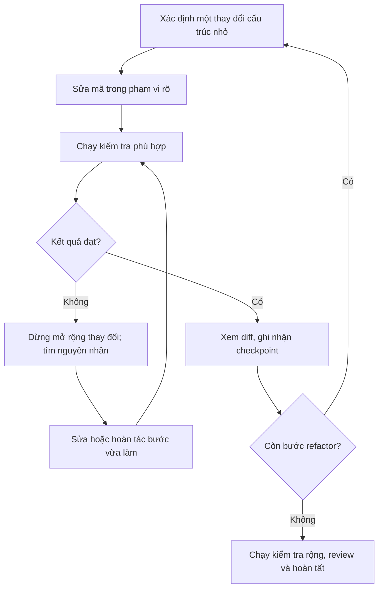
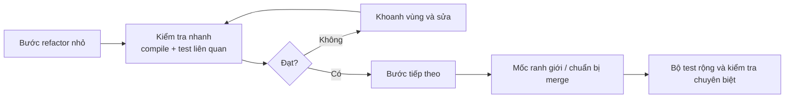
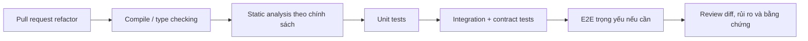

# Chạy kiểm tra phù hợp sau từng bước có ý nghĩa

Một nhóm phát triển quyết định tái cấu trúc lớp tính phí giao hàng vì quy tắc bị trộn với việc xử lý đơn hàng. Lập trình viên đổi tên một số phương thức, tách logic vào lớp mới, thay cách khởi tạo service rồi chạy **toàn bộ test một lần ở cuối**. Khi nhiều ca kiểm thử thất bại, rất khó xác định bước nào đã làm thay đổi hành vi. Người sửa có thể phải lần lại cả một chuỗi chỉnh sửa lớn, trong khi mỗi thay đổi riêng lẻ vốn khá đơn giản.

Một cách khác là thực hiện những **bước nhỏ có ý nghĩa**, sau mỗi bước chạy **kiểm tra phù hợp với phạm vi và rủi ro**. Khi test đỏ, ta biết lỗi có thể xuất hiện ở khoảng thay đổi gần nhất. Khi test xanh, ta có thêm bằng chứng rằng một phần hợp đồng vẫn được giữ nguyên. Việc này giúp refactor dễ kiểm soát mà không phải chờ chạy bộ kiểm thử toàn hệ thống sau từng dòng mã.

Trong chương **Tái cấu trúc** của `CODE_QUALITY_FUNDAMENTALS`, bài học này tập trung vào cách lựa chọn và tổ chức kiểm tra trong quá trình refactoring: **biên dịch, kiểm thử đơn vị, tích hợp, hợp đồng, toàn hệ thống, phân tích tĩnh và những phép đo chuyên biệt**. Mục tiêu của module là hiểu những thuộc tính làm mã nguồn **đáng tin cậy, dễ hiểu và dễ thay đổi**; một vòng lặp refactor có kiểm chứng giúp duy trì các thuộc tính đó khi cấu trúc bên trong thay đổi.

Sau bài học, bạn có thể định nghĩa một bước refactor có ý nghĩa, thiết lập baseline đáng tin cậy, chọn kiểm tra theo thay đổi, dừng và chẩn đoán khi kết quả đỏ, tổ chức các đợt kiểm tra rộng hơn tại mốc phù hợp và giải thích **điều một lần kiểm tra xanh thực sự chứng minh**.

## 1. Refactoring là thay cấu trúc, không tự ý đổi hợp đồng hành vi

**Refactoring (tái cấu trúc)** là thay đổi cấu trúc nội bộ của mã để cải thiện khả năng đọc, bảo trì hoặc thiết kế **mà không cố ý thay đổi hành vi bên ngoài đang được cam kết**.

Những thay đổi thường được xem là refactor:

- Đổi tên một biến hoặc phương thức cho rõ nghĩa, giữ tương thích với nơi dùng liên quan.
- Trích xuất một phép tính vào phương thức thuần.
- Chuyển quy tắc nghiệp vụ từ controller sang service phù hợp.
- Thay hai bản sao cùng chính sách bằng một lớp chính sách có chủ sở hữu rõ.
- Chia một lớp quá nhiều trách nhiệm thành các thành phần có hợp đồng nhỏ hơn.

Những thay đổi **không còn là refactor thuần túy** nếu cố ý đổi hành vi:

- Thay ngưỡng miễn phí vận chuyển từ 300.000 thành 350.000 VND.
- Đổi phản hồi HTTP `404` thành `403` khi hợp đồng công khai chưa cho phép.
- Cho phép hủy đơn ở trạng thái trước đây bị từ chối.
- Thay thứ tự lưu đơn và gửi xác nhận dẫn đến thời điểm/tác dụng phụ khác.

Một pull request có thể gồm cả refactor và thay đổi chức năng, nhưng nên **tách chúng thành những bước dễ phân biệt**. Khi test thất bại, ta cần biết đó là lỗi ngoài ý muốn của refactor hay thay đổi mong đợi theo yêu cầu mới.

### 1.1. “Giữ nguyên hành vi” gồm những gì?

Hành vi quan sát được không chỉ là giá trị trả về. Tùy hợp đồng API, cần bảo vệ:

| Khía cạnh | Ví dụ cần giữ |
| --- | --- |
| **Giá trị và công thức** | Phí tại hai phía ngưỡng 300.000 VND |
| **Lỗi và điều kiện từ chối** | Tổng tiền âm tiếp tục bị từ chối đúng loại lỗi đã cam kết |
| **Tác dụng phụ** | Không gửi email hai lần; không ghi đơn khi kiểm tra thất bại |
| **Thứ tự thực thi** | Lưu dữ liệu thành công trước khi công bố sự kiện |
| **Trạng thái** | Chuyển trạng thái hợp lệ và bất biến được duy trì |
| **Hợp đồng API** | Tên trường JSON, mã trạng thái, nghĩa của giá trị |
| **Quyền và bảo mật** | Không xuất hiện đường truy cập bỏ qua phân quyền |
| **Tài nguyên** | Connection/stream được đóng hoặc trả đúng vòng đời |
| **Đồng thời** | Các lời gọi chồng lấn vẫn giữ bất biến nghiệp vụ |
| **Đặc tính phi chức năng đã cam kết** | Ngưỡng độ trễ, bộ nhớ hoặc khả năng chịu tải quan trọng |

Không phải lúc nào cũng cần chạy mọi loại test để bảo vệ tất cả hàng trên. **Loại kiểm tra phải tương ứng với phần hành vi mà bước refactor có khả năng ảnh hưởng.**

## 2. Thế nào là “một bước có ý nghĩa”?

Một bước refactor có ý nghĩa là **một thay đổi đủ nhỏ để hiểu được ý định và xác định phạm vi tác động, nhưng đủ hoàn chỉnh để kiểm chứng một hợp đồng cụ thể**.

Ví dụ:

- Trích xuất điều kiện tính phí thành `shippingFeeVnd(...)`, cập nhật nơi gọi và kiểm tra kết quả.
- Đưa điều kiện ấy sang `ShippingFeePolicy`, cập nhật constructor/caller, biên dịch và chạy test liên quan.
- Thay repository giả bằng adapter JDBC, rồi chạy test tích hợp về truy vấn.
- Chuyển một chuỗi thao tác đồng bộ sang `CompletableFuture`, rồi kiểm tra thứ tự, lỗi và kết quả bất đồng bộ.

Ngược lại, **gõ một dấu chấm phẩy** chưa phải một bước độc lập đáng chạy cả hệ thống test. Một đoạn mã chưa biên dịch xong cũng không phải mốc thích hợp để kết luận chất lượng.

Có thể dùng ba câu hỏi để chọn kích thước bước:

1. **Mục tiêu thay đổi có thể diễn đạt bằng một câu không?** Ví dụ “trích xuất quy tắc phí mà không đổi công thức”.
2. **Có thể kiểm tra bước đó bằng bằng chứng rõ không?** Compile, test kết quả biên, test hợp đồng?
3. **Nếu kiểm tra đỏ, có thể khoanh vùng vào thay đổi vừa làm không?**

Nếu sau một bước bạn phải giải thích “đã đổi 12 thứ liên quan nên chưa biết lỗi ở đâu”, bước đó có thể quá lớn.

### 2.1. Vòng lặp ngắn và có điểm dừng



**Điểm quan trọng:** Khi một kiểm tra liên quan thất bại, không nên tiếp tục thêm hàng loạt refactor rồi hy vọng mọi thứ sẽ xanh ở cuối. Hãy xác định nguyên nhân trước khi làm thay đổi vùng lỗi thêm lớn.

“Ghi nhận checkpoint” có thể là một commit nhỏ, một thay đổi được lưu rõ trong lịch sử làm việc hoặc một mốc dễ hoàn tác. Không cần tạo commit sau từng lần đổi tên biến, nhưng nên có các mốc có thể hiểu và phục hồi.

## 3. Thiết lập baseline trước khi bắt đầu

**Baseline** là trạng thái và kết quả kiểm chứng ban đầu mà ta có thể so sánh với các bước sau.

Trước khi refactor, nên xác định:

- Mã hiện có **biên dịch được không**?
- Những test liên quan **đang xanh, đỏ hay bị bỏ qua**?
- Các quy tắc hành vi hiện hành là gì, đặc biệt ở giá trị biên và đường lỗi?
- Có kiểm tra tích hợp hoặc môi trường nào cần chuẩn bị không?
- Có cảnh báo hoặc lỗi phân tích tĩnh **đã tồn tại từ trước** không?
- Những thành phần nào sẽ bị ảnh hưởng khi thay cấu trúc?

### 3.1. Vì sao baseline đỏ làm khó đánh giá?

Giả sử trước khi refactor đã có một integration test thỉnh thoảng timeout. Sau khi trích xuất một phương thức, test đó lại đỏ. Nếu không có baseline, rất dễ kết luận lỗi vừa được đưa vào; cũng có thể sai lầm ngược lại: bỏ qua lỗi mới vì “test này vốn flaky”.

Vì vậy, cần ghi nhận **tên test, loại lỗi, mức ổn định, cấu hình và commit**. Nếu kiểm tra cần thiết vốn đang đỏ, phải xác định cách làm rõ hoặc cô lập nguyên nhân trước khi dựa vào kết quả của nó. Không thể kết luận refactor an toàn chỉ từ một test đã mất khả năng phát tín hiệu.

### 3.2. Kiểm thử đặc trưng cho mã cũ

Với mã legacy thiếu tài liệu, có thể viết **characterization tests** để ghi nhận hành vi quan sát được trước khi đổi cấu trúc. Ví dụ:

- Tại `subtotalVnd = 299_999`, phí là bao nhiêu?
- Khi `subtotalVnd = 300_000`, điều kiện có bao gồm ngưỡng không?
- `vip = true` có làm phí bằng 0 không?
- Khi tổng tiền âm, API trả giá trị hay ném exception?
- Khi một thành phần phụ thuộc lỗi, bên gọi có phát sinh tác dụng phụ nào không?

**Cảnh báo:** Characterization test có thể ghi nhận cả **bug hiện tại**. Trước khi coi một hành vi là hợp đồng cần giữ, cần đối chiếu với yêu cầu và người sở hữu nghiệp vụ. Nếu một hành vi sai cần được sửa, tách việc sửa bug khỏi refactor và cập nhật test theo kỳ vọng đúng.

## 4. Chọn kiểm tra theo phạm vi thay đổi, không theo thói quen

Không có một bộ lệnh duy nhất tối ưu cho mọi bước refactor. Cách chọn tốt là nhìn vào **bán kính tác động** và **loại rủi ro**.

| Bước thay đổi | Kiểm tra ngay sau bước | Kiểm tra bổ sung tại mốc thích hợp |
| --- | --- | --- |
| Đổi tên biến local, trích xuất biểu thức thuần | Compile + unit test trực tiếp, xem diff | Test rộng trước merge nếu có liên quan |
| Đổi chữ ký phương thức hoặc constructor | Compile những caller liên quan + unit test | Integration/contract nếu là API dùng bên ngoài module |
| Trích xuất policy tính phí | Unit test giá trị biên, lỗi và consumer | Integration test xác minh cách lắp ghép thực |
| Thay adapter JDBC hoặc cách quản lý transaction | Integration test với database đại diện | Test concurrent update, migration, system test liên quan |
| Đổi DTO/serialization hoặc mapping lỗi HTTP | Kiểm tra compile + contract test | Integration/E2E cho luồng tiêu thụ API |
| Đổi thứ tự thao tác hoặc chuyển sang bất đồng bộ | Test thứ tự, lỗi, cancellation và tác dụng phụ | Integration/concurrency/system test theo rủi ro |
| Refactor xử lý đường dẫn, upload, phân quyền | Test validation/authorization, kiểm tra tĩnh phù hợp | Security/integration test ở ranh giới thật |
| Tối ưu cache, thuật toán hoặc phân trang | Unit test hành vi và trường hợp biên | Benchmark/profiling với dữ liệu đại diện, test tải nếu cần |
| Chuyển ownership của stream/connection/executor | Test close/shutdown trên thành công và lỗi | Integration, metrics pool/thread/handle |
| Chỉnh cấu hình hoặc dependency được load runtime | Build và kiểm tra cấu hình/khởi động | Smoke test trên môi trường mục tiêu |

**Biên dịch thường là bước rẻ và hữu ích**, nhưng không kiểm tra được sai công thức, lỗi SQL, thứ tự bất đồng bộ hoặc quyền truy cập. Ngược lại, chạy E2E đầy đủ sau một lần trích xuất helper nhỏ có thể tốn nhiều thời gian mà không cho thêm bằng chứng tương xứng.

### 4.1. Hai vòng kiểm tra bổ sung nhau

Có thể chia kiểm tra thành:

- **Vòng nhanh (inner loop):** compiler, unit test tập trung, linter/format hoặc phân tích tĩnh gần vùng thay đổi. Dùng sau từng bước có ý nghĩa để có phản hồi sớm.
- **Vòng rộng (outer loop):** nhiều unit test hơn, integration/contract tests, E2E trọng yếu, kiểm tra hiệu năng hoặc an ninh khi phù hợp. Dùng tại mốc thay đổi ranh giới, trước merge, trước release và trong CI theo chính sách.



**Vòng nhanh không thay thế vòng rộng.** Nó giúp phát hiện lỗi gần nơi phát sinh; vòng rộng phát hiện sự tương tác giữa nhiều thành phần mà kiểm tra cục bộ không quan sát được.

## 5. Ví dụ Java 17 xuyên suốt: tách quy tắc phí giao hàng từng bước

Giả sử một ứng dụng báo giá có quy tắc:

- Khách VIP được miễn phí giao hàng.
- Khách thường có tổng tiền hàng từ **300.000 VND** được miễn phí.
- Khách thường có tổng tiền hàng dưới ngưỡng phải trả **30.000 VND**.
- Tổng tiền hàng âm là không hợp lệ.
- Phương thức trả **tổng tiền hàng cộng phí**; chưa lưu đơn hoặc thực hiện thanh toán.

Ta muốn tách chính sách phí ra khỏi lớp tính tổng để sau này có thể kiểm thử và tái sử dụng. **Mục đích là tái cấu trúc, không đổi bất kỳ ngưỡng hay điều kiện nghiệp vụ nào.**

### 5.1. Trạng thái ban đầu

```java
final class QuoteTotals {
    long totalVnd(long subtotalVnd, boolean vip) {
        if (subtotalVnd < 0) {
            throw new IllegalArgumentException(
                    "Subtotal must be nonnegative");
        }

        long shippingFeeVnd = 30_000L;
        if (vip || subtotalVnd >= 300_000L) {
            shippingFeeVnd = 0L;
        }

        return Math.addExact(subtotalVnd, shippingFeeVnd);
    }
}
```

Lớp này nhỏ, nhưng một tính năng mới có thể cần dùng cùng chính sách phí ở checkout. Ta chưa vội thay đổi hai luồng; trước hết hãy **bảo vệ hành vi hiện tại**.

### 5.2. Bước 0 — Ghi nhận baseline và thêm test biên

```java
import static org.junit.jupiter.api.Assertions.assertEquals;
import static org.junit.jupiter.api.Assertions.assertThrows;

import org.junit.jupiter.api.Test;

class QuoteTotalsTest {
    private final QuoteTotals totals = new QuoteTotals();

    @Test
    void chargesStandardFeeJustBelowThreshold() {
        assertEquals(329_999L,
                totals.totalVnd(299_999L, false));
    }

    @Test
    void givesFreeShippingExactlyAtThreshold() {
        assertEquals(300_000L,
                totals.totalVnd(300_000L, false));
    }

    @Test
    void vipGetsFreeShippingBelowThreshold() {
        assertEquals(50_000L,
                totals.totalVnd(50_000L, true));
    }

    @Test
    void rejectsNegativeSubtotal() {
        IllegalArgumentException error = assertThrows(
                IllegalArgumentException.class,
                () -> totals.totalVnd(-1L, false));

        assertEquals("Subtotal must be nonnegative",
                error.getMessage());
    }
}
```

Các test JUnit 5 xác nhận **đường thành công, ranh giới và lỗi đầu vào**. Việc kiểm tra nội dung exception trong ví dụ thể hiện ta muốn giữ đúng một thông điệp hiện hữu. Trong dự án thật, chỉ nên khóa chặt thông điệp nếu nó là một phần hợp đồng cần giữ; nhiều API chỉ cam kết mã lỗi hoặc kiểu exception.

**Kiểm tra phù hợp tại mốc này:** compile dự án/những nguồn liên quan và chạy `QuoteTotalsTest`. Nếu baseline thất bại vì hành vi hiện tại đã khác, cần tìm hiểu trước khi trích xuất.

Ví dụ trong **dự án Gradle có cấu hình JUnit 5 và test filter phù hợp**, một lệnh minh họa là:

```bash
./gradlew test --tests '*QuoteTotalsTest'
```

Đây là **lệnh tham khảo trong nội dung học**, không phải lệnh đã chạy trên repository của bài. Nếu dự án dùng Maven hoặc một cấu trúc build khác, dùng lệnh tương ứng. Không nên suy đoán cấu hình build chỉ từ tên folder.

### 5.3. Bước 1 — Trích xuất phương thức thuần trong cùng lớp

Trước khi tạo một lớp mới, ta có thể tách quyết định phí thành một phương thức riêng:

```java
final class QuoteTotals {
    long totalVnd(long subtotalVnd, boolean vip) {
        if (subtotalVnd < 0) {
            throw new IllegalArgumentException(
                    "Subtotal must be nonnegative");
        }

        long shippingFeeVnd = shippingFeeVnd(subtotalVnd, vip);
        return Math.addExact(subtotalVnd, shippingFeeVnd);
    }

    private static long shippingFeeVnd(
            long subtotalVnd, boolean vip) {
        return (vip || subtotalVnd >= 300_000L)
                ? 0L : 30_000L;
    }
}
```

**Phạm vi thay đổi:**

- Logic điều kiện chuyển từ thân `totalVnd` sang một helper private.
- Không đổi ngưỡng, mức phí, thứ tự kiểm tra tổng âm hay kiểu kết quả.
- Chưa đổi constructor, dependency, cơ sở dữ liệu hay API công khai.

**Kiểm tra phù hợp:** compile + chạy lại `QuoteTotalsTest`; sau đó xem diff để xác nhận không vô tình sửa `>=` thành `>`.

Nếu test ở `300_000` thất bại, lỗi được khoanh vùng ngay trong bước vừa trích xuất. Không cần đợi thêm nhiều refactor mới điều tra.

**Bằng chứng sau bước 1:** Trong phạm vi những đầu vào được kiểm thử, việc trích xuất vẫn giữ các kết quả đã quan sát. Nó chưa chứng minh mọi giá trị `long` đều tương đương, và chưa kiểm tra bất kỳ thay đổi liên module nào.

### 5.4. Bước 2 — Chuyển chính sách sang một lớp riêng

Tiếp theo, tạo `ShippingFeePolicy`:

```java
final class ShippingFeePolicy {
    long feeVnd(long subtotalVnd, boolean vip) {
        if (subtotalVnd < 0) {
            throw new IllegalArgumentException(
                    "Subtotal must be nonnegative");
        }

        return (vip || subtotalVnd >= 300_000L)
                ? 0L : 30_000L;
    }
}
```

Để lớp tính tổng dùng chính sách mới mà vẫn giữ cách khởi tạo cũ:

```java
import java.util.Objects;

final class QuoteTotals {
    private final ShippingFeePolicy shipping;

    QuoteTotals() {
        this(new ShippingFeePolicy());
    }

    QuoteTotals(ShippingFeePolicy shipping) {
        this.shipping = Objects.requireNonNull(shipping);
    }

    long totalVnd(long subtotalVnd, boolean vip) {
        long feeVnd = shipping.feeVnd(subtotalVnd, vip);
        return Math.addExact(subtotalVnd, feeVnd);
    }
}
```

Ở phiên bản này:

- `QuoteTotals.totalVnd` tiếp tục nhận `long` và `boolean`, trả `long`; constructor không tham số vẫn còn.
- `ShippingFeePolicy` sở hữu quy tắc kiểm tra tổng âm và tính phí.
- `QuoteTotals` chỉ phối hợp chính sách với phép cộng tổng.
- Khi tổng tiền âm, chính sách ném exception **trước khi** phép cộng diễn ra, như phiên bản đầu.
- Tên lớp và phương thức trở nên có trách nhiệm rõ hơn nhưng **đã có thay đổi về cách lắp ghép object**.

**Kiểm tra ngay sau bước 2:**

1. Compile để tìm nơi gọi hoặc import chưa hợp lệ.
2. Chạy `QuoteTotalsTest` để xác nhận hợp đồng cũ.
3. Thêm/chạy `ShippingFeePolicyTest` trực tiếp cho quy tắc mới.
4. Nếu thay đổi thêm cấu hình dependency injection của ứng dụng, cần kiểm tra cách lắp ghép ở mức component/integration phù hợp.

Một bài test trực tiếp cho chính sách:

```java
import static org.junit.jupiter.api.Assertions.assertEquals;
import static org.junit.jupiter.api.Assertions.assertThrows;

import org.junit.jupiter.api.Test;

class ShippingFeePolicyTest {
    private final ShippingFeePolicy policy = new ShippingFeePolicy();

    @Test
    void appliesSameThresholdAndVipRules() {
        assertEquals(30_000L, policy.feeVnd(299_999L, false));
        assertEquals(0L, policy.feeVnd(300_000L, false));
        assertEquals(0L, policy.feeVnd(50_000L, true));
    }

    @Test
    void rejectsNegativeSubtotal() {
        assertThrows(IllegalArgumentException.class,
                () -> policy.feeVnd(-1L, false));
    }
}
```

**Chú ý về tổ chức mã:** Ba phiên bản `QuoteTotals` ở các bước 0, 1, 2 là **những lát cắt theo thời gian**, không phải ba định nghĩa cùng đặt vào một package. Khi thực hành, chỉ giữ **phiên bản hiện tại** của lớp và các test tương ứng.

### 5.5. Bước 3 — Cho thêm consumer dùng chung chính sách

Giả sử checkout cũng cần cùng chính sách và trước đây tự sao chép ngưỡng. Ta đưa phần phụ thuộc chung vào một constructor:

```java
import java.util.Objects;

final class CheckoutTotals {
    private final ShippingFeePolicy shipping;

    CheckoutTotals(ShippingFeePolicy shipping) {
        this.shipping = Objects.requireNonNull(shipping);
    }

    long totalVnd(long subtotalVnd, boolean vip) {
        long feeVnd = shipping.feeVnd(subtotalVnd, vip);
        return Math.addExact(subtotalVnd, feeVnd);
    }
}
```

Một test consumer cho hai phép tính:

```java
import static org.junit.jupiter.api.Assertions.assertEquals;

import org.junit.jupiter.api.Test;

class ConsumersUsePolicyTest {
    @Test
    void quoteAndCheckoutAgreeAtThreshold() {
        ShippingFeePolicy policy = new ShippingFeePolicy();
        QuoteTotals quote = new QuoteTotals(policy);
        CheckoutTotals checkout = new CheckoutTotals(policy);

        assertEquals(300_000L, quote.totalVnd(300_000L, false));
        assertEquals(300_000L, checkout.totalVnd(300_000L, false));
    }
}
```

**Điều cần kiểm tra tăng lên** vì bây giờ có hai nơi sử dụng:

- Biên dịch các consumer, kiểm tra đúng chữ ký và constructor.
- Chạy unit test của chính sách và cả hai consumer.
- Nếu controller/service thực tế có DI hoặc factory riêng, chạy integration test xác nhận đối tượng thật đã nhận đúng policy.
- Nếu báo giá và checkout là hai API công khai, cân nhắc contract/API tests để chắc rằng các phản hồi vẫn giữ ý nghĩa trước refactor.

Tại bước này, một bài unit test tạo object bằng `new` có thể xanh trong khi cấu hình ứng dụng thật vẫn chọn nhầm bean hoặc dùng một policy cũ. Đó là ví dụ rõ về lý do **mở rộng phạm vi kiểm tra khi bước refactor vượt ranh giới thành phần**.

### 5.6. Bước 4 — Kiểm tra rộng tại mốc hoàn tất

Khi các bước nhỏ đã xanh, trước khi kết luận refactor hoàn thành, cần xét phạm vi thay đổi thực tế:

- Compile toàn bộ module hoặc những module phụ thuộc.
- Chạy toàn bộ unit test liên quan và bộ kiểm tra tĩnh/quality gate được dự án quy định.
- Chạy integration test lắp ghép các consumer với policy thật nếu wiring thay đổi.
- Chạy contract test nếu API, serialization hoặc consumer bên ngoài có thể bị tác động.
- Chọn E2E kiểm tra hành trình báo giá–checkout quan trọng nếu đó là rủi ro của thay đổi.
- Review diff cuối: không còn bản sao ngưỡng trái chủ đích, không sửa nhầm chính sách, không thêm công việc ngoài phạm vi.

Nếu không có thay đổi ở database hoặc giao thức bên ngoài, **không nhất thiết phải chạy tất cả bài test database và E2E sau từng bước nhỏ**. Tuy nhiên, CI trước merge cần đáp ứng các quality gate và chính sách test của dự án.

### 5.7. Bảng checkpoint cho ví dụ

| Mốc | Thay đổi | Kiểm tra trọng tâm | Kết luận có thể rút ra |
| --- | --- | --- | --- |
| **Baseline** | Chưa refactor; mô tả hành vi hiện có | Compile, `QuoteTotalsTest` biên và lỗi | Có một mốc hành vi để so sánh |
| **Bước 1** | Trích xuất helper private | Compile + test `QuoteTotals` | Điều kiện và đầu ra quan sát được chưa đổi ở ca test |
| **Bước 2** | Tách `ShippingFeePolicy` và kết nối vào `QuoteTotals` | Compile + test policy, test consumer; integration nếu đổi wiring | Quy tắc được tách mà kết quả cũ vẫn được bảo vệ |
| **Bước 3** | Chuyển checkout sang cùng policy | Compile + test hai consumer + kiểm tra cấu hình | Hai consumer được kiểm chứng về cách dùng chung trong phạm vi test |
| **Hoàn tất** | Tập hợp các bước refactor đã xanh | Bộ test rộng theo rủi ro, static analysis, review CI | Có bằng chứng rộng hơn về tác động của thay đổi |

**Quan trọng:** “Test xanh” không tự có nghĩa “100% hành vi được bảo toàn”. Kết luận luôn phụ thuộc **phạm vi test, dữ liệu test và môi trường**.

## 6. Nếu một kiểm tra thất bại thì làm gì?

Việc chạy kiểm tra sau mỗi bước chỉ có giá trị nếu nhóm **phản ứng có kỷ luật với kết quả đỏ**.

### 6.1. Dừng mở rộng phạm vi

Khi một unit test tập trung thất bại sau khi trích xuất helper, trước tiên nên:

1. Giữ nguyên hoặc ghi nhận diff của bước vừa làm.
2. Xác định test nào thất bại, input nào và kỳ vọng nào bị vi phạm.
3. So sánh đường đi dữ liệu và điều kiện **trước/sau bước đó**.
4. Sửa nguyên nhân hoặc hoàn tác chính bước đang làm.
5. Chạy lại kiểm tra cần thiết để xác nhận.
6. Chỉ tiếp tục bước mới khi trạng thái đạt hoặc rủi ro còn lại được ghi nhận và xử lý theo quy trình cho phép.

Đừng vừa sửa lỗi vừa tranh thủ “làm sạch thêm” các lớp lân cận; điều đó thường khiến vùng cần điều tra lớn hơn.

### 6.2. Phân loại kết quả đỏ

| Hiện tượng | Cách điều tra phù hợp |
| --- | --- |
| **Lỗi compile** | Kiểm tra chữ ký, import, generic, quyền truy cập, kiểu trả về và caller chịu tác động |
| **Unit test biên đỏ** | So sánh toán tử `> / >=`, giá trị hằng, phép làm tròn và thứ tự validation |
| **Test thứ tự/tác dụng phụ đỏ** | Kiểm tra việc di chuyển code có đổi thời điểm ghi dữ liệu, gửi sự kiện hoặc transaction không |
| **Integration test đỏ** | Kiểm tra wiring, cấu hình, schema, query, connection hoặc hợp đồng với phụ thuộc thật |
| **Contract test đỏ** | Kiểm tra sự thay đổi JSON, status code, trường bắt buộc và ngữ nghĩa mà consumer dùng |
| **Kiểm tra tĩnh đỏ** | Xem cảnh báo mới hay cũ, quy tắc áp dụng và nguy cơ thực tế; không tự động suppression |
| **Test flaky** | So với baseline, kiểm tra dữ liệu chia sẻ, đồng hồ, lịch luồng và dependency; không tự xem là PASS |
| **Lỗi môi trường** | Xác minh môi trường test, quyền, service, version; phân biệt hạ tầng với hồi quy của mã |
| **Benchmark xấu đi** | Kiểm tra workload, độ nhiễu, warm-up, số lần đo và sự thay đổi thật trong đường nóng |

Trong một số trường hợp, lỗi không do bước vừa làm. Nhưng đây phải là **kết luận sau khi có bằng chứng**, không phải mặc định khi test gây khó chịu.

### 6.3. Không “sửa test cho xanh” bằng cách bỏ mất hợp đồng

Những cách làm dễ làm suy yếu bằng chứng:

- Đổi expected value theo kết quả sai mới mà không có thay đổi yêu cầu.
- Thêm `@Disabled` cho test đang đỏ chỉ để qua CI.
- Tăng timeout mãi để che một race condition hoặc deadlock.
- Thay toàn bộ integration test bằng mock rồi cho rằng đã kiểm chứng database.
- Bỏ assertion về tác dụng phụ vì nó khó ổn định.
- Thêm `@SuppressWarnings` mà không hiểu warning mới.

Nếu **hợp đồng cố ý đổi**, hãy ghi đó là thay đổi chức năng, cập nhật test theo đặc tả mới và kiểm tra tác động đến consumer. Nếu chỉ refactor, test đỏ ở hành vi cũ là tín hiệu cần điều tra.

## 7. Không phải test nào cũng chạy ở cùng nhịp

Tốc độ phản hồi quan trọng: một vòng refactor có kiểm tra mất vài giây khuyến khích nhóm làm từng bước; nếu mỗi lần đều mất nửa giờ, người sửa có xu hướng gom rất nhiều chỉnh sửa trước khi thử.

Tuy vậy, **chỉ chọn test nhanh** sẽ bỏ sót các lỗi ở ranh giới.

### 7.1. Một cách phân lớp thực dụng

| Nhịp | Kiểm tra thường dùng | Mục tiêu |
| --- | --- | --- |
| **Sau bước nhỏ có ý nghĩa** | Compile, focused unit test, kiểm tra format/lint liên quan | Phản hồi nhanh và khoanh vùng lỗi |
| **Sau khi đổi ranh giới** | Integration, contract, concurrency hoặc security test đúng ranh giới | Xác minh những thành phần vừa được kết nối lại |
| **Sau một nhóm bước ổn định** | Tập unit test lớn hơn, static analysis của module, test component | Tìm tác động lan rộng trước khi tích lũy thêm thay đổi |
| **Trước merge/qua CI** | Các quality gate bắt buộc và bộ kiểm thử rộng theo chính sách | Bằng chứng đủ rộng để review và tích hợp |
| **Trước/sau triển khai khi phù hợp** | Smoke test, kiểm tra health/metrics, canary hoặc giám sát hành vi | Phát hiện vấn đề cấu hình và môi trường thực |

**Không có quy tắc cứng** như “sau mỗi ba dòng phải chạy full test” hay “chỉ cần chạy test một lần khi tạo PR”. Mốc phù hợp là mốc mà **một loại hợp đồng hoặc ranh giới vừa có khả năng bị thay đổi**.

### 7.2. Test selection có thể bỏ sót

Một công cụ chọn test dựa trên file thay đổi hoặc quan hệ phụ thuộc có thể giảm thời gian đáng kể. Tuy nhiên, kết quả phụ thuộc độ chính xác của đồ thị và cấu hình:

- Reflection và dependency injection runtime có thể tạo phụ thuộc khó thấy.
- SQL, migration, config, schema và resource file có thể không nằm trong import graph.
- Một thay đổi của thư viện chung có thể ảnh hưởng nhiều module mà bộ lọc đơn giản không bắt hết.
- Plugin build, generated code và cấu hình môi trường có thể thay hành vi gián tiếp.

Vì vậy, **test tập trung là bước phản hồi sớm, không phải lý do mặc nhiên bỏ toàn bộ kiểm tra tích hợp trước mốc cuối**.

### 7.3. Tránh ghép mọi kiểm tra vào một nút “Test”

Lý tưởng là kết quả CI cho biết:

- Biên dịch hay type check thất bại?
- Đơn vị nào, test case nào đỏ?
- Integration test gặp lỗi hạ tầng hay assertion?
- Contract nào không còn tương thích?
- Kiểm tra security/static analysis nào báo phát hiện mới?
- Có test nào bị bỏ qua hoặc vô hiệu hóa?

Phản hồi **cụ thể và dễ quy trách nhiệm** giúp sửa nhanh hơn một dòng tổng kết mơ hồ “Build failed”.

## 8. Kiểm tra chất lượng ngoài unit test: chọn đúng lúc

Refactor có thể vô tình tác động các đặc tính mà test giá trị trả về không thấy được.

### 8.1. Cơ sở dữ liệu và transaction

Nếu đổi nơi mở `Connection`, chuyển truy vấn sang repository hoặc thay transaction boundary, phải kiểm tra:

- Query thật hoạt động với schema và version được hỗ trợ.
- Connection được trả pool khi thành công và khi exception.
- Không ghi một phần dữ liệu trái hợp đồng sau lỗi.
- Ràng buộc database và các cập nhật cạnh tranh vẫn đúng.
- Migration không làm dữ liệu lịch sử không đọc được.

**Unit test dùng fake repository không đủ** để chứng minh những điều trên; cần integration test đúng ranh giới.

### 8.2. Bất đồng bộ và thứ tự xử lý

Nếu chuyển:

```java
store.save(order);
sender.sendConfirmation(order);
```

sang một pipeline `CompletableFuture`, dù code ngắn hơn, có thể thay đổi **khi nào** thông báo được gửi và **khi nào** phương thức trả về.

Cần kiểm tra:

- Bước gửi chỉ bắt đầu sau khi lưu hoàn tất thành công.
- Nếu lưu lỗi, có gửi nhầm thông báo không?
- Nếu gửi lỗi, trạng thái đã lưu có được xử lý phù hợp không?
- Ai quan sát exception từ future, ai chịu trách nhiệm retry?
- Khi bị hủy hoặc timeout, có tác dụng phụ nào đã xảy ra?
- Có chia sẻ trạng thái mutable không an toàn giữa các task không?

Khi kiểm thử nhiều luồng, ưu tiên cơ chế đồng bộ thử nghiệm như `CountDownLatch` hoặc future với timeout thay vì cố tạo thứ tự bằng `Thread.sleep`. Một lần test concurrent xanh không chứng minh tuyệt đối không có race; cần chọn bất biến và workload phù hợp.

### 8.3. Bảo mật và quyền truy cập

Nếu refactor đưa kiểm tra quyền từ controller xuống service, hãy chắc rằng **mọi đường gọi** (HTTP, job, queue, test helper) vẫn đi qua nơi có thẩm quyền. Test nên bao gồm người được phép và người không được phép, cũng như trường hợp tài nguyên thuộc tenant khác.

Biên dịch và unit test thuần của hàm tính giá **không phải bằng chứng** rằng refactor giữ được các ranh giới xác thực/ủy quyền.

### 8.4. Hiệu năng và tài nguyên

Nếu thay vòng lặp bằng stream, thêm cache, tăng cấp phát object hoặc đổi cách phân trang, test kết quả có thể xanh trong khi độ trễ/heap tăng.

Khi hiệu năng là yêu cầu, cần:

- Xác định workload và dữ liệu đại diện.
- Đo baseline trước refactor.
- So sánh sau refactor trong điều kiện có thể tái hiện.
- Theo dõi percentile latency, throughput, allocation hoặc tài nguyên phù hợp.
- Tránh kết luận từ một lần đo thiếu warm-up hoặc tải khác nhau.

Một phương thức có ít dòng hơn chưa chắc nhanh hơn. Ngược lại, cải thiện readability có thể chấp nhận chi phí nhỏ về CPU nếu vẫn đáp ứng SLA và giá trị bảo trì lớn hơn. Cần quyết định theo hợp đồng và dữ liệu đo.

## 9. Chạy kiểm tra không có nghĩa chỉ nhìn trạng thái xanh/đỏ

Một bước kiểm chứng có ích gồm ít nhất bốn phần:

1. **Phép kiểm tra:** Compile, test, static analysis, kiểm tra hợp đồng hoặc phép đo nào?
2. **Phạm vi:** Tệp, module, consumer, database, môi trường và dữ liệu nào?
3. **Kết quả:** Pass, fail, skip, timeout, flaky, cảnh báo mới hay baseline cũ?
4. **Kết luận giới hạn:** Bằng chứng đó cho phép tin vào điều gì, và còn điều gì chưa kiểm chứng?

Ví dụ:

> “Sau khi trích xuất `ShippingFeePolicy`, compiler và các unit test về ngưỡng phí đều xanh. Điều này hỗ trợ kết luận rằng phép tính và những trường hợp biên đã test được giữ nguyên. Chúng ta vẫn cần integration test xác nhận checkout thực dùng đúng policy.”

Đây là nhận xét có giá trị hơn “Em chạy test rồi, ổn” vì giúp reviewer thấy được **phạm vi bằng chứng**.

### 9.1. Tách kết quả từ nguồn khác nhau

Đừng cộng đơn giản “100 unit test + 1 integration test = 101 bằng chứng cùng loại”. Các loại test trả lời câu hỏi khác nhau:

- Unit test: một quy tắc hoặc hành vi cô lập đúng ở các ca đã chọn.
- Integration test: các thành phần thật phối hợp tại ranh giới đã chọn.
- Contract test: provider và consumer thống nhất kỳ vọng giao tiếp.
- System/E2E test: một hành trình đã lắp ghép hoạt động theo kịch bản.
- Static analysis: một tập quy tắc phân tích đã cấu hình không phát hiện vi phạm tương ứng.
- Performance test: một phép đo trên workload và môi trường đã xác định.

**Số lượng test không thay thế chất lượng assertion hay độ đại diện.**

### 9.2. Coverage và mutation testing chỉ là tín hiệu bổ sung

**Coverage** cho biết phần mã được thực thi theo tiêu chí như line/branch coverage; nó không đảm bảo test sẽ phát hiện kết quả sai. Một test chỉ gọi `policy.feeVnd(...)` mà không assert có thể tăng coverage nhưng không bảo vệ hợp đồng.

**Mutation testing** có thể giúp đánh giá sức mạnh test: đổi có chủ đích `>=` thành `>` rồi xem test ngưỡng có phát hiện sai khác hay không. Nhưng chi phí chạy và tập phép biến đổi có giới hạn. Không cần chạy mutation test sau từng lần đổi tên biến; nó hữu ích hơn khi cần củng cố bộ test ở phần logic rủi ro.

## 10. Cách thiết kế checkpoint cho một pull request

Một pull request refactor có thể được chia thành những mốc dễ review:

| Checkpoint | Nội dung | Điều kiện trước khi sang mốc sau |
| --- | --- | --- |
| **C0 – Baseline** | Test ghi nhận hành vi cũ, nêu các bất biến và lỗi đã biết | Phạm vi và kết quả baseline rõ |
| **C1 – Cấu trúc nhỏ** | Rename/extract private method, không đổi API công khai | Compile và focused tests đạt |
| **C2 – Tách trách nhiệm** | Tạo policy/port và nối caller | Compile, unit tests, static analysis liên quan đạt |
| **C3 – Ranh giới thực** | Lắp ghép DI/adapter hoặc cập nhật consumer | Integration/contract tests phù hợp đạt |
| **C4 – Hoàn tất** | Dọn mã dư, tài liệu, review diff | Bộ kiểm tra rộng/CI đạt; không có regression chưa giải thích |
| **C5 – Sau triển khai nếu cần** | Quan sát các chỉ số vận hành của luồng được ảnh hưởng | Không có dấu hiệu lệch hợp đồng/rủi ro mới trong phạm vi theo dõi |

Không nhất thiết mọi PR có đủ sáu mốc. Một refactor local nhỏ có thể chỉ cần C0, C1 và C4; một thay đổi transaction hoặc API công khai có thể cần C3 và C5 quan trọng hơn.

### 10.1. Tách refactor khỏi thay đổi chức năng

Ví dụ nhóm muốn đổi ngưỡng miễn phí từ 300.000 sang 350.000 VND:

- **Mốc refactor:** Đưa điều kiện hiện tại `>= 300_000` vào `ShippingFeePolicy`; các test cũ vẫn xanh.
- **Mốc thay đổi nghiệp vụ:** Cập nhật chính sách thành `>= 350_000` và cập nhật test theo yêu cầu mới.
- **Mốc tích hợp:** Xác nhận báo giá và checkout đều áp dụng đúng chính sách mới, dữ liệu phản hồi hợp đồng và cấu hình đúng.

Cách tách này giúp reviewer nhận biết **khi nào hành vi được chủ động đổi** và dễ phát hiện sai khác ngoài yêu cầu hơn.

### 10.2. Commit nhỏ và khả năng quay lại

Các checkpoint đạt kiểm tra có thể được ghi thành những commit có ý nghĩa, ví dụ:

```text
test: characterize shipping fee boundaries
refactor: extract shipping fee decision
refactor: move shipping rule into policy
refactor: wire checkout to shipping policy
```

Đây là **ví dụ tên commit**, không phải lệnh thay đổi repository. Khi xử lý nhánh làm việc chung, cần chú ý không hoàn tác thay đổi của người khác. Một commit quá lớn làm việc đối chiếu diff, tìm regression hoặc revert riêng lẻ khó hơn; quá nhiều commit vụn không mang ý nghĩa cũng có thể gây nhiễu.

## 11. Kiểm tra tự động trong CI và trách nhiệm của người review

Kiểm tra cục bộ giúp phản hồi nhanh, nhưng CI có vai trò tạo **môi trường và chính sách kiểm chứng chung** trước khi tích hợp.

Một pipeline minh họa:



Trong thực tế, nhiều bước có thể chạy **song song** để tiết kiệm thời gian. Thứ tự trong sơ đồ chỉ minh họa những nhóm kiểm chứng cần xem xét, không phải yêu cầu bắt buộc tuần tự cho mọi dự án.

### 11.1. Một báo cáo PR hữu ích cần nêu gì?

- **Mục tiêu refactor:** Đổi cấu trúc nào, vì sao, hành vi nào cần giữ?
- **Ranh giới ảnh hưởng:** Những module, API, adapter, schema và consumer nào liên quan?
- **Các checkpoint:** Mỗi bước chính đã được kiểm chứng bằng gì?
- **Kết quả cụ thể:** Compile/test/static check nào đạt; phần nào chưa chạy và lý do?
- **Rủi ro còn lại:** Test thiếu, môi trường không đại diện, hành vi concurrent chưa bao phủ?
- **Dữ liệu so sánh:** Nếu liên quan hiệu năng/tài nguyên, baseline và kết quả sau?
- **Kế hoạch triển khai:** Nếu có thay đổi runtime, cần kiểm soát rollout/rollback và theo dõi gì?

Không nên chỉ đưa một ảnh chụp dấu xanh nếu không biết đó là test của commit nào, phạm vi nào hoặc có test bị skip hay không.

### 11.2. Reviewer không chỉ kiểm tra “đã chạy test chưa?”

Reviewer còn cần xét:

1. Điều kiện nghiệp vụ có được chuyển **nguyên nghĩa** không?
2. Một đường lỗi hoặc tác dụng phụ có bị bỏ sót không?
3. Có tạo một abstraction dùng chung sai giữa hai trách nhiệm độc lập không?
4. Test có assert hành vi hay chỉ gọi phương thức để tăng coverage?
5. Tên và vị trí mới có giúp hiểu trách nhiệm rõ hơn không?
6. Có ranh giới runtime nào bị thay đổi mà kiểm tra tập trung chưa bao phủ không?

**Kiểm thử tự động và review bổ sung cho nhau**. Test kiểm tra những điều đã được đặc tả và quan sát; review có thể nhận ra giả thiết bị bỏ qua hoặc thay đổi kiến trúc không hợp lý.

## 12. Những sai lầm thường gặp khi kiểm tra trong quá trình refactor

### 12.1. Chỉ chạy toàn bộ test một lần ở cuối

Khi hàng chục bước đã tích lũy, lỗi khó khoanh vùng. Hãy chạy kiểm tra đủ nhanh ở những checkpoint có ý nghĩa; bộ test rộng vẫn cần tại các mốc quan trọng.

### 12.2. Chạy full E2E sau mọi thay đổi nhỏ

Điều này có thể làm vòng phản hồi chậm không cần thiết. Hãy ưu tiên compile và test liên quan khi sửa cục bộ, rồi chạy E2E cho ranh giới/hành trình có rủi ro và theo quy trình CI.

### 12.3. Đánh đồng compile xanh với hành vi đúng

`javac` phát hiện lỗi cú pháp/kiểu và một số hợp đồng cấu trúc, nhưng không biết phép tính phí đúng hay quyền truy cập đã được kiểm soát.

### 12.4. Bỏ qua test đỏ vì “đang refactor thôi”

Nếu refactor được kỳ vọng không đổi hành vi, một test hợp lệ đỏ là tín hiệu phải điều tra. Không nên tiếp tục thêm thay đổi khi chưa biết tại sao.

### 12.5. Sửa test theo kết quả mới mà chưa kiểm tra yêu cầu

Đây có thể là cách vô tình biến một regression thành hành vi được chấp nhận. Nếu có yêu cầu mới, hãy tách mốc thay đổi chức năng và nêu căn cứ.

### 12.6. Kiểm thử quá phụ thuộc chi tiết triển khai

Test kiểm tra số lần gọi từng helper private có thể đỏ khi refactor đúng dù hành vi bên ngoài giữ nguyên. Ưu tiên kiểm tra kết quả, lỗi và tác dụng phụ theo **hợp đồng quan sát được**; kiểm tra tương tác khi số lần/thứ tự thật sự là yêu cầu.

### 12.7. Bỏ qua đường lỗi và giá trị biên

Một test với `subtotal = 500_000` sẽ xanh dù dùng `>` hay `>=`. Cần ca ở `299_999` và `300_000` để bảo vệ điểm dễ bị thay đổi nhầm.

### 12.8. Dựa hoàn toàn vào mock khi đổi adapter thật

Mock có thể xác nhận một lời gọi được thực hiện, nhưng không chứng minh SQL, transaction, JSON mapping hoặc cấu hình thực hoạt động. Phải chọn integration/contract tests phù hợp.

### 12.9. Dùng `Thread.sleep` làm bằng chứng thứ tự

Ngủ một khoảng thời gian không khẳng định công việc khác đã hoàn tất. Dùng tín hiệu, future, latch hoặc sự kiện có hợp đồng rõ khi kiểm thử bất đồng bộ.

### 12.10. Đánh dấu xanh dù test bị skip hoặc lỗi môi trường

Không chạy được integration test do database thiếu không đồng nghĩa integration đã đạt. Báo cáo nên nêu **NOT RUN/BLOCKED** và phạm vi bằng chứng còn thiếu, không ghi PASS.

### 12.11. Không xem diff sau khi test xanh

Test không bao phủ mọi hành vi và refactor có thể vô tình thêm import phụ thuộc, đổi logging, cấu hình hoặc hợp đồng. Review diff là kiểm tra bổ sung rẻ và quan trọng.

### 12.12. Nghĩ rằng nhiều test hơn luôn tốt hơn

Một bộ test quá chậm, flaky hoặc khóa chặt triển khai có thể làm refactor khó hơn. Cần giữ các test có assertion đúng, độc lập hợp lý và phản ánh rủi ro thật.

## 13. Checklist sau mỗi bước refactor có ý nghĩa

Trước khi chuyển sang bước tiếp theo, hãy kiểm tra:

1. **Mục tiêu bước này là gì?** Chỉ đổi cấu trúc hay còn đổi hành vi theo yêu cầu?
2. **Diff có trong phạm vi dự kiến không?** Có thay đổi ngoài ý muốn hoặc mã chưa hoàn thiện?
3. **Những hợp đồng nào có thể bị ảnh hưởng?** Giá trị, lỗi, trạng thái, API, transaction, đồng thời, tài nguyên?
4. **Có baseline hợp lệ không?** Những test liên quan vốn xanh hay có lỗi đã biết?
5. **Compile đã đạt chưa?** Có chữ ký, import, generic hoặc caller bị bỏ sót?
6. **Focused test nào bảo vệ đúng thay đổi?** Có test biên và nhánh lỗi quan trọng?
7. **Bước này có vượt ranh giới thành phần không?** Nếu có, integration/contract test nào cần chạy?
8. **Có đặc tính phi chức năng nào cần giữ không?** Bảo mật, hiệu năng, tài nguyên, thứ tự bất đồng bộ?
9. **Test đỏ đã được giải thích và xử lý chưa?** Có đang bỏ qua hoặc vô hiệu hóa bằng chứng?
10. **Có thể quay lại bước trước không?** Checkpoint đã đủ rõ để sửa/revert riêng?
11. **Kết quả kiểm tra được ghi nhận đúng phạm vi chưa?** Không gọi NOT RUN là PASS?
12. **Đã đến mốc chạy bộ test rộng chưa?** Sau đổi wiring, trước merge hoặc trước release?

Nếu câu trả lời cho một phần quan trọng chưa rõ, nên dừng để thu hẹp phạm vi hoặc bổ sung bằng chứng, thay vì cứ tiếp tục refactor theo quán tính.

## 14. Bài tập tự kiểm tra

**Câu 1.** Vì sao chạy kiểm tra sau một bước hoàn chỉnh có ích hơn đợi đến khi đã refactor cả module?

*Gợi ý:* Khi lỗi xuất hiện, khoảng thay đổi cần điều tra nhỏ hơn; có thể sửa hoặc quay lại bước vừa làm. Bộ test rộng ở cuối vẫn cần để tìm tác động lan xa.

**Câu 2.** Bạn chỉ đổi tên biến local trong một phương thức thuần. Có cần chạy toàn bộ E2E sau mỗi lần lưu file không?

*Gợi ý:* Không mặc định. Compile và test trực tiếp thường cho phản hồi nhanh hơn; chạy bộ test rộng theo mốc CI và rủi ro của thay đổi.

**Câu 3.** Sau khi đổi `subtotalVnd >= 300_000L` thành `subtotalVnd > 300_000L`, test với 500.000 VND vẫn xanh. Test còn thiếu gì?

*Gợi ý:* Test đúng tại ngưỡng 300.000 VND; giá trị này phân biệt hai toán tử. Nếu đổi toán tử không được yêu cầu, đây là regression của refactor.

**Câu 4.** Một test đang flaky trước refactor và tiếp tục thất bại sau bước mới. Có thể kết luận refactor đúng hoặc sai không?

*Gợi ý:* Chưa. Phải đối chiếu baseline, tìm nguyên nhân bất định và xác định mức liên quan; không tự ghi PASS hay đổ lỗi cho refactor khi thiếu bằng chứng.

**Câu 5.** Bạn đưa logic tính phí sang `ShippingFeePolicy` và unit test policy xanh, nhưng controller sử dụng nhầm bean cấu hình. Loại kiểm tra nào hữu ích?

*Gợi ý:* Integration/component test khởi tạo ứng dụng với wiring thật, hoặc kiểm tra hành trình API liên quan. Unit test tự `new` policy không kiểm chứng cấu hình runtime.

**Câu 6.** Một refactor chuyển lưu đơn và gửi xác nhận sang pipeline bất đồng bộ. Chỉ kiểm tra giá trị trả về có đủ không?

*Gợi ý:* Không. Cần kiểm tra thứ tự phụ thuộc, lỗi, cancellation, tác dụng phụ và ai quan sát kết quả tương lai.

**Câu 7.** Một kiểm tra tích hợp không thể chạy vì database test chưa được khởi động. Có thể báo toàn bộ test PASS vì unit test xanh không?

*Gợi ý:* Không. Ghi rõ integration test **chưa chạy/bị chặn**. Kết quả unit test không thay thế bằng chứng về database.

**Câu 8.** Vì sao refactor có thể làm coverage giảm nhưng chất lượng không nhất thiết giảm tương ứng?

*Gợi ý:* Thay đổi cấu trúc, số dòng và cách công cụ đếm ảnh hưởng coverage. Cần xem assertion, ranh giới hành vi được bảo vệ và phạm vi kiểm thử thật.

**Câu 9.** Trước khi chia `OrderService` thành hai thành phần, nhóm thấy nhiều bug đang tồn tại. Nên xử lý thế nào?

*Gợi ý:* Xác định baseline và hợp đồng mong muốn. Tách việc sửa bug khỏi refactor khi có thể; đừng ghi nhận hành vi sai thành hợp đồng vĩnh viễn.

**Câu 10.** Tại sao một test chỉ xác nhận phương thức private được gọi đúng ba lần có thể không phù hợp để bảo vệ refactor?

*Gợi ý:* Refactor có thể thay đổi chi tiết gọi bên trong mà không đổi hành vi bên ngoài. Chỉ kiểm tra số lần khi nó là một phần yêu cầu, ví dụ tránh gửi thanh toán lặp.

**Câu 11.** Một bước refactor thay đổi transaction boundary của repository. Nên kiểm tra gì ngoài compile và unit test giả lập?

*Gợi ý:* Integration test với database phù hợp, commit/rollback, ràng buộc, connection lifecycle và cạnh tranh khi cần. Đó là ranh giới thật vừa bị tác động.

**Câu 12.** Vì sao review diff vẫn cần thiết khi toàn bộ test đã xanh?

*Gợi ý:* Test chỉ bao phủ những điều đã được viết và chạy. Diff có thể lộ phụ thuộc mới, sai phạm vi, logging/serialization thay đổi hoặc assumption chưa có test.

## Ghi nhớ

**Trong refactoring, hãy thay đổi từng phần đủ nhỏ để hiểu, đủ hoàn chỉnh để kiểm chứng và đủ rõ để có thể quay lại.** Sau mỗi bước có ý nghĩa, chọn phép kiểm tra phù hợp với hành vi và ranh giới vừa bị tác động: compiler và unit test cho vòng phản hồi nhanh; integration/contract/concurrency/security/performance test khi rủi ro yêu cầu; bộ kiểm tra rộng và review trước khi tích hợp.

**Kiểm tra xanh là bằng chứng theo phạm vi, không phải bảo đảm tuyệt đối.** Khi một phép kiểm tra liên quan đỏ, đừng mở rộng thêm thay đổi trước khi hiểu nguyên nhân. Khi refactor đã đạt mục tiêu, đánh giá không chỉ cấu trúc mới đẹp hay số dòng giảm, mà còn **hợp đồng được giữ, rủi ro được kiểm soát và khả năng thay đổi an toàn tăng lên**.

Thói quen này biến việc “làm mã sạch hơn” thành một chuỗi quyết định có thể kiểm chứng, góp phần giúp mã nguồn Java **đáng tin cậy, dễ hiểu và dễ thay đổi hơn**.
