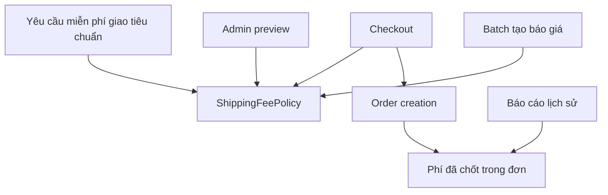

# Hiểu yêu cầu, phạm vi và rủi ro của thay đổi

> **Chương:** Rà soát mã  
> **Học phần:** CODE_QUALITY_FUNDAMENTALS — Hiểu những thuộc tính quyết định mã nguồn có đáng tin cậy, dễ hiểu và dễ thay đổi hay không.

Khi review một pull request (PR), việc đầu tiên thường là mở tab **Files changed**. Ta nhìn các dòng được thêm hoặc xóa, tìm lỗi cú pháp, cách đặt tên và đoạn logic đáng ngờ. Nhưng một diff chỉ cho biết **mã đã thay đổi như thế nào**; nó không tự trả lời **vì sao phải thay đổi, phạm vi được phép thay đổi đến đâu và điều gì có thể bị ảnh hưởng**.

Ví dụ, một PR có tiêu đề “Thêm miễn phí giao hàng từ 500.000 VND” và chỉ sửa hai dòng Java. Đoạn mã mới vẫn biên dịch, test báo giá lớn vẫn xanh. Tuy nhiên, điều kiện tính trên tổng tiền **trước giảm giá**, trong khi yêu cầu nói rõ **sau giảm giá**. Một đơn 600.000 VND được giảm 150.000 VND có thể được miễn phí sai. Reviewer chỉ xem hình thức đoạn mã mà không đối chiếu yêu cầu sẽ dễ bỏ qua lỗi.

**Code review có chất lượng bắt đầu từ hiểu thay đổi, rồi mới đánh giá cách cài đặt.** Reviewer cần xây dựng một hình dung đủ chính xác về mục tiêu, các hành vi phải giữ, nơi có thể bị tác động và bằng chứng kiểm chứng. Nhờ vậy, nhận xét tập trung vào tính đúng đắn, độ tin cậy, bảo mật, khả năng thay đổi — thay vì chỉ là sở thích cú pháp.

Sau bài học, bạn có thể:

- Chuyển yêu cầu thay đổi thành **hợp đồng và tiêu chí chấp nhận có thể kiểm tra**.
- Phân biệt **phạm vi nghiệp vụ**, **phạm vi mã được sửa** và **phạm vi ảnh hưởng**.
- Nhận diện các vùng rủi ro cao như quyền truy cập, tiền, dữ liệu lịch sử, lỗi ngoài hệ thống và tác dụng phụ.
- Đọc diff trong ngữ cảnh call path, dependency, dữ liệu và điều kiện triển khai.
- Đề xuất kiểm thử và nhận xét review dựa trên ví dụ cụ thể thay vì cảm tính.
- Nêu rõ những điều đã được xác minh và những giả định còn cần làm rõ.

## 1. Bốn câu hỏi trước khi đánh giá một dòng code

Một reviewer nên có khả năng trả lời bốn câu hỏi sau:

| Câu hỏi | Ý nghĩa | Một câu trả lời tốt |
| --- | --- | --- |
| **Vì sao?** | Vấn đề nào cần giải quyết? | Đơn đạt ngưỡng sau giảm giá cần được miễn phí giao hàng tiêu chuẩn |
| **Thay đổi gì?** | Hành vi, dữ liệu hay giao tiếp nào được phép khác? | Chỉ quy tắc báo giá mới cho chế độ `STANDARD` |
| **Ảnh hưởng đến đâu?** | Caller, nhánh lỗi, nơi lưu dữ liệu, hệ thống tích hợp nào liên quan? | Checkout, xem trước đơn, nơi chốt phí; không tính lại hóa đơn cũ |
| **Rủi ro là gì?** | Nếu hiểu hoặc cài đặt sai, hậu quả và bằng chứng cần có là gì? | Thu phí sai, lệch số tiền đã chốt; cần test ngưỡng, chế độ và luồng lưu đơn |

Nếu không biết câu trả lời, reviewer có thể hỏi để làm rõ. **Không nên tự suy diễn một quy tắc nghiệp vụ mới từ tên biến hoặc một đoạn test**, nhất là khi tài liệu chưa xác định cách xử lý các trường hợp quan trọng.

### Review không chỉ là kiểm tra “mã có chạy không”

Một thay đổi Java có thể biên dịch, qua kiểm tra style và vượt unit test sẵn có nhưng vẫn:

- Không đáp ứng câu chuyện người dùng hoặc điều kiện chấp nhận.
- Thay đổi một luồng ngoài phạm vi PR.
- Bỏ sót trường hợp lỗi, giá trị biên hoặc quyền truy cập.
- Thêm tác dụng phụ gây ghi trùng, mất dữ liệu hoặc thông báo sai.
- Làm API cũ không tương thích với client chưa nâng cấp.
- Tăng coupling khiến các lần sửa sau khó hơn dù tính năng hôm nay chạy đúng.

**Bằng chứng review** phải đi từ nhu cầu đến hợp đồng, từ hợp đồng đến cách triển khai, rồi từ cách triển khai đến những kiểm chứng phù hợp.

## 2. Đọc yêu cầu theo hướng có thể kiểm chứng

Yêu cầu thường đến từ issue, mô tả PR, tài liệu đặc tả, quyết định kỹ thuật hoặc cuộc trao đổi với người sở hữu nghiệp vụ. Mỗi nguồn có thể có mức chính thức và thời điểm khác nhau. Khi nội dung mâu thuẫn, cần xác định **nguồn có thẩm quyền** thay vì tự chọn câu phù hợp với code đang thấy.

### 2.1. Tách mục tiêu khỏi giải pháp đề xuất

Giả sử issue viết:

> Khi khách đặt đơn giao tiêu chuẩn có tổng tiền hàng sau giảm giá từ 500.000 VND, hệ thống không thu phí giao hàng. Giao nhanh vẫn tính phí như hiện tại. Các đơn đã chốt không được tính lại theo chính sách mới.

Issue thể hiện **hành vi mong muốn**. Nó không nhất thiết yêu cầu tạo một class mới, dùng một `if` hay thay đổi một API cụ thể. Reviewer nên phân biệt:

- **Mục tiêu:** áp dụng miễn phí giao hàng tiêu chuẩn đúng ngưỡng.
- **Ràng buộc:** tính trên tổng sau giảm giá, không thay đổi giao nhanh, không sửa dữ liệu lịch sử.
- **Giải pháp kỹ thuật:** có thể là sửa chính sách hiện có, bổ sung test và cập nhật nơi dùng, miễn giữ đúng hợp đồng.

Một PR tự ý đổi luôn cấu trúc bảng hóa đơn hoặc thêm dịch vụ mạng mới cần có lý do và phạm vi riêng, dù tác giả cho rằng giải pháp đó “kiến trúc tốt hơn”.

### 2.2. Biến câu chữ thành tiêu chí chấp nhận

Từ issue trên, có thể lập bảng:

| Điều kiện | Đầu vào minh họa | Hành vi mong muốn |
| --- | --- | --- |
| Dưới ngưỡng | 499.999 VND **sau giảm giá**, giao tiêu chuẩn | Vẫn thu phí tiêu chuẩn |
| Đúng ngưỡng | 500.000 VND **sau giảm giá**, giao tiêu chuẩn | Miễn phí |
| Trên ngưỡng | 500.001 VND **sau giảm giá**, giao tiêu chuẩn | Miễn phí |
| Giao nhanh | 600.000 VND sau giảm giá, giao nhanh | Giữ mức phí giao nhanh |
| Hóa đơn đã chốt | Đơn được tạo trước ngày chính sách đổi | Giữ phí đã ghi nhận |
| Đầu vào không hợp lệ | Giảm giá âm hoặc vượt tổng tiền hàng | Không tạo báo giá hợp lệ giả |

Trong bài, giả sử phí tiêu chuẩn là **30.000 VND** và phí giao nhanh là **50.000 VND**. Đây là **chính sách minh họa**, không phải dữ liệu thực tế của một sản phẩm.

Các tiêu chí trên cho reviewer cơ sở để đánh giá **đúng/sai**. Một test kiểu “đơn 700.000 VND được miễn phí” là hữu ích nhưng chưa chứng minh điều kiện **đúng ngưỡng** hoặc việc dùng số tiền sau giảm giá.

### 2.3. Đánh dấu điều chưa rõ, đừng tự bịa quy tắc

Ví dụ, issue có thể chưa nói:

- Phí giao hàng cho tổng tiền hàng bằng 0 là gì?
- Các loại giảm giá có được trừ trước khi xét ngưỡng không?
- Ngưỡng áp dụng từ thời điểm đặt đơn hay từ lúc thanh toán?
- Nếu chính sách thay đổi giữa lúc báo giá và chốt đơn, giá nào có hiệu lực?
- Có khác biệt theo vùng giao hàng hoặc loại sản phẩm không?

Reviewer cần phân biệt **chỗ chưa rõ làm thay đổi quyết định triển khai** với câu hỏi không liên quan phạm vi hiện tại. Những điểm ảnh hưởng tiền, quyền hoặc tính tương thích nên được xác nhận trước khi chấp nhận PR.

## 3. Ba lớp phạm vi không được đánh đồng

Từ “phạm vi thay đổi” có ít nhất ba nghĩa:

1. **Phạm vi yêu cầu:** hành vi nào được phép đổi, hành vi nào phải giữ.
2. **Phạm vi triển khai:** file, phương thức, schema, dependency và cấu hình nào tác giả sửa.
3. **Phạm vi ảnh hưởng:** mọi đường dùng và thành phần có thể bị tác động, kể cả những nơi **không xuất hiện trong diff**.

| Lớp phạm vi | Ví dụ trong thay đổi phí giao hàng |
| --- | --- |
| Yêu cầu | Miễn phí `STANDARD` khi tổng sau giảm giá đạt 500.000 VND |
| Triển khai | Sửa `ShippingFeePolicy`, bổ sung `ShippingFeePolicyTest` |
| Ảnh hưởng | Checkout, màn hình xem trước, dịch vụ tạo đơn, dữ liệu chốt phí, báo cáo nếu gọi lại chính sách |

**Một PR sửa một file không đồng nghĩa phạm vi ảnh hưởng chỉ có một file.** Một hằng số được dùng bởi nhiều đường xử lý có thể khiến mọi caller đổi hành vi. Ngược lại, một thay đổi hợp lý ở nhiều file không tự động là code smell; việc cập nhật API, test, tài liệu và adapter liên quan thường là cần thiết.

### 3.1. Sơ đồ giúp nhìn ngoài diff



Sơ đồ minh họa **quan hệ trách nhiệm**: báo giá mới dùng chính sách hiện hành, còn báo cáo lịch sử phải đọc phí đã chốt. Nếu báo cáo lịch sử lại gọi `ShippingFeePolicy` để tính lại, đó là một đường cần điều tra trước khi sửa.

### 3.2. Đọc diff cùng những nơi gọi

Reviewer nên đi theo đường:

```text
Input từ request / UI
          |
          v
Tạo dữ liệu nghiệp vụ đã chuẩn hóa
          |
          v
Gọi phương thức bị thay đổi
          |
          v
Tính giá trị trả về
          |
          v
Lưu / gửi / hiển thị / tiếp tục xử lý lỗi
```

Đừng chỉ tìm xem toán tử trong phương thức đã đúng chưa; hãy kiểm tra **caller đưa đúng loại dữ liệu vào không** và **kết quả có bị sử dụng sai ở bước sau không**.

## 4. Nhận diện rủi ro: hậu quả trước, nhãn ưu tiên sau

Trong review, *rủi ro* không chỉ là khả năng phát sinh ngoại lệ. Nó bao gồm **khả năng có sai lệch** và **mức độ hậu quả nếu sai lệch xuất hiện**, cộng với mức chắc chắn của bằng chứng đang có.

Các miền thường cần ưu tiên:

| Miền rủi ro | Câu hỏi review | Sai lệch có thể gây ra |
| --- | --- | --- |
| **Tiền và số liệu** | Đơn vị, làm tròn, ngưỡng, tràn số, dữ liệu lịch sử đã được bảo vệ? | Thu sai tiền, báo cáo sai, đối soát khó |
| **Phân quyền** | Caller có quyền trên đúng đối tượng không? Có kiểm tra phía server không? | Truy cập dữ liệu hoặc thao tác không được phép |
| **Dữ liệu** | Có thay đổi schema, migration, mặc định trường, trạng thái sau lỗi? | Mất/biến dạng dữ liệu, tương thích kém |
| **Tác dụng phụ** | Ghi DB, gửi sự kiện, thanh toán, gửi email có lặp hay đổi thứ tự? | Giao dịch trùng, thông báo sai |
| **API và tích hợp** | Chữ ký, JSON, mã lỗi, timeout, khả năng retry có đổi? | Client cũ hỏng, hệ thống hiểu sai trạng thái |
| **Đồng thời** | Có trạng thái dùng chung, race condition, thao tác nguyên tử? | Kết quả không nhất quán, ghi đè cập nhật |
| **Bảo mật dữ liệu** | Có log secrets hoặc trả dữ liệu nhạy cảm? | Rò rỉ thông tin |
| **Hiệu năng/tài nguyên** | Có tăng số truy vấn hoặc tiêu thụ tài nguyên? | Chậm, quá tải, hết bộ nhớ |
| **Vận hành** | Có đổi cấu hình, dependency, rollout, rollback? | Triển khai lỗi hoặc khó khôi phục |

Không phải mọi PR đều cần phân tích tất cả các miền sâu như nhau. **Mức độ kiểm tra phải tương xứng với mức độ ảnh hưởng của thay đổi**.

### 4.1. Ba câu hỏi giúp xác định ưu tiên

1. **Nếu sai thì hậu quả là gì?** Một sai lệch trong định dạng nội bộ khác với sai lệch trong phân quyền hoặc thu tiền.
2. **Đường đi đó có thể được kích hoạt không?** Ai cung cấp đầu vào, tần suất gọi, có dữ liệu không tin cậy không?
3. **Ta đang chắc chắn đến mức nào?** Có test, đặc tả, dữ liệu hoặc phân tích đường thực thi chưa; điều gì còn giả định?

Một cảnh báo công cụ mang nhãn `HIGH` cần xem ngữ cảnh; một dòng code không có warning cũng có thể gây rủi ro cao nếu vi phạm nghiệp vụ. Không nên dùng **số dòng thay đổi**, **số warning** hay **độ dài PR** làm phép đo rủi ro duy nhất.

### 4.2. Bảng ưu tiên mang tính định hướng

| Tình huống | Gợi ý mức tập trung | Bằng chứng nên yêu cầu |
| --- | --- | --- |
| Sửa điều kiện trả dữ liệu theo quyền chủ sở hữu | Rất cao | Kiểm thử trường hợp không có quyền, đánh giá xác thực và đường gọi |
| Đổi ngưỡng tính phí | Cao | Ca biên, đơn vị và dữ liệu sau giảm giá, lưu phí đã chốt |
| Đổi client từ đồng bộ sang bất đồng bộ | Cao hoặc trung bình theo tác dụng phụ | Thứ tự, timeout, retry, xử lý kết quả chưa xác định |
| Đổi tên biến cục bộ không ảnh hưởng API | Thường thấp | Diff rõ, biên dịch hoặc kiểm tra tương ứng |
| Chỉnh định dạng với formatter đã thống nhất | Thường thấp về nghiệp vụ | Quy ước formatter và diff không đổi logic |

Đây không phải bảng chấm điểm bắt buộc. Một thay đổi nhỏ về format log có thể rất quan trọng nếu log chứa thông tin mật hoặc phải giữ định dạng cho hệ thống giám sát.

## 5. Tình huống Java: đọc PR theo yêu cầu, không chỉ theo diff

Xét PR thêm miễn phí giao hàng tiêu chuẩn. Để ví dụ thống nhất, ta định nghĩa hai chế độ:

```java
// DeliveryMode.java
public enum DeliveryMode {
    STANDARD,
    EXPRESS
}
```

Ứng dụng có một phương thức nhận:

- `subtotalBeforeDiscountVnd`: tổng tiền hàng trước giảm giá.
- `discountVnd`: khoản giảm giá của đơn.
- `mode`: chế độ giao hàng.

Hợp đồng mong muốn yêu cầu tính miễn phí từ **tổng tiền sau giảm giá**. Để tránh số tiền âm, cần kiểm tra giảm giá không âm và không vượt tổng tiền hàng.

### 5.1. Đoạn thay đổi có vẻ hợp lý nhưng sai ngữ nghĩa

Một phương thức được đề xuất:

```java
// ProposedShippingFeeService.java — ví dụ có lỗi cố ý
import java.util.Objects;

public final class ProposedShippingFeeService {
    public long calculateFeeVnd(
            long subtotalBeforeDiscountVnd,
            long discountVnd,
            DeliveryMode mode) {

        if (subtotalBeforeDiscountVnd < 0L || discountVnd < 0L
                || discountVnd > subtotalBeforeDiscountVnd) {
            throw new IllegalArgumentException("Invalid amount");
        }
        Objects.requireNonNull(mode, "mode");

        if (mode == DeliveryMode.STANDARD
                && subtotalBeforeDiscountVnd >= 500_000L) {
            return 0L;
        }
        return mode == DeliveryMode.EXPRESS ? 50_000L : 30_000L;
    }
}
```

Code này có nhiều điểm **đúng về mặt kỹ thuật**: kiểm tra đầu vào không âm, chỉ miễn phí chế độ `STANDARD`, giữ mức phí giao nhanh. Nhưng nó xét ngưỡng bằng **`subtotalBeforeDiscountVnd`**.

Với đơn 600.000 VND giảm 150.000 VND:

```text
Tổng trước giảm giá: 600.000 VND
Giảm giá:            150.000 VND
Tổng sau giảm giá:   450.000 VND

Kỳ vọng theo yêu cầu: 30.000 VND phí STANDARD
Kết quả mã đề xuất:       0 VND phí STANDARD
```

Đây là một **lỗi đúng đắn** dù patch có thể chỉ thay vài ký tự và mọi quy tắc formatter đều đạt.

### 5.2. Cách cài đặt phù hợp với hợp đồng minh họa

```java
// ShippingFeeService.java
import java.util.Objects;

public final class ShippingFeeService {
    private static final long FREE_STANDARD_THRESHOLD_VND = 500_000L;
    private static final long STANDARD_FEE_VND = 30_000L;
    private static final long EXPRESS_FEE_VND = 50_000L;

    /**
     * Trả phí giao hàng cho báo giá mới, tính bằng VND.
     * Không lưu đơn hoặc thay đổi trạng thái bên ngoài.
     *
     * @throws IllegalArgumentException nếu tổng tiền hoặc giảm giá không hợp lệ
     * @throws NullPointerException nếu mode là null
     */
    public long calculateFeeVnd(
            long subtotalBeforeDiscountVnd,
            long discountVnd,
            DeliveryMode mode) {

        if (subtotalBeforeDiscountVnd < 0L || discountVnd < 0L
                || discountVnd > subtotalBeforeDiscountVnd) {
            throw new IllegalArgumentException("Invalid amount");
        }
        Objects.requireNonNull(mode, "mode");

        long subtotalAfterDiscountVnd =
                subtotalBeforeDiscountVnd - discountVnd;

        if (mode == DeliveryMode.EXPRESS) {
            return EXPRESS_FEE_VND;
        }

        return subtotalAfterDiscountVnd >= FREE_STANDARD_THRESHOLD_VND
                ? 0L
                : STANDARD_FEE_VND;
    }
}
```

Ở đây, việc trừ hai số không âm với `discountVnd <= subtotalBeforeDiscountVnd` không tạo ra kết quả âm hoặc tràn trong miền `long` đã xác định. Nếu sau này cần tính **tổng thanh toán** bằng cách cộng phí, bên sở hữu phép cộng phải xem xét tràn số, chẳng hạn với `Math.addExact(...)`.

Không nên áp dụng mặc định mọi quy tắc từ ví dụ vào sản phẩm thật. Chẳng hạn mức phí theo vùng, các loại giảm giá, thuế, đơn hoàn trả hoặc thời điểm hiệu lực chính sách cần đặc tả riêng.

### 5.3. Một bộ test để reviewer thấy bằng chứng trực tiếp

```java
import static org.junit.jupiter.api.Assertions.assertEquals;
import static org.junit.jupiter.api.Assertions.assertThrows;

import org.junit.jupiter.api.Test;

class ShippingFeeServiceTest {
    private final ShippingFeeService service = new ShippingFeeService();

    @Test
    void afterDiscountJustBelowThresholdPaysStandardFee() {
        assertEquals(30_000L, service.calculateFeeVnd(
                600_000L, 100_001L, DeliveryMode.STANDARD));
    }

    @Test
    void afterDiscountAtThresholdGetsFreeStandardShipping() {
        assertEquals(0L, service.calculateFeeVnd(
                600_000L, 100_000L, DeliveryMode.STANDARD));
    }

    @Test
    void afterDiscountAboveThresholdGetsFreeStandardShipping() {
        assertEquals(0L, service.calculateFeeVnd(
                600_000L, 99_999L, DeliveryMode.STANDARD));
    }

    @Test
    void thresholdUsesAfterDiscountNotBeforeDiscount() {
        assertEquals(30_000L, service.calculateFeeVnd(
                600_000L, 150_000L, DeliveryMode.STANDARD));
    }

    @Test
    void expressShippingDoesNotUseStandardFreeThreshold() {
        assertEquals(50_000L, service.calculateFeeVnd(
                600_000L, 100_000L, DeliveryMode.EXPRESS));
    }

    @Test
    void discountCannotExceedSubtotal() {
        assertThrows(IllegalArgumentException.class,
                () -> service.calculateFeeVnd(
                        100_000L, 100_001L, DeliveryMode.STANDARD));
    }

    @Test
    void negativeDiscountIsRejected() {
        assertThrows(IllegalArgumentException.class,
                () -> service.calculateFeeVnd(
                        100_000L, -1L, DeliveryMode.STANDARD));
    }

    @Test
    void nullDeliveryModeIsRejected() {
        assertThrows(NullPointerException.class,
                () -> service.calculateFeeVnd(
                        100_000L, 0L, null));
    }
}
```

Test `thresholdUsesAfterDiscountNotBeforeDiscount` **phát hiện sai lệch cụ thể** của phiên bản đề xuất. Đây là bằng chứng có mục tiêu, không chỉ là tăng số lượng test.

### 5.4. Reviewer còn cần nhìn nơi gọi

Một caller:

```java
long feeVnd = feeService.calculateFeeVnd(
        cart.getSubtotalVnd(),
        cart.getDiscountVnd(),
        mode);
```

Chữ ký phương thức rõ **chưa tự chứng minh** rằng hai getter trả đúng số tiền. Reviewer nên hỏi:

- `getSubtotalVnd()` trả tổng trước giảm giá hay đã trừ một số giảm giá?
- `getDiscountVnd()` có bao gồm voucher vận chuyển hoặc giảm giá loại khác không?
- Dữ liệu được chốt ở thời điểm nào để tránh thay đổi giữa tính phí và tạo đơn?
- Nếu caller trước đây có logic miễn phí riêng, logic đó đã được loại bỏ hay còn áp dụng lần thứ hai?

Những câu hỏi này nhắm vào **ngữ nghĩa và đường dữ liệu**, không phải yêu cầu đổi tên một biến cho đẹp.

## 6. Xác định hành vi phải giữ ngoài phần tính năng mới

Một PR thêm chức năng thường cũng phải **bảo vệ hành vi không thuộc phạm vi thay đổi**.

Với ví dụ phí giao hàng:

| Hành vi | Được thay đổi? | Cần chứng minh |
| --- | :---: | --- |
| Miễn phí `STANDARD` theo tổng sau giảm giá | Có | Test dưới, đúng và trên ngưỡng |
| Mức phí `EXPRESS` | Không | Test chế độ giao nhanh |
| Kiểm tra đầu vào âm và giảm giá quá mức | Không, trừ khi yêu cầu đổi | Test ngoại lệ và trạng thái sau lỗi |
| Phí đã chốt trong đơn cũ | Không | Luồng lịch sử đọc số tiền đã lưu |
| Gửi email xác nhận | Không | Không thêm gửi trùng hoặc thay nội dung không có yêu cầu |
| Thứ tự lưu đơn và phát sự kiện | Không | Xác minh nếu patch chạm vào orchestration |
| Quyền tạo hoặc xem đơn | Không | Không bỏ kiểm tra phân quyền khi đổi service |

Đây chính là **negative scope**: những điều không được phép âm thầm đổi. Nếu PR sửa một helper dùng chung, những hành vi ngoài phạm vi có thể thay đổi ngoài ý muốn; reviewer cần yêu cầu bằng chứng hoặc thu hẹp thiết kế.

### 6.1. Dữ liệu lịch sử không phải báo giá mới

Ví dụ nguy hiểm:

```java
// Sai nếu mục tiêu là hiển thị giá đã thu ở hóa đơn lịch sử.
long historicShippingFeeVnd = feeService.calculateFeeVnd(
        invoice.getSubtotalBeforeDiscountVnd(),
        invoice.getDiscountVnd(),
        invoice.getDeliveryMode());
```

Đơn đã chốt phải dùng **phí thực tế đã được ghi nhận** khi giao dịch hoàn thành:

```java
// Phương thức giả định của mô hình hóa đơn.
long historicShippingFeeVnd = invoice.getChargedShippingFeeVnd();
```

Thay chính sách hôm nay có thể làm hàm tính báo giá mới trả kết quả khác. Nếu báo cáo lịch sử tính lại bằng chính sách hiện hành, dữ liệu đã chốt có thể bị diễn giải sai. Reviewer cần xác định **nơi sở hữu dữ liệu bất biến của giao dịch** và đường sử dụng của nó.

## 7. Thay đổi nhỏ vẫn có thể lan qua API và dữ liệu

Không phải rủi ro chỉ nằm trong giá trị trả về. Một PR “đổi tên cho rõ” có thể ảnh hưởng API:

| Loại thay đổi | Rủi ro cần xét |
| --- | --- |
| Đổi tên phương thức `public` Java | Nơi gọi và thư viện đã biên dịch có còn tương thích không? |
| Đổi kiểu trả về | Caller có bị mất thông tin hoặc không biên dịch? |
| Đổi trường JSON | Client cũ có còn gửi/đọc được dữ liệu? |
| Đổi ý nghĩa `null` | Caller có phân biệt được “không có dữ liệu” với “lỗi” không? |
| Đổi ngoại lệ hoặc HTTP status | Retry, xử lý lỗi và giám sát có bị ảnh hưởng? |
| Thêm trường bắt buộc vào request | Client triển khai độc lập có cần được nâng cấp? |
| Đổi schema lưu trữ | Dữ liệu cũ, migration và rollback có an toàn? |
| Thay dependency bắc cầu | Có đổi API, hành vi runtime hoặc lỗ hổng được biết đến? |

Một thay đổi giữ nguyên chữ ký cũng có thể **phá hợp đồng hành vi**. Ví dụ, từ trả danh sách rỗng khi không tìm thấy sang ném ngoại lệ là một thay đổi có ảnh hưởng; từ bắt lỗi kết nối rồi trả danh sách rỗng cũng là thay đổi nguy hiểm vì che thất bại.

### 7.1. Đừng chỉ nhìn tên file trong diff

Nếu đổi một interface hoặc DTO được nhiều module dùng, cần tìm các nơi phụ thuộc trong mã được phép truy cập và dùng tài liệu hợp đồng. Nếu đổi cấu hình build, cần chú ý plugin, runtime dependency và phiên bản môi trường. Nếu đổi một đường HTTP, cần xét caller từ bên ngoài repository mà không thể tìm bằng tìm kiếm nội bộ.

Không có công cụ nào nhìn hết các client nếu chúng không nằm trong phạm vi truy cập. Khi thiếu bằng chứng, reviewer nên **ghi rõ giả định**, không khẳng định “không ảnh hưởng client nào”.

## 8. Rà soát tác dụng phụ và đường thất bại

Trong nghiệp vụ có ghi dữ liệu, câu hỏi “hàm trả đúng chưa?” chưa đủ. Giả sử một luồng tạo đơn:

```text
1. Xác thực người dùng và quyền tạo đơn.
2. Kiểm tra giỏ hàng và tính tổng tiền.
3. Xác định phí giao hàng hợp lệ.
4. Lưu đơn với phí đã chốt.
5. Công bố sự kiện hoặc gửi thông báo sau khi trạng thái phù hợp.
```

Một refactor có thể vô tình đổi thứ tự 3 và 4, khiến đơn được lưu với phí mặc định trước khi phí thật được xác nhận. Hoặc nó có thể thực hiện bước 5 hai lần sau một retry.

### 8.1. Bảng kiểm đường lỗi

| Khi nào thất bại? | Câu hỏi reviewer cần đặt |
| --- | --- |
| Dữ liệu request sai | Có từ chối trước khi ghi hoặc gọi dịch vụ bên ngoài không? |
| Không tính được phí | Có trả lỗi thật hay dùng `0 VND` như thể miễn phí? |
| Lưu đơn thất bại | Đã có tác dụng phụ nào xảy ra và có được xử lý đúng không? |
| Phát sự kiện thất bại | Đơn đã lưu có được đối soát hoặc phát lại theo thiết kế không? |
| Client timeout sau khi gửi yêu cầu | Có biết chắc đơn chưa được tạo không, hay trạng thái chưa xác định? |
| Yêu cầu được gửi lại | Có khả năng tạo hai đơn hoặc thu hai lần không? |

**Không nhận được phản hồi không chứng minh thao tác chưa xảy ra.** Với HTTP, hàng đợi hoặc thanh toán, reviewer cần xem idempotency, trạng thái sau lỗi và cơ chế truy vấn/đối soát thích hợp. Những bảo đảm này phụ thuộc hạ tầng thực tế; không thể suy ra chỉ từ việc Java có `try/catch`.

### 8.2. Phân biệt unit test với kiểm thử tích hợp

Một unit test mock repository có thể chứng minh rằng mã định gọi `save()` một lần trong kịch bản nhất định. Nó không chứng minh transaction đã commit thành công, các hệ thống nhìn thấy dữ liệu nhất quán hoặc retry không tạo bản ghi trùng.

Với thay đổi có tác dụng phụ quan trọng, reviewer có thể yêu cầu:

- Kiểm thử hợp đồng giữa service và repository.
- Integration test trên dữ liệu tách biệt, có kiểm soát.
- Ca lỗi giữa các bước và bảo đảm trạng thái cuối.
- Bằng chứng về cấu hình idempotency hoặc giao dịch khi cần.

Không cần áp dụng mọi loại test cho mọi PR. **Yêu cầu bằng chứng nên gắn với hậu quả nếu đường đó sai.**

## 9. Kiểm thử theo rủi ro, không chạy theo tổng số test

Một PR thêm mười test “happy path” vẫn có thể thiếu duy nhất một test phân biệt đúng/sai ở giá trị biên. Reviewer nên xem **test nào chứng minh tiêu chí chấp nhận nào**, thay vì chỉ đếm số testcase.

### 9.1. Bản đồ yêu cầu → kiểm thử

| Tiêu chí chấp nhận | Dữ liệu thử | Kết quả mong đợi | Nơi kiểm tra |
| --- | --- | --- | --- |
| Ngưỡng dựa trên tiền sau giảm giá | 600.000 trước, giảm 150.000 | Phí chuẩn 30.000 | Unit test chính sách |
| Đúng ngưỡng được miễn | 600.000 trước, giảm 100.000 | Phí chuẩn 0 | Unit test điều kiện biên |
| Giao nhanh không đổi | 600.000 trước, giảm 100.000 | Phí nhanh 50.000 | Regression test |
| Đầu vào sai không tạo báo giá thành công | Giảm giá lớn hơn tổng | Ngoại lệ đúng hợp đồng | Unit test + caller khi cần |
| Checkout truyền đúng dữ liệu | Giỏ hàng có giảm giá | Phí chốt theo tổng sau giảm giá | Integration/contract test |
| Hóa đơn cũ không tính lại | Đơn cũ có phí đã lưu | Phí lịch sử không đổi | Test đọc dữ liệu lịch sử |

### 9.2. Coverage cao chưa bảo đảm sức phát hiện

Line coverage và branch coverage cho biết **mã được thực thi đến đâu**, không nói assertion có khả năng phát hiện lỗi hay không. Ví dụ, test tại 700.000 VND sẽ không phát hiện `>=` bị đổi thành `>` nếu không thử đúng 500.000.

Mutation testing có thể giúp kiểm tra test có nhạy với một số biến đổi nhỏ, nhưng cũng không bao phủ mọi sai lệch về yêu cầu và có thể có mutant tương đương. **Không chỉ dùng coverage, mutation score hoặc số test xanh làm kết luận cuối cùng.**

### 9.3. Khi nào cần thử hiệu năng và đồng thời?

Nếu thay đổi chỉ sửa một phép so sánh trong hàm thuần, kiểm thử hiệu năng quy mô lớn có thể không phải bằng chứng quan trọng nhất. Nếu PR chuyển từ một truy vấn tổng hợp sang vòng lặp gọi DB cho từng đơn, cần xem số truy vấn và hành vi trên dữ liệu lớn. Nếu cập nhật trạng thái chia sẻ trong nhiều luồng, cần xét điều kiện cạnh tranh và bảo đảm cập nhật nguyên tử.

Review tốt **tập trung công sức vào đường rủi ro**, thay vì áp một checklist nặng như nhau lên mọi thay đổi.

## 10. Thứ tự đọc PR để tạo bức tranh chính xác

Một quy trình review thực tế có thể là:

1. **Đọc mục tiêu và lý do:** vấn đề người dùng hoặc nghiệp vụ cần giải quyết là gì?
2. **Đọc tiêu chí chấp nhận:** kết quả nào phải khác, kết quả nào phải giữ?
3. **Nhận diện phạm vi:** những module, dữ liệu, API và caller nào liên quan?
4. **Chọn các đường rủi ro:** tiền, quyền, dữ liệu, lỗi, tác dụng phụ, tương thích, vận hành.
5. **Đọc diff cùng ngữ cảnh:** vị trí thay đổi, dữ liệu đi vào/đi ra, dependency và đường gọi liên quan.
6. **Đối chiếu test và bằng chứng:** test có chứng minh những yêu cầu trọng tâm và đường lỗi không?
7. **Đánh giá thiết kế:** trách nhiệm, tính đọc được, coupling và chi phí thay đổi tiếp theo.
8. **Viết nhận xét có thể hành động:** chỉ rõ tình huống, hậu quả, mức ưu tiên và cách kiểm chứng.
9. **Đánh giá lại sau khi sửa:** đảm bảo phản hồi đã được xử lý đúng, không phát sinh thay đổi ngoài phạm vi.

Quy trình này không phải bắt buộc phải thực hiện tuần tự cứng nhắc. Với PR rất nhỏ, nhiều bước chỉ mất vài phút; với thay đổi về tiền hoặc phân quyền, một câu hỏi còn mở có thể cần được giải quyết trước khi reviewer tiếp tục.

### 10.1. PR lớn cần mô tả cấu trúc thay đổi

Khi có nhiều file, tác giả có thể giúp reviewer bằng một bản đồ ngắn:

```text
Mục tiêu: Áp dụng miễn phí giao hàng STANDARD từ 500.000 VND sau giảm giá.
Trong phạm vi: ShippingFeeService, nơi gọi trong Checkout, kiểm thử.
Ngoài phạm vi: Phí EXPRESS, hóa đơn đã chốt, API thanh toán.
Rủi ro chính: Caller truyền tiền trước giảm giá, lịch sử bị tính lại.
Bằng chứng: Unit test biên; integration test chốt phí; test hóa đơn cũ.
Chưa kiểm tra: Bản client bên ngoài nếu có cách tự tính phí riêng.
```

Đây là **mẫu mô tả** cho tình huống bài học, không phải báo cáo rằng những test đó đã thực sự được chạy. Trong PR thật, hãy ghi **lệnh đã chạy, kết quả có thể kiểm tra và phần chưa chạy** theo thực tế.

## 11. Cách đặt câu hỏi và nhận xét review có ích

Nhận xét tốt không chỉ nói “đoạn này sai” mà giúp tác giả xác định **đầu vào gây sai, hành vi mong đợi và hậu quả**.

| Nhận xét mơ hồ | Nhận xét dựa trên yêu cầu và rủi ro |
| --- | --- |
| “Điều kiện này có vẻ sai.” | “Issue nói ngưỡng dựa trên tổng **sau giảm giá**, nhưng ở đây so `subtotalBeforeDiscountVnd`. Với 600.000 trước và giảm 150.000, phí phải là 30.000 nhưng code trả 0. Cần đổi biến so sánh và thêm test.” |
| “Test chưa đủ.” | “Chưa thấy ca đúng 500.000 và ngay dưới ngưỡng. Có thể thêm hai ca này để bảo vệ toán tử `>=`?” |
| “Tại sao sửa thêm file này?” | “PR chỉ đổi phí báo giá mới; lý do cập nhật tính phí của hóa đơn đã chốt là gì? Hợp đồng lịch sử yêu cầu giữ phí đã lưu.” |
| “Hàm này xấu quá.” | “Phương thức vừa tính phí vừa lưu đơn; khi lỗi tính phí, có khả năng lưu bản ghi trước khi biết phí đúng. Có thể tách ranh giới tính toán hoặc thêm test trạng thái sau lỗi không?” |
| “Dùng thư viện mới có ổn không?” | “Thư viện mới kéo thêm dependency runtime nào, nguồn và phiên bản đã được xác minh chưa? Đường xử lý dữ liệu ngoài có cần kiểm tra advisory không?” |

### 11.1. Tách sự thật, giả định và câu hỏi

Cách viết:

> **Quan sát:** `calculateFeeVnd` đang dùng tổng trước giảm giá.  
> **Yêu cầu:** tiêu chí chấp nhận ghi tổng sau giảm giá.  
> **Rủi ro:** đơn có mã giảm giá có thể được miễn phí sai.  
> **Đề xuất:** tính tổng sau giảm giá và kiểm thử trường hợp phân biệt.

Khi chưa có đặc tả, reviewer không nên khẳng định một quy tắc là đúng chỉ vì tên phương thức. Có thể viết:

> “Mình chưa thấy hợp đồng về việc phí được tính trước hay sau voucher. Có thể bổ sung nguồn quyết định và một ví dụ số cụ thể không? Điều này quyết định ngưỡng được áp dụng.”

Với yêu cầu còn mâu thuẫn, đặt câu hỏi sớm tốt hơn là đưa ra patch theo giả định chưa được chấp nhận.

### 11.2. Ghi rõ mức độ ưu tiên mà không làm mất tính hợp tác

Nhận xét về lỗi thu tiền, dữ liệu hay quyền truy cập cần được phân biệt với đề xuất đổi tên hoặc formatter. Một số nhóm dùng nhãn như **blocker**, **must fix**, **suggestion**; tên nhãn có thể khác, nhưng thông điệp nên rõ:

- **Cần sửa trước merge:** trái hợp đồng, ảnh hưởng bảo mật/dữ liệu, hoặc thiếu bằng chứng trọng yếu theo chính sách nhóm.
- **Nên xem lại:** cấu trúc khó bảo trì, phạm vi PR rộng không có lý do hoặc test chưa phủ rủi ro đáng kể.
- **Gợi ý:** tên, format, cách biểu đạt có nhiều lựa chọn tương đương và không gây sai ngữ nghĩa.

Một cảnh báo format vẫn có thể là điều kiện bắt buộc theo CI, nhưng cần nói rõ đó là **quy ước thống nhất**, không phải một lỗi nghiệp vụ.

## 12. Các loại PR và điểm nhấn khác nhau khi hiểu yêu cầu

| Loại thay đổi | Nguồn cần hiểu | Rủi ro/kiểm chứng ưu tiên |
| --- | --- | --- |
| **Thêm tính năng** | Nhu cầu và tiêu chí chấp nhận | Đường mới, tương tác với hành vi cũ, lỗi và quyền |
| **Sửa bug** | Hành vi sai, kết quả mong muốn, cách tái hiện | Regression test tái hiện lỗi và tránh sửa ngoài phạm vi |
| **Refactor** | Hợp đồng phải bảo toàn và baseline | So sánh trước/sau, ngoại lệ, tác dụng phụ, caller |
| **Nâng dependency** | Lý do nâng, bản phát hành, advisory, compatibility | Đồ thị resolved, hành vi tích hợp, artifact thực tế |
| **Thay API/schema** | Hợp đồng cũ/mới và nhóm client | Migration, tương thích phiên bản, rollback |
| **Tối ưu hiệu năng** | Mức đo hiện tại, mục tiêu tải và giới hạn | Benchmark phù hợp, tính đúng đắn, tài nguyên |
| **Thay đổi bảo mật** | Mô hình đe dọa, quyền và dữ liệu | Negative tests, đường bỏ qua kiểm soát, log nhạy cảm |
| **Chỉnh style** | Quy ước codebase | Diff không đổi logic, tránh trộn tính năng |

### 12.1. Refactor có yêu cầu “không đổi hành vi”

Với refactor, không nên dùng “mã nhìn rõ hơn” làm bằng chứng đủ. Hãy xem characterization/regression tests, hợp đồng đầu vào/đầu ra, ngoại lệ, thứ tự tác dụng phụ và nơi gọi. Nếu phát hiện bug cũ trong lúc refactor, **sửa bug có thể cần thiết nhưng phải được ghi là thay đổi hành vi có chủ đích**, không trộn vào một tuyên bố “không đổi gì”.

### 12.2. Bug fix có yêu cầu “đổi đúng một hành vi”

Với bug fix, reviewer cần nhìn được:

```text
Đầu vào tối thiểu tái hiện lỗi
           |
           v
Hành vi sai ở bản cũ
           |
           v
Hành vi đúng theo hợp đồng
           |
           v
Test hồi quy khiến lỗi cũ không xuất hiện lại
```

Nếu patch còn vô tình đổi những trường hợp không liên quan, đó có thể là mở rộng phạm vi cần đánh giá riêng.

## 13. Những ngộ nhận thường gặp trong code review

### “Diff nhỏ thì rủi ro nhỏ”

Đổi `&&` thành `||` trong điều kiện phân quyền chỉ một ký tự nhưng có thể làm lộ dữ liệu. Ngược lại, formatter có thể tạo diff hàng trăm dòng mà không đổi logic. **Hình dạng diff không đại diện cho hậu quả.**

### “Mô tả PR ghi đúng thì không cần xem caller”

Mô tả là tuyên bố của tác giả. Reviewer phải xem dữ liệu thực đi qua ranh giới: caller có thể truyền tiền trước giảm giá, bỏ kiểm tra quyền hoặc xử lý ngoại lệ như giá trị hợp lệ.

### “Test xanh nghĩa là yêu cầu đã đủ”

Test chỉ kiểm tra những trường hợp có assertion phù hợp. Một test miễn phí ở 700.000 VND chưa chứng minh đúng ngưỡng 500.000. Cần đối chiếu test với **tiêu chí chấp nhận và các đường rủi ro**.

### “Chưa thấy lỗi nghĩa là có thể merge”

Không thấy lỗi sau một lần đọc không tương đương với đã xác minh những điều trọng yếu. Reviewer cần nêu rõ những giả định còn thiếu, đặc biệt về dữ liệu lịch sử, client ngoài, timeout và môi trường triển khai.

### “Mọi việc trong diff đều thuộc phạm vi yêu cầu”

Một patch có thể chứa thay đổi phụ, refactor, nâng thư viện hoặc điều chỉnh cấu hình không cần thiết. Reviewer cần hỏi lý do và bằng chứng, không tự chấp nhận mọi sửa đổi chỉ vì chúng đi cùng PR.

### “Chỉ reviewer mới chịu trách nhiệm hiểu yêu cầu”

Tác giả cần cung cấp bối cảnh, tiêu chí chấp nhận và bằng chứng đã kiểm tra. Reviewer đưa ra đánh giá độc lập và hỏi điều chưa rõ. Trách nhiệm về yêu cầu còn có thể thuộc product owner, người thiết kế API hoặc chủ sở hữu dữ liệu.

### “Review tốt là chỉ ra càng nhiều vấn đề càng tốt”

Nhiều nhận xét nhỏ về sở thích cá nhân có thể làm loãng những vấn đề quan trọng. Review tốt là **phát hiện và giải thích rủi ro có ý nghĩa**, hỗ trợ cải thiện thiết kế và giữ khả năng cộng tác.

### “Reviewer phải đoán giải pháp tối ưu”

Không phải lúc nào reviewer cũng cần viết lại toàn bộ patch. Họ cần nêu **hợp đồng bị vi phạm, trường hợp chứng minh và yêu cầu kiểm chứng**; tác giả có thể đưa ra một cách cài đặt khác miễn bảo đảm đúng mục tiêu.

## 14. Checklist hiểu yêu cầu, phạm vi và rủi ro

| Câu hỏi | Dấu hiệu đã đủ để tiếp tục review |
| --- | --- |
| **Mục tiêu rõ chưa?** | Biết vấn đề người dùng hoặc nghiệp vụ được giải quyết |
| **Nguồn yêu cầu là gì?** | Có đặc tả/issue/hợp đồng đáng tin; điểm mâu thuẫn đã được nêu |
| **Có tiêu chí chấp nhận?** | Biết trường hợp bình thường, biên và ngoài phạm vi |
| **Điều gì phải giữ nguyên?** | Có negative scope và regression tests phù hợp |
| **Diff có tương ứng với phạm vi?** | Mọi thay đổi đáng kể có lý do; không có sửa phụ khó giải thích |
| **Đã xét các caller và dữ liệu đầu vào?** | Không chỉ đọc phương thức bị sửa |
| **Có ranh giới API và hệ thống ngoài?** | Đã xét client, kiểu dữ liệu, lỗi, phiên bản khi liên quan |
| **Có tác dụng phụ hay trạng thái lịch sử?** | Biết điều gì được ghi/phát và giữ nguyên sau lỗi |
| **Rủi ro lớn nhất nằm ở đâu?** | Đã ưu tiên tiền, quyền, dữ liệu, độ tin cậy và vận hành thích hợp |
| **Test chứng minh đúng yêu cầu?** | Có dữ liệu phân biệt đúng/sai, không chỉ happy path |
| **Bằng chứng còn thiếu?** | Nêu rõ môi trường, đường lỗi hoặc tích hợp chưa kiểm tra |
| **Nhận xét review có hành động được?** | Có quan sát, ví dụ tác động và đề nghị xác minh cụ thể |

Checklist là **công cụ hỗ trợ suy nghĩ**, không phải máy chấm điểm. Một PR về phân quyền có thể cần phân tích sâu hơn nhiều so với PR định dạng, dù cả hai đều tích đủ các ô chung.

## 15. Bài tập: review thay đổi điều kiện hoàn tiền

Một ứng dụng cho phép hoàn tiền khi đơn **đã thanh toán**, **chưa hoàn tiền**, người yêu cầu **là chủ đơn** và thời gian từ lúc thanh toán **không quá 30 ngày**. Một PR có mục tiêu “cho phép yêu cầu hoàn tiền vào đúng ngày thứ 30”, nhưng tác giả sửa phương thức thành:

```java
// Đây là ví dụ cần review, chưa phải triển khai hoàn chỉnh.
boolean canRefund(
        boolean paid,
        boolean alreadyRefunded,
        boolean ownerMatches,
        long daysSincePayment) {

    return paid
            && (!alreadyRefunded || ownerMatches)
            && daysSincePayment <= 30L;
}
```

Giả sử trước PR, điều kiện thời gian là `daysSincePayment < 30L`, còn các điều kiện khác đều phải đúng. Phương thức này mới xét **điều kiện đủ**, chưa thực hiện giao dịch hoàn tiền thật. Một luồng thực hiện hoàn tiền còn cần bảo đảm giá trị tiền, ghi nhận trạng thái, giao tiếp với cổng thanh toán và xử lý yêu cầu lặp.

Hãy thực hiện:

1. **Viết lại mục tiêu:** hành vi nào được phép đổi và những điều kiện nào phải giữ nguyên?
2. **Chỉ ra thay đổi ngoài phạm vi:** biểu thức `(!alreadyRefunded || ownerMatches)` có giữ yêu cầu “chưa hoàn tiền **và** đúng chủ đơn” không?
3. **Lập bảng dữ liệu biên:** tại ngày 29, 30 và 31; chọn các giá trị `paid`, `alreadyRefunded` và `ownerMatches` để phân biệt code đúng/sai.
4. **Xem giả định thời gian:** `daysSincePayment` được tính từ hai `Instant`, từ ngày lịch theo múi giờ hay từ dữ liệu khác? Giá trị âm có hợp lệ không? Khi nào một ngày bắt đầu/kết thúc?
5. **Phân loại rủi ro:** sai điều kiện quyền, hoàn tiền trùng, sai thời hạn và lỗi khi dịch vụ thanh toán timeout có hậu quả gì?
6. **Đề xuất sửa tối thiểu:** giữ mọi điều kiện cần và chỉ thay ngưỡng thời gian đúng yêu cầu.
7. **Viết unit tests JUnit 5** cho trường hợp đúng ngày 30, quá hạn, không phải chủ đơn, đơn đã hoàn và chưa thanh toán.
8. **Nêu bằng chứng bổ sung** để review luồng hoàn tiền thật: trạng thái lưu, idempotency, transaction, thông báo kết quả và khả năng đối soát.
9. **Xác định phạm vi ảnh hưởng:** API hoàn tiền, giao diện, dữ liệu giao dịch và log có cần kiểm tra không? Cần biết thêm gì trước khi khẳng định?
10. **Viết hai nhận xét PR:** một nhận xét cần sửa trước merge và một câu hỏi làm rõ giả định về thời gian, đều có ví dụ cụ thể.

**Gợi ý:** reviewer không chỉ xác nhận dấu `<=` ở thời hạn đã xuất hiện. Cần đảm bảo **các điều kiện không thuộc yêu cầu vẫn được giữ**, đặc biệt điều kiện phân quyền và chống hoàn trùng. Còn việc ngày thứ 30 được tính chính xác thế nào phải dựa trên hợp đồng thời gian, không suy ra từ một biến `long`.

## Ghi nhớ

**Rà soát mã bắt đầu từ hiểu yêu cầu, phạm vi và rủi ro của thay đổi.** Đọc diff mà không biết mục tiêu dễ dẫn đến nhận xét bề mặt hoặc bỏ sót lỗi nghiệp vụ. Hãy chuyển yêu cầu thành tiêu chí kiểm tra, phân biệt hành vi được phép đổi với hành vi phải giữ, theo dõi dữ liệu qua các ranh giới, nhận diện tác dụng phụ và ưu tiên đường rủi ro cao. Khi kết luận, nói rõ **điều đã có bằng chứng, điều còn giả định và kiểm thử nào cần bổ sung**. Một review có giá trị không chỉ giúp patch hiện tại đúng hơn mà còn giúp cả nhóm hiểu vì sao thay đổi này phù hợp và có thể bảo trì an toàn.
