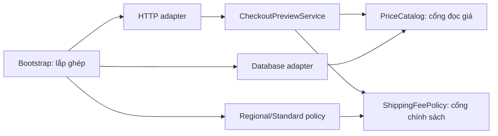
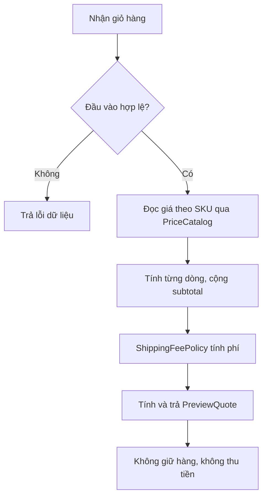
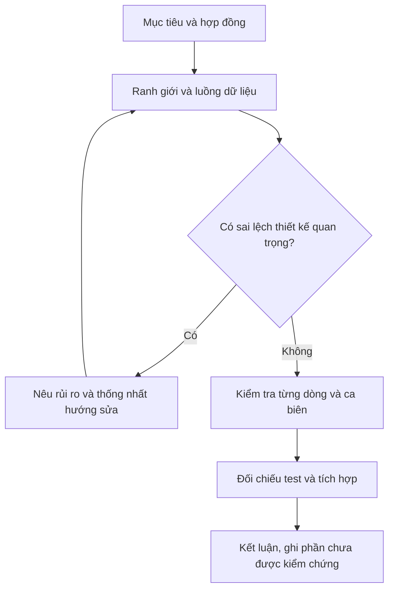

# Đọc thiết kế tổng thể trước khi xét từng dòng

## 1. Mục tiêu bài học

Trong chương **Rà soát mã** của module **CODE_QUALITY_FUNDAMENTALS**, chúng ta học cách review một thay đổi theo thứ tự: **hiểu mục đích và ranh giới thiết kế trước, sau đó mới đọc từng dòng để kiểm tra cách hiện thực**.

Module có mục tiêu **hiểu những thuộc tính quyết định mã nguồn có đáng tin cậy, dễ hiểu và dễ thay đổi hay không**. Code review không chỉ phát hiện lỗi cú pháp hoặc tên biến khó đọc. Một thay đổi có thể biên dịch, được format hoàn hảo và vượt qua unit test nhưng vẫn đặt trách nhiệm sai lớp, tạo phụ thuộc ngược, làm lộ dữ liệu hoặc thay đổi hợp đồng ngoài ý muốn.

Sau bài học, bạn có thể:

- Giải thích vì sao nên bắt đầu review bằng **mục tiêu, phạm vi và luồng dữ liệu** thay vì nhận xét ngay dòng đầu tiên trong diff.
- Xác định **hợp đồng bên sử dụng**, ranh giới giữa các module và vị trí của tác dụng phụ trong thiết kế.
- Tìm các rủi ro có tác động lớn trước khi đi vào tên biến, format, biểu thức và xử lý trường hợp biên.
- Đánh giá một pull request Java 17 về **xem trước tổng tiền**, nhận ra sai lệch khi code vô tình giữ hàng hoặc gọi thanh toán.
- Viết nhận xét review **cụ thể, có lý do và có hành động đề xuất**, phân biệt vấn đề cần chặn với cải tiến tùy chọn.
- Dùng kiểm thử và công cụ tự động làm bằng chứng, nhưng không coi CI xanh là chứng minh thiết kế hoàn toàn đúng.

## 2. Vì sao bắt đầu ngay từ từng dòng có thể bỏ sót vấn đề lớn?

Hãy tưởng tượng một pull request (PR) thêm chức năng **“Xem trước tổng tiền giỏ hàng”**. Người review mở diff, thấy những dòng sau:

```java
long subtotal = unitPrice * quantity;
long shipping = subtotal >= 500_000 ? 0 : 30_000;
long total = subtotal + shipping;
```

Họ có thể tập trung ngay vào việc đổi tên `subtotal` thành `subtotalVnd`, thêm `Math.multiplyExact` hoặc đưa `500_000` vào hằng số. Những nhận xét này có thể hữu ích.

Nhưng nếu đoạn code nằm trong một controller đồng thời **giữ tồn kho và gửi yêu cầu thu tiền**, vấn đề nghiêm trọng hơn là **chức năng xem trước không còn chỉ đọc**. Sửa tên biến trước có thể tạo cảm giác PR đã được review kỹ trong khi hợp đồng thiết kế bị phá.

Một số câu hỏi ở mức tổng thể nên đến trước:

1. **PR giải quyết yêu cầu nào?** Xem trước, chốt đơn, hay thanh toán thật?
2. **Đầu vào/đầu ra được cam kết là gì?** Có yêu cầu về tiền tệ, dữ liệu thiếu, độ mới giá hoặc tình trạng hàng không?
3. **Tác dụng phụ có được phép không?** Có thay tồn kho, phát sự kiện, gửi email, tạo đơn hay thu tiền không?
4. **Trách nhiệm nên nằm ở đâu?** HTTP controller, application service, domain policy, adapter database hay composition root?
5. **Thành phần nào sẽ phải thay đổi nếu giá, phí hoặc hạ tầng đổi?** Chiều phụ thuộc đang làm nhiệm vụ khó hơn hay dễ hơn?
6. **Bằng chứng nào đã có?** Test hành vi, contract test, integration test, kiểm tra cấu hình và những trường hợp biên?

**Trình tự review là thứ tự ưu tiên suy nghĩ, không phải luật phải đọc tài liệu theo một đường duy nhất.** Đôi khi một dòng code bất thường giúp phát hiện vấn đề thiết kế. Khi đó reviewer nên quay lại kiểm tra mục tiêu và hợp đồng, thay vì chỉ đề nghị chỉnh dòng ấy.

## 3. Hai mức nhìn bổ sung cho nhau

| Mức review | Câu hỏi trọng tâm | Ví dụ vấn đề có thể tìm thấy |
| --- | --- | --- |
| **Thiết kế / phạm vi thay đổi** | Thay đổi có đúng trách nhiệm, hợp đồng, hướng phụ thuộc và vị trí tác dụng phụ không? | Luồng xem trước gọi cổng thanh toán; domain import lớp HTTP; controller xử lý giao dịch. |
| **Hiện thực / từng dòng** | Mỗi nhánh và biểu thức có thực hiện đúng thiết kế không? | Điều kiện `>` sai tại ngưỡng; thiếu kiểm tra `null`; tràn số; đóng stream quá sớm. |

Hai mức không thay thế nhau. Thiết kế hợp lý vẫn có thể chứa một lỗi `off-by-one`; ngược lại, mọi dòng đúng về mặt kỹ thuật vẫn có thể được đặt trong thành phần không nên sở hữu hành vi đó.

Một cách nghĩ hữu ích:

> **Thiết kế trả lời “nên làm việc gì, ở đâu, với trách nhiệm nào”; review từng dòng trả lời “cách làm cụ thể có giữ những điều ấy không”.**

### Quy tắc ưu tiên theo tác động

Khi thời gian review có hạn, những vấn đề như **sai giao dịch, làm lộ dữ liệu, phá hợp đồng public, mất cập nhật hoặc phụ thuộc ngược khó đảo ngược** thường cần được nêu sớm hơn việc đổi tên biến hoặc sắp xếp import. Không có nghĩa lỗi mức dòng không quan trọng; chỉ là cần tránh để các chi tiết nhỏ che khuất sai lệch có chi phí lớn.

## 4. Chuẩn bị trước khi mở diff chi tiết

### 4.1. Xác nhận mục đích và phạm vi

Đọc mô tả PR, yêu cầu nghiệp vụ, những quyết định thiết kế có liên quan và các test mà tác giả cung cấp. Reviewer cần biết:

- Hành vi nào **được thêm, giữ nguyên hoặc cố ý thay đổi**?
- Những thành phần hoặc API nào **được phép** thay đổi?
- Có dữ liệu cũ, caller cũ hoặc ràng buộc tương thích nào phải giữ?
- Điều gì **không nằm trong phạm vi**: ví dụ preview không được tạo đơn hay thanh toán?
- Có bước migration, cấu hình, bật/tắt tính năng hoặc thay đổi triển khai nào đi kèm?

Nếu mô tả không đủ để phân biệt **xem trước** với **chốt đơn**, vấn đề đầu tiên không nhất thiết là yêu cầu tác giả viết thêm comment trong code, mà là **làm rõ hợp đồng và phạm vi PR**.

### 4.2. Đọc danh sách tệp thay đổi theo nhóm trách nhiệm

Trước khi xem mọi hunk, nhận diện những nhóm thường có ý nghĩa:

| Nhóm tệp | Điều cần biết ở mức thiết kế |
| --- | --- |
| **API/controller/DTO** | Hợp đồng request/response, xác thực, tương thích và dữ liệu được công bố |
| **Application/use case** | Quy trình, điều phối, transaction và các cổng phụ thuộc |
| **Domain/policy** | Quy tắc nghiệp vụ, bất biến, mô hình dữ liệu |
| **Adapter/infrastructure** | Database, HTTP client, file, thông điệp, lỗi hạ tầng |
| **Build/config/migration** | Thư viện, permission, schema, cấu hình môi trường và khả năng triển khai |
| **Test** | Kỳ vọng nghiệp vụ và những đường được kiểm chứng |

Một PR thêm endpoint nhưng cũng sửa schema, thay timeout thanh toán và thay định dạng sự kiện có thể đã **gộp nhiều loại thay đổi**. Cần hiểu vì sao chúng đi cùng nhau trước khi góp ý về implementation.

### 4.3. Phác sơ đồ đường đi dữ liệu và chiều phụ thuộc

Chỉ cần một sơ đồ ngắn để nhận diện ranh giới:



Sơ đồ biểu diễn **hướng phụ thuộc ở mức mã** trong thiết kế minh họa. Runtime có thể gọi database adapter thông qua `PriceCatalog`, nhưng mã application không cần biết lớp JDBC cụ thể. Khi review, cần so sánh **sơ đồ dự kiến** với những import, constructor và luồng xử lý trong thay đổi thực tế.

Không phải dự án nào cũng cần tách từng lớp hoặc module như sơ đồ. Nếu ứng dụng nhỏ, một lớp dịch vụ thuần có thể phù hợp. Điều quan trọng là **ranh giới trách nhiệm phải rõ và tránh kéo tác dụng phụ vào nơi không được phép**.

## 5. Ví dụ xuyên suốt: PR thêm xem trước tổng tiền

### 5.1. Hợp đồng giả định đã được xác nhận

Ứng dụng bán hàng cần cung cấp chức năng **tính trước tổng tiền hàng và phí giao hàng**. Phạm vi ví dụ:

1. Một giỏ có ít nhất một dòng hàng; mỗi dòng chứa `sku` không rỗng và `quantity > 0`.
2. `PriceCatalog` cung cấp giá đơn vị tính bằng **VND nguyên** và không âm; SKU không tồn tại được báo lỗi theo hợp đồng của catalog.
3. Tổng tiền hàng là tổng `unitPriceVnd × quantity` của mọi dòng.
4. Phí giao hàng chuẩn: **dưới 500.000 VND** là **30.000 VND**; **từ 500.000 VND trở lên** là **0 VND**.
5. Trả `subtotalVnd`, `shippingFeeVnd` và `totalVnd`.
6. Preview **không giữ tồn kho, không tạo đơn, không thu tiền, không gửi thông báo**.
7. Đầu vào sai bị từ chối; phép cộng/nhân vượt `long` bị phát hiện thay vì tràn âm thầm.

Đây là **tình huống học tập giả định**, không phải chính sách của một cửa hàng thực tế. Bài toán chưa giải quyết VAT, voucher, thay đổi giá giữa preview và lúc đặt hàng, tồn kho thực hoặc tính nhất quán phân tán. Một bản preview cũng **không tự là cam kết giữ giá**: nếu cần giữ giá theo thời gian, phải thiết kế hợp đồng và vòng đời riêng.

### 5.2. Một PR có vấn đề về thiết kế dù công thức có vẻ đơn giản

Giả sử hiện thực mới nằm ngay trong controller/service endpoint và có logic:

```java
// Mô tả thiết kế có vấn đề, rút gọn để thấy tác dụng phụ.
// JdbcPriceCatalog, StockReservation và PaymentGateway là các
// phụ thuộc giả định; đây không phải đoạn mã độc lập để biên dịch.
long previewTotal(String sku, int quantity) {
    long unitPrice = jdbcPriceCatalog.findUnitPriceVnd(sku);
    stockReservation.reserve(sku, quantity);
    long subtotal = unitPrice * quantity;
    long shipping = subtotal >= 500_000 ? 0 : 30_000;
    paymentGateway.charge(subtotal + shipping);
    return subtotal + shipping;
}
```

Nếu chỉ đọc từng dòng:

- Cần đổi phép nhân/cộng sang `Math.multiplyExact` và `Math.addExact`.
- Nên kiểm tra `quantity > 0` và giá không âm.
- Có thể đặt tên hằng số và xử lý SKU lạ.

Nhưng **nhận xét chặn quan trọng hơn** là: phương thức mang tên `previewTotal` lại giữ tồn kho và thu tiền. Nó biến hành động người dùng **xem giá** thành hành động **thay đổi hệ thống**. Không thể sửa lỗi này bằng formatter hay một test kiểm tra con số trả về.

Một mối lo thiết kế khác: việc dùng trực tiếp `JdbcPriceCatalog` trong tầng HTTP/application đưa chi tiết lưu trữ vào luồng nghiệp vụ, làm khó kiểm thử và thay database. Nếu dự án đã có ranh giới port/adapter, cách hiện thực này đang phá hướng phụ thuộc.

**Đây là hai vấn đề khác nhau:** (1) phạm vi tác dụng phụ sai; (2) cấu trúc phụ thuộc không phù hợp. Reviewer nên nêu riêng, có lý do và hệ quả cụ thể, tránh gom tất cả thành “code chưa sạch”.

## 6. Thiết kế được điều chỉnh: mỗi thành phần một trách nhiệm rõ

Một phương án phù hợp cho hợp đồng preview là giữ ba phần:

- **Giá trị request/response:** diễn đạt dữ liệu cần thiết và bất biến.
- **Cổng đọc giá và cổng tính phí:** application phụ thuộc các hợp đồng nhỏ, không phụ thuộc cụ thể vào JDBC hoặc bảng phí.
- **CheckoutPreviewService:** tính tổng, kiểm tra kết quả và trả báo giá; không có cổng giữ hàng/thanh toán để sử dụng nhầm.

### 6.1. Các giá trị đầu vào và đầu ra

```java
// PreviewLine.java (Java 17)
import java.util.Objects;

public record PreviewLine(String sku, int quantity) {
    public PreviewLine {
        Objects.requireNonNull(sku, "sku");
        if (sku.isBlank() || quantity <= 0) {
            throw new IllegalArgumentException(
                    "sku must not be blank; quantity must be positive");
        }
    }
}
```

```java
// PreviewRequest.java
import java.util.List;
import java.util.Objects;

public record PreviewRequest(List<PreviewLine> lines) {
    public PreviewRequest {
        Objects.requireNonNull(lines, "lines");
        lines = List.copyOf(lines);
        if (lines.isEmpty()) {
            throw new IllegalArgumentException(
                    "preview must contain at least one line");
        }
    }
}
```

`List.copyOf` tạo một danh sách không cho sửa qua API và tách cấu trúc danh sách khỏi nguồn mutable mà caller đưa vào. Vì `PreviewLine` là record chỉ chứa `String` và `int`, các dòng cũng không có trường mutable. Đây là **snapshot giá trị trong phạm vi ví dụ**; không nên suy ra rằng `List.copyOf` luôn sao chép sâu đối với mọi kiểu phần tử.

```java
// PreviewQuote.java
public record PreviewQuote(
        long subtotalVnd, long shippingFeeVnd, long totalVnd) {
    public PreviewQuote {
        if (subtotalVnd < 0 || shippingFeeVnd < 0) {
            throw new IllegalArgumentException(
                    "quote amounts must not be negative");
        }
        if (Math.addExact(subtotalVnd, shippingFeeVnd) != totalVnd) {
            throw new IllegalArgumentException(
                    "totalVnd must equal subtotalVnd + shippingFeeVnd");
        }
    }
}
```

Một reviewer ở mức thiết kế cần hỏi: tại sao trả **ba trường** thay vì chỉ một số? Vì bên dùng có thể cần trình bày minh bạch phần tiền hàng/phí; record giúp bảo vệ ý nghĩa hợp đồng. Nếu API ngoài hệ thống đã có định dạng khác, thay đổi response phải xét **tương thích với caller** thay vì tự ý đổi.

### 6.2. Cổng dữ liệu và chính sách được gọi theo năng lực

```java
// PriceCatalog.java
@FunctionalInterface
public interface PriceCatalog {
    // SKU hợp lệ đã tồn tại -> giá không âm (VND nguyên).
    // SKU chưa tồn tại -> IllegalArgumentException theo hợp đồng ví dụ.
    long unitPriceVnd(String sku);
}
```

```java
// ShippingFeePolicy.java
@FunctionalInterface
public interface ShippingFeePolicy {
    // Phí không âm cho tổng tiền hàng hợp lệ (VND nguyên).
    long feeVnd(long subtotalVnd);
}
```

```java
// StandardShippingFeePolicy.java
public final class StandardShippingFeePolicy
        implements ShippingFeePolicy {
    private static final long FREE_FROM_VND = 500_000L;
    private static final long STANDARD_FEE_VND = 30_000L;

    @Override
    public long feeVnd(long subtotalVnd) {
        if (subtotalVnd < 0) {
            throw new IllegalArgumentException(
                    "subtotalVnd must not be negative");
        }
        return subtotalVnd >= FREE_FROM_VND
                ? 0L : STANDARD_FEE_VND;
    }
}
```

Các hợp đồng này thể hiện chính xác những năng lực mà luồng preview cần: **đọc giá** và **tính phí**. Chúng **không chứa** `reserve`, `charge` hoặc `sendEmail`. Giới hạn API phụ thuộc làm rõ chức năng được phép làm gì; tuy nhiên, không thể chỉ dựa vào kiểu interface để chứng minh adapter thực tế tuyệt đối không có tác dụng phụ. Cần kiểm thử tích hợp và review ranh giới I/O.

### 6.3. Service xử lý phần tính toán

```java
// CheckoutPreviewService.java
import java.util.Objects;

public final class CheckoutPreviewService {
    private final PriceCatalog priceCatalog;
    private final ShippingFeePolicy shippingFeePolicy;

    public CheckoutPreviewService(
            PriceCatalog priceCatalog,
            ShippingFeePolicy shippingFeePolicy) {
        this.priceCatalog = Objects.requireNonNull(
                priceCatalog, "priceCatalog");
        this.shippingFeePolicy = Objects.requireNonNull(
                shippingFeePolicy, "shippingFeePolicy");
    }

    public PreviewQuote preview(PreviewRequest request) {
        Objects.requireNonNull(request, "request");

        long subtotalVnd = 0L;
        for (PreviewLine line : request.lines()) {
            long priceVnd = priceCatalog.unitPriceVnd(line.sku());
            if (priceVnd < 0) {
                throw new IllegalStateException(
                        "PriceCatalog returned a negative price");
            }
            long lineTotalVnd = Math.multiplyExact(
                    priceVnd, (long) line.quantity());
            subtotalVnd = Math.addExact(subtotalVnd, lineTotalVnd);
        }

        long shippingFeeVnd =
                shippingFeePolicy.feeVnd(subtotalVnd);
        if (shippingFeeVnd < 0) {
            throw new IllegalStateException(
                    "ShippingFeePolicy returned a negative fee");
        }

        long totalVnd = Math.addExact(
                subtotalVnd, shippingFeeVnd);
        return new PreviewQuote(
                subtotalVnd, shippingFeeVnd, totalVnd);
    }
}
```

Đây là một phép tính **đồng bộ, không tự ghi trạng thái bên ngoài** trong phạm vi mã trình bày. Nó không cần biết **JDBC**, cổng thanh toán hay cách giữ hàng. Nếu một catalog đọc giá từ dịch vụ ngoài, hợp đồng lỗi/timeout và độ mới dữ liệu vẫn cần được xác định tại ranh giới tích hợp.

Mã dùng `Math.multiplyExact`/`Math.addExact` vì sản phẩm tính tiền bằng `long` nguyên và không được âm thầm tràn số. Nếu nghiệp vụ dùng số thập phân hoặc nhiều loại tiền, cần một mô hình tiền tệ phù hợp; không chuyển mọi bài toán tiền tệ sang `double` chỉ để làm phép tính ngắn hơn.

### 6.4. Lắp ghép nằm ngoài logic preview

```java
// ShopApplication.java — chỉ minh họa composition root.
import java.util.Map;
import java.util.List;

public final class ShopApplication {
    public static void main(String[] args) {
        Map<String, Long> prices =
                Map.of("SKU-A", 120_000L, "SKU-B", 60_000L);

        PriceCatalog catalog = sku -> {
            Long price = prices.get(sku);
            if (price == null) {
                throw new IllegalArgumentException(
                        "Unknown SKU: " + sku);
            }
            return price;
        };

        CheckoutPreviewService service =
                new CheckoutPreviewService(
                        catalog, new StandardShippingFeePolicy());
        PreviewQuote quote = service.preview(
                new PreviewRequest(List.of(
                        new PreviewLine("SKU-A", 2),
                        new PreviewLine("SKU-B", 1))));

        System.out.println(quote); // subtotal 300000, fee 30000, total 330000
    }
}
```

Ví dụ dùng catalog trong bộ nhớ để dễ hiểu. Trong ứng dụng thật, composition root có thể đưa một adapter đọc giá từ database vào `PriceCatalog`. Mức tách lớp phải **phù hợp quy mô và quyết định kiến trúc đã có**, không phải càng nhiều interface thì càng chất lượng.

## 7. Review thiết kế theo luồng dữ liệu và tác dụng phụ

Trước khi đi qua từng nhánh `if`, người review có thể đi theo một yêu cầu cụ thể:



Đặt các câu hỏi thiết kế tại từng ranh giới:

| Ranh giới | Câu hỏi trước khi đọc từng dòng | Rủi ro nếu bỏ qua |
| --- | --- | --- |
| Caller → request | SKU, số lượng và dữ liệu nguồn có được xác thực? | Dữ liệu âm/rỗng, kết quả sai hoặc lỗi khó hiểu |
| Request → application | Preview có ý nghĩa chỉ đọc và có giới hạn phạm vi không? | Tạo tác dụng phụ ngoài ý muốn |
| Application → catalog | Giá có đơn vị tiền và hợp đồng SKU không tồn tại rõ không? | Sai giá, lỗi không được xử lý, rò rỉ loại persistence |
| Application → policy | Ai sở hữu ngưỡng miễn phí và thay đổi chính sách? | Quy tắc phí bị sao chép ở nhiều nơi |
| Service → quote | Tràn số, tổng đúng và bất biến được bảo vệ không? | Số tiền sai nhưng vẫn tạo response hợp lệ |
| Application → infrastructure | Có phụ thuộc lớp DB/HTTP cụ thể không? | Khó thay hạ tầng, khó kiểm thử độc lập |
| Toàn luồng → môi trường | Có log, metric, timeout hoặc dữ liệu nhạy cảm cần xử lý không? | Khó quan sát lỗi hoặc lộ thông tin |

Một review tổng thể không cần tự thiết kế lại cả hệ thống. Mục tiêu là **kiểm chứng thay đổi phù hợp với hợp đồng và ranh giới đã được nhóm chấp thuận**. Nếu thấy một quyết định mới (ví dụ caching giá trong preview), reviewer nên yêu cầu làm rõ tính nhất quán và bằng chứng, thay vì tự áp một mô hình kiến trúc khác không có lý do.

## 8. Khi thiết kế đã rõ, mới rà kỹ các dòng dễ sai

Sau khi đồng ý rằng `CheckoutPreviewService` là nơi thích hợp cho phép tính, có thể kiểm tra chi tiết:

1. `PreviewLine` từ chối SKU rỗng và `quantity <= 0`; `PreviewRequest` không nhận list rỗng hay phần tử `null`.
2. `List.copyOf` bảo vệ cấu trúc request khỏi việc caller sửa danh sách sau khi tạo.
3. `PriceCatalog` không trả giá âm; quy tắc SKU không tồn tại phải có cách xử lý rõ.
4. `Math.multiplyExact` bảo vệ phép nhân giá × số lượng; `Math.addExact` bảo vệ tổng nhiều dòng và cộng phí.
5. Điều kiện miễn phí dùng **`>= 500_000`**, không phải `> 500_000`.
6. `PreviewQuote` không cho tạo kết quả tự mâu thuẫn giữa các trường.
7. Không có thao tác `reserve`, `charge`, gửi thông báo hoặc ghi đơn trong đường đi của preview.
8. Các phụ thuộc được lắp tại ranh giới phù hợp, không tạo object database cụ thể trong service.

**Đừng làm ngược thứ tự ưu tiên:** bổ sung kiểm tra tràn số là cần thiết, nhưng nó không sửa được việc một preview vô tình thu tiền. Hai tầng review bổ sung nhau và có thể dẫn đến **hai loại nhận xét** khác nhau.

## 9. Kiểm thử Java 17/JUnit 5 như bằng chứng hỗ trợ review

Các test dưới đây đặt kỳ vọng theo **hợp đồng**, không phụ thuộc vào tên helper hay việc service có dùng stream, vòng lặp hoặc một cấu trúc trung gian nào.

```java
import static org.junit.jupiter.api.Assertions.assertEquals;
import static org.junit.jupiter.api.Assertions.assertThrows;

import java.util.List;
import java.util.Map;
import org.junit.jupiter.api.Test;

class CheckoutPreviewServiceTest {
    private static CheckoutPreviewService service() {
        Map<String, Long> prices = Map.of(
                "SKU-A", 120_000L,
                "SKU-B", 60_000L,
                "EDGE", 499_999L,
                "FREE", 500_000L);
        PriceCatalog catalog = sku -> {
            Long price = prices.get(sku);
            if (price == null) {
                throw new IllegalArgumentException(
                        "Unknown SKU: " + sku);
            }
            return price;
        };
        return new CheckoutPreviewService(
                catalog, new StandardShippingFeePolicy());
    }

    @Test
    void calculatesSubtotalAndShippingSeparately() {
        PreviewQuote quote = service().preview(
                new PreviewRequest(List.of(
                        new PreviewLine("SKU-A", 2),
                        new PreviewLine("SKU-B", 1))));

        assertEquals(
                new PreviewQuote(300_000, 30_000, 330_000),
                quote);
    }

    @Test
    void checksExactFreeShippingBoundary() {
        assertEquals(
                new PreviewQuote(499_999, 30_000, 529_999),
                service().preview(new PreviewRequest(
                        List.of(new PreviewLine("EDGE", 1)))));
        assertEquals(
                new PreviewQuote(500_000, 0, 500_000),
                service().preview(new PreviewRequest(
                        List.of(new PreviewLine("FREE", 1)))));
    }

    @Test
    void rejectsInvalidRequestsAndUnknownSku() {
        assertThrows(IllegalArgumentException.class,
                () -> new PreviewLine(" ", 1));
        assertThrows(IllegalArgumentException.class,
                () -> new PreviewLine("SKU-A", 0));
        assertThrows(IllegalArgumentException.class,
                () -> new PreviewRequest(List.of()));
        assertThrows(IllegalArgumentException.class,
                () -> service().preview(new PreviewRequest(
                        List.of(new PreviewLine("UNKNOWN", 1)))));
    }

    @Test
    void rejectsNegativePriceFromBrokenCatalog() {
        CheckoutPreviewService broken =
                new CheckoutPreviewService(
                        sku -> -1L,
                        new StandardShippingFeePolicy());
        assertThrows(IllegalStateException.class,
                () -> broken.preview(new PreviewRequest(
                        List.of(new PreviewLine("SKU-A", 1)))));
    }

    @Test
    void detectsOverflowInsteadOfReturningWrongMoney() {
        CheckoutPreviewService hugePrice =
                new CheckoutPreviewService(
                        sku -> Long.MAX_VALUE,
                        new StandardShippingFeePolicy());
        assertThrows(ArithmeticException.class,
                () -> hugePrice.preview(new PreviewRequest(
                        List.of(new PreviewLine("SKU-A", 2)))));

        CheckoutPreviewService hugeShipping =
                new CheckoutPreviewService(
                        sku -> Long.MAX_VALUE,
                        subtotal -> 1L);
        assertThrows(ArithmeticException.class,
                () -> hugeShipping.preview(new PreviewRequest(
                        List.of(new PreviewLine("SKU-A", 1)))));
    }
}
```

**Test này hỗ trợ điều gì?** Nó kiểm tra phép tính, ngưỡng 500.000 VND, phản ứng với đầu vào sai, giá âm và tràn số. Các ca không cần biết phương thức private hay database nào được dùng.

**Test chưa chứng minh điều gì?** Nó không tự xác nhận adapter database đọc đúng dữ liệu, hệ thống HTTP trả mã lỗi đúng, quyền truy cập đã được kiểm soát hay môi trường chạy không tạo tác dụng phụ. Để bảo vệ yêu cầu **preview chỉ đọc**, cần review đường gọi thực tế và, khi có backend thật, kiểm thử tích hợp xác nhận **không có thay đổi tồn kho/đơn hàng/thanh toán**. CI xanh chỉ là bằng chứng cho các trường hợp đã kiểm tra.

### Kiểm thử theo “đường quan trọng”

Với cùng PR, nên phân lớp bằng chứng:

| Mức | Ví dụ điều kiểm chứng | Giới hạn |
| --- | --- | --- |
| **Unit test** | Số tiền đúng, xử lý biên và lỗi, policy trả phí đúng | Không kiểm tra adapter và cấu hình thật |
| **Architecture/dependency test** | Application không import `JdbcPriceCatalog` hay payment adapter | Không phát hiện tất cả quan hệ động hoặc tác dụng phụ |
| **Integration test** | Endpoint dùng catalog thật, phản hồi đúng; không mutate tồn kho | Phụ thuộc môi trường test và phạm vi dữ liệu |
| **Contract test** | JSON, mã lỗi, kiểu dữ liệu tiền phù hợp với caller | Không chứng minh toàn bộ hành vi nghiệp vụ |
| **Quan sát vận hành** | Lỗi đọc giá, độ trễ và tải catalog sau triển khai | Chỉ phản ánh tình huống đã xảy ra và được quan sát |

Không nhất thiết phải bổ sung tất cả loại test cho mọi thay đổi nhỏ. Hãy chọn bằng chứng theo **rủi ro của chức năng và những ranh giới thực sự được chỉnh sửa**.

## 10. Nhận xét review nên nêu vấn đề thiết kế như thế nào?

Nhận xét tốt thường có bốn phần:

1. **Vị trí hoặc hành vi được quan sát** trong PR.
2. **Hợp đồng hoặc nguyên tắc đã được thống nhất** mà nó ảnh hưởng.
3. **Hệ quả cụ thể** nếu giữ nguyên.
4. **Hướng hành động hoặc câu hỏi có thể trả lời** để tiến tới giải pháp.

Ví dụ những cách góp ý phù hợp:

| Nhận xét mơ hồ | Nhận xét có thể hành động |
| --- | --- |
| “Code này sai kiến trúc.” | “`previewTotal` gọi `stockReservation.reserve` dù API này chỉ xem trước. Nếu người dùng mở trang nhiều lần, tồn kho có thể bị giữ ngoài ý muốn. Có thể bỏ thao tác ghi khỏi luồng preview và giữ nó ở use case đặt hàng không?” |
| “Đừng dùng JDBC ở đây.” | “`CheckoutPreviewService` import `JdbcPriceCatalog`, trong khi application đang cần năng lực đọc giá. Có thể phụ thuộc `PriceCatalog` và lắp adapter ở composition root để không kéo chi tiết DB vào use case không?” |
| “Thiếu test.” | “Chưa thấy ca đúng ngưỡng 500.000 VND và đường giá âm/tràn số. Có thể bổ sung kiểm thử theo hợp đồng ở hai phía ngưỡng và phép tính lớn không?” |
| “Cách này không sạch.” | “Policy miễn phí vận chuyển đang lặp ở controller và service. Nếu ngưỡng đổi, hai nơi dễ lệch nhau. Nên xác định một nơi sở hữu quy tắc phí và để caller dùng kết quả.” |

Không nhất thiết phải dùng chính xác bốn câu mỗi khi review. Một nhận xét ngắn nhưng nêu đúng **rủi ro và yêu cầu cụ thể** thường tốt hơn một đoạn dài về nguyên tắc chung không gắn với code.

### Phân loại mức độ

- **Cần xử lý trước khi merge:** sai hợp đồng, tác dụng phụ không được phép, mất dữ liệu, vấn đề bảo mật hoặc lệch trách nhiệm có tác động đáng kể.
- **Nên sửa trong PR nếu chi phí hợp lý:** trùng logic, đặt tên mơ hồ ảnh hưởng hiểu biết, thiếu test ở đường quan trọng.
- **Đề xuất tùy chọn:** cách đặt tên khác tương đương, sở thích style không được dự án quy định, hoặc ý tưởng tối ưu chưa có bằng chứng.

Các mức này phải được hiểu theo rủi ro thực tế và chính sách nhóm. **Không dùng mức “blocker” cho sở thích cá nhân**. Nếu phát hiện rủi ro có thể ảnh hưởng dữ liệu khách hàng hoặc tiền, phải mô tả cụ thể đường xảy ra thay vì chỉ gắn nhãn nghiêm trọng.

## 11. Những lỗi review thường gặp

**Chỉ nhận xét style trước khi hiểu luồng chính.** Reviewer bỏ nhiều thời gian tranh luận tên biến nhưng không nhận ra endpoint đọc đã trở thành endpoint ghi.

**Áp một mẫu kiến trúc cho mọi quy mô.** Một script thuần nhỏ có thể không cần nhiều interface; một luồng thanh toán thực có ranh giới phức tạp hơn. Cần xét trách nhiệm và chi phí thay đổi, không áp khuôn máy móc.

**Đánh đồng số import với chất lượng.** Composition root có thể biết nhiều adapter vì nhiệm vụ của nó là lắp ghép. Vấn đề là import **đúng hay sai chiều**, không phải lúc nào fan-out cao cũng xấu.

**Tin CI xanh như chứng minh đủ.** Test có thể chưa kiểm tra tác dụng phụ, giao dịch, đồng thời hoặc tương thích. Reviewer vẫn phải đọc hợp đồng và phạm vi test.

**Yêu cầu thêm abstraction mà không nêu lý do.** Tạo interface cho mọi lớp có thể làm code dài hơn. Nên hỏi có **ranh giới biến động hoặc phụ thuộc** nào thật sự cần cô lập.

**Đưa ra nhận xét không đủ ngữ cảnh.** “Sửa cái này” không giúp tác giả hiểu vì sao; cần nối vấn đề với hành vi, bên dùng hoặc khả năng bảo trì.

**Lẫn lộn thay đổi thiết kế với thay đổi tính năng.** Một PR nói “refactor” nhưng âm thầm đổi ngưỡng miễn phí là thay đổi hành vi. Cần yêu cầu đặc tả/test cho hợp đồng mới.

**Bắt tác giả sửa mọi thứ không liên quan.** Khi phát hiện nợ kỹ thuật có sẵn ngoài phạm vi, hãy xác định nó có chặn việc triển khai an toàn không; nếu không, có thể lập công việc riêng thay vì làm PR phình to.

**Review bằng suy đoán thay vì bằng chứng.** Không khẳng định một đường xử lý gây lỗi nếu chưa truy vết được; dùng câu hỏi và nêu giả thuyết có kiểm chứng khi còn thiếu ngữ cảnh.

## 12. Quy trình review theo các lượt đọc

Một PR vừa phải có thể được review qua bốn lượt. Các lượt không nhất thiết yêu cầu mở lại mọi file; mục tiêu là giữ **sự chú ý vào đúng loại rủi ro**.

### Lượt 1 — Hiểu vấn đề và kết quả cần đạt

Đọc mô tả PR, đặc tả, dữ liệu đầu vào/đầu ra và các đường dùng chính. Xác nhận phần nào **thêm mới**, phần nào **đổi hành vi** và phần nào chỉ **tái cấu trúc**.

**Đầu ra của lượt này:** có thể tóm tắt bằng một hoặc hai câu “PR thêm preview chỉ đọc, trả ba khoản tiền; không được tạo đơn, giữ hàng hoặc thu tiền”.

### Lượt 2 — Xem ranh giới, mô hình và luồng dữ liệu

Đọc danh sách file thay đổi, API mới, constructor, dependency, transaction và tác dụng phụ. Lập sơ đồ đường đi khi thay đổi liên quan nhiều tầng; xác định **nguồn sự thật** của dữ liệu và chính sách.

**Đầu ra:** biết trách nhiệm nào nằm ở application, domain, adapter và nơi lắp ghép; phát hiện rủi ro kiến trúc trước khi tranh luận chi tiết.

### Lượt 3 — Kiểm tra hiện thực và trường hợp biên

Đọc các nhánh, số học, validation, xử lý `null`, dữ liệu lỗi, log, quyền truy cập, đồng thời và tài nguyên theo hợp đồng cụ thể. Chỉ đề xuất thay đổi khi chúng có tác động đến tính đúng đắn, khả năng hiểu hoặc chi phí bảo trì.

**Đầu ra:** danh sách lỗi/hạng mục rõ ràng theo mức độ, với vị trí và cách kiểm chứng.

### Lượt 4 — Đối chiếu test và kết luận

Kiểm tra các test có phản ánh **hành vi mong muốn** hay chỉ lặp lại hiện thực; xem dữ liệu biên, đường lỗi, tích hợp, migration, cấu hình và tài liệu. Cân nhắc rủi ro còn lại, nêu rõ điều kiện để PR có thể merge.

**Đầu ra:** quyết định review có căn cứ và các nhận xét tác giả có thể hành động, không chỉ một danh sách chỉnh format.



**Thời gian là một ràng buộc thực tế.** Với PR lớn, reviewer có thể ưu tiên đường có nguy cơ lớn và yêu cầu chia nhỏ thay đổi nếu không thể đánh giá an toàn trong một lần. Việc “đã lướt qua mọi dòng” không có nghĩa đã hiểu thiết kế.

## 13. Một số câu hỏi dùng được ngay khi review Java

### Hợp đồng và dữ liệu

- API này có được bên dùng gọi như một phép **đọc**, nhưng lại thực hiện **ghi** không?
- Đơn vị `VND`, múi giờ, cách làm tròn và quy tắc giá trị biên đã được ghi rõ chưa?
- Kiểu trả về có làm lộ lớp `JpaEntity`, exception hạ tầng hoặc cấu trúc có thể thay đổi bên trong không?
- Dữ liệu mutable có bị chia sẻ qua các lớp mà không có quyền sở hữu rõ ràng không?

### Trách nhiệm và phụ thuộc

- Một controller có đang chứa chính sách nghiệp vụ hoặc điều phối transaction phức tạp?
- Một domain/application service có tự tạo adapter cụ thể thay vì dùng hợp đồng cần thiết?
- Có một quy tắc trùng ở nhiều nơi hoặc một thành phần bị sửa vì nhiều lý do độc lập?
- Có chu trình mới giữa package/module hoặc đường import ngược so với kiến trúc được chấp thuận không?

### Tác dụng phụ và lỗi

- Nếu request được gọi lại sau timeout, có thể tạo **thao tác trùng** không?
- Khi có lỗi giữa chừng, có phần dữ liệu nào đã được ghi/đặt giữ/thu tiền không?
- Tài nguyên do caller đưa vào có bị đóng quá sớm hoặc bị giữ lại qua lời gọi đồng bộ không?
- Exception, mã lỗi và log có đủ ngữ cảnh để xử lý nhưng không làm lộ dữ liệu nhạy cảm không?

### Bằng chứng và khả năng thay đổi

- Test có kiểm tra **điều bên dùng trông đợi** hay chỉ kiểm tra rằng helper được gọi?
- Có ca tại điểm biên, dữ liệu rỗng, số lớn, lỗi phụ thuộc và các nhánh quan trọng không?
- Cấu hình build, quyền truy cập, migration hoặc contract ngoài hệ thống đã được xét chưa?
- Nếu yêu cầu mới xuất hiện, nhóm phải sửa một nơi có trách nhiệm hay nhiều caller đang biết cấu trúc nội bộ?

Không phải mọi câu hỏi đều áp dụng cho mọi PR. Hãy chọn theo **loại thay đổi và mức rủi ro**, thay vì biến checklist thành thủ tục hình thức.

## 14. Bài tập: review một PR trước khi xem từng dòng

### Tình huống A — “API chỉ xem trước”

PR thêm endpoint `GET /checkout/preview`. Service trả đúng số tiền trong unit test nhưng gọi `inventory.reserve` trước khi trả kết quả. Tác giả cho rằng đó là cách “đảm bảo khách sẽ mua được hàng”.

**Hỏi:** Vấn đề thiết kế cần nêu đầu tiên là gì? Nếu sản phẩm thật sự cần tính năng giữ hàng, cần làm rõ hợp đồng và luồng nghiệp vụ nào?

**Gợi ý:** Việc giữ hàng là tác dụng phụ, không phù hợp với API xem trước chỉ đọc đã được xác nhận. Nếu cần reservation, nên thiết kế **use case riêng** với thời hạn giữ, idempotency, hủy/hoàn trả, đồng thời và quản lý trạng thái. Không nên giấu khả năng này trong một endpoint preview chỉ vì test tổng tiền xanh.

### Tình huống B — “Đổi tên và tách phương thức”

PR đổi tên lớp, tách helper và chuyển vài hàm private. Kết quả công khai giữ nguyên, nhưng test cũ đỏ vì assert `calculateShippingFeeVnd` được gọi đúng một lần.

**Hỏi:** Đây có thể là lỗi test bám triển khai hay không? Reviewer nên dựa vào điều gì để quyết định sửa test?

**Gợi ý:** Nếu số lần gọi helper private **không thuộc hợp đồng**, test có thể quá bám cấu trúc. Hãy bảo vệ đầu ra, trường hợp biên, lỗi và tác dụng phụ quan trọng; không tự đổi assertion chỉ để làm pipeline xanh nếu chưa xác minh hành vi.

### Tình huống C — “Tối ưu tra giá”

PR thêm cache vào adapter đọc giá. Unit test tính tổng vẫn xanh, nhưng không có tài liệu về mức giá cũ được chấp nhận hay cách vô hiệu hóa cache.

**Hỏi:** Những câu hỏi ở mức thiết kế nào cần được giải quyết trước khi review vòng lặp hay map được dùng để cache?

**Gợi ý:** Cần xác định giá preview được phép cũ bao lâu, nguồn sự thật, hành vi khi cache miss/hỏng, nhất quán giữa instance, cách cập nhật cache và số liệu chứng minh nhu cầu. Chọn `HashMap` hay `ConcurrentHashMap` ở mã mới chưa giải quyết hết các câu hỏi đó.

### Tình huống D — “Sửa một dòng là đủ?”

Service tính tiền có phép toán `long total = subtotal + fee;`. Reviewer yêu cầu đổi sang `Math.addExact`, nhưng service còn bỏ qua lỗi từ adapter rồi trả báo giá `0` như một kết quả hợp lệ.

**Hỏi:** Vì sao nhận xét chỉ về `Math.addExact` chưa đủ? Cần xét thêm hợp đồng nào?

**Gợi ý:** Ngoài tràn số, cần xác định **lỗi đọc giá/phí** phải được biểu diễn thế nào. Đổi lỗi thành giá `0` có thể tạo thành công giả, khiến caller xử lý sai. Review thiết kế đi trước giúp tìm được cả **ý nghĩa đường lỗi**, không chỉ tính đúng của phép cộng.

## 15. Checklist ngắn cho một lượt review hiệu quả

1. **Hiểu mục tiêu:** tôi có thể nói rõ PR thêm/sửa hành vi gì và điều gì nằm ngoài phạm vi không?
2. **Xem thiết kế:** đã xác định đường đi dữ liệu, trách nhiệm từng thành phần và nguồn sự thật chưa?
3. **Bảo vệ hợp đồng:** đầu vào, đầu ra, lỗi, tương thích và tác dụng phụ có khớp yêu cầu không?
4. **Kiểm tra phụ thuộc:** có lớp/module mới import sai tầng hoặc phụ thuộc trực tiếp công nghệ cần được che giấu không?
5. **Xét thất bại:** nếu một bước lỗi, retry, timeout hoặc chạy đồng thời thì trạng thái có còn đúng không?
6. **Đọc từng dòng:** validation, ranh giới, số học, điều kiện, null, vòng đời tài nguyên và an toàn dữ liệu đã được kiểm tra chưa?
7. **Đối chiếu test:** bài test có xác minh hành vi quan trọng, điểm biên và đường lỗi không? Có cần integration/contract test không?
8. **Phân biệt mức độ:** đâu là vấn đề phải sửa trước merge, đâu là cải thiện nên làm, đâu là tùy chọn?
9. **Nhận xét có cơ sở:** mỗi góp ý quan trọng có vị trí, rủi ro và hướng xử lý rõ không?
10. **Kết luận đúng phạm vi:** tôi biết điều nào đã được kiểm chứng và điều nào còn cần xác minh không?

Mục tiêu không phải làm review dài hơn mà là **đưa sự chú ý đến quyết định ảnh hưởng lớn trước**, sau đó mới kiểm tra sự chính xác của từng phần hiện thực.

## 16. Ghi nhớ

**Đọc thiết kế tổng thể trước khi xét từng dòng** giúp code review phát hiện các vấn đề mà formatter, linter hoặc một số unit test khó nhìn thấy: **đặt sai trách nhiệm, phụ thuộc sai chiều, hợp đồng không rõ, tác dụng phụ ngoài phạm vi và khả năng thay đổi bị thu hẹp**. Bắt đầu từ mục tiêu PR, luồng dữ liệu, ranh giới và những gì bên dùng có quyền trông đợi; tiếp theo kiểm tra từng nhánh, biểu thức và test. Đưa ra nhận xét dựa trên **rủi ro có thể giải thích và hành động cụ thể**, không chỉ sở thích cá nhân. Khi review theo hai mức bổ sung nhau, nhóm có cơ hội tạo ra mã nguồn **đáng tin cậy, dễ hiểu và dễ thay đổi hơn**.
