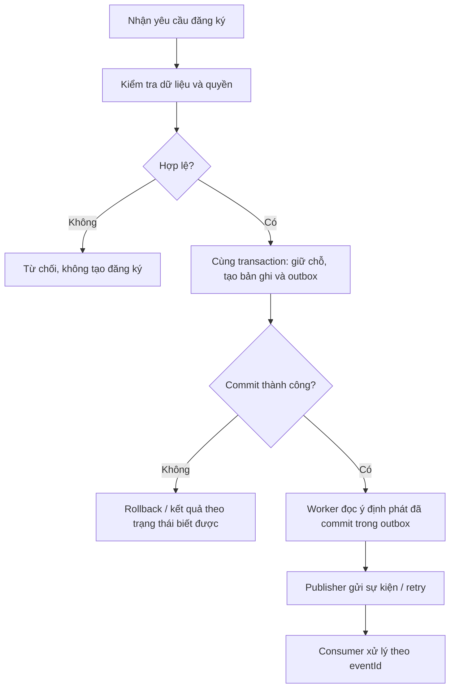

# Xem xét dữ liệu, trạng thái, đồng thời và tài nguyên khi có liên quan

Một pull request bổ sung nút “Đăng ký” cho lớp học. Ở đường sử dụng bình thường, mã chạy đúng: học viên nhấn nút, số chỗ còn lại giảm và một thông báo được gửi. Người review thấy tên phương thức rõ, định dạng đẹp và unit test xanh nên chấp thuận. Nhưng sau khi triển khai, hai học viên cùng giữ được chỗ cuối, một yêu cầu lỗi vẫn phát thông báo thành công và kết nối cơ sở dữ liệu không được trả về pool khi một thao tác ném ngoại lệ.

Các vấn đề này khó phát hiện nếu chỉ đọc mã theo từng dòng hoặc chỉ kiểm tra **đầu ra của trường hợp thành công**. Trong chương **Rà soát mã** thuộc module **CODE_QUALITY_FUNDAMENTALS**, bài học này hướng dẫn cách đặt câu hỏi có chủ đích về **dữ liệu, trạng thái, đồng thời và vòng đời tài nguyên**, để mã nguồn ngày càng **đáng tin cậy, dễ hiểu và dễ thay đổi**.

Điểm quan trọng nằm ở cụm **“khi có liên quan”**. Không phải một hàm thuần tính tổng hai số cần review kết nối DB, luồng và transaction. Ngược lại, một thay đổi nhỏ trong xử lý thanh toán hoặc giữ chỗ có thể cần xem đủ những ranh giới đó, dù diff chỉ vài dòng.

## 1. Rà soát mã là kiểm tra hợp đồng và rủi ro, không chỉ kiểm tra phong cách

Code review giúp trả lời câu hỏi: **thay đổi này có làm đúng điều đã hứa và có bảo toàn những thuộc tính quan trọng khi hoạt động trong hệ thống thật không?**

Formatter, linter, compiler và unit test là bằng chứng hữu ích, nhưng chưa thay được việc đọc và đánh giá một thay đổi theo ngữ cảnh.

| Góc nhìn review | Câu hỏi trọng tâm | Khi nào đặc biệt quan trọng? |
| --- | --- | --- |
| **Dữ liệu** | Giá trị đến từ đâu, hợp lệ khi nào, được biểu diễn và chuyển đổi thế nào? | API, nhập liệu, tiền, thời gian, ánh xạ DB, dữ liệu từ bên ngoài |
| **Trạng thái** | Sau thành công, thất bại và retry, trạng thái nào phải đúng? | Thao tác ghi, workflow, transaction, cache, hàng đợi |
| **Đồng thời** | Hai tác nhân có thể cùng thấy, cùng sửa hoặc tranh tài nguyên nào? | Tồn kho, đặt chỗ, thanh toán, counter, xử lý message |
| **Tài nguyên** | Ai mở, ai sở hữu, ai đóng hoặc giải phóng khi lỗi? | File/stream, connection, socket, thread, lock, transaction |
| **Tác dụng phụ** | Có ghi dữ liệu, gọi API ngoài, phát sự kiện hoặc gửi thông báo sai thời điểm không? | Mọi tác vụ có I/O hoặc thay đổi hệ thống khác |
| **Bằng chứng** | Kiểm thử và quan sát nào chứng minh các hợp đồng quan trọng? | PR thay đổi quy tắc, dữ liệu, hạ tầng hoặc đường lỗi |

Một review tốt không cần bình luận về mọi dấu ngoặc hoặc tất cả các ô trong bảng. Nó cần **ưu tiên những trường hợp có hậu quả cao** và làm rõ khi nào bằng chứng hiện có chưa đủ.

### 1.1. Bắt đầu từ thay đổi và ranh giới chịu ảnh hưởng

Trước khi đi vào chi tiết, người review nên biết:

1. Thay đổi giải quyết vấn đề hoặc yêu cầu nào?
2. Hành vi cũ và mới khác nhau ở đâu?
3. Những điểm nào nhận dữ liệu không tin cậy hoặc đổi cách hiểu dữ liệu?
4. Những thành phần nào có thể thay đổi trạng thái?
5. Có nhiều request, thread, tiến trình hoặc worker cùng tác động dữ liệu đó không?
6. Có mở tài nguyên hoặc phát sinh tác dụng phụ ra ngoài không?
7. Điều gì cần được bảo vệ bằng test, contract hoặc bằng chứng vận hành?

Nếu PR chỉ đổi tên một biến private trong một phép tính thuần, một số câu hỏi có thể được trả lời “không áp dụng”. Nếu PR thêm endpoint đăng ký lớp, gần như toàn bộ các câu hỏi đều cần được cân nhắc.

## 2. Lập bản đồ dữ liệu trước khi đánh giá logic

Nhiều bug không nằm trong câu lệnh `if` mà nằm ở **cách giá trị được hiểu**: số tiền trước giảm giá bị dùng như số tiền sau giảm, thời gian UTC bị diễn giải thành giờ địa phương, mã định danh của khách bị nhầm với mã đơn hoặc trường `null` mang hai ý nghĩa khác nhau.

### 2.1. Theo dấu dữ liệu từ nguồn đến nơi sử dụng

Xét một yêu cầu đặt hàng:

```text
JSON từ client
  → HTTP adapter: parse, xác thực dạng dữ liệu
  → Application service: quyết định nghiệp vụ
  → Domain policy: tính toán với giá trị có ngữ nghĩa
  → Repository: lưu dữ liệu
  → Event publisher: công bố kết quả
```

Review theo luồng này giúp tìm những lần đổi đơn vị, chuẩn hóa, mặc định và mất thông tin.

| Điểm kiểm tra | Câu hỏi nên đặt | Ví dụ rủi ro |
| --- | --- | --- |
| **Nguồn dữ liệu** | Client, DB, cache, message hay config? Có đáng tin không? | Tin giá sản phẩm do client gửi |
| **Kiểu và miền** | Âm, bằng 0, cực lớn, `null`, chuỗi rỗng có hợp lệ không? | Voucher âm khiến tổng tiền tăng |
| **Đơn vị** | VND, cent, giây, mili giây hay ngày? | Nhầm `timeoutSeconds` với `timeoutMillis` |
| **Ý nghĩa** | Trước/sau chiết khấu, giá chốt hay giá tạm? | Xét miễn giao hàng trên tiền sai loại |
| **Mã hóa/chuẩn hóa** | Chuỗi có dấu cách, Unicode, timezone, mã ngoài hệ thống? | Hai ID được coi giống nhau khi chưa có quy tắc |
| **Giới hạn kích thước** | Payload, danh sách, batch, chuỗi có giới hạn? | Đọc tệp cực lớn vào RAM |
| **Thời điểm** | Giá trị phản ánh snapshot nào? Có thay đổi giữa các bước không? | Báo giá theo voucher cũ, chốt đơn theo voucher mới |
| **Sở hữu cập nhật** | Ai có quyền sửa giá trị này? | Hai service cùng cập nhật một số dư |

**Câu hỏi review tốt:** “`amountVnd` ở đây là số tiền trước hay sau voucher? Hợp đồng miễn phí vận chuyển dùng giá trị nào, và unit test có ca đúng ngưỡng chưa?” Câu hỏi đó kiểm tra ý nghĩa, không chỉ yêu cầu đổi tên biến.

### 2.2. Java: kiểm tra dữ liệu tại ranh giới, không phải chắp vá ở mọi nơi

Ví dụ chính sách minh họa nhận số tiền ở dạng số nguyên VND. Java 17 `record` có thể tập trung một số điều kiện hợp lệ:

```java
package com.example.review;

import java.util.Objects;

public record QuoteRequest(
        long merchandiseSubtotalVnd,
        long voucherDiscountVnd,
        DeliverySpeed speed) {

    public QuoteRequest {
        Objects.requireNonNull(speed, "speed");

        if (merchandiseSubtotalVnd < 0
                || voucherDiscountVnd < 0
                || voucherDiscountVnd > merchandiseSubtotalVnd) {
            throw new IllegalArgumentException(
                    "invalid quote amounts");
        }
    }

    public enum DeliverySpeed {
        STANDARD, EXPRESS
    }
}
```

Điều đáng review ở đây là **hợp đồng đầu vào**: voucher không âm, không vượt tiền hàng, loại giao được chỉ định. Sau khi một `QuoteRequest` hợp lệ được tạo, các thành phần sử dụng có thể dựa vào những bất biến đó thay vì sao chép cùng validation khắp nơi.

Nhưng không nên tự suy ra rằng đây là toàn bộ validation cần thiết. Trong hệ thống thật, **giá và ưu đãi có thể phải được xác nhận ở phía server**, không được tin hoàn toàn vào một trường tiền do client gửi. Giá trị âm và `null` chỉ là một phần của mô hình dữ liệu đáng tin cậy.

### 2.3. Nhận diện các trường hợp biên có ý nghĩa

Với một ngưỡng nghiệp vụ `500_000` VND, review nên tìm ca **499.999 / 500.000 / 500.001**. Với một giới hạn chỗ `30`, hỏi trạng thái khi có **0, 29, 30, 31** đăng ký, nhưng phải hiểu giá trị đang xét là **trước** hay **sau** khi ghi.

Trường hợp biên khác cần chọn theo rủi ro:

- `null`, chuỗi trắng, mảng rỗng hoặc tập có phần tử trùng.
- Số âm, số 0, giá trị rất lớn và tràn `int`/`long`.
- Ngày đổi múi giờ, chuyển tháng/năm, thời điểm hết hạn.
- Payload ở sát giới hạn bộ nhớ hoặc giới hạn API.
- Dữ liệu cũ có schema khác phiên bản hiện tại.
- Dữ liệu đến chậm, đến lặp hoặc không theo thứ tự.

Không viết một danh sách ca biên khổng lồ cho mọi PR; hãy chọn **các biên liên quan đến điều kiện vừa đổi**.

## 3. Review trạng thái: nhìn sau lời gọi, không chỉ nhìn giá trị trả về

Một phương thức có thể trả `false` đúng như test mong đợi nhưng đã trừ tồn kho trước khi từ chối. Một API có thể báo timeout nhưng đã ghi thành công xuống DB. Do đó, khi có trạng thái mutable, review cần hỏi **bất biến, chuyển trạng thái và hậu điều kiện đường lỗi**.

### 3.1. Ghi bất biến để có chuẩn nhận xét

Ví dụ một kho chỗ đơn giản có ba đại lượng:

```text
capacity >= 0
available >= 0
held >= 0
available + held == capacity
```

Nếu chỉ quan sát `reserveOne() == true`, người review chưa biết tổng số chỗ có được giữ đúng không. Một kiểm thử nên xem **số chỗ còn**, **số lời gọi thành công** và **bất biến tổng**.

| Thao tác | Tiền điều kiện | Hậu điều kiện thành công | Khi bị từ chối |
| --- | --- | --- | --- |
| `hold(count)` | `count > 0` | `available -= count`; `held += count` | Thiếu chỗ: không đổi trạng thái |
| `release(count)` | `count > 0` và có đủ chỗ đã giữ | `available += count`; `held -= count` | Không đủ chỗ đã giữ: không đổi |
| `snapshot()` | Đối tượng tồn tại hợp lệ | Trả trạng thái nhất quán | Không làm thay đổi kho |

Bảng này là **một hợp đồng minh họa**. Khi review hệ thống thật, cần xác minh liệu thao tác có hỗ trợ thành công một phần, có lưu định danh chủ sở hữu, có timeout giữ chỗ, và bất biến có áp dụng trên một instance hay toàn hệ thống.

### 3.2. Xem bảng chuyển trạng thái khi có workflow

Ví dụ luồng đơn hàng:

| Trạng thái hiện tại | Hành động | Trạng thái hợp lệ tiếp theo | Điều cần từ chối hoặc làm rõ |
| --- | --- | --- | --- |
| `DRAFT` | Xác nhận | `CONFIRMED` | Không xác nhận khi thiếu dữ liệu bắt buộc |
| `CONFIRMED` | Bắt đầu thanh toán | `PAYMENT_PENDING` | Không bắt đầu hai lần khi cùng request ID |
| `PAYMENT_PENDING` | Thanh toán thành công đã xác nhận | `PAID` | Không chuyển vì timeout đơn thuần |
| `PAYMENT_PENDING` | Thanh toán bị từ chối đã xác nhận | `PAYMENT_FAILED` | Phân biệt bị từ chối và chưa có kết quả |
| `PAID` | Hoàn tiền theo chính sách | `REFUND_PENDING` hoặc trạng thái được quy định | Không hoàn vượt số tiền còn được hoàn |
| `CANCELLED` | Yêu cầu thanh toán mới | Từ chối | Không gửi lệnh thu tiền trái hợp đồng |

Một yêu cầu review đáng giá có thể là: “Nếu cổng thanh toán timeout khi đơn đang `PAYMENT_PENDING`, đoạn mã này có đang chuyển sang `PAYMENT_FAILED` mà không đối soát không?” Đây là kiểm tra **ý nghĩa trạng thái**.

### 3.3. Đường lỗi phải giữ điều được cam kết

Với mỗi thao tác có cập nhật, xem ít nhất:

1. Lỗi **trước khi thay đổi trạng thái**.
2. Lỗi **giữa hai cập nhật**.
3. Lỗi **sau commit nhưng trước phản hồi**.
4. Lỗi ở một **hệ thống ngoài transaction**.
5. Retry hoặc xử lý lặp sau lỗi.

Không phải mọi hệ thống đều bảo đảm **all-or-nothing**. Nếu cho phép kết quả một phần, hợp đồng phải ghi rõ phần nào đã hoàn thành và cách bên gọi biết điều đó. Nếu hệ thống không thể xác nhận kết quả, trạng thái **UNKNOWN/PENDING** có thể trung thực hơn việc khẳng định thất bại.

## 4. Review đồng thời: tìm check-then-act và phạm vi nguyên tử

Một đoạn mã nhìn đúng khi chạy tuần tự vẫn có thể sai khi hai request hoặc hai worker cùng truy cập trạng thái.

### 4.1. Ví dụ có lỗi tranh chấp

```java
// Ví dụ minh họa anti-pattern: không dùng cho hệ thống thật.
final class UnsafeInventory {
    private volatile int available;

    UnsafeInventory(int available) {
        this.available = available;
    }

    boolean reserveOne() {
        if (available <= 0) {
            return false;
        }
        available--;
        return true;
    }
}
```

Giả sử `available = 1`. Hai luồng đều có thể đọc giá trị 1 trước khi luồng nào giảm. Cả hai có thể trả `true` dù chỉ có một suất. `volatile` hỗ trợ khả năng quan sát giá trị mới theo quy tắc bộ nhớ Java, nhưng **không làm nguyên tử tổ hợp “đọc → kiểm tra → giảm”**.

Một cách xen kẽ có thể xảy ra:

```text
Luồng A: thấy available = 1, vượt qua điều kiện.
Luồng B: thấy available = 1, vượt qua điều kiện.
Luồng A: giảm và trả true.
Luồng B: giảm và trả true.
Kết quả: có 2 thành công cho 1 suất ban đầu.
```

Giá trị còn lại có thể là 0 hoặc -1 tùy lịch đọc/ghi của phép `--`. Vì thế **chỉ kiểm tra tồn kho không âm vẫn có thể bỏ sót lỗi** nếu cả hai cùng báo thành công và một lần cập nhật bị mất.

### 4.2. Một thiết kế bảo vệ nguyên tử trong một JVM

Với một đối tượng trong **một tiến trình Java**, có thể dùng `AtomicInteger` và `compareAndSet`:

```java
package com.example.review;

import java.util.concurrent.atomic.AtomicInteger;

public final class Inventory {
    private final AtomicInteger available;

    public Inventory(int initialQuantity) {
        if (initialQuantity < 0) {
            throw new IllegalArgumentException(
                    "initialQuantity must be non-negative");
        }
        this.available = new AtomicInteger(initialQuantity);
    }

    public boolean reserve(int quantity) {
        if (quantity <= 0) {
            throw new IllegalArgumentException(
                    "quantity must be positive");
        }

        while (true) {
            int current = available.get();
            if (current < quantity) {
                return false;
            }
            if (available.compareAndSet(
                    current, current - quantity)) {
                return true;
            }
            // Trạng thái đã đổi, đọc lại trước khi quyết định.
        }
    }

    public int remaining() {
        return available.get();
    }
}
```

Các điểm nên kiểm tra trong review:

- **Bất biến:** `remaining >= 0` với số lượng khởi tạo hợp lệ.
- **Tính nguyên tử:** chỉ một CAS thành công có thể đổi từ một giá trị `current` cụ thể sang `current - quantity` khi dữ liệu chưa bị đổi.
- **Đường từ chối:** `current < quantity` trả `false` và không cập nhật.
- **Phạm vi:** tất cả luồng truy cập **cùng đối tượng `Inventory` trong cùng JVM**.
- **Giới hạn:** không giải quyết tồn kho chung giữa nhiều server, không giữ định danh của từng đơn, không bảo đảm lưu bền.

### 4.3. Kiểm thử hai yêu cầu tranh suất cuối

Tệp `InventoryTest.java`, dùng JUnit 5:

```java
package com.example.review;

import static java.util.concurrent.TimeUnit.SECONDS;
import static org.junit.jupiter.api.Assertions.assertEquals;
import static org.junit.jupiter.api.Assertions.assertTrue;

import java.util.List;
import java.util.concurrent.CountDownLatch;
import java.util.concurrent.ExecutorService;
import java.util.concurrent.Executors;
import java.util.concurrent.Future;
import org.junit.jupiter.api.Test;

class InventoryTest {
    @Test
    void twoConcurrentRequestsCannotBothReserveLastSeat()
            throws Exception {

        Inventory inventory = new Inventory(1);
        ExecutorService executor = Executors.newFixedThreadPool(2);
        CountDownLatch ready = new CountDownLatch(2);
        CountDownLatch start = new CountDownLatch(1);

        try {
            Future<Boolean> first = executor.submit(() -> {
                ready.countDown();
                start.await();
                return inventory.reserve(1);
            });
            Future<Boolean> second = executor.submit(() -> {
                ready.countDown();
                start.await();
                return inventory.reserve(1);
            });

            assertTrue(ready.await(5, SECONDS));
            start.countDown();

            List<Boolean> results = List.of(
                    first.get(5, SECONDS),
                    second.get(5, SECONDS));

            long successes = results.stream()
                    .filter(Boolean::booleanValue)
                    .count();

            assertEquals(1L, successes);
            assertEquals(0, inventory.remaining());
        } finally {
            // Không để tác vụ chờ mãi nếu assertion thất bại.
            start.countDown();
            executor.shutdownNow();
            executor.awaitTermination(5, SECONDS);
        }
    }
}
```

`CountDownLatch` tạo điểm bắt đầu có kiểm soát, tăng khả năng tranh chấp, nhưng **không bảo đảm hai lời gọi chạy đúng cùng nanosecond**. Một lần chạy xanh không chứng minh mọi lịch xen kẽ đã được kiểm tra. Lập luận CAS, nhiều kịch bản cạnh tranh và test ở ranh giới dữ liệu thật bổ sung cho nhau.

Với lỗi race khó tái hiện, review có thể yêu cầu thêm kiểm thử với nhiều worker, các lần chạy lặp có kiểm soát, kiểm tra số lần thành công và kiểm tra trạng thái sau xử lý. **Không nên chỉ tăng `Thread.sleep(...)`** để mong mã chạy “đồng thời hơn”.

### 4.4. Những câu hỏi review đồng thời có giá trị

| Câu hỏi | Điều cần tìm trong mã và kiểm thử |
| --- | --- |
| Ai sở hữu trạng thái chia sẻ? | Instance, singleton, DB, cache, broker hay dịch vụ ngoài? |
| Có thao tác nhiều bước không nguyên tử? | `exists → insert`, `read → update`, `check → charge` |
| Khóa/CAS/transaction bảo vệ phần nào? | Mọi đường ghi liên quan hay chỉ một trong các đường? |
| Có bất biến xuyên nhiều bản ghi? | Sức chứa, số dư, tính duy nhất, trạng thái đơn |
| Có nguy cơ deadlock? | Nhiều khóa với thứ tự lấy khác nhau, khóa giữ khi gọi mạng |
| Khi retry có gây tác dụng phụ lặp? | Idempotency key, ghi nhận bền vững, deduplication |
| Có yêu cầu xử lý đúng thứ tự sự kiện? | Version, sequence hoặc kiểm tra chuyển trạng thái |
| Test có tạo tranh chấp ở đúng ranh giới? | Hai request thật trên cùng DB khác test hai thread của một fake |

## 5. Kiểm tra đồng thời ở database và nhiều tiến trình

`synchronized` và `AtomicInteger` trong Java không bảo vệ hai instance khác nhau cùng ghi vào một database. Ví dụ hai node cùng chạy:

```text
Node A: SELECT remaining = 1
Node B: SELECT remaining = 1
Node A: INSERT enrollment
Node B: INSERT enrollment
```

Nếu mỗi node tự kiểm tra rồi ghi, có thể phát sinh đăng ký vượt sức chứa. Review cần xem **tính nguyên tử tại nơi dữ liệu được sở hữu**, không chỉ một khóa trong ứng dụng.

Một hướng SQL mang tính minh họa:

```sql
-- Thực hiện trong transaction thích hợp với DBMS:
UPDATE course_capacity
SET remaining = remaining - 1
WHERE course_id = :courseId
  AND remaining > 0;

-- Chỉ tạo enrollment khi cập nhật đúng 1 dòng.
-- INSERT enrollment thuộc cùng transaction.
-- UNIQUE(course_id, student_id) bảo vệ đăng ký trùng.
-- Nếu INSERT thất bại, rollback cả việc giảm remaining.
```

Đây **chưa phải chương trình SQL đầy đủ**; cần xem transaction boundary, isolation, số dòng cập nhật, ràng buộc unique, ánh xạ lỗi và kiểu dữ liệu. Không phải mọi DBMS có cùng cú pháp hoặc hành vi đồng thời.

Người review nên hỏi:

- Việc giảm chỗ và tạo bản ghi đăng ký có thuộc **cùng giao dịch** không?
- Nếu một học viên nhấn đăng ký hai lần, ràng buộc duy nhất bảo vệ **hai yêu cầu đến đồng thời** không?
- Nếu `INSERT` thất bại sau `UPDATE`, transaction có rollback không?
- Nếu commit thành công nhưng phản hồi mất, client biết dùng **mã yêu cầu** nào để tra cứu?
- Có test tích hợp với **adapter/DB thực** thay vì chỉ fake repository không?

**Tính đúng đắn của thao tác trên một object Java không suy ra tính đúng đắn của một hệ thống nhiều node.** Ranh giới bảo vệ phải trùng ranh giới nơi dữ liệu và giao dịch thật sự tồn tại.

## 6. Review tài nguyên: không chỉ xem lúc chạy thành công

Khi mã dùng file, JDBC connection, socket, khóa hoặc executor, người review cần biết **ai sở hữu tài nguyên** và **đường nào giải phóng nó**. Rò rỉ có thể không xuất hiện trong một unit test ngắn nhưng làm dịch vụ hết connection, file descriptor hoặc thread khi chạy lâu.

### 6.1. Cách viết dễ rò rỉ khi có lỗi

```java
// Anti-pattern minh họa; dataSource và query được giả định có sẵn.
Connection connection = dataSource.getConnection();
PreparedStatement statement = connection.prepareStatement(query);
ResultSet rows = statement.executeQuery();

while (rows.next()) {
    process(rows);
}

rows.close();
statement.close();
connection.close();
```

Nếu `executeQuery()`, `process(rows)` hoặc thậm chí `rows.close()` ném ngoại lệ, các lệnh đóng sau đó có thể không được chạy. Đoạn này cũng chưa thể hiện rõ **ai sở hữu connection**, nó có thuộc transaction do bên ngoài quản lý hay không.

### 6.2. Java: quản lý tài nguyên bằng try-with-resources

Một mô hình khi phương thức **sở hữu kết nối**:

```java
import java.sql.Connection;
import java.sql.PreparedStatement;
import java.sql.ResultSet;
import java.sql.SQLException;
import javax.sql.DataSource;

public final class CourseReader {
    private final DataSource dataSource;

    public CourseReader(DataSource dataSource) {
        this.dataSource = dataSource;
    }

    public long countCourses() throws SQLException {
        String sql = "SELECT COUNT(*) FROM courses";
        try (Connection connection = dataSource.getConnection();
             PreparedStatement statement =
                     connection.prepareStatement(sql);
             ResultSet rows = statement.executeQuery()) {

            if (!rows.next()) {
                throw new SQLException("count query returned no row");
            }
            return rows.getLong(1);
        }
    }
}
```

Đây là **ví dụ JDBC độc lập về vòng đời tài nguyên**, giả định bảng `courses` tồn tại và quyền kết nối đã được cấu hình. `try-with-resources` đóng tài nguyên theo thứ tự ngược với lúc khai báo khi thoát khỏi khối, kể cả khi thao tác trong khối ném ngoại lệ. Với connection đến pool, `close()` thường có nghĩa trả về pool theo triển khai `DataSource`, không nhất thiết đóng socket vật lý.

**Không áp dụng máy móc:** nếu connection được truyền vào từ một transaction bên ngoài, một phương thức đọc dữ liệu **không phải chủ sở hữu** có thể không được phép đóng connection đó. Review phải làm rõ **quyền sở hữu**, không chỉ tìm từ khóa `close`.

### 6.3. Các tài nguyên khác cần cách giải phóng tương ứng

| Tài nguyên | Cơ chế thường dùng | Điều cần xem trong đường lỗi |
| --- | --- | --- |
| `InputStream` / `OutputStream` | `try-with-resources` nếu sở hữu luồng | Có đóng khi đọc/ghi ném lỗi? Có đóng nhầm luồng do caller sở hữu? |
| JDBC `Connection`/`Statement`/`ResultSet` | `try-with-resources` và quản lý transaction rõ | Có trả connection về pool? Commit/rollback thuộc ai? |
| `Lock` | `lock()` và `unlock()` trong `finally` | Exception có để khóa bị giữ không? |
| `ExecutorService` | `shutdown()`, đợi/hủy theo chính sách | Tác vụ chờ có được giải phóng? Interruption có được xử lý? |
| File tạm | Xóa theo vòng đời đã quy định | Khi xử lý fail, còn file rác hoặc dữ liệu nhạy cảm không? |
| HTTP client/socket | Timeout, close theo API và quyền sở hữu | Có tài nguyên kết nối bị giữ vô hạn không? |
| Transaction | Commit/rollback theo hợp đồng | Có cập nhật dở dang bị commit hoặc rollback thiếu không? |

Với khóa:

```java
lock.lock();
try {
    updateSharedState();
} finally {
    lock.unlock();
}
```

Đoạn mã này giả định `lock` là một `java.util.concurrent.locks.Lock` và `updateSharedState()` tồn tại. Nó minh họa một ranh giới: **đường ra khỏi vùng bảo vệ phải nhả khóa**. Nếu phương thức gọi mạng bên trong khóa, review cần hỏi có giữ khóa quá lâu hoặc gây tắc nghẽn không.

### 6.4. Kiểm thử đóng tài nguyên khi lỗi

Một ví dụ nhỏ tách khỏi JDBC để dễ kiểm tra vòng đời một `OutputStream`:

```java
package com.example.review;

import java.io.IOException;
import java.io.OutputStream;
import java.nio.charset.StandardCharsets;
import java.util.Objects;
import java.util.function.Supplier;

public final class AuditWriter {
    private final Supplier<OutputStream> streamFactory;

    public AuditWriter(Supplier<OutputStream> streamFactory) {
        this.streamFactory =
                Objects.requireNonNull(streamFactory, "streamFactory");
    }

    public void write(String event) throws IOException {
        Objects.requireNonNull(event, "event");
        try (OutputStream stream = Objects.requireNonNull(
                streamFactory.get(), "stream")) {
            stream.write(event.getBytes(StandardCharsets.UTF_8));
        }
    }
}
```

Tệp kiểm thử `AuditWriterTest.java`, JUnit 5:

```java
package com.example.review;

import static org.junit.jupiter.api.Assertions.assertThrows;
import static org.junit.jupiter.api.Assertions.assertTrue;

import java.io.IOException;
import java.io.OutputStream;
import org.junit.jupiter.api.Test;

class AuditWriterTest {
    static final class FailingStream extends OutputStream {
        boolean closed;

        @Override
        public void write(int value) throws IOException {
            throw new IOException("simulated write failure");
        }

        @Override
        public void close() {
            closed = true;
        }
    }

    @Test
    void closesOwnedStreamWhenWritingFails() {
        FailingStream stream = new FailingStream();
        AuditWriter writer = new AuditWriter(() -> stream);

        assertThrows(IOException.class,
                () -> writer.write("ENROLLMENT_CREATED"));
        assertTrue(stream.closed);
    }
}
```

Đây là bằng chứng **cục bộ**: khi `write()` ném `IOException`, `close()` vẫn được gọi trên stream mà `AuditWriter` sở hữu. Nó không tự chứng minh việc đóng file thật, connection pool hoặc giải phóng tài nguyên trong mọi hệ điều hành. Nếu rủi ro cao, thêm kiểm thử tích hợp và quan sát số connection/file descriptor theo thời gian.

## 7. Tác dụng phụ và retry cần được review cùng trạng thái

Gửi sự kiện, email hoặc lệnh thanh toán là **tác dụng phụ**, không chỉ là một lời gọi phương thức. Điều này tạo câu hỏi về **thứ tự**, **số lần**, **thời điểm có thể xác nhận** và **phục hồi sau lỗi**.

Một luồng đăng ký minh họa:



Đây là **sơ đồ ý tưởng** dùng mẫu **transactional outbox**: bản ghi đăng ký và bản ghi ý định phát sự kiện được ghi trong **cùng transaction**; worker chỉ phát sau khi transaction đã commit. Cách này tránh khoảng trống nguy hiểm của thiết kế “commit đơn rồi mới ghi ý định phát” khi tiến trình có thể chết giữa hai bước. Nó **không tự bảo đảm sự kiện chỉ được gửi đúng một lần**: publisher có thể gửi lại sau khi mất ACK, nên consumer phải xử lý trùng theo hợp đồng.

### 7.1. Review điều gì khi có mất phản hồi?

| Sự cố | Sai lầm thường gặp | Câu hỏi review đúng |
| --- | --- | --- |
| Client timeout sau commit | Giả định chắc chắn chưa tạo đơn | Có `requestId` để tra cứu kết quả không? |
| Publisher mất ACK | Publish lại và tạo tác dụng phụ trùng | Consumer có nhận diện `eventId` và xử lý trùng không? |
| Email lỗi sau khi đăng ký thành công | Hủy đơn chỉ vì email chưa gửi | Hợp đồng gửi lại và trạng thái thông báo là gì? |
| Hai request cùng `requestId` | Kiểm tra “đã tồn tại?” bằng hai bước rời | Việc ghi nhận ID và kết quả có nguyên tử không? |
| Gọi thanh toán sau khi đã từ chối đơn | Chỉ test mã lỗi trả về | Có kiểm tra **không gửi lệnh thu tiền** không? |

**Idempotency** phải được định nghĩa theo tác dụng phụ cần tránh lặp và phạm vi định danh, không chỉ theo tên một tham số `requestId`. Cần biết khóa tồn tại bao lâu, xử lý cùng khóa với payload khác ra sao và kết quả nào được trả khi hai request trùng đến cùng lúc.

### 7.2. Kiểm tra tương tác khi nó là hợp đồng

Một verification kiểu “helper `validate()` được gọi đúng một lần” thường khóa cứng cấu trúc nội bộ. Ngược lại, kiểm tra “khi đăng ký bị từ chối, **không có thông báo thành công nào được gửi**” có thể là kiểm thử hành vi quan trọng. Khi cần, dùng một **recording fake** tại cổng gửi thông báo để ghi nhận thông điệp đã yêu cầu phát.

Dù test với fake thành công, nó chưa chứng minh message broker thật có cơ chế gửi lại và consumer thật xử lý trùng đúng. Cấp kiểm thử phải phù hợp với **ranh giới và kiểu lỗi** đang được xem xét.

## 8. Cách rà soát một PR đăng ký lớp học theo rủi ro

Giả sử PR bổ sung API `POST /enrollments` với yêu cầu giả định:

- Một lớp có tối đa 30 chỗ.
- Mỗi học viên có tối đa một đăng ký hợp lệ trong lớp.
- Đủ điều kiện thì tạo đăng ký và giảm chỗ còn một đơn vị.
- Hết chỗ hoặc dữ liệu không hợp lệ thì không tạo bản ghi.
- Khi đăng ký đã được ghi nhận thành công, có cơ chế gửi thông báo xác nhận.
- Hệ thống chạy nhiều application instance trên chung database.

### 8.1. Đặt bản đồ kiểm chứng trước khi duyệt

| Rủi ro | Điều phải giữ | Bằng chứng nên yêu cầu |
| --- | --- | --- |
| ID lớp/học viên sai hoặc thiếu | Không ghi đăng ký trái hợp đồng | Test input invalid, hợp đồng HTTP |
| Lớp đầy | Không giảm `remaining`, không ghi đăng ký | Unit + integration test đường từ chối |
| Hai người tranh chỗ cuối | Tổng thành công không vượt sức chứa | Integration test cạnh tranh trên DB thật |
| Một người gửi hai lần | Không có hai bản ghi trùng | Unique constraint, test đồng thời và retry |
| Lỗi sau khi giảm chỗ | Không commit trạng thái nửa vời | Transaction integration test, failure injection |
| Gửi sự kiện thất bại | Không làm mất ý định thông báo đã được cam kết | Test outbox/publisher retry theo thiết kế |
| Consumer xử lý lặp | Không gửi thông báo trùng trái hợp đồng | Test deduplication với cùng event ID |
| Connection/worker không được giải phóng | Không tích tụ tài nguyên sau lỗi | Test cleanup và quan sát pool/threads |
| Thay schema HTTP | Client nhận đúng trường, mã lỗi, ý nghĩa | Contract test |

**Không phải mọi dòng đều cần test mới trong một PR.** Có thể tái sử dụng test hiện có, nhưng người review cần biết **bằng chứng nào đang bảo vệ rủi ro nào** và khoảng trống nào chấp nhận được theo phạm vi.

### 8.2. Trình tự review một diff có nhiều lớp

1. **Đọc mô tả thay đổi và hợp đồng:** khi thành công/từ chối, client thấy gì?
2. **Đi theo dữ liệu:** `courseId`, `studentId`, `requestId` và sức chứa đến từ đâu, được xác thực thế nào?
3. **Xác định người sở hữu trạng thái:** DB hay bộ nhớ trong từng instance?
4. **Tìm điểm không nguyên tử:** kiểm tra tồn tại rồi ghi, giảm sức chứa rồi thêm đăng ký.
5. **Tìm ranh giới transaction:** phạm vi commit/rollback có bao gồm toàn bộ bất biến dữ liệu không?
6. **Tìm tác dụng phụ ra ngoài:** sự kiện gửi trước hay sau commit, có cơ chế outbox/retry không?
7. **Xem cleanup:** connection, lock, executor và file có vòng đời rõ ở đường lỗi?
8. **Đối chiếu test và giới hạn:** unit test fake nào đã đủ, integration test nào chưa thể thay thế?
9. **Để lại nhận xét có hành động:** mô tả rủi ro, kịch bản, đề xuất tiêu chí chứng minh.

### 8.3. Chọn mức độ ưu tiên cho nhận xét

| Mức độ | Ví dụ | Cách ứng xử |
| --- | --- | --- |
| **Blocker — có nguy cơ vi phạm hợp đồng quan trọng** | Hai request có thể giữ cùng chỗ cuối; thu tiền hai lần | Yêu cầu sửa hoặc bằng chứng thuyết phục trước khi merge |
| **Cần xử lý hoặc thống nhất** | Không rõ kết quả sau timeout; thiếu test rollback | Làm rõ hợp đồng, test hoặc ghi quyết định |
| **Đề xuất cải thiện** | Tên `data` chưa thể hiện là giá trước voucher | Gợi ý cách đặt tên có ý nghĩa, cân đối phạm vi PR |
| **Nit về phong cách** | Khoảng trắng, xuống dòng theo chuẩn | Ưu tiên formatter tự động; tránh tốn thời gian review |

**Ưu tiên nhận xét dựa trên tác động**, không dựa vào việc người review thích cách đặt dấu ngoặc nào hơn. Nếu nhóm có quy tắc đặt tên/format được kiểm tra tự động, hãy để công cụ xử lý phần lặp lại.

## 9. Viết bình luận review có căn cứ, dễ hành động

Bình luận tốt thường gồm **vị trí có vấn đề + kịch bản gây lỗi + hậu quả + đề xuất xác minh hoặc sửa**. Không cần khẳng định quá mức khi chưa đủ thông tin.

**Ví dụ 1 — Dữ liệu**

> Ở đây đang so ngưỡng với `merchandiseSubtotalVnd`. Chính sách miễn phí áp dụng trên tiền **sau voucher** hay trước voucher? Nếu áp dụng sau giảm giá, đơn 600.000 VND có voucher 100.001 VND sẽ cần tính phí. Có thể bổ sung test cho trường hợp này và mốc 500.000 VND không?

**Ví dụ 2 — Đồng thời**

> Hai request có thể cùng đọc `remaining = 1` trước khi cập nhật. Cơ chế nào tại database ngăn cả hai tạo đăng ký? Tôi đề xuất cập nhật có điều kiện cùng transaction với `INSERT` và một integration test hai request tranh suất cuối.

**Ví dụ 3 — Tài nguyên**

> `connection.close()` nằm sau `executeQuery()`. Nếu query ném `SQLException`, connection có được trả về pool không? Có thể dùng `try-with-resources` nếu phương thức sở hữu connection, hoặc nêu rõ nơi quản lý transaction/cleanup không?

**Ví dụ 4 — Trạng thái và side effect**

> Khi publisher timeout sau commit, đoạn này trả “đăng ký thất bại” nhưng DB có thể đã tạo bản ghi. Client có cơ chế tra cứu bằng `requestId` không? Cần phân biệt kết quả từ chối với kết quả chưa rõ và kiểm tra retry không tạo thêm đăng ký.

Các bình luận trên tập trung vào **khả năng sai và cách chứng minh**, không gắn nhãn người viết mã. Người review có thể hỏi lại khi hợp đồng chưa rõ thay vì giả định thiết kế hiện tại chắc chắn sai.

### 9.1. Khi tác giả có giải pháp khác

Không cần ép một kỹ thuật duy nhất nếu có nhiều cách đáp ứng cùng hợp đồng. Ví dụ bên review đề xuất CAS, tác giả chứng minh transaction DB đã bảo vệ bất biến ở đúng ranh giới. Hãy đánh giá **bảo đảm thực tế, phạm vi và kiểm thử**, không chỉ việc có dùng đúng kỹ thuật được đề xuất hay không.

## 10. Bằng chứng nào giúp review kết thúc?

Một nhận xét rủi ro nên có **điều kiện đóng**. Ví dụ:

| Nhận xét | Bằng chứng đóng nhận xét |
| --- | --- |
| Ngưỡng bị so nhầm tiền | Đặc tả đã chốt; test 499.999/500.000/500.001 và voucher |
| Có thể vượt sức chứa | Ràng buộc/transaction hoặc cập nhật nguyên tử, integration test cạnh tranh đạt |
| Có thể rò rỉ connection | Sửa vòng đời và test đường exception; cấu hình pool được hiểu |
| Timeout có thể bị coi là từ chối | Hợp đồng trạng thái UNKNOWN, idempotency và test đối soát |
| Sự kiện phát trước commit | Thiết kế phù hợp, test rollback và cơ chế phát lại |
| Thay đổi có thể phá schema | Contract tests hoặc migration/versioning được xác nhận |

Không phải trường hợp nào cũng cần **thêm một công cụ**. Có khi điều cần nhất là làm rõ quy tắc nghiệp vụ, viết một ca test chính xác hoặc xác định ai sở hữu trạng thái.

### 10.1. Test xanh chứng minh được gì?

- Unit test dùng fake chứng minh quy tắc **trong mô hình fake** và phạm vi dữ liệu đã chạy.
- Integration test với DB thật có thể kiểm tra constraint, transaction và hành vi adapter theo cấu hình thử.
- Contract test bảo vệ schema/ý nghĩa đã công bố tại biên API.
- Concurrency test quan sát một số lịch thực thi, không duyệt hết mọi lịch xen kẽ.
- Load/soak test cho bằng chứng về tài nguyên và hiệu năng dưới workload cụ thể.

Một tập test xanh **không tự chứng minh mọi tình huống sản xuất đều an toàn**. Nhưng kết hợp lập luận về bất biến, kiểm tra ranh giới thật và test theo rủi ro tạo niềm tin có căn cứ hơn chỉ đọc một con số coverage.

## 11. Những ngộ nhận khiến code review bỏ sót rủi ro

| Ngộ nhận | Vì sao không đủ | Cách nghĩ phù hợp |
| --- | --- | --- |
| “Hàm này chỉ mười dòng nên an toàn.” | Một lệnh ghi hoặc timeout có thể có hậu quả lớn | Xem hợp đồng và ranh giới, không chỉ độ dài |
| “Đã có validation ở client.” | Client không phải nguồn dữ liệu đáng tin duy nhất | Kiểm tra tại ranh giới server sở hữu quy tắc |
| “`volatile` loại hết race condition.” | Check-then-act không nguyên tử | Xác định thao tác và phạm vi đồng bộ |
| “Có `synchronized` nên DB an toàn giữa nhiều node.” | Khóa Java chỉ bảo vệ phạm vi phù hợp trong JVM | Bảo vệ tại DB/dịch vụ sở hữu dữ liệu |
| “Ném ngoại lệ thì transaction sẽ tự rollback.” | Phụ thuộc cấu hình, phạm vi transaction và cách bắt lỗi | Xác nhận commit/rollback bằng test tích hợp |
| “`close()` trên đường thành công là đủ.” | Exception có thể bỏ qua các lệnh sau | Dùng quản lý tài nguyên phù hợp và test đường lỗi |
| “Timeout nghĩa là chưa thực hiện.” | Dịch vụ ngoài có thể đã commit | Idempotency, đối soát và trạng thái chưa rõ |
| “Mock được gọi đúng một lần là hệ thống đúng.” | Mock có thể chỉ xác nhận kịch bản lập trình sẵn | Kiểm tra trạng thái và side effect thuộc hợp đồng |
| “Review nào cũng phải xét DB và đa luồng.” | Gây nhiễu với phép tính thuần không I/O | Chọn câu hỏi theo rủi ro và phạm vi thay đổi |
| “Unit test xanh chứng minh repository thật đúng.” | Fake không mô phỏng mọi đặc tính DB | Integration test ranh giới thực |
| “Một comment chung chung cũng đủ.” | Không chỉ ra tình huống, hậu quả, điều kiện khắc phục | Viết nhận xét có bằng chứng và kịch bản cụ thể |

## 12. Một checklist ngắn dùng khi rà soát pull request

Dùng các nhóm dưới đây như **gợi ý câu hỏi**. Không cần đánh dấu “có” cho mọi nhóm nếu rủi ro ấy không hiện diện trong thay đổi.

### Dữ liệu

- Đầu vào đến từ đâu? Có kiểm tra miền hợp lệ và giới hạn kích thước không?
- Đơn vị, thời điểm, trạng thái chuẩn hóa, ý nghĩa `null`/rỗng có rõ không?
- Các trường có bị đổi nghĩa giữa HTTP, domain và database không?
- Có ca biên, giá trị cực lớn hoặc dữ liệu cũ cần kiểm tra không?
- Dữ liệu nhạy cảm có bị ghi log/trả ra ngoài ngoài ý muốn không?

### Trạng thái

- Bất biến nào phải giữ sau thành công và từ chối?
- Những chuyển trạng thái nào hợp lệ, bất hợp lệ?
- Khi lỗi giữa nhiều bước, hệ thống có trạng thái dở dang không?
- Có thể phân biệt **thành công**, **từ chối chắc chắn**, **chưa rõ kết quả** không?
- Có cần giữ phiên bản/snapshot khi dữ liệu thay đổi theo thời gian không?

### Đồng thời

- Có trạng thái chia sẻ giữa request/thread/process/node không?
- Thao tác nào cần nguyên tử? Có check-then-act hoặc lost update không?
- Khóa/transaction/CAS bao phủ toàn bộ bất biến và mọi đường cập nhật không?
- Có giới hạn chỗ, tính duy nhất hoặc số dư cần constraint ở DB không?
- Retry, duplicate event và xử lý lặp có được dự tính không?

### Tài nguyên và tác dụng phụ

- Ai sở hữu connection, stream, lock, executor? Có cleanup khi lỗi không?
- Có giữ khóa khi gọi dịch vụ ngoài hoặc chờ quá lâu không?
- Ghi DB và phát sự kiện có cần outbox hoặc cơ chế khôi phục không?
- Một thao tác bị từ chối có còn phát lệnh thanh toán/email trái hợp đồng không?
- Khi shutdown hoặc timeout, tài nguyên và công việc chưa hoàn tất được xử lý thế nào?

### Bằng chứng và quyết định

- Có test cho quy tắc vừa đổi, biên, lỗi và trạng thái sau lỗi không?
- Test nào phải dùng DB/broker/adapter thật thay vì fake?
- Nếu thiếu test, nhóm có giải thích rõ phạm vi và rủi ro còn lại không?
- Nhận xét reviewer có nêu được kịch bản, tác động và cách xác minh không?

## 13. Bài tập vận dụng: review một PR tạo đơn thanh toán

**Bối cảnh:** hệ thống bán vé có API `POST /orders`. Một sự kiện mở bán có 100 vé. API nhận `eventId`, `customerId`, `quantity` và `requestId`. Sau khi tạo đơn, hệ thống gọi cổng thanh toán và phát `OrderPaid` khi đã có bằng chứng thanh toán thành công.

PR mới có những đoạn xử lý như sau (mã giả):

```text
if (quantity <= 0) reject();

remaining = repository.getRemaining(eventId);
if (remaining >= quantity) {
    repository.setRemaining(eventId, remaining - quantity);
    orderId = repository.insertOrder(customerId, eventId, quantity);
    paymentGateway.charge(orderId, price * quantity);
    eventPublisher.publish(OrderPaid(orderId));
    return SUCCESS;
}
return SOLD_OUT;
```

**Yêu cầu:**

1. **Review dữ liệu:** liệt kê ít nhất sáu câu hỏi về `quantity`, `price`, đơn vị tiền, `eventId`, `customerId`, dữ liệu client, phép nhân tràn số và giới hạn số vé mỗi đơn.
2. **Review trạng thái:** nêu ba bất biến cho số vé, đơn hàng và thanh toán; lập ma trận trạng thái sau khi xảy ra lỗi tại mỗi thao tác.
3. **Review đồng thời:** mô tả kịch bản hai request cùng mua số vé cuối. Đề xuất cơ chế nguyên tử tại database và một integration test để xác nhận không oversell.
4. **Review idempotency:** client timeout sau khi đã thu tiền. Làm thế nào dùng `requestId` để tránh thu lần hai? Khi nào cần đối soát thay vì lập tức trả “thanh toán thất bại”?
5. **Review tài nguyên:** những điểm nào có transaction, connection, lock hoặc thread cần quản lý? Điều gì cần giải phóng nếu publisher hoặc gateway ném ngoại lệ?
6. **Review side effect:** vì sao phát `OrderPaid` ngay sau lời gọi `charge` không nhất thiết đúng nếu cổng thanh toán trả trạng thái `PENDING`? Một thiết kế outbox hoặc quy trình đối soát cần bảo vệ điều gì?
7. **Viết ba bình luận review:** một blocker về tính nguyên tử, một về trạng thái thanh toán sau timeout và một đề xuất về khả năng đọc, mỗi bình luận có kịch bản và điều kiện xác minh.
8. **Chọn kiểm thử:** phân loại ít nhất hai unit test, ba integration/contract test và một thử nghiệm failure injection, nêu điều mỗi test chưa chứng minh.

**Hướng tự đối chiếu:** dữ liệu giá và quyền mua phải được xác nhận ở phía server; `price * quantity` có thể tràn số và cần cách biểu diễn tiền phù hợp. `getRemaining → setRemaining` là check-then-act dễ cạnh tranh, cần cập nhật có điều kiện/transaction hoặc cơ chế bảo vệ tương đương. Ghi đơn và giữ vé cần giữ bất biến cùng transaction phù hợp. Thanh toán là tác dụng phụ ngoài DB; timeout không chứng minh chưa thu tiền. `OrderPaid` chỉ nên được công bố khi trạng thái thanh toán đã được xác nhận theo hợp đồng, với cơ chế ghi nhận bền vững, retry và xử lý trùng. Bằng chứng kiểm thử cần bao phủ thất bại, đồng thời và tài nguyên, không chỉ số lần gọi mock.

## 14. Ghi nhớ

- **Review theo rủi ro:** dữ liệu, trạng thái, đồng thời và tài nguyên khi thay đổi thực sự chạm đến các ranh giới đó.
- **Theo dấu dữ liệu:** hiểu nguồn, ý nghĩa, đơn vị, miền hợp lệ và các lần chuyển đổi trước khi đánh giá công thức.
- **Xem hậu điều kiện và bất biến:** kết quả trả về đúng chưa đủ nếu trạng thái sau lỗi hoặc tác dụng phụ sai.
- **Đặt câu hỏi về tính nguyên tử ở đúng nơi sở hữu dữ liệu:** khóa trong JVM không bảo vệ giao dịch giữa nhiều node.
- **Quản lý tài nguyên theo quyền sở hữu:** đường lỗi và timeout phải có cách cleanup rõ, không chỉ đường thành công.
- **Phân biệt từ chối với kết quả chưa rõ:** retry, idempotency và đối soát là phần của hợp đồng khi có I/O.
- **Gắn nhận xét với bằng chứng:** nêu kịch bản gây lỗi, tác động và test hoặc cơ chế cần xác minh.
- **Tránh checklist máy móc:** một hàm thuần và một quy trình thanh toán không cần cùng độ sâu review.

Rà soát mã có giá trị không phải vì người review tìm được nhiều lỗi đặt tên hay nhiều dòng cần viết lại. Giá trị nằm ở khả năng xác định **điều gì có thể hỏng dưới dữ liệu thực, trạng thái thực, cạnh tranh thực và đường lỗi thực**, rồi giúp nhóm bổ sung đúng hợp đồng và bằng chứng để thay đổi mã an toàn hơn.
