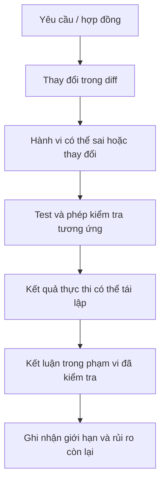
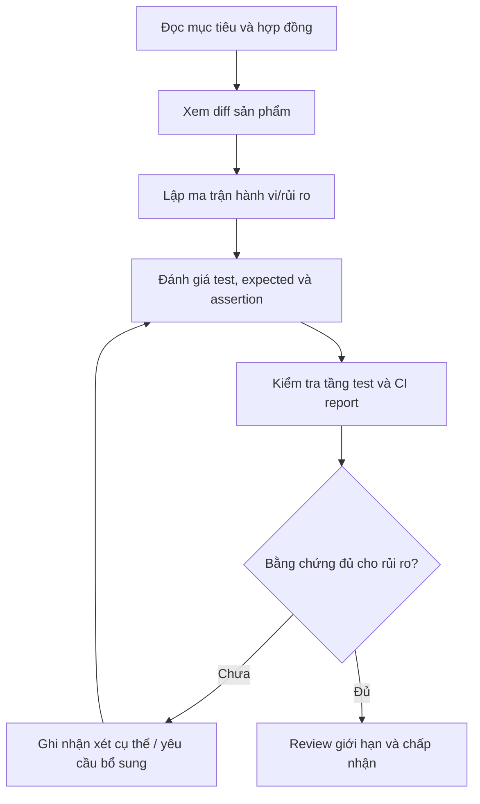

# Đánh giá kiểm thử và bằng chứng xác minh

Trong module `CODE_QUALITY_FUNDAMENTALS`, chất lượng mã nguồn được đánh giá qua khả năng làm phần mềm **đáng tin cậy, dễ hiểu và dễ thay đổi**. Ở chương **Rà soát mã**, việc xem test trong một pull request (PR) không chỉ là kiểm tra xem có thêm file test hay pipeline có màu xanh. Reviewer cần hiểu **thay đổi tuyên bố điều gì**, **bằng chứng nào hỗ trợ tuyên bố đó**, và **phạm vi nào vẫn chưa được xác minh**.

Một PR thay điều kiện áp dụng chiết khấu từ “lớn hơn 500.000 đồng” thành “từ 500.000 đồng trở lên”. Tác giả bổ sung một test với đơn hàng 500.000 đồng và test pass. Đó là bằng chứng hữu ích cho trường hợp biên, nhưng reviewer vẫn cần hỏi: dưới ngưỡng có giữ nguyên không? Trên ngưỡng có giảm đúng không? Quy tắc làm tròn có đổi không? Test có đang tính expected bằng chính công thức của production hay không? Cấu hình CI có thực sự chạy test mới?

**Test pass chỉ chứng minh các kiểm tra đã chạy thỏa mãn trong điều kiện cụ thể.** Một bằng chứng tốt cần liên hệ với hợp đồng nghiệp vụ, bao phủ những trường hợp quan trọng và có khả năng phát hiện lỗi mà thay đổi có thể gây ra. Review test là đánh giá chất lượng của lập luận đó.

Sau bài học, người học có thể:

- Đọc test cùng diff sản phẩm để xác định hành vi nào đang được bảo vệ.
- Đánh giá expected có độc lập và phản ánh đúng hợp đồng hay không.
- Nhận diện thiếu kiểm thử giá trị biên, đầu vào sai, lỗi, trạng thái và tác dụng phụ.
- Phân biệt test kiểm tra hành vi với test phụ thuộc quá chặt vào chi tiết triển khai.
- Đánh giá tính độc lập, tính xác định, khả năng tái hiện và mức hữu ích của assertion.
- Diễn giải coverage, mutation testing, integration test và bằng chứng CI đúng giới hạn.
- Viết nhận xét review cụ thể, có thể hành động và dựa trên rủi ro.

## 1. Test trong PR là một tuyên bố cần bằng chứng

Một thay đổi thường mang theo một hoặc nhiều tuyên bố:

- “Lỗi tại giá trị biên đã được sửa.”
- “Thêm trạng thái mới mà không làm thay đổi luồng cũ.”
- “Có thể retry yêu cầu mà không tạo giao dịch trùng.”
- “Đổi cấu trúc nội bộ nhưng giữ nguyên hành vi công khai.”
- “Thay adapter của nhà cung cấp mà hợp đồng nghiệp vụ vẫn được giữ.”

Reviewer cần tìm **bằng chứng phù hợp với từng tuyên bố**, không chỉ đếm số test mới.

| Tuyên bố của PR | Bằng chứng phù hợp | Điều bằng chứng đó chưa tự chứng minh |
| --- | --- | --- |
| Sửa lỗi giá trị biên | Test trước đây tái hiện lỗi, test sau sửa pass ở biên và các phía lân cận | Mọi tổ hợp giá, thuế, phí đều đúng |
| Giữ nguyên hành vi khi refactor | Test hợp đồng/characterization trước và sau, kiểm tra các nhánh liên quan | Không có khác biệt ở mọi môi trường |
| Ngăn giao dịch trùng | Test cùng idempotency key, test cạnh tranh và kiểm chứng dữ liệu đã commit | Nhà cung cấp bên ngoài luôn phản hồi đúng |
| Tăng hiệu năng | Benchmark/load test cùng điều kiện, số đo latency/throughput/tài nguyên | Hành vi đúng và an toàn dưới mọi tải |
| Tương thích API | Test schema/status/contract với bên gọi hoặc bên cung cấp | Mọi client thực tế đã nâng cấp |
| Sửa lỗi quyền truy cập | Test cho vai trò được phép và không được phép, ở ranh giới bảo vệ thật | Không còn lỗ hổng ở mọi endpoint khác |

Một test đơn vị có thể chứng minh một quy tắc thuần; nó không chứng minh giao dịch DB, quyền truy cập HTTP hay tích hợp nhà cung cấp. Ngược lại, một end-to-end test đi qua nhiều tầng có thể cho thấy hành trình thành công nhưng khó xác định chính xác quy tắc nào đang được bảo vệ. **Bằng chứng phải phù hợp với phạm vi của tuyên bố.**

### Chuỗi suy luận khi review



Nếu một mắt xích bị thiếu, reviewer cần hỏi để làm rõ. Ví dụ test có assertion nhưng không rõ expected đến từ đâu; pipeline xanh nhưng không biết test task có chạy; coverage tăng nhưng không chứng minh assertion có thể phát hiện lỗi.

## 2. Đọc test cùng với thay đổi sản phẩm

Đừng bắt đầu bằng việc đọc toàn bộ file test một cách tách rời. Trước tiên hãy hiểu diff sản phẩm:

1. **Thay đổi hợp đồng nào?** Đầu vào, đầu ra, trạng thái, lỗi, side effect hay hiệu năng?
2. **Điều kiện nào đã thay đổi?** Nhánh mới, điều kiện biên, kiểu dữ liệu, thứ tự thao tác hoặc chính sách retry?
3. **Ai chịu ảnh hưởng?** Người dùng, client API, DB, dịch vụ ngoài, tác vụ nền hay mã gọi nội bộ?
4. **Điều gì có thể hỏng?** Sai kết quả, mất dữ liệu, ghi trùng, lộ thông tin, timeout hoặc giảm tương thích?
5. **Test nào thể hiện các hành vi đó?** Có ca trước/sau, thành công/thất bại và trường hợp biên không?

Sau đó đọc test để kiểm tra liệu chúng thực sự mô tả **hành vi cần giữ** hay chỉ chạy qua dòng code mới. Một PR có thể thêm nhiều test nhưng tất cả đều kiểm tra cùng một trường hợp thành công, trong khi nhánh lỗi quan trọng vẫn chưa có bằng chứng.

### Từ diff đến ma trận hành vi

Ví dụ thay đổi quy tắc số lượng đặt hàng:

| Nhóm tình huống | Hành vi cần xác minh |
| --- | --- |
| Số lượng hợp lệ thông thường | Đơn được tạo với số lượng đã yêu cầu |
| Số lượng bằng 1 | Giá trị nhỏ nhất hợp lệ được chấp nhận |
| Số lượng bằng 0 hoặc âm | Bị từ chối trước khi ghi dữ liệu |
| Số lượng vượt tồn kho | Không xác nhận vượt số lượng khả dụng |
| Số lượng ở giới hạn tối đa | Không tràn số hoặc vượt giới hạn nghiệp vụ |
| Hai request cạnh tranh | Không bán vượt tồn kho |
| DB hoặc upstream lỗi | Trạng thái và phản hồi phản ánh đúng mức độ chắc chắn |
| Client gửi lại request | Không tạo đơn hoặc trừ kho hai lần nếu hợp đồng idempotent |

Ma trận này giúp reviewer tìm ra khoảng trống mà chỉ nhìn tên test khó nhận ra. Không phải mọi PR đều cần test tất cả các hàng; hãy chọn theo **phần hành vi bị tác động và rủi ro có liên quan**.

## 3. Đánh giá expected: test có biết điều gì là đúng?

Một test có cấu trúc rõ thường có ba phần:

- **Arrange:** thiết lập đầu vào, trạng thái ban đầu và phụ thuộc.
- **Act:** thực hiện hành vi đang kiểm tra.
- **Assert:** kiểm tra kết quả hoặc tương tác quan trọng.

Tên test nên mô tả hành vi và điều kiện, ví dụ `rejectsQuantityAboveAvailableStock` thay vì `testReserve2`. Nhưng tên rõ không cứu được một expected sai. Reviewer cần biết **nguồn của expected**: yêu cầu, quy tắc miền, hợp đồng API, chuẩn dữ liệu hay hành vi được xác nhận.

### Expected độc lập với implementation

Test dễ mất giá trị nếu tính expected bằng chính logic production:

```java
@Test
void calculatesDiscount() {
    BigDecimal subtotal = new BigDecimal("500000");
    BigDecimal expected = pricing.discountedTotal(subtotal);

    assertEquals(expected, pricing.discountedTotal(subtotal));
}
```

Test trên gần như chỉ so sánh một lời gọi với chính nó. Nếu hàm trả kết quả sai một cách ổn định, test vẫn pass.

Một test hữu ích hơn nêu expected đã được xác định độc lập từ hợp đồng:

```java
@Test
void appliesTenPercentDiscountAtThreshold() {
    BigDecimal actual =
            pricing.discountedTotal(new BigDecimal("500000"));

    assertEquals(new BigDecimal("450000"), actual);
}
```

Expected 450.000 phải đến từ quy tắc nghiệp vụ đã xác nhận “từ 500.000 đồng trở lên giảm 10%”, không phải từ việc chạy code rồi sao chép kết quả. Với phép tính tiền, cũng phải ghi rõ chính sách làm tròn và đơn vị.

### Tránh assertion quá yếu

Một số assertion không đủ mạnh để bảo vệ thay đổi:

| Assertion | Khoảng trống |
| --- | --- |
| `assertNotNull(result)` | Không chứng minh giá trị đúng hoặc trạng thái đúng |
| `assertTrue(result != null)` | Tương tự, còn kém diễn đạt hơn assertion chuyên biệt |
| `assertDoesNotThrow(action)` | Không kiểm tra kết quả hoặc side effect có đúng không |
| `assertTrue(list.size() > 0)` | Không xác minh phần tử, thứ tự hoặc số lượng chính xác |
| `assertEquals(expected.size(), actual.size())` | Hai danh sách cùng kích thước vẫn có thể chứa dữ liệu sai |
| `verify(repository).save(any())` | Chỉ chứng minh có gọi save, không chắc dữ liệu được lưu đúng |

Assertion nên khẳng định **điều quan trọng nhất trong hợp đồng**. Có thể giữ thêm assertion phụ về side effect hoặc trạng thái, nhưng tránh kiểm tra quá nhiều chi tiết không liên quan khiến test dễ vỡ khi refactor.

## 4. Kiểm tra trường hợp biên, lỗi và trạng thái

Lỗi thường xuất hiện tại ranh giới của một quy tắc: giá trị bằng ngưỡng, danh sách rỗng, số lượng tối đa, thời điểm hết hạn, dữ liệu thiếu hoặc hai thao tác đồng thời. Review test cần tìm những trường hợp mà một phép so sánh, phép chuyển đổi hoặc thứ tự thao tác có thể thay đổi kết quả.

### Phân hoạch đầu vào

Một cách hữu ích là chia đầu vào thành các nhóm có hành vi tương đương (*equivalence partitions*), sau đó chọn đại diện và biên:

| Loại dữ liệu | Nhóm nên cân nhắc |
| --- | --- |
| Số lượng | Âm, 0, giá trị nhỏ nhất hợp lệ, thông thường, giới hạn, vượt giới hạn, tràn số |
| Tiền/tỷ lệ | 0, âm, bằng ngưỡng, ngay dưới/trên ngưỡng, scale, làm tròn, khác tiền tệ |
| Chuỗi/ID | Null, rỗng, khoảng trắng, định dạng sai, độ dài tối đa, ký tự đặc biệt |
| Danh sách | Rỗng, một phần tử, trùng phần tử, rất lớn, phần tử null nếu hợp đồng cho phép |
| Thời gian | Trước, đúng lúc bắt đầu/kết thúc, sau, múi giờ và chuyển ngày |
| Trạng thái | Trạng thái ban đầu, chuyển hợp lệ, chuyển không hợp lệ, thao tác lặp |
| Tích hợp | Thành công, dữ liệu rỗng, timeout, lỗi xác thực, giới hạn tần suất, phản hồi sai |

Không cần tạo tổ hợp Cartesian của tất cả giá trị. Chọn test theo **rủi ro và quan hệ giữa các biến**; dùng pairwise hoặc kỹ thuật kiểm thử tổ hợp khi số chiều lớn và có căn cứ.

### Ví dụ Java: quy tắc giảm giá và ba phía của ngưỡng

Giả sử hợp đồng xác nhận: đơn từ 500.000 đồng được giảm 10%; đơn thấp hơn không giảm; kết quả làm tròn tới đồng nguyên bằng `HALF_UP`.

```java
import java.math.BigDecimal;
import java.math.RoundingMode;
import java.util.Objects;

final class DiscountPolicy {
    private static final BigDecimal THRESHOLD =
            new BigDecimal("500000");
    private static final BigDecimal RATE =
            new BigDecimal("0.10");

    BigDecimal discountedTotal(BigDecimal subtotal) {
        Objects.requireNonNull(subtotal, "subtotal");
        if (subtotal.signum() < 0) {
            throw new IllegalArgumentException("Negative subtotal");
        }
        if (subtotal.compareTo(THRESHOLD) < 0) {
            return subtotal.setScale(0, RoundingMode.HALF_UP);
        }
        return subtotal.multiply(BigDecimal.ONE.subtract(RATE))
                .setScale(0, RoundingMode.HALF_UP);
    }
}
```

Test hồi quy có thể kiểm tra:

```java
import static org.junit.jupiter.api.Assertions.assertEquals;
import static org.junit.jupiter.api.Assertions.assertThrows;

import java.math.BigDecimal;
import org.junit.jupiter.api.Test;

class DiscountPolicyTest {
    private final DiscountPolicy policy = new DiscountPolicy();

    @Test
    void doesNotDiscountJustBelowThreshold() {
        assertEquals(new BigDecimal("499999"),
                policy.discountedTotal(new BigDecimal("499999")));
    }

    @Test
    void discountsAtThreshold() {
        assertEquals(new BigDecimal("450000"),
                policy.discountedTotal(new BigDecimal("500000")));
    }

    @Test
    void discountsJustAboveThreshold() {
        assertEquals(new BigDecimal("450001"),
                policy.discountedTotal(new BigDecimal("500001")));
    }

    @Test
    void rejectsNegativeSubtotal() {
        assertThrows(IllegalArgumentException.class,
                () -> policy.discountedTotal(new BigDecimal("-1")));
    }
}
```

Reviewer có thể xác minh ba điểm: test đúng với hợp đồng, expected độc lập, và các giá trị sát biên có khả năng bắt lỗi dùng `>` thay cho `>=`. Nếu quy tắc thật là “lớn hơn 500.000” thì test tại ngưỡng phải đổi theo hợp đồng đã xác nhận; không được tự suy từ tên test.

### Test chuyển trạng thái quan trọng hơn test từng setter

Với đơn hàng, kiểm tra từng giá trị enum chưa đủ. Hợp đồng có thể yêu cầu:

- `DRAFT -> CONFIRMED` khi còn đủ hàng và dữ liệu hợp lệ.
- `CONFIRMED -> PAID` khi thanh toán được xác nhận.
- `CANCELLED` không thể chuyển thành `PAID`.
- Gọi `confirm()` lần hai không được tạo side effect lặp.

Test cần gọi **hành vi chuyển trạng thái** và kiểm tra cả trạng thái cuối lẫn tác dụng phụ. Một test chỉ đặt `status = PAID` rồi assert getter trả `PAID` không chứng minh quy tắc chuyển trạng thái được bảo vệ.

## 5. Test phải ổn định, độc lập và có thể tái hiện

Một test chỉ cung cấp bằng chứng hữu ích nếu kết quả của nó đủ ổn định để người khác tin và điều tra. Test thỉnh thoảng pass/thỉnh thoảng fail khi không có thay đổi có chủ đích thường được gọi là **flaky test**. Nó làm giảm niềm tin vào CI, khiến nhóm rerun theo thói quen và có thể che giấu lỗi thật.

### Các nguồn gây không ổn định

| Nguồn | Dấu hiệu | Cách review |
| --- | --- | --- |
| Thời gian hệ thống | Test chỉ fail gần nửa đêm, đầu tháng hoặc ngày hết hạn | Inject `Clock`; cố định mốc và kiểm tra biên |
| Ngẫu nhiên | Lỗi hiếm, không biết cách tạo lại | Dùng seed ghi nhận được hoặc fake điều khiển kết quả; giữ random bảo mật trong production |
| Thứ tự test | Chạy riêng pass, chạy suite fail | Kiểm tra trạng thái static, system property, DB/cache và cleanup |
| Đồng thời | Chỉ fail dưới tải hoặc khi chạy song song | Kiểm tra synchronization, race, timeout và điều kiện chờ |
| Mạng/dịch vụ ngoài | Phụ thuộc trạng thái sandbox hoặc internet | Dùng fake/stub cho unit test; test tích hợp có kiểm soát riêng |
| Chia sẻ dữ liệu | Test khác sửa cùng bản ghi/file | Dữ liệu riêng, transaction rollback hoặc namespace độc lập |
| Sleep và timeout tùy tiện | CI chậm fail, máy cá nhân pass | Chờ tín hiệu hoàn tất với deadline có ý nghĩa |
| Locale/múi giờ/môi trường | Khác nhau giữa máy dev và CI | Thiết lập rõ locale, timezone, encoding và phiên bản runtime |

### Ví dụ test chờ sai cách

```java
@Test
void exportCompletes() throws Exception {
    exportService.start();
    Thread.sleep(200);
    assertEquals("DONE", exportService.status());
}
```

Test này giả định tác vụ luôn hoàn tất trong 200 ms. Sleep không thiết lập quan hệ hoàn tất; nó chỉ trì hoãn test. Nếu API cung cấp tín hiệu hoàn thành, nên chờ kết quả đó với timeout:

```java
@Test
void exportCompletesWithinTestDeadline() throws Exception {
    String result = exportService.startAsync()
            .toCompletableFuture()
            .get(5, java.util.concurrent.TimeUnit.SECONDS);

    assertEquals("DONE", result);
}
```

`startAsync()` là API minh họa. Trong dự án thật, reviewer cần xem timeout 5 giây có phù hợp với môi trường test và hợp đồng hay không. Timeout của test giúp ngăn treo vô hạn; nó không tự chứng minh SLA production.

### Test không nên phụ thuộc vào thứ tự hoặc dữ liệu còn sót

Một test nên tự chuẩn bị dữ liệu mà nó cần và dọn trạng thái mà nó sở hữu. Reviewer nên cảnh giác khi:

- Test dùng ID cố định trong DB dùng chung mà không dọn hoặc cô lập.
- Test phụ thuộc một test khác đã tạo cache, file hoặc cấu hình.
- Một test thay `System.setProperty`, default timezone hoặc locale mà không khôi phục.
- Test dùng biến `static` mutable hoặc singleton làm trạng thái chung.
- Test chạy song song nhưng ghi vào cùng một tài nguyên.

Nếu test cần dữ liệu lịch sử hoặc trạng thái được tạo bởi một quy trình khác, phải nói rõ đây là **test tích hợp** và cách fixture được chuẩn bị. Không nên ngụy trang sự phụ thuộc đó thành unit test độc lập.

### Đừng mock mọi thứ

Mock giúp cô lập phụ thuộc và tạo tình huống lỗi, nhưng quá nhiều mock có thể khiến test chỉ chứng minh **các lời gọi đã được sắp xếp như người viết nghĩ**, không chứng minh hệ thống thực sự hoạt động.

| Cách dùng test double | Khi hữu ích | Điều cần review |
| --- | --- | --- |
| Fake repository trong unit test | Kiểm tra logic miền mà không cần DB | Fake có giữ đúng hợp đồng quan trọng của repository không? |
| Stub HTTP client trả timeout | Kiểm tra cách ứng dụng xử lý lỗi upstream | Test này không chứng minh cấu hình timeout của HTTP client thật |
| Mock để xác nhận gửi email một lần | Khi “không gửi trùng” là yêu cầu nghiệp vụ | Có kiểm tra điều kiện khiến email được gửi và trạng thái commit chưa? |
| Mock mọi lớp trong cùng module | Có thể tách một thành phần phức tạp | Test dễ bị ràng buộc vào cấu trúc nội bộ, thay đổi refactor là fail |
| Dùng DB thật trong integration test | Xác minh SQL, transaction, constraint, mapping | Dữ liệu phải cô lập, test phải quản lý vòng đời và môi trường |

Một dấu hiệu test quá phụ thuộc implementation là chỉ cần đổi từ một helper sang helper khác, giữ nguyên đầu ra và hợp đồng, hàng loạt test fail vì verify chính xác chuỗi gọi nội bộ. Reviewer nên hỏi tương tác đó có phải yêu cầu hay chỉ là chi tiết thiết kế.

## 6. Chọn tầng kiểm thử phù hợp với tuyên bố

Không có một loại test duy nhất chứng minh mọi thứ. Một thay đổi thường cần nhiều tầng bằng chứng với phạm vi khác nhau:

| Tầng | Điều có thể xác minh tốt | Giới hạn thường gặp |
| --- | --- | --- |
| **Unit test** | Quy tắc thuần, giá trị biên, nhánh lỗi, bất biến cục bộ | Không chứng minh DB, mạng, serialization hoặc cấu hình thật |
| **Integration test** | Tương tác giữa repository, transaction, framework, adapter và DB thật | Chỉ bao phủ môi trường và đường tích hợp được dựng |
| **Contract test** | Cấu trúc và hành vi giao tiếp giữa consumer/provider | Hợp đồng có thể thiếu một quy tắc nghiệp vụ hoặc không phản ánh mọi provider |
| **Component/service test** | Một dịch vụ với các phụ thuộc được kiểm soát | Không bao phủ toàn hành trình qua mọi dịch vụ |
| **End-to-end test** | Hành trình từ giao diện/API đến các hệ thống liên quan trong môi trường test | Chậm, khó chẩn đoán và không nên dùng để kiểm tra mọi tổ hợp nhỏ |
| **Performance/load test** | Latency, throughput, tài nguyên và hành vi dưới tải đã mô tả | Không tự chứng minh logic đúng hoặc môi trường production giống hệt |
| **Security test** | Một lớp kiểm soát hoặc tình huống tấn công cụ thể | Không chứng minh không còn lỗ hổng khác |

### Ví dụ: thêm trường tiền tệ vào lưu trữ

Giả sử PR bổ sung cột `currency_code` cho đơn hàng:

- Unit test xác minh `Money` không cộng hai tiền tệ khác nhau.
- Integration test xác minh DB lưu/đọc đúng cả `amount` và `currency_code`, constraint và migration.
- Contract/API test xác minh JSON trả đúng mã tiền và client có thể đọc.
- Test dữ liệu lịch sử xác minh bản ghi cũ được chuyển đổi theo quy tắc đã thống nhất.
- Test end-to-end có thể xác minh người dùng tạo và xem đơn với tiền tệ đúng.

Nếu PR chỉ thêm unit test cho `Money`, reviewer không nên kết luận migration và API tương thích. Nếu chỉ có end-to-end test thành công, reviewer vẫn có thể yêu cầu unit test cho các giá trị biên vì test rộng khó cô lập nguyên nhân.

### Khi test phụ thuộc dịch vụ ngoài

Một test gọi sandbox nhà cung cấp thanh toán có thể cần thiết để xác minh giao thức, nhưng không nên là bằng chứng duy nhất cho mọi lần chạy CI nếu sandbox không ổn định. Hãy phân biệt:

- Unit test: fake phản hồi thành công, từ chối, timeout và trạng thái không rõ.
- Contract/integration test: kiểm tra schema, xác thực, timeout và ánh xạ status với sandbox hoặc stub server.
- End-to-end: xác minh một số hành trình đại diện, với dữ liệu và tài khoản thử được cô lập.

Với thao tác có tác dụng phụ, phải có idempotency key hoặc môi trường an toàn để test không tạo giao dịch thật. Timeout không chứng minh nhà cung cấp chưa xử lý request; test cần kiểm tra cách hệ thống tra cứu và đối soát trạng thái.

## 7. Đọc coverage đúng giới hạn

**Code coverage** cho biết phần mã nào đã được thực thi bởi tập test trong một lần đo và theo cách công cụ định nghĩa. Nó hữu ích để tìm vùng chưa có test, nhưng **không đo trực tiếp chất lượng assertion**.

Một dòng code có thể được thực thi mà test không hề kiểm tra kết quả. Một nhánh có thể chạy nhưng assertion quá yếu. Một test có thể đạt 100% line coverage mà vẫn bỏ qua trạng thái dữ liệu sai hoặc side effect trùng.

### Các loại coverage thường gặp

| Chỉ số | Câu hỏi trả lời | Không tự chứng minh |
| --- | --- | --- |
| Line coverage | Dòng nào được thực thi? | Dòng đó được kiểm tra đúng hay chưa |
| Statement coverage | Câu lệnh nào được thực thi? | Mọi nhánh và điều kiện đã được kiểm chứng |
| Branch coverage | Các nhánh quyết định đã được đi qua chưa? | Mọi tổ hợp điều kiện hoặc mọi giá trị miền |
| Condition coverage | Các điều kiện con đã nhận true/false chưa? | Mọi tổ hợp điều kiện hoặc quan hệ giữa điều kiện |
| Method coverage | Phương thức nào đã được gọi? | Phương thức được kiểm tra đầy đủ |
| Path coverage | Những đường thực thi nào đã đi qua? | Thường khó đạt đầy đủ với số đường tăng rất lớn hoặc vòng lặp |

Không nên đặt một ngưỡng coverage chung rồi xem nó là mục tiêu chất lượng duy nhất. Ngưỡng có thể hữu ích như **quality gate tối thiểu**, nhưng phải kết hợp review nội dung test, rủi ro nghiệp vụ và các trường hợp chưa được kiểm tra.

### Coverage tăng nhưng bằng chứng có thể không mạnh hơn

Ví dụ thêm test:

```java
@Test
void callsDiscountMethod() {
    pricing.discountedTotal(new BigDecimal("500000"));
}
```

Test gọi phương thức và có thể làm coverage tăng, nhưng không assert kết quả. Nếu logic sai, test vẫn pass. Một test có assertion độc lập và xác minh các trường hợp biên có giá trị hơn cho tuyên bố về tính đúng đắn.

Khi review báo cáo coverage, hỏi:

- Báo cáo thuộc **đúng commit** đang review không?
- Tệp generated code, DTO, adapter hoặc test fixture có làm lệch mẫu số không?
- Coverage có được thu từ test đã thực sự chạy hay chỉ từ một tác vụ cũ/cache?
- Những nhánh rủi ro cao đã được kiểm tra chưa?
- Test có assertion đủ mạnh và expected có nguồn rõ không?
- Có dòng/nhánh bị loại trừ khỏi báo cáo mà không có lý do không?

## 8. Mutation testing: test có phát hiện thay đổi sai không?

**Mutation testing** đánh giá sức mạnh phát hiện lỗi của test bằng cách tạo những biến thể nhỏ, có chủ đích, trong mã sản phẩm (*mutants*). Ví dụ:

- Đổi `>=` thành `>`.
- Đổi `&&` thành `||`.
- Đảo một điều kiện boolean.
- Thay một giá trị trả về bằng hằng số.
- Bỏ một lời gọi hoặc thay đổi phép toán.

Nếu một mutant làm thay đổi hành vi nhưng toàn bộ test vẫn pass, có thể test chưa kiểm tra điều mà thay đổi đó ảnh hưởng.

### Ví dụ với quy tắc chiết khấu

Code ban đầu:

```java
if (subtotal.compareTo(THRESHOLD) >= 0) {
    return applyDiscount(subtotal);
}
return subtotal;
```

Mutant:

```java
if (subtotal.compareTo(THRESHOLD) > 0) {
    return applyDiscount(subtotal);
}
return subtotal;
```

Nếu test chỉ có 600.000 đồng và 400.000 đồng, cả hai phiên bản đều có thể pass. Test ở đúng 500.000 đồng sẽ làm mutant bị phát hiện (*killed*). Đây là bằng chứng cụ thể rằng test bảo vệ dấu bằng tại biên.

### Diễn giải mutation score

Một công cụ có thể báo:

- **Killed:** test thất bại khi chạy mutant; test phát hiện thay đổi đó.
- **Survived:** test vẫn pass; có thể thiếu assertion hoặc mutant không ảnh hưởng đến đường được test.
- **No coverage:** mã bị biến đổi không được test thực thi.
- **Timeout/error:** mutant không thể được phân loại bình thường; cần xem riêng.
- **Equivalent mutant:** biến thể không làm thay đổi hành vi có thể quan sát trong phạm vi liên quan; không nên tính nó như một lỗi test còn sống mà không phân tích.

Mutation score thường được tính trên nhóm mutant có thể phân loại, nhưng cách loại trừ mutant tương đương và lỗi công cụ khác nhau giữa nền tảng. **Không so sánh phần trăm giữa hai công cụ hoặc hai cấu hình khác nhau mà không hiểu cách tính.**

Mutation testing có chi phí chạy và review. Không nhất thiết áp dụng toàn bộ repository trong mọi PR; có thể chọn module/rule quan trọng hoặc chạy định kỳ. Nó bổ sung bằng chứng về chất lượng test, không thay thế đặc tả, review hoặc kiểm thử tích hợp.

## 9. Những thay đổi trong test cần reviewer chú ý đặc biệt

Một PR có thể thêm test nhưng đồng thời **làm yếu hoặc loại bỏ** bằng chứng cũ. Hãy xem toàn bộ diff của test, không chỉ những file mới.

### 9.1. Assertion bị xóa hoặc nới lỏng

Các dấu hiệu đáng hỏi:

- `assertEquals(expected, actual)` bị thay bằng `assertNotNull(actual)`.
- Test kiểm tra đúng status cụ thể chuyển thành kiểm tra “không phải lỗi”.
- Kiểm tra số lần gọi side effect bị xóa dù yêu cầu “chỉ gửi một lần” vẫn còn.
- Test cho trạng thái lỗi bị đổi thành `assertDoesNotThrow` mà không có lý do hợp đồng.
- Snapshot expected được cập nhật tự động mà không review khác biệt nghiệp vụ.

Không phải mọi thay đổi assertion đều sai. Có thể expected cũ đã lỗi thời hoặc một hợp đồng được làm rõ. Reviewer cần yêu cầu **lý do và nguồn của expected mới**, đồng thời kiểm tra test có còn phát hiện lỗi quan trọng hay không.

### 9.2. Test bị xóa, skip hoặc disable

Khi PR xóa hoặc bỏ qua test, cần hỏi:

1. Hành vi mà test cũ bảo vệ còn tồn tại không?
2. Có test khác thay thế cùng bằng chứng không?
3. Test cũ sai vì hợp đồng thay đổi, vì flaky hay vì môi trường?
4. Nếu tạm skip, ai sở hữu việc sửa, có issue/mốc xem lại không?
5. Pipeline có hiển thị rõ test đã skip không?

Một test flaky có thể được quarantine tạm để khôi phục độ tin cậy của pipeline, nhưng **quarantine không giải quyết nguyên nhân**. Cần lưu bằng chứng lần fail, lý do, phạm vi rủi ro, chủ sở hữu và cách đưa test trở lại.

### 9.3. Mock/stub thay đổi theo hướng khiến test luôn pass

Ví dụ trước đây fake repository có thể trả lỗi khi không tìm thấy bản ghi, nhưng PR đổi fake thành luôn trả một đối tượng hợp lệ. Các ca test lỗi có thể biến mất mà production chưa được bảo vệ. Reviewer nên xem:

- Setup mới có phản ánh hợp đồng thật không?
- Mock có trả đúng giá trị mà test đang cần hay vô tình che một nhánh?
- Có kiểm tra số lần gọi quan trọng hoặc dữ liệu gửi đi không?
- Có test tích hợp để xác minh mapping thật không?

Không nên xác nhận một test tốt chỉ vì dùng nhiều mock hoặc có nhiều dòng `verify`. Số lượng tương tác được kiểm tra không tương đương chất lượng bằng chứng.

### 9.4. Test chỉ kiểm tra chi tiết triển khai

Một test có thể fail khi đổi tên helper, thay cấu trúc collection hoặc trích xuất phương thức, dù hành vi công khai không đổi. Đó là dấu hiệu test bị gắn với implementation quá chặt.

Ví dụ, nếu yêu cầu là “mỗi request hợp lệ chỉ phát một sự kiện xác nhận”, verify số lần phát sự kiện là hợp lý vì đây là side effect có ý nghĩa. Nhưng verify thứ tự gọi ba private helper trong một service thường không phải hợp đồng. Review cần phân biệt **tương tác nghiệp vụ quan trọng** với **cấu trúc nội bộ dễ thay đổi**.

### 9.5. Test mới không được CI thực thi

Một file test có thể tồn tại nhưng không chạy vì:

- Tên/lớp không khớp quy ước discovery của test runner.
- Nằm ngoài source set hoặc module được cấu hình.
- Bị annotation/condition skip.
- Test task không chạy trong pipeline PR.
- Profile CI loại bỏ test hoặc chạy một tập chọn lọc khác.

Reviewer nên xem report của đúng commit, số test đã chạy, skipped/disabled và task thực thi. **Sự tồn tại của test trong diff không phải bằng chứng test đã chạy.**

## 10. Đọc bằng chứng từ CI và môi trường

Khi pipeline báo xanh, hãy xác định **bước nào đã chạy, trên commit nào, trong điều kiện nào**. Một báo cáo đáng tin thường có:

- Commit SHA hoặc revision chính xác của PR.
- Phiên bản JDK, build tool, dependency lock/version và cấu hình liên quan.
- Tên task đã chạy (compile, unit test, integration test, static analysis...).
- Số lượng test pass/fail/skipped/aborted và report tương ứng.
- Trạng thái analyzer và phạm vi source được phân tích.
- Thông tin môi trường dịch vụ phụ thuộc hoặc container test khi cần.
- Artifact, log hoặc trace đủ để tái hiện lỗi mà không lộ dữ liệu nhạy cảm.

### Phân biệt trạng thái pipeline

| Trạng thái | Bằng chứng thực sự có |
| --- | --- |
| **Passed** | Bước đã chạy và các điều kiện của bước đạt trong phạm vi cấu hình |
| **Failed** | Bước đã chạy nhưng có assertion, lỗi build hoặc quality gate không đạt |
| **Skipped** | Bước không được thực thi theo điều kiện cấu hình |
| **Blocked/Error** | Không thể hoàn tất kiểm tra do môi trường, dependency, quyền hoặc lỗi công cụ |
| **Inconclusive** | Có kết quả nhưng thiếu phần quan trọng để kết luận, ví dụ report bị cắt hoặc test không chạy đủ |

Nếu integration test bị skip do sandbox không sẵn sàng, không nên nói “tất cả test đều pass”. Cách báo chính xác là “unit test pass; integration test bị skip do sandbox; hợp đồng tích hợp chưa được xác minh trong lần chạy này”.

### Test chạy lại và test ổn định là hai bằng chứng khác nhau

Một lần rerun pass sau khi fail có thể cho thấy lỗi không ổn định hoặc môi trường đã hồi phục. Nó **không xóa** bằng chứng của lần fail trước. Với flaky test, nên lưu:

- Lần chạy đầu và lần rerun, cùng commit.
- Tần suất fail quan sát được và số lần thử.
- Môi trường, mức tải, thứ tự chạy và các phụ thuộc.
- Điều kiện tái hiện hoặc bằng chứng chưa thể tái hiện.
- Kế hoạch xử lý và chủ sở hữu nếu test được quarantine.

Không kết luận “đã sửa flaky” chỉ vì chạy lại vài lần xanh. Bản sửa cần giải thích nguyên nhân biến động và có phép thử phù hợp.

## 11. Quy trình review test có trọng tâm

Một quy trình review thực tế có thể đi theo các bước:

**Bước 1 — Đọc mục tiêu PR và hợp đồng liên quan.** Tóm tắt hành vi trước/sau và tiêu chí chấp nhận. Nếu yêu cầu mơ hồ, hỏi tác giả hoặc người sở hữu nghiệp vụ trước khi đánh giá expected.

**Bước 2 — Xác định rủi ro của diff.** Tìm thay đổi điều kiện, kiểu dữ liệu, trạng thái, transaction, concurrency, side effect, API và dependency.

**Bước 3 — Liệt kê các tình huống cần bằng chứng.** Thành công, lỗi, biên, dữ liệu rỗng/thiếu, trạng thái lặp, cạnh tranh và timeout tùy phạm vi.

**Bước 4 — Đọc test mới và test bị sửa/xóa.** Kiểm tra Arrange/Act/Assert, tên test, expected, assertion, fake/mock, cleanup và mức gắn với implementation.

**Bước 5 — Đối chiếu tầng kiểm thử.** Unit, integration, contract, end-to-end hoặc performance test có phù hợp tuyên bố không? Có cần bằng chứng ở ranh giới khác không?

**Bước 6 — Đọc report thực thi.** Đúng commit? Task bắt buộc đã chạy? Có skipped, flaky, lỗi setup hoặc analyzer không hoàn tất không?

**Bước 7 — Đánh giá coverage và chất lượng assertion.** Coverage có chỉ ra khoảng trống? Với logic quan trọng, mutation test có thể giúp phát hiện test yếu không?

**Bước 8 — Viết nhận xét cụ thể.** Chỉ rõ hành vi/rủi ro, bằng chứng đang thiếu và test hoặc thay đổi nào sẽ giải quyết.

**Bước 9 — Đánh giá lại sau sửa.** Xác minh test mới thực sự bắt được lỗi mục tiêu và test đối chứng vẫn pass.



Không phải PR nào cũng cần coverage report, mutation test hoặc end-to-end test mới. Mức bằng chứng phải **tương xứng với hậu quả và phạm vi thay đổi**. Một đổi tên biến cục bộ không cần bộ test lớn; thay đổi cách ghi nhận thanh toán, phân quyền hoặc cập nhật tồn kho cần bằng chứng chặt hơn.

## 12. Viết nhận xét review có thể hành động

Một nhận xét hữu ích có ba phần:

1. **Điều đang quan sát:** test hoặc diff hiện thiếu/khẳng định điều gì?
2. **Rủi ro:** hành vi sai nào có thể lọt qua?
3. **Yêu cầu cụ thể:** nên thêm phép kiểm tra, xác nhận hợp đồng hoặc bằng chứng nào?

### Ví dụ nhận xét

**Chưa đủ cụ thể:**

> “Thiếu test edge case.”

**Cụ thể hơn:**

> “Điều kiện mới dùng `>=` nên kết quả khác ở đúng 500.000 đồng. Test hiện chỉ kiểm tra 400.000 và 600.000, vì vậy cả `>` và `>=` đều có thể pass. Vui lòng thêm ca đúng ngưỡng với expected theo chính sách đã xác nhận.”

**Chưa đủ căn cứ:**

> “Coverage thấp, cần tăng lên 90%.”

**Cụ thể hơn:**

> “Nhánh xử lý timeout của `PaymentGateway` chưa có test. Nếu request đã được nhà cung cấp xử lý nhưng response thất lạc, retry có thể thu tiền hai lần. Vui lòng bổ sung test cho trạng thái không xác định và chứng minh luồng tra cứu dùng cùng idempotency key.”

**Quá gắn với implementation:**

> “Hãy mock đúng ba helper theo thứ tự này.”

**Tập trung vào hợp đồng:**

> “Test cần chứng minh thao tác xác nhận chỉ phát một sự kiện sau khi giao dịch được commit. Có thể kiểm tra side effect ở ranh giới này; cách tổ chức helper nội bộ có thể thay đổi.”

### Phân biệt mức độ nhận xét

- **Blocking:** thiếu bằng chứng cho một rủi ro có hậu quả lớn hoặc test cho thấy hành vi vi phạm hợp đồng.
- **Non-blocking/suggestion:** có thể cải thiện tính rõ ràng, độ bền của test hoặc giảm chi phí bảo trì nhưng không chặn tiêu chí hiện tại.
- **Question:** cần làm rõ hợp đồng hoặc nguồn expected trước khi kết luận.
- **Nit:** nhận xét nhỏ về phong cách/diễn đạt, không nên trình bày như lỗi chức năng.

Không nên dùng nhãn blocking cho mọi sở thích test. Một nhận xét nghiêm trọng cần nêu rõ **hậu quả và bằng chứng**, để tác giả biết vì sao phải xử lý trước khi merge.

## 13. Dữ liệu test, fixture và tính dễ hiểu

Một test có thể có assertion đúng nhưng dữ liệu dựng quá phức tạp, khiến người đọc không hiểu điều kiện nào quan trọng. Reviewer cần xem liệu fixture có làm nổi bật **điều kiện đang được kiểm tra** hay che nó trong nhiều lớp cấu hình.

### Dữ liệu nên nhỏ nhưng đủ ý nghĩa

Với một test tính giá, dữ liệu sau dễ đọc:

```java
BigDecimal subtotal = new BigDecimal("500000");
String tier = "VIP";
BigDecimal expected = new BigDecimal("450000");
```

So với việc dựng 30 sản phẩm, 5 khách hàng, nhiều trạng thái đơn và mock hàng loạt khi test chỉ cần xác minh một ngưỡng, ví dụ nhỏ giúp người review nhanh chóng thấy **điều kiện và kết quả**.

Nhưng không nên thu nhỏ đến mức bỏ mất yếu tố làm lỗi xuất hiện. Nếu lỗi do hai request cùng đặt sản phẩm cuối cùng, fixture phải tạo được **hai thao tác cạnh tranh thực sự**; chuyển test thành một lời gọi tuần tự không còn kiểm tra cùng rủi ro.

### Builder và fixture dùng chung

Builder có thể giúp tạo đối tượng phức tạp, nhưng default của builder phải hợp lý và nhìn thấy được. Reviewer nên hỏi:

- Giá trị mặc định có khiến test vô tình dùng trạng thái khác dự định không?
- Có trường nào quan trọng được set ngầm trong helper không?
- Một thay đổi default có làm nhiều test đổi nghĩa mà diff không thể hiện rõ không?
- Fixture có dùng chung mutable state giữa các test không?

Một helper tên `validOrder()` có thể hữu ích nếu nó thực sự tạo đơn hợp lệ theo hợp đồng. Nhưng nếu test cần kiểm tra một trường cụ thể, hãy thể hiện trường đó rõ ràng trong test thay vì buộc người đọc mở nhiều helper để tìm.

### Test parameterized khi nhiều trường hợp cùng quy tắc

Với các giá trị biên của ngưỡng, parameterized test có thể tránh lặp và làm bảng dữ liệu rõ:

```java
import static org.junit.jupiter.api.Assertions.assertEquals;

import java.math.BigDecimal;
import java.util.stream.Stream;
import org.junit.jupiter.params.ParameterizedTest;
import org.junit.jupiter.params.provider.Arguments;
import org.junit.jupiter.params.provider.MethodSource;

class DiscountPolicyParameterizedTest {
    private final DiscountPolicy policy = new DiscountPolicy();

    static Stream<Arguments> thresholdCases() {
        return Stream.of(
                Arguments.of("499999", "499999"),
                Arguments.of("500000", "450000"),
                Arguments.of("500001", "450001"));
    }

    @ParameterizedTest
    @MethodSource("thresholdCases")
    void appliesThresholdRule(String input, String expected) {
        assertEquals(
                new BigDecimal(expected),
                policy.discountedTotal(new BigDecimal(input)));
    }
}
```

Parameterized test giúp thể hiện tập trường hợp cùng một hành vi. Không nên gom những tình huống có **lý do khác nhau** vào một test duy nhất đến mức tên test và báo cáo lỗi không còn chỉ ra được vấn đề.

### Property-based testing khi không thể liệt kê hết đầu vào

Với một hàm có miền đầu vào rộng, có thể kiểm tra các **tính chất** thay vì chỉ vài ví dụ:

- Tổng tiền trước giảm không âm thì kết quả sau giảm theo tỷ lệ trong [0, 1] không vượt quá tổng ban đầu, nếu chính sách không có phụ phí.
- Cộng số lượng hợp lệ không được âm thầm tràn số.
- Chuẩn hóa một giá trị hợp lệ hai lần phải cho cùng giá trị.
- Một thao tác idempotent khi lặp cùng định danh không tạo thêm hiệu ứng nghiệp vụ.

Framework property-based có thể sinh nhiều đầu vào và thu nhỏ trường hợp thất bại. Khi review, cần xem **property có đúng theo miền** không, seed có thể tái hiện không, và dữ liệu thu nhỏ có còn giữ điều kiện gây lỗi không. Sinh hàng nghìn đầu vào với một property sai chỉ làm kiểm thử sai chạy nhanh hơn.

## 14. Đánh giá gói bằng chứng trước khi chấp nhận PR

Một bản review tốt kết thúc bằng kết luận **đúng mức**. Có thể dùng bảng sau để ghi nhận:

| Câu hỏi | Bằng chứng nên có | Kết luận nếu thiếu |
| --- | --- | --- |
| Hành vi thay đổi đã được hiểu? | Mục tiêu PR, hợp đồng, ví dụ đầu vào/đầu ra | Cần làm rõ yêu cầu trước khi đánh giá expected |
| Test có kiểm tra điều quan trọng? | Assertion độc lập, ca biên/lỗi, trạng thái | Test có thể pass nhưng bỏ lọt lỗi |
| Test có ổn định và tự chủ? | Setup rõ, cleanup, thời gian/random kiểm soát | Kết quả CI khó tái hiện |
| Tầng test phù hợp? | Unit/integration/contract/e2e theo ranh giới | Chưa có bằng chứng cho tích hợp hoặc vận hành liên quan |
| Bằng chứng đã chạy đúng commit? | CI run, SHA, task, số test và report | Chưa xác minh bản thay đổi đang review |
| Coverage được diễn giải đúng? | Phạm vi, loại coverage, nhánh rủi ro | Không dùng phần trăm làm kết luận chất lượng |
| Có kiểm tra sức mạnh test khi cần? | Mutation result hoặc phân tích assertion cho logic quan trọng | Chưa biết test có bắt được thay đổi sai tinh vi |
| Rủi ro còn lại đã rõ? | Test skip, môi trường thiếu, giả định và kế hoạch theo dõi | Kết luận cần giới hạn hoặc yêu cầu thêm bằng chứng |

### Ví dụ tóm tắt kết luận review

> **Đã xác minh:** quy tắc giảm giá mới được kiểm tra dưới, đúng và trên ngưỡng; expected khớp hợp đồng đã xác nhận. Ca đầu vào âm vẫn bị từ chối. Unit test của đúng commit đã chạy và pass.
>
> **Chưa xác minh:** integration test với repository thật bị skip do môi trường DB không sẵn sàng. Vì vậy mapping và transaction chưa được kiểm chứng trong lần chạy này.
>
> **Đề nghị:** bổ sung/khôi phục integration test trước khi phát hành nếu thay đổi có tác động tới lưu trữ; không kết luận toàn bộ đường thanh toán đã được xác minh từ unit test.

Kết luận này vừa công nhận bằng chứng đã có, vừa giữ rõ giới hạn. Nó có ích hơn câu “LGTM, CI xanh” khi còn một ranh giới quan trọng chưa được kiểm tra.

### Khi không cần thêm test mới

Không phải mọi PR đều cần thêm test. Một thay đổi có thể chỉ đổi comment, format hoặc tên biến mà không thay đổi hành vi. Khi đó reviewer vẫn cần kiểm tra phạm vi diff, và có thể dựa vào test hiện có nếu chúng đủ phù hợp. Nhưng nếu PR **đổi điều kiện, trạng thái, dữ liệu, side effect hoặc hợp đồng**, tác giả cần giải thích test hiện tại đã bảo vệ hành vi mới như thế nào hoặc vì sao không cần thêm bằng chứng.

Không thêm test vì “đã có nhiều test” không phải lý do đủ. Cần chỉ ra **test hiện có nào** bao phủ hành vi và assertion nào phát hiện sai khác.

## 15. Bài tập thực hành

### Bài 1 — Từ diff đến bằng chứng

Một PR đổi điều kiện áp dụng phí giao hàng miễn phí từ `subtotal > 1.000.000` thành `subtotal >= 1.000.000`. Test hiện chỉ kiểm tra 900.000 và 1.100.000. Hãy viết ma trận test tối thiểu, expected theo hợp đồng mới và một nhận xét review cụ thể giải thích khoảng trống.

### Bài 2 — Expected có độc lập không?

Một test gọi `service.calculate()` để lấy expected, rồi gọi lại cùng phương thức với cùng đầu vào để lấy actual. Hãy giải thích vì sao test vẫn pass khi implementation sai. Viết lại test với expected lấy từ một quy tắc đã xác nhận và chỉ rõ nguồn của expected.

### Bài 3 — Assertion quá yếu

Một test cho thao tác tạo đơn chỉ assert `assertNotNull(orderId)`. Hãy xác định các hành vi quan trọng có thể vẫn sai (khách hàng, tổng tiền, tồn kho, trạng thái, side effect) và chọn những assertion phù hợp với hợp đồng. Không thêm assertion cho chi tiết nội bộ không có ý nghĩa.

### Bài 4 — Flaky test

Test khởi chạy tác vụ nền, `sleep(100)` rồi kiểm tra trạng thái `DONE`. Test fail trên CI nhưng pass cục bộ. Hãy đề xuất cách chờ tín hiệu hoàn thành, đặt deadline, cô lập dữ liệu và ghi nhận bằng chứng của lần fail đầu. Giải thích vì sao rerun pass chưa chứng minh test ổn định.

### Bài 5 — Coverage và mutation

Một module đạt 95% line coverage nhưng mutant đổi `>=` thành `>` vẫn sống. Hãy giải thích hai kết quả không mâu thuẫn vì sao. Đề xuất test bổ sung để kill mutant và nêu giới hạn của mutation score.

### Bài 6 — Chọn tầng test

PR đổi cách ánh xạ trường `currencyCode` giữa JSON, domain object và DB. Hãy phân chia bằng chứng cần có ở unit, integration và contract/API test. Nêu điều nào không thể kết luận từ unit test với repository fake.

### Bài 7 — Test bị xóa

PR xóa một test kiểm tra giao dịch timeout vì test “không ổn định”. Hãy viết các câu hỏi review cần đặt ra, thông tin cần giữ từ lần fail, biện pháp quarantine có trách nhiệm và tiêu chí để khôi phục test.

### Bài 8 — Review mock

Một test verify chính xác năm phương thức private được gọi theo thứ tự, nhưng không assert kết quả nghiệp vụ. Hãy giải thích test đang bảo vệ điều gì, điều gì bị bỏ trống và cách kiểm tra lại hợp đồng ở ranh giới công khai.

### Bài 9 — Báo cáo CI không đầy đủ

CI báo xanh nhưng integration test bị skip và analyzer không xuất report. Hãy viết kết luận chính xác về những gì đã pass, những gì chưa chạy và bằng chứng cần bổ sung trước khi phát hành một thay đổi liên quan DB.

### Bài 10 — Nhận xét review có mức độ

Viết ba nhận xét cho cùng một PR: một blocking vì thiếu test cho rủi ro mất dữ liệu, một question vì expected chưa rõ theo yêu cầu, và một suggestion để làm test dễ đọc. Mỗi nhận xét phải nêu điều quan sát, rủi ro và hành động cụ thể; tránh biến sở thích cá nhân thành blocker.

**Tiêu chí tự đánh giá:** người học phải nối được **hợp đồng → rủi ro → test → assertion → kết quả thực thi → giới hạn kết luận**. Một câu trả lời chỉ nói “đã có test”, “coverage cao” hoặc “CI xanh” là chưa đủ nếu không giải thích bằng chứng đó bảo vệ hành vi nào.

## Ghi nhớ

**Review kiểm thử là review chất lượng bằng chứng cho hành vi thay đổi.** Hãy đọc test cùng diff và hợp đồng, kiểm tra expected độc lập, assertion đủ mạnh, trường hợp biên/lỗi và tính ổn định. Chọn tầng kiểm thử phù hợp; diễn giải coverage và mutation testing đúng giới hạn; xác minh test thật sự chạy trên đúng commit. Khi viết nhận xét, nêu rõ rủi ro và phép kiểm tra còn thiếu. Một PR đáng tin không phải PR có nhiều test hoặc phần trăm coverage cao nhất, mà là PR có **bằng chứng phù hợp với rủi ro, có thể tái hiện và có giới hạn được trình bày trung thực**.
