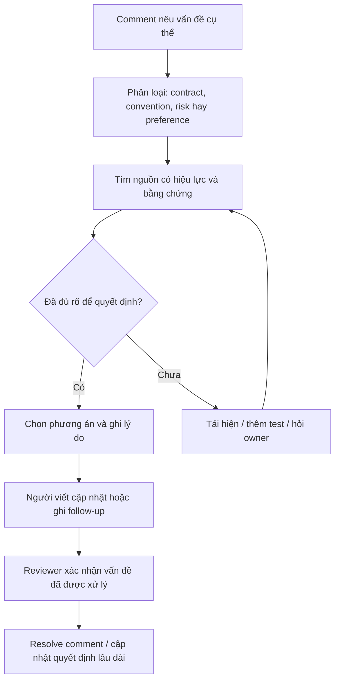

# Xử lý bất đồng dựa trên hợp đồng, quy ước và bằng chứng

Trong một pull request, người viết muốn dùng `>` vì “ngưỡng phải vượt qua mới được áp dụng”; người review đọc đặc tả thấy “từ 500.000 trở lên” và cho rằng phải dùng `>=`. Một người thích trả `null` để biểu thị không tìm thấy; người khác muốn dùng `Optional`. Hai người cùng có kinh nghiệm, đều muốn bảo vệ chất lượng, nhưng cuộc trao đổi bắt đầu biến thành tranh luận về phong cách cá nhân.

Code review có giá trị khi bất đồng được đưa về **hợp đồng cần giữ, quy ước đã thống nhất và bằng chứng có thể kiểm tra**. Mục tiêu không phải chứng minh ai đúng bằng thâm niên hay cách diễn đạt mạnh hơn; mục tiêu là đưa ra quyết định giúp mã nguồn đáng tin cậy, dễ hiểu và dễ thay đổi.

Trong chương **Rà soát mã** của **CODE_QUALITY_FUNDAMENTALS**, bài học này tập trung vào cách xử lý bất đồng trong review. Nội dung gắn với mục tiêu module: hiểu những thuộc tính quyết định mã nguồn có **đáng tin cậy, dễ hiểu và dễ thay đổi hay không**.

Một review tốt không có nghĩa mọi người luôn đồng ý. Nó có nghĩa bất đồng được làm rõ, đánh giá đúng mức rủi ro, giải quyết bởi người có trách nhiệm và ghi lại khi quyết định có ảnh hưởng lâu dài.

## Mục tiêu học tập

Sau bài này, bạn có thể:

1. Phân biệt bất đồng về hợp đồng, tính đúng đắn, quy ước, khả năng bảo trì, hiệu năng và bảo mật.
2. Xác định nguồn có thẩm quyền cho một quyết định thay vì dựa vào ý kiến cá nhân.
3. Chuyển nhận xét mơ hồ thành câu hỏi hoặc yêu cầu có thể kiểm chứng.
4. Dùng test, ví dụ tái hiện, đặc tả, analyzer và phép đo phù hợp với loại bất đồng.
5. Phản hồi review một cách chuyên nghiệp, bảo vệ quan điểm bằng lập luận và tiếp nhận bằng chứng mới.
6. Phân loại mức độ, xác định người quyết định và xử lý bất đồng chưa được giải quyết.
7. Ghi lại quyết định quan trọng để tránh lặp lại cùng tranh luận trong những thay đổi sau.

## 1. Bất đồng trong code review thường thuộc loại nào?

Trước khi tranh luận, hãy xác định **hai bên đang bất đồng về điều gì**. Cùng một comment “nên sửa cách này” có thể chứa nhiều loại vấn đề khác nhau.

| Loại bất đồng | Câu hỏi cần trả lời | Nguồn xác minh thường phù hợp |
| --- | --- | --- |
| **Hợp đồng / tính đúng đắn** | Hành vi nào đã được cam kết? Input và output nào là hợp lệ? | Đặc tả được duyệt, API contract, quy tắc nghiệp vụ, test có oracle đúng. |
| **Tương thích** | Caller hoặc dữ liệu cũ có tiếp tục hoạt động? | Chính sách versioning, schema, compatibility test, inventory consumer. |
| **Quy ước** | Nhóm đã thống nhất cách viết hoặc cấu trúc nào? | Formatter, linter, coding standard, ADR hoặc guideline của dự án. |
| **Khả năng bảo trì** | Cách nào làm trách nhiệm và thay đổi tương lai rõ hơn? | Ví dụ sử dụng, phạm vi phụ thuộc, lịch sử thay đổi, mô hình miền. |
| **Hiệu năng** | Phương án nào nhanh hơn trong workload cần hỗ trợ? | Benchmark tái lập, profiler, production metrics và giới hạn tài nguyên. |
| **Bảo mật / độ tin cậy** | Đường đi nào có thể gây lộ dữ liệu, mất dữ liệu hoặc trạng thái sai? | Threat model, security policy, reproduction, kiểm thử và phân tích luồng. |
| **Sở thích cá nhân** | Người review thích cách viết nào hơn? | Chưa có bằng chứng bắt buộc; cần xem lợi ích thực tế và quy ước hiện hành. |

Một bất đồng có thể thuộc nhiều loại. Ví dụ, đổi `null` thành `Optional.empty()` vừa là thay đổi chữ ký Java, vừa ảnh hưởng source compatibility và hợp đồng của caller. Nếu chỉ tranh luận “Optional sạch hơn” thì chưa giải quyết các tác động đó.

### Đừng dùng một tiêu chuẩn cho mọi loại bất đồng

- Lỗi làm sai tiền, quyền truy cập hoặc trạng thái dữ liệu cần bằng chứng về **hợp đồng và tác động**.
- Vi phạm format đã được tự động hóa nên để formatter xử lý, không biến thành cuộc tranh luận thẩm mỹ.
- Một đề xuất tối ưu cần số liệu từ workload phù hợp; trực giác có thể giúp nêu giả thuyết, không đủ để kết luận.
- Một lựa chọn đặt tên có nhiều phương án chấp nhận được có thể giải quyết theo quy ước nhóm, không cần chứng minh một tên là “đúng duy nhất”.

## 2. Xác định nguồn có thẩm quyền: hợp đồng trước ý thích

Khi hai người diễn giải khác nhau, câu hỏi đầu tiên không nên là “ai có nhiều kinh nghiệm hơn?” mà là **quyết định này đang phục vụ lời hứa nào, và ai có quyền xác nhận lời hứa đó?**

### Những nguồn thường cần đối chiếu

1. **Quy định và ràng buộc bắt buộc:** chính sách bảo mật, pháp lý, quyền riêng tư, yêu cầu an toàn hoặc cam kết đã ký với khách hàng.
2. **Hợp đồng bên ngoài:** API schema, giao thức, định dạng dữ liệu, hành vi đã công bố và chính sách tương thích.
3. **Yêu cầu nghiệp vụ đã được phê duyệt:** quy tắc, trường hợp biên, định nghĩa hoàn tất và các ngoại lệ.
4. **Quyết định kiến trúc/thiết kế đang có hiệu lực:** ADR, tiêu chuẩn module, quyết định về ownership hoặc vận hành.
5. **Kiểm thử và bằng chứng thực thi:** contract test, regression test, reproduction, log/trace đã loại bỏ dữ liệu nhạy cảm.
6. **Quy ước của nhóm:** naming, format, cấu trúc package, cách dùng API và tiêu chuẩn review.
7. **Lý do kỹ thuật và sở thích:** tính dễ đọc, sự quen thuộc, cảm nhận về độ đơn giản.

Đây là **danh sách nguồn cần tìm**, không phải thứ tự máy móc cho mọi tình huống. Ví dụ, một test cũ có thể sai so với hợp đồng mới; một ADR có thể đã bị thay thế; một guideline nội bộ không thể ghi đè yêu cầu bảo mật bắt buộc. Hãy xác minh **nguồn còn hiệu lực, phạm vi áp dụng và chủ sở hữu**.

### Nếu nguồn mâu thuẫn thì sao?

Giả sử API spec nói trường `preferredName` là bắt buộc, nhưng ví dụ trong README lại bỏ trường này. Không thể chọn ngẫu nhiên một nguồn. Cần xác định:

- Spec có đúng version đang được hỗ trợ không?
- README là ví dụ cũ hay dành cho một endpoint khác?
- Consumer thực tế đang dựa vào hợp đồng nào?
- Ai sở hữu API và có quyền xác nhận thay đổi?
- Nếu phải thay hợp đồng, cần version mới hay giai đoạn chuyển tiếp?

Nếu chưa có câu trả lời, ghi nhận đây là **điểm chưa rõ của hợp đồng** và yêu cầu chủ sở hữu xác nhận. Không nên lặng lẽ biến cách implementation hiện tại thành đặc tả mới.

## 3. Ví dụ xuyên suốt: bất đồng về điều kiện biên

Giả sử hợp đồng phí vận chuyển đã được xác nhận:

- Tổng tiền giỏ hàng không âm.
- Giỏ hàng có tổng tiền **từ 500.000 đơn vị tiền trở lên** được miễn phí.
- Dưới ngưỡng, phí tiêu chuẩn là 30.000.

Đây là quy tắc minh họa, không phải biểu phí thật.

Implementation trong pull request:

```java
public final class ShippingFeePolicy {
    private static final long FREE_FROM = 500_000L;
    private static final long STANDARD_FEE = 30_000L;

    public long feeMinor(long basketMinor) {
        if (basketMinor < 0) {
            throw new IllegalArgumentException(
                    "Basket amount must be non-negative");
        }
        return basketMinor > FREE_FROM ? 0L : STANDARD_FEE;
    }
}
```

Người viết giải thích: “Đơn hàng phải vượt 500.000 mới miễn phí.” Người review nói: “Đặc tả ghi **từ 500.000**, nên giá trị đúng bằng ngưỡng cũng phải miễn phí.”

Đây không còn là tranh luận về phong cách. Hai cách viết tạo ra kết quả khác nhau tại đúng một giá trị:

| `basketMinor` | Hợp đồng “từ 500.000” | Code hiện tại dùng `>` |
| ---: | ---: | ---: |
| 499.999 | 30.000 | 30.000 |
| 500.000 | 0 | 30.000 |
| 500.001 | 0 | 0 |

### Bằng chứng nào giải quyết được?

Đầu tiên là **nguồn hợp đồng đã được phê duyệt**. Nếu câu chữ “từ 500.000” có hiệu lực và được hiểu là bao gồm ngưỡng, code cần dùng `>=`. Sau đó thêm test ranh giới để biến hợp đồng thành bằng chứng có thể chạy:

```java
import static org.junit.jupiter.api.Assertions.*;
import org.junit.jupiter.api.Test;

class ShippingFeePolicyTest {
    private final ShippingFeePolicy policy = new ShippingFeePolicy();

    @Test
    void chargesStandardFeeImmediatelyBelowThreshold() {
        assertEquals(30_000L, policy.feeMinor(499_999L));
    }

    @Test
    void waivesFeeAtExactlyTheThreshold() {
        assertEquals(0L, policy.feeMinor(500_000L));
    }

    @Test
    void waivesFeeImmediatelyAboveThreshold() {
        assertEquals(0L, policy.feeMinor(500_001L));
    }

    @Test
    void rejectsNegativeAmount() {
        assertThrows(IllegalArgumentException.class,
                () -> policy.feeMinor(-1L));
    }
}
```

Implementation tương ứng:

```java
return basketMinor >= FREE_FROM ? 0L : STANDARD_FEE;
```

Test không phải nguồn chân lý tự thân: nó được viết **từ hợp đồng đã xác nhận**. Nếu yêu cầu thực sự được đổi thành “lớn hơn 500.000”, test phải thay theo quyết định đó. Không nên để một test cũ ép hệ thống tiếp tục thực hiện một quy tắc đã bị thay thế hợp lệ.

### Khi đặc tả chưa rõ

Nếu tài liệu chỉ ghi “đạt ngưỡng” mà không nói có bao gồm 500.000, review nên đặt câu hỏi:

> “Ở đúng 500.000, khách hàng có được miễn phí không? Mình cần xác nhận quy tắc biên trước khi chốt `>` hay `>=`.”

Trong lúc chờ xác nhận, không nên biến phỏng đoán của một bên thành quyết định. Nếu thay đổi đang chặn phát hành, hãy xác định owner nghiệp vụ và thời điểm cần phản hồi.

## 4. Dùng đúng loại bằng chứng cho đúng câu hỏi

Một comment có thể viện dẫn “test xanh”, “analyzer báo”, “benchmark nhanh hơn” hoặc “production đang chạy”. Nhưng **bằng chứng chỉ có giá trị trong phạm vi điều nó đo hoặc kiểm tra**.

| Loại bằng chứng | Hữu ích để xác minh | Giới hạn cần nhớ |
| --- | --- | --- |
| Đặc tả/contract được duyệt | Hành vi phải đáp ứng. | Có thể lỗi thời hoặc diễn đạt chưa rõ; cần xác nhận version/owner. |
| Unit test với expected độc lập | Quy tắc thuần, giá trị biên, ngoại lệ. | Không tự xác minh DB, mạng hoặc consumer thật. |
| Integration/contract test | Tương tác giữa thành phần và giao thức. | Chỉ bao phủ cấu hình và kịch bản đã chạy. |
| Reproduction tối thiểu | Một lỗi có thể tái hiện với input cụ thể. | Một reproduction chưa mô tả mọi trường hợp. |
| Compiler/type checker | Lỗi cú pháp, kiểu, một số ràng buộc ngôn ngữ. | Không chứng minh logic nghiệp vụ đúng. |
| Static analyzer | Mẫu lỗi và một số đường đi dữ liệu. | Có false positive/negative, phụ thuộc rule và mô hình. |
| Benchmark/profiler | Chi phí trong workload, môi trường và cấu hình đã đo. | Không suy rộng sang workload khác nếu chưa có căn cứ. |
| Production metrics/log/trace | Hành vi đã quan sát trong môi trường cụ thể. | Cần xem sampling, thời gian, cấu hình, privacy và tính đại diện. |
| Coding convention/formatter | Cách trình bày và quy tắc nhóm đã thống nhất. | Không quyết định thay hợp đồng hoặc sửa lỗi nghiệp vụ. |

### Bằng chứng phải trả lời được câu hỏi cụ thể

Ví dụ:

- “Nhánh này có thể dereference `null` không?” → theo đường đi, annotation, analyzer và test input null phù hợp.
- “Có phá API V1 không?” → so sánh schema/behavior với contract và chạy consumer/provider tests.
- “Cách mới có nhanh hơn không?” → benchmark tái lập trên workload đại diện hoặc đo production có kiểm soát.
- “Có nên đổi tên biến không?” → đọc ngữ cảnh, convention và mức độ rõ ở caller; có thể không cần benchmark hay test.

Không cần gom thật nhiều link hoặc screenshot. Một reproduction ngắn, đúng phạm vi và dễ chạy thường thuyết phục hơn một đoạn tranh luận dài.

## 5. Phân biệt quy ước nhóm với sở thích cá nhân

Không phải bất đồng nào cũng cần một test. Ví dụ hai cách viết:

```java
if (request == null) {
    throw new IllegalArgumentException("request is required");
}
```

và:

```java
Objects.requireNonNull(request, "request");
```

Trong một ngữ cảnh, chúng có thể thể hiện cùng một mục đích; nhưng loại exception và thông điệp có thể khác, nên **không được mặc định tương đương** nếu caller dựa vào hợp đồng lỗi. Nếu chỉ đang tranh luận cách trình bày trong một private helper không có ràng buộc đặc biệt, convention của nhóm hoặc lựa chọn dễ đọc hơn có thể đủ để quyết định.

### Công cụ nên giải quyết những gì có thể tự động hóa

- Formatter có thể quyết định indentation, khoảng trắng, dấu ngoặc và thứ tự import theo cấu hình.
- Linter có thể kiểm tra quy tắc naming, độ phức tạp hoặc những pattern đã thống nhất.
- Compiler và build có thể phát hiện API không tương thích ở compile time.
- Test/contract check có thể bảo vệ hành vi quan trọng.

Khi formatter đã là chuẩn của repository, comment review kiểu “tôi thích dấu ngoặc ở dòng kế tiếp” không nên lặp lại. Hãy để công cụ áp dụng thống nhất. Review của con người dành cho **ngữ nghĩa, thiết kế, rủi ro và những điều công cụ không hiểu được**.

### Khi convention chưa tồn tại

Đừng biến sở thích của reviewer thành “quy định của nhóm” ngay trong một PR. Có thể:

1. Nêu lợi ích cụ thể của cách viết đề xuất.
2. Hỏi nhóm có cần một quy ước thống nhất không.
3. Nếu quyết định có tác động rộng, ghi vào guideline/ADR và áp dụng nhất quán trong thay đổi phù hợp.
4. Không yêu cầu sửa toàn bộ code cũ trong PR không liên quan nếu chưa có kế hoạch migration.

Một convention có ích khi giảm số quyết định lặp lại và giúp code dễ đọc; nó trở thành gánh nặng nếu được áp dụng máy móc dù bối cảnh khác.

## 6. Cách viết comment review có thể hành động

Một nhận xét tốt giúp người nhận hiểu **điều gì đang xảy ra, vì sao cần quan tâm và bước tiếp theo là gì**.

### Cấu trúc gợi ý

1. **Quan sát:** chỉ ra đoạn mã hoặc hành vi cụ thể.
2. **Căn cứ:** hợp đồng, quy ước, dữ liệu hoặc reproduction nào liên quan?
3. **Tác động:** nếu giữ nguyên thì điều gì có thể xảy ra?
4. **Đề nghị:** cần sửa, thêm test, xác nhận hay ghi lại quyết định nào?

Ví dụ comment có tính xây dựng:

> **Blocking —** Đặc tả phí vận chuyển ghi “từ 500.000”, nên giá trị đúng bằng ngưỡng phải được miễn phí. Với `>` hiện tại, `500_000` vẫn bị tính 30.000. Đề nghị đổi thành `>=` và thêm test cho giá trị đúng ngưỡng để giữ hợp đồng này.

Comment này nêu rõ mức độ, căn cứ, đầu vào tái hiện, kết quả sai và thay đổi cần thiết.

Comment mơ hồ:

> “Logic này sai. Sửa lại đi.”

Người nhận không biết sai ở hợp đồng, cách triển khai, style hay kỳ vọng cá nhân. Nếu reviewer chưa chắc, nên hỏi câu hỏi thay vì khẳng định.

### Một comment nên chứa một vấn đề chính

Tránh gom trong một comment:

- Sai điều kiện biên.
- Đổi tên biến.
- Tách phương thức.
- Viết lại toàn bộ test.
- Nâng thư viện.

Khi nhiều yêu cầu được trộn, người viết khó biết điều gì đang chặn merge và reviewer khó xác nhận phần nào đã được giải quyết. Có thể tách comment hoặc tạo follow-up issue nếu một đề xuất không thuộc phạm vi thay đổi hiện tại.

### Dùng câu hỏi khi bằng chứng chưa đầy đủ

Ví dụ:

> “Mình chưa thấy test cho trường hợp provider timeout sau khi đã nhận yêu cầu. Hợp đồng retry hiện tại có bảo đảm idempotency không? Nếu chưa, mình nghĩ nên xác nhận điều này trước khi thêm retry tự động.”

Đây là cách nêu rủi ro và yêu cầu làm rõ mà không giả định người viết đã bỏ sót một quy tắc chắc chắn.

## 7. Mức độ comment: điều gì thực sự chặn merge?

Nếu mọi nhận xét đều được gọi là “blocking”, nhóm khó phân biệt lỗi nguy hiểm với đề xuất cải thiện. Nếu không comment nào được đánh dấu mức độ, người viết có thể vô tình bỏ qua một vấn đề nghiêm trọng.

Một cách phân loại đơn giản:

| Mức | Ý nghĩa | Ví dụ |
| --- | --- | --- |
| **Blocker** | Có lỗi hoặc rủi ro nghiêm trọng; cần giải quyết trước khi merge/phát hành theo chính sách nhóm. | Sai tiền, phá API được hỗ trợ, lộ secret, mất dữ liệu, race gây trạng thái không hợp lệ. |
| **Major** | Ảnh hưởng đáng kể đến tính đúng, khả năng bảo trì hoặc khả năng vận hành; cần xử lý hoặc có quyết định rõ. | Thiếu test cho nhánh lỗi quan trọng, dependency thay đổi không tương thích. |
| **Suggestion** | Có cách cải thiện đáng cân nhắc nhưng không nhất thiết chặn thay đổi. | Tách helper để giảm lặp hoặc đổi tên cho rõ nghĩa. |
| **Nit / style** | Chi tiết nhỏ, thường được formatter hoặc convention xử lý. | Khoảng trắng, dòng trống, wording không ảnh hưởng ngữ nghĩa. |

Tên mức độ và quyền chặn merge tùy chính sách repository. Một comment blocker cần nêu **tác động và điều kiện để được gỡ**. Không dùng mức độ cao chỉ để ép người khác chấp nhận một sở thích.

### Severity không phải thứ tự ưu tiên duy nhất

Một vấn đề có thể nghiêm trọng nhưng ít khả năng xảy ra; vấn đề khác thường xuyên xảy ra nhưng tác động nhỏ. Review cần xem cả **xác suất, tác động, khả năng phát hiện và phạm vi**. Tuy nhiên, các ràng buộc bảo mật, pháp lý hoặc an toàn có thể yêu cầu xử lý ngay bất kể tần suất.

Nếu comment không chặn merge, người review nên nói rõ có thể xử lý trong PR hay tạo issue follow-up. Tránh để một suggestion biến thành nghĩa vụ ngầm sau khi PR đã được approve.

## 8. Người viết phản hồi bất đồng thế nào?

Người viết không cần đồng ý với mọi comment, nhưng cần **phản hồi nội dung** và cho biết comment đã được xử lý ra sao.

### Một phản hồi hữu ích thường gồm

- Trạng thái: đã sửa, chưa sửa, cần làm rõ hoặc đề xuất follow-up.
- Căn cứ: link/spec/test/reproduction hoặc giải thích kỹ thuật ngắn.
- Phạm vi thay đổi: commit hoặc vị trí đã sửa nếu có.
- Phần còn lại: rủi ro nào vẫn tồn tại và ai cần quyết định.

Ví dụ:

> “Đã đổi sang `>=` và thêm test tại 500.000 theo mục 3.2 của hợp đồng phí. Các ca 499.999 và 500.001 cũng được giữ để bảo vệ hai phía của ngưỡng.”

Nếu không đồng ý:

> “Mình hiểu đề xuất dùng `Optional` để thể hiện trường hợp không có dữ liệu. Tuy nhiên đây là phương thức public đã được SDK V1 gọi và hiện hợp đồng trả `null`. Đổi kiểu trả về sẽ phá source compatibility. Mình đề xuất thêm phương thức mới trả `Optional`, giữ phương thức cũ trong thời gian deprecation. Nếu mục tiêu là thay hợp đồng ngay, mình cần xác nhận versioning với owner API.”

Đây là phản hồi có lý do và phương án; nó không đóng cuộc trao đổi bằng câu “tôi đã làm vậy từ trước”.

### Tránh phản hồi gây bế tắc

- “Máy tôi chạy được” không thay cho reproduction trên môi trường/phiên bản được hỗ trợ.
- “Test đã xanh” không giải quyết được nếu test chưa kiểm tra đúng hành vi đang tranh luận.
- “Đây là code của tôi” không phải lý do từ chối review.
- “Anh/chị có kinh nghiệm hơn nên tôi làm theo” không xác nhận được hợp đồng.
- Im lặng rồi resolve comment không cho biết vấn đề đã được xử lý hay chỉ bị bỏ qua.

## 9. Quy trình xử lý một bất đồng từ đầu đến cuối



### Bước 1 — Nêu bất đồng bằng một phát biểu có thể kiểm tra

Thay vì “thiết kế này không tốt”, hãy nêu điều cụ thể: “service đang phụ thuộc trực tiếp vào HTTP client, vì vậy unit test cần mạng và không thể thay provider độc lập”.

### Bước 2 — Phân loại

Đây là lỗi hợp đồng, rủi ro bảo mật, vi phạm convention, hay chỉ là đề xuất maintainability? Phân loại giúp chọn bằng chứng và mức độ phù hợp.

### Bước 3 — Kiểm tra nguồn và phạm vi

Xác nhận version của đặc tả, phạm vi API, convention, JDK, cấu hình hoặc workload. Đừng trích một tài liệu không còn áp dụng.

### Bước 4 — Tạo bằng chứng tối thiểu

Nếu tranh luận về logic, thêm test nhỏ. Nếu về performance, benchmark đúng workload. Nếu về API, chạy contract test. Nếu về code style, chạy formatter. Chỉ tạo phép đo đủ để phân biệt hai phương án.

### Bước 5 — Quyết định và ghi lại

Người sở hữu hợp đồng xác nhận quy tắc; người phụ trách API quyết định versioning; owner bảo mật xác nhận rủi ro security; nhóm có thể thống nhất convention. Một người review không tự động có quyền thay đổi chính sách sản phẩm hoặc cam kết công khai.

### Bước 6 — Xác nhận việc giải quyết

Reviewer kiểm tra thay đổi hoặc bằng chứng mới, rồi resolve comment theo quy trình. Nếu còn phần việc ngoài phạm vi, tạo follow-up có owner và điều kiện hoàn tất; không để vấn đề blocker biến mất khỏi review mà không có quyết định.

## 10. Khi hai bên có bằng chứng trái ngược

Không phải cứ có test hoặc log là bất đồng tự kết thúc. Bằng chứng có thể khác nhau do:

- Test đang kiểm một version khác.
- Môi trường local và CI dùng cấu hình khác.
- Feature flag, timezone, dữ liệu hoặc quyền truy cập khác nhau.
- Test mock một dependency nhưng production gọi provider thật.
- Log bị sampling, metric có độ trễ hoặc reproduction không tái hiện cùng trạng thái.
- Đặc tả đã được cập nhật nhưng test/README chưa cập nhật.

### Cách xử lý

1. Viết rõ **điều kiện tạo ra từng kết quả**: commit, version, môi trường, input, flag, thời điểm.
2. Tái hiện trên cùng một cấu hình hoặc tạo fixture có thể chia sẻ.
3. Kiểm tra test đang khẳng định điều gì; expected có nguồn độc lập không?
4. Xác định bằng chứng nào trực tiếp trả lời hợp đồng đang tranh luận.
5. Nếu nguồn chuẩn mâu thuẫn, mời owner của hợp đồng/thiết kế xác nhận và cập nhật nguồn chuẩn.
6. Ghi lại kết luận, giới hạn và test cần bổ sung.

Không chọn bằng chứng chỉ vì nó ủng hộ phương án mình thích. Nếu production quan sát hành vi khác spec, đó có thể là **bug production**, không phải lý do tự động viết lại spec.

### Ví dụ về benchmark không thống nhất

Người viết nói cách A nhanh hơn vì đo local được 20 ns; reviewer nói cách B nhanh hơn theo profiler production. Trước khi tranh luận:

- Hai phép đo có cùng workload, input distribution và JDK không?
- Benchmark có warm-up, fork và tiêu thụ kết quả đúng cách không?
- Profiler có đo đoạn mã này hay tổng thời gian của I/O và queue?
- Khác biệt có ý nghĩa với latency/throughput của hệ thống không?
- Có chi phí memory, allocation hoặc độ phức tạp mới nào không?

Nếu khác biệt không ảnh hưởng mục tiêu vận hành, hãy chọn phương án đơn giản hơn theo convention. Nếu ảnh hưởng SLO, thiết kế benchmark/experiment đại diện rồi quyết định dựa trên kết quả.

## 11. Khi nào cần trao đổi trực tiếp hoặc chuyển cấp?

Phần lớn bất đồng nhỏ có thể giải quyết trong thread review. Nhưng trao đổi đồng bộ hoặc nhờ owner quyết định là hợp lý khi:

- Hai bên đang diễn giải khác nhau một hợp đồng quan trọng.
- Comment qua lại nhiều vòng nhưng không tạo thêm bằng chứng.
- Cần đánh giá rủi ro bảo mật, dữ liệu hoặc tương thích ngoài phạm vi reviewer.
- Quyết định ảnh hưởng nhiều module/nhóm hoặc tạo convention mới.
- Thời gian phát hành buộc phải có người chịu trách nhiệm chấp nhận rủi ro.

### Một buổi trao đổi ngắn nên có đầu ra

1. Phát biểu bất đồng trong một câu.
2. Liệt kê nguồn và bằng chứng mỗi bên đang dùng.
3. Chỉ ra điểm chưa thống nhất: hợp đồng, dữ kiện hay trade-off.
4. Xác định người có thẩm quyền quyết định nếu cần.
5. Ghi kết luận, người thực hiện và điều kiện kiểm chứng vào PR/ADR/issue.

Escalation không phải “đưa người có chức danh cao hơn vào để thắng”. Mục tiêu là **đưa quyết định đến đúng người sở hữu rủi ro hoặc hợp đồng**. Người được mời cần có thông tin và câu hỏi cụ thể, không chỉ một chuỗi tranh luận dài.

### Nếu chưa thể thống nhất trước hạn

- Với blocker về tính đúng, bảo mật, dữ liệu hoặc tương thích: giữ trạng thái chưa được chấp thuận theo chính sách nhóm cho đến khi có quyết định có trách nhiệm.
- Với suggestion không ảnh hưởng hợp đồng: có thể ghi follow-up và tiếp tục nếu nhóm chấp nhận.
- Với rủi ro được chấp nhận có chủ đích: ghi người chấp thuận, phạm vi, biện pháp giảm thiểu và thời điểm xem lại.

Không dùng việc “reviewer mệt rồi” hoặc “deadline sắp tới” làm bằng chứng rằng rủi ro đã biến mất.

## 12. Ghi lại quyết định để không tranh luận lại

Không phải mọi comment đều cần ADR. Nhưng quyết định có tác động nhiều module, API công khai, dữ liệu hoặc vận hành nên được ghi ở nơi dễ tìm.

Ví dụ ADR ngắn:

```markdown
# ADR-012: Giữ hợp đồng phí miễn phí tại ngưỡng

Trạng thái: Accepted

## Bối cảnh
API báo giá đã công bố đơn hàng từ 500.000 trở lên
được miễn phí vận chuyển. Một PR dùng điều kiện > 500.000.

## Quyết định
Điều kiện nghiệp vụ là basketMinor >= 500_000.

## Bằng chứng
Đặc tả giá được owner nghiệp vụ xác nhận.
JUnit test kiểm 499_999, 500_000 và 500_001.

## Hệ quả
Các adapter/API phải giữ cùng ngữ nghĩa.
Thay đổi ngưỡng cần review với owner chính sách giá.
```

Đây là ADR **minh họa**, không phải quyết định thật của một dự án. ADR cần trạng thái, ngày, owner và liên kết bản thay thế khi quyết định đổi. Không nên sao chép một ví dụ rồi xem nó là nguồn hợp đồng của sản phẩm.

### Comment giải quyết xong không cần thành tài liệu dài

Nếu vấn đề chỉ là cách đặt tên private helper và nhóm đã có convention, resolve trong PR là đủ. Nếu quyết định làm thay đổi API, schema, chính sách retry hoặc quy tắc nghiệp vụ, hãy ghi lại ở tài liệu hợp đồng/ADR phù hợp để consumer sau không phải suy luận từ lịch sử comment.

## 13. Những anti-pattern trong bất đồng review

**Dùng thâm niên thay bằng chứng.** “Tôi làm Java mười năm nên cách này đúng” không giải thích hành vi, hợp đồng hoặc trade-off. Kinh nghiệm giúp nêu giả thuyết, nhưng vẫn cần căn cứ.

**Biến sở thích thành blocker.** Một cách đặt tên khác ý reviewer chưa chắc làm code sai. Nếu không có convention hoặc ảnh hưởng rõ, hãy ghi suggestion hoặc thảo luận guideline riêng.

**Nói “best practice” mà không có bối cảnh.** Best practice cho thư viện, workload và tổ chức này có thể không phù hợp nơi khác. Nêu vấn đề cụ thể và điều kiện áp dụng.

**Chỉ viện dẫn test xanh.** Test có thể thiếu ca, dùng mock sai hoặc expected được sao chép từ implementation. Hãy xem test bảo vệ hợp đồng nào.

**Đổi tiêu chí giữa cuộc trao đổi.** Ban đầu yêu cầu sửa correctness, sau khi sửa lại đòi rewrite toàn bộ kiến trúc. Yêu cầu mới cần lý do và phạm vi riêng.

**Gom nhiều yêu cầu vào một comment.** Người nhận khó biết việc nào bắt buộc và reviewer khó xác nhận hoàn tất.

**Resolve comment khi chưa có phản hồi.** Làm mất dấu vết của rủi ro mà không giải quyết bất đồng.

**Review lại cùng vấn đề sau khi đã có quyết định.** Nếu không có bằng chứng hoặc yêu cầu mới, hãy tôn trọng quyết định còn hiệu lực; nếu có, nêu rõ điều gì đã thay đổi.

**Dùng review để yêu cầu rewrite ngoài phạm vi.** Nếu đề xuất không cần thiết để bảo vệ hợp đồng của PR, tạo issue riêng và ưu tiên theo rủi ro.

**Công kích người thay vì đánh giá mã.** “Bạn không hiểu hệ thống” không giúp xác định lỗi. Hãy mô tả đường đi, dữ kiện và tác động.

## 14. Checklist cho reviewer và author

### Reviewer

1. Tôi đã xác định đây là vấn đề hợp đồng, convention, rủi ro hay preference chưa?
2. Tôi có thể chỉ ra dòng mã, input, đường đi hoặc hành vi cụ thể không?
3. Nguồn tôi viện dẫn còn hiệu lực và đúng version không?
4. Bằng chứng có trực tiếp trả lời điều tôi đang khẳng định không?
5. Mức độ blocker có tương xứng tác động và chính sách nhóm không?
6. Comment có nêu đề nghị hoặc câu hỏi rõ ràng không?
7. Tôi có đang yêu cầu thay đổi ngoài phạm vi mà không giải thích lý do không?
8. Nếu đây là quyết định lâu dài, có cần ghi lại ở ADR/contract không?

### Author

1. Tôi đã hiểu comment và loại bất đồng chưa?
2. Tôi có thể tái hiện hoặc dẫn nguồn hợp đồng liên quan không?
3. Nếu không đồng ý, tôi đã giải thích tác động và trade-off chưa?
4. Test có expected độc lập và bao phủ trường hợp đang tranh luận không?
5. Tôi đã nêu rõ đã sửa, chưa sửa hay cần owner quyết định chưa?
6. Comment đã được reviewer xác nhận trước khi resolve chưa?
7. Rủi ro còn lại có được ghi thành follow-up với owner không?

### Cả hai bên

- Tập trung vào **hành vi và bằng chứng**, không gán động cơ cho người khác.
- Tách vấn đề blocker khỏi suggestion.
- Dùng cùng version, môi trường và giả định khi kiểm chứng.
- Chấp nhận sửa quan điểm khi có bằng chứng tốt hơn.
- Ghi quyết định đủ để người đến sau hiểu vì sao chọn phương án đó.

## 15. Câu hỏi tự kiểm tra

**Câu 1.** Reviewer yêu cầu dùng `>=` vì spec ghi “từ 500.000”, author muốn dùng `>` vì hiểu “vượt ngưỡng”. Nên bắt đầu từ đâu?

*Gợi ý:* Xác nhận nguồn hợp đồng và ý nghĩa giá trị đúng ngưỡng; sau đó tạo test 499.999, 500.000 và 500.001. Không giải quyết bằng thâm niên.

**Câu 2.** Một formatter đã được cấu hình trong CI nhưng reviewer vẫn chặn PR vì dấu ngoặc không đúng sở thích. Cách xử lý nào phù hợp?

*Gợi ý:* Để formatter và convention đã thống nhất quyết định. Chỉ tạo tranh luận mới nếu có vấn đề thực sự về readability hoặc nhóm muốn thay đổi chuẩn chung.

**Câu 3.** Author nói “tất cả test đều xanh”, reviewer cho rằng chưa có test cho timeout sau khi upstream đã nhận giao dịch. Ai cần đưa thêm bằng chứng gì?

*Gợi ý:* Reviewer nêu hợp đồng và rủi ro retry/trùng giao dịch; author cùng reviewer kiểm tra contract, tạo test lỗi ở đúng tầng và xác nhận idempotency. Test hiện tại xanh không tự trả lời trường hợp chưa được chạy.

**Câu 4.** Hai benchmark cho kết quả trái ngược. Có nên chọn kết quả có lợi cho phương án mình thích?

*Gợi ý:* Không. So sánh workload, JDK, warm-up, fork, môi trường, input distribution và cách đo; thiết kế lại phép đo có thể tái lập nếu performance thực sự quan trọng.

**Câu 5.** Một comment đề nghị đổi tên private method và một comment chỉ ra response API vi phạm schema. Có nên đánh dấu cả hai là blocker?

*Gợi ý:* Thường không. Lỗi schema có thể phá consumer và cần được xử lý theo hợp đồng; đổi tên private method thường là suggestion trừ khi có tác động rõ khác.

**Câu 6.** Reviewer và author đều có test riêng cho hai kết quả khác nhau. Điều gì cần kiểm tra?

*Gợi ý:* Expected của mỗi test đến từ đâu, version/fixture/config có giống nhau không, test có dùng mock hay implementation khác nhau, và hợp đồng được owner xác nhận là gì.

**Câu 7.** Một quyết định API được giải quyết trong PR nhưng sẽ ảnh hưởng nhiều consumer về sau. Có cần ghi ADR không?

*Gợi ý:* Nếu quyết định có tính lâu dài hoặc ảnh hưởng tương thích, nên ghi ở contract/ADR và liên kết PR; không cần ADR cho mọi comment nhỏ.

## Ghi nhớ

- **Bất đồng cần được phân loại trước khi giải quyết.** Hợp đồng, quy ước, maintainability, performance và preference cần loại bằng chứng khác nhau.
- **Nguồn có hiệu lực quyết định điều phải giữ.** Test và implementation cần đối chiếu với yêu cầu, version và owner; chúng không tự động trở thành chân lý.
- **Comment tốt chỉ ra quan sát, căn cứ, tác động và đề nghị.** Khi chưa chắc, đặt câu hỏi có thể kiểm tra thay vì khẳng định mơ hồ.
- **Mức độ phải phản ánh rủi ro.** Blocker dành cho vấn đề cần giải quyết trước khi merge theo chính sách; suggestion không nên bị biến thành nghĩa vụ ngầm.
- **Author và reviewer cùng chịu trách nhiệm làm rõ.** Phản hồi bằng bằng chứng, xác nhận quyết định và chỉ resolve khi vấn đề đã được xử lý hoặc có quyết định chấp nhận rủi ro.
- **Ghi lại quyết định dài hạn ở đúng nơi.** ADR, API contract và test giúp những người đến sau không phải lặp lại cùng tranh luận.

**Câu hỏi trước khi yêu cầu sửa:** “Tôi đang bảo vệ hợp đồng hoặc quy ước nào, bằng chứng nào cho thấy thay đổi hiện tại vi phạm nó, và người viết có thể làm gì cụ thể để xác minh hoặc giải quyết vấn đề?”
