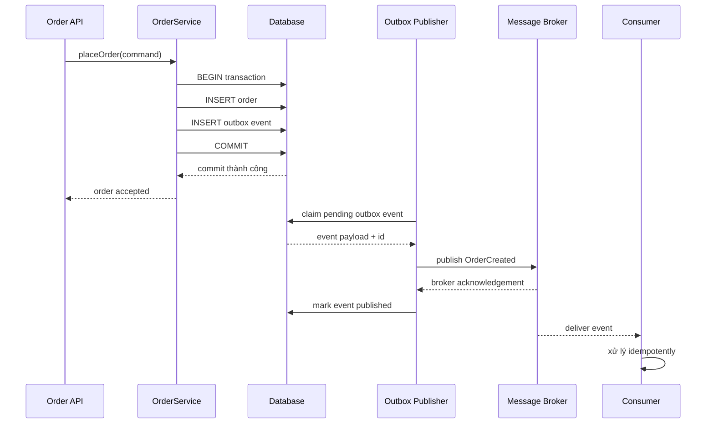
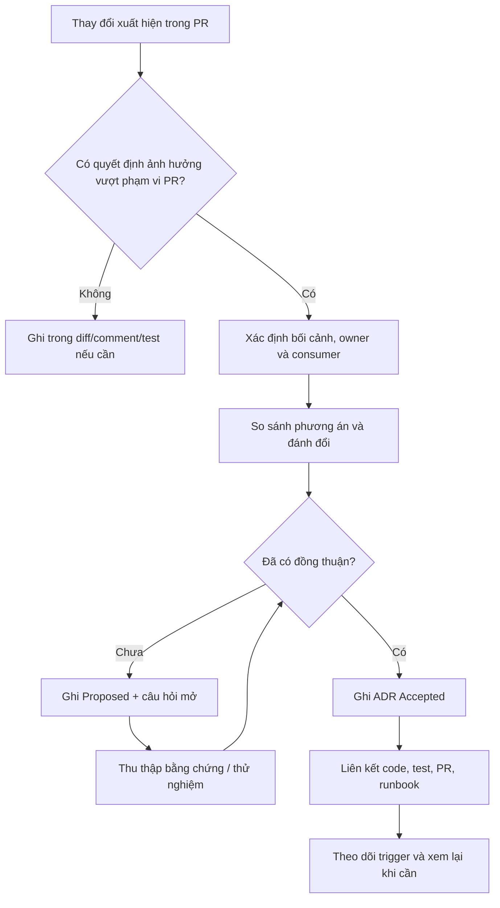

# Ghi lại quyết định có ảnh hưởng vượt ra ngoài một thay đổi

Một pull request bổ sung chức năng tạo đơn hàng. Trong quá trình review, nhóm quyết định dùng **transactional outbox** để bảo đảm sự kiện `OrderCreated` được ghi nhận cùng transaction với đơn hàng rồi mới phát tới message broker. PR được merge, test đều xanh và người thực hiện chuyển sang công việc khác.

Ba tháng sau, một nhóm khác cần thêm sự kiện `OrderCancelled`. Họ nhìn thấy bảng outbox nhưng không biết vì sao hệ thống dùng cơ chế này, liệu consumer có thể nhận sự kiện trùng hay không, thứ tự sự kiện có được bảo đảm không, và vì sao không phát trực tiếp sau khi lưu đơn. Nếu chỉ đọc diff của PR cũ, họ phải tự dựng lại bối cảnh và các đánh đổi mà nhóm trước đã cân nhắc.

Đây là lúc cần **ghi lại quyết định kỹ thuật có ảnh hưởng vượt ra ngoài một thay đổi**. Mã nguồn và kiểm thử cho biết hệ thống đang làm gì; một bản ghi quyết định giải thích **vì sao nhóm chọn cách đó, những lựa chọn nào đã cân nhắc, hệ quả nào được chấp nhận và điều kiện nào có thể khiến quyết định cần xem lại**.

Trong chương **Rà soát mã** của `CODE_QUALITY_FUNDAMENTALS`, bài học này trình bày cách nhận diện và ghi lại những quyết định đáng được lưu giữ sau khi một pull request kết thúc. Nội dung gắn với mục tiêu hiểu những thuộc tính làm mã nguồn **đáng tin cậy, dễ hiểu và dễ thay đổi**: người bảo trì tương lai cần hiểu cả cấu trúc hiện tại lẫn lý do khiến cấu trúc đó tồn tại.

Sau bài học, bạn có thể phân biệt quyết định lâu dài với chi tiết triển khai cục bộ, chọn hình thức ghi phù hợp, viết một Architecture Decision Record (ADR) ngắn gọn, liên kết quyết định với code/test/review và quản lý quyết định đã lỗi thời mà không làm mất lịch sử.

## 1. Vì sao cần lưu lại quyết định sau code review?

Code review thường giải quyết nhiều câu hỏi:

- Vì sao service gọi qua interface thay vì phụ thuộc trực tiếp vào adapter?
- Vì sao API trả `404` trong trường hợp người dùng không có quyền xem tài nguyên?
- Vì sao consumer phải xử lý sự kiện trùng?
- Vì sao nhóm chấp nhận cache dữ liệu trong một khoảng thời gian?
- Vì sao schema được mở rộng theo cách tương thích ngược thay vì đổi tên trường ngay?
- Vì sao một kiểm tra bảo mật được đặt ở service sở hữu tài nguyên thay vì chỉ ở giao diện?

Nếu câu trả lời chỉ nằm trong trí nhớ của người review hoặc một đoạn hội thoại trong PR, thông tin có thể khó tìm sau khi thay đổi đã được merge. Một quyết định ảnh hưởng đến nhiều module hoặc nhiều lần phát hành sẽ tiếp tục chi phối công việc của người khác.

**Bản ghi quyết định kỹ thuật** lưu lại phần bối cảnh và lý do cần thiết để người đọc hiểu quyết định đó mà không phải tái dựng toàn bộ cuộc thảo luận.

### 1.1. Mã nguồn cho biết điều gì, bản ghi quyết định bổ sung điều gì?

| Nguồn thông tin | Trả lời tốt câu hỏi nào? | Giới hạn |
| --- | --- | --- |
| **Mã nguồn** | Hệ thống hiện thực hóa hành vi ra sao? | Không phải lúc nào cũng giải thích vì sao chọn cách đó |
| **Unit/integration/contract test** | Hành vi nào được kiểm chứng? | Không lưu đầy đủ các phương án từng cân nhắc |
| **Comment gần code** | Vì sao một đoạn hoặc điều kiện cụ thể cần được giữ? | Không phù hợp để chứa bối cảnh kiến trúc rộng |
| **Pull request** | Thay đổi nào được review, ai trao đổi và test nào chạy? | Lịch sử dài, khó tra cứu như một hồ sơ quyết định lâu dài |
| **ADR/decision record** | Bối cảnh, lựa chọn, đánh đổi, hệ quả và trạng thái của quyết định | Không thay thế code, test hoặc tài liệu vận hành |
| **Tài liệu hướng dẫn vận hành** | Cách triển khai, quan sát và xử lý hệ thống hiện tại | Có thể không giải thích các phương án thiết kế đã bị loại |

Các nguồn này bổ sung cho nhau. **ADR không phải bản sao của mã nguồn**; nó giữ lại lý do và hệ quả có giá trị qua nhiều thay đổi.

### 1.2. Quyết định có thể tồn tại lâu hơn PR

Một PR thường có phạm vi cụ thể: thêm endpoint, đổi repository, sửa một luồng thanh toán. Nhưng quyết định được đưa ra trong PR có thể ảnh hưởng đến:

- Cách các module giao tiếp trong nhiều năm.
- Cấu trúc bảng dữ liệu và khả năng migration.
- Hợp đồng API với ứng dụng mobile hoặc đối tác.
- Quyền sở hữu dữ liệu và trách nhiệm giữa các service.
- Chính sách retry, timeout, idempotency và xử lý lỗi.
- Cách đo hiệu năng, giám sát và ứng phó sự cố.
- Chi phí triển khai, phát hành và tương thích phiên bản.

Nếu tác động kéo dài vượt khỏi phạm vi thay đổi hiện tại, **lý do của quyết định nên có nơi lưu trữ bền vững**.

## 2. Quyết định nào đáng được ghi lại?

Không phải mọi lựa chọn trong một PR đều cần ADR. Đổi tên biến local, chọn thứ tự hai câu lệnh thuần hoặc trích xuất một helper nhỏ thường đã được thể hiện đủ trong diff và test.

Một quyết định đáng ghi lại khi có một hoặc nhiều dấu hiệu:

1. **Ảnh hưởng nhiều thành phần:** thay đổi cách các module, service hoặc nhóm phối hợp.
2. **Tạo hợp đồng lâu dài:** API, schema, event, format dữ liệu hoặc quy ước tương thích.
3. **Khó đảo ngược:** migration, lựa chọn nền tảng, lưu trữ, giao thức hoặc phụ thuộc bên ngoài.
4. **Có đánh đổi đáng kể:** độ trễ so với tính nhất quán, chi phí so với khả năng mở rộng, bảo mật so với tiện dụng.
5. **Định hướng nhiều thay đổi tiếp theo:** các PR sau phải tuân theo một nguyên tắc đã chọn.
6. **Có phương án thay thế hợp lý:** nhóm đã cân nhắc các cách khác và cần lưu vì sao không chọn chúng.
7. **Rủi ro vận hành/bảo mật:** quyết định ảnh hưởng retry, dữ liệu nhạy cảm, phân quyền, phục hồi hoặc quan sát.
8. **Có giả định cần theo dõi:** quyết định chỉ phù hợp trong một tải, phạm vi sản phẩm hoặc giai đoạn nhất định.

### 2.1. Ví dụ quyết định nên và chưa cần ghi riêng

| Thay đổi trong PR | Có nên ghi thành quyết định lâu dài? | Lý do |
| --- | --- | --- |
| Đổi tên biến `fee` thành `shippingFeeVnd` | Thường không | Ý nghĩa đã thể hiện trong code |
| Trích xuất một hàm thuần trong cùng lớp | Thường không | Phạm vi nhỏ, dễ suy ra từ diff/test |
| Chọn transactional outbox cho sự kiện nghiệp vụ | **Nên** | Ảnh hưởng schema, transaction, publisher, consumer và vận hành |
| Chuẩn hóa mọi API lỗi theo một envelope JSON | Có thể nên | Tạo hợp đồng dùng chung cho nhiều consumer |
| Quy định service nào sở hữu dữ liệu khách hàng | **Nên** | Ảnh hưởng quyền ghi, đồng bộ và trách nhiệm nhiều hệ thống |
| Chọn cache TTL cho dữ liệu giá | Tùy tác động | Có thể ảnh hưởng tính đúng của tiền và độ mới dữ liệu |
| Đổi thứ tự hai phép tính độc lập, không tác dụng phụ | Thường không | Không tạo ràng buộc lâu dài |
| Chọn phiên bản giao thức hoặc thư viện dùng chung | Thường nên | Ảnh hưởng tương thích và lộ trình nâng cấp |
| Tạm chấp nhận bỏ qua một test flaky | Cần ghi lý do/issue nếu có rủi ro đáng kể | Nếu không, ngoại lệ có thể trở thành vĩnh viễn |

**Ngưỡng ghi lại phụ thuộc vào chi phí tìm lại lý do và mức độ ảnh hưởng**, không phụ thuộc số dòng code. Một quyết định có thể chỉ cần vài dòng nếu nó có tác động lớn; một thay đổi dài vẫn có thể không cần ADR nếu chỉ là triển khai theo một quyết định đã được ghi.

### 2.2. Một câu hỏi nhanh trong review

Reviewer có thể hỏi:

> “Nếu một nhóm khác thay đổi phần này sau sáu tháng, họ có cần biết lý do và đánh đổi mà không thể suy ra từ code hoặc test không?”

Nếu câu trả lời là có, hãy cân nhắc lưu quyết định. Câu hỏi này giúp tránh ghi mọi chi tiết nhưng cũng không bỏ sót lý do quan trọng.

## 3. ADR là gì và nên dùng khi nào?

**Architecture Decision Record (ADR)** là bản ghi ngắn mô tả một quyết định kiến trúc hoặc kỹ thuật có phạm vi ảnh hưởng đủ rộng. Một ADR thường tập trung vào **một quyết định**, có bối cảnh, lựa chọn, quyết định cuối cùng và hệ quả.

ADR không nhất thiết phải nói về kiến trúc cấp toàn doanh nghiệp. Một quyết định ở mức module cũng có thể đáng ghi nếu nó ảnh hưởng lâu dài đến hợp đồng hoặc cách các thành phần phối hợp.

### 3.1. Một cấu trúc ADR thực dụng

Một mẫu có thể gồm:

| Phần | Nội dung cần trả lời |
| --- | --- |
| **Tiêu đề và ID** | Quyết định nào đang được ghi lại? |
| **Trạng thái** | Đề xuất, được chấp nhận, bị từ chối, bị thay thế hay đã ngừng áp dụng? |
| **Ngày và người chịu trách nhiệm** | Khi nào quyết định được đưa ra, ai sở hữu việc theo dõi? |
| **Bối cảnh** | Vấn đề, yêu cầu, ràng buộc và giả định nào dẫn tới quyết định? |
| **Các lựa chọn** | Những phương án khả thi nào đã được cân nhắc? |
| **Quyết định** | Nhóm chọn phương án nào và trong phạm vi nào? |
| **Lý do** | Vì sao phương án này phù hợp hơn các lựa chọn khác? |
| **Hệ quả tích cực** | Khả năng hoặc lợi ích nào được tạo ra? |
| **Hệ quả tiêu cực/đánh đổi** | Chi phí, giới hạn hoặc trách nhiệm mới nào được chấp nhận? |
| **Rủi ro và biện pháp giảm thiểu** | Điều gì có thể thất bại và kiểm soát bằng cách nào? |
| **Cách kiểm chứng** | Test, metric, rollout hoặc quan sát nào cho biết quyết định hoạt động đúng? |
| **Điều kiện xem lại** | Sự kiện nào khiến nhóm cần đánh giá lại quyết định? |

Không phải ADR nào cũng cần tất cả mục ở mức chi tiết như nhau. **Mẫu là khung suy nghĩ, không phải biểu mẫu hành chính bắt buộc**. Một quyết định nhỏ có thể ngắn; một quyết định liên quan dữ liệu, bảo mật hoặc nhiều service cần giải thích kỹ hơn.

### 3.2. Trạng thái quyết định cần rõ

Một quy ước trạng thái thường dùng:

- **Proposed:** đang đề xuất, chưa được chấp nhận làm hướng chính thức.
- **Accepted:** đã được chấp nhận và là quyết định hiện hành.
- **Rejected:** đã cân nhắc nhưng không chọn.
- **Superseded:** đã bị một quyết định mới thay thế.
- **Deprecated/Retired:** không còn áp dụng vì thành phần hoặc cách tiếp cận đã ngừng sử dụng.

Tên trạng thái có thể thay đổi theo quy ước nhóm. Điều quan trọng là người đọc phân biệt **ý tưởng đang thảo luận** với **quyết định đã có hiệu lực**.

### 3.3. Một ADR nên bất biến về lịch sử

Khi quyết định cũ không còn phù hợp, thông thường nên **tạo ADR mới tham chiếu ADR cũ**, cập nhật trạng thái ADR trước thành `Superseded` và ghi lý do thay thế. Cách này giữ lại lịch sử: nhóm biết vì sao từng chọn cách cũ và điều gì đã thay đổi.

Nếu sửa nội dung cũ để làm như thể nhóm luôn biết quyết định mới, người đọc mất dấu bối cảnh lịch sử. Có thể sửa lỗi chính tả hoặc bổ sung liên kết nhỏ, nhưng thay đổi nội dung quyết định nên được ghi nhận rõ theo quy trình phiên bản của nhóm.

## 4. Ghi lại bối cảnh và đánh đổi, không chỉ ghi kết quả

Một bản ghi chỉ viết “Chúng ta dùng outbox” chưa trả lời câu hỏi quan trọng. Người đọc cần biết **vì sao** outbox phù hợp trong hoàn cảnh đó.

Bối cảnh nên làm rõ:

- Vấn đề nào đang cần giải quyết?
- Hành vi hoặc hợp đồng nào phải giữ?
- Hệ thống hiện có giới hạn gì?
- Tải, tính nhất quán và độ trễ yêu cầu ở mức nào?
- Thành phần nào sở hữu dữ liệu và transaction?
- Điều gì chưa biết hoặc mới chỉ là giả định?
- Quyết định này áp dụng cho phạm vi nào và không áp dụng cho đâu?

### 4.1. Lựa chọn thay thế phải là phương án thực tế

Không cần liệt kê mọi công nghệ trên thị trường. Chỉ ghi các lựa chọn mà nhóm thực sự có thể cân nhắc trong bối cảnh đó.

Ví dụ khi phát sự kiện sau khi lưu đơn:

| Phương án | Ưu điểm | Đánh đổi |
| --- | --- | --- |
| **Ghi đơn rồi publish trực tiếp** | Đơn giản, ít thành phần | Có khoảng hở giữa commit database và publish; một bước có thể thành công còn bước kia thất bại |
| **Publish rồi ghi đơn** | Consumer nhận sự kiện sớm | Sự kiện có thể được phát dù transaction lưu đơn thất bại |
| **Transactional outbox** | Ghi đơn và thông điệp outbox trong cùng transaction database | Cần publisher nền, retry, xử lý trùng và vận hành bảng outbox |
| **Distributed transaction/2PC** | Có thể phối hợp commit giữa một số hệ thống hỗ trợ | Phức tạp, phụ thuộc hạ tầng và ảnh hưởng khả dụng/vận hành |

ADR nên nêu **vì sao phương án được chọn đáp ứng yêu cầu quan trọng nhất**, không tuyên bố nó tốt nhất trong mọi hệ thống.

### 4.2. Ghi cả hệ quả tiêu cực

Một quyết định có chất lượng không phải quyết định không có đánh đổi. Nó là quyết định mà nhóm **nhìn thấy và chấp nhận đánh đổi** trong bối cảnh cụ thể.

Với outbox, lợi ích là giảm nguy cơ mất đồng bộ giữa transaction lưu đơn và việc phát sự kiện. Hệ quả là:

- Thêm bảng và quy trình dọn dữ liệu outbox.
- Publisher phải chạy nền, có cơ chế claim/lease hoặc khóa phù hợp.
- Sự kiện có thể được phát lại sau timeout, nên consumer cần idempotency.
- Có độ trễ từ lúc commit đơn đến lúc consumer nhận sự kiện.
- Cần metric cho số bản ghi pending, tuổi bản ghi cũ nhất, retry và lỗi publish.
- Vận hành phải theo dõi publisher bị dừng hoặc backlog tăng.

Nếu chỉ ghi ưu điểm, ADR giống tài liệu quảng bá giải pháp và không giúp nhóm sau hiểu chi phí đang gánh.

## 5. Ví dụ xuyên suốt: quyết định dùng transactional outbox

Xét một ứng dụng Java xử lý đơn hàng. Khi tạo đơn thành công, hệ thống cần phát sự kiện `OrderCreated` để dịch vụ kho và thông báo xử lý tiếp.

Một triển khai ban đầu có thể viết:

```java
@Transactional
public void placeOrder(CreateOrder command) {
    Order order = orderFactory.create(command);
    orderRepository.save(order);
    eventPublisher.publish(new OrderCreated(order.id()));
}
```

Đây là mã giả lập theo phong cách Spring/Jakarta; `@Transactional`, repository và publisher phụ thuộc framework thực tế. Điểm cần xem xét là **database transaction và message broker thường không cùng một transaction nguyên tử**.

Có hai tình huống lỗi:

1. Database commit đơn thành công nhưng publish thất bại: đơn tồn tại, sự kiện không được phát.
2. Broker nhận sự kiện nhưng database transaction rollback: consumer thấy một đơn chưa được lưu.

Một reviewer không nên chỉ hỏi “test xanh chưa?” mà còn phải hỏi **khoảng hở giữa hai hệ thống được xử lý bằng hợp đồng nào?** Nếu quyết định dùng outbox ảnh hưởng nhiều thay đổi tiếp theo, lý do cần được ghi lại.

### 5.1. Luồng được chọn



Sơ đồ mô tả **một cách triển khai phổ biến**, không bảo đảm mọi broker/database có cùng ngữ nghĩa. Outbox bảo đảm đơn hàng và bản ghi sự kiện được ghi cùng transaction của database nếu cả hai thao tác thật sự nằm trong transaction đó. Nó **không tự bảo đảm** broker chỉ nhận một lần, consumer xử lý đúng một lần hoặc thứ tự toàn cục.

### 5.2. Ví dụ Java minh họa phần ghi transaction

```java
import java.time.Instant;
import java.util.Objects;
import java.util.UUID;

record CreateOrder(String customerId) {}

record OrderCreated(
        String eventId,
        String orderId,
        Instant occurredAt) {}

interface OrderRepository {
    void save(Order order);
}

interface OutboxRepository {
    void append(OrderCreated event);
}

interface OrderFactory {
    Order create(CreateOrder command);
}

final class Order {
    private final String id;

    Order(String id) {
        this.id = Objects.requireNonNull(id);
    }

    String id() {
        return id;
    }
}

/*
 * Pseudocode: @Transactional phải đến từ framework giao dịch thật
 * và bao trùm cả OrderRepository lẫn OutboxRepository trên cùng
 * transaction manager/database.
 */
final class OrderApplicationService {
    private final OrderFactory factory;
    private final OrderRepository orders;
    private final OutboxRepository outbox;

    OrderApplicationService(
            OrderFactory factory,
            OrderRepository orders,
            OutboxRepository outbox) {
        this.factory = Objects.requireNonNull(factory);
        this.orders = Objects.requireNonNull(orders);
        this.outbox = Objects.requireNonNull(outbox);
    }

    // @Transactional
    void placeOrder(CreateOrder command) {
        Order order = factory.create(command);
        orders.save(order);

        OrderCreated event = new OrderCreated(
                UUID.randomUUID().toString(),
                order.id(),
                Instant.now());

        outbox.append(event);
    }
}
```

Ví dụ này tập trung vào quyết định **ghi đơn và ghi sự kiện outbox trong cùng transaction**. Chú thích `@Transactional` là placeholder; trong ứng dụng thật, phải dùng annotation/API của framework và xác minh hai repository cùng tham gia đúng transaction manager. Nếu một repository dùng database khác hoặc transaction bị mở ở phạm vi sai, giả thiết nguyên tử không còn đúng.

### 5.3. Publisher phải chấp nhận giao nhận có thể lặp

Một publisher có thể gửi sự kiện thành công tới broker nhưng mất kết nối trước khi nhận acknowledgement. Nó không biết broker đã nhận hay chưa. Nếu gửi lại, broker/consumer có thể nhìn thấy sự kiện trùng.

Vì vậy, thiết kế outbox thường chấp nhận **at-least-once delivery** và yêu cầu consumer xử lý idempotently theo `eventId` hoặc khóa nghiệp vụ phù hợp.

```java
record ProcessedEvent(String eventId) {}

interface ProcessedEventRepository {
    boolean alreadyProcessed(String eventId);
    void recordProcessed(String eventId);
}

interface InventoryService {
    void reserveForOrder(String orderId);
}

final class OrderCreatedConsumer {
    private final ProcessedEventRepository processed;
    private final InventoryService inventory;

    OrderCreatedConsumer(
            ProcessedEventRepository processed,
            InventoryService inventory) {
        this.processed = Objects.requireNonNull(processed);
        this.inventory = Objects.requireNonNull(inventory);
    }

    void handle(OrderCreated event) {
        if (processed.alreadyProcessed(event.eventId())) {
            return;
        }

        inventory.reserveForOrder(event.orderId());
        processed.recordProcessed(event.eventId());
    }
}
```

Đoạn consumer trên chỉ minh họa ý tưởng và **chưa đủ an toàn khi có nhiều consumer worker chạy đồng thời**. Trong triển khai thực tế, thao tác kiểm tra, tác dụng phụ và ghi nhận đã xử lý phải được thiết kế theo transaction/unique constraint/idempotency key phù hợp. Nếu `reserveForOrder` và `recordProcessed` không nguyên tử hoặc không idempotent, hai worker có thể cùng xử lý một event.

Đây chính là loại hệ quả cần ghi trong ADR: **outbox chuyển rủi ro dual-write thành trách nhiệm retry, duplicate handling và vận hành publisher/consumer**.

## 6. Một ADR mẫu cho quyết định outbox

Ví dụ dưới đây cho thấy cách chuyển cuộc thảo luận trong PR thành một bản ghi có thể được tra cứu sau này. Đây là nội dung minh họa; ID, ngày và người sở hữu cần thay bằng thông tin thật của dự án khi áp dụng.

```markdown
# ADR-004: Ghi sự kiện đơn hàng bằng transactional outbox

- **Status:** Accepted
- **Date:** 2026-11-16
- **Owners:** Order Platform Team
- **Related change:** PR thêm sự kiện OrderCreated

## Context

Khi tạo đơn, hệ thống phải lưu order vào database và phát
OrderCreated tới message broker. Database transaction không
bao trùm broker publish, nên hai thao tác có thể lệch nhau khi
một trong hai hệ thống gặp lỗi hoặc timeout.

Yêu cầu:
- Không phát sự kiện cho một order chưa commit.
- Không mất dấu sự kiện chỉ vì broker tạm thời không khả dụng.
- Chấp nhận consumer có thể nhận event nhiều lần.
- Giữ transaction ghi order trong database hiện tại.

## Decision

Ghi order và outbox event trong cùng database transaction.
Một publisher nền đọc các event pending, publish tới broker,
rồi đánh dấu đã phát sau khi nhận acknowledgement.

Consumer phải idempotent theo eventId.

## Alternatives considered

1. Publish trực tiếp sau khi save: đơn giản nhưng có khoảng hở
   giữa database commit và broker publish.
2. Publish trước khi save: có thể phát event cho order rollback.
3. Distributed transaction: không phù hợp với hạ tầng broker
   và vận hành hiện tại.

## Consequences

Positive:
- Order và event intent được commit cùng nhau.
- Publisher có thể retry khi broker tạm thời lỗi.

Negative:
- Thêm bảng outbox, publisher nền và quy trình dọn dữ liệu.
- Event có thể được giao nhiều lần.
- Có độ trễ giữa commit order và consumer xử lý.
- Cần theo dõi backlog, retry và tuổi event pending.

## Verification

- Integration test: rollback order thì outbox event cũng rollback.
- Integration test: publisher retry khi broker lỗi.
- Consumer test: cùng eventId không tạo tác dụng phụ lặp.
- Metrics: pending count, oldest pending age, publish failures.

## Revisit when

- Chuyển database hoặc message broker.
- Yêu cầu latency/event ordering thay đổi đáng kể.
- Hạ tầng hỗ trợ một cơ chế atomic publish khác có lợi ích rõ ràng.
```

ADR trên có thể ngắn hơn hoặc dài hơn tùy rủi ro. Điểm quan trọng là nó lưu **quyết định, lý do, đánh đổi và cách kiểm chứng**, không sao chép toàn bộ code hoặc mọi comment trong PR.

### 6.1. Kiểm thử nào hỗ trợ quyết định này?

| Kiểm thử | Điều cần xác minh |
| --- | --- |
| **Unit test OrderService** | Service yêu cầu lưu order và append event theo hợp đồng |
| **Integration test transaction** | Khi transaction rollback, cả order và outbox event đều không tồn tại |
| **Publisher integration test** | Event pending được publish; lỗi broker dẫn đến retry theo chính sách |
| **Consumer test** | Event trùng không tạo tác dụng phụ lặp |
| **Concurrency test** | Nhiều publisher/consumer không claim hoặc áp dụng cùng công việc sai cách |
| **System/operational test** | Backlog được quan sát, publisher có thể phục hồi và xử lý dữ liệu tồn đọng |

Unit test với mock có thể xác nhận thứ tự lời gọi, nhưng không chứng minh database rollback thật. **Quyết định được ghi trong ADR phải liên kết tới loại kiểm chứng phù hợp với rủi ro của nó.**

## 7. Liên kết quyết định với code review, code và test

ADR không nên là một tài liệu nằm riêng mà không ai tìm thấy. Khi một PR đưa ra hoặc hiện thực hóa quyết định, cần tạo đường liên kết hai chiều.

### 7.1. Trong pull request

Mô tả PR có thể nêu:

- Quyết định mới nào được đưa ra?
- ADR nào được tạo hoặc cập nhật?
- Phạm vi implementation trong PR này là gì?
- Phần nào còn nằm trong PR sau?
- Test nào kiểm chứng các hệ quả quan trọng?
- Rủi ro hoặc giả định nào cần reviewer xác nhận?

Ví dụ:

```markdown
## Decision

Dùng transactional outbox cho OrderCreated.
ADR: docs/adr/ADR-004-transactional-outbox.md

## Scope

- Ghi order và outbox event trong cùng transaction.
- Thêm publisher retry theo cấu hình hiện tại.
- Consumer deduplicate theo eventId.

## Verification

- Integration test rollback transaction.
- Publisher retry test.
- Consumer duplicate-event test.

## Follow-up

- Dashboard cho oldest pending event.
- Quy trình xử lý dead-letter event.
```

Đây là ví dụ mô tả PR. Nếu dashboard hoặc dead-letter workflow chưa có trong PR, phải ghi rõ là **follow-up chưa hoàn tất**, không làm người review hiểu nhầm đã được triển khai.

### 7.2. Trong mã nguồn

Một comment ngắn gần code có thể trỏ tới ADR khi lý do không thể suy ra trực tiếp:

```java
// Order và outbox event phải nằm trong cùng DB transaction.
// Lý do và các đánh đổi: ADR-004.
orders.save(order);
outbox.append(event);
```

Comment nên giải thích **điều kiện quan trọng tại chỗ** và dẫn đến bản ghi đầy đủ. Không cần lặp toàn bộ bối cảnh ADR trong từng file.

Nếu code tự giải thích được, không cần thêm comment chỉ để nhắc rằng ADR tồn tại. Liên kết trong tài liệu module hoặc PR cũng có thể đủ.

### 7.3. Liên kết tới test

ADR nên chỉ tới tên test hoặc đường dẫn test ổn định khi có thể. Khi test đổi tên, cập nhật liên kết để người đọc không mất dấu bằng chứng.

Không nên ghi “đã kiểm thử đầy đủ” mà không nói kiểm thử gì. Một bản ghi tốt chỉ rõ **kiểm tra nào hỗ trợ giả thiết nào**, và phần nào còn được xác minh bằng vận hành.

## 8. Phân biệt quyết định, yêu cầu, hướng dẫn và chi tiết triển khai

Một hệ thống có nhiều loại tài liệu. Đưa tất cả vào ADR khiến tài liệu dài và khó bảo trì.

| Loại thông tin | Nơi phù hợp thường gặp | Ví dụ |
| --- | --- | --- |
| **Quyết định kỹ thuật lâu dài** | ADR/decision record | Dùng outbox cho event phát sau transaction |
| **Yêu cầu sản phẩm** | Product requirement/specification | Đơn đã commit phải phát thông báo tạo đơn |
| **Hợp đồng giao tiếp** | OpenAPI, AsyncAPI, schema, contract docs | Tên event, trường bắt buộc, version |
| **Cách vận hành** | Runbook | Kiểm tra backlog và xử lý publisher bị dừng |
| **Chi tiết một thay đổi** | PR description/diff | Thêm repository method, đổi tên biến |
| **Lý do cục bộ** | Comment gần code | Không đổi thứ tự hai thao tác vì cùng transaction |
| **Hành vi được bảo vệ** | Test | Rollback phải xóa cả order và outbox row |

ADR có thể liên kết đến những nguồn trên nhưng không thay thế chúng. Ví dụ ADR nói chọn at-least-once delivery; hợp đồng event vẫn cần định nghĩa schema, còn runbook phải mô tả cách xử lý backlog thực tế.

## 9. Ghi quyết định khi có nhiều nhóm và nhiều hệ thống

Khi một quyết định ảnh hưởng tới nhiều đội, cần làm rõ **ai được quyền quyết định, ai cần tham vấn và ai chịu trách nhiệm triển khai hệ quả**.

### 9.1. Phân biệt người đề xuất, người quyết định và người sở hữu

- **Người đề xuất:** Chuẩn bị phương án, bằng chứng và đánh đổi.
- **Người quyết định:** Cá nhân/nhóm có thẩm quyền chấp nhận hướng đi theo cơ chế tổ chức.
- **Người triển khai:** Thực hiện thay đổi và các kiểm tra.
- **Người vận hành/consumer:** Chịu ảnh hưởng từ hợp đồng và cần được thông báo hoặc tham gia review.
- **Người sở hữu lâu dài:** Theo dõi điều kiện xem lại và đảm bảo tài liệu còn đúng.

Một người có thể đảm nhiệm nhiều vai trò, nhưng bản ghi nên tránh ngụ ý rằng **người mở PR tự động có quyền quyết định mọi thay đổi liên hệ thống**.

### 9.2. Ghi rõ phạm vi áp dụng

Ví dụ:

- “Tất cả sự kiện nghiệp vụ phát ra từ Order Service” khác với “chỉ sự kiện OrderCreated trong giai đoạn đầu”.
- “Mọi API công khai” khác với “API nội bộ của một module”.
- “Mọi dữ liệu khách hàng” khác với “bản ghi cache phục vụ gợi ý”.

Phạm vi rõ giúp nhóm sau tránh mở rộng một quyết định vượt khỏi bối cảnh ban đầu.

### 9.3. Khi chưa đạt đồng thuận

Không nên ghi một quyết định là `Accepted` khi các bên có thẩm quyền chưa thống nhất. Có thể:

1. Ghi ADR ở trạng thái `Proposed`.
2. Liệt kê câu hỏi còn mở và bằng chứng cần thu thập.
3. Ghi người chịu trách nhiệm và thời điểm quyết định.
4. Nếu cần thử nghiệm, mô tả phạm vi, tiêu chí thành công và cách kết thúc thử nghiệm.
5. Chuyển sang `Accepted` hoặc `Rejected` sau khi có quyết định thật.

Nếu nhóm đã triển khai tạm một giải pháp để giảm rủi ro, hãy nói rõ **đây là biện pháp tạm thời**, ai chấp nhận và điều kiện thay thế. Không nên để trạng thái thử nghiệm bị hiểu thành chuẩn lâu dài.

## 10. Quyết định có thể đảo ngược và quyết định khó đảo ngược

Mức độ khó đảo ngược là một yếu tố quan trọng để xác định mức ghi chép cần thiết.

| Loại | Ví dụ | Cách ghi phù hợp |
| --- | --- | --- |
| **Dễ đảo ngược** | Chọn một helper nội bộ hoặc thay tên class | Có thể chỉ cần PR/test nếu phạm vi hẹp |
| **Đảo ngược có chi phí** | Chọn thư viện serialization dùng ở nhiều module | Ghi lựa chọn, version, khả năng tương thích và chi phí thay |
| **Khó đảo ngược** | Chọn database, partition key hoặc event contract công khai | ADR rõ bối cảnh, lựa chọn, migration và hệ quả dài hạn |
| **Gần như không thể đảo ngược** | Công bố dữ liệu ra bên ngoài, thay đổi định danh công khai hoặc xóa dữ liệu không thể phục hồi | Đánh giá rủi ro, phê duyệt phù hợp, kế hoạch bảo vệ dữ liệu và hồ sơ quyết định đầy đủ |

Một quyết định dễ đảo ngược không có nghĩa không cần ghi nếu nó ảnh hưởng nhiều nhóm. Ngược lại, quyết định khó đảo ngược cần **nhiều bằng chứng và review hơn**, kể cả khi chỉ tác động một thành phần.

### 10.1. Dùng thử nghiệm có giới hạn để giảm bất định

Nếu chưa biết một giải pháp có đáp ứng tải hay không, có thể ghi một **spike/prototype decision**:

- Giả thuyết cần kiểm chứng.
- Môi trường và workload thử nghiệm.
- Tiêu chí đo.
- Giới hạn thời gian/phạm vi.
- Kết quả và điều kiện chấp nhận hoặc loại bỏ.
- Cách dọn prototype nếu không được chọn.

Một kết quả benchmark trên máy cá nhân không tự chứng minh production đạt mục tiêu. ADR nên ghi **điều kiện đo và giới hạn**, không chỉ ghi một con số.

## 11. Quản lý quyết định cũ khi hệ thống thay đổi

Một bản ghi quyết định có thể trở nên lỗi thời vì:

- Nhu cầu sản phẩm đổi.
- Lưu lượng tăng vượt giả định.
- Một công nghệ được thay thế hoặc ngừng hỗ trợ.
- Hợp đồng với đối tác thay đổi.
- Một rủi ro mới xuất hiện.
- Cách triển khai thực tế đã khác với quyết định ban đầu.

Khi đó, không nên âm thầm xóa ADR cũ. Hãy:

1. Tạo bản ghi mới mô tả bối cảnh mới.
2. Tham chiếu ADR cũ và nói rõ điều gì không còn đúng.
3. Ghi quyết định mới cùng các hệ quả.
4. Đánh dấu ADR cũ là `Superseded` hoặc trạng thái tương đương.
5. Liên kết PR, migration, test và tài liệu vận hành liên quan.
6. Cập nhật hướng dẫn hiện hành để người đọc không tiếp tục áp dụng cách cũ.

### 11.1. Một quyết định cũ không nhất thiết là quyết định sai

Giả sử ADR cũ chọn một message broker vì hệ thống lúc đó có tải nhỏ và nhóm vận hành đã có kinh nghiệm với nó. Hai năm sau, lưu lượng tăng và tổ chức đã chuẩn hóa nền tảng khác. Việc thay broker không chứng minh quyết định cũ vô lý; **bối cảnh đã thay đổi**.

ADR hữu ích khi giúp người đọc hiểu cả hai giai đoạn: tại sao lựa chọn cũ phù hợp lúc đó và yếu tố nào khiến nhóm chuyển hướng.

### 11.2. Định kỳ xem lại có điều kiện

Không nhất thiết tổ chức một cuộc họp định kỳ để đọc tất cả ADR. Có thể đặt **trigger**:

- Trước khi nâng phiên bản major của một nền tảng.
- Khi metric vượt ngưỡng đã nêu trong ADR.
- Khi bắt đầu tích hợp một consumer mới.
- Khi một phụ thuộc bị ngừng hỗ trợ.
- Khi sự cố cho thấy một giả định không còn đúng.
- Khi một thay đổi cần đi ngược quyết định hiện hành.

Cách này giữ ADR có giá trị mà không tạo thêm công việc hành chính không cần thiết.

## 12. Những sai lầm thường gặp khi ghi quyết định

### 12.1. Chỉ ghi “đã chọn X”

Không có bối cảnh và đánh đổi, người đọc không biết lựa chọn giải quyết vấn đề gì. Họ có thể áp dụng X cho một hoàn cảnh khác dù các giả định đã khác.

### 12.2. Ghi lại mọi dòng code review

ADR không phải transcript của cuộc trò chuyện. Chỉ lưu quyết định có ảnh hưởng lâu dài, kết quả và lý do cần nhớ. Các trao đổi cục bộ có thể ở PR.

### 12.3. Ghi giải pháp như một chân lý vĩnh viễn

Quyết định luôn phụ thuộc bối cảnh. Hãy ghi giả định, giới hạn và trigger xem lại thay vì viết “đây là cách duy nhất đúng”.

### 12.4. Bỏ qua phương án bị loại

Khi người khác đề xuất lại phương án cũ, họ sẽ phải lặp cuộc thảo luận. Ghi ngắn gọn lý do loại bỏ giúp tiết kiệm thời gian và tránh quên một rủi ro đã biết.

### 12.5. Không ghi hệ quả tiêu cực

Outbox thêm publisher, retry và xử lý duplicate; cache thêm rủi ro dữ liệu cũ; thư viện chung thêm coupling phiên bản. Nếu không ghi, nhóm sau có thể tưởng đây là lỗi triển khai thay vì chi phí đã chấp nhận.

### 12.6. Đặt ADR ở nơi khó tìm

Một thư mục không có quy ước, không có index hoặc không liên kết từ PR khiến ADR ít được dùng. Nên thống nhất vị trí, tên file, ID và cách liên kết trong repository.

### 12.7. Sửa ADR cũ để xóa lịch sử

Thay nội dung cũ bằng quyết định mới làm mất lý do của giai đoạn trước. Tạo ADR thay thế và liên kết trạng thái giúp lịch sử có thể kiểm tra.

### 12.8. Ghi quyết định chưa được phê duyệt như đã chấp nhận

Trạng thái phải phản ánh thực tế. `Proposed` và `Accepted` có ý nghĩa khác nhau, đặc biệt khi nhiều nhóm bị ảnh hưởng.

### 12.9. Lặp tài liệu thay vì liên kết

Nếu ADR sao chép toàn bộ schema, runbook và API docs, các bản sao dễ lệch nhau. ADR nên ghi **lý do và quyết định**, rồi trỏ đến nguồn chi tiết có thẩm quyền.

### 12.10. Không nói ai chịu trách nhiệm xem lại

Một quyết định có trigger nhưng không có owner có thể không bao giờ được đánh giá. Ghi nhóm hoặc vai trò sở hữu, không nhất thiết phải ghi tên cá nhân cố định.

### 12.11. Gắn ADR vào mọi PR cho đủ thủ tục

Nếu mỗi thay đổi nhỏ đều cần một ADR, nhóm có thể tạo hàng loạt tài liệu rỗng hoặc lặp lại cùng một quyết định. Hãy tái sử dụng ADR hiện hành và chỉ tạo mới khi có quyết định mới hoặc quyết định cũ thay đổi.

### 12.12. Nghĩ ADR thay thế kiểm thử

Một ADR nói consumer phải idempotent không chứng minh code đã idempotent. Cần test, ràng buộc dữ liệu và quan sát để xác minh triển khai.

## 13. Quy trình ghi quyết định ngay trong code review

Một quy trình gọn có thể thực hiện như sau:

1. **Nhận diện câu hỏi có phạm vi dài hạn.** Reviewer phát hiện thay đổi ảnh hưởng hợp đồng, nhiều module, dữ liệu, bảo mật hoặc vận hành.
2. **Xác định người có thẩm quyền.** Ai sở hữu hệ thống/quy tắc? Ai là consumer chịu ảnh hưởng?
3. **Nêu bối cảnh và ràng buộc.** Tách sự thật đã xác minh khỏi giả định.
4. **So sánh các lựa chọn khả thi.** Nêu lợi ích, chi phí và lý do loại bỏ.
5. **Thống nhất quyết định và phạm vi.** Chưa đồng thuận thì để `Proposed`, không giả định đã được chấp nhận.
6. **Ghi ADR/decision record.** Một quyết định chính cho mỗi bản ghi; giữ ngắn gọn nhưng đủ hệ quả.
7. **Liên kết với PR và bằng chứng.** Code, test, migration, metric và runbook có liên quan.
8. **Review việc thực thi.** Xác nhận code thực tế phản ánh quyết định và các hệ quả quan trọng được xử lý.
9. **Đặt điều kiện xem lại.** Ghi trigger, owner hoặc dấu hiệu cho biết quyết định không còn phù hợp.
10. **Cập nhật trạng thái sau này.** Khi thay đổi, tạo quyết định thay thế và giữ lịch sử.

### 13.1. Sơ đồ luồng quyết định



Không phải mọi PR phải đi hết sơ đồ này. Nếu quyết định đã tồn tại, PR có thể chỉ **tham chiếu ADR hiện hành và chứng minh implementation tuân thủ**.

## 14. Checklist cho reviewer và người viết ADR

Khi một thay đổi tạo ra quyết định có ảnh hưởng dài hạn, hãy kiểm tra:

1. **Quyết định cụ thể là gì?** Có thể diễn đạt trong một câu không?
2. **Phạm vi áp dụng ở đâu?** Module, service, API, dữ liệu hoặc toàn hệ thống?
3. **Bối cảnh nào dẫn tới lựa chọn?** Yêu cầu, giới hạn và giả định đã rõ chưa?
4. **Ai sở hữu quyết định?** Các nhóm/consumer liên quan đã được tham vấn chưa?
5. **Có lựa chọn thay thế thực tế nào?** Vì sao không chọn chúng?
6. **Đánh đổi tiêu cực đã được ghi chưa?** Chi phí mới, giới hạn, retry, vận hành, coupling?
7. **Hệ quả bảo mật và dữ liệu đã rõ chưa?** Quyền, retention, privacy, migration?
8. **Hợp đồng bên ngoài có thay đổi không?** API, event, schema và compatibility?
9. **Có bằng chứng xác minh không?** Test, metric, benchmark, rollout hoặc quan sát?
10. **Điều kiện xem lại là gì?** Trigger có thể nhận biết và owner có rõ?
11. **ADR đã liên kết với PR/code/test chưa?** Người đọc có thể lần theo từ quyết định đến implementation?
12. **Trạng thái có chính xác không?** Proposed, Accepted hay Superseded?
13. **Tài liệu có lặp nguồn có thẩm quyền không?** Có thể liên kết đến schema/runbook thay vì sao chép?
14. **Người mới có hiểu lý do sau sáu tháng không?** Nếu không, còn thiếu bối cảnh hay hệ quả nào?

Một nhận xét review hữu ích có thể viết:

> “Thay đổi này khiến order và event cần được commit cùng nhau, nhưng broker không tham gia transaction database. Vì quyết định outbox sẽ ảnh hưởng publisher, consumer và retry ở các PR sau, đề nghị ghi ADR nêu rõ lựa chọn, khả năng giao trùng, idempotency và cách theo dõi backlog.”

Nhận xét này nêu **vấn đề, phạm vi tác động và nội dung cần ghi**, thay vì yêu cầu tạo tài liệu chỉ vì quy trình.

## 15. Bài tập tự kiểm tra

**Câu 1.** Một PR đổi tên biến local và trích xuất một helper thuần. Có nhất thiết tạo ADR không?

*Gợi ý:* Thường không. Diff và test đủ để giải thích thay đổi cục bộ; ADR chỉ cần khi có quyết định vượt phạm vi và tạo ảnh hưởng lâu dài.

**Câu 2.** Vì sao ghi “đã chọn transactional outbox” chưa đủ?

*Gợi ý:* Người đọc cần biết vấn đề dual-write, các lựa chọn bị loại, hệ quả retry/duplicate, độ trễ, vận hành và cách kiểm chứng.

**Câu 3.** Một ADR có trạng thái `Proposed` nhưng code đã được triển khai cho một phần lưu lượng. Cần làm rõ điều gì?

*Gợi ý:* Phải nói đây là thử nghiệm/biện pháp tạm thời, ai chấp nhận rủi ro, phạm vi rollout và tiêu chí quyết định cuối. Không để trạng thái đề xuất bị hiểu thành quyết định chính thức.

**Câu 4.** Publisher gửi event thành công nhưng không nhận được acknowledgement. Vì sao ADR outbox cần đề cập consumer idempotency?

*Gợi ý:* Publisher có thể gửi lại vì không biết lần trước broker đã nhận chưa. Consumer cần xử lý event trùng theo idempotency key hoặc cơ chế tương đương.

**Câu 5.** Khi một ADR cũ không còn phù hợp, có nên xóa file và viết lại nội dung mới vào cùng chỗ không?

*Gợi ý:* Thường không. Tạo ADR mới tham chiếu ADR cũ, đánh dấu cũ là `Superseded` để giữ lịch sử và lý do thay đổi.

**Câu 6.** Một quyết định chỉ ảnh hưởng một module nhưng làm thay đổi schema database và khó rollback. Có đáng ghi ADR không?

*Gợi ý:* Có thể rất đáng. Phạm vi module nhỏ không làm mất tính khó đảo ngược hoặc hệ quả dữ liệu.

**Câu 7.** ADR ghi consumer phải idempotent. Chỉ đọc ADR có thể kết luận implementation đã bảo đảm điều đó không?

*Gợi ý:* Không. Cần code, test duplicate-event, ràng buộc transaction/unique key và kiểm tra concurrency phù hợp.

**Câu 8.** Hai nhóm chưa đồng thuận về message broker. Nhóm triển khai một thử nghiệm có giới hạn. Nên ghi trạng thái và thông tin nào?

*Gợi ý:* Ghi `Proposed` hoặc trạng thái thử nghiệm theo quy ước, giả thuyết, phạm vi, thời gian, tiêu chí đo, owner và điều kiện chấp nhận/loại bỏ.

**Câu 9.** Một quyết định được dùng ở nhiều PR. Mỗi PR có cần sao chép toàn bộ ADR vào mô tả không?

*Gợi ý:* Không. Liên kết tới ADR hiện hành, mô tả phần implementation và bằng chứng riêng của PR. Tránh tạo nhiều bản sao dễ lệch.

**Câu 10.** ADR ghi rõ publisher retry nhưng không có metric backlog hay runbook. Đây là thiếu sót ở đâu?

*Gợi ý:* Hệ quả vận hành đã được nhận diện nhưng chưa có bằng chứng kiểm soát đủ. Cần xác định follow-up, owner và cách quan sát/ứng phó.

**Câu 11.** Một quyết định dễ đảo ngược nhưng ảnh hưởng hợp đồng API của nhiều consumer. Có thể bỏ qua việc ghi lại chỉ vì đổi lại được không?

*Gợi ý:* Không nhất thiết. Số consumer và chi phí phối hợp có thể làm quyết định đáng ghi dù code có thể rollback; cần cân nhắc phạm vi và khả năng tìm lại lý do.

**Câu 12.** Một ADR mô tả mọi class và phương thức của implementation hiện tại. Rủi ro là gì?

*Gợi ý:* Tài liệu trùng mã, nhanh lỗi thời và che khuất quyết định. ADR nên giữ bối cảnh, lựa chọn, đánh đổi và hệ quả; chi tiết implementation thuộc code/API docs.

## Ghi nhớ

**Ghi lại quyết định có ảnh hưởng vượt ra ngoài một thay đổi là cách giữ lại lý do và đánh đổi để những người đến sau không phải tự dựng lại lịch sử.** Hãy cân nhắc ADR khi quyết định tạo hợp đồng lâu dài, ảnh hưởng nhiều thành phần, khó đảo ngược hoặc có hệ quả đáng kể về dữ liệu, bảo mật, hiệu năng và vận hành.

Một bản ghi tốt nêu rõ **bối cảnh, lựa chọn, quyết định, lý do, hệ quả, cách kiểm chứng và điều kiện xem lại**. Liên kết nó với pull request, mã nguồn, test và tài liệu vận hành; cập nhật trạng thái khi quyết định bị thay thế, đồng thời giữ lịch sử. ADR không thay code hay test, nhưng giúp giải thích vì sao code được tổ chức như hiện tại.

Khi quyết định và bằng chứng được ghi đúng mức, review không chỉ xác nhận một thay đổi riêng lẻ mà còn giúp duy trì **một hệ thống đáng tin cậy, dễ hiểu và dễ thay đổi qua nhiều lần phát triển**.
