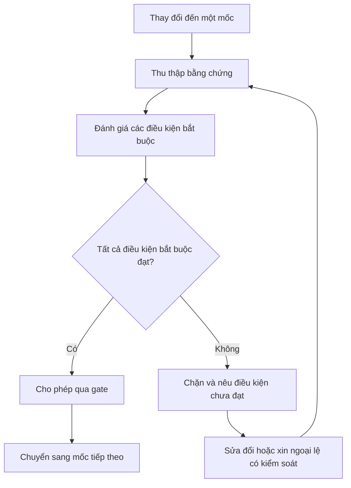
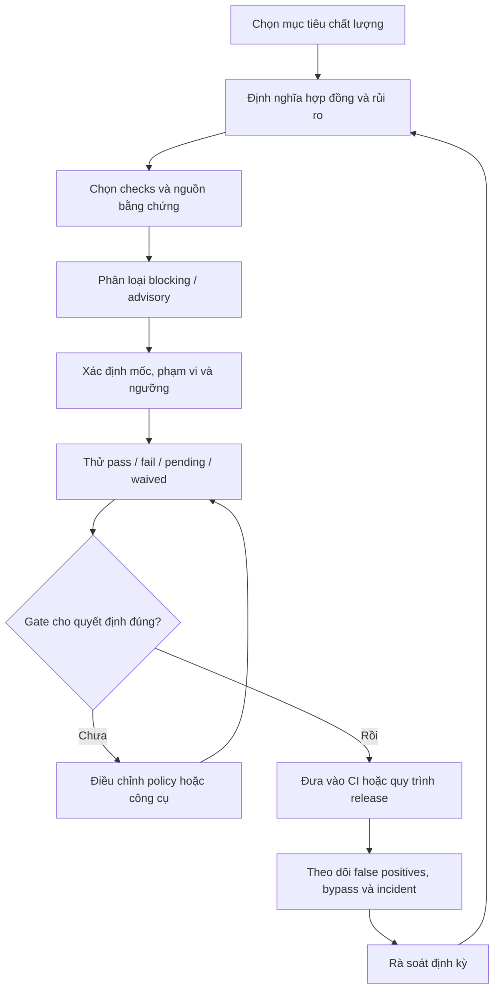

# Cổng chất lượng là điều kiện chấp nhận thay đổi như thế nào?

## 1. Cổng chất lượng biến tiêu chí thành quyết định có thể kiểm chứng

Một pull request có thể biên dịch thành công nhưng vẫn làm hỏng một quy tắc nghiệp vụ. Một bộ test có thể xanh nhưng chưa kiểm tra hợp đồng API. Một bản build có thể không có cảnh báo bảo mật nghiêm trọng nhưng lại chứa migration làm mất dữ liệu. Vì vậy, câu hỏi “build có pass không?” thường chưa đủ để quyết định một thay đổi đã sẵn sàng được hợp nhất hoặc phát hành.

**Cổng chất lượng** (*quality gate*) là tập hợp các điều kiện và bằng chứng được thống nhất để quyết định một thay đổi có được đi qua một mốc trong quy trình phát triển hay không. Mốc đó có thể là merge vào nhánh chính, tạo release, triển khai lên môi trường production hoặc mở rộng rollout tới toàn bộ người dùng.

Trong module `CODE_QUALITY_FUNDAMENTALS`, mục tiêu là **hiểu những thuộc tính quyết định mã nguồn có đáng tin cậy, dễ hiểu và dễ thay đổi hay không**. Thuộc chương **Cổng chất lượng**, bài này tập trung vào câu hỏi: **cổng chất lượng là điều kiện chấp nhận thay đổi như thế nào?**

Một cổng có ích phải kết nối được bốn điều:

1. **Mục tiêu cần bảo vệ:** ví dụ không phát hành code không biên dịch, không phá hợp đồng công khai, không đưa lỗ hổng nghiêm trọng chưa được xử lý vào production.
2. **Bằng chứng:** build, test, phân tích tĩnh, kiểm tra dependency, review, migration test hoặc kết quả canary.
3. **Quy tắc quyết định:** điều kiện nào bắt buộc đạt, điều kiện nào chỉ cảnh báo, ngoại lệ nào được phép.
4. **Hành động:** cho phép tiếp tục, chặn thay đổi, yêu cầu sửa, hoặc chấp nhận ngoại lệ có thời hạn và người chịu trách nhiệm.

Cổng chất lượng không phải một công cụ cụ thể, một con số coverage duy nhất hay một bảng điểm đẹp. Nó là **chính sách chấp nhận thay đổi dựa trên bằng chứng**. Công cụ CI, hệ thống review và nền tảng triển khai chỉ thực thi hoặc hiển thị chính sách đó.

Sau bài học, bạn có thể phân biệt quality gate với một bước kiểm tra đơn lẻ, thiết kế tiêu chí theo rủi ro, chọn điều kiện bắt buộc và điều kiện tư vấn, xác định phạm vi gate ở PR/release/deploy, xử lý flaky tests và ngoại lệ, áp dụng dần cho codebase cũ, và đánh giá xem chính cổng chất lượng có đang bảo vệ đúng mục tiêu hay không.

## 2. Một quality gate gồm mục tiêu, điều kiện, bằng chứng và quyết định

Hãy xét một thay đổi sửa logic tính phí giao hàng. Nhóm muốn bảo đảm rằng code vẫn build được, quy tắc miễn phí tại đúng ngưỡng không bị phá, và không tạo lỗi ở API đang được client cũ sử dụng.

Một gate có thể được diễn đạt:

| Thành phần | Nội dung ví dụ |
| --- | --- |
| **Mục tiêu** | Không đưa thay đổi tính phí sai hoặc phá caller hiện có vào nhánh chính |
| **Phạm vi** | Pull request có thay đổi module checkout |
| **Điều kiện** | Build thành công; unit test liên quan đạt; contract test phù hợp đạt; có review của người sở hữu nghiệp vụ |
| **Bằng chứng** | Kết quả CI, báo cáo test, diff API và phê duyệt review |
| **Quyết định** | Chặn merge nếu điều kiện bắt buộc chưa đạt; cảnh báo nếu thiếu một phép đo chưa liên quan trực tiếp |
| **Ngoại lệ** | Chỉ chấp nhận khi có lý do, người phê duyệt, phạm vi và thời hạn rõ ràng |

Có thể hình dung quality gate như một quyết định:



Cổng không tự xác định mục tiêu chất lượng. Nhóm phải thống nhất **vì sao mỗi điều kiện tồn tại** và điều gì xảy ra khi điều kiện không đạt. Một danh sách 30 bước CI không tự trở thành quality gate tốt nếu không biết chúng bảo vệ rủi ro nào.

### 2.1. Gate khác với check

- **Check** là một phép kiểm tra cụ thể, ví dụ chạy unit test hoặc scan dependency.
- **Gate** là chính sách sử dụng một hay nhiều kết quả check để ra quyết định ở một mốc.

Một check có thể pass nhưng gate vẫn fail vì một điều kiện bắt buộc khác chưa đạt. Một check có thể warning mà gate vẫn cho qua nếu chính sách xác định nó chỉ mang tính tư vấn. Cần phân biệt rõ để tránh hiểu “pipeline xanh” là mọi rủi ro đã được kiểm tra.

### 2.2. Gate khác với checklist review thủ công

Checklist giúp con người đặt câu hỏi có hệ thống. Quality gate có thể kết hợp checklist với bằng chứng tự động và phê duyệt của người có trách nhiệm. Những điều đòi hỏi hiểu ý định, nghiệp vụ hoặc đánh đổi vẫn cần người đánh giá; không phải mọi câu hỏi review đều có thể chuyển thành rule máy.

## 3. Chọn đúng mốc: merge, release và deployment có mục tiêu khác nhau

Một lỗi có thể được phát hiện ở nhiều thời điểm. Nếu dồn mọi kiểm tra vào một gate duy nhất, phản hồi có thể quá chậm hoặc không đúng nơi chịu trách nhiệm.

| Mốc | Câu hỏi quyết định | Ví dụ điều kiện phù hợp |
| --- | --- | --- |
| **Commit / local** | Người phát triển có thể phát hiện lỗi sớm không? | Format, compile, unit test liên quan |
| **Pull request / merge** | Thay đổi có đủ bằng chứng để nhập vào nhánh chung không? | Build, test, static analysis, review, contract checks |
| **Release candidate** | Phiên bản có đủ điều kiện trở thành artifact phát hành không? | Integration suite, dependency/security review, migration validation, compatibility |
| **Deployment** | Môi trường đích có sẵn sàng nhận phiên bản này không? | Config validation, smoke test, migration readiness, capacity |
| **Progressive rollout** | Có nên mở rộng phạm vi phát hành không? | Canary metrics, error rate, latency, business invariants |
| **Post-deployment** | Bản đang chạy có tiếp tục đáp ứng mục tiêu không? | SLO, alerts, reconciliation và incident signals |

### 3.1. Merge gate không thể thay deployment gate

Một pull request có thể pass mọi test trong môi trường CI nhưng production đang thiếu cấu hình hoặc database migration chưa tương thích với phiên bản đang chạy. Merge gate bảo vệ chất lượng thay đổi trong repository; deployment gate phải xem xét **điều kiện môi trường và thứ tự triển khai**.

### 3.2. Deployment gate không thể thay test trước merge

Canary có thể phát hiện latency tăng sau khi triển khai một phần, nhưng không nên dùng production làm nơi đầu tiên phát hiện một lỗi cú pháp, test biên rõ ràng hoặc lỗ hổng dependency đã biết. Phát hiện sớm thường giảm phạm vi tác động và chi phí khắc phục.

### 3.3. Chọn nơi chạy theo chi phí phát hiện và hậu quả

Một check nhanh nên chạy sớm nếu nó có thể phát hiện lỗi với chi phí thấp. Một integration test cần database có thể chạy ở CI hoặc stage. Một kiểm tra tải lớn có thể chạy theo lịch hoặc trước release quan trọng. Tuy nhiên, rủi ro nghiêm trọng không được bỏ chỉ vì check đắt; cần thiết kế cách kiểm tra phù hợp hơn.

## 4. Phân loại điều kiện: bắt buộc, cảnh báo và thông tin

Một gate rõ ràng cần chỉ ra trạng thái của từng điều kiện.

| Loại điều kiện | Ý nghĩa | Hành động |
| --- | --- | --- |
| **Required / blocking** | Không đạt thì thay đổi không được qua mốc | Chặn merge/release/deploy theo policy |
| **Advisory / warning** | Có dấu hiệu cần xem xét nhưng không tự động chặn | Hiển thị cảnh báo và yêu cầu triage khi cần |
| **Informational** | Cung cấp ngữ cảnh, không tham gia quyết định | Lưu hoặc hiển thị để tham khảo |
| **Not applicable** | Điều kiện không liên quan đến thay đổi này | Ghi nhận lý do bỏ qua nếu cần |
| **Pending / unknown** | Chưa có kết quả đáng tin, check chưa hoàn tất hoặc không chạy được | Chờ, chạy lại có kiểm soát hoặc xử lý theo policy |
| **Waived / exception** | Người có thẩm quyền chấp nhận ngoại lệ cụ thể | Ghi rõ phạm vi, lý do, người duyệt và thời hạn |

**Pending không phải pass.** Nếu test bảo mật chưa chạy vì dịch vụ quét không sẵn sàng, không được hiển thị nó như đã đạt. Tùy mức rủi ro, gate có thể chờ, chặn tạm thời hoặc áp dụng quy trình khẩn cấp được phê duyệt.

### 4.1. Trạng thái “skipped” cần có ngữ nghĩa rõ

Một check không áp dụng vì thay đổi chỉ sửa tài liệu có thể được bỏ qua hợp lý. Một check bị bỏ qua vì cấu hình pipeline sai là tình huống khác. Nên phân biệt:

- **Not applicable:** phạm vi thay đổi không cần check đó.
- **Skipped by policy:** policy cho phép không chạy trong điều kiện xác định.
- **Skipped due to error:** check không chạy được; không có bằng chứng đạt.
- **Waived:** ngoại lệ được người có thẩm quyền chấp nhận.

Nếu giao diện CI chỉ hiển thị “skipped”, phần giải thích cần cho biết nguyên nhân và tác động đến quyết định gate.

### 4.2. Một warning vẫn có thể cần hành động

Warning không chặn merge không có nghĩa người phát triển được bỏ qua. Ví dụ, cảnh báo một dependency sắp hết hỗ trợ có thể chưa cần chặn hotfix, nhưng cần tạo công việc có chủ sở hữu và thời hạn. Nếu warning nghiêm trọng lặp lại mà không ai xử lý, gate đang tạo tín hiệu nhưng thiếu cơ chế vận hành.

## 5. Chọn điều kiện theo rủi ro và hợp đồng cần bảo vệ

Không có một danh sách gate đúng cho mọi repository. Một thư viện nhỏ, một hệ thống thanh toán và một ứng dụng nội bộ có hậu quả khi lỗi khác nhau.

### 5.1. Các nhóm bằng chứng thường gặp

| Nhóm | Điều kiện có thể dùng | Rủi ro được giảm |
| --- | --- | --- |
| **Build / compile** | Build thành công với JDK và cấu hình mục tiêu | Code không biên dịch hoặc thiếu dependency |
| **Formatting / lint** | Quy tắc định dạng và style đã thống nhất | Diff nhiễu, quy ước thiếu nhất quán |
| **Static analysis** | Không có finding thuộc severity bắt buộc | Một số mẫu lỗi tiềm ẩn, nullability, resource misuse |
| **Unit / regression tests** | Test hợp đồng và trường hợp biên liên quan đạt | Lỗi logic và hồi quy đã mô hình |
| **Contract / integration tests** | Schema, API, transaction và adapter đạt | Phá caller hoặc tương tác thành phần |
| **Architecture checks** | Không vi phạm dependency rule quan trọng | Coupling và hướng phụ thuộc sai |
| **Security / dependency** | Không có finding vượt ngưỡng rủi ro đã định | Lỗ hổng và thành phần không an toàn |
| **Secret scanning** | Không phát hiện secret hợp lệ trong diff hoặc artifact | Lộ thông tin xác thực |
| **License / provenance** | Dependency và artifact đáp ứng policy | Rủi ro pháp lý và nguồn gốc |
| **Migration validation** | Schema/data migration tương thích với rollout | Mất dữ liệu hoặc phiên bản không tương thích |
| **Performance** | Không vượt regression threshold có căn cứ | Suy giảm latency/throughput hoặc tài nguyên |
| **Review / ownership** | Người có trách nhiệm phê duyệt thay đổi nhạy cảm | Quyết định không được đánh giá đúng chuyên môn |

Một check chỉ có giá trị nếu **phạm vi và chất lượng dữ liệu đủ rõ**. Ví dụ, secret scanner không thể chứng minh repository không có bất kỳ bí mật nào nếu chỉ quét một số tệp hoặc bỏ qua artifact quan trọng.

### 5.2. Đánh giá mức độ hậu quả

Một cách phân loại đơn giản:

- **Critical:** có thể gây mất dữ liệu, truy cập trái phép, thanh toán sai hoặc vi phạm nghĩa vụ nghiêm trọng.
- **High:** có thể làm hỏng chức năng trọng yếu, gây gián đoạn lớn hoặc phá hợp đồng rộng.
- **Medium:** ảnh hưởng một phần chức năng hoặc tăng chi phí bảo trì có thể kiểm soát.
- **Low / informational:** vấn đề hình thức hoặc cải tiến không gây rủi ro tức thời.

Tên mức độ và cách xử lý cần theo chính sách tổ chức, không nên giả định mọi scanner dùng cùng thang. Nếu một finding có hậu quả nghiêm trọng nhưng công cụ gán severity thấp, cần cơ chế triage và nâng mức dựa trên ngữ cảnh.

### 5.3. Không dùng một gate duy nhất cho mọi thay đổi

Có thể áp dụng policy theo loại thay đổi:

| Loại thay đổi | Điều kiện cần chú ý |
| --- | --- |
| Tài liệu thuần | Kiểm tra link/format tài liệu; có thể bỏ compile nếu không tác động code |
| Logic nghiệp vụ | Unit/regression tests, review chủ sở hữu nghiệp vụ |
| Public API / schema | Compatibility, contract tests, versioning và migration |
| Authentication / authorization | Security tests, review chuyên môn và kiểm tra đường lỗi |
| Database migration | Upgrade/downgrade strategy, backup/restore hoặc kiểm chứng tương thích |
| Dependency update | Vulnerability, license, compatibility và test tích hợp |
| Performance-sensitive path | Benchmark/load evidence và guardrails latency/tài nguyên |
| Hotfix khẩn cấp | Gate rút gọn có phê duyệt, truy vết và kế hoạch kiểm tra bù |

Gate theo phạm vi không được tạo kẽ hở để thay đổi nhạy cảm bị phân loại nhầm thành “không áp dụng”. Cần xác định rõ cách phát hiện loại file, module, API hoặc dữ liệu bị ảnh hưởng.

## 6. Ngưỡng đạt phải có ý nghĩa, không chọn chỉ để dashboard xanh

Một điều kiện gate thường có ngưỡng: coverage tối thiểu, số finding nghiêm trọng cho phép, mức regression latency, hoặc thời gian chạy test. Ngưỡng nên xuất phát từ mục tiêu và bằng chứng, không chọn một con số phổ biến rồi áp vào mọi dự án.

### 6.1. Ngưỡng tuyệt đối và ngưỡng thay đổi

- **Ngưỡng tuyệt đối:** ví dụ không chấp nhận finding critical mới trong artifact phát hành.
- **Ngưỡng theo thay đổi:** ví dụ PR không được làm tăng số finding nghiêm trọng trong phần code được sửa.
- **Ngưỡng theo baseline:** code cũ có nợ đã ghi nhận; gate bảo đảm không tạo thêm vi phạm trong phạm vi được kiểm soát.
- **Ngưỡng theo xu hướng:** theo dõi mức suy giảm qua nhiều lần release, không chỉ một PR.

Ngưỡng theo thay đổi hữu ích khi codebase có nợ cũ lớn, nhưng không được biến thành lý do bỏ qua lỗ hổng nghiêm trọng đang tồn tại. Những vấn đề có nghĩa vụ xử lý vẫn cần kế hoạch và gate riêng.

### 6.2. Coverage không phải điều kiện duy nhất để chấp nhận test

Ví dụ, gate có thể yêu cầu coverage không giảm đáng kể trên vùng thay đổi, nhưng vẫn phải có test cho các rủi ro cụ thể. Coverage cao với assertion yếu không bảo vệ hợp đồng. Ngược lại, một thay đổi nhỏ thêm guard quan trọng có thể rất có giá trị dù tỷ lệ coverage toàn repository thay đổi không đáng kể.

### 6.3. Định nghĩa chính xác cách đo

Nếu đặt gate p95 latency, cần xác định:

- Endpoint và loại request nào được tính.
- Thời gian đo ở client hay backend.
- Timeout, lỗi, retry và request bị hủy có được tính thế nào.
- Cửa sổ đo, tải, số mẫu và phiên bản triển khai.
- Cách so sánh với baseline và mức dao động.
- Guardrail về error rate, throughput, CPU và memory.

Nếu thay đổi định nghĩa giữa hai lần đo, việc so sánh ngưỡng không còn đáng tin. **Một con số không có định nghĩa và mẫu số rõ ràng không phải điều kiện chấp nhận tốt.**

## 7. Quality gate trong CI: ví dụ với dự án Java

Giả sử một dự án Java dùng Gradle và đã cấu hình các plugin phù hợp. Một gate ở pull request có thể yêu cầu:

1. Compile thành công với toolchain Java đã xác định.
2. Formatter check đạt.
3. Unit và regression tests đạt.
4. Static analysis không có finding thuộc mức blocking.
5. Contract/integration tests liên quan thay đổi đạt.
6. Có review cần thiết và không còn thay đổi chưa được kiểm tra sau phê duyệt.

Một lệnh minh họa:

```bash
./gradlew clean check
```

`clean` và `check` là các task Gradle phổ biến, nhưng nội dung chính xác của `check` phụ thuộc build script và plugin đã cấu hình. Nó **không tự động bao gồm** mọi contract test, security scan, migration test hay review. Ví dụ có thể dùng thêm:

```bash
./gradlew spotlessCheck test
```

`spotlessCheck` chỉ có khi dự án đã cấu hình plugin Spotless. Không sao chép lệnh này sang repository khác mà chưa kiểm tra các task thực tế.

### 7.1. Pipeline khái niệm

```yaml
stages:
  - validate
  - test
  - analyze
  - review

validate:
  commands:
    - compile_with_pinned_jdk
    - check_format

test:
  commands:
    - run_unit_tests
    - run_relevant_regression_tests
    - run_contract_and_integration_tests

analyze:
  commands:
    - run_static_analysis
    - scan_dependencies_and_secrets

review:
  requirements:
    - required_owners_approved
    - no_unresolved_blocking_findings

decision:
  allow_merge_only_if:
    - all_required_checks_pass
    - required_reviews_approved
```

Đây là **pseudoconfiguration** minh họa cấu trúc policy, không phải file cấu hình dùng trực tiếp cho GitHub Actions, GitLab CI hay Jenkins. Mỗi nền tảng có schema, cách đặt required status checks và xử lý skipped job khác nhau.

### 7.2. Phải kiểm tra đúng revision đang được merge

Một pipeline xanh trên commit cũ không chứng minh commit mới nhất đạt gate. Nếu code thay đổi sau khi CI chạy hoặc sau khi review, cần chạy lại các kiểm tra bắt buộc hoặc dùng cơ chế merge queue/required checks đảm bảo kết quả tương ứng với revision cuối.

### 7.3. Chạy song song có kiểm soát

Các check độc lập có thể chạy song song để rút ngắn feedback. Tuy nhiên, phải tránh:

- Hai job ghi vào cùng thư mục build/cache gây kết quả không xác định.
- Integration tests dùng chung database và sửa dữ liệu của nhau.
- Job bị hủy nhưng trạng thái tổng hợp vẫn hiển thị như pass.
- Một check quan trọng không được nối vào điều kiện quyết định cuối.
- Artifact từ job khác revision hoặc không có nguồn gốc xác định.

Một gate nhanh nhưng tổng hợp sai trạng thái còn nguy hiểm hơn gate chậm.

## 8. Java/JUnit: test biên là một điều kiện có ý nghĩa trong gate

Một cổng có thể kiểm tra unit test đạt, nhưng nhóm cần thiết kế test đúng trước. Xét chính sách giao hàng giả định:

- Tổng tiền hàng nhỏ hơn 200.00: phí giao tiêu chuẩn là 30.00.
- Tổng tiền hàng **từ 200.00 trở lên**: miễn phí giao.
- Tổng tiền không âm và không được null.

Một implementation cố ý có lỗi:

```java
import java.math.BigDecimal;
import java.util.Objects;

public final class ShippingFeePolicy {
    private static final BigDecimal FREE_THRESHOLD =
            new BigDecimal("200.00");
    private static final BigDecimal STANDARD_FEE =
            new BigDecimal("30.00");

    private ShippingFeePolicy() {}

    public static BigDecimal feeFor(BigDecimal subtotal) {
        Objects.requireNonNull(subtotal, "subtotal");
        if (subtotal.signum() < 0) {
            throw new IllegalArgumentException("subtotal must be non-negative");
        }

        // BUG: điều kiện sai ở đúng ngưỡng.
        if (subtotal.compareTo(FREE_THRESHOLD) > 0) {
            return BigDecimal.ZERO;
        }
        return STANDARD_FEE;
    }
}
```

Formatter và compiler có thể pass. Một số static checks cũng có thể không phát hiện vì `>` hoàn toàn hợp lệ về cú pháp và kiểu. Gate cần test bảo vệ **hợp đồng nghiệp vụ**.

```java
import static org.junit.jupiter.api.Assertions.*;
import java.math.BigDecimal;
import org.junit.jupiter.api.Test;

class ShippingFeePolicyTest {
    @Test
    void chargesFeeBelowThreshold() {
        assertEquals(0,
                ShippingFeePolicy.feeFor(new BigDecimal("199.99"))
                        .compareTo(new BigDecimal("30.00")));
    }

    @Test
    void waivesFeeAtExactThreshold() {
        assertEquals(0,
                ShippingFeePolicy.feeFor(new BigDecimal("200.00"))
                        .compareTo(BigDecimal.ZERO));
    }

    @Test
    void waivesFeeAboveThreshold() {
        assertEquals(0,
                ShippingFeePolicy.feeFor(new BigDecimal("200.01"))
                        .compareTo(BigDecimal.ZERO));
    }

    @Test
    void rejectsNegativeSubtotal() {
        assertThrows(IllegalArgumentException.class,
                () -> ShippingFeePolicy.feeFor(new BigDecimal("-0.01")));
    }

    @Test
    void rejectsNullSubtotal() {
        assertThrows(NullPointerException.class,
                () -> ShippingFeePolicy.feeFor(null));
    }
}
```

Trên implementation lỗi, `waivesFeeAtExactThreshold` sẽ fail vì kết quả là 30.00. Khi sửa `>` thành `>=`, test này có thể chuyển sang pass, trong khi hai ca lân cận vẫn bảo vệ phần còn lại của quy tắc.

### 8.1. Gate kiểm tra bằng chứng, không đoán ý nghĩa test

Một pipeline chỉ thấy “5 tests passed” chưa biết các test có assertion đủ mạnh không. Review cần xem test có expected độc lập, dữ liệu biên và tên diễn đạt đúng hợp đồng. Mutation testing có thể bổ sung tín hiệu rằng test phát hiện một số thay đổi sai, nhưng không thay thế xác nhận yêu cầu nghiệp vụ.

### 8.2. Gate có thể yêu cầu test theo loại thay đổi

Một PR đổi tài liệu không nhất thiết phải chạy integration test database. Một PR đổi tính phí phải chạy test chính sách và những contract tests liên quan. Một PR đổi migration cần test nâng cấp dữ liệu và tương thích phiên bản. **Điều kiện áp dụng cần rõ**, tránh cả hai cực: chạy mọi thứ vô ích hoặc bỏ sót kiểm tra rủi ro cao.

## 9. Gate cho bảo mật, dependency và dữ liệu

Quality gate thường cần nhiều hơn test chức năng.

### 9.1. Dependency và lỗ hổng bảo mật

Một policy có thể chặn dependency có lỗ hổng nghiêm trọng vượt ngưỡng chấp nhận, nhưng phải làm rõ:

- Scanner và nguồn dữ liệu vulnerability được cập nhật thế nào.
- Finding có ảnh hưởng tới dependency thực sự được sử dụng hay chỉ nằm trong test scope.
- Có exploitability hoặc mức phơi nhiễm cụ thể không.
- Có phiên bản vá hoặc biện pháp giảm thiểu không.
- False positive được xử lý và lưu bằng chứng ra sao.
- Ngoại lệ có thời hạn, người chịu trách nhiệm và ngày xem lại không.

Không nên dùng số lượng vulnerability duy nhất để xếp hạng dự án. Một finding nghiêm trọng ở đường internet-facing có thể quan trọng hơn nhiều finding mức thấp trong code không được đóng gói vào runtime.

### 9.2. Secret scanning

Một gate có thể chặn commit hoặc artifact có khả năng chứa token/credential. Nếu scanner phát hiện secret, cần **coi secret đã lộ** theo quy trình tương ứng: revoke/rotate, xác định phạm vi truy cập và điều tra lịch sử. Xóa chuỗi khỏi commit mới không làm credential đã lộ trở lại an toàn.

Không đưa secret thật vào ví dụ, log hoặc suppression. Nếu có ngoại lệ với chuỗi giả lập trong test, rule phải giới hạn chính xác vào fixture và vẫn quét những nơi còn lại.

### 9.3. Database migration và tương thích nhiều phiên bản

Một migration có thể chạy thành công trên database trống nhưng thất bại với dữ liệu lịch sử hoặc khi phiên bản ứng dụng cũ và mới cùng chạy. Gate nên xem xét:

- Upgrade từ schema đang hỗ trợ.
- Dữ liệu thiếu trường, giá trị null và bản ghi lớn.
- Backfill và tính nhất quán sau migration.
- Khả năng ứng dụng cũ đọc/ghi trong giai đoạn chuyển đổi.
- Thời gian khóa và ảnh hưởng tải.
- Kế hoạch rollback hoặc forward-fix, không giả định mọi migration đều có thể đảo ngược.

### 9.4. API và schema compatibility

Với thư viện hoặc service có caller ngoài, gate có thể yêu cầu compatibility check và contract tests. Một đổi tên field JSON có thể không ảnh hưởng compile của server nhưng làm client cũ không đọc được dữ liệu. **Build xanh không chứng minh tương thích giao thức.**

## 10. Gate hiệu năng và vận hành phải đo đúng phạm vi

Một thay đổi tối ưu có thể cải thiện microbenchmark nhưng làm p95 endpoint tăng do allocation, lock contention hoặc query mới. Gate hiệu năng cần dựa trên workload và chỉ số liên quan.

### 10.1. Chọn chỉ số phù hợp

- Latency p50/p95/p99 của đường xử lý quan trọng.
- Throughput tại mức tải đã xác định.
- Error rate, timeout và tỷ lệ hoàn tất nghiệp vụ.
- CPU, memory, allocation, GC và queue depth.
- Số lượng thao tác DB hoặc external calls khi có giả thuyết cụ thể.

Không đặt ngưỡng “nhanh hơn 10%” nếu chưa có baseline đáng tin, số mẫu đủ và cách đo tương đương. Một số hệ thống cần kiểm tra hiệu năng theo lịch hoặc trước release lớn vì chạy load test trên mọi PR quá tốn kém; nhưng thay đổi chạm đường nóng vẫn cần một mức kiểm chứng phù hợp.

### 10.2. Canary là một gate sau triển khai

Một rollout theo tỷ lệ có thể đánh giá nhóm instance mới trước khi mở rộng. Điều kiện có thể gồm:

- Không tăng error rate vượt ngưỡng đã định.
- Latency không suy giảm đáng kể.
- Không có vi phạm bất biến dữ liệu.
- Không tăng thao tác cần đối soát hoặc rollback.
- Các chỉ số nghiệp vụ vẫn trong phạm vi chấp nhận.

Nếu canary thiếu traffic hoặc thời gian quan sát quá ngắn, kết quả “không thấy lỗi” chưa phải bằng chứng đủ. Gate cần xác định **điều kiện quan sát tối thiểu** và cách xử lý khi dữ liệu không đủ.

### 10.3. Không biến mọi alert thành điều kiện chặn merge

Alert production là tín hiệu vận hành, không phải lúc nào cũng gắn trực tiếp với một PR. Nếu dịch vụ đang có sự cố độc lập, chặn tất cả merge có thể làm chậm sửa lỗi. Cần có cơ chế phân biệt trạng thái môi trường, mức độ sự cố và loại thay đổi đang được thực hiện.

## 11. Ngoại lệ và hotfix: có đường đi nhưng không làm mất trách nhiệm

Một hệ thống gate tuyệt đối không có ngoại lệ có thể làm đội không thể xử lý khẩn cấp. Một hệ thống cho phép bỏ qua mọi check bằng một nút bấm lại không có ý nghĩa bảo vệ.

Ngoại lệ có kiểm soát cần ghi:

1. **Điều kiện nào không đạt:** check cụ thể, revision và kết quả.
2. **Lý do:** vì sao không thể chờ sửa theo quy trình bình thường.
3. **Phạm vi:** thay đổi, môi trường hoặc đối tượng bị ảnh hưởng.
4. **Người chấp nhận rủi ro:** vai trò có thẩm quyền theo chính sách tổ chức.
5. **Biện pháp giảm thiểu:** test bù, canary, giới hạn rollout, rollback hoặc giám sát.
6. **Thời hạn:** khi nào ngoại lệ hết hiệu lực hoặc cần review lại.
7. **Công việc tiếp theo:** ai sửa nguyên nhân và bằng chứng đóng ngoại lệ.

### 11.1. Ngoại lệ không biến kết quả fail thành pass

Nên giữ trạng thái thực tế “waived/exception” riêng với “passed”. Điều này giúp lịch sử cho thấy gate đã được vượt qua bằng một quyết định chấp nhận rủi ro, thay vì làm sai dữ liệu kiểm tra.

### 11.2. Hotfix cần gate rút gọn nhưng có truy vết

Một hotfix khắc phục lỗ hổng nghiêm trọng có thể không thể chờ toàn bộ bộ kiểm thử dài. Quy trình rút gọn nên xác định **những check không thể bỏ** (ví dụ compile, test của lỗi, review phù hợp và kiểm tra tác dụng phụ), người phê duyệt và kiểm tra bổ sung sau phát hành. Không dùng nhãn “hotfix” cho các thay đổi thường xuyên để né quality gate.

### 11.3. Không cho cùng người tạo thay đổi tự duyệt mọi ngoại lệ rủi ro cao

Phân tách trách nhiệm giúp giảm xung đột lợi ích. Mức phê duyệt cần theo hậu quả, chẳng hạn thay đổi quyền truy cập, dữ liệu thanh toán hoặc migration không thể rollback cần người sở hữu tương ứng xem xét.

## 12. Flaky checks, dịch vụ CI hỏng và trạng thái chưa xác định

Một gate đáng tin phải phân biệt **thay đổi không đạt** với **hệ thống kiểm tra không đưa ra được bằng chứng**.

| Tình huống | Diễn giải | Phản ứng phù hợp |
| --- | --- | --- |
| Unit test fail do assertion | Có bằng chứng hành vi không đạt | Chặn và điều tra |
| Compile fail | Thay đổi chưa build được | Chặn |
| Test timeout không ổn định | Chưa biết là lỗi code hay môi trường | Triage, tái hiện có kiểm soát; không coi lần retry xanh là chứng minh |
| Scanner không truy cập được nguồn dữ liệu | Không có kết quả scan đáng tin | Chờ/chạy lại hoặc ngoại lệ có kiểm soát theo rủi ro |
| Job bị hủy | Check chưa hoàn tất | Không chuyển thành pass |
| Check không áp dụng theo policy | Không cần bằng chứng của check đó | Ghi rõ lý do not applicable |
| Artifact không đúng revision | Bằng chứng không gắn với thay đổi đang xét | Chạy lại trên revision chính xác |
| CI mất dịch vụ | Hệ thống gate không hoạt động | Dùng quy trình dự phòng có truy vết, không giả lập kết quả pass |

### 12.1. Retry không phải cách sửa flaky test

Retry có thể giúp phân biệt lỗi nhất thời của hạ tầng, nhưng một test chạy lại đến khi xanh có thể che lỗi concurrency hoặc timing. Cần phân loại nguyên nhân, sửa tính không xác định hoặc cô lập tạm thời theo policy có thời hạn.

### 12.2. Gate phải có cách xử lý khi chính nó không đáng tin

Nếu một check thường xuyên báo sai, nhóm sẽ mất niềm tin và tìm cách bypass. Cần theo dõi tỷ lệ flaky, thời gian chờ, lỗi hạ tầng và số ngoại lệ. Cải thiện chất lượng của gate là công việc kỹ thuật có chủ sở hữu, không phải việc “để CI tự lo”.

## 13. Áp dụng quality gate cho codebase cũ

Một repository cũ có thể có hàng nghìn cảnh báo, coverage thấp và test không ổn định. Bật mọi điều kiện nghiêm ngặt cùng lúc có thể chặn cả thay đổi an toàn. Ngược lại, bỏ toàn bộ gate vì “code đã cũ” khiến nợ tiếp tục tăng.

Một lộ trình hợp lý:

| Giai đoạn | Việc thực hiện | Mục tiêu |
| --- | --- | --- |
| 1. Khảo sát | Chạy build, tests, analyzers ở chế độ báo cáo | Biết baseline và chất lượng tín hiệu |
| 2. Phân loại rủi ro | Xác định finding critical/high, vùng nghiệp vụ trọng yếu | Xử lý vấn đề không thể chấp nhận trước |
| 3. Bảo vệ thay đổi mới | Không cho PR tạo thêm vi phạm đã xác định trong vùng sửa | Ngăn nợ tăng |
| 4. Ổn định kiểm thử | Sửa flaky tests, thêm regression tests cho lỗi đã biết | Làm gate đáng tin |
| 5. Đặt gate theo vùng | Bắt buộc check ở module/API có rủi ro cao | Tập trung nguồn lực |
| 6. Giảm baseline | Xử lý nợ cũ theo kế hoạch và người sở hữu | Mở rộng mức bảo vệ |
| 7. Rà soát ngưỡng | Điều chỉnh dựa trên incident, false positives và chi phí | Giữ gate phù hợp bối cảnh |

### 13.1. Baseline không phải giấy phép giữ lỗ hổng nguy hiểm

Có thể cho phép giữ một số cảnh báo cũ mức thấp trong khi ngăn phát sinh mới. Nhưng lỗ hổng nghiêm trọng, secret bị lộ hoặc lỗi dữ liệu có hậu quả lớn cần quy trình xử lý riêng; không nên bị ẩn trong một baseline chung.

### 13.2. Chỉ kiểm tra code mới khi định nghĩa được “phần mới”

Gate theo diff cần biết phạm vi so sánh, file generated, code di chuyển, rename và dependency giữa các vùng. Nếu công cụ không nhận diện rename hoặc bỏ sót tệp, số liệu “không có vi phạm mới” có thể sai. Phải kiểm tra cách công cụ xác định phạm vi trước khi dùng làm điều kiện chặn.

## 14. Thiết kế quality gate không tạo động cơ tối ưu sai chỉ số

Gate là cơ chế khuyến khích hành vi. Nếu chỉ chặn theo line coverage, nhóm có thể thêm test yếu. Nếu chỉ yêu cầu không có warning, nhóm có thể tắt rule. Nếu chỉ theo dõi HTTP success rate, nhóm có thể trả kết quả thành công giả.

Để giảm nguy cơ này:

- Gắn mỗi điều kiện với **mục tiêu hoặc rủi ro cụ thể**.
- Dùng nhiều bằng chứng bổ trợ thay vì một proxy duy nhất.
- Theo dõi guardrails như correctness, error rate và dữ liệu sai.
- Giữ định nghĩa metric, mẫu số và phạm vi đo ổn định.
- Xem xét các hành vi có thể được khuyến khích bởi ngưỡng gate.
- Cho phép phản biện rule có false positives bằng bằng chứng.
- Không thưởng cho việc bypass, giấu finding hoặc xóa test để đạt điểm.
- Đánh giá cả thời gian feedback và chất lượng phát hiện của gate.

### 14.1. Điều kiện phải bảo vệ độc lập

Một score tổng có thể che lấp rủi ro nghiêm trọng. Ví dụ, code có thể đạt format, coverage và complexity tốt nhưng vẫn chứa secret. Những điều kiện như quyền truy cập, tính đúng đắn dữ liệu, migration an toàn và lỗ hổng nghiêm trọng cần được đánh giá **độc lập**, không cho điểm cao ở hạng mục khác bù trừ.

### 14.2. Không đặt ngưỡng chỉ vì dự án khác dùng

Coverage 80%, tối đa 10 cảnh báo hoặc p95 dưới 200 ms không phải các con số đúng phổ quát. Chúng chỉ có ý nghĩa nếu phù hợp mục tiêu, workload, công cụ, độ tin cậy và mức rủi ro của hệ thống đang xét.

## 15. Chất lượng của chính quality gate cũng phải được đo

Một gate có thể quá chậm, báo sai hoặc không phát hiện được vấn đề mà nó được tạo ra để bảo vệ. Cần theo dõi chính cơ chế này.

| Chỉ số vận hành gate | Điều cần hiểu | Cảnh báo khi diễn giải |
| --- | --- | --- |
| Thời gian feedback | Bao lâu developer nhận được kết quả bắt buộc | Nhanh chưa chắc kiểm tra đủ |
| Tỷ lệ flaky | Bao nhiêu lần fail không liên quan thay đổi | Cần phân biệt test và hạ tầng |
| Tỷ lệ false positive | Cảnh báo bị xác nhận là không áp dụng/sai | Có thể do rule hoặc cấu hình |
| Tỷ lệ bypass/waiver | Gate bị vượt qua bao nhiêu lần và vì sao | Số cao có thể phản ánh policy không phù hợp |
| Lỗi lọt sau gate | Loại vấn đề nào vẫn xuất hiện sau merge/release | Không thể quy mọi incident cho một check |
| Tỷ lệ finding được xử lý | Cảnh báo có chủ sở hữu và được giải quyết không | Đóng finding không nhất thiết giảm rủi ro |
| Chi phí chạy | CPU, runner time, database/test environment | Cần cân bằng với lợi ích phát hiện |
| Khả năng tái hiện local | Developer có chạy cùng check và nhận kết quả tương tự không | Còn phụ thuộc cấu hình môi trường |

Không dùng các chỉ số này để xếp hạng cá nhân. Mục đích là cải thiện **hệ thống phản hồi và quyết định chấp nhận thay đổi**.

### 15.1. Khi nào cần sửa hoặc loại bỏ một gate?

Xem lại nếu:

- Rule không còn bảo vệ rủi ro hiện tại.
- Tool liên tục báo sai hoặc kết quả không tái lập.
- Thay đổi an toàn thường xuyên bị chặn vì phạm vi không phù hợp.
- Gate quá chậm nhưng có thể chia tầng mà không giảm bảo vệ.
- Một điều kiện được đo ở nơi khác chính xác hơn.
- Gate tạo động cơ làm sai metric hoặc khuyến khích bypass.

Loại bỏ gate cũng cần quyết định có lý do: rủi ro nào được chấp nhận, check nào thay thế hoặc tại sao không còn cần bằng chứng đó.

## 16. Quy trình xây dựng và vận hành một gate mới

### Bước 1 — Nêu mục tiêu và hậu quả

Ví dụ: “Không cho phép thay đổi làm sai phí tại ngưỡng miễn phí giao hàng” rõ hơn “tăng chất lượng checkout”.

### Bước 2 — Chọn hợp đồng cần bảo vệ

Xác định đầu vào, kết quả, biên, exception, tác dụng phụ và caller chịu ảnh hưởng.

### Bước 3 — Chọn bằng chứng phù hợp

Unit test cho quy tắc thuần, contract test cho API, integration test cho database, scanner cho dependency/secret, review cho quyết định nghiệp vụ.

### Bước 4 — Phân loại blocking và advisory

Chỉ chặn với điều kiện có tiêu chí đủ rõ, tín hiệu đáng tin và hậu quả phù hợp. Ghi lý do cho warning và cách triage.

### Bước 5 — Xác định phạm vi và mốc

PR, release, deployment hay canary? Check chạy với revision nào, loại file nào, môi trường nào và dữ liệu nào?

### Bước 6 — Thiết lập baseline và ngưỡng

Dựa trên dữ liệu đã xác minh. Nếu chưa đủ dữ liệu, bắt đầu ở chế độ quan sát và thu thập bằng chứng trước khi biến thành điều kiện chặn.

### Bước 7 — Thử cả đường pass, fail và không xác định

Tạo trường hợp vi phạm, trường hợp hợp lệ, check không áp dụng, scanner không sẵn sàng và job bị hủy. Xác nhận gate không nhầm các trạng thái.

### Bước 8 — Công bố cách sửa và ngoại lệ

Người phát triển cần biết cách chạy lại, xem log, sửa lỗi và xin ngoại lệ đúng quy trình.

### Bước 9 — Theo dõi sau khi bật

Quan sát feedback time, flaky, false positives, bypass, incident lọt và chi phí chạy.

### Bước 10 — Rà soát theo bối cảnh mới

Khi kiến trúc, rủi ro, API, tool hoặc quy trình phát hành thay đổi, xem lại gate và người sở hữu.



## 17. Checklist review một quality gate

1. **Mục tiêu có rõ không?** Gate bảo vệ hành vi hoặc rủi ro cụ thể nào?
2. **Điều kiện có kiểm chứng được không?** Có định nghĩa chính xác pass/fail và nguồn bằng chứng?
3. **Check có đúng phạm vi không?** Revision, file, module, API và môi trường nào?
4. **Mốc quyết định có đúng không?** Merge, release, deployment hay rollout?
5. **Required và advisory có phân biệt không?** Người dùng biết điều gì thực sự chặn?
6. **Pending/skipped có ngữ nghĩa rõ không?** Không có kết quả có bị coi nhầm là pass?
7. **Ngưỡng có cơ sở không?** Có baseline, mẫu số, tải và mức độ rủi ro?
8. **Hành vi nghiệp vụ có được bảo vệ?** Test có assertion độc lập và trường hợp biên?
9. **Tương thích và migration có được xét?** Caller cũ, dữ liệu lịch sử, phiên bản chạy song song?
10. **Security checks có phạm vi đủ không?** Dependency, secret, artifact và severity?
11. **Có cơ chế xử lý flaky/false positive không?** Có người sở hữu và thời hạn?
12. **Ngoại lệ có truy vết không?** Lý do, người duyệt, phạm vi, hạn và biện pháp giảm thiểu?
13. **Gate có thể tái hiện không?** Cùng revision, tool version và môi trường phù hợp?
14. **Feedback có hành động được không?** Diagnostic chỉ ra lỗi và cách xử lý?
15. **Có đo chất lượng của gate không?** Thời gian, false positives, bypass và lỗi lọt?
16. **Có động cơ tối ưu sai không?** Rule có thể khiến nhóm giấu lỗi, tắt test hoặc thay đổi mẫu số?
17. **Có người sở hữu policy không?** Ai cập nhật khi rủi ro và kiến trúc thay đổi?

## 18. Bài tập tình huống

### Bài 1 — Build xanh nhưng bug biên vẫn lọt

Một PR đổi phép so sánh phí giao hàng từ `>=` thành `>`. Formatter, compiler và static analysis đều pass; unit test chỉ kiểm tra 100.00 và 300.00, không có test tại ngưỡng 200.00. Hãy thiết kế gate bảo vệ hợp đồng, bổ sung test dưới/bằng/trên ngưỡng và giải thích vì sao check style không thể thay test nghiệp vụ.

### Bài 2 — Scanner chưa chạy nhưng pipeline báo xanh

Một dependency scan bị bỏ qua vì dịch vụ scanner timeout. Hệ thống tổng hợp CI vẫn báo pass. Hãy phân biệt pending, skipped do lỗi, not applicable và waived; đề xuất chính sách cho release có rủi ro cao và cách giữ bằng chứng ngoại lệ.

### Bài 3 — Một gate cho mọi loại thay đổi

Repository có tài liệu, Java service, migration SQL và cấu hình triển khai. Một pipeline yêu cầu tất cả PR chạy toàn bộ integration suite 40 phút. Hãy phân loại các check theo phạm vi thay đổi, xác định điều kiện nào vẫn phải chạy chung và cách giảm thời gian mà không tạo kẽ hở.

### Bài 4 — Coverage trở thành chỉ tiêu

Nhóm bị yêu cầu coverage trên 90%, nên thêm nhiều test getter/setter và bỏ qua test timeout thanh toán vì khó viết. Hãy thiết kế lại gate theo rủi ro, chọn guardrails về giao dịch và giải thích cách dùng coverage như tín hiệu thay vì mục tiêu duy nhất.

### Bài 5 — Hotfix cần vượt gate

Một lỗ hổng nghiêm trọng cần vá ngay, nhưng integration suite đang lỗi do môi trường test không sẵn sàng. Hãy thiết kế gate rút gọn, các bằng chứng không thể bỏ, vai trò phê duyệt, giới hạn rollout, kiểm tra bù và thời hạn xử lý phần còn thiếu.

### Bài 6 — API compatibility

Một PR đổi tên JSON field từ `customer_id` sang `customerId`. Server test nội bộ pass nhưng ứng dụng mobile cũ không đọc được response. Hãy đề xuất contract/compatibility gate, kiểm tra các phiên bản caller, kế hoạch hỗ trợ song song và điều kiện gỡ field cũ.

### Bài 7 — Canary ít traffic

Một bản phát hành có 2% traffic canary trong 3 phút, không có error alert, rồi tự động rollout 100%. Hãy xác định vì sao “không thấy lỗi” chưa đủ bằng chứng, chọn số mẫu/cửa sổ quan sát theo mục tiêu, thêm latency và business guardrails, và nêu điều kiện dừng rollout.

### Bài 8 — Gate báo quá nhiều false positives

Một static analysis rule chặn 50 PR mỗi tuần, trong đó phần lớn finding được xác nhận không áp dụng. Developer bắt đầu suppress toàn package. Hãy thiết kế quy trình triage, suppression hẹp, owner và cách đo chất lượng rule để khôi phục niềm tin vào gate.

### Bài 9 — Migration có thể rollback một phần

Một migration đổi cột tiền từ integer sang decimal. Build và unit test pass nhưng phiên bản ứng dụng cũ vẫn chạy trong rollout. Hãy xác định gate cần kiểm tra upgrade, dữ liệu lịch sử, dual compatibility, backfill, rollback/forward-fix và điều kiện mở rộng rollout.

### Bài 10 — Gate xanh nhưng incident tăng

Sau khi giảm số test bắt buộc để rút CI từ 25 phút xuống 8 phút, tỷ lệ incident sau release tăng. Hãy nêu cách điều tra loại lỗi lọt, xác định check nào đã bị bỏ, so chi phí feedback với hậu quả và xây lại gate theo rủi ro.

Với mỗi bài, hãy trả lời theo cấu trúc **mục tiêu → mốc quyết định → điều kiện bắt buộc/tư vấn → bằng chứng và phạm vi → trạng thái khi fail/unknown → ngoại lệ và theo dõi**.

## 19. Ghi nhớ

- **Quality gate là chính sách chấp nhận thay đổi dựa trên bằng chứng**, không phải tên một công cụ hay một con số chất lượng.
- **Gate phải gắn với mục tiêu và hậu quả:** build, test, security, compatibility, migration và vận hành bảo vệ các rủi ro khác nhau.
- **Chọn đúng mốc:** merge gate, release gate, deployment gate và canary gate có câu hỏi và dữ liệu khác nhau.
- **Phân biệt required, advisory, informational, not applicable, pending và waived.** Check chưa chạy không được coi là đã pass.
- **Ngưỡng cần định nghĩa và có cơ sở:** mẫu số, phạm vi, baseline, revision và điều kiện tải phải rõ.
- **Bảo vệ hợp đồng bằng test phù hợp:** formatter và compiler không thể xác nhận mọi quy tắc nghiệp vụ; unit test cũng không thay integration test cho transaction.
- **Ngoại lệ phải truy vết:** lý do, người chịu trách nhiệm, phạm vi, biện pháp giảm thiểu và thời hạn xem lại.
- **Gate cần đáng tin và có feedback hữu ích:** flaky, false positives và CI hỏng phải được phân loại, không che bằng retry hoặc bypass vô thời hạn.
- **Áp dụng dần cho code cũ:** bảo vệ thay đổi mới, xử lý rủi ro nghiêm trọng và giảm baseline theo kế hoạch.
- **Đánh giá cả chính quality gate:** thời gian phản hồi, chi phí, bypass, lỗi lọt và động cơ tối ưu sai đều cần được theo dõi.
- **Không để điểm tổng che rủi ro không thể đánh đổi:** dữ liệu, quyền truy cập, bảo mật và tính đúng đắn cần điều kiện độc lập.

Một thay đổi được chấp nhận không phải vì dashboard có màu xanh, mà vì **các điều kiện quan trọng đã được kiểm tra bằng bằng chứng đủ tin cậy, những giới hạn còn lại được nhìn nhận và người chịu trách nhiệm hiểu rõ rủi ro**. Khi quality gate được thiết kế theo cách đó, nó giúp nhóm thay đổi phần mềm nhanh hơn mà vẫn bảo vệ được độ tin cậy, khả năng hiểu và khả năng thay đổi của mã nguồn.
