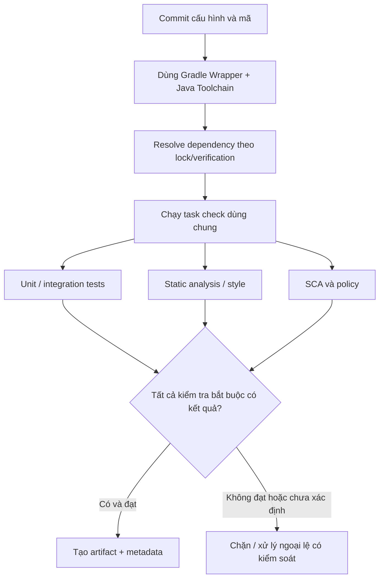

# Giữ cấu hình kiểm tra nhất quán giữa các môi trường

> **Chương:** Cổng chất lượng  
> **Học phần:** CODE_QUALITY_FUNDAMENTALS — Hiểu những thuộc tính quyết định mã nguồn có đáng tin cậy, dễ hiểu và dễ thay đổi hay không.

Một lập trình viên chạy test trên máy cá nhân và nhận kết quả xanh. Pull request được đẩy lên CI, nhưng CI báo lỗi định dạng, một bài test thất bại và một dependency có cảnh báo bảo mật. Sau vài lần thử, nhóm phát hiện máy cá nhân dùng JDK khác, IDE áp dụng một bộ quy tắc riêng, còn CI chạy scanner với cấu hình mới hơn. Cùng một commit nhưng **hai môi trường đang đánh giá hai bộ điều kiện khác nhau**.

Đây là vấn đề về **độ nhất quán của cấu hình kiểm tra**. Một quality gate chỉ đáng tin khi người phát triển, CI và các môi trường xác minh dùng cùng những quy tắc, phiên bản công cụ, phạm vi kiểm tra và cách diễn giải kết quả đã được thống nhất. Nếu mỗi nơi có một bộ điều kiện khác nhau, kết quả xanh ở một môi trường không bảo đảm thay đổi sẽ vượt qua môi trường tiếp theo.

Mục tiêu không phải ép mọi máy tính có cùng phần cứng, hệ điều hành hay dữ liệu. Mục tiêu là làm rõ **những kiểm tra nào phải có cùng ý nghĩa**, những khác biệt môi trường nào được phép, và cách phát hiện khi cấu hình bị lệch.

Sau bài học, bạn có thể:

- Phân biệt cấu hình kiểm tra, cấu hình chạy ứng dụng và cấu hình riêng của từng môi trường.
- Nhận diện drift ở JDK, build tool, ruleset, scanner, dependency, biến môi trường và phạm vi test.
- Đặt cấu hình kiểm tra trong mã nguồn, cố định phiên bản và dùng chung task giữa local với CI.
- Thiết kế quality gate có trạng thái rõ ràng khi kiểm tra thất bại hoặc không thể chạy.
- Xử lý khác biệt có chủ đích mà không làm suy yếu cổng chất lượng.
- Xác minh tính tái lập của kết quả và ghi nhận ngoại lệ có người sở hữu, lý do và thời hạn.

## 1. Vì sao cùng một commit có thể cho kết quả khác?

Một quy trình kiểm tra phần mềm có nhiều thành phần:

- **Toolchain:** JDK, Gradle/Maven, compiler và plugin.
- **Quy tắc:** formatter, linter, static analysis, test coverage, dependency scan.
- **Phạm vi:** module, source set, loại test, file được loại trừ.
- **Đầu vào:** dependency đã resolve, cấu hình, biến môi trường, dữ liệu test.
- **Môi trường thực thi:** hệ điều hành, locale, timezone, filesystem, database và dịch vụ ngoài.
- **Chính sách kết quả:** ngưỡng pass/fail, cách xử lý lỗi scanner, suppression và ngoại lệ.

Nếu bất kỳ thành phần nào thay đổi mà không được quản lý, hai lần chạy có thể không còn tương đương.

| Khác biệt | Hậu quả có thể thấy |
| --- | --- |
| Local dùng JDK 17, CI dùng JDK 21 | Compiler, API có sẵn, cảnh báo và hành vi runtime có thể khác |
| IDE dùng formatter riêng, CI dùng ruleset trong repository | Code format xanh trong IDE nhưng fail trên CI |
| Local bỏ qua integration test, CI chạy đầy đủ | “Test xanh” ở local không bao phủ cùng phạm vi |
| Dependency không khóa phiên bản | Hai lần build có thể resolve graph khác nhau |
| Scanner local và CI khác phiên bản hoặc database | Số finding và phân loại thay đổi |
| Test dựa vào timezone mặc định | Kết quả có thể khác theo máy hoặc thời điểm chạy |
| CI bỏ qua lỗi khi scanner không truy cập được dịch vụ | Pipeline có thể báo xanh dù chưa kiểm tra được |

**Cùng commit không đồng nghĩa cùng điều kiện kiểm tra.** Muốn tin vào quality gate, phải biết điều kiện nào đã được giữ ổn định và điều kiện nào có chủ đích thay đổi.

## 2. Phân biệt ba loại cấu hình

Không phải mọi cấu hình phải giống nhau giữa local, CI, staging và production. Trước tiên cần phân biệt:

| Loại cấu hình | Ví dụ | Cách quản lý |
| --- | --- | --- |
| **Cấu hình kiểm tra** | JDK dùng để build, ruleset, test task, coverage threshold, scanner version | Nên được chia sẻ và quản lý phiên bản |
| **Cấu hình ứng dụng theo môi trường** | URL database, endpoint dịch vụ, feature flag, thông tin kết nối | Khác nhau theo môi trường nhưng phải có schema và quy tắc kiểm tra rõ |
| **Cấu hình hạ tầng thực thi** | CPU, bộ nhớ, hệ điều hành, runner, container runtime | Có thể khác; cần khai báo và kiểm soát ảnh hưởng |

Ví dụ:

- Formatter và quy tắc static analysis phải nhất quán giữa IDE/CLI/CI.
- URL database trong local và staging có thể khác, nhưng cả hai cần đáp ứng hợp đồng schema và quyền truy cập phù hợp.
- Local có thể chạy một bộ test nhanh để phản hồi sớm; CI vẫn phải chạy bộ test bắt buộc đầy đủ trước khi merge.
- Production có thể dùng cấu hình bảo mật nghiêm ngặt hơn local, nhưng không nên dùng một profile làm tắt kiểm tra đầu vào mà ứng dụng cần trong mọi môi trường.

**Nhất quán không có nghĩa là mọi giá trị phải giống hệt nhau.** Nó có nghĩa cùng một quy tắc được diễn giải nhất quán và các khác biệt có chủ đích được công khai.

## 3. Xác định “nguồn sự thật” cho quality gate

Nếu quy tắc được khai báo riêng trong IDE, script cá nhân, CI và wiki, sớm muộn các bản sẽ lệch nhau. Cần xác định nơi sở hữu từng loại cấu hình.

| Thành phần | Nguồn sở hữu phù hợp thường gặp |
| --- | --- |
| Phiên bản Gradle | Gradle Wrapper trong repository |
| Phiên bản Java dùng để compile/test | Java toolchain hoặc cấu hình build tương đương |
| Dependency và phiên bản resolved | File build, BOM/constraints và lockfile |
| Xác minh artifact tải về | Verification metadata được review |
| Quy tắc Checkstyle/PMD/SpotBugs | File cấu hình được quản lý trong repository |
| Cấu hình coverage và ngưỡng | Build script hoặc file cấu hình dùng chung |
| Task kiểm tra chuẩn | Task build có tên và hợp đồng rõ, ví dụ `check` |
| Quy trình CI | Pipeline config được version control |
| Secret và endpoint theo môi trường | Secret manager và cấu hình triển khai, không commit giá trị bí mật |
| Ngoại lệ | Hồ sơ có người phê duyệt, phạm vi và ngày xem lại |

**Một nguồn sự thật không nhất thiết là một file duy nhất.** Điều quan trọng là mỗi quy tắc có nơi sở hữu rõ, có review khi thay đổi và được các môi trường tiêu thụ theo cùng một cách.

### 3.1. IDE là nơi phản hồi sớm, không phải nguồn quy tắc độc lập

IDE có thể tự động đọc formatter, compiler settings hoặc inspection profile từ repository. Nếu IDE cần cấu hình riêng để hiển thị tốt hơn, cấu hình đó không nên âm thầm thay đổi kết quả quality gate.

Ví dụ, nếu dự án chọn Checkstyle, file cấu hình Checkstyle trong repository phải là căn cứ chung. Người dùng có thể bật thêm inspection cá nhân trong IDE, nhưng không nên để những rule riêng đó trở thành điều kiện merge mà đồng đội không thể tái tạo.

### 3.2. Thay đổi cấu hình cũng cần review

Một PR sửa file Java có thể được xem xét kỹ, nhưng một PR chỉ sửa cấu hình scanner lại dễ được gộp nhanh. Điều này nguy hiểm nếu thay đổi:

- Tắt rule về kiểm tra null hoặc quyền truy cập.
- Loại toàn bộ thư mục chứa mã khó khỏi scope.
- Hạ ngưỡng coverage.
- Đánh dấu mọi finding cũ là accepted.
- Chuyển lỗi scanner thành trạng thái pass.

Review cấu hình phải trả lời **vì sao thay đổi, phạm vi bị ảnh hưởng, bằng chứng nào cho thấy chính sách vẫn phù hợp**. Thay đổi cấu hình kiểm tra có thể làm thay đổi kết quả đánh giá toàn repository dù mã ứng dụng không đổi.

## 4. Cố định toolchain để các lần build có thể so sánh

### 4.1. Gradle Wrapper

Gradle Wrapper giúp dự án chỉ định phiên bản Gradle mà mọi người dùng. Thay vì dựa vào Gradle cài sẵn trên máy, dùng wrapper được commit trong repository:

```bash
./gradlew --version
./gradlew clean check
```

Trên Windows, script wrapper tương ứng thường là:

```powershell
.\gradlew.bat --version
.\gradlew.bat clean check
```

Các lệnh trên là ví dụ hướng dẫn, không phải kết quả đã chạy trong dự án. Wrapper giúp thống nhất phiên bản Gradle; nó **không tự cố định JDK, plugin, dependency, cấu hình môi trường hoặc image runner**.

### 4.2. Java Toolchain

Một cấu hình Gradle Kotlin DSL minh họa:

```kotlin
plugins {
    java
    checkstyle
}

java {
    toolchain {
        languageVersion.set(JavaLanguageVersion.of(17))
    }
}

checkstyle {
    toolVersion = "10.21.2"
    configFile = rootProject.file("config/checkstyle/checkstyle.xml")
}

tasks.test {
    useJUnitPlatform()
}
```

Đây là ví dụ minh họa cho một dự án chọn Java 17, Checkstyle và JUnit Platform; phiên bản tool được nêu là ví dụ, **không phải khuyến nghị bắt buộc**. Dự án thật phải chọn phiên bản phù hợp và kiểm tra tương thích với Gradle/JDK.

Toolchain giúp chọn JDK phù hợp cho task biên dịch và kiểm thử. Tuy vậy, cần xem thêm:

- JDK nào chạy chính Gradle daemon và plugin?
- Compiler có dùng cùng release target như production không?
- CI có tải đúng JDK vendor/patch level theo chính sách không?
- Test có chạy trên runtime mà sản phẩm thực sự hỗ trợ không?

Nếu sản phẩm hỗ trợ nhiều phiên bản Java, có thể cần ma trận test tương thích. Trong trường hợp đó, **một toolchain chuẩn để build** và **các runtime mục tiêu để kiểm tra tương thích** là hai mục tiêu khác nhau.

### 4.3. Cố định plugin và dependency

Plugin build là mã thực thi trong quá trình build, do đó phiên bản và nguồn của nó cần được quản lý như dependency. Dependency locking giúp ghi nhận phiên bản được resolve; dependency verification có thể kiểm tra checksum/chữ ký theo metadata đã xác minh.

Ví dụ phần cấu hình Gradle:

```kotlin
dependencyLocking {
    lockAllConfigurations()
}
```

Đoạn trên minh họa bật locking cho các configuration được quản lý; dự án còn cần quy trình tạo, lưu và review lock state. **Lockfile không tự chứng minh artifact an toàn hoặc đúng nguồn**. Nếu có verification metadata, việc thêm checksum/chữ ký mới cần xác minh nguồn tin cậy, không chấp nhận mù quáng giá trị lấy từ một nguồn đang bị nghi ngờ.

Không dùng version động như `1.+` cho các dependency mà build cần có thể tái lập, trừ khi có cơ chế kiểm soát và lý do rõ ràng. Một lần build khác thời điểm có thể chọn phiên bản khác dù commit không đổi.

## 5. Dùng cùng một lệnh kiểm tra giữa local và CI

Một nguyên nhân phổ biến của drift là mỗi nơi chạy một tập lệnh riêng:

```text
Developer:
  compileJava
  test

CI:
  clean check
  dependencyScan
  coverageVerification
```

Nếu local không chạy static analysis hoặc CI có thêm test mà developer không biết, “máy tôi xanh” không có cùng ý nghĩa với “CI xanh”.

Nên tạo một task hoặc entrypoint chuẩn cho các kiểm tra bắt buộc:

```bash
./gradlew clean check
```

Nếu dự án có SCA, coverage verification hoặc kiểm tra schema ngoài task `check`, hãy tạo task tổng hợp có tên rõ hoặc tài liệu hóa lệnh CI tương ứng. Điều quan trọng là **local và CI gọi cùng định nghĩa task**, không sao chép một danh sách lệnh riêng ở nhiều nơi.

### 5.1. Không phải mọi test đều phải chạy trên mỗi thao tác local

Để phản hồi nhanh, nhóm có thể có các cấp:

| Cấp kiểm tra | Ví dụ | Mục đích |
| --- | --- | --- |
| Nhanh khi phát triển | Compile, unit test liên quan, formatter | Phát hiện lỗi sớm |
| Trước khi push | Unit suite, static analysis, test module liên quan | Tự kiểm tra thay đổi |
| CI bắt buộc | Toàn bộ check theo quality gate, integration test được yêu cầu, SCA | Quyết định merge |
| Trước phát hành | Kiểm tra artifact, migration, security/dependency scan, smoke test | Xác minh bản build triển khai |
| Theo lịch | Test tương thích, quét advisory mới, kiểm tra drift | Phát hiện rủi ro xuất hiện sau merge |

Các cấp này có thể khác **thời điểm và độ rộng**, nhưng không nên khác nhau ở cách diễn giải một rule bắt buộc. Nếu local chỉ chạy subset, giao diện và tài liệu phải nói rõ đó là **kiểm tra nhanh**, không phải kết quả pass của toàn quality gate.

### 5.2. Task tổng hợp phải thật sự bao gồm các kiểm tra bắt buộc

Tên task `check` không bảo đảm mọi công cụ đều đã được nối vào. Review build script để biết task nào phụ thuộc task nào, test nào bị exclude và report nào chỉ được tạo nhưng không làm pipeline thất bại.

Một task tạo report SCA nhưng không được đưa vào quality gate có thể khiến CI hiển thị báo cáo trong khi merge vẫn pass. Đó có thể là lựa chọn có chủ đích ở giai đoạn thử nghiệm, nhưng phải được mô tả đúng trạng thái.

## 6. Giữ ruleset và phạm vi scan nhất quán

Một kết quả phân tích chỉ có thể so sánh khi biết **công cụ, rule, scope và cấu hình** đã dùng.

| Thành phần | Cần thống nhất hoặc công khai |
| --- | --- |
| Formatter | Phiên bản, cấu hình, phạm vi file và cách xử lý file sinh |
| Linter/style checker | Phiên bản, ruleset, severity, suppression |
| Static analyzer | Phiên bản, rule profile, classpath và source set |
| Coverage | Công cụ, phạm vi class/test, file exclude và ngưỡng |
| SCA | Phiên bản scanner, nguồn advisory, dependency scope và thời điểm dữ liệu |
| Secret/config scan | Quy tắc phát hiện, đường dẫn loại trừ và cách xử lý finding |
| API/schema checks | Schema được kiểm tra, phiên bản và chế độ tương thích |

### 6.1. Scope phải giống nhau khi so sánh kết quả

Nếu local scan toàn bộ `src/main/java` nhưng CI loại `legacy/`, số cảnh báo sẽ không thể so trực tiếp. Nếu test coverage loại generated code ở local nhưng không loại ở CI, tỷ lệ cũng khác.

Mỗi báo cáo nên thể hiện:

- Module và đường dẫn được quét.
- Source set hoặc configuration được chọn.
- File/loại mã bị loại trừ và lý do.
- Phiên bản tool, ruleset và dữ liệu advisory.
- Commit/build ID tương ứng.

**Không mở rộng exclusions để làm dashboard xanh** mà không review tác động. Một thư mục bị loại khỏi scan vẫn tồn tại trong artifact và có thể chứa rủi ro.

### 6.2. Cập nhật ruleset có thể làm thay đổi baseline

Khi nâng phiên bản scanner hoặc bật thêm rule:

1. Chạy thử trên baseline đã biết.
2. Phân loại finding mới và kiểm tra false positive.
3. Đánh giá mức độ và khối lượng cần xử lý.
4. Công bố thay đổi cấu hình và thời điểm áp dụng.
5. Không âm thầm coi kết quả trước/sau là cùng một phép đo nếu phương pháp đã thay đổi.

Việc có nhiều finding hơn sau khi mở rộng ruleset có thể cho thấy **khả năng quan sát được cải thiện**. Cần phân biệt điều đó với việc mã mới thực sự thêm lỗi.

## 7. Môi trường khác nhau: chuẩn hóa điều kiện và khai báo khác biệt

Local, CI, staging và production có vai trò khác nhau. Cố ép tất cả dùng chung endpoint, dữ liệu, quyền hoặc feature flag có thể không an toàn. Thay vào đó, phân biệt **quy tắc cần tương đương** và **giá trị được phép khác**.

| Thuộc tính | Local | CI | Staging/Production |
| --- | --- | --- | --- |
| Build tool và ruleset | Theo repository | Theo repository | Artifact đã build; không tự build lại với rule khác |
| JDK compile | Toolchain đã chọn | Cùng toolchain | Runtime hỗ trợ theo mục tiêu triển khai |
| Dependency | Lock/verification theo repository | Cùng graph/metadata | Artifact chứa dependency đã xác minh |
| Dữ liệu | Fixture an toàn | Dữ liệu test cô lập | Dữ liệu theo quyền và chính sách môi trường |
| Endpoint | Dịch vụ local/mock | Dịch vụ test | Dịch vụ thực tế theo cấu hình triển khai |
| Secrets | Giá trị giả hoặc secret cá nhân có kiểm soát | Secret CI giới hạn quyền | Secret manager của môi trường |
| Feature flags | Có thể bật/tắt cho phát triển | Giá trị test được công bố | Giá trị rollout có kiểm soát |
| Quality gate | Chạy nhanh hoặc đầy đủ theo lệnh chuẩn | Cổng merge có thẩm quyền | Kiểm tra artifact, smoke/health và vận hành |

**Staging không cần có secret hoặc dữ liệu production**, và local không nên kết nối production chỉ để “giống môi trường”. Tính nhất quán cần đạt là **cùng hợp đồng và quy tắc kiểm tra**, trong khi quyền và dữ liệu phải phù hợp từng môi trường.

### 7.1. Tránh phụ thuộc vào locale/timezone mặc định

Ví dụ code:

```java
import java.time.LocalDate;

public final class ExpirationPolicy {
    public boolean isExpired(LocalDate expiryDate) {
        return expiryDate.isBefore(LocalDate.now());
    }
}
```

Phương thức dùng ngày hiện tại theo môi trường mặc định. Một test chạy gần nửa đêm có thể cho kết quả khác giữa máy dùng timezone khác nhau, hoặc khác khi chạy qua thời điểm chuyển ngày.

Có thể làm thời gian thành dependency rõ ràng:

```java
import java.time.Clock;
import java.time.LocalDate;
import java.util.Objects;

public final class ExpirationPolicy {
    private final Clock clock;

    public ExpirationPolicy(Clock clock) {
        this.clock = Objects.requireNonNull(clock, "clock");
    }

    public boolean isExpired(LocalDate expiryDate) {
        return expiryDate.isBefore(LocalDate.now(clock));
    }
}
```

Kiểm thử dùng đồng hồ cố định:

```java
import static org.junit.jupiter.api.Assertions.assertTrue;

import java.time.Clock;
import java.time.Instant;
import java.time.LocalDate;
import java.time.ZoneOffset;
import org.junit.jupiter.api.Test;

class ExpirationPolicyTest {
    @Test
    void evaluatesExpiryAtAnExplicitInstantAndZone() {
        Clock fixedClock = Clock.fixed(
                Instant.parse("2026-05-10T00:00:00Z"),
                ZoneOffset.UTC);
        ExpirationPolicy policy = new ExpirationPolicy(fixedClock);

        assertTrue(policy.isExpired(LocalDate.of(2026, 5, 9)));
    }
}
```

Đây là một ví dụ về **làm phụ thuộc thời gian tường minh**, không phải khuyến nghị mọi nghiệp vụ đều dùng UTC. Với ngày nghiệp vụ theo vùng, cần chọn timezone theo hợp đồng và truyền rõ; tránh dựa vào timezone mặc định của máy.

### 7.2. Biến môi trường phải có hợp đồng

Một ứng dụng có thể đọc `PAYMENT_TIMEOUT_SECONDS`. Nếu local có giá trị mặc định 30 nhưng CI dùng 0 hoặc không khai báo, test có thể chạy khác.

Nên xác định:

- Biến nào bắt buộc, biến nào có mặc định.
- Kiểu dữ liệu, miền giá trị và cách báo lỗi nếu cấu hình sai.
- Giá trị nào được phép khác giữa môi trường.
- Cách bảo vệ secret và ngăn in secret vào log.
- Cách kiểm tra cấu hình trước khi ứng dụng nhận traffic.

Không đưa secret vào file cấu hình được commit để đạt “đồng nhất”. **Cùng schema và validation** có thể đi cùng **giá trị khác nhau** theo môi trường.

## 8. Phân biệt fail-open và fail-closed trong quality gate

Khi một kiểm tra không chạy được, pipeline cần có trạng thái rõ. Ví dụ scanner phụ thuộc không truy cập được nguồn advisory:

- **Fail-open:** cho phép pipeline pass dù chưa có kết quả kiểm tra.
- **Fail-closed:** coi việc không thể kiểm tra là không đạt cho đến khi có kết quả hoặc ngoại lệ được phê duyệt.

Không có một lựa chọn duy nhất phù hợp cho mọi kiểm tra. Nhưng phải tránh trạng thái **không kiểm tra được nhưng hiển thị như đã kiểm tra và không có vấn đề**.

| Kiểm tra | Câu hỏi khi công cụ không chạy được | Cách xử lý cần xác định |
| --- | --- | --- |
| Unit test | Có thể build/merge mà không chạy test bắt buộc? | Thường phải chặn gate bắt buộc hoặc có quyết định khẩn cấp có ghi nhận |
| Static analysis | Có dùng report cũ không? | Ghi rõ report cũ và tuổi dữ liệu; không giả thành kết quả hiện tại |
| SCA/advisory | Database có cập nhật không? | Trạng thái chưa xác định, retry hoặc ngoại lệ có thời hạn |
| Formatter | Có thể chạy lại trên local/CI khác? | Cùng phiên bản và cấu hình; không bỏ qua âm thầm |
| Integration test | Dịch vụ test không sẵn sàng? | Báo môi trường không sẵn sàng, không nhầm với test pass |
| Schema compatibility | Không lấy được schema chuẩn? | Không kết luận tương thích nếu thiếu nguồn so sánh |

Với kiểm soát bảo mật hoặc dữ liệu nhạy cảm, quyết định fail-open cần được xem xét đặc biệt cẩn thận. Nếu có đường khẩn cấp, phải xác định **ai được duyệt, phạm vi nào được bỏ qua, thời hạn và biện pháp bù**.

## 9. Chặn drift bằng cấu hình có phiên bản và kiểm tra tự động

Một chiến lược thực dụng:

1. **Commit cấu hình kiểm tra** cùng repository: build script, formatter, ruleset, coverage và scanner config.
2. **Cố định phiên bản toolchain**: wrapper, Java toolchain, plugin và scanner.
3. **Khóa và xác minh dependency** theo quy trình của dự án.
4. **Dùng task chuẩn** cho local/CI để không duy trì hai danh sách kiểm tra độc lập.
5. **Ghi metadata mỗi lần chạy**: commit, tool version, ruleset, scope, dependency graph và trạng thái dữ liệu advisory.
6. **Kiểm tra cấu hình trước khi dùng**: thiếu biến bắt buộc, sai profile hoặc ruleset không tồn tại phải báo rõ.
7. **Review thay đổi policy** như thay đổi mã quan trọng.
8. **Theo dõi drift định kỳ** giữa repository, runner CI và môi trường triển khai.

### 9.1. Một pipeline minh họa



Sơ đồ là mô hình quy trình, không phải cấu hình CI của một nền tảng cụ thể. Một pipeline thật còn cần quản lý quyền runner, cache, artifact, timeout và lưu báo cáo.

### 9.2. Metadata giúp so sánh các lần chạy

Mỗi báo cáo có thể lưu:

| Trường | Ví dụ minh họa |
| --- | --- |
| Commit | Mã commit đã kiểm tra |
| Build ID | Định danh lần chạy CI |
| Java toolchain | 17 |
| Gradle Wrapper | Phiên bản đã commit |
| Static analyzer | Tên và phiên bản tool |
| Ruleset revision | Commit hoặc version của cấu hình |
| Scope | Module và source set được kiểm tra |
| Dependency state | Lockfile hoặc digest graph |
| Advisory data | Thời điểm cập nhật nguồn dữ liệu |
| Result | Pass / fail / incomplete / approved exception |

Các giá trị chỉ là ví dụ về metadata cần lưu. Khi cấu hình hoặc tool thay đổi, metadata giúp biết **đây có còn là phép đo tương đương với lần trước không**.

## 10. Quản lý khác biệt có chủ đích

Một số khác biệt giữa môi trường là cần thiết:

- Local dùng database container; CI dùng database dịch vụ tạm thời.
- CI chạy test song song; local có thể chạy tuần tự để debug.
- Production bật TLS và secret manager; local dùng chứng chỉ phát triển.
- Staging bật feature flag cho một nhóm thử nghiệm; production rollout theo tỷ lệ.
- CI chạy thêm test tích hợp và SCA mà mỗi lần lưu file trong IDE không chạy.

Khác biệt trở nên nguy hiểm khi **không được khai báo**, hoặc làm một kiểm tra có ý nghĩa khác mà không ai nhận ra.

### 10.1. Bảng ghi nhận sai khác

| Khác biệt | Có chủ đích? | Cách kiểm soát |
| --- | --- | --- |
| Local dùng SQLite, CI dùng PostgreSQL | Có thể có | Nếu sản phẩm chạy PostgreSQL, cần integration test trên PostgreSQL |
| Local bỏ qua SCA, CI bắt buộc SCA | Có thể có | Nêu local là fast feedback; CI là gate có thẩm quyền |
| CI loại integration test vì thiếu dịch vụ | Chỉ chấp nhận nếu có bước thay thế và trạng thái rõ | Không báo pass toàn bộ suite |
| Production dùng timezone nghiệp vụ, local dùng UTC | Có thể có | Mã phải nhận timezone tường minh và test các biên |
| Local tắt auth để tiện phát triển | Có rủi ro | Phải giữ test xác thực/phân quyền và không để cấu hình dev lọt production |
| CI tắt rule do quá nhiều finding | Không nên làm âm thầm | Triage, baseline, người duyệt và thời hạn |

### 10.2. Profile môi trường không nên thay đổi hợp đồng cốt lõi

Ví dụ, ứng dụng có thể dùng profile `local`, `test`, `staging`, `production` để chọn endpoint và credentials. Nhưng nếu profile `local` tắt validation dữ liệu, còn production bật, unit test local có thể không phát hiện lỗi đầu vào mà code vẫn phải xử lý.

Hãy phân biệt:

- **Khác biệt cấu hình triển khai:** URL, credentials, feature flag và tài nguyên.
- **Quy tắc cốt lõi:** kiểm tra quyền, xác thực đầu vào, tính tiền, xử lý lỗi và bất biến dữ liệu.

Những quy tắc cốt lõi nên được kiểm thử và không biến mất chỉ vì một profile được chọn.

## 11. Baseline và nâng cấp cấu hình an toàn

Khi nâng JDK, Gradle, Checkstyle hoặc scanner, số lỗi có thể tăng. Không nên vội hạ phiên bản chỉ để lấy lại trạng thái xanh; cũng không nên áp toàn bộ rule mới mà không xem tác động.

Quy trình cập nhật có thể gồm:

1. Ghi lại phiên bản và cấu hình hiện tại.
2. Chạy công cụ mới trên baseline để xác định finding do mã hay do phương pháp đo thay đổi.
3. Phân loại finding mới, kiểm tra false positive và tác động tới mã.
4. Cập nhật cấu hình, sửa mã cần thiết hoặc lập kế hoạch xử lý backlog.
5. Chạy lại cùng phạm vi và lưu metadata mới.
6. Thông báo rõ từ build nào gate mới có hiệu lực.

### 11.1. Không so sánh hai báo cáo khác phương pháp như thể giống nhau

Giả sử trước đây scanner bỏ qua dependency test, nay scanner quét cả test runtime. Tổng finding tăng không nhất thiết do mã xấu đi. Báo cáo cần ghi **scope đã mở rộng** và tạo mốc baseline mới nếu cần.

Tương tự, khi đổi coverage tool hoặc quy tắc loại file, tỷ lệ coverage trước/sau có thể không so trực tiếp được. Không dùng biểu đồ xu hướng mà bỏ mất thay đổi phương pháp.

### 11.2. Cập nhật gate theo từng bước

Nếu ruleset mới tạo nhiều finding, nhóm có thể:

- Chạy ở chế độ báo cáo trước để hiểu tác động.
- Chặn finding mới có rủi ro cao ngay khi đủ bằng chứng.
- Tạo backlog có chủ sở hữu cho vấn đề cũ.
- Bật dần rule theo module hoặc theo loại lỗi.
- Chọn thời điểm áp dụng chính thức và xóa chế độ thử nghiệm.

Đây là cách triển khai có kiểm soát, không phải lý do để giữ mãi một gate chỉ báo cáo mà không chặn bất kỳ vấn đề nào.

## 12. Ngoại lệ và suppression không được làm mất dấu rủi ro

Khi một finding chưa thể xử lý ngay, ngoại lệ cần:

- Định danh finding và rule cụ thể.
- Ghi component/module/đường dẫn hoặc phiên bản liên quan.
- Giải thích lý do, phạm vi ảnh hưởng và bằng chứng.
- Có người sở hữu và người phê duyệt theo chính sách.
- Đặt thời hạn hoặc điều kiện xem lại.
- Nêu biện pháp giảm thiểu và kế hoạch xử lý nếu có.

Một hồ sơ ví dụ:

```yaml
# MẪU MINH HỌA, không phải schema suppression của scanner cụ thể.
finding: DEP-DEMO-014
scope: invoice-service/runtime
decision: temporary-acceptance
reason: >
  Bản vá tương thích chưa sẵn sàng; đường xử lý được giới hạn
  và đang có kiểm thử tích hợp bổ sung.
owner: invoice-platform-team
approvedBy: security-reviewer
reviewBefore: 2027-02-01
```

Các giá trị trong mẫu hoàn toàn giả định. Ngoại lệ không nên chỉ là một comment “ignore” không có thời hạn. Khi hết hạn hoặc phạm vi thay đổi, cần xem lại quyết định.

### 12.1. Không dùng baseline như danh sách miễn kiểm tra vĩnh viễn

Baseline có thể giúp phân biệt finding cũ và mới. Nhưng nếu một finding cũ được xác nhận là nguy cơ nghiêm trọng, việc nó nằm trong baseline không tự làm nó chấp nhận được. Phải có quyết định rủi ro riêng và kế hoạch khắc phục.

### 12.2. Tránh tắt gate khi công cụ chập chờn

Nếu scanner tạm thời không truy cập được advisory database, kết quả đúng là **incomplete/unknown** theo chính sách. Không nên biến thành “0 findings”. Có thể retry, dùng dữ liệu cache có tuổi được công bố, hoặc xin ngoại lệ có giới hạn; lựa chọn phụ thuộc mức rủi ro và yêu cầu phát hành.

## 13. Chẩn đoán khi local và CI không thống nhất

Khi một test pass ở local nhưng fail ở CI, không nên ngay lập tức kết luận CI sai hoặc máy local sai. Thu thập:

1. Commit và branch giống nhau chưa?
2. JDK vendor/version, Gradle Wrapper và JVM args có giống không?
3. Dependency graph/lock state có giống không?
4. Test có dựa vào thứ tự chạy, thời gian, random, locale, timezone hoặc filesystem không?
5. CI có biến môi trường, profile hoặc secret cần thiết khác không?
6. CI có chạy thêm source set hoặc integration test không?
7. Có race condition hoặc test dùng chung tài nguyên không?
8. Cache có đưa artifact cũ vào không?
9. Phiên bản scanner/ruleset và nguồn advisory có thay đổi không?
10. Kết quả fail có tái hiện được khi chạy đúng lệnh CI trên môi trường tương đương không?

### 13.1. Tạo lệnh tái hiện chính xác

CI nên hiển thị lệnh, phiên bản tool và cấu hình cần thiết để developer có thể tái hiện. Ví dụ:

```bash
./gradlew --version
./gradlew clean check --no-build-cache
```

Tùy dự án, có thể cần task cụ thể hoặc profile test. `--no-build-cache` là tùy chọn chẩn đoán trong một số trường hợp, không nên mặc định tắt cache cho mọi build. Nếu lỗi chỉ xảy ra với service tích hợp, cần chỉ ra dependency và môi trường test cần có.

### 13.2. Khi lỗi chỉ xuất hiện trên một hệ điều hành

Không nhất thiết mọi developer phải chạy tất cả hệ điều hành. Nhưng nếu sản phẩm hỗ trợ Windows, Linux và macOS, CI có thể chạy ma trận trên các môi trường đó hoặc kiểm tra những khác biệt có ý nghĩa như:

- Dấu phân cách đường dẫn.
- Quyền truy cập file và phân biệt hoa/thường.
- Encoding và newline.
- Process signal và cách dừng tiến trình.
- Native library hoặc công cụ ngoài.

Một gate trên Linux không tự chứng minh chương trình tương thích Windows nếu sản phẩm có cam kết hỗ trợ Windows.

## 14. Checklist giữ cấu hình quality gate nhất quán

| Câu hỏi | Dấu hiệu đạt |
| --- | --- |
| Có nguồn sở hữu rõ cho từng quy tắc kiểm tra? | Build script, ruleset và pipeline được version control |
| JDK và build tool có được cố định? | Toolchain/Wrapper và phiên bản được ghi rõ |
| Plugin và dependency có phiên bản ổn định? | Không phụ thuộc ngẫu nhiên vào phiên bản động |
| Locking/verification được dùng có chủ đích? | Có quy trình cập nhật và review metadata |
| Local và CI dùng chung task? | Lệnh chuẩn được tài liệu hóa và tái hiện được |
| Ruleset và scanner version có đồng nhất? | Báo cáo lưu phiên bản và cấu hình |
| Scope có rõ và tương đương? | Module/source set/exclusions được ghi lại |
| Khác biệt môi trường có được khai báo? | Endpoint, secrets, timezone, profile có hợp đồng |
| Lỗi kiểm tra có bị biến thành pass? | Trạng thái fail/incomplete/unknown rõ ràng |
| Ngoại lệ có chủ sở hữu và thời hạn? | Không có suppression vô thời hạn không giải thích |
| Cấu hình gate có được review? | PR thay đổi policy có đánh giá tác động |
| Có thể tái hiện kết quả CI? | Có commit, build ID, lệnh, tool version và metadata |

## 15. Bài tập thực hành

Một dự án Java có cấu hình như sau:

| Thành phần | Máy developer A | CI |
| --- | --- | --- |
| Java | JDK 17 | JDK 21 |
| Gradle | Cài global 8.x | Wrapper 8.7 |
| Formatter | IDE profile cá nhân | File cấu hình trong repository |
| Unit tests | Chỉ test module đang sửa | Tất cả module |
| Integration tests | Không chạy | Chạy khi có service test |
| Dependency | Không có lockfile | Resolve lại mỗi lần build |
| SCA | Không chạy | Scanner có dữ liệu advisory |
| Khi scanner lỗi | Không áp dụng | Pipeline hiện vẫn pass |

Developer A báo “máy tôi xanh”, còn CI báo có finding dependency và một số test fail. Nhóm muốn chuẩn hóa để các lần kiểm tra có ý nghĩa nhất quán.

Hãy thực hiện:

1. **Phân loại các điểm drift:** toolchain, build, ruleset, scope, dependency, scanner và chính sách fail.
2. Đề xuất nguồn sở hữu phiên bản Gradle, JDK, formatter, scanner và dependency graph.
3. Thiết kế một task chuẩn để developer có thể chạy cùng định nghĩa kiểm tra mà CI dùng cho merge.
4. Xác định những kiểm tra nào có thể là fast feedback local và những kiểm tra nào vẫn bắt buộc trên CI.
5. Đề xuất cách xử lý khi scanner không truy cập được dữ liệu advisory. Vì sao không nên hiển thị kết quả đó thành “0 findings”?
6. Chỉ ra những giá trị **được phép khác** giữa local, CI và production (endpoint, credentials, dữ liệu), và những quy tắc cần nhất quán (validation, permission, ruleset).
7. Viết một cấu hình Gradle minh họa dùng Java toolchain, Checkstyle và JUnit Platform. Nêu phiên bản tool cần được chọn và quản lý như thế nào.
8. Một test dùng `LocalDate.now()` chỉ fail ở CI gần nửa đêm. Hãy phân tích timezone/time dependency và đề xuất cách làm test xác định.
9. Thiết kế metadata tối thiểu để so sánh hai lần quét khi scanner được nâng phiên bản.
10. Đề xuất quy trình review một PR chỉ thay đổi file cấu hình quality gate, bao gồm trường hợp thêm suppression.

**Gợi ý:** lời giải tốt không cố làm mọi môi trường giống hệt nhau. Nó chỉ ra **quy tắc kiểm tra nào phải có cùng ý nghĩa, khác biệt nào được phép và làm sao phát hiện khi khác biệt vượt khỏi thiết kế**.

## Ghi nhớ

Quality gate chỉ đáng tin khi **cùng một quy tắc được áp dụng và diễn giải nhất quán** giữa các môi trường có liên quan. Hãy quản lý toolchain, ruleset, dependency, scope và task kiểm tra bằng cấu hình có phiên bản; phân biệt chúng với endpoint, secret và dữ liệu riêng của môi trường; ghi metadata để tái hiện và so sánh; xử lý rõ trạng thái fail, incomplete và ngoại lệ. Local có thể chạy tập kiểm tra nhanh, nhưng CI phải thực thi cổng bắt buộc đã thống nhất. **Một kết quả xanh chỉ có ý nghĩa khi ta biết chính xác điều gì đã được kiểm tra, bằng phiên bản và cấu hình nào.**
