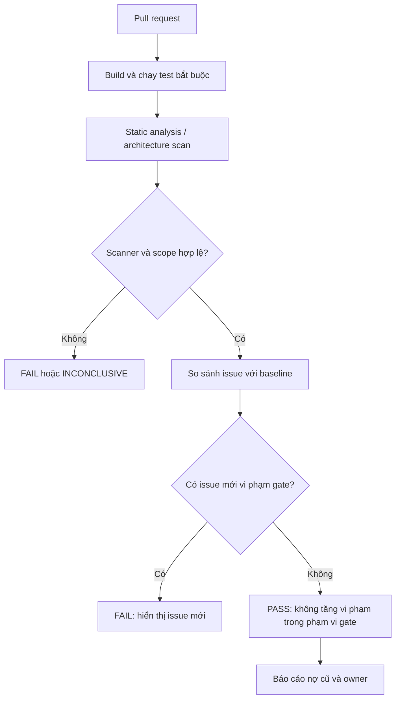

# Ngăn lỗi mới trong khi quản lý tồn đọng bằng baseline

## 1. Mục tiêu bài học

Trong chương **Cổng chất lượng** của module **CODE_QUALITY_FUNDAMENTALS**, chúng ta tìm hiểu cách áp dụng một cổng chất lượng thực tế cho repository đã có mã cũ và nhiều vấn đề tồn đọng. Mục tiêu là **ngăn thay đổi mới làm chất lượng giảm thêm**, đồng thời giữ cho các vấn đề cũ hiển thị và có kế hoạch xử lý.

Module hướng đến việc **hiểu những thuộc tính quyết định mã nguồn có đáng tin cậy, dễ hiểu và dễ thay đổi hay không**. Một repository lâu năm có thể đang chứa cảnh báo static analysis, test thiếu, độ phức tạp cao hoặc phụ thuộc chưa hợp lý. Nếu yêu cầu mọi vấn đề phải về 0 trước khi CI được bật, nhóm có thể không triển khai được. Nếu bỏ qua toàn bộ cảnh báo vì “mã cũ vốn đã như vậy”, lỗi mới sẽ tiếp tục tích lũy.

Sau bài học, bạn có thể:

- Giải thích **baseline** là gì và nó khác với việc tắt rule hoặc bỏ qua cảnh báo như thế nào.
- Phân biệt **tổng số vấn đề đang tồn tại** với **vấn đề mới hoặc bị làm xấu đi trong thay đổi hiện tại**.
- Thiết kế cách nhận diện issue bằng fingerprint ổn định, tránh phụ thuộc đơn thuần vào số dòng hoặc tổng số cảnh báo.
- Đặt cổng cho code mới, kiểm soát ngoại lệ và thu hẹp baseline theo thời gian.
- Đọc một ví dụ Java về lỗi tràn số mới được phát hiện trong khi repository còn cảnh báo cũ.
- Đưa kiểm tra vào CI với điều kiện quét đầy đủ, đúng commit và đúng phạm vi.
- Đánh giá rủi ro false positive, false negative và cách xử lý khi công cụ hoặc baseline gặp lỗi.

## 2. Bài toán: repository đã có nợ chất lượng

Giả sử một ứng dụng Java đã phát triển nhiều năm. Lần quét đầu tiên ghi nhận:

- 45 cảnh báo về độ tin cậy, trong đó có một số lỗi tiềm ẩn cần điều tra.
- 70 cảnh báo về khả năng bảo trì như phương thức quá phức tạp hoặc trùng logic.
- 5 phụ thuộc kiến trúc chưa phù hợp.
- Một số package chưa có kiểm thử đủ tốt.

Đây là **số liệu giả định để minh họa**, không phải chuẩn đánh giá cho mọi dự án.

Nếu nhóm đặt điều kiện “CI chỉ xanh khi toàn repository không còn bất kỳ cảnh báo nào”, mọi PR đều bị chặn bởi các vấn đề có thể đã tồn tại nhiều năm, nằm ngoài phạm vi thay đổi và cần kế hoạch xử lý riêng.

Nếu nhóm tắt static analysis hoặc đánh dấu toàn bộ cảnh báo là không quan trọng, những lỗi mới do PR tạo ra cũng có thể lọt qua.

Một cách tiếp cận cân bằng là:

1. **Ghi nhận hiện trạng đã được xem xét** tại một mốc tham chiếu.
2. Tiếp tục hiển thị và quản lý các vấn đề đã tồn tại.
3. So sánh mỗi thay đổi với mốc đó để phát hiện **vấn đề mới hoặc vấn đề bị làm xấu đi**.
4. Chỉ chấp nhận PR khi không tạo thêm vi phạm thuộc phạm vi cổng và các kiểm tra bắt buộc khác đều hoàn tất.
5. Khi sửa được vấn đề cũ, cập nhật baseline để khoản nợ giảm dần.

Đó là ý nghĩa của việc **ngăn lỗi mới trong khi quản lý tồn đọng bằng baseline**. Baseline giúp quản lý điểm xuất phát; nó không biến các vấn đề cũ thành đúng hoặc an toàn.

## 3. Baseline là gì?

**Baseline chất lượng** là bản ghi về các vấn đề đã tồn tại và được chấp nhận là nợ cần quản lý tại một thời điểm hoặc phiên bản tham chiếu. Hệ thống dùng nó để phân biệt:

- **Issue cũ:** vấn đề đã có trong baseline và chưa được sửa.
- **Issue mới:** vấn đề chưa có trong baseline nhưng xuất hiện trong code đang kiểm tra.
- **Issue bị làm xấu đi:** một vấn đề cũ thay đổi theo cách tăng mức độ nghiêm trọng hoặc mở rộng tác động theo chính sách đã xác định.
- **Issue đã được sửa:** vấn đề trong baseline không còn được công cụ phát hiện hoặc đã được xác nhận xử lý.
- **Issue tái xuất hiện:** vấn đề từng được sửa và loại khỏi baseline, sau đó xuất hiện lại.

Baseline có thể được biểu diễn bằng danh sách issue, một snapshot của báo cáo, mốc commit hoặc cơ chế so sánh “new code” của công cụ. Cách triển khai phụ thuộc công cụ, nhưng **ý nghĩa quản trị phải rõ**: vấn đề cũ vẫn được nhìn thấy, còn thay đổi mới phải chịu cổng phù hợp.

### Baseline không phải là gì?

| Cách làm | Có phải baseline tốt không? | Lý do |
| --- | --- | --- |
| Lưu danh sách issue đã được phân loại ở một commit tham chiếu | **Có thể** | Có thể đối chiếu từng vấn đề và theo dõi việc sửa. |
| Tắt rule đang báo nhiều lỗi | **Không** | Mất khả năng phát hiện cả lỗi mới cùng loại. |
| Bỏ qua toàn bộ thư mục mã cũ mà không có phạm vi/lý do | **Không** | Lỗi mới trong chính thư mục đó có thể không được phát hiện. |
| Ghi một con số “hiện có 120 cảnh báo” rồi chỉ chặn khi vượt 120 | **Chưa đủ** | Một issue mới có thể xuất hiện đồng thời một issue cũ biến mất; tổng vẫn không đổi. |
| Đánh dấu mọi cảnh báo là false positive | **Không** | Phân loại không dựa trên điều tra và làm sai lệch thông tin. |
| Chụp snapshot, review từng nhóm và gắn chủ sở hữu cho nợ cũ | **Có thể** | Tạo điểm xuất phát có trách nhiệm và có thể thu hẹp. |

**Baseline không phải giấy phép bỏ qua lỗi.** Nó là cách ghi nhận khoản nợ có kiểm soát trong khi vẫn giữ tiêu chuẩn cho phần thay đổi mới.

## 4. So sánh vấn đề mới thay vì chỉ so tổng số lượng

Giả sử baseline có 120 issue. Một PR:

- Sửa được 1 issue cũ.
- Tạo ra 2 issue mới.

Tổng số sau thay đổi là **121**.

Nếu chỉ đặt gate “tổng issue không vượt 120”, PR bị chặn — điều này có thể hợp lý vì số lượng ròng tăng. Nhưng cách đếm đó không cho biết **hai vấn đề mới nào được tạo ra**, issue cũ nào đã được sửa và mức độ nghiêm trọng của từng vấn đề.

Một trường hợp nguy hiểm hơn:

- PR sửa 5 issue cũ.
- PR tạo 5 issue mới, trong đó có một lỗi bảo mật nghiêm trọng.
- Tổng vẫn là 120.

Gate chỉ dựa trên tổng số có thể cho qua, dù thay đổi đã đưa vào một rủi ro mới rất lớn.

| Cách so sánh | Có thể trả lời | Điểm yếu |
| --- | --- | --- |
| **Tổng số issue** | Khoản nợ hiện tại tăng hay giảm bao nhiêu? | Không chỉ ra danh tính, mức độ và nguồn gốc của issue mới. |
| **Số issue theo severity** | Nhóm cảnh báo nghiêm trọng có tăng không? | Vẫn có thể che việc một issue mới thay thế một issue cũ cùng severity. |
| **Diff issue theo fingerprint** | Issue nào mới, cũ, đã sửa hoặc thay đổi? | Cần fingerprint ổn định và phạm vi quét nhất quán. |
| **New-code analysis** | Thay đổi trong khoảng “code mới” có vi phạm không? | Phụ thuộc mốc tham chiếu và cách công cụ xác định code mới. |
| **Kiểm tra trên dòng thay đổi** | Vấn đề nào gắn với phần diff hiện tại? | Có thể bỏ sót lỗi do thay đổi ở cấu hình, dependency hoặc luồng liên quan ngoài dòng diff. |

**Nên dùng danh tính và mức độ issue để quyết định gate; dùng tổng số để theo dõi xu hướng nợ.** Hai loại số liệu trả lời hai câu hỏi khác nhau.

## 5. Fingerprint: nhận diện một vấn đề qua nhiều lần quét

Để biết một issue đã có trong baseline hay mới xuất hiện, công cụ cần một cách nhận diện. **Fingerprint** là dấu hiệu định danh issue qua các lần phân tích.

Một fingerprint có thể dựa trên tổ hợp:

- ID rule hoặc loại vấn đề.
- Artifact/package/class/method liên quan.
- Một phần ngữ cảnh mã hoặc vị trí logic.
- Vị trí nguồn đã chuẩn hóa theo khả năng của công cụ.
- Thông tin bổ sung cần thiết để phân biệt nhiều lần vi phạm cùng rule trong một lớp.

Ví dụ minh họa:

```text
Rule: java:Sxxxx
Component: checkout-core
Symbol: CheckoutCalculator#calculateTotal
Context: phép nhân giá và số lượng không kiểm tra tràn số
Fingerprint: <giá trị do công cụ phân tích tạo>
```

Đây là **mô tả khái niệm**, không phải định dạng fingerprint của một công cụ cụ thể.

### Vì sao không nên chỉ dùng số dòng?

Giả sử một issue nằm ở dòng 80. Khi thêm comment hoặc import ở đầu file, issue chuyển xuống dòng 84 dù logic không đổi. Nếu baseline định danh chỉ bằng số dòng, nó có thể bị xem là issue mới.

Ngược lại, một issue khác được thêm ở đúng dòng 80 sau khi dòng cũ đã được sửa có thể bị nhận nhầm là issue cũ nếu định danh quá thô.

Fingerprint tốt nên **ổn định khi code được di chuyển hoặc format**, nhưng vẫn phân biệt được những vi phạm khác nhau. Khả năng này tùy công cụ và loại rule; không phải công cụ nào cũng có fingerprint hoàn hảo.

### Cần xem lại khi fingerprint thay đổi

Một issue có thể xuất hiện như mới sau khi:

- Đổi tên package, class hoặc method.
- Tách/gộp file và di chuyển logic.
- Nâng phiên bản analyzer làm thay đổi cách tạo fingerprint.
- Đổi rule hoặc profile khiến cách phân loại khác.

Không nên tự động kết luận mọi issue có fingerprint mới là lỗi mới; cũng không nên tự động coi chúng là issue cũ. Hãy xem **ngữ cảnh, lịch sử diff và rule liên quan** trước khi cập nhật baseline.

Nếu công cụ không hỗ trợ fingerprint ổn định, có thể kết hợp **new-code comparison**, vùng dòng thay đổi và review thủ công. Cần ghi rõ giới hạn để không tuyên bố gate mạnh hơn khả năng thực tế.

## 6. Baseline và “new code” không hoàn toàn giống nhau

Hai cách triển khai phổ biến:

### 6.1. So sánh snapshot baseline

Một lần quét tạo danh sách issue ở commit tham chiếu. Mỗi PR được quét lại, rồi so sánh danh tính issue:

- Có trong cả hai: issue cũ còn tồn tại.
- Chỉ có ở kết quả mới: issue mới hoặc issue cũ chưa được nhận diện ổn định.
- Chỉ có trong baseline: issue đã sửa, không còn được phát hiện hoặc nằm ngoài phạm vi quét mới.

Ưu điểm là có thể theo dõi **từng issue cụ thể**. Nhược điểm là cần duy trì snapshot, xử lý thay đổi fingerprint, thay đổi cấu hình rule và nâng phiên bản analyzer.

### 6.2. Phân tích “new code”

Một số nền tảng chất lượng cho phép xác định code mới theo:

- Thay đổi kể từ một ngày hoặc một phiên bản phát hành.
- Khác biệt với nhánh chính hoặc một nhánh tham chiếu.
- Commit/merge base của pull request.

Gate chỉ áp dụng một số điều kiện trên phạm vi code mới. Cách này giảm nhu cầu quản lý file baseline thủ công, nhưng cần cấu hình đúng **reference branch, merge base hoặc khoảng thời gian**.

Ví dụ nếu nhánh tham chiếu bị cấu hình sai, toàn bộ repository có thể bị coi là “code mới” hoặc ngược lại, diff hiện tại bị bỏ qua. Một gate xanh trong tình huống đó không có ý nghĩa.

### Chọn cách nào?

| Điều kiện dự án | Cách có thể phù hợp |
| --- | --- |
| Công cụ cung cấp new-code analysis đáng tin cậy và nhánh chính được quản lý ổn định | Dùng mốc code mới theo cấu hình công cụ, kiểm tra kỹ reference branch |
| Muốn theo dõi từng vấn đề cũ, phân công owner và thời hạn | Snapshot baseline có danh tính issue |
| Repository nhỏ, rule ít và dễ xác định vùng cũ | Baseline có kiểm soát hoặc danh sách ngoại lệ có fingerprint |
| Có nhiều generated/vendor code | Phân vùng phạm vi rõ, ghi lý do loại trừ và kiểm tra phần mã sản phẩm vẫn được quét |

Có thể kết hợp nhiều cách. Ví dụ dùng new-code gate cho static analysis, đồng thời giữ danh sách issue bảo mật tồn đọng có owner và kế hoạch xử lý.

## 7. Ví dụ Java: lỗi mới trong repository có cảnh báo cũ

Giả sử repository có một lớp cũ `LegacyInvoiceFormatter` đang chứa một số cảnh báo về độ phức tạp và cách đặt tên. Các cảnh báo này đã được ghi nhận trong baseline và có ticket xử lý riêng.

Một PR mới thêm hàm tính tổng dòng hàng:

```java
// LinePricing.java — phiên bản có lỗi mới.
public final class LinePricing {
    private LinePricing() {}

    public static long lineTotalVnd(long unitPriceVnd, int quantity) {
        if (quantity <= 0) {
            throw new IllegalArgumentException(
                    "quantity must be positive");
        }
        // Lỗi: phép nhân long có thể tràn mà không báo lỗi.
        return unitPriceVnd * quantity;
    }
}
```

Mã đã kiểm tra số lượng nhưng chưa kiểm tra giá âm, đồng thời phép nhân có thể tràn. Nếu giá là `Long.MAX_VALUE` và số lượng bằng 2, kết quả có thể thành số âm hoặc một giá trị không còn đúng.

Giả sử baseline chỉ có các issue ở `LegacyInvoiceFormatter`. Vấn đề trong `LinePricing` không có fingerprint trong baseline nên phải được coi là **issue mới** nếu analyzer có rule tương ứng và phạm vi quét bao gồm lớp này.

Phiên bản sửa:

```java
// LinePricing.java — phiên bản đã xử lý hợp đồng đầu vào và tràn số.
public final class LinePricing {
    private LinePricing() {}

    public static long lineTotalVnd(long unitPriceVnd, int quantity) {
        if (unitPriceVnd < 0) {
            throw new IllegalArgumentException(
                    "unitPriceVnd must not be negative");
        }
        if (quantity <= 0) {
            throw new IllegalArgumentException(
                    "quantity must be positive");
        }
        return Math.multiplyExact(unitPriceVnd, (long) quantity);
    }
}
```

Hợp đồng ví dụ:

- Giá VND không âm.
- Số lượng nguyên dương.
- Kết quả là giá nhân số lượng.
- Nếu tích không biểu diễn được bằng `long`, báo `ArithmeticException`.

### Kiểm thử JUnit 5

```java
import static org.junit.jupiter.api.Assertions.assertEquals;
import static org.junit.jupiter.api.Assertions.assertThrows;

import org.junit.jupiter.api.Test;

class LinePricingTest {
    @Test
    void calculatesOrdinaryLineTotal() {
        assertEquals(240_000L,
                LinePricing.lineTotalVnd(80_000L, 3));
    }

    @Test
    void rejectsInvalidPriceAndQuantity() {
        assertThrows(IllegalArgumentException.class,
                () -> LinePricing.lineTotalVnd(-1L, 1));
        assertThrows(IllegalArgumentException.class,
                () -> LinePricing.lineTotalVnd(100L, 0));
        assertThrows(IllegalArgumentException.class,
                () -> LinePricing.lineTotalVnd(100L, -1));
    }

    @Test
    void detectsMultiplicationOverflow() {
        assertThrows(ArithmeticException.class,
                () -> LinePricing.lineTotalVnd(Long.MAX_VALUE, 2));
    }

    @Test
    void acceptsLargestRepresentableValueWhenQuantityIsOne() {
        assertEquals(Long.MAX_VALUE,
                LinePricing.lineTotalVnd(Long.MAX_VALUE, 1));
    }
}
```

Các test bảo vệ hợp đồng của hàm; static analysis có thể phát hiện một số dạng phép nhân không kiểm tra, tùy rule và cấu hình. **Không nên giả định mọi analyzer đều có rule tự động nhận diện đúng lỗi nghiệp vụ này.** Nếu không có rule phù hợp, review và kiểm thử vẫn phải bảo vệ điều kiện tràn.

### Baseline tác động thế nào trong ví dụ?

| Thành phần | Trước PR | Sau PR đã sửa | Ý nghĩa với gate |
| --- | --- | --- | --- |
| `LegacyInvoiceFormatter` | 4 issue cũ trong baseline | 4 issue cũ vẫn còn | Theo dõi nợ, không quy cho PR mới |
| `LinePricing` | Chưa tồn tại | Không có issue mới theo rule đang bật | Không thêm nợ mới trong phạm vi đã quét |
| Unit test tính tiền | Chưa có | Có test thường, đầu vào sai, tràn số | Bằng chứng hành vi cho API mới |
| Scanner | Chưa có kết quả PR | Hoàn tất trên commit hiện tại | Điều kiện bắt buộc để gate có ý nghĩa |

Nếu phiên bản có lỗi của `LinePricing` được đưa vào PR, gate phải phát hiện issue mới tương ứng và chặn theo policy. Sau khi sửa, issue mới biến mất. **Bốn issue cũ vẫn được hiển thị và phải có kế hoạch xử lý**, không bị xóa khỏi báo cáo chỉ để làm dashboard xanh.

## 8. Thiết kế một quality gate có ý nghĩa

Quality gate là tập điều kiện quyết định một thay đổi **được phép tiếp tục qua một giai đoạn hay không**. Với repository có baseline, nên tách ít nhất hai lớp:

### 8.1. Điều kiện cho phần mới hoặc phần bị thay đổi

Ví dụ một chính sách có thể là:

- Không có issue bảo mật mức nghiêm trọng cao mới.
- Không có bug mới được xác nhận ở mức blocker/critical theo rule profile.
- Không tạo mới phụ thuộc vòng giữa những module đã được quy định là độc lập.
- Các test bắt buộc của phần thay đổi phải chạy thành công.
- Những rule có độ tin cậy cao phải không có vi phạm mới.
- Nếu một issue cũ bị tăng severity hoặc tác động, phải review như một vấn đề mới/thay đổi.

### 8.2. Điều kiện về toàn bộ lần chạy

- Scanner phải hoàn tất, không bị timeout hoặc lỗi cấu hình.
- Báo cáo phải gắn với **đúng commit/merge request** đang xét.
- Phạm vi quét phải bao gồm các source set, module và file cần thiết.
- Baseline/reference branch phải được tải và so sánh thành công.
- Các rule bắt buộc không bị vô hiệu hóa ngoài chính sách.
- Artifact hoặc report phải đủ mới; không dùng kết quả từ commit trước.

Nếu scanner không chạy được hoặc baseline không tải được, kết quả phải là **inconclusive/failure theo chính sách**, không tự chuyển thành PASS. “Không có issue được báo” khác với “đã quét và không tìm thấy issue”.

### 8.3. Theo dõi nợ cũ riêng

Dashboard tổng thể vẫn nên hiển thị:

- Tổng issue theo loại và mức độ.
- Tuổi của issue hoặc thời gian tồn tại.
- Chủ sở hữu và ticket xử lý.
- Issue được sửa trong kỳ.
- Xu hướng baseline tăng/giảm qua các mốc.

Gate PR và dashboard nợ cũ phục vụ **hai mục tiêu khác nhau**: một cái bảo vệ chất lượng thay đổi mới; cái kia giúp nhóm giảm khoản nợ đã tồn tại.

## 9. Một cấu hình gate minh họa

Ví dụ sau mô tả **ý tưởng cấu hình**, không phải schema thật của SonarQube, Gradle, GitHub Actions hay một nền tảng CI cụ thể:

```yaml
qualityGate:
  analysis:
    required: true
    revision: current-pull-request-commit
    scope:
      include: production-source
      exclude:
        - generated-code
        - vendored-dependencies

  baseline:
    reference: approved-main-branch-snapshot
    comparison: issue-fingerprint
    missing-baseline: fail
    allow-automatic-refresh: false

  newIssues:
    security-critical: 0
    confirmed-bugs: 0
    architecture-boundary-violations: 0
    high-confidence-maintainability: 0

  tests:
    required-suites:
      - unit
      - architecture
    failed-tests: 0

  legacyDebt:
    report-all: true
    require-owner: true
    require-review-date: true
    trend: non-increasing
```

Các giá trị 0 trong ví dụ là **chính sách minh họa cho số issue mới được phép**, không phải ngưỡng phù hợp cho mọi tổ chức. Một số rule có false positive cao hoặc cần phân loại thủ công có thể dùng quy trình exception. Quy tắc bảo mật và lỗi dữ liệu có thể cần cổng nghiêm ngặt hơn quy tắc style.

Phần `exclude` cũng cần cẩn trọng: generated code và dependency vendor có thể được loại khỏi một số phép phân tích, nhưng phải xác định chính xác đường dẫn và cách xác minh generator/source gốc. Không nên loại cả thư mục ứng dụng chỉ vì một số file sinh tự động nằm trong đó.

### Mô hình pipeline



Điều kiện cuối không có nghĩa “repository không còn lỗi”. Nó chỉ có nghĩa **các điều kiện được định nghĩa đã đạt trên đúng lần quét và phạm vi đã cấu hình**.

## 10. Quy trình tạo baseline ban đầu

Không nên tạo baseline bằng cách lấy toàn bộ cảnh báo hiện tại rồi tự động đánh dấu chúng là hợp lệ. Hãy thực hiện có review:

1. **Chọn mốc tham chiếu:** thường là commit ổn định trên nhánh chính đã được build và phân tích đầy đủ.
2. **Cố định công cụ và rule profile:** ghi phiên bản scanner, cấu hình, source scope và các exclusion.
3. **Chạy phân tích toàn diện:** bảo đảm scanner hoàn tất và không thiếu module/source set.
4. **Phân loại vấn đề:** bug, vulnerability, maintainability, architecture; đánh giá severity, confidence và khả năng khai thác/tác động.
5. **Xử lý vấn đề nghiêm trọng trước:** không đưa lỗi có rủi ro cao vào baseline chỉ vì chúng nằm trong code cũ.
6. **Xác nhận false positive:** chỉ đóng hoặc suppress khi có bằng chứng, lý do và phạm vi cụ thể.
7. **Ghi fingerprint và metadata:** commit tham chiếu, rule, component, mức độ, người phụ trách, ticket và ngày review.
8. **Review baseline:** ít nhất người phụ trách chất lượng và owner kỹ thuật đồng ý với phần nợ được chấp nhận.
9. **Bật gate cho thay đổi mới:** kiểm tra thử một PR có issue mới và một PR chỉ sửa issue cũ.
10. **Theo dõi dashboard:** baseline là điểm bắt đầu của kế hoạch giảm nợ, không phải đích đến.

Nếu lần quét đầu tiên có 500 cảnh báo, không có nghĩa phải chấp nhận cả 500. Những vấn đề có thể gây mất dữ liệu, truy cập trái phép hoặc lỗi nghiêm trọng cần được xử lý hoặc có quyết định rủi ro rõ ràng trước khi khóa baseline.

### Tạo baseline có thể tái lập

Để một người khác hiểu kết quả, baseline nên ghi:

| Thông tin | Mục đích |
| --- | --- |
| Commit SHA hoặc release tham chiếu | Biết chính xác code nào là điểm xuất phát |
| Phiên bản scanner và rule profile | Giải thích khác biệt khi nâng công cụ |
| Phạm vi source và exclusion | Tránh so sánh hai tập mã khác nhau |
| Fingerprint/ID issue | Nhận diện từng vấn đề qua lần quét |
| Severity, confidence, loại issue | Ưu tiên xử lý và đặt gate phù hợp |
| Owner/ticket | Biết ai theo dõi và kế hoạch xử lý |
| Ngày tạo và ngày review lại | Ngăn baseline tồn tại vô thời hạn |

Không lưu thông tin bí mật, dữ liệu khách hàng hoặc nội dung nhạy cảm trong baseline. Báo cáo scanner có thể chứa đường dẫn nội bộ hoặc đoạn code; cần áp dụng chính sách truy cập phù hợp.

## 11. Quản lý ngoại lệ mà không biến baseline thành nơi bỏ qua mọi thứ

Có trường hợp issue đã được điều tra nhưng không thể sửa ngay:

- Một API cũ cần giữ tương thích trong thời gian migration.
- Một rule báo sai do giới hạn analyzer và có bằng chứng xác nhận.
- Một đoạn generated code không thể sửa trực tiếp; cần sửa generator.
- Một thay đổi kiến trúc phải chờ dependency bên ngoài hoặc kế hoạch phát hành.

Một ngoại lệ nên có:

1. **Issue cụ thể** hoặc rule/path rất hẹp.
2. **Lý do kỹ thuật** và bằng chứng điều tra.
3. **Người chịu trách nhiệm** hoặc team owner.
4. **Ticket/biện pháp giảm thiểu** nếu có rủi ro.
5. **Ngày hết hạn hoặc ngày review lại**.
6. **Phạm vi áp dụng** và cách xác minh ngoại lệ không che issue mới.

Không nên suppress toàn bộ rule vì một vài false positive. Cũng không nên dùng wildcard rộng kiểu `src/main/java/**` để bỏ qua mọi cảnh báo ở source sản phẩm.

### Ví dụ ngoại lệ có thời hạn

```yaml
exception:
  issueFingerprint: "tool-generated-fingerprint"
  reason: "False positive đã được xác nhận bằng kiểm tra luồng dữ liệu"
  owner: "team-catalog"
  trackingTicket: "QUALITY-142"
  reviewBy: "2026-12-15"
  scope: "một issue tại một method"
```

Đây là **mẫu minh họa**, không phải cú pháp cấu hình cho công cụ cụ thể. Khi tới ngày review, nhóm cần xác nhận rule còn báo sai không, phiên bản analyzer có thay đổi không và issue có thể xử lý theo cách khác không.

## 12. Thu hẹp baseline theo thời gian

Baseline chỉ có giá trị nếu **có thể giảm**. Nếu mỗi PR đều thêm issue mới vào baseline để CI xanh, baseline sẽ tăng mãi và cổng chất lượng trở thành hình thức.

Một quy trình thu hẹp:

1. Khi PR sửa một issue cũ, xác nhận issue thực sự biến mất trong lần quét mới.
2. Loại issue đó khỏi baseline theo quy trình review; không chỉ xóa dòng metadata trước khi quét.
3. Cập nhật ticket và owner để ghi nhận phần nợ đã xử lý.
4. Định kỳ chọn một nhóm issue theo rủi ro, tuổi hoặc khu vực hay thay đổi để giảm.
5. Khi nâng scanner/rule profile, phân tích chênh lệch và cập nhật baseline **một cách có chủ đích**.
6. Theo dõi số issue mới, số issue đã sửa và tuổi nợ; không chỉ nhìn tổng số cuối kỳ.

Ví dụ một báo cáo theo quý:

| Chỉ số | Đầu kỳ | Phát sinh mới | Đã xử lý | Cuối kỳ |
| --- | ---: | ---: | ---: | ---: |
| Issue nghiêm trọng | 8 | 1 | 3 | 6 |
| Issue bảo trì mức cao | 42 | 4 | 10 | 36 |
| Vi phạm kiến trúc | 6 | 0 | 2 | 4 |

Các con số trên chỉ minh họa cách đọc. Với issue được phân loại lại, mở lại hoặc thay đổi fingerprint, báo cáo cần quy tắc thống kê rõ để tránh cộng trừ sai.

### Ratchet: chỉ tiến về phía tốt hơn

**Ratchet** là nguyên tắc không cho chất lượng của phần mới đi lùi qua ngưỡng đã thống nhất. Ví dụ:

- Không thêm issue nghiêm trọng mới.
- Không tạo chu kỳ phụ thuộc mới giữa các module đã được bảo vệ.
- Không giảm coverage của code mới dưới ngưỡng nhóm đã xác nhận có ý nghĩa.
- Không tăng nợ mới thuộc các rule có độ tin cậy cao.

Ratchet không bắt buộc mọi số đo phải giảm trong mỗi PR. Một PR có thể tăng độ phức tạp cục bộ vì bổ sung một thuật toán nghiệp vụ hợp lệ; cần đánh giá bằng bối cảnh và bằng chứng, không máy móc từ chối chỉ vì một con số tăng.

## 13. Các lỗi cấu hình khiến gate xanh giả hoặc đỏ giả

### 13.1. Scanner không quét đủ nhưng pipeline vẫn PASS

Ví dụ một module không được đưa vào task phân tích hoặc source set bị loại khỏi cấu hình. Không có issue được báo ở module đó không có nghĩa module sạch.

**Cách giảm rủi ro:** kiểm tra số file/module đã phân tích, trạng thái hoàn tất, log scanner và cấu hình scope; scanner lỗi hoặc báo cáo thiếu phải thành failure/inconclusive.

### 13.2. Baseline được tạo lại ở mọi PR

Nếu pipeline chụp snapshot từ chính commit đang xét rồi so sánh commit đó với nó, không có issue nào được xem là mới.

**Cách giảm rủi ro:** baseline phải đến từ mốc tham chiếu đã được phê duyệt, không tự động refresh để làm PR hiện tại xanh.

### 13.3. Nhánh tham chiếu sai

New-code analysis có thể dùng sai merge base hoặc reference branch. Khi nhánh tham chiếu thay đổi, phạm vi code mới cũng có thể thay đổi.

**Cách giảm rủi ro:** kiểm tra cấu hình trên PR mẫu, hiển thị mốc commit được so sánh và xác nhận nhánh chính được cập nhật đúng.

### 13.4. Fingerprint không ổn định

Chỉ di chuyển một phương thức đã làm issue bị nhận là mới; hoặc fingerprint quá rộng khiến hai issue khác nhau bị gộp.

**Cách giảm rủi ro:** dùng định danh theo ngữ nghĩa của công cụ nếu có; kiểm tra chênh lệch sau refactor và nâng analyzer; không tự động chấp nhận mọi thay đổi fingerprint.

### 13.5. Rule profile bị nới lỏng

Một PR sửa cấu hình để tắt rule hoặc giảm severity có thể khiến gate xanh mà chất lượng thực tế không cải thiện.

**Cách giảm rủi ro:** bảo vệ file cấu hình chất lượng bằng review phù hợp; mọi thay đổi rule phải có lý do, phạm vi và đánh giá tác động.

### 13.6. Exclusion quá rộng

Loại cả thư mục vì có một số generated files sẽ làm code sản phẩm trong thư mục đó không còn được kiểm tra.

**Cách giảm rủi ro:** giới hạn exclusion theo đường dẫn chính xác hoặc source set; kiểm tra danh sách file được quét sau khi đổi cấu hình.

### 13.7. Chỉ gate theo số lượng

Một issue nghiêm trọng mới có thể bị che bởi nhiều issue cũ được sửa, khiến tổng số không tăng.

**Cách giảm rủi ro:** so sánh từng issue hoặc dùng phân tích new-code; tách severity và loại vấn đề.

### 13.8. Chấp nhận suppression không có chủ sở hữu

Suppression tồn tại vĩnh viễn, không ai nhớ vì sao nó được thêm và issue mới có thể được gắn vào cùng phạm vi.

**Cách giảm rủi ro:** fingerprint cụ thể, owner, lý do, ticket và hạn review; kiểm tra phạm vi suppression trong review.

## 14. Phân biệt quality gate với các kiểm tra khác

Quality gate không thay thế mọi hoạt động đảm bảo chất lượng. Nó **kết hợp kết quả từ nhiều bước** theo điều kiện quyết định.

| Cơ chế | Mục đích | Quan hệ với baseline |
| --- | --- | --- |
| **Formatter** | Thống nhất cách trình bày | Thường có thể áp dụng toàn bộ code khi format tự động; diff vẫn cần review nếu thay đổi lớn |
| **Compiler/build** | Kiểm tra cú pháp, kiểu và đóng gói | Lỗi build mới phải chặn; baseline cảnh báo cũ không làm build sai trở nên hợp lệ |
| **Unit/integration test** | Kiểm tra hành vi và tương tác | Không nên coi test lỗi hiện tại là nợ được phép bỏ qua nếu chúng là test bắt buộc của PR |
| **Static analysis** | Tìm mẫu lỗi và rủi ro mã | Baseline có thể phân biệt issue cũ/mới theo fingerprint |
| **Architecture test** | Bảo vệ chiều phụ thuộc và ranh giới | Có thể đặt điều kiện không tạo vi phạm mới |
| **Dependency/security scan** | Phát hiện thư viện lỗi thời, lỗ hổng và license risk | Cần policy theo mức độ và khả năng khai thác; không tự động chấp nhận vulnerability nghiêm trọng vì cũ |
| **Quality gate** | Tổng hợp điều kiện PASS/FAIL cho một giai đoạn | Kết hợp baseline, code mới, test và trạng thái scanner |
| **Review con người** | Đánh giá ý định, hợp đồng và bối cảnh | Phân loại false positive, quyết định ngoại lệ và đánh giá rủi ro còn lại |

Đặc biệt với **lỗ hổng bảo mật nghiêm trọng**, việc nó đã tồn tại trong baseline không làm giảm tác động. Baseline giúp ghi nhận lịch sử; tổ chức vẫn cần chính sách xử lý khẩn cấp và quyết định rủi ro rõ ràng. Không nên dùng “legacy” như lý do tự động cho phép triển khai thêm rủi ro nghiêm trọng.

## 15. Quy trình xử lý một PR khi có issue mới

Khi gate báo lỗi, tác giả và reviewer có thể thực hiện:

1. **Xác nhận báo cáo thuộc đúng commit.** Kiểm tra revision, nhánh tham chiếu, thời điểm quét và trạng thái scanner.
2. **Mở issue cụ thể.** Đọc rule, vị trí, ngữ cảnh và đường dữ liệu; không chỉ nhìn số lượng.
3. **Xác minh issue có thật.** Dựng tình huống, kiểm tra hợp đồng, test hoặc điều tra false positive.
4. **Phân loại mức độ.** Bug, security, reliability, maintainability hay architecture; đánh giá tác động và confidence.
5. **Chọn hành động.** Sửa, thiết kế lại, bổ sung test hoặc đề xuất ngoại lệ hẹp có owner và thời hạn nếu có cơ sở.
6. **Quét lại đúng revision.** Xác nhận issue đã biến mất và không tạo vấn đề mới khác.
7. **Cập nhật baseline nếu cần.** Chỉ sau khi có quyết định review; không thêm issue mới vào baseline để vượt gate.
8. **Ghi lại bằng chứng.** Liên kết PR, ticket, kết quả test và lý do chấp nhận rủi ro.

Nếu một issue bị báo lại do thay đổi fingerprint sau refactor, reviewer cần xác minh đó là **cùng vấn đề được di chuyển** hay một vấn đề mới. Không nên ép tác giả tắt rule để tránh xử lý một khác biệt nhận diện.

## 16. Bài tập tự kiểm tra

### Bài tập 1 — tổng số không đổi

Baseline có 80 issue. PR sửa 4 issue cũ và tạo 4 issue mới, trong đó có một issue bảo mật mức cao. Tổng vẫn là 80.

**Câu hỏi:** Gate chỉ kiểm tra tổng số có thể cho qua không? Nên kiểm tra theo cách nào?

**Gợi ý:** Có thể cho qua nếu điều kiện chỉ là tổng không tăng. Cần so sánh issue theo fingerprint và severity hoặc dùng new-code analysis; issue bảo mật mới phải được đánh giá theo policy riêng.

### Bài tập 2 — baseline mới tạo từ PR

Pipeline của nhóm chạy scanner trên commit PR, lưu kết quả thành baseline mới rồi so sánh chính kết quả đó. Gate luôn xanh.

**Câu hỏi:** Sai ở đâu? Mốc so sánh nên lấy từ đâu?

**Gợi ý:** Baseline không độc lập với thay đổi đang kiểm tra. Cần dùng snapshot đã được phê duyệt từ nhánh chính/release tham chiếu hoặc cấu hình new-code period có ý nghĩa.

### Bài tập 3 — issue biến mất sau khi đổi tên

Một class được chuyển package và đổi tên. Issue cũ biến mất khỏi danh sách; một issue cùng rule xuất hiện ở vị trí mới.

**Câu hỏi:** Có nên tự động coi issue cũ đã sửa và issue mới là nợ mới không?

**Gợi ý:** Chưa đủ cơ sở. Kiểm tra fingerprint, ngữ cảnh logic và diff. Có thể chỉ là cùng issue được di chuyển; cũng có thể vi phạm mới. Cần phân loại có review.

### Bài tập 4 — scanner không hoàn tất

Static analysis timeout ở module cuối cùng nhưng pipeline vẫn nhận báo cáo một phần và đánh dấu PASS vì không có issue mới được báo.

**Câu hỏi:** Kết quả có đáng tin không? Gate nên xử lý thế nào?

**Gợi ý:** Không. Không có báo cáo đầy đủ nên trạng thái phải là failure/inconclusive theo policy. Cần chạy lại hoặc xử lý scanner; không diễn giải dữ liệu thiếu thành “không có lỗi”.

### Bài tập 5 — legacy vulnerability

Một dependency cũ có lỗ hổng nghiêm trọng đã tồn tại trước baseline. PR chỉ sửa tên biến và không thay dependency.

**Câu hỏi:** Có nên tự động cho qua vì issue đã cũ không?

**Gợi ý:** Không thể kết luận chỉ dựa trên baseline. Cần áp dụng chính sách bảo mật, khả năng khai thác, mức phơi nhiễm và biện pháp giảm thiểu; baseline không phải miễn trừ rủi ro.

## 17. Checklist trước khi bật gate

- **Mốc tham chiếu rõ ràng:** commit/branch/release nào được dùng làm baseline?
- **Scanner đáng tin cậy:** công cụ, phiên bản, rule profile và phạm vi quét đã được cố định chưa?
- **Báo cáo đầy đủ:** CI có phát hiện timeout, lỗi import, thiếu module hoặc report stale không?
- **So sánh đúng issue:** có fingerprint hoặc new-code mechanism đủ tin cậy không?
- **Gate theo rủi ro:** rule nào bắt buộc không có issue mới; rule nào cần review thủ công?
- **Baseline được review:** issue nghiêm trọng đã được phân loại, có owner và kế hoạch chưa?
- **Ngoại lệ có giới hạn:** mỗi suppression có lý do, phạm vi, người phụ trách và ngày review không?
- **Không refresh tự động:** PR không thể tự đưa issue mới vào baseline để làm gate xanh?
- **Có test cấu hình gate:** PR có issue mới bị chặn; PR sửa issue cũ được ghi nhận; scanner lỗi không báo PASS?
- **Có kế hoạch giảm nợ:** dashboard theo dõi issue cũ, issue đã sửa và tuổi tồn đọng?

Một đợt triển khai thận trọng có thể chạy gate ở chế độ **report-only** trong thời gian ngắn để kiểm tra cấu hình, nhưng phải có thời điểm chuyển sang enforce và người chịu trách nhiệm. Nếu report-only kéo dài vô thời hạn, nhóm sẽ quen với cảnh báo mà không có hành động.

## 18. Ghi nhớ

**Baseline giúp ngăn lỗi mới mà không bắt repository phải giải quyết toàn bộ nợ cũ trong một lần.** Hãy ghi nhận hiện trạng tại mốc được review, nhận diện issue bằng fingerprint hoặc cơ chế new-code đáng tin cậy, đặt gate theo mức độ rủi ro và giữ scanner chạy đầy đủ trên đúng commit. Vấn đề cũ vẫn phải hiển thị, có owner và kế hoạch; vấn đề mới không được tự động nhập vào baseline để làm CI xanh. Khi mỗi PR không làm tăng vi phạm mới và baseline được thu hẹp có chủ đích, chất lượng có thể **cải thiện liên tục mà không làm gián đoạn việc phát triển**.
