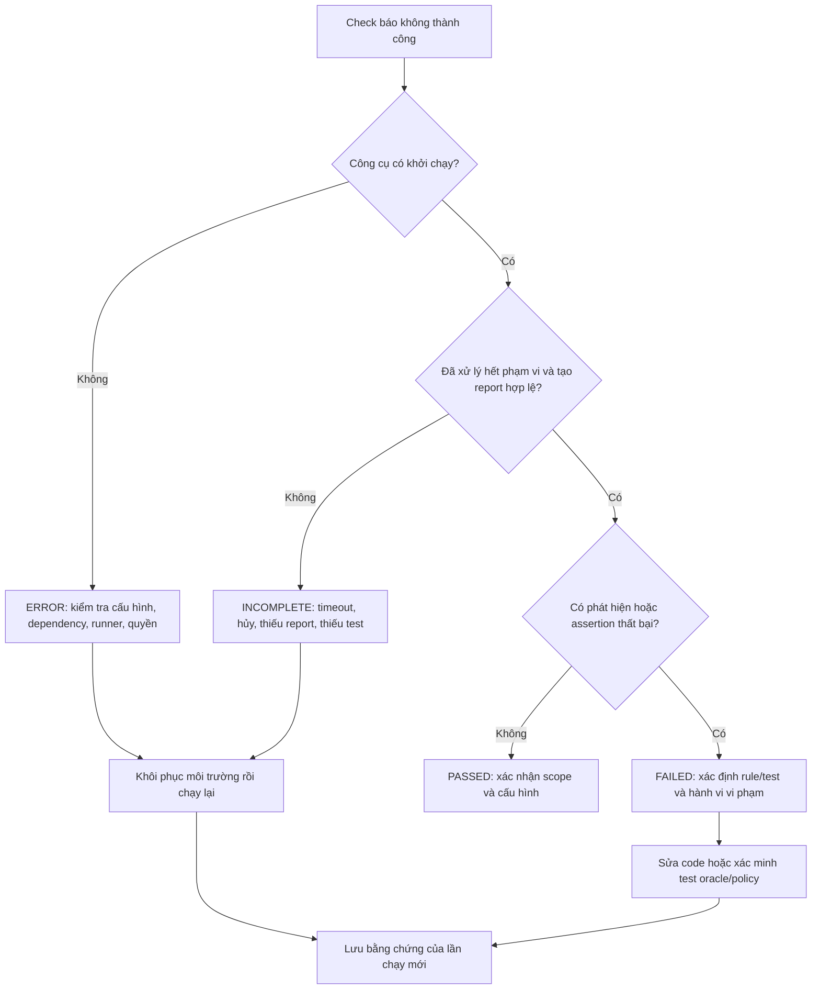

# Phân biệt kiểm tra thất bại với công cụ không chạy được

Một pull request thay đổi cách tính phí giao hàng. CI hiển thị dấu đỏ ở bước kiểm thử. Log cho thấy test đã chạy và assertion tại ngưỡng 500.000 VND thất bại. Đây là **bằng chứng hành vi của mã không đáp ứng kỳ vọng kiểm thử**. Ở một pull request khác, cùng bước CI báo đỏ nhưng Gradle không tải được plugin vì máy chủ kho phụ thuộc không phản hồi. Đây là **vấn đề thực thi công cụ hoặc môi trường**; chưa có bằng chứng để kết luận mã nguồn sai.

Hai tình huống cùng làm pipeline đỏ nhưng cần cách xử lý khác nhau. Nếu coi mọi lỗi CI là lỗi code, nhóm có thể sửa mã không liên quan. Nếu coi mọi lỗi là sự cố hạ tầng, nhóm có thể bỏ qua bug thật. Nếu một bước không chạy được mà vẫn hiển thị như đã đạt, cổng chất lượng tạo cảm giác an toàn giả.

Trong chương **Cổng chất lượng** của module **CODE_QUALITY_FUNDAMENTALS**, bài học này giúp phân biệt **kiểm tra đã chạy và phát hiện vi phạm** với **kiểm tra không thể hoàn tất**, rồi xác định cách một quality gate nên phản hồi. Mục tiêu là giữ mã nguồn **đáng tin cậy, dễ hiểu và dễ thay đổi** bằng bằng chứng rõ ràng, đồng thời giúp nhóm xử lý đúng người và đúng nguyên nhân.

## 1. Dấu đỏ không nói hết nguyên nhân

Một bước CI có thể kết thúc không thành công vì nhiều lý do:

- Test đã chạy và một assertion thất bại.
- Checkstyle đã phân tích mã và phát hiện vi phạm quy ước.
- Bộ phân tích tĩnh hoàn tất nhưng tìm thấy vấn đề bị cấu hình chặn.
- Compiler tìm thấy lỗi cú pháp hoặc kiểu.
- Công cụ không khởi động được vì JDK, cấu hình hoặc plugin không hợp lệ.
- Runner CI mất kết nối tới dependency repository, database hoặc dịch vụ scanner.
- Job hết thời gian trước khi có kết quả.
- Job bị hủy, bị bỏ qua hoặc không được lập lịch.
- Công cụ chạy nhưng không tìm thấy test nào trong phạm vi dự kiến.
- Báo cáo bị thiếu, hỏng hoặc không được thu thập.

Những trường hợp này **không tương đương về ý nghĩa**. Cần biết bước kiểm tra đã thực hiện được công việc của nó chưa, kết quả là gì và dữ liệu nào chứng minh kết quả ấy.

### 1.1. Tách trạng thái thực thi khỏi kết quả kiểm tra

Có hai câu hỏi riêng:

1. **Thực thi:** công cụ có khởi chạy, xử lý đúng phạm vi và tạo ra kết quả hợp lệ không?
2. **Kết quả:** nếu thực thi hoàn tất, nó có phát hiện vi phạm theo chính sách không?

| Tình huống | Thực thi | Kết quả | Cách diễn giải |
| --- | --- | --- | --- |
| Tất cả test chạy và assertion đều đạt | Hoàn tất | PASS | Có bằng chứng test đã chạy đạt |
| Test chạy, một assertion thất bại | Hoàn tất | FAIL | Hành vi được test không đáp ứng kỳ vọng |
| Checkstyle quét đủ tệp, phát hiện rule vi phạm | Hoàn tất | FAIL | Có vi phạm trong phạm vi đã quét |
| Scanner không kết nối được dịch vụ | Không hoàn tất | ERROR | Chưa có kết luận về mã từ lần scan này |
| Gradle không tải được plugin | Không hoàn tất | ERROR | Build không thể thực hiện bước kiểm tra |
| Job timeout trước khi tạo report | Không hoàn tất hoặc chưa rõ | TIMED_OUT / INCONCLUSIVE | Cần điều tra, chưa thể coi là đạt |
| Job bị skip theo điều kiện | Không chạy | SKIPPED | Không có bằng chứng từ bước đó |
| Job bị hủy giữa chừng | Dừng giữa chừng | CANCELLED | Không có kết quả hoàn chỉnh |
| Không tìm thấy test trong module bắt buộc | Công cụ có thể đã chạy | INCONCLUSIVE hoặc FAIL theo policy | Cần kiểm tra discovery, không mặc định PASS |

Một hệ thống CI có thể chỉ hiển thị `success` hoặc `failure` ở cấp job. Khi đó nhóm cần đọc task output, test report, scan report, trạng thái từng bước và log thực thi để phân loại chính xác hơn.

### 1.2. Không có phát hiện khác với không có báo cáo

Hai tình huống sau khác nhau:

- **Không có phát hiện:** công cụ đã chạy thành công trên đúng phạm vi, hoàn tất phân tích và báo không có vi phạm.
- **Không có báo cáo:** công cụ có thể chưa chạy, không quét được tệp, bị timeout hoặc không tải được kết quả.

Chỉ trường hợp đầu mới là bằng chứng “không phát hiện” trong phạm vi đã kiểm tra. Trường hợp thứ hai là **thiếu bằng chứng**.

Ví dụ, dependency scanner trả danh sách rỗng có thể vì đã quét thành công và không tìm thấy lỗ hổng theo cơ sở dữ liệu/rule hiện tại; hoặc vì scanner không truy cập được nguồn advisory nên không tạo report. Cần xác nhận trạng thái hoàn tất và phạm vi scan trước khi diễn giải danh sách rỗng.

## 2. Từ điển trạng thái cho từng bước kiểm tra

Một quality gate rõ ràng cần quy ước trạng thái thống nhất. Các nhãn dưới đây là **mô hình khái niệm**; tên thực tế tùy nền tảng CI và công cụ.

| Trạng thái | Ý nghĩa | Có thể coi là bằng chứng đạt? |
| --- | --- | --- |
| **NOT_STARTED** | Chưa đến lượt chạy | Không |
| **RUNNING** | Đang thực thi | Chưa |
| **PASSED** | Đã chạy hoàn tất, kết quả thỏa rule | Có, trong phạm vi và phiên bản đã ghi |
| **FAILED** | Đã chạy hoàn tất, phát hiện vi phạm hoặc test không đạt | Không |
| **ERROR** | Công cụ không thể thực hiện hoặc tạo kết quả hợp lệ | Không |
| **TIMED_OUT** | Vượt thời gian quy định trước khi hoàn tất | Không; cần điều tra |
| **SKIPPED** | Bị bỏ qua theo điều kiện hoặc cấu hình | Không |
| **CANCELLED** | Bị hủy trước khi có kết quả hoàn chỉnh | Không |
| **INCONCLUSIVE** | Có chạy nhưng thiếu bằng chứng để kết luận, ví dụ không tìm thấy test bắt buộc | Không |
| **WAIVED** | Có ngoại lệ được phê duyệt theo chính sách | Chỉ được chấp nhận trong phạm vi waiver hợp lệ |

### 2.1. Tại sao cần ERROR riêng với FAILED?

Giả sử một bộ test trả kết quả:

```text
Tests run: 125
Failures: 2
Errors: 0
Skipped: 1
BUILD FAILED
```

Đây là một lần chạy có bằng chứng về **hai test thất bại**. Người phát triển cần đọc tên test, assertion, dữ liệu và stack trace để xác định hành vi sai.

Một log khác:

```text
Could not resolve plugin dependency.
Repository connection timed out.
Task :test was not started.
BUILD FAILED
```

Ở đây task test **chưa chạy**. Không có cơ sở nói 125 test thất bại hoặc mã không đúng. Build vẫn thất bại ở cấp pipeline, nhưng nguyên nhân thuộc bước phân giải dependency hoặc môi trường.

Nếu gộp cả hai thành một nhãn “test failed”, thống kê lỗi code sẽ sai và người nhận việc cũng có thể là sai nhóm.

### 2.2. Trạng thái của bước và trạng thái của quality gate khác nhau

Một bước kiểm tra có trạng thái riêng. Cổng chất lượng là **chính sách quyết định một thay đổi có đủ bằng chứng để đi tiếp hay không**.

Ví dụ:

| Kiểm tra | Trạng thái | Có bắt buộc? |
| --- | --- | --- |
| Formatter check | PASSED | Có |
| Unit tests | PASSED | Có |
| Static analysis | FAILED | Có |
| Database integration | ERROR | Có |
| Performance smoke test | SKIPPED | Không áp dụng cho PR này theo policy |

Cổng có thể báo **BLOCKED** vì static analysis phát hiện vi phạm, đồng thời báo **INCOMPLETE** vì integration test không chạy được. Việc sửa vi phạm tĩnh không tự giải quyết lỗi môi trường DB. Cả hai vấn đề phải được ghi nhận riêng.

## 3. Quyết định quality gate: PASS, BLOCKED hay chưa đủ bằng chứng?

Một cổng chất lượng không chỉ là phép đếm dấu xanh. Nó là **chính sách quyết định một thay đổi có đủ bằng chứng để đi tiếp hay không**.

Có thể dùng ba kết quả tổng hợp:

- **PASS:** tất cả bước bắt buộc đã chạy hoàn tất và đạt; các waiver (nếu có) hợp lệ.
- **BLOCKED:** có ít nhất một bước bắt buộc đã chạy và xác nhận vi phạm theo chính sách.
- **INCOMPLETE / ERROR:** có bước bắt buộc không chạy, bị hủy, timeout hoặc không tạo được bằng chứng đáng tin; chưa thể quyết định đạt.

Tên trạng thái có thể khác nhau. Điều quan trọng là không hiển thị PASS khi một kiểm tra bắt buộc chưa có kết quả.

### 3.1. Bảng quyết định tổng hợp

| Các bước bắt buộc | Kết quả gate phù hợp | Lý do |
| --- | --- | --- |
| Tất cả PASSED | PASS | Có đủ bằng chứng theo chính sách |
| Ít nhất một FAILED, không có bước chưa chạy | BLOCKED | Đã xác nhận vi phạm |
| Một FAILED và một ERROR | BLOCKED kèm INCOMPLETE | Có vi phạm thật và còn thiếu một bằng chứng khác |
| Không FAILED nhưng có ERROR | INCOMPLETE / ERROR | Không được suy ra đạt từ các bước còn lại |
| Không FAILED nhưng có TIMED_OUT | INCOMPLETE / ERROR | Chưa biết kiểm tra có hoàn tất không |
| Một bước bắt buộc SKIPPED | INCOMPLETE / ERROR | Không có bằng chứng cho yêu cầu bắt buộc |
| Một bước không bắt buộc SKIPPED theo policy | Có thể PASS | Việc bỏ qua đã được cho phép rõ ràng |
| Một bước được WAIVED hợp lệ | Có thể PASS_WITH_WAIVER hoặc PASS có chú thích | Ngoại lệ có phạm vi, người duyệt và hạn hiệu lực |
| Không tìm thấy test bắt buộc | INCOMPLETE hoặc BLOCKED tùy policy | Có thể do discovery sai hoặc thiếu test |

### 3.2. Vì sao kiểm tra quan trọng thường cần fail-closed?

Nếu bước scan bảo mật bắt buộc không thể chạy, một lựa chọn an toàn là **không cho gate báo PASS** cho tới khi có bằng chứng thay thế hoặc waiver hợp lệ. Đây là cách tiếp cận *fail-closed*: thiếu khả năng xác minh không được diễn giải như an toàn.

Tuy nhiên, fail-closed **không có nghĩa gán lỗi code cho người phát triển**. Gate có thể giữ trạng thái INCOMPLETE, giao việc khôi phục cho chủ sở hữu hạ tầng CI hoặc dịch vụ scanner, và giữ PR chờ bằng chứng.

Với bước ít rủi ro hơn, nhóm có thể cho phép bỏ qua tạm thời trong phạm vi cụ thể. Quyết định đó cần nêu:

- Bước nào được miễn và vì sao.
- Phạm vi PR/module/branch nào.
- Người có thẩm quyền chấp thuận.
- Thời hạn hết hiệu lực.
- Bằng chứng thay thế hoặc kế hoạch khôi phục.
- Rủi ro được chấp nhận.

Không nên dùng một thiết lập `continue-on-error` chung cho mọi bước rồi coi pipeline xanh là gate đạt.

## 4. Ví dụ 1: phân biệt test thất bại với test không chạy trong Gradle

Giả sử dự án Java dùng Gradle Wrapper và JUnit 5.

### 4.1. Trường hợp test đã chạy và assertion thất bại

Log giả định:

```text
> Task :test

ShippingFeePolicyTest > memberAtThresholdGetsFreeShipping FAILED
    org.opentest4j.AssertionFailedError:
    expected: <0>
     but was: <15000>

Tests run: 48, Failures: 1, Errors: 0, Skipped: 0

> Task :test FAILED
BUILD FAILED
```

Đây là **FAILED** vì test đã thực thi và cho kết quả khác kỳ vọng. Hướng điều tra:

1. Đọc hợp đồng: đúng ngưỡng có được miễn phí không?
2. Xem test oracle được xây dựng từ đặc tả nào.
3. Kiểm tra giá trị đầu vào thực tế, đơn vị và cách tính sau voucher.
4. Tái hiện trên cùng phiên bản JDK, dependency và dữ liệu.
5. Sửa mã hoặc cập nhật đặc tả/test nếu nguồn kỳ vọng đã thay đổi.

Không nên xóa test chỉ để build xanh. Nếu test oracle sai, phải có căn cứ độc lập để sửa kỳ vọng.

### 4.2. Trường hợp Gradle không khởi chạy test

Log giả định:

```text
FAILURE: Build failed with an exception.

* What went wrong:
Could not resolve all files for configuration ':classpath'.
Could not GET plugin artifact from configured repository.
Connection timed out.

BUILD FAILED
Task :test was not executed.
```

Đây là **ERROR/INCOMPLETE**, không phải bằng chứng unit test thất bại. Cần xem:

- Kết nối CI tới repository và DNS/proxy.
- Credential, token hoặc quyền truy cập.
- Dependency cache và trạng thái mirror.
- Plugin/version có tồn tại và tương thích không.
- Job có chạy đúng môi trường và JDK được yêu cầu không.

Nếu lỗi chỉ xảy ra trên runner CI nhưng máy phát triển chạy được, vẫn không nên mặc định “CI sai”. Phải so sánh cấu hình và dependency lock/version. Mục tiêu là xác định vì sao **môi trường kiểm tra không tái hiện được**.

### 4.3. Một số lệnh chẩn đoán hữu ích

Các lệnh sau là ví dụ Gradle; chỉ dùng khi dự án có cấu hình tương ứng:

```bash
# Chạy test và hiển thị log chi tiết hơn
./gradlew test --info

# Chạy một lớp test cụ thể
./gradlew test --tests "com.example.shipping.ShippingFeePolicyTest"

# Chạy lại task test sau khi xác minh nguyên nhân transient
./gradlew test --rerun-tasks

# Kiểm tra các task được build khai báo
./gradlew tasks --all
```

Trên Windows có thể dùng `gradlew.bat`. `--rerun-tasks` yêu cầu Gradle thực hiện lại task thay vì dựa vào trạng thái up-to-date; nó **không tự sửa lỗi** và không nên dùng lặp lại vô hạn để che một test không ổn định.

Lệnh `--info` giúp có thêm chi tiết, nhưng log có thể chứa đường dẫn nội bộ hoặc thông tin nhạy cảm tùy plugin. Trước khi chia sẻ ra ngoài, cần loại bỏ token, password và dữ liệu bí mật.

## 5. Ví dụ 2: Checkstyle tìm thấy vi phạm hay không thể chạy?

Hai trường hợp có vẻ giống nhau nếu chỉ nhìn dấu đỏ ở job style.

### 5.1. Checkstyle chạy và báo vi phạm

```text
[ant:checkstyle] [WARN] ShippingQuotePolicy.java:24:
    Variable 'fee' must match pattern '^[a-z][a-zA-Z0-9]*$'.
Checkstyle violations found: 1
BUILD FAILED
```

Nếu rule đang được áp dụng là bắt buộc, đây là **FAILED**: công cụ đã quét và phát hiện tên không tuân quy ước. Có thể đổi tên, hoặc review xem rule có ngoại lệ được phép không.

### 5.2. Checkstyle không đọc được cấu hình

```text
Could not load configuration:
config/checkstyle/checkstyle.xml
Resource not found.
Task :checkstyleMain FAILED
No source files were analyzed.
```

Đây là **ERROR**, vì không có phân tích mã hợp lệ. Không thể nói “0 vi phạm”. Cần kiểm tra:

- Tệp cấu hình có được commit và nằm đúng đường dẫn?
- Build đang chạy ở đúng working directory?
- Cấu hình được tham chiếu theo đường dẫn tương đối hay tuyệt đối?
- Phiên bản plugin có tương thích với cấu hình?
- Tệp có quyền đọc và encoding phù hợp không?

### 5.3. Không tìm thấy file có thể là PASS hay INCONCLUSIVE?

Điều này phụ thuộc phạm vi dự kiến:

- Nếu module được phép không có mã Java và policy cho phép, scan hoàn tất với **0 tệp trong phạm vi hợp lệ** có thể là PASS kèm số lượng tệp bằng 0.
- Nếu module bắt buộc phải có mã Java mà glob sai nên công cụ không quét tệp nào, kết quả phải là INCONCLUSIVE/ERROR hoặc FAIL theo policy.
- Nếu một thư mục bị loại trừ có chủ ý, cần ghi rõ phạm vi loại trừ và lý do.

**Phạm vi quét là một phần của bằng chứng.** “Không có vi phạm” chỉ có ý nghĩa khi nhóm biết công cụ đã xem những gì.

## 6. Ví dụ 3: scanner không tìm thấy lỗ hổng hay không truy cập được nguồn dữ liệu?

Một dependency scanner có thể hoàn tất thành công và báo:

```text
Dependencies scanned: 86
Confirmed findings above configured severity: 0
Scan status: completed
```

Đây là bằng chứng không tìm thấy phát hiện vượt ngưỡng **theo phiên bản scanner, rule, advisory database và dependency scope đã dùng**. Nó không chứng minh không có lỗ hổng nào tồn tại.

Một log khác:

```text
Failed to update vulnerability database.
Authentication to advisory service failed.
Scan aborted before dependency analysis.
```

Đây là **ERROR**. Danh sách phát hiện rỗng nếu có không thể được coi là “0 lỗ hổng”, bởi scan chưa hoàn tất.

Người review gate nên xem ít nhất:

- Scan có kết thúc với trạng thái hoàn tất không?
- Có bao nhiêu dependency được phân tích?
- Có dependency nào bị bỏ qua hoặc không phân giải được?
- Database/rule version và thời điểm cập nhật?
- Mức severity nào đang chặn gate?
- Có exception/waiver nào, phạm vi và hạn hiệu lực?
- Báo cáo có gắn với đúng commit và artifact chuẩn bị phát hành không?

## 7. Timeout: kiểm tra chậm hay môi trường bị treo?

Timeout là trường hợp dễ phân loại nhầm. Một test chạy 15 phút thay vì 2 phút có thể do:

- Một vòng lặp hoặc truy vấn gây suy giảm hiệu năng sau thay đổi.
- Test chờ deadlock hoặc race.
- Database thử đang quá tải.
- Runner CI bị thiếu CPU/RAM.
- Dịch vụ phụ thuộc không phản hồi.
- Timeout cấu hình thấp hơn thời gian hợp lệ của bộ test.

Không nên tự động gán mọi timeout thành lỗi hạ tầng, cũng không nên gán mọi timeout thành lỗi code.

### 7.1. Dùng bằng chứng để phân biệt

| Dấu hiệu | Giả thuyết cần kiểm tra | Bằng chứng tiếp theo |
| --- | --- | --- |
| Timeout xuất hiện sau thay đổi truy vấn, lặp lại ở runner ổn định | Có thể là regression hiệu năng | So execution plan, số dòng, profiling và baseline |
| Nhiều job không liên quan cùng timeout trên một runner | Có thể là vấn đề runner | CPU, RAM, disk, network và lịch sử runner |
| Test chờ một latch không bao giờ được giải phóng | Có thể là lỗi đồng thời hoặc setup test | Thread dump, timeout của latch, đường cleanup |
| Test chờ database không sẵn sàng | Có thể là dependency/fixture | Health check, log container, thời điểm khởi động |
| Chỉ một lần timeout, các lần sau đạt | Có thể là nhiễu transient hoặc race hiếm | Giữ log lần lỗi, lặp có kiểm soát, không xóa dấu vết |
| Timeout chỉ xảy ra với dữ liệu lớn | Có thể là vấn đề độ phức tạp/tài nguyên | So workload, kích thước payload và profiling |

### 7.2. Không tăng timeout để che triệu chứng

Nếu một test trước đây chạy 3 giây, nay mất 90 giây, nâng timeout từ 60 lên 180 giây có thể làm pipeline xanh nhưng che regression. Cần xác định **mốc thời gian mong đợi** và workload. Tăng timeout có thể hợp lý nếu môi trường mới chậm hơn có căn cứ, nhưng phải ghi lý do và xem guardrail hiệu năng liên quan.

### 7.3. Test flaky và retry

Một test lúc xanh lúc đỏ có thể do race, dữ liệu chia sẻ, đồng hồ thật hoặc dependency không ổn định. Chạy lại một lần giúp thu thập bằng chứng, nhưng **lần chạy lại xanh không xóa kết quả thất bại ban đầu**.

Chính sách tốt cần:

- Giữ report và log của lần chạy đầu.
- Ghi rõ số lần retry và kết quả từng lần.
- Phân loại test flaky và giao chủ sở hữu khắc phục.
- Đặt thời hạn xử lý test bị quarantine.
- Không cho phép retry vô hạn để biến mọi job thành xanh.
- Với test quan trọng, quy định kết quả không ổn định vẫn làm gate INCOMPLETE/BLOCKED cho tới khi có đánh giá.

## 8. Chẩn đoán lỗi theo cây quyết định

Khi một bước gate báo đỏ, có thể đi theo trình tự:



Cây này giúp tránh bước nhảy từ **“job đỏ”** sang **“code sai”**. Tuy nhiên, nếu công cụ không chạy vì cấu hình trong chính PR vừa sửa, trách nhiệm có thể thuộc thay đổi code/build configuration. Phân loại ERROR nói về **loại kết quả kiểm tra**, không tự động miễn trách nhiệm cho thay đổi.

## 9. Chẩn đoán bằng chứng: log, report, exit code và phạm vi

Một exit code khác 0 chỉ cho biết lệnh kết thúc theo cách công cụ xem là không thành công. Nguyên nhân cụ thể phụ thuộc công cụ và cấu hình.

| Bằng chứng | Có thể cho biết | Không nên suy diễn |
| --- | --- | --- |
| Exit code `1` từ Gradle | Một hoặc nhiều task/build thất bại | Chắc chắn unit test assertion sai |
| Test XML report có `<failure>` | Test cụ thể có assertion failure | Toàn bộ code có bug ngoài test đó |
| Test XML report có `<error>` | Test có lỗi thực thi, fixture hoặc exception không xử lý | Chắc chắn assertion mong đợi sai |
| Checkstyle report có vi phạm và file/dòng | Rule đã phát hiện vi phạm | Toàn bộ module có chất lượng thấp |
| Không có report | Có thể chưa chạy, bị ngắt hoặc không xuất report | Không có phát hiện |
| Scanner report hoàn tất, scope rõ | Kết quả scan theo rule/database đã dùng | Không có lỗ hổng nào trong hệ thống |
| Log `Task was skipped` | Task không chạy theo điều kiện | Task đạt |
| Log `No tests found` | Discovery không tìm thấy test | Bộ test đã đạt |

### 9.1. Mỗi check nên có “hợp đồng thực thi”

Để tránh mơ hồ, mô tả một check nên ghi:

- **Mục đích:** rủi ro hoặc quy tắc được kiểm tra.
- **Lệnh/cấu hình:** task, plugin, phiên bản, rule set.
- **Phạm vi:** module, tệp, test suite, dependency hoặc môi trường.
- **Điều kiện hoàn tất:** thế nào là đã chạy đủ và report hợp lệ.
- **Điều kiện PASS/FAIL:** finding nào chặn gate, finding nào chỉ cảnh báo.
- **Điều kiện ERROR:** thiếu credential, dependency, runner hoặc report.
- **Timeout và retry:** giới hạn, số lần, cách giữ kết quả ban đầu.
- **Chủ sở hữu:** nhóm xử lý lỗi code và nhóm xử lý hạ tầng.
- **Ngoại lệ:** ai phê duyệt, phạm vi, hạn sử dụng và bằng chứng thay thế.

Một check có hợp đồng thực thi rõ giúp người phát triển biết **cần sửa mã, sửa cấu hình hay khôi phục môi trường**.

## 10. Ví dụ Java: biểu diễn kết quả kiểm tra và quyết định gate

Để tránh gộp mọi trạng thái thành một Boolean, có thể biểu diễn trạng thái của từng bước bằng enum. Đây là **mô hình học tập**, không phải API của Gradle hay một nền tảng CI cụ thể.

Tệp `CheckResult.java`:

```java
package com.example.qualitygate;

import java.util.Objects;

public record CheckResult(
        String name,
        boolean required,
        Status status,
        String evidenceReference) {

    public CheckResult {
        Objects.requireNonNull(name, "name");
        Objects.requireNonNull(status, "status");
        if (name.isBlank()) {
            throw new IllegalArgumentException("name must not be blank");
        }
    }

    public enum Status {
        NOT_STARTED,
        RUNNING,
        PASSED,
        FAILED,
        ERROR,
        TIMED_OUT,
        SKIPPED,
        CANCELLED,
        INCONCLUSIVE,
        WAIVED
    }
}
```

Một quyết định tổng hợp đơn giản:

```java
package com.example.qualitygate;

import java.util.List;
import java.util.Objects;

public final class QualityGate {
    private QualityGate() {}

    public enum Decision {
        PASS,
        BLOCKED,
        INCOMPLETE
    }

    public static Decision evaluate(List<CheckResult> checks) {
        Objects.requireNonNull(checks, "checks");

        boolean hasRequiredFailure = false;
        boolean hasRequiredIncomplete = false;

        for (CheckResult check : checks) {
            Objects.requireNonNull(check, "check");

            if (!check.required()) {
                continue;
            }

            switch (check.status()) {
                case FAILED -> hasRequiredFailure = true;
                case PASSED, WAIVED -> {
                    // WAIVED chỉ được tạo sau quy trình phê duyệt hợp lệ.
                }
                case NOT_STARTED, RUNNING, ERROR, TIMED_OUT,
                     SKIPPED, CANCELLED, INCONCLUSIVE ->
                        hasRequiredIncomplete = true;
            }
        }

        if (hasRequiredFailure) {
            return Decision.BLOCKED;
        }
        if (hasRequiredIncomplete) {
            return Decision.INCOMPLETE;
        }
        return Decision.PASS;
    }
}
```

Mô hình này cố ý giữ một số quy tắc:

- Check không bắt buộc không ảnh hưởng quyết định tổng hợp.
- Một check bắt buộc FAILED làm gate BLOCKED.
- Không có failure nhưng check bắt buộc chưa có bằng chứng hoàn chỉnh làm gate INCOMPLETE.
- Chỉ PASSED hoặc WAIVED mới được coi là hoàn tất theo mô hình này.

**Giới hạn quan trọng:** mã minh họa chưa xác thực waiver, người phê duyệt, hạn hiệu lực, trạng thái WAIVED có được dùng cho check cụ thể không, hay một check có được phép optional không. Hệ thống thật phải kiểm tra các điều kiện đó ở lớp chính sách trước khi tạo kết quả WAIVED. Không nên để bất kỳ job nào tự đổi trạng thái thành WAIVED chỉ bằng cách thêm một nhãn.

### 10.1. Kiểm thử quy tắc gate

Tệp `QualityGateTest.java` dùng JUnit 5:

```java
package com.example.qualitygate;

import static org.junit.jupiter.api.Assertions.assertEquals;

import java.util.List;
import org.junit.jupiter.api.Test;

class QualityGateTest {
    private static CheckResult check(
            String name,
            boolean required,
            CheckResult.Status status) {
        return new CheckResult(name, required, status, "report/" + name);
    }

    @Test
    void passesWhenAllRequiredChecksPassed() {
        var checks = List.of(
                check("format", true, CheckResult.Status.PASSED),
                check("unit", true, CheckResult.Status.PASSED),
                check("security", true, CheckResult.Status.PASSED));

        assertEquals(QualityGate.Decision.PASS,
                QualityGate.evaluate(checks));
    }

    @Test
    void blocksWhenRequiredCheckFoundViolation() {
        var checks = List.of(
                check("unit", true, CheckResult.Status.PASSED),
                check("style", true, CheckResult.Status.FAILED));

        assertEquals(QualityGate.Decision.BLOCKED,
                QualityGate.evaluate(checks));
    }

    @Test
    void incompleteWhenRequiredToolCouldNotRun() {
        var checks = List.of(
                check("unit", true, CheckResult.Status.PASSED),
                check("dependency-scan", true, CheckResult.Status.ERROR));

        assertEquals(QualityGate.Decision.INCOMPLETE,
                QualityGate.evaluate(checks));
    }

    @Test
    void optionalSkippedCheckDoesNotBlockGate() {
        var checks = List.of(
                check("unit", true, CheckResult.Status.PASSED),
                check("load-test", false, CheckResult.Status.SKIPPED));

        assertEquals(QualityGate.Decision.PASS,
                QualityGate.evaluate(checks));
    }

    @Test
    void failureAndInfrastructureErrorRemainDistinctInDecision() {
        var checks = List.of(
                check("unit", true, CheckResult.Status.FAILED),
                check("database-integration", true,
                        CheckResult.Status.ERROR));

        assertEquals(QualityGate.Decision.BLOCKED,
                QualityGate.evaluate(checks));
    }
}
```

Test cuối chỉ xác nhận quyết định tổng hợp là BLOCKED; một báo cáo chi tiết tốt vẫn phải giữ cả **finding đã xác nhận** và **check bị lỗi thực thi** để không làm mất nguyên nhân thứ hai. Có thể bổ sung một cấu trúc kết quả giàu thông tin hơn để hiển thị nhiều trạng thái đồng thời, thay vì chỉ trả một enum.

## 11. Waiver và bỏ qua kiểm tra có kiểm soát

Có lúc một check không thể chạy ngay: dịch vụ scanner bảo trì, runner mất khả năng kết nối hoặc test môi trường chưa được dựng. Với rủi ro thấp, nhóm có thể cần cơ chế ngoại lệ tạm thời. Với rủi ro cao, việc thiếu bằng chứng có thể buộc PR chờ.

**Waiver không phải cách biến lỗi thành PASS.** Nó là một quyết định có trách nhiệm chấp nhận rủi ro còn lại trong phạm vi cụ thể.

Một bản ghi waiver nên có:

| Trường | Ví dụ minh họa |
| --- | --- |
| Check được miễn | `dependency-scan` |
| Lý do | Dịch vụ advisory đang bảo trì, scan chưa thể hoàn tất |
| Phạm vi | Một PR/commit hoặc branch cụ thể |
| Người phê duyệt | Người có quyền theo chính sách bảo mật |
| Hạn hiệu lực | Một mốc ngày/giờ rõ ràng |
| Bằng chứng thay thế | Report scan gần nhất, lockfile và review thay đổi dependency |
| Việc cần làm tiếp | Chạy lại scan khi dịch vụ khôi phục |
| Điều kiện thu hồi | Phát hiện dependency mới hoặc waiver hết hạn |

Waiver phải **hẹp và có thời hạn**. Không nên dùng một ngoại lệ vô thời hạn cho toàn repository chỉ vì một runner gặp sự cố trong một buổi.

### 11.1. Không phải mọi bước SKIPPED đều là waiver

Có ba tình huống khác nhau:

- **Không áp dụng theo policy:** ví dụ load test chuyên sâu chỉ chạy trước phát hành, không bắt buộc ở PR thường.
- **Bị bỏ qua ngoài dự kiến:** điều kiện job sai, tag không khớp hoặc pipeline cấu hình thiếu.
- **Được miễn có phê duyệt:** có waiver với người chịu trách nhiệm và hạn hiệu lực.

Chỉ tình huống đầu là bỏ qua bình thường. Tình huống thứ hai là lỗi pipeline hoặc INCOMPLETE. Tình huống thứ ba là quyết định chấp nhận rủi ro có thể kiểm tra lại.

## 12. Phân công xử lý theo loại lỗi

Khi gate phân loại đúng, việc giao xử lý cũng chính xác hơn.

| Loại kết quả | Chủ sở hữu thường phù hợp | Hành động |
| --- | --- | --- |
| Test assertion thất bại do hành vi code | Nhóm phát triển tính năng | Kiểm tra hợp đồng, sửa code/test và thêm regression |
| Checkstyle/formatter phát hiện vi phạm | Tác giả PR hoặc nhóm duy trì quy ước | Sửa style hoặc xin ngoại lệ đúng policy |
| Static analyzer finding đã xác nhận | Chủ sở hữu mã và reviewer chuyên môn | Đánh giá severity, sửa hoặc waiver |
| Compiler lỗi do source | Nhóm phát triển | Sửa kiểu, API hoặc cú pháp |
| Plugin/dependency repository không truy cập được | Nhóm build/CI hoặc hạ tầng | Khôi phục repository, cache, credential và runner |
| Scanner không truy cập advisory service | Nhóm bảo mật/hạ tầng công cụ | Khôi phục nguồn dữ liệu, chạy lại scan |
| Database integration không khởi động | Nhóm CI/test infrastructure cùng nhóm sở hữu DB test | Kiểm tra container, migration, credential và health |
| Timeout có dấu hiệu regression | Nhóm phát triển + người phụ trách hiệu năng | Profiling, so baseline, xác định tải và môi trường |
| Test flaky | Chủ sở hữu test và nhóm liên quan | Tìm race/timing, cô lập dữ liệu, sửa đồng bộ |
| Không có report hoặc test discovery rỗng | Chủ sở hữu build/test configuration | Kiểm tra glob, task wiring và điều kiện bắt buộc |

Bảng này nói về **chủ sở hữu thường phù hợp**, không phải quy định rằng chỉ một nhóm được phép điều tra. Một lỗi DB integration có thể do migration trong PR; nhóm CI và nhóm tính năng cần phối hợp dựa trên log và thay đổi thực tế.

## 13. Một quy trình xử lý khi quality gate báo đỏ

### Bước 1 — Giữ nguyên bằng chứng của lần chạy đầu

Lưu log, test report, scan report, commit SHA, phiên bản JDK, Gradle/plugin và cấu hình. Không xóa dấu vết bằng cách chạy lại ngay rồi chỉ giữ lần xanh.

### Bước 2 — Xác định bước đã thực thi đến đâu

Hỏi: tool đã khởi chạy chưa? Đã quét đúng phạm vi chưa? Có test nào thực sự chạy không? Có report hợp lệ không? Job timeout hay bị cancel?

### Bước 3 — Phân loại FAILED, ERROR, INCOMPLETE

Nếu có finding/test failure, đọc bằng chứng của nó. Nếu tool không chạy, xác định cấu hình, runner, dependency, quyền và dịch vụ ngoài. Nếu trạng thái chưa rõ, giữ INCOMPLETE cho tới khi đủ thông tin.

### Bước 4 — Giao đúng chủ sở hữu

Không yêu cầu tác giả đổi logic chỉ để chữa lỗi repository timeout. Cũng không giao cho hạ tầng sửa assertion sai ở một ca nghiệp vụ. Nếu cả hai cùng tồn tại, mở hai việc có liên kết.

### Bước 5 — Khôi phục và chạy lại có kiểm soát

Sau khi sửa môi trường, chạy lại **cùng commit và cùng cấu hình** nếu có thể so sánh. Nếu đã đổi mã, ghi rõ commit mới. Với test flaky, giữ kết quả ban đầu và số lần retry.

### Bước 6 — Xác minh báo cáo hoàn chỉnh

Đảm bảo check bắt buộc đã hoàn tất, report đúng commit, đúng phạm vi và đúng phiên bản. Không coi việc job không còn đỏ là đủ nếu test đã bị skip hoặc bị tắt.

### Bước 7 — Đóng vấn đề theo bằng chứng

Ghi rõ đã sửa code, sửa cấu hình, khôi phục môi trường hay chấp thuận waiver. Nếu sự cố có khả năng tái diễn, bổ sung health check, cảnh báo hoặc kiểm thử pipeline.

## 14. Những chỉ số giúp đánh giá độ tin cậy của quality gate

Chính **hệ thống kiểm tra** cũng cần được theo dõi. Một gate thường đỏ vì runner lỗi sẽ làm nhóm mất niềm tin và tìm cách bỏ qua. Một gate luôn xanh vì các bước quan trọng bị skip cũng nguy hiểm.

| Chỉ số vận hành gate | Câu hỏi cần trả lời | Cẩn trọng khi diễn giải |
| --- | --- | --- |
| Tỷ lệ check hoàn tất | Bao nhiêu lần chạy có kết quả hợp lệ? | Tách theo check và môi trường |
| Tỷ lệ ERROR/TIMED_OUT | Tool hoặc hạ tầng thường không chạy được đến đâu? | Không tính chúng như lỗi code |
| Tỷ lệ FAILED đã xác nhận | Có bao nhiêu lần phát hiện vi phạm/test thất bại? | Tách severity, loại rule và số PR |
| Tỷ lệ flaky test | Test có kết quả không ổn định thế nào? | Giữ lần chạy đầu và lần retry |
| Thời gian phản hồi gate | Người phát triển chờ bao lâu? | Phân biệt thời gian xếp hàng và thời gian chạy |
| Tỷ lệ waiver | Có bao nhiêu ngoại lệ được dùng? | Nhiều waiver có thể cho thấy rule hoặc hạ tầng có vấn đề |
| Tỷ lệ không tìm thấy test | Có task nào chạy mà không thực thi test dự kiến? | Kiểm tra test discovery và scope |
| Tỷ lệ report thiếu/hỏng | Kết quả có truy vết được không? | Không suy ra không có finding |

Không nên tối ưu gate bằng cách **giảm tỷ lệ đỏ** đơn thuần. Nếu giảm đỏ bằng cách tắt scanner, tăng retry vô hạn hoặc bỏ test, độ tin cậy thực tế giảm.

### 14.1. Cải thiện độ tin cậy của chính pipeline

- Pin phiên bản JDK, build tool và plugin theo chính sách dự án.
- Cache dependency có kiểm soát, không để cache hỏng làm kết quả mơ hồ.
- Health check dịch vụ DB, broker, scanner trước bước kiểm tra tương ứng.
- Tạo report ngay cả khi test thất bại và lưu artifact theo commit.
- Đặt timeout hợp lý theo baseline; ghi rõ lý do khi thay đổi.
- Phân biệt job không áp dụng với job bị skip do cấu hình lỗi.
- Có chủ sở hữu và SLA khôi phục cho các dịch vụ CI quan trọng.
- Kiểm thử cấu hình pipeline khi thay đổi task, glob hoặc điều kiện chạy.

## 15. Những ngộ nhận thường gặp

| Ngộ nhận | Vì sao không đúng | Cách xử lý phù hợp |
| --- | --- | --- |
| “CI đỏ nghĩa là code sai.” | Job có thể chưa chạy được | Kiểm tra execution state và report |
| “Không có report nghĩa là không có finding.” | Tool có thể chưa hoàn tất hoặc không xuất report | Phân loại ERROR/INCOMPLETE |
| “Exit code 1 luôn là test fail.” | Build tool có thể thất bại ở bước resolve/configure/compile | Đọc task và test report cụ thể |
| “Scanner trả danh sách rỗng nghĩa là an toàn.” | Scan có thể bị abort hoặc scope rỗng | Xác nhận completed, scope và database |
| “Retry xanh thì bỏ qua lần đỏ.” | Có thể che flaky/race hoặc lỗi transient | Giữ cả hai kết quả, điều tra nguyên nhân |
| “Tăng timeout luôn giải quyết vấn đề.” | Có thể che regression hoặc deadlock | So baseline, thread dump, tài nguyên và workload |
| “SKIPPED cũng gần như PASSED.” | Không có bằng chứng được tạo | Chỉ chấp nhận nếu policy nói rõ không áp dụng |
| “Có continue-on-error thì vẫn có quality gate.” | Lỗi có thể bị nuốt mà không phân loại | Tổng hợp trạng thái và điều kiện chặn rõ |
| “Waiver là cách làm xanh pipeline.” | Waiver chấp nhận rủi ro còn lại, không chứng minh đạt | Ghi người duyệt, phạm vi và hạn hiệu lực |
| “Mọi lỗi môi trường không liên quan tới PR.” | PR có thể làm sai cấu hình build hoặc dependency | Xem thay đổi và nguyên nhân gốc |
| “Không tìm thấy test là không có test fail.” | Test discovery có thể bị cấu hình sai | Xác nhận số test chạy theo phạm vi mong đợi |
| “Một gate xanh chứng minh sản phẩm an toàn.” | Gate chỉ bao phủ rule, dữ liệu và môi trường đã định nghĩa | Nêu phạm vi và giới hạn bằng chứng |

## 16. Bài tập vận dụng

Một pull request thay đổi module thanh toán Java. Kết quả CI giả định:

| Job | Kết quả hiển thị | Chi tiết |
| --- | --- | --- |
| Formatter | PASSED | 42 tệp được kiểm tra |
| Unit test | FAILED | 86 test chạy, 1 assertion fail ở ca hoàn tiền đúng hạn |
| Checkstyle | ERROR | Không đọc được `checkstyle.xml`, 0 tệp được phân tích |
| Database integration | TIMED_OUT | Database container chưa healthy sau thời gian chờ |
| Dependency scan | PASSED | 74 dependency được scan, không có finding trên ngưỡng chặn |
| E2E | SKIPPED | Điều kiện job chỉ chạy trên branch phát hành |

Hãy thực hiện:

1. **Phân loại từng job:** đâu là bằng chứng code/test thất bại, đâu là công cụ không chạy được, đâu là không áp dụng theo policy và đâu cần điều tra thêm?
2. **Đánh giá gate:** PR có thể PASS không? Nêu các kết quả tổng hợp cần hiển thị, kể cả khi có nhiều loại trạng thái cùng tồn tại.
3. **Xử lý unit test:** cần đọc những thông tin nào để biết assertion fail là bug hay test oracle đã lỗi thời?
4. **Xử lý Checkstyle:** liệt kê nguyên nhân cấu hình có thể khiến tệp không đọc được và cách xác minh phạm vi quét sau khi sửa.
5. **Xử lý database timeout:** cần kiểm tra health check, log container, migration, credential và runner thế nào để phân biệt lỗi hạ tầng với regression do PR?
6. **Đánh giá dependency scan:** vì sao kết quả PASSED vẫn chỉ có ý nghĩa trong phạm vi 74 dependency và rule hiện tại?
7. **Quyết định về E2E:** SKIPPED có hợp lệ cho loại branch này không? Nếu đây là nhánh bắt buộc E2E thì gate cần phản hồi thế nào?
8. **Viết báo cáo ngắn:** phân công ai xử lý từng vấn đề và nêu bằng chứng cần có trước khi gate được coi là hoàn tất.

**Hướng tự đối chiếu:** unit test đã chạy và có assertion fail nên là FAILED; Checkstyle không phân tích được tệp nên là ERROR; database hết thời gian chờ nên là TIMED_OUT; E2E chỉ được chấp nhận SKIPPED nếu policy nói rõ branch này không yêu cầu chạy. Dependency scan có bằng chứng hoàn tất nhưng chỉ bao phủ 74 dependency và ngưỡng đã cấu hình. Gate không thể PASS khi một check bắt buộc chưa có bằng chứng. Việc sửa assertion không tự giải quyết Checkstyle và DB; các vấn đề phải được theo dõi riêng.

## 17. Ghi nhớ

- **FAILED** nghĩa là kiểm tra đã chạy và phát hiện vi phạm; **ERROR** nghĩa là công cụ không thể hoàn tất việc kiểm tra.
- **TIMED_OUT, SKIPPED, CANCELLED và INCONCLUSIVE** không phải PASS; phải hiểu lý do và phạm vi.
- **Không có finding** chỉ có ý nghĩa khi công cụ hoàn tất trên đúng phạm vi và tạo report hợp lệ.
- **Quality gate tổng hợp các check bắt buộc**; thiếu bằng chứng quan trọng thì không được tuyên bố đạt.
- **Fail-closed không đồng nghĩa đổ lỗi cho code:** gate có thể INCOMPLETE trong khi hạ tầng chịu trách nhiệm khôi phục.
- **Waiver phải có người duyệt, phạm vi, lý do và hạn hiệu lực**; không biến ngoại lệ thành đường bỏ qua lâu dài.
- **Giữ log và report của lần chạy đầu**, đặc biệt với timeout và flaky test; retry chỉ là bước chẩn đoán.
- **Theo dõi độ tin cậy của pipeline** để chính hệ thống kiểm tra cũng đáng tin cậy.

Một cổng chất lượng hữu ích không chỉ trả lời “xanh hay đỏ”. Nó phải cho biết **điều gì đã được kiểm tra, kết quả nào đã được xác nhận, bước nào chưa thể chạy và ai cần xử lý tiếp**. Khi phân biệt đúng kiểm tra thất bại với công cụ không chạy được, nhóm vừa tránh sửa mã sai chỗ vừa không bỏ qua những rủi ro chưa có bằng chứng.
