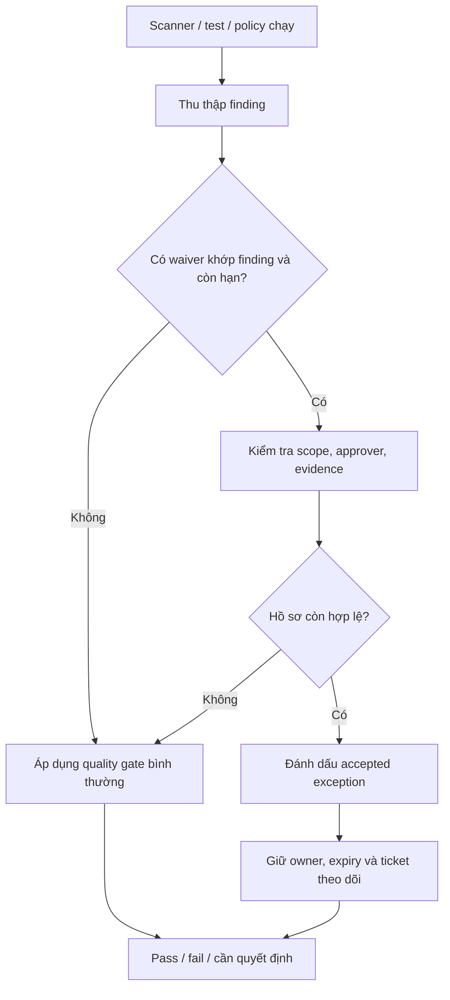
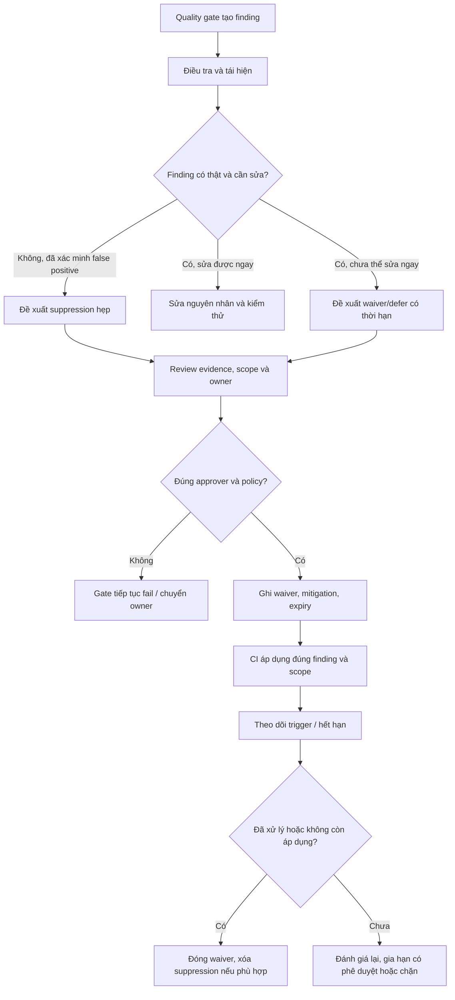

# Miễn trừ phạm vi hẹp với bằng chứng và thời hạn xem xét

Một quality gate phát hiện cảnh báo có vẻ là false positive trong một phương thức xử lý dữ liệu đã được kiểm tra ở tầng khác. Nhóm muốn cho pull request tiếp tục, nhưng không muốn tắt quy tắc đó cho toàn repository. Một trường hợp khác: module cũ còn vài cảnh báo đã biết, chưa thể sửa hết trong đợt phát hành hiện tại. Nếu không có cách ghi nhận ngoại lệ rõ ràng, nhóm có thể hoặc chặn mọi thay đổi vì nợ cũ, hoặc tắt kiểm tra quá rộng và đánh mất tín hiệu cảnh báo mới.

**Miễn trừ chất lượng** (*quality-gate waiver/exception*) là quyết định có kiểm soát cho phép một phát hiện hoặc điều kiện chưa đạt được chấp nhận trong một phạm vi xác định, dựa trên bằng chứng và trách nhiệm rõ ràng. Nó không làm cho vấn đề biến mất, không tự chứng minh mã an toàn và không thay thế kế hoạch xử lý rủi ro.

Trong chương **Cổng chất lượng** của **CODE_QUALITY_FUNDAMENTALS**, bài học này tập trung vào cách miễn trừ **phạm vi hẹp, có căn cứ và có thời hạn xem xét**. Nội dung phục vụ mục tiêu module: hiểu những thuộc tính quyết định mã nguồn có **đáng tin cậy, dễ hiểu và dễ thay đổi hay không**.

## Mục tiêu học tập

Sau bài này, bạn có thể:

1. Phân biệt miễn trừ (*waiver*), suppression và hoãn xử lý (*defer*).
2. Xác định khi nào một phát hiện có thể được miễn trừ và khi nào phải sửa trước khi merge/phát hành.
3. Giới hạn ngoại lệ theo đúng rule, vị trí, phiên bản, nhánh hoặc thời gian cần thiết.
4. Ghi lại lý do, bằng chứng, tác động, biện pháp giảm thiểu, owner, người phê duyệt và ngày xem xét.
5. Thiết kế quy trình CI để ngoại lệ không tự động mở rộng hoặc tồn tại vô thời hạn.
6. Đánh giá lại ngoại lệ khi code, dependency, môi trường, threat model hoặc quy tắc gate thay đổi.
7. Tránh các cách làm khiến quality gate mất ý nghĩa như tắt rule toàn cục, suppression không lý do hoặc gia hạn vô hạn.

## 1. Miễn trừ là quyết định chấp nhận rủi ro có giới hạn

Quality gate thường kiểm tra một số điều kiện trước khi cho phép merge, phát hành hoặc triển khai: test phải đạt, không có lỗ hổng ở mức cấm, coverage không giảm quá ngưỡng, dependency phải đáp ứng chính sách hoặc phân tích tĩnh không có lỗi nghiêm trọng.

Trong thực tế, đôi khi có phát hiện mà nhóm chưa thể xử lý ngay hoặc sau khi điều tra thấy công cụ không hiểu đúng ngữ cảnh. **Miễn trừ** cho phép xử lý ngoại lệ có trách nhiệm, với điều kiện phải trả lời được:

- Phát hiện cụ thể nào đang được miễn?
- Phạm vi ảnh hưởng nhỏ nhất là gì?
- Vì sao chưa sửa hoặc vì sao cảnh báo không áp dụng?
- Bằng chứng nào hỗ trợ kết luận?
- Rủi ro còn lại và biện pháp giảm thiểu là gì?
- Ai chịu trách nhiệm và ai có quyền chấp thuận?
- Ngoại lệ hết hiệu lực hoặc phải xem xét lại khi nào?

Nếu không trả lời được những câu hỏi này, ngoại lệ dễ trở thành **lối đi vòng quanh quality gate**.

### Phân biệt ba hành động thường bị gọi chung là “bỏ qua”

| Hành động | Ý nghĩa | Khi nào phù hợp? |
| --- | --- | --- |
| **Suppression** | Che hoặc đánh dấu một cảnh báo cụ thể để công cụ không tiếp tục báo theo cơ chế của nó. | Khi đã xác minh cảnh báo không áp dụng hoặc công cụ chưa mô hình hóa được hợp đồng cụ thể; cần lý do và phạm vi hẹp. |
| **Waiver / exception** | Người có thẩm quyền chấp nhận một điều kiện gate chưa đạt trong phạm vi và thời hạn nhất định. | Khi rủi ro được hiểu, có biện pháp giảm thiểu và có quyết định chấp thuận rõ. |
| **Defer / hoãn** | Ghi nhận vấn đề là có thật nhưng dời thời điểm sửa theo kế hoạch. | Khi có lý do ưu tiên hoặc phụ thuộc công việc; phải có owner, ticket và ngày xem lại. |

Ba hành động này có thể đi cùng nhau nhưng không đồng nghĩa. Một suppression có thể chỉ điều khiển cách công cụ hiển thị cảnh báo; nó **không tự cấp quyền phát hành**. Một waiver có thể cho phép một lần phát hành dù cảnh báo vẫn hiện diện. Defer là kế hoạch xử lý vấn đề thật, không phải tuyên bố rằng vấn đề không tồn tại.

### Miễn trừ không phải cách sửa lỗi

Nếu code đang tính sai số tiền, bỏ qua kiểm tra quyền, làm lộ token hoặc có nguy cơ mất dữ liệu, việc miễn trừ không biến hành vi đó thành đúng. Những trường hợp có rủi ro không thể chấp nhận phải được sửa hoặc chặn phát hành theo chính sách.

Miễn trừ chỉ hợp lý khi **người chịu trách nhiệm hiểu rủi ro và có cơ sở chấp nhận phần rủi ro còn lại**. Không nên dùng nó để né một kiểm tra bắt buộc về pháp lý, an toàn, bảo mật hoặc chính sách tổ chức.

## 2. Khi nào có thể cân nhắc miễn trừ?

Một số tình huống thường cần điều tra:

| Tình huống | Câu hỏi trước khi miễn trừ | Hướng xử lý có thể phù hợp |
| --- | --- | --- |
| Static analyzer báo false positive. | Đường dữ liệu có thực sự tới sink nguy hiểm không? Công cụ có hiểu sanitizer hoặc wrapper không? | Bổ sung model/test hoặc suppression đúng một finding với bằng chứng. |
| Dependency scan phát hiện phiên bản có advisory. | Ứng dụng có dùng thành phần bị ảnh hưởng và đường khai thác có thể đạt tới không? Có bản vá tương thích không? | Ưu tiên nâng cấp; chỉ xem xét waiver nếu đánh giá rủi ro và kiểm soát được owner bảo mật chấp thuận. |
| Coverage gate giảm sau khi đổi cấu trúc. | Phần nào mất coverage? Có nhánh quan trọng bị bỏ test hay chỉ là mã sinh tự động? | Sửa phạm vi đo hoặc bổ sung test; waiver tạm thời chỉ khi đã chứng minh phần bị ảnh hưởng không làm giảm bằng chứng quan trọng. |
| Một test tích hợp flaky do môi trường. | Test có lỗi thiết kế, race thật hay dependency test không ổn định? | Sửa nguyên nhân; có thể tạm quarantine test theo quy trình và giữ tín hiệu theo dõi. |
| Code legacy có cảnh báo cũ. | Cảnh báo đã tồn tại từ baseline hay mới xuất hiện? Mã có thay đổi không? | Baseline theo phạm vi và kế hoạch giảm nợ; không miễn trừ cảnh báo mới theo mặc định. |
| Lint convention không phù hợp một file sinh tự động. | File có thực sự được sinh lại và có nguồn chuẩn không? | Loại trừ đúng thư mục/file sinh tự động theo chính sách, không tắt rule cho mã viết tay. |

Đây là **các tình huống để điều tra**, không phải danh sách tự động được miễn. Đặc biệt, phát hiện bảo mật có thể cần người sở hữu rủi ro chuyên trách đánh giá; nhóm phát triển không nên tự kết luận “không khai thác được” chỉ vì chưa tái hiện thành công.

### Những trường hợp không nên miễn trừ

- Không biết phát hiện là gì hoặc không đọc được bằng chứng.
- Chưa xác định phạm vi, nhưng đề xuất tắt rule cho toàn dự án.
- Lý do duy nhất là “cần merge gấp” hoặc “CI đang đỏ”.
- Phát hiện liên quan một yêu cầu bắt buộc mà người đề nghị không có quyền chấp thuận ngoại lệ.
- Rủi ro có tác động nghiêm trọng và chưa có biện pháp giảm thiểu đáng tin cậy.
- Ngoại lệ cũ đã hết hạn, không có người chịu trách nhiệm hoặc không được xem xét lại.
- Cùng một vấn đề được miễn nhiều lần mà không có kế hoạch xử lý nguyên nhân.

Trong những tình huống này, cần sửa lỗi, làm rõ hợp đồng, xử lý cấu hình CI hoặc chuyển quyết định tới đúng owner.

## 3. Nguyên tắc giới hạn phạm vi nhỏ nhất

Một ngoại lệ nên áp dụng cho **đúng finding và đúng phạm vi cần thiết**, không rộng hơn.

Các chiều có thể giới hạn:

1. **Rule:** chỉ một quy tắc hoặc một loại finding cụ thể.
2. **Vị trí:** một dòng, một phương thức, một class hoặc một file cụ thể nếu công cụ hỗ trợ.
3. **Module:** chỉ module có vấn đề, không mở rộng sang các module khác.
4. **Phiên bản/nhánh:** chỉ release hoặc nhánh cần xử lý chuyển tiếp.
5. **Môi trường:** chỉ môi trường thử nghiệm hoặc điều kiện xác định, nếu chính sách cho phép.
6. **Thời gian:** chỉ đến ngày hết hạn hoặc sự kiện xem xét lại.
7. **Điều kiện:** chỉ khi có biện pháp giảm thiểu hoặc kiểm thử bổ sung được duy trì.

### Ví dụ về phạm vi rộng và hẹp

**Quá rộng:**

```text
Disable rule SQL_INJECTION for the entire repository.
```

Điều này có thể che một lỗ hổng mới ở endpoint khác, không liên quan finding ban đầu.

**Hẹp hơn:**

```text
Rule: SQL_INJECTION
Location: LegacyReportAdapter.java, method loadReport
Scope: one finding / current migration branch
Expiry: 2026-12-16
Reason: analyzer does not recognize the repository's
        parameter-binding wrapper; provider contract test
        verifies values are bound, not concatenated.
```

Đây là **mẫu minh họa**, không phải cấu hình cú pháp của một sản phẩm scanner cụ thể. Tên rule, định danh finding, cách gắn vị trí và định dạng ngày phải theo hệ thống quản lý ngoại lệ đang dùng.

### Phạm vi càng nhỏ, càng dễ đánh giá lại

Nếu một ngoại lệ áp dụng cho cả module, người review phải biết mọi code trong module có cùng điều kiện không. Nếu chỉ áp dụng một method, có thể xem đúng đường dữ liệu, test và lý do của nó. Ngoại lệ theo file cũng có thể quá rộng nếu file đó tiếp tục được thêm code mới.

**Không nên miễn trừ toàn file hoặc toàn module chỉ vì một finding nằm trong đó**, trừ khi có lý do rõ rằng toàn bộ phạm vi đó có cùng đặc tính và đã được kiểm soát. Khi công cụ không hỗ trợ suppression nhỏ, hãy dùng registry/waiver ở lớp quản lý chính sách thay vì tắt rule toàn cục.

## 4. Bằng chứng cần có trước khi chấp thuận

Một lời giải thích như “đây là false positive” là kết luận, chưa phải bằng chứng. Hồ sơ ngoại lệ nên chứa **dữ kiện có thể được người khác kiểm tra lại**.

### Các loại bằng chứng hữu ích

| Bằng chứng | Có thể hỗ trợ điều gì? | Giới hạn |
| --- | --- | --- |
| Reproduction tối thiểu | Tái hiện hoặc chứng minh điều kiện của finding. | Không tái hiện được chưa chắc chứng minh không thể xảy ra. |
| Data-flow trace / analyzer path | Xem source, propagation, sink và nhánh điều khiển. | Mô hình công cụ có thể thiếu framework hoặc wrapper. |
| Unit/contract/integration test | Xác nhận một hành vi hoặc ranh giới cụ thể. | Chỉ bao phủ input, môi trường và assertion đã có. |
| Code review độc lập | Kiểm tra logic, hợp đồng và phạm vi ảnh hưởng. | Cần reviewer có chuyên môn và quyền phù hợp. |
| Dependency/advisory assessment | Xác định phiên bản, thành phần và điều kiện bị ảnh hưởng. | Không nên suy ra an toàn chỉ từ việc chưa thấy exploit. |
| Metrics/log/trace | Cho biết hành vi đã quan sát trong môi trường và thời gian cụ thể. | Sampling và dữ liệu lịch sử không chứng minh mọi trường hợp tương lai. |
| Threat model / risk assessment | Xác định tài sản, đường tấn công và biện pháp giảm thiểu. | Phải còn phù hợp với kiến trúc và môi trường hiện tại. |
| Owner/contract confirmation | Làm rõ hành vi được cam kết và người có quyền quyết định. | Không thay thế test hoặc kiểm chứng kỹ thuật khi chúng cần thiết. |

### Bằng chứng phải khớp với loại rủi ro

- **False positive của nullness:** cần chỉ ra invariant hoặc đường kiểm tra khiến tham chiếu chắc chắn không null ở vị trí bị báo; test ở ranh giới có thể củng cố lập luận.
- **SQL injection:** cần xem dữ liệu từ source đi tới sink thế nào, cách bind tham số và đường gọi thực tế; một test chỉ kiểm response HTTP 200 chưa đủ.
- **Dependency advisory:** cần xác định phiên bản thực tế, module bị ảnh hưởng, thành phần được sử dụng, điều kiện khai thác và biện pháp giảm thiểu; không chỉ ghi “chưa có sự cố”.
- **Coverage exception:** cần chỉ ra phần mã bị tính sai hoặc chưa thể đo, đồng thời chứng minh những hành vi rủi ro có test khác bảo vệ; line coverage cao ở chỗ khác không bù cho nhánh thanh toán chưa kiểm thử.
- **Flaky test:** cần lịch sử lần chạy, lỗi môi trường/timing, reproduction và cách theo dõi khi test tạm quarantine.

### Bằng chứng phải có thể truy xuất

Ghi link tới:

- Pull request hoặc commit chứa code.
- Finding ID và báo cáo scanner có phiên bản.
- Test/contract hoặc reproduction liên quan.
- Ticket xử lý nợ kỹ thuật.
- ADR, threat model hoặc quyết định của owner nếu có.

Tránh dán token, dữ liệu cá nhân, thông tin khách hàng hoặc log nhạy cảm vào hồ sơ waiver. Có thể lưu tham chiếu tới kho có phân quyền thay vì sao chép dữ liệu nhạy cảm vào nơi nhiều người đọc.

## 5. Hồ sơ miễn trừ tối thiểu

Một waiver có thể được biểu diễn thành bản ghi có cấu trúc. Mẫu sau là **định dạng minh họa độc lập**, không phải schema bắt buộc của công cụ CI:

```yaml
id: QG-WAIVER-042
rule: STATIC-NULL-DEREFERENCE
finding: scanner-finding-12345
scope:
  module: billing-core
  file: src/main/java/example/LegacyMapper.java
  symbol: mapLegacyRecord
reason: "Analyzer does not understand the validated adapter contract."
evidence:
  - "PR-4821: adapter validates the source field before mapping"
  - "LegacyMapperTest: null and non-null input cases"
  - "Code review by module owner"
risk:
  impact: "Low within the described path"
  likelihood: "Unlikely while adapter contract remains enforced"
mitigation:
  - "Keep the adapter validation test in CI"
  - "Do not call the mapper outside the adapter"
owner: "billing-core-maintainer"
approver: "quality-gate-owner"
createdAt: "2026-11-16"
expiresAt: "2026-12-16"
reviewTrigger:
  - "Adapter contract changes"
  - "Mapper is called from another entry point"
  - "Analyzer model is updated"
ticket: "TECHDEBT-204"
```

Mẫu này cố tình ghi **module, file và symbol** để tránh một ngoại lệ không có vị trí cụ thể. Trong hệ thống thực tế, cần thêm định danh finding ổn định, môi trường/branch nếu phù hợp và trạng thái như proposed, approved, expired, revoked hoặc remediated.

### Những trường không nên bỏ

| Trường | Mục đích |
| --- | --- |
| **Finding/rule ID** | Biết chính xác cảnh báo hoặc điều kiện gate nào được xử lý. |
| **Scope** | Xác định phạm vi áp dụng, ngăn ngoại lệ lan rộng. |
| **Reason** | Nêu nguyên nhân, không chỉ ghi “false positive” hoặc “deadline”. |
| **Evidence** | Cho phép người khác tái kiểm tra lập luận. |
| **Risk/impact** | Ghi rõ điều gì có thể xảy ra nếu đánh giá sai. |
| **Mitigation** | Giảm rủi ro trong thời gian ngoại lệ tồn tại. |
| **Owner** | Người theo dõi và thực hiện hành động tiếp theo. |
| **Approver** | Người có quyền chấp thuận loại rủi ro đó. |
| **Expiry/review date** | Ngăn ngoại lệ tồn tại vô thời hạn. |
| **Ticket/condition** | Liên kết việc xử lý và điều kiện thu hồi. |

**Owner và approver không nhất thiết là cùng một người.** Người thực hiện có thể đề xuất ngoại lệ, nhưng quyền chấp thuận rủi ro bảo mật, dữ liệu hoặc phát hành phải theo chính sách của tổ chức.

## 6. Ví dụ Java: suppression hẹp có lý do

Java có annotation `@SuppressWarnings` cho một số cảnh báo do compiler hoặc tooling hỗ trợ. Annotation này **không phải cơ chế waiver chung cho mọi quality gate**. Ví dụ dưới đây chỉ minh họa cách giới hạn một suppression ở method thay vì class hoặc package:

```java
import java.util.List;

final class LegacyAttributeReader {

    @SuppressWarnings("unchecked")
    static List<String> readLegacyValues(Object rawValues) {
        // Hợp đồng legacy đảm bảo đây là List<String>.
        // Việc đảm bảo phải đến từ ranh giới giải mã/validation,
        // không chỉ từ comment này.
        return (List<String>) rawValues;
    }
}
```

Đây là ví dụ **cố ý đơn giản hóa**. Trong production, cast chỉ hợp lệ nếu có kiểm tra runtime hoặc một hợp đồng đáng tin được xác minh ở ranh giới. Một comment nói “được đảm bảo” mà không có bằng chứng không làm cast an toàn.

Một phiên bản chặt chẽ hơn có thể kiểm tra kiểu và từng phần tử:

```java
import java.util.ArrayList;
import java.util.List;

final class LegacyAttributeReader {
    static List<String> readLegacyValues(Object rawValues) {
        if (!(rawValues instanceof List<?> values)) {
            throw new IllegalArgumentException("Expected a list");
        }

        List<String> result = new ArrayList<>(values.size());
        for (Object value : values) {
            if (!(value instanceof String text)) {
                throw new IllegalArgumentException(
                        "Expected string values");
            }
            result.add(text);
        }
        return List.copyOf(result);
    }
}
```

Nếu có thể sửa code để không còn cảnh báo mà vẫn giữ đúng hợp đồng, **sửa nguyên nhân thường tốt hơn suppression**. Chỉ giữ suppression khi có lý do kỹ thuật cụ thể và phạm vi được giới hạn. Không nên dùng `@SuppressWarnings("all")` ở class/package chỉ để làm build xanh.

### Suppression theo công cụ phân tích

Một số analyzer hỗ trợ comment hoặc annotation riêng, ví dụ cơ chế suppression gắn rule ID và lý do. Cú pháp khác nhau theo công cụ, phiên bản và cấu hình. Trước khi dùng:

1. Xác minh công cụ thật sự nhận cú pháp đó.
2. Xác minh suppression chỉ áp dụng đúng finding.
3. Kiểm tra report sau suppression để biết finding có bị che hay chỉ được phân loại.
4. Ghi waiver ở nơi quản lý tập trung nếu chính sách yêu cầu approval/expiry.

Không copy một token comment từ dự án khác rồi giả định CI sẽ hiểu. Nếu công cụ không hỗ trợ expiry tại vị trí code, cần một cơ chế kiểm tra registry riêng để bảo đảm suppression được xem lại.

## 7. Tổ chức waiver trong CI mà không tắt quality gate

Quality gate có thể được mô hình hóa như:

```text
Kết quả gate = các finding hiện tại
             - ngoại lệ còn hiệu lực và khớp phạm vi
             + các điều kiện bắt buộc khác
```

Đây là mô hình khái niệm. Một hệ thống thực tế còn có severity, baseline, policy theo nhánh và các điều kiện phát hành khác. Điểm quan trọng là **ngoại lệ chỉ loại trừ finding đã được chấp thuận**, không biến toàn bộ rule thành optional.

### Luồng đề xuất



Một waiver chỉ nên được áp dụng khi:

- Finding ID và rule khớp chính xác.
- File/module/symbol hoặc scope khớp.
- Trạng thái được phê duyệt bởi đúng role.
- Chưa hết hạn và chưa bị thu hồi.
- Bằng chứng bắt buộc còn truy cập được.
- Điều kiện giảm thiểu vẫn được duy trì.

Nếu thiếu một điều kiện quan trọng, CI nên coi finding là **chưa được miễn** hoặc yêu cầu review, thay vì tự đoán.

### Pseudocode minh họa kiểm tra registry

Đoạn dưới đây là logic khái niệm, không phải API của một CI provider cụ thể:

```text
for finding in scanResults:
    waiver = registry.findExactMatch(finding.id, finding.rule)

    if waiver is None:
        gate.fail(finding)
        continue

    if not waiver.isApproved:
        gate.fail(finding)
        continue

    if waiver.isExpired(today):
        gate.fail(finding)
        continue

    if not waiver.scope.matches(finding.location):
        gate.fail(finding)
        continue

    if not waiver.evidence.isAccessible:
        gate.requireReview(finding)
        continue

    gate.recordAcceptedException(finding, waiver.id)
```

Kiểm tra thực tế cần xử lý múi giờ/ngày hết hạn, định danh finding thay đổi qua lần scan, quyền truy cập registry, audit log và trạng thái race giữa approval với merge. Không dùng tên file đơn thuần làm khóa nếu một file có thể chứa nhiều finding khác nhau.

### Không cho phép ngoại lệ mới tự được áp dụng

Một chính sách an toàn thường yêu cầu:

- Waiver mới cần approval, không tự chấp thuận chỉ vì có file cấu hình.
- Thay đổi scope, expiry hoặc evidence phải được review lại.
- CI báo rõ finding nào được miễn và waiver ID tương ứng.
- Báo cáo vẫn giữ số lượng ngoại lệ, không làm chúng biến mất khỏi dashboard.
- Waiver hết hạn làm gate đánh giá lại finding.

Điều này giúp người review nhìn thấy **chất lượng thực tế cùng phần rủi ro được chấp nhận**, thay vì chỉ nhìn một trạng thái xanh.

## 8. Expiry và review trigger: thời hạn phải tạo ra hành động

Một trường `expiresAt` chỉ có ý nghĩa nếu hệ thống thực sự kiểm tra nó. Nếu không, nó chỉ là ngày được viết trong tài liệu.

### Chọn thời hạn theo loại ngoại lệ

Không có một thời hạn chung cho mọi waiver. Có thể cân nhắc:

| Loại | Cách chọn thời hạn xem xét |
| --- | --- |
| False positive đã xác minh, code ổn định. | Xem lại khi rule/model hoặc code path thay đổi; vẫn cần chu kỳ xác nhận định kỳ. |
| Dependency risk tạm thời. | Gắn với mốc có bản vá/phiên bản hỗ trợ hoặc kế hoạch nâng cấp; xem lại thường xuyên hơn nếu rủi ro cao. |
| Flaky test được quarantine. | Thời hạn ngắn, gắn ticket sửa nguyên nhân và điều kiện đưa test trở lại. |
| Coverage debt ở module legacy. | Gắn với kế hoạch test/refactor hoặc lần thay đổi tiếp theo của module. |
| Ngoại lệ theo release. | Hết hiệu lực ở release hoặc thời điểm đã xác định, không tự động kế thừa sang mọi branch. |

Ngày hết hạn phải **phù hợp mức rủi ro**. Một lỗ hổng nghiêm trọng không nên có waiver dài chỉ vì nhóm chưa có lịch nâng cấp. Một false positive ổn định có thể được review theo chu kỳ dài hơn, nhưng vẫn phải xem lại khi giả định thay đổi.

### Review trigger có thể quan trọng hơn ngày

Ngoại lệ nên được xem lại ngay khi:

- Method hoặc file bị thay đổi đáng kể.
- Data flow, framework, sanitizer hoặc adapter contract thay đổi.
- Dependency được nâng cấp hoặc xuất hiện advisory mới.
- Threat model, endpoint exposure hoặc quyền truy cập thay đổi.
- Test liên quan bị xóa, disable hoặc không còn chạy.
- Module được chuyển owner hoặc chuẩn chất lượng thay đổi.
- Finding được scanner nhận diện khác sau khi cập nhật rule.

**Expiry và trigger bổ sung cho nhau.** Ngày bảo đảm ngoại lệ không sống mãi; trigger giúp phát hiện giả định đã hết đúng ngay cả trước ngày đó.

### Gia hạn không phải thao tác mặc định

Khi waiver sắp hết hạn, cần:

1. Xác nhận vấn đề còn tồn tại không.
2. Kiểm tra bằng chứng và điều kiện giảm thiểu còn đúng không.
3. Xác định vì sao ticket chưa hoàn thành.
4. Đánh giá lại mức rủi ro với môi trường hiện tại.
5. Có quyết định mới từ đúng approver nếu tiếp tục chấp nhận.
6. Cập nhật thời hạn và kế hoạch xử lý cụ thể.

Không tự động cộng thêm 30 ngày cho mọi waiver. Nếu phải gia hạn nhiều lần, cần xem đó có phải **nợ kỹ thuật không được ưu tiên** hoặc quy trình phê duyệt đang không hiệu quả.

## 9. Mức rủi ro, người phê duyệt và trách nhiệm

Người viết code có thể hiểu rõ implementation nhưng không nhất thiết có quyền chấp nhận mọi hậu quả. Ví dụ:

- Nhóm ứng dụng sở hữu chất lượng code và test.
- Owner API quyết định thay đổi hợp đồng và thời gian hỗ trợ consumer.
- Security owner đánh giá ngoại lệ liên quan lỗ hổng hoặc threat model.
- Data owner chịu trách nhiệm với tính toàn vẹn và khả năng phục hồi dữ liệu.
- Release/quality owner quyết định việc cho phép gate exception trong phạm vi chính sách.

### Tách vai trò đề xuất, kiểm chứng và phê duyệt

| Vai trò | Trách nhiệm |
| --- | --- |
| **Requester** | Nêu finding, lý do, scope và bằng chứng. |
| **Technical owner** | Xác minh đường đi, tác động và biện pháp kỹ thuật. |
| **Risk approver** | Chấp thuận phần rủi ro thuộc quyền sở hữu của mình. |
| **Quality-gate owner** | Bảo đảm waiver được áp dụng đúng policy và có expiry. |
| **Remediation owner** | Theo dõi ticket sửa hoặc loại bỏ ngoại lệ. |

Một nhóm nhỏ có thể để một người đảm nhiệm nhiều vai trò theo chính sách; nhưng với rủi ro cao, nên có **review độc lập** thay vì người tạo waiver tự duyệt cho chính mình.

### Đánh giá rủi ro không chỉ bằng nhãn severity

Hãy xem:

1. **Tác động:** nếu đánh giá sai, hậu quả là gì?
2. **Khả năng xảy ra/khai thác:** đường đi có thể được kích hoạt trong môi trường thực không?
3. **Phạm vi:** một method nội bộ hay endpoint công khai, một tenant hay mọi người dùng?
4. **Khả năng phát hiện:** có alert, log, test hoặc kiểm soát khác nhận ra lỗi không?
5. **Khả năng khôi phục:** có rollback, backup và owner trực vận hành không?
6. **Thời gian phơi nhiễm:** ngoại lệ tồn tại bao lâu và trong giai đoạn nào?

Một cảnh báo mức trung bình ở code không được gọi có thể có rủi ro thấp hơn khi chỉ nằm trong test fixture; nhưng nếu đường dữ liệu có thể đi tới production, cần đánh giá theo ngữ cảnh thực. **Không được hạ severity chỉ để waiver dễ được duyệt.**

## 10. Baseline và waiver khác nhau thế nào?

Hai cơ chế thường bị trộn:

| Cơ chế | Mục đích | Cách quản lý |
| --- | --- | --- |
| **Baseline** | Ghi nhận tập finding cũ để tập trung chặn finding mới hoặc xu hướng xấu đi. | Có snapshot, phạm vi, thời điểm và kế hoạch giảm nợ. |
| **Waiver** | Chấp nhận một finding/điều kiện cụ thể chưa đạt theo quyết định có trách nhiệm. | Có scope, evidence, approver, expiry và mitigation. |
| **Suppression** | Điều khiển việc hiển thị hoặc đánh giá một finding của công cụ. | Gắn đúng vị trí/rule, lý do và kiểm tra hiệu lực. |

Baseline **không phải danh sách miễn trừ rủi ro đã được phê duyệt**. Một finding trong baseline vẫn có thể là lỗ hổng nghiêm trọng và cần xử lý. Ngược lại, waiver có thể được dùng cho một finding mới đã được điều tra, nhưng không nên dùng để thay thế quản lý nợ cũ.

### Khi baseline bị thay đổi

Nếu một người cập nhật baseline để loại finding mới mà không review, họ có thể vô tình **hợp thức hóa sự suy giảm chất lượng**. Những thay đổi baseline cần:

- Review diff của finding được thêm/bỏ.
- Giải thích lý do và phạm vi.
- Xác định finding mới có phải bug/rủi ro thật không.
- Không xóa lịch sử theo dõi chỉ để đạt gate xanh.

## 11. Theo dõi ngoại lệ trên dashboard

Một dashboard hữu ích không chỉ hiện “Gate passed”. Nó có thể hiển thị:

| Chỉ số | Câu hỏi quản trị |
| --- | --- |
| Số waiver đang hiệu lực | Có bao nhiêu rủi ro đang được chấp nhận? |
| Waiver theo loại/rule/severity | Rủi ro tập trung ở bảo mật, test hay maintainability? |
| Waiver sắp hết hạn/quá hạn | Ngoại lệ nào cần quyết định ngay? |
| Thời gian tồn tại trung bình | Nợ được xử lý hay kéo dài? |
| Tỷ lệ gia hạn | Có khoản nợ nào bị gia hạn lặp lại? |
| Waiver không có ticket/owner | Có ngoại lệ nào không ai chịu trách nhiệm? |
| Finding mới bị waiver | Quy trình có đang tạo đường vòng cho vấn đề mới? |
| Waiver được đóng/remediated | Những rủi ro nào đã thực sự được loại bỏ? |

Không nên biến các chỉ số thành KPI khiến nhóm cố giảm số waiver bằng cách che finding hoặc cố tăng tốc đóng ticket mà không sửa nguyên nhân. Dashboard cần giúp **ra quyết định và phân bổ nguồn lực**, không tạo động cơ làm đẹp số.

### Báo cáo ngoại lệ minh bạch

Một báo cáo phát hành có thể nêu:

```text
Quality gate: PASSED WITH APPROVED EXCEPTIONS

Active exceptions:
  - QG-WAIVER-042
    Rule: STATIC-NULL-DEREFERENCE
    Scope: billing-core / LegacyMapper.mapLegacyRecord
    Owner: billing-core-maintainer
    Expires: 2026-12-16
    Evidence: adapter contract + JUnit tests

Expired exceptions: 0
Unowned exceptions: 0
```

Đây là **output minh họa**. Một trạng thái “passed with exceptions” trung thực hơn việc báo “all checks passed” khi vẫn có rủi ro đang được chấp nhận.

## 12. Quy trình xử lý waiver từ phát hiện đến đóng



### Bước 1 — Điều tra finding

Đọc rule, vị trí, đường đi và phiên bản công cụ. Xác định finding có thể tái hiện, có áp dụng với code hiện tại và có rủi ro thật không.

### Bước 2 — Chọn đúng loại xử lý

- Nếu cảnh báo không áp dụng và có bằng chứng: cân nhắc suppression.
- Nếu rủi ro thật nhưng chưa sửa ngay: ghi nhận debt/defer và cân nhắc waiver theo policy.
- Nếu lỗi nghiêm trọng hoặc không thể chấp nhận: sửa hoặc giữ gate fail.

### Bước 3 — Đề xuất hồ sơ

Ghi scope, reason, evidence, risk, mitigation, owner, approver, expiry, trigger và ticket. Không để người phê duyệt phải tự tìm lại ngữ cảnh trong nhiều thread.

### Bước 4 — Phê duyệt đúng quyền

Kiểm tra loại rủi ro có cần security/data/API owner không. Không tự cấp waiver cho yêu cầu bắt buộc nằm ngoài quyền của nhóm.

### Bước 5 — CI áp dụng và báo cáo

CI xác nhận finding ID, scope và trạng thái. Báo cáo vẫn phải thể hiện exception được chấp thuận để người phát hành biết còn rủi ro.

### Bước 6 — Xem lại và đóng

Khi code đã sửa, finding không còn tồn tại hoặc giả định không còn đúng, đóng waiver và xóa suppression tương ứng. Nếu hết hạn mà chưa xử lý, cần quyết định mới; không tự chuyển thành permanent.

## 13. Tình huống thực hành: quarantine một test flaky

Một test tích hợp xác minh xử lý webhook đôi khi thất bại do phụ thuộc thời gian và một môi trường test dùng chung. Nhóm muốn tạm đưa test khỏi gate chặn merge để tránh false alarm, nhưng test liên quan xử lý thanh toán nên không thể bỏ theo dõi.

### Đề xuất không đủ căn cứ

```text
Disable WebhookPaymentTest because it is flaky.
```

Đề xuất này không nêu:

- Lỗi cụ thể là timeout, race hay dữ liệu dùng chung.
- Tần suất thất bại và bằng chứng môi trường.
- Những kiểm thử nào vẫn bảo vệ logic webhook.
- Ai sửa test, khi nào bật lại và điều kiện nào buộc chặn phát hành.

### Hồ sơ tạm thời có trách nhiệm

```text
Finding: TEST-FLAKY-WEBHOOK-17
Scope: WebhookPaymentTest / integration-test stage
Reason: Shared test environment has intermittent clock drift;
        failure is reproduced when fixture clock is not controlled.
Evidence:
  - CI runs 8812, 8820, 8831
  - Reproduction with uncontrolled system clock
  - Unit tests for signature validation and idempotency remain enabled
Mitigation:
  - Keep webhook contract test in pre-release environment
  - Use isolated fixture data
  - Monitor webhook duplicate-payment metric
Owner: payments-test-maintainer
Approver: payments-service-owner
Expiry: YYYY-MM-DD (short review window)
Ticket: TEST-219
Exit condition:
  - Injected clock is used
  - Test passes repeatedly in isolated environment
  - Test is restored to the blocking gate
```

Hồ sơ này vẫn cần xác minh **việc quarantine không làm mất kiểm chứng quan trọng**. Nếu test là bằng chứng duy nhất cho idempotency thanh toán, không nên chỉ giữ unit test giả mà phải có một biện pháp kiểm chứng thay thế đủ mạnh trước khi bỏ gate.

### Bài học từ tình huống

- Flaky không đồng nghĩa test không cần thiết.
- Quarantine là **ngoại lệ cho một tầng kiểm tra**, không phải xóa test.
- Phải giữ một mức bảo vệ thay thế phù hợp với rủi ro.
- Điều kiện đóng là khôi phục test vào gate, không chỉ “ticket đã được cập nhật”.

## 14. Những anti-pattern cần tránh

**Tắt toàn bộ rule vì một false positive.** Một finding không áp dụng không chứng minh mọi finding cùng rule đều không có rủi ro.

**Miễn trừ theo thư mục quá rộng.** Code mới trong cùng thư mục có thể tạo finding khác và bị che theo.

**Không có owner.** Một ngoại lệ không có người xử lý sẽ tồn tại đến khi không ai còn nhớ lý do.

**Không có expiry.** “Tạm thời” không có mốc xem lại thường trở thành vĩnh viễn.

**Gia hạn tự động.** Nó biến việc chấp nhận rủi ro thành trạng thái mặc định, không cần đánh giá lại.

**Lý do chỉ ghi “false positive”.** Đây là kết luận thiếu đường đi, hợp đồng hoặc test chứng minh.

**Suppression không có ticket hoặc bằng chứng.** Người bảo trì sau không thể biết vì sao cảnh báo bị ẩn.

**Tự duyệt waiver rủi ro cao.** Người đề xuất không nhất thiết là người sở hữu hậu quả nếu đánh giá sai.

**Xóa finding khỏi dashboard.** Làm mất khả năng nhìn thấy rủi ro đang được chấp nhận.

**Đưa ngoại lệ vào baseline rồi quên.** Baseline không thay cho approval, owner và kế hoạch xử lý.

**Dùng waiver để vượt yêu cầu bắt buộc.** Không có phê duyệt nội bộ nào tự động làm một vi phạm pháp lý hoặc chính sách trở nên hợp lệ.

**Đóng waiver vì scanner không còn báo.** Finding có thể mất do rule đổi, file bị exclude hoặc code chuyển chỗ. Cần xác nhận nguyên nhân và bằng chứng remediation.

## 15. Checklist review một yêu cầu miễn trừ

Trước khi chấp thuận, reviewer có thể kiểm tra:

1. **Finding rõ ràng:** rule ID, finding ID, vị trí và phiên bản scanner có đầy đủ không?
2. **Phân loại đúng:** đây là false positive, risk acceptance, hoãn xử lý hay lỗi phải sửa?
3. **Scope nhỏ nhất:** ngoại lệ có giới hạn theo finding/file/module/branch và thời gian không?
4. **Lý do cụ thể:** có mô tả điều kiện và nguyên nhân, không chỉ một nhãn không?
5. **Bằng chứng độc lập:** reproduction, test, contract hoặc assessment có thể được người khác xem lại không?
6. **Rủi ro còn lại:** tác động, khả năng xảy ra và phạm vi ảnh hưởng đã được nêu không?
7. **Mitigation:** biện pháp giảm thiểu có tồn tại và được kiểm tra không?
8. **Owner/approver:** người chịu trách nhiệm và người có quyền chấp thuận đã được xác định không?
9. **Expiry/trigger:** có ngày xem lại và sự kiện làm waiver mất hiệu lực không?
10. **CI enforcement:** pipeline có kiểm tra scope, approval và hết hạn không?
11. **Visibility:** báo cáo có thể hiện exception thay vì làm nó biến mất không?
12. **Exit condition:** biết rõ cần làm gì để đóng waiver chưa?

Nếu câu trả lời cho các mục quan trọng là “chưa biết”, hồ sơ chưa đủ để được xem như một ngoại lệ đã kiểm soát.

## 16. Câu hỏi tự kiểm tra

**Câu 1.** Một scanner báo false positive ở một method. Có nên tắt rule đó cho cả repository không?

*Gợi ý:* Không. Cần xác minh finding và áp dụng suppression/waiver cho đúng rule, vị trí và phạm vi nhỏ nhất. Các finding mới ở nơi khác vẫn phải được kiểm tra.

**Câu 2.** Một waiver có lý do và approver nhưng không có ngày xem lại. Rủi ro là gì?

*Gợi ý:* Ngoại lệ có thể tồn tại vô thời hạn dù code, dependency, môi trường hoặc threat model đã thay đổi. Cần expiry và review trigger.

**Câu 3.** Test flaky duy nhất kiểm tra idempotency của thanh toán được quarantine. Có thể cho release chỉ vì unit test xanh không?

*Gợi ý:* Chưa đủ. Phải xác định unit test có thực sự bảo vệ hợp đồng retry/idempotency hay không và có kiểm thử thay thế ở tầng phù hợp trước khi chấp nhận rủi ro.

**Câu 4.** Baseline chứa một finding bảo mật từ năm trước. Điều đó có nghĩa finding đã được chấp thuận miễn trừ?

*Gợi ý:* Không. Baseline chỉ ghi nhận finding hiện hữu theo cơ chế đo. Waiver cần hồ sơ, owner, approver, scope và expiry riêng.

**Câu 5.** Người đề xuất waiver tự đánh dấu “approved” trong file cấu hình. CI có nên tin trạng thái đó?

*Gợi ý:* Chỉ khi hệ thống xác minh được quyền phê duyệt và audit trail theo policy. File thay đổi trong PR không tự chứng minh người có thẩm quyền đã chấp thuận.

**Câu 6.** Waiver hết hạn nhưng scanner không còn báo finding. Có thể đóng ngay không?

*Gợi ý:* Cần xác minh finding đã được sửa hay chỉ mất do rule, exclusion hoặc thay đổi định danh. Ghi lý do đóng và giữ bằng chứng.

**Câu 7.** Một ngoại lệ đã được gia hạn ba lần. Cần làm gì trước lần gia hạn tiếp?

*Gợi ý:* Đánh giá lại rủi ro, lý do trì hoãn, nguồn lực và phương án giảm nợ. Gia hạn cần quyết định mới của approver, không tự động tiếp tục.

## Ghi nhớ

- **Miễn trừ là chấp nhận rủi ro có giới hạn**, không phải sửa lỗi và không biến một phát hiện thành an toàn.
- **Suppression, waiver và defer khác nhau:** che finding, chấp nhận điều kiện gate và hoãn xử lý cần cơ chế theo dõi riêng.
- **Phạm vi phải nhỏ nhất có thể:** đúng finding, rule, vị trí/module và thời gian; không tắt rule toàn cục vì một trường hợp.
- **Bằng chứng phải phù hợp với loại rủi ro**, có thể truy xuất và không chứa dữ liệu nhạy cảm không cần thiết.
- **Mỗi waiver cần owner, approver, mitigation, expiry và exit condition.** Hết hạn hoặc thay đổi giả định phải kích hoạt đánh giá lại.
- **CI phải giữ ngoại lệ hiển thị và kiểm tra hiệu lực**, không âm thầm bỏ finding khỏi báo cáo.
- **Baseline không phải waiver; gia hạn không phải xử lý nợ.** Mục tiêu là loại bỏ nguyên nhân hoặc chấp nhận rủi ro một cách minh bạch, có trách nhiệm.

**Câu hỏi trước khi bấm approve:** “Ngoại lệ này chỉ che đúng điều đã được điều tra chưa, bằng chứng nào cho phép chấp nhận rủi ro, ai chịu trách nhiệm, và sự kiện/ngày nào buộc chúng ta xem lại hoặc loại bỏ nó?”
