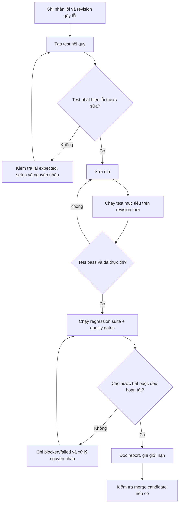

# Xác nhận bản sửa bằng lần kiểm tra mới

Trong module `CODE_QUALITY_FUNDAMENTALS`, mục tiêu là hiểu những thuộc tính quyết định mã nguồn có **đáng tin cậy, dễ hiểu và dễ thay đổi** hay không. Ở chương **Cổng chất lượng**, một bản sửa chỉ có bằng chứng đáng tin khi các kiểm tra cần thiết đã chạy trên **đúng phiên bản mã và cấu hình mà ta định chấp nhận**. Một dấu xanh từ lần chạy trước, một báo cáo cũ được giữ lại hoặc một test đã bị bỏ qua không chứng minh bản sửa hiện tại hoạt động đúng.

Hãy xét tình huống một test báo lỗi tại ngưỡng giảm giá. Lập trình viên đổi điều kiện, chạy test và thấy pass. Sau đó họ sửa thêm một dòng trong cùng phương thức, cập nhật test, rồi mở PR. Nếu không chạy lại sau thay đổi cuối, kết quả xanh trước đó không còn đại diện cho mã đang được review. Tương tự, một pipeline xanh trên commit cha hoặc trên một revision cũ của PR không xác minh commit mới.

**Lần kiểm tra mới (fresh check)** là lần thực thi có thể truy nguyên tới **đúng revision, đúng phạm vi, đúng cấu hình và đúng đầu vào liên quan**, được hoàn tất sau các thay đổi cần xác minh. “Mới” ở đây không chỉ là thời gian gần đây: một lần chạy vừa xong nhưng dùng nhầm commit vẫn là bằng chứng sai đối tượng.

Sau bài học, người học có thể:

- Xác định vì sao kết quả xanh cũ không còn đủ giá trị sau khi mã hoặc cấu hình thay đổi.
- Kiểm tra đúng commit, merge candidate, workflow, toolchain, dependency và phạm vi test.
- Tái hiện lỗi trước sửa và xác nhận test hồi quy phát hiện đúng nguyên nhân.
- Chọn tập kiểm tra phù hợp rủi ro, từ test mục tiêu tới toàn bộ quality gate bắt buộc.
- Đánh giá cache, incremental build, test selection, flaky test và retry đúng giới hạn.
- Đọc trạng thái CI, lưu bằng chứng và ghi rõ phần chưa được kiểm chứng.

## 1. Vì sao phải xác nhận bằng một lần kiểm tra mới?

Một kết quả kiểm tra chỉ nói về **đầu vào mà lần chạy đó thực sự sử dụng**. Nếu đầu vào thay đổi, kết quả cũ có thể không còn áp dụng.

Những thay đổi có thể làm mất hiệu lực của bằng chứng:

- Mã sản phẩm thay đổi sau khi test đã chạy.
- Test hoặc assertion thay đổi; test xanh cũ không kiểm tra phiên bản assertion mới.
- Cấu hình build, ruleset, quality gate hoặc workflow CI thay đổi.
- Dependency, lockfile, plugin, JDK hoặc image môi trường thay đổi.
- Phạm vi tệp, module hoặc bộ test được chọn thay đổi.
- Một artifact được tạo từ commit khác được tái sử dụng.
- Kết quả đến từ nhánh nguồn cũ, trong khi PR đã nhận thêm commit hoặc merge thêm thay đổi từ nhánh đích.
- Lần chạy trước bị timeout, hủy hoặc chỉ chạy một phần nhưng giao diện tổng hợp hiển thị trạng thái dễ gây hiểu nhầm.

### Kết quả xanh phải gắn với đối tượng được kiểm tra

Khi đọc CI, không chỉ hỏi “có dấu xanh không?” mà hãy hỏi:

1. **Revision nào?** Commit SHA hoặc tree mà job đã checkout.
2. **Cấu hình nào?** Phiên bản workflow, script, ruleset, build config và tham số.
3. **Môi trường nào?** JDK, hệ điều hành/container, dependency và biến môi trường có ảnh hưởng.
4. **Phạm vi nào?** Module, source set, test được chạy, test bị skip và loại phân tích.
5. **Kết quả nào?** Bước đã chạy, bước pass/fail/blocked, report có đầy đủ không?
6. **Sau lần chạy có thay đổi gì nữa không?** Có commit, chỉnh sửa file, thay cấu hình hoặc cập nhật test sau khi job kết thúc không?

Một pipeline xanh ở commit `A` không xác minh commit `B` chỉ vì `B` được tạo ngay sau `A`. Tương tự, pipeline của PR head có thể chưa xác minh kết quả sau khi hợp nhất với thay đổi mới nhất ở nhánh đích.

### Freshness không chỉ là timestamp

| Tình huống | Có phải bằng chứng mới cho bản sửa hiện tại? | Lý do |
| --- | --- | --- |
| Job vừa hoàn tất nhưng checkout commit cũ | **Không** | Đã kiểm tra sai revision |
| Job chạy trên commit mới nhất, đầy đủ các bước bắt buộc | **Có**, trong phạm vi job | Đầu vào khớp với revision được xác minh |
| Job xanh trên PR head, sau đó có commit mới | **Không** cho commit mới | Mã đã thay đổi sau lần chạy |
| Job xanh trên PR head, merge queue tạo merge candidate mới | **Chưa đủ** cho merge candidate | Kết quả hợp nhất có thể khác PR head |
| Job dùng cache hợp lệ có khóa theo mọi đầu vào liên quan | **Có thể có** | Cache không tự làm kết quả cũ; cần chứng minh cache tương ứng đúng đầu vào |
| Job bỏ qua test nhưng vẫn kết thúc thành công | **Không** cho tuyên bố bao phủ test đó | Test chưa được thực thi |
| Rerun pass sau một lần fail cùng commit | **Có thêm bằng chứng**, nhưng cần điều tra lần fail | Rerun không xóa tính không ổn định hoặc lỗi môi trường trước đó |

**Thời điểm chạy gần nhất không thay thế định danh revision.** Hãy kiểm tra commit và trạng thái hoàn tất trước khi dựa vào badge.

## 2. Xác định chính xác thứ cần xác minh

Trước khi chạy lại mọi thứ, hãy xác định **bản sửa đang tuyên bố giải quyết điều gì**. Một câu như “đã fix lỗi” quá rộng; một tuyên bố có thể kiểm chứng rõ hơn là:

> “Với đơn hàng có tổng trước giảm giá bằng 500.000 đồng, chính sách giảm 10% phải được áp dụng. Đơn ngay dưới ngưỡng không giảm. Test hồi quy phải fail với mã cũ và pass với mã đã sửa.”

Tuyên bố rõ giúp chọn đúng test, tránh chạy một bộ test rất lớn mà vẫn bỏ qua lỗi mục tiêu.

### Tạo danh sách bằng chứng theo rủi ro

| Loại thay đổi | Bằng chứng mục tiêu | Bằng chứng mở rộng có thể cần |
| --- | --- | --- |
| Điều kiện hoặc phép tính | Unit test tái hiện lỗi, giá trị biên, đầu vào hợp lệ | Test module liên quan, regression suite |
| Trạng thái nghiệp vụ | Test chuyển trạng thái hợp lệ/không hợp lệ, thao tác lặp | Integration test với transaction và dữ liệu thật |
| SQL/schema/migration | Test repository, migration trên schema phù hợp | Test dữ liệu lịch sử, tương thích phiên bản ứng dụng |
| HTTP/API/serialization | Test status, payload, validation và contract | Consumer/provider hoặc end-to-end test |
| Đồng thời/idempotency | Test cạnh tranh, retry, cùng định danh request | Integration test và kiểm tra bất biến sau commit |
| Cấu hình/build/ruleset | Kiểm tra đúng config, phạm vi và trạng thái analyzer | Chạy lại các quality gate bị ảnh hưởng |
| Hiệu năng/tài nguyên | Benchmark hoặc load test với dữ liệu và tải mô tả | Quan sát p95/p99, throughput, CPU, memory và lỗi |
| Phụ thuộc/bảo mật | Test tương thích, kiểm tra advisory/rule phù hợp | Quét toàn bộ dependency hoặc security gate theo chính sách |

Không phải mọi thay đổi cần mọi tầng kiểm tra. Mục tiêu là **không bỏ qua bằng chứng bắt buộc đối với rủi ro đã thay đổi**, đồng thời không dùng kiểm tra không liên quan để tạo cảm giác chắc chắn.

### Phân biệt test mục tiêu với quality gate đầy đủ

- **Test mục tiêu:** kiểm tra trực tiếp lỗi hoặc hành vi đang sửa; thường chạy nhanh và dễ chẩn đoán.
- **Regression suite:** kiểm tra những hành vi liên quan có thể bị ảnh hưởng.
- **Quality gate:** tập điều kiện bắt buộc của dự án, có thể gồm build, test, phân tích tĩnh, bảo mật, coverage hoặc kiểm tra khác.
- **Kiểm tra sau hợp nhất:** xác minh kết quả trên revision được tạo bởi merge/merge queue hoặc trạng thái gần với bản sẽ phát hành.

Test mục tiêu pass là tín hiệu quan trọng, nhưng không tự thay thế quality gate. Ngược lại, quality gate xanh cũng không bảo đảm test mục tiêu có assertion đúng nếu gate không chạy hoặc không bao gồm test đó.

## 3. Quy trình xác minh một bản sửa

Một quy trình có thể áp dụng cho PR:

**Bước 1 — Ghi nhận lỗi gốc.** Lưu đầu vào, trạng thái, thông báo lỗi, commit gây lỗi và điều kiện tái hiện. Không chỉ lưu ảnh chụp dấu đỏ; cần biết chính xác test hoặc hành vi nào thất bại.

**Bước 2 — Xác nhận test tái hiện lỗi.** Chạy test với mã trước sửa hoặc tạo một phép thử độc lập chứng minh lỗi. Nếu không thể chạy mã cũ, giải thích cách xác nhận test thực sự phân biệt hành vi sai và đúng.

**Bước 3 — Viết test hồi quy.** Expected lấy từ hợp đồng đã xác nhận; test phải thất bại vì nguyên nhân mục tiêu trước khi sửa, không phải do setup, môi trường hoặc lỗi không liên quan.

**Bước 4 — Thực hiện bản sửa.** Giữ phạm vi thay đổi rõ, tránh đồng thời thay cả test, rule và cấu hình mà không có lý do.

**Bước 5 — Chạy test mục tiêu trên mã đã sửa.** Xác nhận test pass, report cho biết test đã thực thi và đúng revision.

**Bước 6 — Chạy regression suite và quality gate liên quan.** Xác minh các luồng đối chứng, tích hợp và kiểm tra bắt buộc không bị bỏ qua.

**Bước 7 — Chạy lại sau thay đổi cuối cùng.** Nếu sửa mã, test, workflow, dependency hoặc cấu hình sau lần chạy xanh, chạy lại các bước bị ảnh hưởng trên revision cuối.

**Bước 8 — Đọc kết quả và lưu bằng chứng.** Ghi commit, trạng thái từng bước, số test, skip, lỗi và giới hạn; không kết luận chỉ từ màu tổng hợp.

**Bước 9 — Xác minh revision sẽ được hợp nhất.** Nếu nhánh đích thay đổi hoặc hệ thống dùng merge queue, bảo đảm merge candidate cũng được kiểm tra theo chính sách.

### Sơ đồ từ lỗi đến bằng chứng



Chu trình này nhấn mạnh hai điều: test hồi quy cần **thực sự bắt được lỗi**, và lần kiểm tra sau sửa phải **chạy trên đúng revision**.

## 4. Ví dụ Java: chứng minh test bắt lỗi trước và sau sửa

Giả sử hợp đồng đã xác nhận: đơn có tổng trước giảm giá **từ 500.000 đồng trở lên** được giảm 10%; dưới ngưỡng không giảm. Kết quả làm tròn đến đồng nguyên bằng `HALF_UP`.

### 4.1. Mã cũ có lỗi tại ngưỡng

```java
import java.math.BigDecimal;
import java.math.RoundingMode;

final class DiscountCalculator {
    private static final BigDecimal THRESHOLD =
            new BigDecimal("500000");
    private static final BigDecimal RATE =
            new BigDecimal("0.10");

    BigDecimal totalAfterDiscount(BigDecimal subtotal) {
        if (subtotal.signum() < 0) {
            throw new IllegalArgumentException("Negative subtotal");
        }

        // Bug: bỏ qua đơn có giá trị đúng bằng ngưỡng.
        if (subtotal.compareTo(THRESHOLD) > 0) {
            return subtotal.multiply(BigDecimal.ONE.subtract(RATE))
                    .setScale(0, RoundingMode.HALF_UP);
        }
        return subtotal.setScale(0, RoundingMode.HALF_UP);
    }
}
```

Với đầu vào `500000`, mã cũ trả `500000` trong khi hợp đồng yêu cầu `450000`. Một test chỉ chạy với `400000` hoặc `600000` có thể không bắt được lỗi này.

### 4.2. Test hồi quy phải có expected độc lập

```java
import static org.junit.jupiter.api.Assertions.assertEquals;
import java.math.BigDecimal;
import org.junit.jupiter.api.Test;

class DiscountCalculatorTest {
    private final DiscountCalculator calculator =
            new DiscountCalculator();

    @Test
    void appliesDiscountAtExactThreshold() {
        BigDecimal actual = calculator.totalAfterDiscount(
                new BigDecimal("500000"));

        assertEquals(new BigDecimal("450000"), actual);
    }

    @Test
    void doesNotDiscountBelowThreshold() {
        BigDecimal actual = calculator.totalAfterDiscount(
                new BigDecimal("499999"));

        assertEquals(new BigDecimal("499999"), actual);
    }

    @Test
    void appliesDiscountAboveThreshold() {
        BigDecimal actual = calculator.totalAfterDiscount(
                new BigDecimal("500001"));

        assertEquals(new BigDecimal("450001"), actual);
    }
}
```

Expected được tính từ quy tắc nghiệp vụ đã xác nhận, không lấy từ chính phương thức production. Khi chạy trên mã cũ, test tại đúng ngưỡng phải fail; hai test đối chứng giúp bảo vệ phía dưới và phía trên.

### 4.3. Bản sửa và lần chạy mới

Sửa điều kiện thành:

```java
if (subtotal.compareTo(THRESHOLD) >= 0) {
    return subtotal.multiply(BigDecimal.ONE.subtract(RATE))
            .setScale(0, RoundingMode.HALF_UP);
}
return subtotal.setScale(0, RoundingMode.HALF_UP);
```

Sau khi thay đổi, cần chạy lại test trên **revision chứa điều kiện mới**. Bằng chứng phù hợp gồm:

| Kiểm tra | Kết quả cần thấy |
| --- | --- |
| Test đúng ngưỡng trên mã cũ | Fail với expected 450.000, actual 500.000 |
| Test đúng ngưỡng trên mã mới | Pass với expected 450.000 |
| Test dưới ngưỡng | Pass và không áp dụng giảm |
| Test trên ngưỡng | Pass và áp dụng giảm |
| Test task trong CI | Trạng thái đã thực thi, không phải skipped |
| Commit của report | Trùng với revision chứa bản sửa và test hồi quy |

Không phải lúc nào CI cũng có sẵn hai job trên mã cũ và mã mới. Có thể xác nhận test fail trước sửa bằng một lần chạy baseline có lưu commit và report, hoặc tạm áp dụng test vào mã cũ trong một worktree/nhánh thử nghiệm có kiểm soát. Điều quan trọng là **có bằng chứng test phân biệt được lỗi**, không phải bắt buộc tạo một quy trình phức tạp cho mọi bug.

### 4.4. Những gì ví dụ chưa chứng minh

Ba test đơn vị không xác minh DB lưu đúng giá, API trả đúng JSON, quyền áp dụng ưu đãi, chính sách kết hợp khuyến mãi hoặc tính nhất quán khi hai request đồng thời. Nếu PR thay đổi các ranh giới đó, phải bổ sung kiểm tra tương ứng. Kết luận cần giới hạn đúng phạm vi: “đã xác minh điều kiện ngưỡng trong calculator” chính xác hơn “đã xác minh toàn bộ thanh toán”.


## 5. Xác minh đúng revision trong PR và merge queue

Một PR thường có nhiều revision:

- **Base commit:** phiên bản nhánh đích mà PR đang dựa vào.
- **Head commit:** commit mới nhất của nhánh PR.
- **Merge result/candidate:** kết quả giả lập hoặc commit tạm được tạo khi kết hợp head với base.
- **Final merge commit:** commit thực sự được ghi vào nhánh đích, tùy chiến lược merge của nền tảng.

Các revision này có thể chứa nội dung khác nhau. Test pass trên head không tự động chứng minh kết quả merge sẽ pass nếu nhánh đích đã thay đổi, có xung đột được giải quyết hoặc pipeline dùng merge queue.

### Khi PR nhận commit mới

Giả sử:

1. Commit `A` được push, CI pass.
2. Tác giả thêm commit `B` sửa test hoặc code.
3. Giao diện vẫn hiển thị một job xanh thuộc `A`.

Job đó **không xác minh `B`**. Cần một lần chạy trên head mới hoặc một cơ chế CI được nền tảng xác nhận là tự động tái sử dụng kết quả khi các đầu vào vẫn tương đương. Không nên tự suy rằng badge xanh vẫn áp dụng cho commit mới chỉ vì nó xuất hiện ở PR.

Nếu thay đổi chỉ là comment không ảnh hưởng build, một số hệ thống có thể tối ưu không chạy lại mọi job. Tuy vậy, chính sách required checks phải xác định rõ những thay đổi nào có thể tái sử dụng kết quả và hệ thống phải chứng minh điều đó bằng cơ chế tin cậy.

### Khi nhánh đích thay đổi

Một PR có thể pass trên base `A`, nhưng trong lúc review nhánh đích nhận commit `B`. Khi merge, kết quả kết hợp có thể khác: cùng một file được sửa ở cả hai nhánh, API dùng chung thay đổi hoặc một test mới tương tác với code mới.

Nếu dự án yêu cầu kiểm tra merge result, hãy xác minh **merge candidate mới nhất** hoặc để merge queue chạy lại quality gate trên ứng viên hợp nhất. Điều này đặc biệt quan trọng khi có thay đổi đồng thời ở dependency, schema, contract hoặc cấu hình chung.

### Merge queue và trạng thái required check

Với merge queue, nền tảng có thể tạo một revision tạm đại diện cho PR cùng những thay đổi đang chờ merge. Kết quả trên PR head và kết quả trên merge candidate có mục đích khác nhau:

| Revision được kiểm tra | Câu hỏi được trả lời |
| --- | --- |
| PR head | Thay đổi của nhánh PR tự nó có đạt các kiểm tra đã chạy không? |
| Merge candidate | PR có hoạt động khi kết hợp với base/những thay đổi được xếp trước nó không? |
| Final branch commit | Phiên bản cuối trên nhánh đích có đúng là nội dung đã được xác minh theo chính sách không? |

Tên và cách nền tảng tạo revision có thể khác. Reviewer cần xem **SHA gắn với required check** và chính sách bảo vệ nhánh của dự án, không dựa vào tên hiển thị chung như “CI”.

### Kiểm tra sau merge khi cần

Ngay cả khi merge candidate đã pass, một số dự án vẫn chạy smoke test hoặc deploy verification sau merge. Những kiểm tra này xác minh trạng thái nhánh đích hoặc môi trường triển khai thực tế. Chúng không thay thế PR gate: chúng là một lớp bằng chứng khác.

Nếu một commit mới được thêm sau khi merge để sửa lỗi, các kiểm tra của commit trước không xác minh commit sửa mới. Chu trình xác nhận lại phải áp dụng cho revision mới.

## 6. Cache và incremental build: dùng đúng đầu vào

**Cache không mặc nhiên làm kết quả lỗi thời.** Cache hợp lệ giúp tránh tính toán lại những đầu ra có thể tái sử dụng khi tất cả đầu vào ảnh hưởng đến đầu ra vẫn tương đương. Vấn đề xuất hiện khi khóa cache hoặc logic incremental không bao gồm một đầu vào quan trọng, hoặc pipeline dùng nhầm artifact từ revision khác.

### Cache cần phản ánh những đầu vào nào?

Tùy công cụ, cache key hoặc metadata có thể cần bao gồm:

- Commit hoặc nội dung tệp nguồn liên quan.
- Build script, plugin và phiên bản toolchain.
- File dependency lock/version và artifact đầu vào.
- Cấu hình compiler, analyzer, ruleset và test runner.
- Biến môi trường có ảnh hưởng đến kết quả.
- Schema, generated source hoặc dữ liệu fixture liên quan.
- Hệ điều hành/kiến trúc khi output phụ thuộc nền tảng.

Không phải cache nào cũng cần commit SHA đầy đủ. Một cache cho dependency đã tải có thể tái sử dụng giữa nhiều commit nếu tọa độ và checksum artifact giống nhau; một cache kết quả test phải gắn với mã, cấu hình và đầu vào mà test phụ thuộc. **Khóa cache phải phù hợp với loại artifact**, không áp dụng một quy tắc chung cho mọi thứ.

### Dấu hiệu cache có thể làm sai bằng chứng

- Sửa file test nhưng test runner báo không có test nào được chạy dù pipeline tuyên bố đã kiểm tra.
- Thay ruleset nhưng report phân tích vẫn có timestamp/metadata của cấu hình cũ.
- Generated source không được tạo lại sau khi schema thay đổi.
- Build incremental bỏ sót file phụ thuộc hoặc annotation processor.
- Artifact tải từ cache không khớp checksum hoặc revision dự kiến.
- CI dùng report được tải từ job cũ mà không xác nhận commit.

Khi nghi ngờ, hãy kiểm tra metadata cache, dependency graph và log của công cụ; chạy lại tác vụ liên quan với cache được vô hiệu hóa hoặc làm mới **trong một lần chẩn đoán có kiểm soát**. Không cần xóa toàn bộ cache mỗi lần chạy: điều đó làm pipeline chậm hơn và không sửa được khóa cache sai.

### Fresh check không có nghĩa mọi thứ phải clean build

Một clean build có ích khi:

- Cần chứng minh build không phụ thuộc artifact cũ trong workspace.
- Thay đổi liên quan generated code, compiler plugin hoặc dependency resolution.
- Có bằng chứng về lỗi incremental build hoặc cache không nhất quán.

Incremental build có thể đủ tin cậy nếu công cụ theo dõi đầy đủ đầu vào và pipeline đã được xác minh. Reviewer cần xem **đầu ra nào được tái sử dụng và vì sao**. “Chạy clean” không thay thế việc kiểm tra đúng commit, đúng phạm vi và đúng test.

### Artifact báo cáo cũng cần gắn revision

Một report có thể được lưu làm artifact để reviewer đọc sau, nhưng nên kèm:

| Metadata | Vì sao cần |
| --- | --- |
| Commit/tree SHA | Biết report thuộc mã nào |
| Pipeline/job ID | Truy ngược lần chạy và log gốc |
| Thời điểm và trạng thái hoàn tất | Phân biệt job hoàn tất với artifact tạo dở |
| Toolchain/ruleset version | Hiểu cách kết quả được tạo |
| Phạm vi source/test | Biết những gì được và không được kiểm tra |
| Cache/incremental metadata khi liên quan | Xác định kết quả có tái sử dụng đầu ra nào |

Nếu artifact chỉ có tổng số “0 lỗi” mà thiếu revision và phạm vi, giá trị điều tra của nó rất thấp.

## 7. Test selection: chạy đúng tập test và công bố phần bị bỏ qua

Để rút ngắn thời gian phản hồi, pipeline có thể chỉ chạy test của module thay đổi hoặc test được xác định là chịu ảnh hưởng. Cách chọn lọc này hữu ích, nhưng **tính đúng đắn của test selection cũng là một phần của bằng chứng**.

### Khi chạy test mục tiêu là đủ?

Test mục tiêu thường phù hợp cho vòng phản hồi đầu tiên:

- Xác nhận một bug fix trong hàm tính toán thuần.
- Kiểm tra một lớp mapper hoặc validator.
- Tái hiện một lỗi đã có test riêng.
- Chẩn đoán một nhánh thất bại mà không cần chờ toàn bộ suite.

Nhưng nếu thay đổi chạm vào hợp đồng dùng chung, dependency, transaction, schema, security hoặc luồng gọi qua nhiều module, chỉ chạy test của một lớp có thể bỏ qua tác động liên quan.

### Tập test chọn lọc phải hiểu được dependency

Một bộ chọn test dựa trên file thay đổi cần biết những quan hệ như:

- Module A gọi module B; thay đổi ở B có thể ảnh hưởng test của A.
- Một interface hoặc schema dùng chung được nhiều thành phần tiêu thụ.
- Một plugin/compiler option thay đổi cách biên dịch nhiều module.
- Một migration DB tác động tới tất cả repository dùng schema.
- Một cấu hình authentication ảnh hưởng nhiều endpoint dù code endpoint không đổi.

Nếu hệ thống không thể chứng minh dependency graph hoặc test selection chính xác, cần mở rộng phạm vi chạy hoặc ghi rõ giới hạn. **Test selection sai có thể tạo một pipeline nhanh nhưng không đáng tin.**

### Phân biệt test không cần chạy với test chưa chạy

| Trạng thái | Cách diễn giải |
| --- | --- |
| Test không thuộc phạm vi thay đổi theo quy tắc selection đã xác minh | Có thể không cần chạy trong job đó; cần ghi tiêu chí selection |
| Test bị skip bởi điều kiện môi trường | Chưa có bằng chứng từ test đó |
| Test bị disable trong cấu hình | Không được kiểm tra; cần lý do và quản lý rủi ro |
| Test không được discover | Có thể là lỗi cấu hình hoặc tên; không được xem là pass |
| Test bị timeout/hủy | Chưa có kết quả hoàn chỉnh |
| Test được chạy và pass | Có bằng chứng trong phạm vi test, đầu vào và môi trường |

Một report có `0 failed` nhưng cũng có `120 skipped` không tương đương với “120 test đã pass”. Cần đọc cả số đã chạy, số pass, fail, skipped, aborted và lỗi setup.

### Chạy theo tầng để phản hồi nhanh

Một chiến lược phổ biến:

1. **Kiểm tra nhanh tại máy phát triển:** compile/test mục tiêu để phát hiện lỗi sớm.
2. **PR checks:** unit test liên quan, static analysis và quality gate bắt buộc.
3. **Regression/integration:** các module, DB hoặc contract có liên quan.
4. **Merge candidate:** kiểm tra kết quả hợp nhất nếu chính sách yêu cầu.
5. **Post-merge/smoke:** xác minh build hoặc môi trường triển khai theo chính sách.

Các tầng có thể chạy song song khi độc lập, nhưng trạng thái tổng hợp chỉ được coi là đạt khi **mọi bước bắt buộc cho revision đó** đã hoàn tất theo chính sách. Không nên đánh dấu một job tổng hợp pass khi job phụ quan trọng bị bỏ qua ngoài dự kiến.

## 8. Flaky test, rerun và retry: giữ nguyên bằng chứng lần đầu

Một test flaky có thể pass ở lần chạy này và fail ở lần khác dù không có thay đổi có chủ đích. Khi gặp hiện tượng đó, rerun giúp thu thập thêm dữ liệu, nhưng **không biến lần fail đầu thành không có thật**.

### Quy trình khi test fail không ổn định

1. Lưu report và log của **lần fail đầu**, gồm commit SHA và môi trường.
2. Rerun cùng revision và cấu hình để xem hiện tượng có lặp lại không.
3. So sánh thứ tự test, seed, thời gian, tải, tài nguyên và trạng thái dịch vụ phụ thuộc.
4. Tìm nguyên nhân: dữ liệu chia sẻ, sleep cố định, race, timeout quá ngắn, dependency không ổn định hoặc test cleanup thiếu.
5. Sửa nguyên nhân hoặc quarantine có kiểm soát nếu cần khôi phục pipeline.
6. Chạy lại test sau sửa trên revision mới và lưu bằng chứng ổn định phù hợp.

### Rerun pass có ý nghĩa gì?

| Lần đầu | Rerun | Kết luận thận trọng |
| --- | --- | --- |
| Fail | Fail cùng cách | Có khả năng lỗi tái hiện; điều tra nguyên nhân |
| Fail | Pass | Có biến động; chưa chứng minh bản sửa hoặc môi trường đã ổn định |
| Pass | Fail | Test không ổn định hoặc điều kiện chạy khác; không được chấp nhận chỉ vì lần đầu xanh |
| Pass | Pass | Có bằng chứng cho hai lần chạy; mức tin cậy còn tùy khả năng tái hiện và phạm vi |
| Timeout | Bị hủy | Không có kết quả hoàn chỉnh; cần kiểm tra hạ tầng hoặc thời gian chạy |

Không dùng retry vô hạn để che lỗi. Nếu pipeline tự động retry, report cần phân biệt **lần chạy đầu**, **các lần thử lại** và **trạng thái cuối**. Với kiểm tra có tác dụng phụ, retry của chính test cũng phải an toàn và idempotent.

### Quarantine test cần có thời hạn và chủ sở hữu

Trong một số trường hợp, test flaky nghiêm trọng có thể tạm được đưa ra khỏi required gate để các thay đổi khác không bị chặn liên tục. Nếu làm vậy, phải:

- Giữ lại bằng chứng fail ban đầu và lý do quarantine.
- Xác định test/hành vi không còn được kiểm tra.
- Đặt chủ sở hữu và thời hạn hoặc điều kiện xem lại.
- Có test thay thế hoặc kiểm tra bù nếu rủi ro cao.
- Hiển thị trạng thái quarantine rõ trong CI/report.
- Theo dõi việc khôi phục test sau khi xử lý nguyên nhân.

Quarantine không đồng nghĩa xóa nợ test. Với luồng thanh toán, phân quyền hoặc ghi dữ liệu, có thể cần giữ một kiểm tra ổn định khác làm gate cho tới khi test gốc được sửa.

## 9. Trạng thái CI và quality gate phải phản ánh kết quả thật

Một quality gate thường tổng hợp nhiều bước. Để diễn giải đúng, hãy phân biệt:

| Trạng thái | Ý nghĩa |
| --- | --- |
| **PASSED** | Bước đã chạy và đáp ứng điều kiện trong phạm vi xác định |
| **FAILED** | Bước đã chạy nhưng vi phạm assertion, rule hoặc điều kiện gate |
| **SKIPPED** | Bước không được thực thi theo cấu hình/điều kiện |
| **CANCELLED** | Bước bị hủy trước khi có kết quả hoàn chỉnh |
| **BLOCKED/ERROR** | Không thể thực hiện do hạ tầng, dependency, quyền hoặc lỗi công cụ |
| **INCONCLUSIVE** | Có một phần dữ liệu nhưng thiếu bằng chứng cần thiết để kết luận |

Tên trạng thái thay đổi theo nền tảng CI. Dù nhãn nào được dùng, nguyên tắc vẫn là **không đánh đồng “không phát hiện lỗi” với “không chạy được kiểm tra”**.

### Fail closed cho kiểm tra bắt buộc

Nếu analyzer bắt buộc bị lỗi, test task không được discover, hoặc artifact report không được tạo, gate không nên báo pass chỉ vì không có finding nào. Cần một trạng thái rõ như blocked/error để người review biết chưa có bằng chứng.

Một ngoại lệ vận hành có thể được chấp nhận trong tình huống hạ tầng đặc biệt, nhưng phải có:

- Người có thẩm quyền chấp nhận.
- Lý do và phạm vi của ngoại lệ.
- Thời hạn hoặc điều kiện hết hiệu lực.
- Bằng chứng thay thế nếu có.
- Kế hoạch chạy bù hoặc khôi phục kiểm tra bắt buộc.

Không dùng ngoại lệ để biến lỗi công cụ thành thành công kỹ thuật.

### Gate nên kiểm tra cả việc kiểm tra đã thực thi

Ví dụ các điều kiện cần có:

- Test task bắt buộc được gọi và có report.
- Số test thực thi không giảm bất thường ngoài dự kiến.
- Static analysis hoàn tất trên các đường dẫn yêu cầu.
- Không có test bắt buộc bị skip mà không có ngoại lệ được chấp nhận.
- Report gắn với đúng revision.
- Kết quả của từng job phụ được tổng hợp đúng; lỗi job phụ không bị nuốt.

Một gate “không có lỗi nghiêm trọng” cần xác nhận **analyzer đã chạy đầy đủ**. Nếu phạm vi tệp đột ngột giảm từ 2.000 xuống 10 mà gate vẫn pass, đó có thể là vấn đề cấu hình chứ không phải chất lượng tăng vượt bậc.

## 10. CI minh họa: gắn kết quả với revision và phạm vi

Các bước dưới đây là **mô hình khái niệm**, không phải cú pháp của một nền tảng CI cụ thể:

```text
1. Checkout đúng commit/revision được yêu cầu kiểm tra
2. Xác nhận JDK, build tool và dependency theo phiên bản dự án
3. Compile source và test
4. Chạy test mục tiêu và regression suite bắt buộc
5. Chạy static analysis / security / coverage theo policy
6. Xác nhận report đầy đủ và ghi phạm vi test/source
7. Tổng hợp required checks, giữ trạng thái skip/error rõ ràng
8. Gắn artifact với commit SHA và pipeline run ID
```

Một cấu trúc metadata minh họa:

```yaml
verification:
  revision: "abc123"
  pipelineRun: "run-2027-0042"
  toolchain:
    java: "21"
    buildTool: "pinned-version"
  checks:
    unitTests:
      required: true
      status: PASSED
      executed: 182
      skipped: 0
    integrationTests:
      required: true
      status: BLOCKED
      reason: "database service unavailable"
    staticAnalysis:
      required: true
      status: PASSED
      analyzedPaths:
        - "src/main/java"
  conclusion: INCONCLUSIVE
```

Ví dụ trên cho thấy unit test và analyzer đã pass, nhưng integration test bắt buộc bị blocked; kết luận tổng thể vì vậy là **INCONCLUSIVE**, không phải PASSED. Đây không phải schema chuẩn của một công cụ cụ thể. Khi triển khai, cần dùng cấu trúc và trạng thái mà nền tảng hỗ trợ, đồng thời bảo đảm report không chứa secret.

### Cách viết kết luận CI trung thực

Thay vì:

> “CI xanh, bản sửa an toàn.”

Hãy viết:

> “Trên revision `abc123`, unit test (182 test) và static analysis trên `src/main/java` đã pass. Integration test bắt buộc bị blocked do dịch vụ DB không sẵn sàng; phần transaction và mapping DB chưa được xác minh. Cần chạy lại integration gate trước khi chấp nhận phát hành.”

Kết luận sau nêu đúng điều đã kiểm tra và điều còn thiếu. Người review có thể quyết định tiếp theo dựa trên rủi ro thay vì một badge tổng hợp.

## 11. Khi nào phải chạy lại sau một thay đổi?

Không phải mỗi thay đổi trong PR đều buộc chạy lại **mọi** job, nhưng phải đánh giá đầu vào nào của job đã thay đổi. Một lần chạy chỉ còn áp dụng nếu những đầu vào ảnh hưởng tới kết quả vẫn tương đương và cơ chế CI có thể chứng minh điều đó.

| Thay đổi sau lần kiểm tra xanh | Việc cần làm |
| --- | --- |
| Sửa mã production trong phạm vi test | Chạy lại test liên quan và các gate chịu ảnh hưởng |
| Sửa hoặc thêm test | Chạy lại test task; kết quả cũ không xác minh assertion mới |
| Sửa build script, plugin hoặc cấu hình compiler | Chạy lại compile/build và test bị ảnh hưởng |
| Sửa workflow CI hoặc điều kiện chọn test | Xác minh lại chính workflow và phạm vi test thực thi |
| Sửa ruleset, threshold hoặc suppression | Chạy lại analyzer và quality gate tương ứng |
| Thay dependency/lockfile/JDK | Chạy lại build và test trong toolchain mới |
| Thay tài liệu không được build/kiểm tra | Có thể không cần chạy lại test code; kiểm tra định dạng/tài liệu nếu gate yêu cầu |
| Chỉ đổi comment không ảnh hưởng công cụ | Có thể không cần chạy lại mọi gate nếu policy xác định và đầu vào thực sự không đổi |
| Merge base mới hoặc tạo merge candidate mới | Chạy kiểm tra theo revision hợp nhất nếu chính sách yêu cầu |

**Đừng chỉ dựa vào tên file thay đổi.** Một file cấu hình ở thư mục gốc có thể ảnh hưởng toàn bộ module; một file test có thể không tác động production nhưng vẫn làm mất hiệu lực bằng chứng về test. Cần hiểu dependency và cách công cụ tạo kết quả.

### Quy tắc “sửa lần cuối thì xác minh lần cuối”

Một cách làm thực tế:

1. Hoàn tất thay đổi mã, test và cấu hình.
2. Chạy các kiểm tra cần thiết.
3. Nếu có bất kỳ thay đổi tiếp theo nào ảnh hưởng tới đầu vào kiểm tra, đánh giá job nào bị ảnh hưởng và chạy lại chúng.
4. Trước khi merge, xác nhận required checks gắn với đúng revision.

Nếu chỉ sửa typo trong comment, không nhất thiết phải chạy lại integration suite hàng giờ; nếu sửa assertion hoặc code sau lần xanh, cần chạy lại test liên quan. **Tính tương đương của đầu vào**, không phải số phút đã trôi qua, quyết định kết quả có còn áp dụng không.

## 12. Lưu và trình bày bằng chứng xác minh

Một báo cáo ngắn nhưng đủ thông tin giúp reviewer, người phát hành và người điều tra sau này biết chính xác điều gì đã được kiểm tra.

### Mẫu báo cáo

| Trường | Nội dung |
| --- | --- |
| Revision | Commit SHA/tree của mã đã kiểm tra |
| Pipeline run | ID/link tới job và thời điểm hoàn tất |
| Thay đổi mục tiêu | Hành vi hoặc bug được sửa |
| Test hồi quy | Tên test, kết quả trên mã cũ (nếu có), kết quả trên mã mới |
| Test/regression scope | Các module/tập test thực thi; số pass/fail/skipped |
| Quality gates | Build, analyzer, security, coverage và trạng thái từng gate |
| Toolchain/config | JDK, build tool, dependency/ruleset/workflow version |
| Cache/artifact | Có tái sử dụng cache không; metadata chứng minh tính hợp lệ |
| Revision merge | PR head hay merge candidate; có cần kiểm tra sau merge không |
| Giới hạn | Test blocked, môi trường chưa sẵn sàng, giả định và rủi ro còn lại |
| Kết luận | Đã xác minh điều gì và điều kiện nào còn phải hoàn tất |

Không cần ghi mọi dòng log vào PR. Hãy gắn report hoặc artifact có thể truy cập, trích những thông tin giúp đánh giá và tránh đưa secret, token, dữ liệu cá nhân hoặc thông tin sản xuất không cần thiết vào phần mô tả.

### Ví dụ báo cáo cho bug ngưỡng

> **Thay đổi:** sửa điều kiện giảm giá để bao gồm đơn đúng 500.000 đồng.
>
> **Revision:** `abc123` — commit chứa cả bản sửa và test hồi quy.
>
> **Bằng chứng lỗi:** test `appliesDiscountAtExactThreshold` fail trên mã trước sửa (expected 450.000, actual 500.000).
>
> **Bằng chứng sau sửa:** test đúng ngưỡng, dưới ngưỡng và trên ngưỡng đều pass trên `abc123`. Unit test task đã thực thi, không có test bị skip.
>
> **Quality gate:** compile, unit test và static analysis đã pass. Integration test không nằm trong phạm vi thay đổi này theo policy đã xác định.
>
> **Giới hạn:** chưa xác minh luồng tính tiền tích hợp với nhà cung cấp thanh toán; thay đổi chỉ nằm trong calculator thuần.

Đây là mẫu minh họa. Nếu integration test là required check của dự án, không được bỏ qua nó chỉ bằng câu “không nằm trong phạm vi”; phải có chính sách selection hoặc ngoại lệ được chấp nhận.

### Bằng chứng cần đủ để tái hiện

Với một lỗi CI, giữ:

- Commit SHA và lệnh/task đã chạy.
- Phiên bản toolchain, cấu hình và test selection.
- Log phần thất bại, stack trace hoặc report tương ứng.
- Seed random, timezone hoặc dữ liệu fixture khi liên quan.
- Metadata cache/artifact nếu nghi ngờ kết quả cũ.
- Thời điểm và trạng thái của từng lần thử.

Nếu log quá lớn, lưu artifact có quyền truy cập phù hợp và dẫn tới phần liên quan. Không sao chép toàn bộ dữ liệu sản xuất hoặc thông tin xác thực vào ticket.

## 13. Cách xử lý khi lần kiểm tra mới thất bại

Một lần chạy mới có thể phát hiện lỗi thực, lỗi test, lỗi hạ tầng hoặc thay đổi môi trường. Không nên lập tức sửa mã sản phẩm trước khi phân loại.

| Quan sát | Câu hỏi điều tra | Bước tiếp theo |
| --- | --- | --- |
| Test hồi quy fail ổn định trên revision mới | Expected và hợp đồng có đúng? Bản sửa có bỏ sót điều kiện? | Đọc assertion, tái hiện và sửa nguyên nhân |
| Test cũ trước sửa fail, test mới vẫn fail | Test có thực sự tái hiện lỗi mục tiêu? | Kiểm tra giả thuyết và phạm vi sửa |
| Test pass tại máy cá nhân nhưng fail trên CI | JDK, timezone, dữ liệu, thứ tự, concurrency hay cấu hình khác? | So sánh môi trường và log, tạo điều kiện tái hiện |
| Analyzer báo thêm finding | Mã thay đổi hay rule/scope/tool version thay đổi? | So sánh ruleset, phạm vi và finding cụ thể |
| Test task không discover test mới | Source set, tên lớp, annotation, profile hoặc lệnh CI? | Sửa cấu hình/discovery rồi chạy lại |
| Job timeout hoặc bị hủy | Tác vụ quá lâu hay runner/hạ tầng gặp sự cố? | Kiểm tra thời gian từng bước, tài nguyên và report một phần |
| Chỉ rerun mới pass | Flaky test, race, phụ thuộc ngoài hay tài nguyên biến động? | Giữ lần fail đầu, điều tra, không xóa lịch sử |
| Report rỗng hoặc thiếu artifact | Analyzer/test có chạy và hoàn tất không? | Đánh dấu blocked/inconclusive, khôi phục bước kiểm tra |

### Không dùng “rerun until green”

Nếu tự động chạy lại cho tới khi có một lần pass, xác suất che giấu test không ổn định tăng lên. Điều đó đặc biệt nguy hiểm khi lỗi chỉ xuất hiện theo lịch xen kẽ hoặc tải. Một test fail ở 1/10 lần vẫn có thể chỉ ra race gây hậu quả nghiêm trọng.

Nếu policy cho phép retry giới hạn để xử lý lỗi runner tạm thời, phải giữ kết quả lần đầu và báo rõ trạng thái cuối. Retry chỉ nên giải quyết **lỗi thực thi đã được phân loại**, không dùng để hợp thức hóa một kiểm tra thất bại.

### Phân biệt lỗi sản phẩm với lỗi môi trường

Ví dụ CI không kết nối được DB test:

- Đây là bằng chứng integration test **không hoàn tất**.
- Nó chưa chứng minh logic repository đúng hay sai.
- Unit test với fake có thể vẫn pass, nhưng không thay thế bằng chứng SQL/transaction.
- Quality gate bắt buộc cần trạng thái blocked/error hoặc ngoại lệ được quản lý, không được coi report thiếu là pass.

Khi hạ tầng phục hồi, chạy lại integration gate trên đúng revision đang cần chấp nhận. Nếu trong lúc chờ có commit mới, dùng revision mới và ghi lại SHA.

## 14. Checklist review một lần kiểm tra mới

Trước khi chấp nhận một bản sửa, reviewer có thể dùng checklist ngắn sau:

- [ ] Test hồi quy mô tả đúng lỗi hoặc hành vi thay đổi.
- [ ] Expected lấy từ hợp đồng độc lập, không tính bằng chính implementation.
- [ ] Test có bằng chứng fail trên mã cũ hoặc có cách khác chứng minh nó phân biệt lỗi.
- [ ] Test pass sau sửa trên revision chứa thay đổi cuối cùng.
- [ ] Các ca đối chứng và giá trị biên quan trọng đã được chạy.
- [ ] Test task thực sự discover và thực thi test mới; không bị skip ngoài dự kiến.
- [ ] Regression suite và quality gates bắt buộc đã hoàn tất.
- [ ] Report thuộc đúng commit/merge candidate, đúng workflow và toolchain.
- [ ] Cache/incremental build không làm tái sử dụng đầu ra sai đầu vào.
- [ ] Lần fail đầu và mọi rerun được giữ lại nếu test không ổn định.
- [ ] Phần blocked/skipped/inconclusive được nêu rõ và xử lý theo policy.
- [ ] Kết luận chỉ tuyên bố trong phạm vi đã có bằng chứng.

Không phải mọi mục đều áp dụng cho mọi PR. Reviewer nên đánh dấu những mục liên quan rủi ro thay đổi, và giải thích ngoại lệ khi một kiểm tra không cần thiết theo chính sách dự án.

## 15. Những sai lầm phổ biến

| Sai lầm | Vì sao không đáng tin | Cách làm tốt hơn |
| --- | --- | --- |
| Dùng badge xanh cũ sau commit mới | Badge gắn với revision khác | Kiểm tra SHA và chạy lại trên revision hiện tại |
| Chỉ chạy test mục tiêu rồi kết luận toàn bộ gate pass | Không có bằng chứng từ các bước bắt buộc khác | Chạy regression/gate theo phạm vi rủi ro và policy |
| Test mới tồn tại nhưng không được discover | Không có assertion nào thực sự chạy | Kiểm tra report và số test thực thi |
| Rerun đến khi xanh | Che flaky test hoặc lỗi ngẫu nhiên | Giữ lần fail đầu, phân loại và sửa nguyên nhân |
| Xóa cache toàn bộ mỗi lần để gọi là fresh | Tốn thời gian và không chứng minh đúng revision | Kiểm tra cache key/metadata, chỉ làm mới khi có lý do |
| Report cũ được đính vào PR mới | Không chứng minh mã hiện tại | Gắn report với commit SHA và pipeline run |
| Merge base thay đổi nhưng không kiểm tra merge result | Kết quả kết hợp có thể khác head | Dùng merge queue/candidate theo policy |
| Test skip nhưng gate vẫn pass | Không có bằng chứng từ test bắt buộc | Fail closed hoặc quản lý ngoại lệ minh bạch |
| Chỉ nhìn số test pass, bỏ qua skipped | Số pass không mô tả toàn bộ phạm vi | Báo pass/fail/skipped/aborted và task |
| Test pass sau sửa nhưng không có bằng chứng test bắt lỗi | Test có thể quá yếu hoặc expected sai | Chứng minh fail trước sửa hoặc kiểm tra mutant/đối chứng |
| Kết luận “đã xác minh toàn bộ hệ thống” từ unit test | Phạm vi kết luận vượt quá phạm vi test | Nêu rõ tầng và giới hạn đã kiểm tra |

## 16. Bài tập thực hành

### Bài 1 — Nhận diện kết quả cũ

Một PR có commit `A` với CI xanh. Sau đó tác giả thêm commit `B` thay đổi điều kiện và test. Trang PR vẫn hiển thị một số job xanh của `A`. Hãy giải thích vì sao không thể dùng các job đó làm bằng chứng cho `B`, và xác định thông tin cần kiểm tra để xác nhận job mới.

### Bài 2 — Test hồi quy phải bắt lỗi

Dựa trên `DiscountCalculator`, hãy chạy hoặc mô phỏng test đúng ngưỡng trên mã dùng `>` và mã dùng `>=`. Viết bảng expected/actual trước và sau sửa. Giải thích vì sao chỉ test 400.000 và 600.000 không phân biệt hai điều kiện.

### Bài 3 — Sửa sau lần chạy xanh

CI pass trên commit `C1`. Tác giả sửa thêm một assertion trong test nhưng không tạo commit mới hoặc chạy lại. Hãy xác định bằng chứng nào đã mất hiệu lực và các bước cần chạy lại. Có cần clean build không? Giải thích dựa trên đầu vào bị thay đổi.

### Bài 4 — Cache và artifact

Analyzer báo 0 findings sau khi ruleset đổi, nhưng metadata report vẫn chỉ phiên bản cũ. Hãy nêu giả thuyết, cách kiểm tra cache key/artifact, cách chạy chẩn đoán có kiểm soát và kết luận tạm thời phù hợp trước khi có report mới.

### Bài 5 — Test selection

PR chỉ thay một interface được 5 module sử dụng. Pipeline chỉ chạy test module chứa interface và pass. Hãy phân tích dependency nào cần xem, cách xác định test consumer bị ảnh hưởng và khi nào phải chạy regression rộng hơn.

### Bài 6 — Flaky test

Test timeout fail ở lần đầu, rerun pass trên cùng commit. Viết báo cáo giữ lại cả hai kết quả, liệt kê dữ liệu cần thu và kế hoạch điều tra. Giải thích vì sao không thể gọi đây là “đã xác minh bản sửa”.

### Bài 7 — Merge candidate

PR head pass. Trong lúc review, nhánh đích nhận thay đổi cùng một API mà PR đang sửa. Hãy giải thích vì sao merge candidate có thể thất bại dù PR head pass và những required checks nào cần chạy lại.

### Bài 8 — Quality gate bị blocked

Unit test và static analysis pass, integration test bắt buộc blocked vì DB test không sẵn sàng. Hãy viết kết luận CI trung thực, nêu phần đã xác minh, phần chưa xác minh và điều kiện cần có trước phát hành.

### Bài 9 — Đánh giá ngoại lệ

Nhóm muốn tạm bỏ một test flaky khỏi required gate trong một tuần. Hãy đề xuất cách lưu bằng chứng, chủ sở hữu, thời hạn, kiểm tra bù và điều kiện khôi phục. Chọn một ví dụ rủi ro cao mà không nên bỏ test nếu chưa có bằng chứng thay thế.

### Bài 10 — Báo cáo xác minh hoàn chỉnh

Chọn một bug fix trong dự án hoặc ví dụ ở bài học. Viết báo cáo gồm revision, test fail trước sửa, test pass sau sửa, test đối chứng, quality gate, cache/toolchain, trạng thái skip/blocked và giới hạn. Một reviewer không tham gia thực hiện có thể xác định chính xác **điều gì đã được kiểm tra và trên phiên bản nào** không?

**Tiêu chí tự đánh giá:** người học phân biệt được lần chạy gần nhất với lần chạy đúng revision, biết chứng minh test bắt lỗi, kiểm tra phạm vi thực thi và diễn giải trạng thái CI trung thực. Không kết luận vượt quá bằng chứng đã có.

## Ghi nhớ

**Một bản sửa được xác minh bằng lần kiểm tra mới khi kết quả gắn với đúng revision, đúng cấu hình, đúng phạm vi và các bước bắt buộc đã thực sự hoàn tất.** Hãy tái hiện lỗi, tạo test hồi quy có expected độc lập, chạy lại sau thay đổi cuối, kiểm tra cache và test selection, giữ bằng chứng của lần fail và phân biệt pass với skip/blocked. Nếu merge candidate khác PR head, hãy xác minh đúng revision theo chính sách. Kết luận phải nói rõ điều đã kiểm tra và giới hạn còn lại. Một badge xanh chỉ có ý nghĩa khi ta biết **nó đang xác nhận phiên bản nào và đã thực hiện những kiểm tra gì**.

