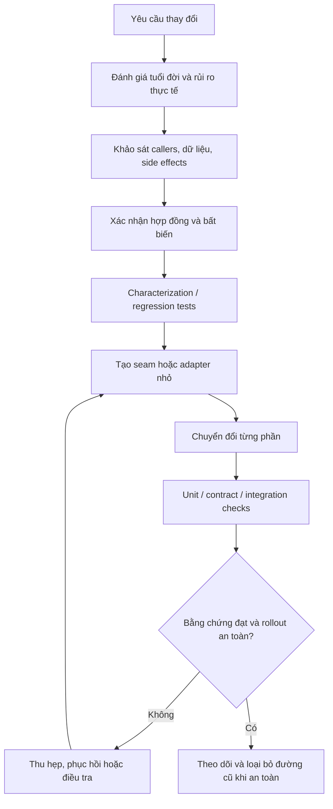

# Phân biệt mã cũ với mã khó thay đổi an toàn

## 1. Tuổi đời của mã không quyết định mức độ rủi ro khi sửa

Một module được viết từ mười năm trước có thể vẫn dễ hiểu, có hợp đồng ổn định, test đáng tin và chỉ cần một thay đổi nhỏ để đáp ứng yêu cầu mới. Ngược lại, một service vừa được phát triển vài tháng có thể rất khó sửa nếu logic nghiệp vụ bị trộn với I/O, trạng thái toàn cục, cấu hình ngầm và nhiều tác dụng phụ không được kiểm soát.

Vì vậy, **mã cũ** và **mã khó thay đổi an toàn** không phải hai cách gọi cho cùng một vấn đề:

- **Mã cũ** nói về tuổi đời, công nghệ, bối cảnh hoặc lịch sử hình thành. Từ “cũ” tự nó chưa chứng minh code kém chất lượng.
- **Mã khó thay đổi an toàn** nói về khả năng hiểu tác động, bảo vệ hành vi và triển khai một thay đổi mà không tạo hồi quy hoặc sự cố ngoài dự kiến.

Trong module `CODE_QUALITY_FUNDAMENTALS`, mục tiêu là **hiểu những thuộc tính quyết định mã nguồn có đáng tin cậy, dễ hiểu và dễ thay đổi hay không**. Thuộc chương **Mã hiện hữu**, bài này tập trung vào cách phân biệt tuổi đời của code với rủi ro thay đổi thực tế.

Một hệ thống có thể dùng Java phiên bản cũ nhưng có module hóa tốt, test ổn định và API rõ ràng. Một hệ thống dùng framework mới nhất vẫn có thể có các lớp phụ thuộc vòng, các phương thức ghi dữ liệu ở nhiều nơi và không có cách xác nhận hành vi sau refactor.

Điều cần đánh giá không phải “code được viết khi nào?” mà là:

1. Ta có hiểu hành vi hiện tại và hợp đồng cần giữ không?
2. Ta có biết thay đổi sẽ ảnh hưởng những thành phần nào không?
3. Có bằng chứng đủ tin cậy để phát hiện hành vi bị phá không?
4. Có thể triển khai, quan sát và phục hồi khi thay đổi gây sự cố không?

Sau bài học, bạn có thể phân biệt tuổi đời với khả năng bảo trì, nhận diện cơ chế khiến code khó thay đổi, khảo sát hệ thống trước khi sửa, tạo characterization tests, tìm seam để cô lập phụ thuộc, chuyển đổi từng phần và xác định khi nào nên giữ nguyên một module cũ.

## 2. Mã cũ, mã legacy và mã khó thay đổi

Các từ “legacy code” và “old code” thường được dùng lẫn nhau trong hội thoại, nhưng khi đưa ra quyết định kỹ thuật nên nói rõ ý nghĩa.

| Khái niệm | Ý nghĩa thực tế | Điều không thể kết luận chỉ từ tên gọi |
| --- | --- | --- |
| **Mã cũ theo tuổi đời** | Được viết hoặc phát hành từ lâu | Chưa chắc khó hiểu hay không an toàn |
| **Mã legacy theo bối cảnh** | Code đang được vận hành và có người dùng/phụ thuộc cần duy trì, có thể mang theo quyết định lịch sử | Không có nghĩa phải viết lại |
| **Mã khó bảo trì** | Cấu trúc làm việc hiểu, sửa và kiểm chứng tốn nhiều công | Không nhất thiết là code lâu năm |
| **Mã khó thay đổi an toàn** | Không đủ khả năng dự đoán tác động, kiểm chứng hợp đồng, giới hạn phạm vi và phục hồi | Không chỉ là vấn đề style hoặc số dòng |
| **Mã chưa có test** | Chưa có bằng chứng tự động ở một số phạm vi | Không tự động chứng minh hành vi sai |
| **Mã không có người sở hữu rõ** | Thiếu trách nhiệm cập nhật và hiểu biết tập trung | Không nhất thiết code có lỗi, nhưng rủi ro tri thức cao |

Ví dụ, một thư viện nội bộ có API ổn định, test hợp đồng và chỉ có một vài caller có thể đã cũ nhưng vẫn an toàn để thay đổi có kiểm soát. Một microservice mới tạo có thể khó sửa nếu mỗi request ghi vào nhiều hệ thống, trạng thái retry không rõ và không có correlation giữa các tác dụng phụ.

### 2.1. “Legacy” thường là mối quan hệ với hiện tại

Một thành phần trở thành legacy vì nó đang tồn tại trong một hệ sinh thái có phụ thuộc: người dùng, dữ liệu lịch sử, phiên bản client, tích hợp đối tác, quy trình vận hành hoặc quy định nghiệp vụ. Nó có thể tiếp tục tạo giá trị và cần được duy trì trong thời gian dài.

Vì vậy, gọi một module là legacy không nên là cách kết luận “hãy bỏ đi”. Câu hỏi phù hợp hơn là **nó còn phục vụ ai, hợp đồng nào cần giữ và chi phí thay thế có xứng đáng không?**

### 2.2. Công nghệ mới không bảo đảm khả năng thay đổi

Framework mới có thể cung cấp dependency injection, observability và test tooling, nhưng code vẫn có thể sử dụng chúng sai cách. Một class dùng annotation hiện đại không tự có ranh giới tốt nếu nó vừa nhận HTTP request, vừa tính giá, ghi database và gọi thanh toán.

Khả năng thay đổi là thuộc tính của **cách hệ thống tổ chức hành vi và bằng chứng**, không phải huy hiệu phiên bản công nghệ.

## 3. Thế nào là thay đổi an toàn?

Không có thay đổi nào hoàn toàn không rủi ro. “An toàn” ở đây có nghĩa là nhóm **hiểu và kiểm soát được rủi ro ở mức phù hợp với hậu quả**.

Một thay đổi có thể được xem là có kiểm soát khi:

- Phạm vi code, dữ liệu, caller và hệ thống phụ thuộc đã được xác định đủ rõ.
- Hành vi cần giữ được diễn đạt bằng hợp đồng, test hoặc bằng chứng khác.
- Các đường lỗi quan trọng và trường hợp biên đã được xem xét.
- Tác dụng phụ, transaction, concurrency và thứ tự thao tác không bị đổi ngoài chủ đích.
- Có cách triển khai, theo dõi và phục hồi phù hợp.
- Người chịu trách nhiệm hiểu giả định và giới hạn còn lại.

### 3.1. Sáu chiều để đánh giá

| Chiều đánh giá | Câu hỏi | Bằng chứng có thể xem |
| --- | --- | --- |
| **Khả năng hiểu** | Người khác có giải thích được luồng và quy tắc chính không? | Tên, ranh giới module, tài liệu, review |
| **Khả năng dự đoán tác động** | Có biết caller, dữ liệu và dependency nào bị ảnh hưởng không? | Dependency graph, tìm references, tracing |
| **Khả năng kiểm chứng** | Có test đáng tin cho hợp đồng quan trọng không? | Unit, contract, integration, regression tests |
| **Khả năng cô lập** | Có thể thay logic mà không cần khởi tạo cả hệ thống không? | Seams, interfaces, dependency boundaries |
| **Khả năng triển khai** | Có thể đưa thay đổi qua các phiên bản và dữ liệu hiện có không? | Migration plan, compatibility, rollout |
| **Khả năng phục hồi** | Nếu sai, có thể phát hiện và giảm tác động không? | Metrics, logs, alerts, rollback/forward-fix |

Không cần một điểm tổng để kết luận mọi module. Một vùng code có thể dễ hiểu nhưng thiếu test; vùng khác có test tốt nhưng migration rủi ro. Hãy ghi rõ **chiều nào đang là trở ngại và vì sao**.

### 3.2. Thay đổi nhỏ về số dòng vẫn có thể có rủi ro lớn

Đổi một điều kiện trong quyền truy cập có thể chỉ cần một ký tự nhưng ảnh hưởng dữ liệu nhạy cảm. Đổi tên một biến local có thể tác động gần như bằng không. Kích thước diff không phải thước đo đáng tin cho phạm vi hậu quả.

### 3.3. An toàn phụ thuộc loại thay đổi

Thêm một trường optional vào response có thể ít rủi ro nếu caller bỏ qua trường không biết. Xóa một trường cũ có thể phá client đã phát hành. Thay đổi hàm tính thuần có thể được kiểm tra bằng unit test; đổi transaction hoặc thứ tự gửi event cần integration/failure tests.

Do đó, không nên đánh giá code bằng một câu “dễ sửa/khó sửa” tách khỏi **thay đổi cụ thể đang dự định thực hiện**.

## 4. Dấu hiệu thực sự cho thấy code khó thay đổi an toàn

Các dấu hiệu nên được xem như giả thuyết để điều tra, không phải checklist máy móc.

### 4.1. Một quy tắc bị sao chép ở nhiều nơi

Nếu cùng chính sách phí, phân quyền hoặc trạng thái đơn hàng xuất hiện trong controller, batch job và event consumer, thay đổi có thể chỉ cập nhật một phần. Hậu quả là các đường xử lý đưa ra kết quả khác nhau.

**Câu hỏi:** Những đoạn code giống nhau có thật sự cùng hợp đồng không? Chúng dùng cùng nguồn dữ liệu, đơn vị và thời điểm không? Có một nơi sở hữu quy tắc không?

### 4.2. Một class biết quá nhiều về thành phần khác

Một service đọc hàng loạt trường nội bộ của object khác, điều khiển thứ tự gọi repository và tự diễn giải trạng thái adapter có thể đang sở hữu quá nhiều trách nhiệm. Thay đổi cấu trúc của một thành phần buộc nhiều caller phải đổi theo.

### 4.3. Tác dụng phụ ẩn hoặc trạng thái toàn cục

Các lời gọi như `System.currentTimeMillis()`, `LocalDate.now()`, static mutable field, singleton có thể thay đổi và truy cập environment trực tiếp khiến kết quả phụ thuộc môi trường hoặc thời điểm. Test khó cô lập, và người sửa khó biết hành vi nào bị ảnh hưởng.

### 4.4. Không có đường kiểm chứng đủ tin cậy

Một module có thể không có test, test chỉ kiểm tra implementation detail, hoặc suite chạy không ổn định. Khi sửa, nhóm phải kiểm tra thủ công nhiều bước và vẫn không biết mình đã bỏ sót gì.

### 4.5. Ranh giới giao dịch và lỗi không rõ

Code ghi database rồi gọi dịch vụ ngoài nhưng không định nghĩa trạng thái khi timeout, retry hoặc process restart có thể khó sửa vì mỗi lần di chuyển một dòng đều có thể làm đổi tính nhất quán.

### 4.6. Thay đổi nhỏ tạo phạm vi diff lớn

Một thay đổi chính sách cần sửa nhiều module không liên quan, nhiều file cấu hình hoặc nhiều adapter. Đây là dấu hiệu coupling hoặc thiếu abstraction có ích, nhưng cần phân tích xem phạm vi rộng là do nợ hay do yêu cầu thực sự liên quan nhiều thành phần.

### 4.7. Chỉ một người biết cách vận hành

Nếu chỉ một người hiểu script triển khai, dữ liệu cần backfill hoặc thứ tự bật feature flag, rủi ro không chỉ nằm trong code. Tri thức chưa được chia sẻ khiến thay đổi phụ thuộc vào sự hiện diện của một cá nhân.

### 4.8. Không thể biết bản đang chạy khác gì bản đã kiểm tra

Nếu artifact, commit, config và schema không được truy vết, nhóm không thể chắc phiên bản nào đã qua test hoặc đang xử lý dữ liệu. Đây là vấn đề quy trình và vận hành, không thể sửa chỉ bằng rename method.

## 5. Những điều trông giống nợ nhưng chưa đủ bằng chứng

Một số dấu hiệu thường bị gán nhãn quá nhanh.

| Quan sát | Có thể là vấn đề? | Cần xác minh thêm |
| --- | --- | --- |
| Code dài 10 năm | Có thể đã tích lũy quyết định cũ | Hành vi, test, caller và chi phí thay đổi hiện tại |
| Method dài 80 dòng | Có thể trộn nhiều trách nhiệm | Có nhiều lý do thay đổi không, luồng có khó hiểu không |
| Dùng thư viện cũ | Có thể thiếu hỗ trợ hoặc lỗ hổng | Phiên bản còn hỗ trợ, CVE, khả năng nâng cấp |
| Không dùng interface | Có thể coupling cứng | Có nhu cầu thay implementation/test seam thực sự không |
| Coverage thấp | Có thể thiếu bằng chứng | Vùng nào rủi ro cao, test hiện có bảo vệ gì |
| Nhiều class | Có thể abstraction quá mức | Mỗi class có trách nhiệm và hợp đồng riêng không |
| Không dùng framework mới | Không tự là vấn đề | Có yêu cầu kỹ thuật hoặc vận hành nào không đáp ứng? |
| Comment ít | Có thể thiếu lý do của quyết định bất thường | Tên, test và tài liệu hiện tại có đủ diễn đạt không |
| Build chậm | Có thể gây feedback chậm | Chậm ở compile, test, dependency download hay runner? |
| Không có test end-to-end | Có thể thiếu kiểm tra luồng quan trọng | Unit/contract/integration hiện có bảo vệ đến đâu? |

**Không refactor chỉ để code giống phong cách ưa thích.** Một thay đổi cấu trúc nên có mục tiêu, ví dụ giảm số nơi phải sửa cùng chính sách, cô lập một phụ thuộc khó kiểm soát hoặc tạo bằng chứng cho một hợp đồng quan trọng.

## 6. Vì sao code khó thay đổi? Nhìn vào cơ chế thay vì triệu chứng

### 6.1. Coupling vượt ranh giới

Một module phụ thuộc trực tiếp vào chi tiết của nhiều module khác sẽ chịu ảnh hưởng khi các chi tiết ấy đổi. Dependency vòng khiến không biết nên thay đổi ở đâu trước, và khó kiểm thử từng phần.

Cần phân biệt **coupling cần thiết** (một service phải gọi repository để lưu dữ liệu) với coupling không cần thiết (policy tính giá phải biết loại connection pool hoặc cấu trúc bảng).

### 6.2. Cohesion thấp

Một class vừa parse HTTP, tính chiết khấu, gửi email và lưu dữ liệu thường có nhiều lý do thay đổi. Khi yêu cầu email đổi, người sửa có thể phải đọc cả logic tiền; khi logic tiền đổi, test lại phải dựng email client.

Tách trách nhiệm có thể giúp, nhưng không phải cứ tạo class cho từng dòng là tăng cohesion. Ranh giới cần dựa trên khái niệm và lý do thay đổi.

### 6.3. Hợp đồng không được thể hiện

Một phương thức trả `boolean` có thể có nghĩa “đã lưu”, “được phép”, “tìm thấy” hoặc “đã gửi”. Nếu caller không biết `false` là kết quả nghiệp vụ hay lỗi hạ tầng, thay đổi dễ làm mất ngữ nghĩa.

Kiểu dữ liệu, tên, exception, Javadoc và contract tests cần diễn đạt những trạng thái quan trọng.

### 6.4. Dữ liệu và hành vi không cùng chủ sở hữu

Nếu một class tự lấy dữ liệu nội bộ từ object khác để tính quy tắc của object đó, thay đổi mô hình dữ liệu có thể kéo theo nhiều nơi. Di chuyển trách nhiệm có thể giảm điều này khi xác định được nơi sở hữu đúng, nhưng phải giữ nguyên transaction và side effect.

### 6.5. Phụ thuộc môi trường bị ẩn

Code đọc giờ hệ thống, locale, timezone, biến môi trường hoặc thư mục hiện tại trực tiếp khó tái hiện trong test. Kết quả có thể khác giữa laptop, CI và production.

Những phụ thuộc này có thể được truyền vào qua constructor hoặc method, ví dụ `Clock`, `ZoneId`, config object hoặc interface adapter.

### 6.6. Không có đường đi an toàn qua dữ liệu cũ

Schema, event và API đã tồn tại thường có caller cũ. Thay đổi một field có thể cần nhiều phiên bản chạy song song, backfill hoặc giai đoạn đọc/ghi kép. Nếu không hiểu lịch sử dữ liệu và caller, code mới có thể đúng với dữ liệu fixture nhưng sai với production.

### 6.7. Không có khả năng quan sát

Nếu hệ thống không ghi nhận phiên bản, trạng thái giao dịch, lỗi adapter và correlation ID phù hợp, nhóm khó xác định hậu quả sau triển khai. Khả năng thay đổi an toàn cần cả **phát hiện và phản ứng**, không chỉ compile/test.

## 7. Khảo sát trước khi sửa: dựng bản đồ tác động

Trước khi chỉnh một vùng code hiện hữu, hãy hiểu nó trong phạm vi vừa đủ. Mục tiêu không phải đọc toàn bộ repository, mà là dựng bản đồ của thay đổi cụ thể.

### 7.1. Bắt đầu từ hành vi được yêu cầu

Viết lại yêu cầu thành câu có thể kiểm tra:

- Người dùng hoặc hệ thống nào đang gọi?
- Điều kiện nào kích hoạt?
- Kết quả đúng phải là gì?
- Trường hợp biên và trạng thái lỗi?
- Dữ liệu nào được đọc/ghi?
- Có side effect hoặc event nào?
- Những phiên bản/caller nào phải tiếp tục hoạt động?

Nếu chưa thể trả lời, có thể cần xác minh hợp đồng trước khi sửa.

### 7.2. Lần theo đường gọi

Tìm entry point, các caller, dependency và nơi lưu trạng thái. Trong Java có thể xem references, tìm tên method/interface, đọc module dependency và kiểm tra các adapter. Với hệ thống lớn, tracing có thể cho biết đường xử lý thật mà static code search không bộc lộ hết.

### 7.3. Tìm nơi dữ liệu thay đổi

Một quy tắc có thể xuất hiện ở nhiều nơi đọc nhưng chỉ một nơi ghi; hoặc có nhiều job ghi cùng một bảng. Hãy xác định:

- Ai tạo dữ liệu?
- Ai cập nhật?
- Ai đọc và diễn giải?
- Có migration, backfill hoặc dữ liệu cũ?
- Có unique constraint, foreign key hoặc check constraint?
- Có retry/idempotency?
- Có tác vụ ngoài request như batch/consumer?

### 7.4. Xem lịch sử thay đổi và sự cố

Lịch sử commit, pull request, bug report và incident có thể chỉ ra vùng code thường gây hồi quy hoặc có workaround. Tuy nhiên, tần suất sửa cao không tự chứng minh thiết kế kém: một tính năng thành công có thể thay đổi nhiều vì nghiệp vụ phát triển.

### 7.5. Dùng bằng chứng nhiều nguồn

| Nguồn | Trả lời được | Không tự trả lời được |
| --- | --- | --- |
| Code search | Vị trí tham chiếu và cách triển khai tĩnh | Đường gọi runtime có thực sự đi qua không |
| Dependency graph | Quan hệ package/module | Ý nghĩa nghiệp vụ của phụ thuộc |
| Tests | Những hành vi đã được assertion | Những yêu cầu chưa được test |
| Tracing/logs | Đường đi và sự kiện đã quan sát | Mọi đường hiếm hoặc chưa phát sinh |
| Incident/PR history | Vùng từng gặp vấn đề | Nguyên nhân luôn là thiết kế |
| Schema/contract | Hình dạng dữ liệu và API đã công bố | Mọi consumer đang dùng phiên bản nào |
| Người vận hành/domain owner | Bối cảnh và quy tắc lịch sử | Bằng chứng thay thế cho test hoặc dữ liệu |

Đừng suy luận chỉ từ một nguồn. Ví dụ, một phương thức có vẻ không được gọi trong code search vẫn có thể được framework gọi qua reflection hoặc cấu hình.

## 8. Khi test còn thiếu: characterization tests giúp tạo điểm tựa

**Characterization test** là test ghi nhận hành vi đang có của một hệ thống, thường được dùng khi code cũ chưa có đặc tả hoặc test đủ tin cậy. Nó giúp phát hiện khi refactor làm thay đổi hành vi quan sát được.

Tuy nhiên, characterization test **không chứng minh hành vi cũ là đúng nghiệp vụ**. Nếu hệ thống đang có bug, test ghi nhận bug đó có thể làm nó khó sửa hơn nếu không phân biệt rõ.

### 8.1. Tách hành vi quan sát được khỏi hành vi được yêu cầu

Có thể ghi hai cột:

| Quan sát hiện tại | Hợp đồng mong muốn đã xác nhận |
| --- | --- |
| Tại đúng ngưỡng 200.00 đang thu phí | Đúng ngưỡng phải miễn phí |
| Khi gateway timeout trả trạng thái `FAILED` | Trạng thái phải là chưa xác định và cần đối soát |
| Client cũ gửi `customer_id` vẫn được chấp nhận | Tiếp tục hỗ trợ trong giai đoạn migration |
| Job chạy lại tạo bản ghi trùng | Cùng request ID phải idempotent |

Nếu hai cột khác nhau, cần **sửa bug hoặc thay đổi hợp đồng có chủ đích** trước/sau refactor theo kế hoạch rõ. Không nên ghi PR là “refactor giữ nguyên hành vi” khi thực tế đã sửa nghĩa.

### 8.2. Ví dụ test ghi nhận hành vi đơn giản

Giả sử code cũ có chính sách phí:

```java
import java.math.BigDecimal;

public final class LegacyShippingFee {
    private LegacyShippingFee() {}

    public static BigDecimal calculate(BigDecimal subtotal) {
        if (subtotal.compareTo(new BigDecimal("200.00")) > 0) {
            return BigDecimal.ZERO;
        }
        return new BigDecimal("30.00");
    }
}
```

Một characterization test có thể ghi nhận điều đang xảy ra:

```java
import static org.junit.jupiter.api.Assertions.*;
import java.math.BigDecimal;
import org.junit.jupiter.api.Test;

class LegacyShippingFeeCharacterizationTest {
    @Test
    void recordsCurrentBehaviorAtExactThreshold() {
        BigDecimal actual =
                LegacyShippingFee.calculate(new BigDecimal("200.00"));

        assertEquals(0, actual.compareTo(new BigDecimal("30.00")));
    }
}
```

Test này ghi nhận implementation hiện tại **đang thu phí ở đúng ngưỡng**. Nếu tài liệu nghiệp vụ xác nhận đúng ngưỡng phải miễn, không được coi test trên là specification cuối cùng. Hãy ghi bug và thêm regression test mong đợi:

```java
@Test
void approvedPolicyWaivesFeeAtExactThreshold() {
    BigDecimal actual =
            ShippingFeePolicy.calculate(new BigDecimal("200.00"));

    assertEquals(0, actual.compareTo(BigDecimal.ZERO));
}
```

Đoạn thứ hai giả định đã có policy đích với hợp đồng mới. Nó minh họa test cho **hành vi đã được xác nhận**, không phải lời gọi chạy được với class legacy ở trên.

### 8.3. Test theo hợp đồng, tránh khóa chặt implementation

Ưu tiên assertion về:

- Giá trị và trạng thái trả về.
- Exception thuộc hợp đồng.
- Dữ liệu được lưu hoặc event được phát ở ranh giới quan trọng.
- Thứ tự khi thứ tự là một bất biến thực.
- Không có side effect khi validation thất bại.
- Hành vi với dữ liệu biên, null, rỗng, lỗi và timeout.

Không cần kiểm tra một private helper đã được gọi đúng ba lần chỉ vì code hiện tại có ba bước. Khi cấu trúc thay đổi, test đó có thể fail dù hợp đồng vẫn được giữ.

## 9. Tìm seam: tạo điểm có thể quan sát hoặc thay thế hành vi

Một **seam** là vị trí trong thiết kế cho phép thay đổi hành vi hoặc quan sát nó mà không phải sửa mọi nơi xung quanh. Seam có thể là interface, constructor parameter, adapter, method boundary, configuration point hoặc một ranh giới module.

Ví dụ, code gọi trực tiếp static method để lấy ngày hiện tại:

```java
if (invoice.dueDate().isBefore(LocalDate.now())) {
    markOverdue(invoice);
}
```

Kết quả phụ thuộc vào ngày thật của máy chạy. Một seam đơn giản là truyền `Clock`:

```java
import java.time.Clock;
import java.time.LocalDate;
import java.util.Objects;

public final class InvoiceDeadlinePolicy {
    private final Clock clock;

    public InvoiceDeadlinePolicy(Clock clock) {
        this.clock = Objects.requireNonNull(clock, "clock");
    }

    public boolean isOverdue(LocalDate dueDate) {
        Objects.requireNonNull(dueDate, "dueDate");
        LocalDate today = LocalDate.now(clock);
        return dueDate.isBefore(today);
    }
}
```

Test có thể dùng đồng hồ cố định:

```java
import static org.junit.jupiter.api.Assertions.*;
import java.time.Clock;
import java.time.Instant;
import java.time.LocalDate;
import java.time.ZoneOffset;
import org.junit.jupiter.api.Test;

class InvoiceDeadlinePolicyTest {
    @Test
    void evaluatesAgainstInjectedClock() {
        Clock fixedClock = Clock.fixed(
                Instant.parse("2026-11-16T10:00:00Z"),
                ZoneOffset.UTC);
        var policy = new InvoiceDeadlinePolicy(fixedClock);

        assertTrue(policy.isOverdue(LocalDate.of(2026, 11, 15)));
        assertFalse(policy.isOverdue(LocalDate.of(2026, 11, 16)));
    }
}
```

Ví dụ này chỉ thay cách lấy ngày để test được xác định; nó **không quyết định** nghiệp vụ có coi hóa đơn đến hạn hôm nay là quá hạn hay không. Nếu quy tắc tính theo múi giờ địa phương của khách hàng, phải truyền `ZoneId` phù hợp thay vì mặc định UTC.

### 9.1. Seam có thể bao quanh code cũ

Không cần viết lại một module để tạo seam. Có thể thêm adapter nhỏ:

- Một interface bao quanh static SDK.
- Một repository interface trước khi gọi database.
- Một wrapper cung cấp clock/configuration.
- Một facade giữ API cũ nhưng ủy quyền vào implementation mới.
- Một function boundary nhận dữ liệu và trả kết quả thuần.

Mục tiêu là **cô lập điều khó kiểm soát** để phần logic cần thay đổi có thể được kiểm tra độc lập.

### 9.2. Đừng thêm abstraction nếu chưa có vấn đề cần cô lập

Nếu một hàm thuần rất nhỏ chỉ có một caller và không có phụ thuộc ngoài, thêm ba interface chỉ để “dễ mock” có thể làm code phức tạp hơn. Seam hữu ích khi nó giảm coupling hoặc tạo cách kiểm chứng cần thiết, không phải vì mọi dependency đều phải được bọc.

## 10. Chuyển đổi từng phần thay vì viết lại toàn bộ

Khi một hệ thống khó thay đổi, phản xạ “rewrite từ đầu” rất hấp dẫn. Nhưng viết lại đồng nghĩa phải tái hiện cả hành vi được biết lẫn hành vi chưa được ghi lại, xử lý dữ liệu lịch sử, tương thích caller và vận hành hai phiên bản.

Các chiến lược từng bước thường an toàn hơn.

### 10.1. Branch by Abstraction

Tạo một abstraction hoặc facade trước, sau đó chuyển caller từng phần sang implementation mới. Trong thời gian chuyển đổi, abstraction có thể định tuyến tới code cũ hoặc code mới theo policy rõ.

Lợi ích: thay đổi không cần diễn ra cùng lúc ở mọi caller. Rủi ro: tồn tại giai đoạn hai implementation, cần kiểm tra kết quả và tránh định tuyến khác nhau ngoài chủ đích.

### 10.2. Strangler pattern

Với hệ thống lớn, có thể đưa một facade hoặc router trước hệ thống cũ. Từng chức năng được chuyển sang thành phần mới, trong khi các đường chưa chuyển vẫn dùng hệ thống cũ. Khi mọi caller và dữ liệu liên quan đã được chuyển, phần cũ mới được loại bỏ.

Không nên dùng pattern này cho một class nhỏ không có ranh giới vận hành rõ; thêm router và hai đường triển khai có thể không đáng.

### 10.3. Expand-and-contract cho schema và API

Khi đổi cấu trúc dữ liệu có caller cũ:

1. **Expand:** thêm trường hoặc schema mới theo cách phiên bản cũ vẫn hoạt động.
2. **Dual support:** ứng dụng có thể đọc/ghi theo giai đoạn tương thích đã định.
3. **Backfill:** chuyển dữ liệu cũ và kiểm tra đối soát.
4. **Switch:** chuyển caller sang schema mới, quan sát kết quả.
5. **Contract:** chỉ xóa trường/đường cũ sau khi xác nhận không còn consumer được hỗ trợ cần nó.

Migration phải có chiến lược rollback hoặc forward-fix thực tế. Không phải mọi thay đổi dữ liệu đều đảo ngược an toàn sau khi ghi dữ liệu mới.

### 10.4. Không để hai nguồn dữ liệu cùng trở thành “nguồn sự thật”

Trong giai đoạn dual-write, hai hệ thống có thể lệch nhau nếu một lần ghi thành công ở nơi này nhưng thất bại ở nơi kia. Cần xác định nguồn sự thật, cách retry/idempotency, đối soát và tiêu chí kết thúc chuyển đổi. Dual-write không tự đảm bảo nhất quán.

## 11. Ví dụ: bọc dependency cũ để có thể thay đổi và kiểm chứng

Giả sử một service hiện gọi trực tiếp static payment gateway. Điều đó làm unit test khó kiểm soát vì mỗi test có thể phụ thuộc SDK, mạng hoặc trạng thái bên ngoài.

Một cách cô lập là định nghĩa cổng thanh toán nhỏ:

```java
public interface PaymentPort {
    PaymentResult charge(String requestId, long amountCents);
}

public record PaymentResult(
        PaymentStatus status,
        String transactionId) {}

public enum PaymentStatus {
    APPROVED,
    DECLINED,
    UNKNOWN
}
```

Trong dự án Java, mỗi kiểu `public` ở ví dụ này được đặt trong tệp nguồn riêng có tên tương ứng (PaymentPort.java, PaymentResult.java và PaymentStatus.java). Chúng được đặt cùng một khối để trình bày mối quan hệ giữa các kiểu.

Adapter cũ thực hiện giao tiếp SDK:

```java
public final class LegacyPaymentAdapter implements PaymentPort {
    @Override
    public PaymentResult charge(String requestId, long amountCents) {
        // Gọi SDK cũ tại đây và chuyển phản hồi sang kiểu nội bộ.
        // Phải ánh xạ timeout thành UNKNOWN nếu chưa biết giao dịch đã chạy chưa.
        throw new UnsupportedOperationException(
                "Illustrative adapter boundary; SDK integration is project-specific");
    }
}
```

Implementation adapter ở trên **cố ý là khung minh họa**, chưa tích hợp SDK thật. Nó cho thấy vị trí đặt mapping; không thể dùng nguyên trạng trong production.

Service nghiệp vụ có thể nhận `PaymentPort` qua constructor:

```java
import java.util.Objects;

public final class CheckoutPaymentService {
    private final PaymentPort paymentPort;

    public CheckoutPaymentService(PaymentPort paymentPort) {
        this.paymentPort = Objects.requireNonNull(paymentPort, "paymentPort");
    }

    public PaymentResult pay(String requestId, long amountCents) {
        if (requestId == null || requestId.isBlank()) {
            throw new IllegalArgumentException("requestId must not be blank");
        }
        if (amountCents <= 0) {
            throw new IllegalArgumentException("amountCents must be positive");
        }
        return Objects.requireNonNull(
                paymentPort.charge(requestId, amountCents),
                "payment result");
    }
}
```

Test có thể dùng fake thay vì gọi gateway thật:

```java
import static org.junit.jupiter.api.Assertions.*;
import org.junit.jupiter.api.Test;

class CheckoutPaymentServiceTest {
    @Test
    void passesRequestAndAmountToPaymentPort() {
        PaymentPort fake = (requestId, amountCents) -> {
            assertEquals("req-42", requestId);
            assertEquals(12500L, amountCents);
            return new PaymentResult(PaymentStatus.APPROVED, "txn-9");
        };

        var service = new CheckoutPaymentService(fake);
        var result = service.pay("req-42", 12500L);

        assertEquals(PaymentStatus.APPROVED, result.status());
        assertEquals("txn-9", result.transactionId());
    }

    @Test
    void rejectsInvalidAmountBeforeCallingPaymentPort() {
        var service = new CheckoutPaymentService(
                (requestId, amountCents) -> {
                    fail("Payment port must not be called");
                    return null;
                });

        assertThrows(IllegalArgumentException.class,
                () -> service.pay("req-42", 0L));
    }
}
```

Seam này làm service dễ test hơn, nhưng chưa chứng minh adapter xử lý timeout, idempotency hoặc protocol đúng. Cần contract/integration tests riêng với sandbox hoặc môi trường kiểm soát của nhà cung cấp.

### 11.1. Đừng mock luôn thứ cần xác minh

Nếu rủi ro nằm ở transaction database, mock repository sẽ không kiểm tra constraint. Nếu rủi ro nằm ở SDK serialization, fake `PaymentPort` không kiểm tra request thật. Chọn test double cho logic cần cô lập, và integration test cho ranh giới có rủi ro.

## 12. Quản lý rủi ro dữ liệu, transaction và concurrency

Code hiện hữu thường mang theo các giả định không hiển thị trong chữ ký method.

Trước khi di chuyển hoặc thay thế code ghi dữ liệu, xác định:

- Một thao tác có bao nhiêu lần ghi?
- Các lần ghi có nằm trong cùng transaction không?
- Khi lỗi giữa chừng, trạng thái nào tồn tại?
- Retry có thể tạo tác dụng phụ trùng không?
- Có request đồng thời cùng cập nhật một bản ghi không?
- Có constraint database bảo vệ bất biến không?
- Event được phát trước hay sau khi commit?
- Dữ liệu lịch sử có giá trị hoặc hình dạng khác dữ liệu mới không?

### 12.1. Đọc rồi ghi riêng có thể tạo race condition

Mẫu nguy hiểm:

```java
int available = repository.readAvailable(sku);
if (available >= requested) {
    repository.writeAvailable(sku, available - requested);
}
```

Hai request có thể cùng đọc một giá trị trước khi một request ghi. Cả hai đều thấy đủ hàng và sau đó cùng trừ. Tách đoạn code thành helper không giải quyết vấn đề; cần một thao tác nguyên tử hoặc transaction/locking/constraint phù hợp với database.

### 12.2. Side effect có trạng thái chưa xác định

Khi gửi thanh toán hoặc phát event, timeout không tự chứng minh phía nhận chưa thực hiện. Thay đổi code quanh retry phải giữ khóa idempotency, trạng thái chưa xác định và cơ chế đối soát theo hợp đồng thật.

### 12.3. Migration phải tính tới phiên bản chạy song song

Trong rollout, phiên bản cũ và mới có thể cùng ghi dữ liệu. Một migration chỉ đúng khi ứng dụng mới chạy đơn độc có thể thất bại lúc deploy nhiều instance. Cần test theo trình tự triển khai thực tế, không chỉ test schema mới trên database trống.
## 13. Lập kế hoạch thay đổi theo rủi ro và khả năng phục hồi

Một kế hoạch an toàn thường có các bước:

1. **Xác định mục tiêu:** thay đổi hành vi nào, hoặc giảm rủi ro cấu trúc nào?
2. **Vẽ phạm vi ảnh hưởng:** callers, dữ liệu, API, job, dependency, phiên bản.
3. **Xác nhận hợp đồng:** điều gì phải giữ, điều gì được phép thay đổi?
4. **Tạo bằng chứng nền:** test, log, trace, số liệu và characterization khi cần.
5. **Tạo seam nhỏ:** cô lập dependency hoặc policy gây khó khăn.
6. **Thực hiện thay đổi hẹp:** ưu tiên một caller hoặc một đường xử lý.
7. **Chạy test đúng tầng:** unit, contract, integration, failure/concurrency theo rủi ro.
8. **Triển khai có kiểm soát:** canary, feature flag hoặc rollout theo giai đoạn khi phù hợp.
9. **Quan sát guardrails:** correctness, error rate, latency, dữ liệu và tác dụng phụ.
10. **Hoàn tất chuyển đổi:** loại bỏ code cũ khi đã xác minh caller và dữ liệu.
11. **Ghi lại phần còn lại:** giả định, rủi ro và chủ sở hữu của việc chưa hoàn thành.



Không phải mọi thay đổi đều cần đủ 11 bước ở cùng mức độ. Đổi tên biến local có thể chỉ cần compile và test liên quan. Đổi transaction hoặc schema có thể cần hầu hết các bước. **Mức độ quy trình phải tương xứng với hậu quả và phạm vi thay đổi.**

## 14. Khi nào nên giữ code cũ?

Không phải cứ thấy legacy là phải rewrite. Có thể giữ nguyên khi:

- Hành vi và hợp đồng đã rõ.
- Thành phần ổn định, ít thay đổi và có chi phí vận hành chấp nhận được.
- Công nghệ vẫn được hỗ trợ và không có rủi ro bảo mật nghiêm trọng.
- Có đủ test/quan sát để thay đổi nhỏ khi cần.
- Viết lại có nguy cơ mất dữ liệu hoặc phá tương thích lớn hơn lợi ích.
- Tính năng sắp ngừng dùng theo kế hoạch đáng tin cậy.
- Chưa có bằng chứng rằng cấu trúc hiện tại là nguyên nhân của chi phí hoặc sự cố.

### 14.1. Khi nào cần đầu tư cải thiện trước khi thêm tính năng?

Có thể cần dừng mở rộng vùng code để bổ sung bằng chứng nếu:

- Không thể xác định trạng thái sau timeout.
- Không có cách test an toàn cho logic có tác dụng phụ.
- Một thay đổi nhỏ thường gây lỗi ở caller không liên quan.
- Dữ liệu quan trọng không có constraint hoặc đối soát.
- Dependency đã hết hỗ trợ hoặc có lỗ hổng nghiêm trọng.
- Không thể biết phiên bản đang chạy hoặc không có cách rollback phù hợp.

“Cải thiện trước” không nhất thiết là viết lại. Thêm test, constraint, adapter, logging hoặc runbook nhỏ có thể giảm rủi ro nhanh hơn một dự án kiến trúc lớn.

### 14.2. Khi nào rewrite có thể hợp lý?

Rewrite có thể được cân nhắc khi nền tảng không còn đáp ứng yêu cầu bắt buộc, chi phí duy trì tiếp tục tăng, không thể nâng cấp an toàn hoặc cần thay đổi mô hình dữ liệu/kiến trúc ở quy mô lớn. Nhưng phải so sánh với các lựa chọn migration từng phần và tính đầy đủ chi phí:

- Tái hiện mọi hành vi cần giữ.
- Chuyển dữ liệu lịch sử.
- Hỗ trợ caller và phiên bản cũ.
- Chạy song song hoặc chuyển traffic.
- Kiểm chứng kết quả và đối soát.
- Đào tạo, vận hành và xử lý sự cố trong giai đoạn chuyển đổi.
- Loại bỏ hệ thống cũ an toàn.

Rewrite không xóa được những quy tắc nghiệp vụ chưa được hiểu. Nếu thiếu tri thức và dữ liệu, code mới có thể tái tạo các vấn đề cũ dưới một cấu trúc khác.

## 15. Đánh giá mức độ sẵn sàng thay đổi bằng câu hỏi cụ thể

Thay vì chấm một điểm “legacy health” chung, có thể dùng bảng câu hỏi theo thay đổi đang dự định.

| Câu hỏi | Tín hiệu rủi ro cao | Bước giảm rủi ro |
| --- | --- | --- |
| Có xác định được caller không? | Framework/reflection hoặc consumer ngoài chưa rõ | Inventory callers, contract tests |
| Hợp đồng đã được xác nhận chưa? | Tài liệu, code và dữ liệu thực mâu thuẫn | Domain review, characterization, decision record |
| Có test hành vi quan trọng không? | Không có test biên hoặc expected phụ thuộc implementation | Regression tests, test độc lập |
| Có cô lập dependency không? | Static global, network/DB gọi trực tiếp | Adapter/seam, dependency injection |
| Side effect có rõ không? | Retry/timeout không biết đã ghi/gửi chưa | Idempotency, transaction, reconciliation |
| Dữ liệu cũ có được hỗ trợ không? | Schema/client cũ chưa rõ | Compatibility inventory, migration test |
| Có thể triển khai từng phần không? | Cần dừng toàn hệ thống hoặc deploy đồng loạt | Expand-contract, facade, feature flag |
| Có thể phát hiện lỗi sau rollout không? | Không có metric/log/correlation hữu ích | Observability và runbook |
| Có thể phục hồi không? | Migration không rollback/forward-fix rõ | Backup, restore rehearsal, recovery plan |
| Có người hiểu và sở hữu không? | Không rõ owner hoặc tri thức chỉ nằm ở một người | Pairing, documentation, shared ownership |

Có thể đánh dấu **đã biết / chưa biết / không áp dụng** thay vì ép một con số tổng. Một câu “chưa biết” ở vùng có hậu quả cao là lý do thu thập bằng chứng trước khi sửa.

## 16. Những sai lầm thường gặp khi làm việc với mã hiện hữu

| Sai lầm | Vì sao gây rủi ro | Cách làm phù hợp hơn |
| --- | --- | --- |
| Đánh giá code theo tuổi đời | Tuổi không nói lên hành vi, hợp đồng hoặc test | Đánh giá theo thay đổi và rủi ro |
| Rewrite trước khi hiểu hệ thống | Bỏ sót quy tắc ngầm và caller cũ | Khảo sát, characterization và migration plan |
| Xem mọi hành vi hiện tại là đúng | Có thể bảo tồn bug | Phân biệt observed behavior và approved contract |
| Xem mọi hành vi lạ là bug | Có thể phá workaround hoặc compatibility | Xác minh nguồn gốc và người sở hữu |
| Viết test chỉ để tăng coverage | Test có thể không bắt lỗi quan trọng | Assertion độc lập, test biên và failure modes |
| Mock mọi dependency | Bỏ qua transaction/protocol thật | Unit tests cộng integration/contract tests |
| Tạo interface cho mọi class | Tăng abstraction mà không giảm coupling thật | Tạo seam ở nơi cần cô lập |
| Chuyển trách nhiệm nhưng đổi transaction | Có thể mất dữ liệu hoặc event | Giữ ranh giới side effect và test failure |
| Chuyển nhiều caller cùng lúc | Phạm vi rollback lớn | Chuyển từng đường, theo dõi và đối chiếu |
| Giữ dual-write vô thời hạn | Hai nguồn dữ liệu có thể lệch | Xác định source of truth và tiêu chí kết thúc |
| Bỏ code cũ ngay sau deploy | Caller chậm cập nhật có thể vẫn dùng | Theo dõi usage và migration window |
| Không đo sau thay đổi | Không biết giả thuyết có đúng không | So sánh trước/sau và guardrails |

### 16.1. Đừng “dọn” code ngoài phạm vi mà không có lý do

Khi đang sửa một bug nhỏ, việc format toàn repository, đổi tên hàng trăm class và thay framework cùng lúc khiến diff khó review. Có thể ghi nhận nợ phát hiện được, nhưng ưu tiên thay đổi đủ nhỏ để hiểu nguyên nhân và kết quả.

### 16.2. Đừng để characterization tests trở thành hợp đồng vĩnh viễn

Khi đã xác nhận một hành vi cũ là bug, cập nhật test theo hợp đồng đúng và lưu lại lý do thay đổi. Nếu giữ cả test cũ lẫn test mới mà không giải thích, nhóm có thể không biết kết quả nào là chuẩn.

## 17. Bài tập tình huống

### Bài 1 — Mã mười năm tuổi nhưng có test tốt

Một thư viện Java được viết từ lâu, có API ổn định, test hợp đồng, dependency còn được hỗ trợ và chỉ một thay đổi nhỏ mỗi năm. Một đề xuất muốn rewrite sang framework mới vì “code quá cũ”. Hãy đánh giá rủi ro thực, chi phí chuyển đổi và bằng chứng cần có trước khi quyết định.

### Bài 2 — Service mới nhưng khó sửa

Một service mới có controller chứa logic tính giá, truy cập database, gọi payment gateway và gửi event. Không có test cho timeout hoặc retry. Hãy xác định vì sao tuổi đời ngắn không làm service an toàn, chọn seam và các test cần tạo trước khi thay đổi.

### Bài 3 — Hành vi hiện tại có phải hợp đồng?

Một hệ thống cũ thu phí tại đúng ngưỡng 200.00. Tài liệu sản phẩm ghi “từ 200.00 trở lên được miễn”, nhưng chưa có test. Hãy tách characterization test và specification test, mô tả quy trình xác nhận bug và tránh gọi thay đổi hành vi là refactor thuần.

### Bài 4 — Static dependency làm test khó

Một lớp gọi `LocalDate.now()` và static SDK thanh toán trực tiếp. Hãy đề xuất seam cho clock và payment gateway, xác định unit test nào trở nên dễ hơn và integration test nào vẫn cần để kiểm tra adapter thật.

### Bài 5 — Migration schema có caller cũ

Một API đổi tên JSON field, trong khi một số mobile client không thể cập nhật ngay. Hãy thiết kế expand-and-contract, cách quan sát usage, test contract và tiêu chí an toàn trước khi xóa field cũ.

### Bài 6 — Hai lần ghi không nguyên tử

Một job lưu đơn hàng rồi gửi event. Sau refactor, event được gửi trước khi transaction commit. Hãy phân tích các trạng thái có thể xảy ra khi process crash, đề xuất vị trí outbox hoặc cơ chế tương đương và test failure cần thiết.

### Bài 7 — Rewrite hay cô lập từng phần?

Một module 20.000 dòng có nhiều caller, thiếu test và một số dependency đã lỗi thời. Hãy xây ba phương án: giữ nguyên có kiểm soát, tạo seam và chuyển từng phần, rewrite. So sánh rủi ro dữ liệu, tương thích, chi phí và thời gian có thể đưa giá trị tới người dùng.

### Bài 8 — Không có owner

Một batch job chỉ chạy mỗi tháng nhưng chỉ một nhân viên cũ biết cách chạy lại sau lỗi. Hãy giải thích vì sao đây là rủi ro thay đổi/vận hành dù code ít đổi, đề xuất runbook, ownership và test phục hồi.

### Bài 9 — Test xanh nhưng dữ liệu production khác

Unit tests dùng fixture mới đầy đủ, nhưng database production có nhiều bản ghi thiếu trường từ phiên bản cũ. Hãy xác định khoảng trống bằng chứng, thiết kế migration/data profiling và test tương thích dữ liệu lịch sử.

### Bài 10 — Refactor quá phạm vi

Một PR sửa bug ở một điều kiện nhưng đồng thời format toàn module, đổi tên public API và chuyển 6 class. Hãy đề xuất cách chia phạm vi, các bằng chứng cần chạy và cách review để giữ được quan hệ nhân quả giữa thay đổi và kết quả.

Với mỗi bài, hãy trả lời theo cấu trúc **tuổi đời/bối cảnh → thay đổi cụ thể → hợp đồng và caller → rủi ro thực → bằng chứng → lựa chọn và kế hoạch chuyển đổi**.

## 18. Ghi nhớ

- **Mã cũ không đồng nghĩa mã khó thay đổi an toàn.** Tuổi đời, framework và phong cách không thay thế đánh giá hành vi, hợp đồng và rủi ro.
- **Đánh giá theo thay đổi cụ thể.** Một module có thể an toàn với rename local nhưng rủi ro cao khi đổi schema hoặc transaction.
- **Khó thay đổi thường có cơ chế rõ:** coupling, trách nhiệm trộn lẫn, trạng thái ẩn, dữ liệu lịch sử, side effect và thiếu bằng chứng.
- **Khảo sát trước khi sửa:** caller, dependency, dữ liệu, transaction, API và lịch sử sự cố đều có thể ảnh hưởng quyết định.
- **Characterization test ghi nhận điều đang xảy ra, không chứng minh nó đúng.** Phân biệt observed behavior với hợp đồng đã được xác nhận.
- **Tạo seam nhỏ để cô lập điều khó kiểm soát.** Clock, gateway, repository và facade có thể giúp kiểm thử, nhưng không thêm abstraction nếu không có mục tiêu.
- **Chuyển đổi từng phần thường giảm phạm vi rủi ro.** Branch by abstraction, strangler và expand-and-contract hữu ích khi có caller hoặc dữ liệu cũ.
- **Giữ transaction và bất biến.** Di chuyển code có side effect cần kiểm tra concurrency, retry, idempotency và trạng thái sau lỗi.
- **Không rewrite chỉ vì code cũ.** So sánh lợi ích, chi phí, tương thích và khả năng phục hồi; có thể giữ nguyên hoặc cải thiện từng phần.
- **An toàn cần cả test lẫn vận hành.** Bằng chứng trước phát hành phải đi cùng quan sát, rollout và phục hồi sau triển khai.

Làm việc tốt với mã hiện hữu bắt đầu bằng việc tách **ấn tượng về tuổi đời** khỏi **bằng chứng về khả năng thay đổi**. Khi biết hợp đồng nào cần giữ, đường phụ thuộc nào cần kiểm soát và nơi nào thiếu khả năng kiểm chứng, nhóm có thể chọn đúng bước: giữ nguyên, thêm test, tạo seam, chuyển đổi từng phần hoặc thay thế. Mục tiêu cuối cùng là làm cho phần mềm **đáng tin cậy, dễ hiểu và dễ thay đổi**, bất kể nó được viết từ năm nào.
