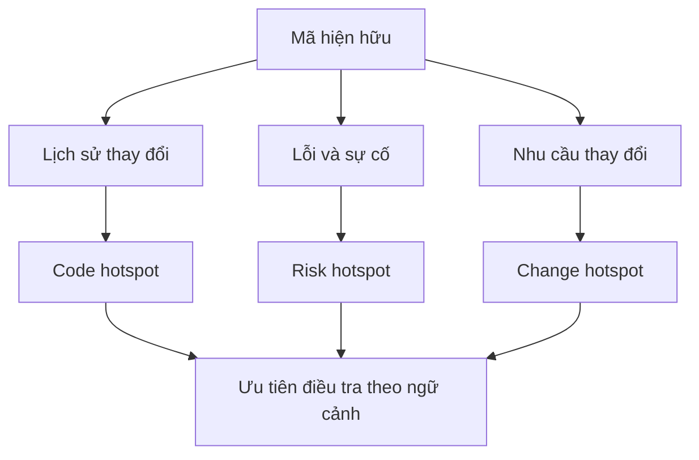
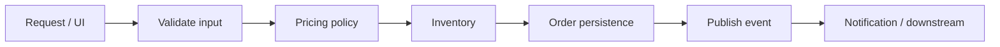
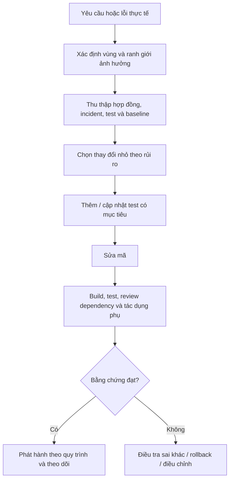

# Xác định vùng rủi ro theo lỗi và nhu cầu thay đổi thực tế

> **Chương:** Mã hiện hữu  
> **Học phần:** CODE_QUALITY_FUNDAMENTALS — Hiểu những thuộc tính quyết định mã nguồn có đáng tin cậy, dễ hiểu và dễ thay đổi hay không.

Trong một hệ thống đã vận hành nhiều năm, không phải mọi phần mã đều có mức rủi ro như nhau. Một module ít thay đổi, có hợp đồng ổn định và được kiểm thử tốt có thể ít cần can thiệp. Một luồng khác thường xuyên phát sinh lỗi, liên tục được sửa vì yêu cầu nghiệp vụ, phụ thuộc vào nhiều dịch vụ và có ít kiểm thử lại có thể là nơi dễ gây sự cố nhất.

Khi nhận một yêu cầu thay đổi trong mã hiện hữu, câu hỏi hữu ích không chỉ là **“file nào cần sửa?”** mà còn là **“vùng nào có thể bị ảnh hưởng, rủi ro nào đã có bằng chứng, và thay đổi nào thực sự cần thiết?”**. Nếu chỉ nhìn diff, ta có thể bỏ sót caller hoặc dữ liệu liên quan. Nếu chỉ nhìn code smell hay số dòng, ta có thể dành công sức refactor một vùng ít rủi ro trong khi luồng đang gây lỗi cho người dùng vẫn chưa được kiểm tra.

**Xác định vùng rủi ro theo lỗi và nhu cầu thay đổi thực tế** là cách đánh giá mã hiện hữu dựa trên những gì đã xảy ra, những gì người dùng hoặc nghiệp vụ cần thay đổi, và đường tác động của thay đổi đó. Cách tiếp cận này giúp ưu tiên điều tra và kiểm thử đúng chỗ, giảm sửa lan man, đồng thời giữ khả năng bảo trì của hệ thống.

Sau bài học, bạn có thể:

- Thu thập bằng chứng về lỗi, sự cố, yêu cầu thay đổi và lịch sử sửa mã.
- Xác định vùng rủi ro theo tác động nghiệp vụ, tần suất thay đổi, độ phức tạp và khả năng kiểm chứng.
- Lần theo caller, dữ liệu, dependency và tác dụng phụ vượt ra ngoài file được sửa.
- Phân biệt **code hotspot**, **risk hotspot** và **vùng có nhu cầu thay đổi thực tế**.
- Chọn mức kiểm tra phù hợp trước khi sửa mã hiện hữu.
- Lập kế hoạch thay đổi nhỏ có bằng chứng, có phạm vi và có cách xác minh sau sửa.

## 1. Bắt đầu từ vấn đề đã xảy ra và thay đổi đang cần

Một hệ thống cũ có thể chứa hàng nghìn lớp, hàng trăm module và nhiều năm lịch sử. Không thể đọc toàn bộ mã trước mỗi thay đổi. Cũng không nên chọn vùng cần cải thiện chỉ vì một lớp dài hoặc có nhiều cảnh báo.

Hãy bắt đầu từ hai nguồn thông tin:

1. **Lỗi và sự cố đã xảy ra:** bug report, incident, dữ liệu hỗ trợ khách hàng, log lỗi, rollback, lỗi kiểm thử và những bản sửa trước đây.
2. **Nhu cầu thay đổi thực tế:** issue, yêu cầu nghiệp vụ, thay đổi API, quy định, tích hợp mới, thay đổi vận hành hoặc nhu cầu giảm chi phí.

Hai nguồn này trả lời những câu hỏi khác nhau:

| Nguồn | Câu hỏi | Điều có thể học được |
| --- | --- | --- |
| Bug/incident | Điều gì đã sai, ở đường nào và gây hậu quả gì? | Vùng có lỗi đã được quan sát, điều kiện kích hoạt và lỗ hổng kiểm soát |
| Yêu cầu thay đổi | Điều gì cần đổi, ai sử dụng và khi nào? | Vùng mã sẽ được chạm tới, hành vi cần giữ và các ràng buộc mới |
| Lịch sử commit | Những file nào thường đổi cùng nhau và vì lý do gì? | Dấu hiệu phụ thuộc thay đổi, điểm nóng bảo trì |
| Test và kết quả build | Những hành vi nào đang được kiểm tra? | Khoảng trống bằng chứng và mức tự tin trước khi sửa |
| Dữ liệu vận hành | Luồng nào thường dùng, lỗi hoặc tải tập trung ở đâu? | Mức phơi nhiễm và tác động thực tế |

**Một vùng có nhiều lỗi trong quá khứ cần được chú ý**, nhưng không có nghĩa mọi lỗi mới đều xuất phát từ đó. **Một vùng ít lỗi cũng không mặc nhiên an toàn**, nếu nó kiểm soát tiền, quyền truy cập hoặc dữ liệu quan trọng mà thiếu kiểm thử.

## 2. Phân biệt code hotspot, risk hotspot và change hotspot

Ba khái niệm có liên quan nhưng không đồng nhất:

- **Code hotspot:** phần mã được sửa thường xuyên hoặc tập trung nhiều thay đổi.
- **Risk hotspot:** phần mã có khả năng tạo hậu quả lớn hoặc đã có bằng chứng lỗi đáng kể.
- **Change hotspot:** phần mã thường xuyên chịu tác động từ những yêu cầu thay đổi nghiệp vụ hoặc kỹ thuật.



Một lớp có thể là cả ba loại. Ví dụ, dịch vụ thanh toán thường xuyên thay đổi vì sản phẩm mới, từng gây lỗi hoàn tiền và nằm trên đường xử lý tiền của khách hàng.

Một lớp khác có thể là code hotspot nhưng không phải risk hotspot rõ rệt: một file cấu hình được cập nhật mỗi lần thêm endpoint. Ngược lại, một đoạn migration hiếm khi sửa nhưng nếu chạy sai có thể làm mất dữ liệu — nó có mức rủi ro cao dù tần suất thay đổi thấp.

**Không dùng tần suất commit làm đại diện cho rủi ro.** Nó chỉ là một tín hiệu để đặt câu hỏi tiếp theo.

## 3. Xây dựng bức tranh rủi ro từ nhiều loại bằng chứng

Một vùng rủi ro nên được xác định bằng nhiều tín hiệu thay vì một con số duy nhất.

| Tín hiệu | Câu hỏi cần đặt | Ý nghĩa |
| --- | --- | --- |
| Lỗi lặp lại | Cùng loại lỗi có quay lại ở một luồng không? | Có thể tồn tại nguyên nhân gốc hoặc thiếu regression test |
| Mức ảnh hưởng | Lỗi tác động tới tiền, quyền, dữ liệu hay khả năng hoạt động? | Giúp xác định hậu quả |
| Tần suất thay đổi | Vùng mã có thường xuyên bị sửa không? | Có thể phản ánh áp lực thay đổi hoặc cấu trúc khó sửa |
| Độ phức tạp | Có nhiều nhánh, trạng thái hoặc luồng lỗi khó theo dõi? | Tăng chi phí hiểu và khả năng bỏ sót đường đi |
| Phụ thuộc | Có nhiều caller, hệ thống ngoài hoặc thành phần dùng chung? | Tăng blast radius khi thay đổi |
| Kiểm thử | Các đường quan trọng có test đáng tin không? | Cho biết khả năng phát hiện regression |
| Dữ liệu vận hành | Có lưu lượng, lỗi hoặc khiếu nại tập trung ở đây? | Cho biết mức phơi nhiễm thực tế |
| Thay đổi sắp tới | Yêu cầu mới có chạm vùng này hoặc hợp đồng liên quan? | Cho biết nhu cầu điều tra hiện tại |
| Khả năng phục hồi | Có rollback, audit, đối soát hoặc retry an toàn? | Giúp hiểu mức độ kiểm soát hậu quả |

### 3.1. Bằng chứng lỗi cần có ngữ cảnh

Một bug report hữu ích thường ghi:

- Phiên bản hoặc commit bị ảnh hưởng.
- Luồng người dùng và điều kiện tái hiện.
- Dữ liệu đầu vào quan trọng, đã được xử lý đúng quyền riêng tư.
- Hành vi quan sát được và hành vi mong đợi.
- Mức độ ảnh hưởng, phạm vi người dùng hoặc dữ liệu.
- Cách khắc phục trước đây và test hồi quy liên quan.

Nếu chỉ có tiêu đề “checkout đôi khi sai tổng tiền”, ta chưa biết lỗi nằm ở phép tính, cách áp dụng voucher, làm tròn, dữ liệu bị cập nhật đồng thời hay hiển thị. **Không gán nguyên nhân cho một lớp trước khi lần theo bằng chứng.**

### 3.2. Bằng chứng thay đổi cần phân biệt yêu cầu và giải pháp

Một issue “thêm hỗ trợ voucher theo vùng” là nhu cầu nghiệp vụ. Việc sửa `PricingService`, `CheckoutController` hay schema là phương án triển khai cần được đánh giá. Reviewer cần biết:

- Kết quả nào phải thay đổi?
- Hành vi nào phải giữ?
- Dữ liệu nào là nguồn có thẩm quyền?
- Những luồng nào dùng cùng chính sách?
- Có thời điểm hiệu lực hoặc tương thích dữ liệu cũ không?

Nhu cầu thay đổi thực tế giúp tập trung điều tra vào vùng có liên quan. Nó không phải giấy phép để refactor toàn bộ module trong cùng PR.

## 4. Xác định tác động theo đường đi của dữ liệu

Một file có thể chỉ là điểm đầu của đường xử lý. Rủi ro thường nằm ở mối liên hệ giữa **đầu vào, quyết định nghiệp vụ, tác dụng phụ và kết quả**.

Ví dụ luồng đặt hàng:



Khi sửa `PricingPolicy`, hãy hỏi:

- Caller có truyền đúng tổng tiền và loại giảm giá không?
- Có đường gọi nào bỏ qua validation?
- Inventory được giữ trước hay sau khi giá được xác nhận?
- Nếu lưu đơn thất bại thì có phát sự kiện không?
- Nếu event publish thất bại sau khi lưu, hệ thống có trạng thái đối soát không?
- Các consumer có giả định phí đã chốt là bất biến không?

### 4.1. Tạo bản đồ phụ thuộc nhỏ cho thay đổi hiện tại

Không cần vẽ kiến trúc toàn hệ thống. Hãy ghi những thành phần cần để hiểu thay đổi:

| Thành phần | Vai trò | Quan hệ với vùng đang sửa | Rủi ro cần xem |
| --- | --- | --- | --- |
| `CheckoutController` | Nhận request | Caller | Đầu vào và quyền truy cập |
| `CartPricingService` | Tính tiền hàng và giảm giá | Cung cấp dữ liệu | Đơn vị, thứ tự giảm giá |
| `ShippingFeePolicy` | Tính phí | Thành phần mục tiêu | Ngưỡng và loại giao hàng |
| `OrderRepository` | Lưu đơn | Tác dụng phụ | Giá đã chốt và transaction |
| `InvoiceHistoryService` | Đọc hóa đơn cũ | Dùng dữ liệu lịch sử | Không tính lại theo chính sách hiện tại |

Tên thành phần ở bảng là ví dụ minh họa. Trong dự án thật, cần dùng tên và ranh giới đã xác minh từ mã nguồn.

### 4.2. Blast radius không bằng số file trong diff

*Blast radius* là phạm vi có thể chịu ảnh hưởng khi thay đổi hoặc khi lỗi xảy ra. Một file được sửa có thể nằm trong thư viện dùng chung bởi nhiều dịch vụ. Một PR sửa mười file có thể chỉ cập nhật một tính năng cô lập.

Để ước lượng blast radius, xét:

- Số và loại caller, bao gồm caller bên ngoài repository nếu có.
- Mức độ dùng chung của component.
- Quyền và dữ liệu mà component có thể truy cập.
- Tác dụng phụ và hệ thống downstream.
- Khả năng tương thích giữa các phiên bản.
- Khả năng phát hiện và khôi phục nếu có sai lệch.

Không khẳng định “chỉ ảnh hưởng một module” nếu chưa xác minh các client hoặc dịch vụ triển khai độc lập.

## 5. Ví dụ Java: xác định vùng rủi ro quanh một lỗi tính tiền

Giả sử một dịch vụ bán hàng nhận báo cáo rằng một số đơn có voucher bị miễn phí giao hàng sai. Yêu cầu thực tế là:

- Phí tiêu chuẩn là **30.000 VND**.
- Được miễn phí nếu tổng tiền hàng **sau giảm giá** đạt từ **500.000 VND**.
- Giao nhanh vẫn thu **50.000 VND**.
- Phí đã chốt trong hóa đơn cũ không được tính lại.

Các giá trị này là **giả định của bài học**.

### 5.1. Mã hiện hữu có dấu hiệu rủi ro

```java
// LegacyShippingFeeService.java
public final class LegacyShippingFeeService {
    public long calculateFeeVnd(
            long subtotalBeforeDiscountVnd,
            long discountVnd,
            boolean express) {

        if (express) {
            return 50_000L;
        }

        if (subtotalBeforeDiscountVnd >= 500_000L) {
            return 0L;
        }

        return 30_000L;
    }
}
```

Có ít nhất ba câu hỏi cần điều tra:

1. Phương thức không kiểm tra tổng tiền âm, giảm giá âm hoặc giảm giá lớn hơn tổng tiền.
2. Ngưỡng được áp dụng lên **tiền trước giảm giá**, khác với yêu cầu.
3. Không có kiểu giao hàng tường minh ngoài boolean `express`, nên khi thêm loại mới có thể làm điều kiện khó hiểu.

Không nên vội sửa cả ba điểm chỉ vì nhìn thấy chúng. Hãy xác minh hợp đồng hiện tại, caller và các loại đơn được hỗ trợ. Tuy nhiên, lỗi dùng sai cơ sở tính ngưỡng đã có **bằng chứng trực tiếp** từ yêu cầu và ví dụ đầu vào.

### 5.2. Dữ liệu tái hiện lỗi

| Tiền trước giảm giá | Giảm giá | Tiền sau giảm giá | Chế độ | Phí mong muốn |
| ---: | ---: | ---: | --- | ---: |
| 600.000 | 100.000 | 500.000 | STANDARD | 0 |
| 600.000 | 150.000 | 450.000 | STANDARD | 30.000 |
| 499.999 | 0 | 499.999 | STANDARD | 30.000 |
| 600.000 | 100.000 | 500.000 | EXPRESS | 50.000 |

Ở hàng thứ hai, mã cũ nhìn vào 600.000 VND và trả 0, trong khi yêu cầu cần tính trên 450.000 VND và thu 30.000 VND. Đây là một test tái hiện cụ thể, không chỉ là nghi ngờ dựa trên tên biến.

### 5.3. Bản sửa có hợp đồng rõ hơn

```java
// ShippingFeeService.java
import java.util.Objects;

public final class ShippingFeeService {
    private static final long FREE_THRESHOLD_VND = 500_000L;
    private static final long STANDARD_FEE_VND = 30_000L;
    private static final long EXPRESS_FEE_VND = 50_000L;

    public enum DeliveryMode {
        STANDARD,
        EXPRESS
    }

    public long calculateFeeVnd(
            long subtotalBeforeDiscountVnd,
            long discountVnd,
            DeliveryMode mode) {

        if (subtotalBeforeDiscountVnd < 0L
                || discountVnd < 0L
                || discountVnd > subtotalBeforeDiscountVnd) {
            throw new IllegalArgumentException("Invalid amount");
        }
        Objects.requireNonNull(mode, "mode");

        long subtotalAfterDiscountVnd =
                subtotalBeforeDiscountVnd - discountVnd;

        if (mode == DeliveryMode.EXPRESS) {
            return EXPRESS_FEE_VND;
        }

        return subtotalAfterDiscountVnd >= FREE_THRESHOLD_VND
                ? 0L
                : STANDARD_FEE_VND;
    }
}
```

Đoạn code thể hiện một hợp đồng rõ hơn:

- Đầu vào dùng VND và giảm giá không được âm hoặc vượt tổng tiền.
- Phép tính ngưỡng sử dụng tổng sau giảm giá.
- Chế độ giao hàng là enum, không phải một boolean khó mở rộng.
- Giao nhanh không bị ảnh hưởng bởi ngưỡng miễn phí tiêu chuẩn.
- Phương thức chỉ tính phí, không lưu đơn hoặc gọi mạng.

Nếu API cũ là public và có caller bên ngoài, đổi boolean thành enum có thể là thay đổi tương thích. Khi đó cần migration hoặc adapter phù hợp, không được coi là refactor nội bộ miễn phí.

### 5.4. Kiểm thử theo vùng rủi ro

```java
import static org.junit.jupiter.api.Assertions.assertEquals;
import static org.junit.jupiter.api.Assertions.assertThrows;

import org.junit.jupiter.api.Test;

class ShippingFeeServiceTest {
    private final ShippingFeeService service = new ShippingFeeService();

    @Test
    void standardShippingIsFreeAtThresholdAfterDiscount() {
        assertEquals(0L, service.calculateFeeVnd(
                600_000L, 100_000L,
                ShippingFeeService.DeliveryMode.STANDARD));
    }

    @Test
    void standardShippingIsChargedBelowThresholdAfterDiscount() {
        assertEquals(30_000L, service.calculateFeeVnd(
                600_000L, 150_000L,
                ShippingFeeService.DeliveryMode.STANDARD));
    }

    @Test
    void expressFeeIsIndependentOfStandardThreshold() {
        assertEquals(50_000L, service.calculateFeeVnd(
                600_000L, 100_000L,
                ShippingFeeService.DeliveryMode.EXPRESS));
    }

    @Test
    void discountCannotExceedSubtotal() {
        assertThrows(IllegalArgumentException.class,
                () -> service.calculateFeeVnd(
                        100_000L, 100_001L,
                        ShippingFeeService.DeliveryMode.STANDARD));
    }

    @Test
    void negativeSubtotalIsRejected() {
        assertThrows(IllegalArgumentException.class,
                () -> service.calculateFeeVnd(
                        -1L, 0L,
                        ShippingFeeService.DeliveryMode.STANDARD));
    }
}
```

Các test này bảo vệ phép tính và đầu vào. Chúng chưa chứng minh:

- Caller thực tế truyền đúng tổng tiền trước giảm giá và khoản giảm giá.
- Phí được lưu đúng vào đơn mới.
- Hóa đơn lịch sử không bị tính lại.
- Các loại voucher khác nhau được áp dụng đúng thứ tự.
- Dữ liệu đồng thời không làm phí thay đổi giữa báo giá và chốt đơn.

Reviewer nên tìm thêm bằng chứng tại **caller và ranh giới lưu dữ liệu**, dựa trên phạm vi thực tế của yêu cầu.

## 6. Xác định vùng rủi ro theo lỗi đã lặp lại

Một lỗi lặp lại có thể là dấu hiệu của nguyên nhân gốc ở một vùng hoặc ở ranh giới giữa nhiều vùng.

Ví dụ, trong ba tháng có các ticket:

| Ticket giả định | Triệu chứng | Thành phần xuất hiện trong điều tra |
| --- | --- | --- |
| BUG-101 | Tổng tiền sau voucher sai | `CartPricingService`, `ShippingFeeService` |
| BUG-117 | Báo giá và hóa đơn lệch nhau | `OrderCreationService`, `InvoiceHistoryService` |
| BUG-129 | Phí giao nhanh bị miễn nhầm | `ShippingFeeService`, caller checkout |
| BUG-143 | Retry tạo hai thông báo | `OrderWorkflow`, event publisher |

Không thể chỉ nhìn bảng này để kết luận `ShippingFeeService` là nguyên nhân của cả bốn lỗi. Nhưng nó cho thấy một số **vùng và ranh giới cần điều tra**:

- Quan hệ giữa giảm giá và phí.
- Khác biệt giữa báo giá mới và dữ liệu đã chốt.
- Phân biệt chế độ giao hàng.
- Thứ tự tác dụng phụ và retry.

### 6.1. Tìm nguyên nhân gốc thay vì chỉ đếm bug

Với mỗi lỗi, hãy hỏi:

1. Lỗi có tái hiện được không?
2. Điều kiện đầu vào nào kích hoạt?
3. Thành phần nào đưa ra quyết định sai?
4. Có một bất biến bị vi phạm ở ranh giới nào?
5. Bản sửa trước đây đã giải quyết nguyên nhân hay chỉ thêm điều kiện cục bộ?
6. Có regression test bảo vệ không?
7. Các luồng khác có dùng cùng logic hoặc dữ liệu không?

Nếu ba ticket cùng liên quan đến một helper, có thể cần sửa helper. Nhưng nếu nguyên nhân nằm ở caller truyền sai dữ liệu, thay đổi helper có thể không giải quyết gốc rễ.

### 6.2. Phân biệt lỗi lặp do nguyên nhân chung và lỗi trùng triệu chứng

Hai lỗi đều hiện “tổng tiền sai” có thể có nguyên nhân khác nhau: một lỗi do thứ tự voucher, một lỗi do làm tròn, một lỗi do dữ liệu cũ bị tính lại. Ngược lại, một lỗi phân quyền có thể xuất hiện dưới nhiều triệu chứng khác nhau.

**Nhóm theo nguyên nhân và đường tác động**, không chỉ nhóm theo câu chữ của ticket.

## 7. Đánh giá nhu cầu thay đổi thực tế

Một vùng có nhiều code smell nhưng không có yêu cầu thay đổi hoặc bằng chứng rủi ro rõ có thể chưa cần refactor ngay. Một vùng mã nhỏ nhưng sắp phải hỗ trợ API mới có thể cần được điều tra trước.

Để đánh giá nhu cầu thay đổi, xem:

- Có feature hoặc bug fix đã được phê duyệt không?
- Ai là người sử dụng và kết quả nào cần khác?
- Thay đổi có lặp lại theo roadmap hay chỉ là yêu cầu một lần?
- Có thời hạn, yêu cầu tương thích hoặc ràng buộc pháp lý/vận hành?
- Các module nào sẽ cần thay đổi cùng?
- Cấu trúc hiện tại có làm thay đổi mới khó kiểm thử hoặc khó review không?
- Có thể sửa cục bộ với rủi ro thấp, hay cần chuẩn bị một bước tách trách nhiệm?

### 7.1. Không lấy “có thể refactor” làm lý do đủ

Ví dụ:

> “Lớp này có 900 dòng, nên nên chia lại toàn bộ trước khi thêm trường voucher.”

Đây chưa phải lập luận đầy đủ. Cần biết:

- Những trách nhiệm nào đang trộn?
- Trường voucher sẽ đi qua đường nào?
- Vùng nào thực sự phải thay đổi?
- Rủi ro nếu chỉ sửa cục bộ là gì?
- Có test bảo vệ hành vi hiện tại không?
- Refactor rộng có làm chậm hoặc tăng rủi ro cho yêu cầu đang cần không?

Một phương án có thể là **tách đúng phép tính chính sách đang gây lỗi**, bổ sung test và để các phần không liên quan cho đợt riêng. Nếu cấu trúc hiện tại khiến không thể sửa an toàn, cần đưa bằng chứng đó vào lý do mở rộng phạm vi.

### 7.2. Nhu cầu thay đổi có thể xuất phát từ vận hành

Không phải thay đổi nào cũng bắt đầu bằng feature:

- Incident cho thấy hệ thống không thể đối soát khi dịch vụ ngoài timeout.
- Nhóm hỗ trợ cần biết vì sao một đơn bị từ chối.
- Hạ tầng yêu cầu nâng JDK hoặc database.
- Advisory mới ảnh hưởng dependency.
- Tải tăng khiến một truy vấn trở thành điểm nghẽn.

Những nhu cầu này có thể làm một vùng trở thành change hotspot dù ít thay đổi nghiệp vụ trực tiếp.

## 8. Ưu tiên theo rủi ro, không theo độ xấu của mã

Một ma trận định tính giúp nhóm thảo luận:

| Tác động nếu sai | Khả năng/điều kiện xuất hiện | Hướng ưu tiên |
| --- | --- | --- |
| Rất cao | Đã có lỗi lặp hoặc đường kích hoạt phổ biến | Điều tra và kiểm soát sớm |
| Rất cao | Chưa thấy lỗi nhưng thiếu test ở ranh giới nhạy cảm | Bổ sung bằng chứng trước thay đổi |
| Trung bình | Lỗi hiếm, có cách phát hiện và phục hồi rõ | Lên kế hoạch theo nhu cầu |
| Thấp | Không có bằng chứng lỗi, ít thay đổi và dễ rollback | Có thể theo dõi thay vì refactor ngay |

Không cần ép mọi vùng vào một điểm số. Nếu tổ chức dùng scoring, cần định nghĩa rõ thang đo, người đánh giá và cách xử lý dữ liệu thiếu. **Một finding bảo mật hoặc mất dữ liệu không nên bị “bù trừ” bởi nhiều điểm tích cực ở vùng khác.**

### 8.1. Ví dụ bản đồ ưu tiên

| Vùng | Bằng chứng hiện có | Mức tác động | Nhu cầu thay đổi | Hành động đề xuất |
| --- | --- | --- | --- | --- |
| Tính phí checkout | Hai lỗi về voucher, thiếu test ngưỡng | Cao | Đang thêm chính sách mới | Ưu tiên điều tra và test |
| Lưu hóa đơn lịch sử | Không có incident, dữ liệu cần bất biến | Rất cao nếu sai | Không có yêu cầu đổi | Bảo vệ bằng test, tránh refactor ngoài phạm vi |
| Formatter email nội bộ | Ít thay đổi, không có lỗi đã biết | Thấp | Không có | Theo dõi |
| Event publisher | Một incident retry tạo thông báo trùng | Cao | Cần cải thiện retry | Điều tra idempotency và trạng thái sau lỗi |
| Admin report | Hay sửa giao diện, tác động nghiệp vụ thấp | Thấp đến trung bình | Có feature mới | Kiểm tra phạm vi UI và API liên quan |

Mức trong bảng chỉ minh họa cách lập luận. Trong dự án thật, cần dựa trên incident, dữ liệu và hợp đồng thực tế.

### 8.2. Xem cả chi phí không thay đổi

Đôi khi không refactor cũng có rủi ro: mỗi feature mới phải sao chép quy tắc, test không thể cô lập và một lỗi cũ liên tục quay lại. Hãy cân nhắc:

- Chi phí sửa từng lần.
- Khả năng xảy ra regression.
- Chi phí kiểm thử và review.
- Mức ảnh hưởng nếu lỗi xuất hiện.
- Chi phí và rủi ro của chính refactor.

Quyết định tốt không phải luôn là refactor hay luôn giữ nguyên. Nó là chọn **mức thay đổi nhỏ nhất có thể kiểm soát để đáp ứng nhu cầu và giảm rủi ro đã xác định**.

## 9. Xác định khoảng trống kiểm thử quanh vùng rủi ro

Không phải mọi dòng mã đều cần cùng mật độ test. Tập trung vào các hành vi mà nếu sai sẽ có hậu quả đáng kể.

| Vùng rủi ro | Bằng chứng kiểm thử nên cân nhắc |
| --- | --- |
| Tính tiền/giảm giá | Ngưỡng, làm tròn, đơn vị, tràn số, thứ tự áp dụng |
| Phân quyền | Người đúng quyền, sai quyền, không có danh tính, truy cập chéo đối tượng |
| Trạng thái đơn | Chuyển trạng thái hợp lệ/không hợp lệ, retry, thao tác lặp |
| Dữ liệu lịch sử | Giá trị đã chốt không bị tính lại hoặc ghi đè |
| Database | Transaction, rollback, dữ liệu đồng thời, migration |
| HTTP/service ngoài | Timeout, lỗi, phản hồi sai, retry, trạng thái chưa xác định |
| File hoặc payload không tin cậy | Kích thước, định dạng sai, tài nguyên và giới hạn xử lý |
| Dependency | Phiên bản resolved, advisory, nguồn và compatibility |

### 9.1. Test theo ranh giới và đường lỗi

Một test happy path có thể xác nhận thao tác thành công. Nhưng vùng rủi ro cao thường cần thêm:

- Đầu vào sát ngưỡng.
- Dữ liệu thiếu hoặc sai.
- Caller không có quyền.
- Dependency trả lỗi.
- Tác dụng phụ thất bại giữa chừng.
- Yêu cầu lặp lại hoặc chạy đồng thời.
- Dữ liệu đã tồn tại từ phiên bản trước.

Không cần test mọi tổ hợp đầu vào một cách mù quáng. Hãy chọn ca đại diện cho **các quyết định và bất biến khác nhau**.

### 9.2. Coverage không chỉ ra hết vùng rủi ro

Một vùng có 95% line coverage vẫn có thể thiếu test cho nhánh quyền truy cập quan trọng. Một vùng có coverage thấp có thể là adapter đơn giản chưa được dùng trong luồng quan trọng, dù vẫn cần cân nhắc.

Hãy đọc coverage cùng:

- Tiêu chí chấp nhận.
- Các nhánh nghiệp vụ và lỗi.
- Lịch sử incident.
- Đường dữ liệu và tác dụng phụ.
- Sức phát hiện của assertion.

Coverage là bản đồ **mã đã được thực thi**, không phải bản đồ đầy đủ **rủi ro đã được kiểm soát**.

## 10. Điều tra mã hiện hữu có mục tiêu

Khi nhận một yêu cầu, có thể dùng trình tự:

1. Đọc issue và xác định nguồn yêu cầu.
2. Tìm entrypoint hoặc API tiếp nhận luồng.
3. Theo dữ liệu đến component đưa ra quyết định.
4. Xác định caller, dependency và tác dụng phụ.
5. Tìm test, incident và thay đổi trước đó liên quan.
6. Ghi các hành vi phải giữ và hành vi cần đổi.
7. Xác định vùng chưa có bằng chứng.
8. Chỉ mở rộng điều tra khi phát hiện ranh giới rủi ro liên quan.

### 10.1. Dùng tìm kiếm và lịch sử thay đổi như tín hiệu

Ví dụ các lệnh Git có thể hỗ trợ điều tra:

```bash
# Xem lịch sử thay đổi của một file
git log --oneline -- path/to/ShippingFeeService.java

# Xem những file thường xuất hiện trong các commit gần đây
git log --stat -n 20

# Xem ai và commit nào thay đổi từng dòng
git blame path/to/ShippingFeeService.java

# Xem diff của một commit cụ thể
git show --stat --oneline <commit>
```

Các lệnh là ví dụ, không được chạy trong bài học này. Kết quả `git blame` không chứng minh ai là người chịu trách nhiệm nghiệp vụ; nó chỉ giúp tìm lịch sử dòng mã và commit để tiếp tục điều tra.

### 10.2. Cẩn trọng khi diễn giải lịch sử

- Một file thay đổi nhiều có thể vì nó là entrypoint hợp lý.
- Nhiều file cùng thay đổi có thể vì một feature xuyên lớp, không phải thiết kế sai.
- Commit lớn có thể là formatter hoặc migration tự động.
- Lịch sử cũ có thể thiếu thông tin issue và lý do.
- Người sửa gần nhất không nhất thiết là người hiểu hoặc sở hữu quy tắc.

**Dùng lịch sử để tìm câu hỏi và bằng chứng tiếp theo, không dùng nó làm kết luận tự động.**

## 11. Thay đổi an toàn theo từng bước

Sau khi xác định vùng rủi ro, kế hoạch thay đổi nên có phạm vi rõ và cách xác minh.



### 11.1. Tránh mở rộng phạm vi không có căn cứ

Giả sử lỗi phí giao hàng nằm ở điều kiện so sánh tổng tiền trước giảm giá. PR có thể:

- Sửa cơ sở tính ngưỡng.
- Thêm test cho các giá trị biên.
- Kiểm tra caller truyền dữ liệu đúng.
- Bảo vệ phí đã chốt trong hóa đơn cũ.

Không nhất thiết phải đồng thời:

- Đổi toàn bộ mô hình đơn hàng.
- Chuyển database.
- Viết lại hệ thống thông báo.
- Đưa một microservice mới vào chỉ để tính phí.

Nếu điều tra chứng minh cấu trúc hiện tại không thể sửa an toàn, có thể mở rộng phạm vi với lý do và kế hoạch cụ thể. **Mỗi phần mở rộng phải giải thích được nó giảm rủi ro nào hoặc đáp ứng yêu cầu nào.**

### 11.2. Chia refactor và thay đổi nghiệp vụ khi cần

Một cách tổ chức:

```text
Thay đổi A — Bảo vệ hiện trạng:
  - Characterization test cho hành vi hiện có.
  - Làm rõ nơi sở hữu chính sách.
  - Refactor cấu trúc nhưng giữ hành vi được chấp nhận.

Thay đổi B — Sửa lỗi theo yêu cầu:
  - Tính ngưỡng trên tổng sau giảm giá.
  - Cập nhật test biên theo đặc tả.
  - Xác minh caller và dữ liệu hóa đơn.
```

Không phải lúc nào cũng cần hai PR, nhưng người review phải phân biệt được **điều gì thay đổi về cấu trúc** và **điều gì thay đổi về hành vi**.

### 11.3. Đặt cách xác minh và phục hồi trước khi triển khai

Với vùng có rủi ro cao, hãy biết:

- Test nào bắt buộc đạt.
- Dashboard/log/metric nào giúp phát hiện lỗi sau phát hành.
- Có thể rollback artifact hay cần migration tương thích hai chiều?
- Dữ liệu đã ghi có thể đối soát hoặc khôi phục không?
- Nếu dependency ngoài lỗi, có cách giảm thiểu tạm thời nào?

Rollback code không nhất thiết đảo được migration hoặc giao dịch đã hoàn tất. Vì vậy, kế hoạch phục hồi cần dựa trên **loại tác dụng phụ và dữ liệu thực tế**.

## 12. Khi nào nên sửa ngay, theo dõi hoặc chưa đụng tới?

| Tình trạng | Hành động phù hợp |
| --- | --- |
| Có lỗi tái hiện, hậu quả cao, yêu cầu đã rõ | Ưu tiên sửa với test hồi quy |
| Có rủi ro cao nhưng thiếu bằng chứng đường ảnh hưởng | Điều tra và bổ sung bằng chứng trước khi thay đổi lớn |
| Có code smell, sắp có feature chạm đúng vùng đó | Cân nhắc refactor có mục tiêu cùng yêu cầu |
| Có code smell nhưng ít thay đổi, không có tác động đã biết | Ghi nhận và theo dõi; chưa nhất thiết refactor |
| Có cảnh báo tool nhưng chưa xác minh | Triage; không coi là defect đã xác nhận |
| Có finding cũ nghiêm trọng và đang được chấp nhận tạm thời | Theo dõi owner, biện pháp giảm thiểu và thời hạn |
| Không có test nhưng vùng nằm trên luồng tiền/quyền/dữ liệu | Tăng bằng chứng trước khi sửa |

“Chưa đụng tới” không có nghĩa bỏ quên. Có thể ghi lại vùng cần theo dõi, điều kiện kích hoạt xem xét lại và người sở hữu nếu rủi ro đáng kể.

### 12.1. Ưu tiên thay đổi theo nhu cầu thực tế

Nếu một module thường xuyên thay đổi vì cùng một quy tắc, việc tách chính sách có thể giảm chi phí tương lai. Nhưng nếu yêu cầu hiện tại chỉ cần sửa một lỗi nhỏ và ranh giới hiện có đủ rõ, refactor rộng có thể tạo thêm rủi ro mà không đem lại lợi ích tương xứng.

Hãy cân nhắc:

- Mức độ lỗi và hậu quả.
- Tần suất thay đổi có thể dự đoán.
- Số caller và mức dùng chung.
- Khả năng viết test đáng tin.
- Chi phí triển khai và rollback.
- Những yêu cầu sắp tới đã được xác nhận.

## 13. Viết hồ sơ vùng rủi ro ngắn gọn

Một bản ghi điều tra không cần trở thành tài liệu kiến trúc dài. Nó cần đủ thông tin để nhóm hiểu **vì sao vùng được ưu tiên và bước tiếp theo là gì**.

```yaml
# MẪU MINH HỌA, không phải schema bắt buộc của dự án.
area: checkout-shipping-fee
trigger:
  - repeated-voucher-pricing-defects
  - approved-free-shipping-change
impact:
  - incorrect-customer-charge
  - invoice-and-quote-mismatch
evidence:
  - reproducible-case-after-discount
  - missing-boundary-test
dependencies:
  - cart-pricing
  - order-creation
  - invoice-history
action:
  - verify-input-contract
  - add-boundary-regression-tests
  - fix-threshold-calculation
out-of-scope:
  - historical-invoice-repricing
```

Đây chỉ là mẫu để mô tả tư duy. Trong thực tế, dùng định dạng và nơi lưu phù hợp quy trình nhóm, tránh đưa dữ liệu khách hàng hoặc thông tin nhạy cảm vào hồ sơ.

Một bản ghi hữu ích nên có:

- Vùng hoặc luồng nghiệp vụ.
- Lý do điều tra: defect, incident, yêu cầu hoặc rủi ro.
- Bằng chứng đã xác nhận và giả định chưa xác nhận.
- Tác động nếu sai.
- Caller/dependency liên quan.
- Hành động đề xuất và tiêu chí hoàn tất.
- Phần ngoài phạm vi.
- Người sở hữu và điều kiện xem lại nếu cần.

## 14. Checklist xác định vùng rủi ro trong mã hiện hữu

| Câu hỏi | Dấu hiệu có đủ cơ sở |
| --- | --- |
| Lỗi hoặc nhu cầu thay đổi cụ thể là gì? | Có issue, incident hoặc tiêu chí chấp nhận rõ |
| Bằng chứng tái hiện và hành vi mong muốn có phân biệt? | Biết hiện trạng và hợp đồng, không suy từ code đơn thuần |
| Vùng mã nào đưa ra quyết định? | Đã lần theo entrypoint, caller và dữ liệu |
| Thành phần nào bị ảnh hưởng ngoài diff? | Có bản đồ dependency và tác dụng phụ liên quan |
| Lịch sử lỗi có mẫu chung? | Nhóm theo nguyên nhân/đường đi, không chỉ theo tiêu đề ticket |
| Tần suất thay đổi có ý nghĩa gì? | Phân biệt code hotspot với risk hotspot |
| Tác động nếu sai là gì? | Xem tiền, quyền, dữ liệu, khả dụng và vận hành |
| Test hiện có bảo vệ những đường nào? | Có test biên, lỗi và hành vi quan trọng |
| Phần nào phải giữ nguyên? | Có negative scope, đặc biệt dữ liệu đã chốt |
| Thay đổi tối thiểu nào giải quyết nhu cầu? | Mỗi phần mở rộng có lý do |
| Có cách xác minh sau sửa? | Test, review, artifact và theo dõi phù hợp |
| Rủi ro còn lại được ghi nhận? | Nêu phần chưa kiểm tra, owner hoặc bước tiếp theo |

## 15. Bài tập thực hành

Một hệ thống Java xử lý thanh toán có ba vấn đề được báo trong một quý:

1. Một số khách bị thu tiền hai lần khi client retry sau timeout.
2. Báo cáo lịch sử hiển thị tổng tiền khác hóa đơn đã gửi.
3. Một thay đổi gần đây thêm phí xử lý nhưng chỉ cập nhật luồng checkout, không cập nhật batch tạo đơn.

Nhóm có những thành phần giả định:

```text
CheckoutController
PaymentService
OrderPricingService
BatchOrderJob
InvoiceHistoryService
PaymentEventPublisher
OrderRepository
```

Hãy thực hiện:

1. Phân loại ba vấn đề thành **defect/incident**, **nhu cầu thay đổi** hoặc **tín hiệu cần điều tra**. Nêu thông tin còn thiếu để xác nhận nguyên nhân.
2. Vẽ đường dữ liệu và tác dụng phụ cho trường hợp retry thanh toán sau timeout. Thành phần nào cần xem về idempotency, trạng thái chưa xác định và đối soát?
3. Đối với sai lệch báo cáo lịch sử, xác định vì sao cần so sánh dữ liệu đã chốt với chính sách hiện tại. Đề xuất bằng chứng để biết nơi nào đang tính lại thay vì đọc snapshot.
4. Đối với phí xử lý bị bỏ sót ở batch, phân tích có dấu hiệu **một quy tắc phải sửa nhiều nơi** hay không. Cần xác minh batch và checkout thực sự dùng cùng hợp đồng nào?
5. Lập bảng vùng rủi ro gồm tác động, tần suất thay đổi, số caller, khoảng trống test và khả năng phục hồi. Không cộng thành một điểm số nếu chưa có cơ sở trọng số.
6. Đề xuất thứ tự điều tra và sửa. Giải thích vì sao một lỗi có thể cần ưu tiên trước dù số file liên quan ít hơn.
7. Viết tối thiểu ba test có giá trị: retry không tạo giao dịch trùng, phí lịch sử không bị tính lại, và checkout/batch dùng cùng chính sách mới.
8. Xác định phần ngoài phạm vi cho từng PR để tránh refactor toàn bộ hệ thống thanh toán cùng lúc.
9. Đề xuất bằng chứng sau triển khai: metric/log nào có thể xác nhận retry, đối soát và phí đã chốt hoạt động đúng?
10. Viết một hồ sơ vùng rủi ro ngắn, phân biệt **đã xác nhận**, **giả thuyết** và **chưa kiểm tra**.

**Gợi ý:** không thể kết luận `PaymentService` là nguyên nhân duy nhất chỉ vì nó xuất hiện trong tên vấn đề. Hãy lần theo dữ liệu và trạng thái thực tế, xem những thành phần nào đưa ra quyết định và tác dụng phụ nào có thể đã xảy ra.

## Ghi nhớ

Xác định vùng rủi ro trong mã hiện hữu cần kết hợp **lỗi đã xảy ra, nhu cầu thay đổi thực tế, đường phụ thuộc, tác động nghiệp vụ và bằng chứng kiểm thử**. Code thay đổi nhiều là tín hiệu để điều tra, không phải kết luận về rủi ro; một vùng ít thay đổi vẫn có thể quan trọng nếu nó kiểm soát tiền, quyền hoặc dữ liệu. Hãy lần theo dữ liệu và tác dụng phụ vượt ngoài diff, phân biệt hành vi hiện tại với hợp đồng mong muốn, ưu tiên thay đổi nhỏ có thể kiểm chứng và ghi rõ khoảng trống còn lại. Mục tiêu là **sửa đúng vùng cần thiết, bảo vệ những hành vi phải giữ và giảm rủi ro thực tế cho những thay đổi tiếp theo**.
