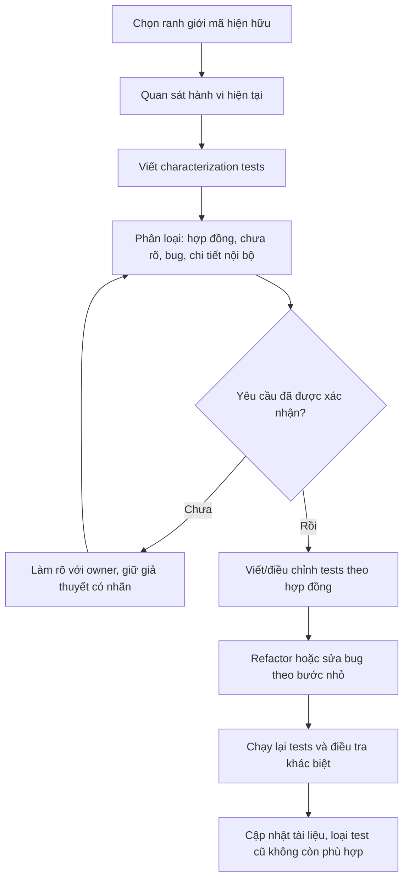

# Kiểm thử đặc tính hiện có trước khi sửa khi chưa có đặc tả đủ rõ

## 1. Mục tiêu bài học

Trong chương **Mã hiện hữu** của module **CODE_QUALITY_FUNDAMENTALS**, chúng ta tìm hiểu cách tiếp cận một hệ thống đã chạy lâu nhưng thiếu tài liệu hoặc kiểm thử: **ghi nhận hành vi thực tế trước khi thay đổi cấu trúc hoặc logic**.

Module hướng đến việc **hiểu những thuộc tính quyết định mã nguồn có đáng tin cậy, dễ hiểu và dễ thay đổi hay không**. Với mã cũ, người phát triển thường không biết đâu là quy tắc nghiệp vụ được chủ ý thiết kế, đâu là hành vi tình cờ tồn tại qua nhiều năm. Nếu refactor ngay dựa trên suy đoán, ta có thể vô tình phá một hợp đồng mà caller đang dựa vào; nếu giữ mọi hành vi cũ như thể đều đúng, ta có thể đóng băng cả những lỗi đã tồn tại.

Sau bài học, bạn có thể:

- Giải thích **characterization test** (kiểm thử đặc tính) và phân biệt nó với kiểm thử theo đặc tả.
- Thu thập hành vi quan sát được từ API, dữ liệu, lỗi và tác dụng phụ trước khi sửa mã.
- Viết kiểm thử JUnit 5 mô tả hành vi của một parser Java cũ, kể cả những trường hợp bất ngờ.
- Phân loại hành vi thành **đã được xác nhận**, **chưa rõ**, **có vẻ là lỗi** và **không còn được phép duy trì**.
- Tránh biến kết quả hiện tại thành yêu cầu nghiệp vụ chỉ vì test đã ghi nhận nó.
- Dùng characterization test, differential testing và kiểm thử hồi quy để hỗ trợ refactor an toàn theo từng bước.

## 2. Vấn đề khi sửa mã chưa có đặc tả rõ

Một hệ thống lâu năm thường có một số đặc điểm:

- Tài liệu không còn khớp với code.
- Người viết ban đầu đã rời nhóm hoặc không nhớ lý do của một nhánh xử lý.
- Unit test thiếu, chỉ kiểm tra luồng phổ biến hoặc phụ thuộc quá nhiều vào cấu trúc nội bộ.
- Caller khác đang dựa vào những chi tiết chưa từng được công bố như quy tắc xử lý giá trị rỗng, thứ tự kết quả hoặc mã lỗi.
- Một số hành vi có vẻ kỳ lạ nhưng chưa có người xác nhận đó là bug.

Ví dụ, một hàm nhập danh sách SKU có thể:

- Bỏ qua dòng trống.
- Tự loại khoảng trắng ở hai đầu.
- Nếu SKU lặp lại thì lấy số lượng ở dòng cuối.
- Chấp nhận số lượng âm.
- Chấp nhận SKU rỗng.
- Báo lỗi khi cột cuối bị bỏ trống.

Những hành vi này có thể là lựa chọn cũ, lỗi triển khai hoặc hệ quả của một hàm thư viện được dùng từ lâu. Chỉ nhìn một vài dòng code chưa đủ biết **người dùng thật sự đang trông đợi điều gì**.

Nếu ta thay parser bằng một thư viện CSV mới, parser mới có thể:

- Từ chối SKU rỗng.
- Gộp số lượng của các SKU trùng nhau.
- Giữ trường cuối rỗng.
- Hỗ trợ dấu phẩy nằm trong chuỗi được đặt trong dấu nháy.

Một thay đổi có thể hợp lý về kỹ thuật nhưng vẫn làm hệ thống khác đi. Trước khi sửa, cần biết **điều gì đang xảy ra**, **điều gì được yêu cầu giữ** và **điều gì cần thay đổi có chủ đích**.

## 3. Characterization test là gì?

**Characterization test** là kiểm thử ghi nhận và mô tả hành vi mà một chương trình hiện tại thực sự thể hiện trong những điều kiện đầu vào cụ thể. Nó đặc biệt hữu ích khi đặc tả thiếu hoặc hệ thống không có đủ kiểm thử.

Mục tiêu ban đầu không phải chứng minh hành vi ấy đúng. Mục tiêu là tạo ra một **bản đồ hành vi có thể chạy lại**, để người sửa code biết thay đổi nào đang diễn ra và tránh làm mất những bảo đảm chưa được hiểu đầy đủ.

Ví dụ:

```java
assertEquals(
        Map.of("SKU-A", 5),
        LegacySkuParser.parse("SKU-A,2\nSKU-A,5"));
```

Test này ghi nhận rằng parser hiện tại trả số lượng 5 cho SKU lặp lại. Nó **chưa chứng minh** “dòng cuối luôn thắng” là chính sách nhập hàng đúng. Muốn biến điều đó thành hợp đồng, cần xác nhận với người sở hữu nghiệp vụ hoặc nguồn đặc tả có thẩm quyền.

### Phân biệt các loại kiểm thử

| Loại kiểm thử | Câu hỏi chính | Kỳ vọng đến từ đâu? |
| --- | --- | --- |
| **Characterization test** | Code hiện tại đang làm gì với đầu vào này? | Hành vi quan sát được từ phiên bản đang chạy |
| **Specification/acceptance test** | Hệ thống phải làm gì? | Yêu cầu nghiệp vụ, hợp đồng API hoặc quyết định đã được xác nhận |
| **Regression test** | Một lỗi đã sửa có tái xuất hiện không? | Hành vi đúng đã được xác định sau khi sửa lỗi |
| **Contract test** | Hai thành phần có tuân thủ cùng một giao kèo không? | Hợp đồng giữa caller và provider |
| **Differential test** | Hai hiện thực có khác nhau trên cùng đầu vào không? | So sánh kết quả của hai phiên bản/thuật toán |
| **Golden master/snapshot test** | Đầu ra lớn hoặc phức tạp hiện tại là gì? | Một bản ghi đầu ra được lưu để đối chiếu |

Các loại này có thể phối hợp. Một characterization test sau khi yêu cầu được xác nhận có thể trở thành regression test. Tuy nhiên, **không nên đổi tên một test ghi nhận hành vi cũ thành test đặc tả mà không xem lại kỳ vọng**.

## 4. Quy trình tìm hiểu trước khi sửa

### 4.1. Xác định ranh giới cần quan sát

Trước tiên, tìm điểm mà người dùng hoặc thành phần khác tương tác:

- Public method, endpoint, command hoặc message handler.
- Đầu vào, đầu ra, kiểu lỗi và mã trạng thái.
- Database, file, message broker, email hoặc cổng dịch vụ bên ngoài.
- Cấu hình, feature flag, thời gian, múi giờ và nguồn dữ liệu.

Ưu tiên kiểm thử qua **API công khai hoặc ranh giới có ý nghĩa**. Nếu test chỉ gọi private helper, nó có thể khóa chặt cách hiện thực mà không ghi lại hành vi người dùng thực sự quan sát.

### 4.2. Thu thập các trường hợp đại diện

Đừng chỉ chạy một ví dụ thành công. Cần thử:

- Giá trị thông thường và giá trị tại ngưỡng.
- Chuỗi rỗng, khoảng trắng, null nếu API có thể nhận.
- Phần tử trùng, dữ liệu thiếu hoặc sai định dạng.
- Giá trị rất lớn, rất nhỏ và trường hợp tràn số.
- Thứ tự đầu vào khác nhau.
- Lỗi từ database, mạng hoặc dịch vụ phụ thuộc.
- Lặp lại cùng yêu cầu và chạy đồng thời nếu đó là cách hệ thống được sử dụng.

Không cần tạo mọi tổ hợp ngay từ đầu. Chọn ca dựa trên **đường code, mức rủi ro và dữ liệu caller thực tế đang gửi**.

### 4.3. Ghi lại điều kiện môi trường

Kết quả có thể phụ thuộc vào:

- Phiên bản JDK, thư viện và cấu hình.
- Locale, timezone, charset hoặc hệ điều hành.
- Dữ liệu ban đầu trong database.
- Thời điểm gọi, đồng hồ hệ thống và trạng thái cache.
- Trạng thái dịch vụ ngoài hoặc thứ tự message.

Một test không ghi rõ các điều kiện này có thể chạy xanh ở máy phát triển nhưng thất bại ở CI hoặc production.

### 4.4. Ghi nhận quan sát và câu hỏi chưa trả lời

Với mỗi hành vi lạ, ghi:

1. Đầu vào cụ thể.
2. Kết quả hoặc tác dụng phụ quan sát được.
3. Phiên bản và môi trường đã chạy.
4. Caller hoặc dữ liệu thực tế liên quan.
5. Điều đã được xác nhận và điều vẫn chỉ là giả thuyết.

Đặc biệt, hãy phân biệt câu **“code đang chấp nhận số lượng âm”** với câu **“nghiệp vụ cho phép số lượng âm”**. Câu đầu có thể quan sát trực tiếp; câu sau cần căn cứ nghiệp vụ.

## 5. Ví dụ Java 17: parser SKU cũ

Giả sử một ứng dụng có parser nhập danh sách SKU và số lượng từ văn bản. Không tìm thấy tài liệu đầy đủ, nên nhóm muốn ghi nhận hành vi trước khi thay thư viện hoặc refactor.

Đoạn code sau là **ví dụ giả định về một hiện thực legacy**, được viết để minh họa các đặc tính cần quan sát. Nó không phải parser CSV hoàn chỉnh và không nên dùng như khuyến nghị cho định dạng CSV tổng quát.

### 5.1. Hiện thực hiện tại

```java
// LegacySkuParser.java
import java.util.LinkedHashMap;
import java.util.Map;

public final class LegacySkuParser {
    private LegacySkuParser() {}

    public static Map<String, Integer> parse(String input) {
        Map<String, Integer> quantities = new LinkedHashMap<>();

        for (String line : input.split("\\R")) {
            if (line.isBlank()) {
                continue;
            }

            // split(",") dùng limit mặc định 0:
            // các trường rỗng ở cuối bị loại khỏi mảng.
            String[] fields = line.split(",");
            if (fields.length != 2) {
                throw new IllegalArgumentException(
                        "Expected exactly two fields");
            }

            String sku = fields[0].trim();
            int quantity = Integer.parseInt(fields[1].trim());
            quantities.put(sku, quantity);
        }

        return Map.copyOf(quantities);
    }
}
```

Từ code và các thử nghiệm có kiểm soát, ta có thể quan sát:

- Dòng trống hoặc chỉ có whitespace bị bỏ qua do `isBlank()`.
- SKU và số lượng được `trim()` trước khi xử lý.
- SKU trùng được ghi đè bằng số lượng xuất hiện sau cùng do `Map.put()`.
- Số lượng âm được chấp nhận vì không có kiểm tra `quantity > 0`.
- SKU rỗng được chấp nhận nếu dòng có dạng `,2`.
- Dòng `SKU-A,` bị từ chối vì `String.split(",")` mặc định loại trường rỗng cuối, khiến mảng chỉ còn một phần tử.
- Số lượng không parse được tạo `NumberFormatException`.
- Đầu vào null tạo `NullPointerException` khi gọi `split`.
- Kết quả được trả bằng `Map.copyOf()`, nên caller không thể sửa map trả về; thứ tự duyệt của map kết quả không được cam kết.

Những điều trên là **mô tả hành vi của ví dụ code**, không phải tuyên bố rằng một hệ thống thực tế có cùng hành vi. Khi làm với repository thật, cần chạy test trên đúng hiện thực và môi trường của nó.

### 5.2. Characterization test bằng JUnit 5

Các test sau ghi lại hành vi đang quan sát. Tên test cố ý dùng cách diễn đạt như **“documents”** hoặc **“currently”** để nhắc rằng đây là baseline hành vi cũ, chưa phải phán quyết nghiệp vụ.

```java
import static org.junit.jupiter.api.Assertions.assertEquals;
import static org.junit.jupiter.api.Assertions.assertThrows;

import java.util.Map;
import org.junit.jupiter.api.Test;

class LegacySkuParserCharacterizationTest {
    @Test
    void documentsTrimmingAndIgnoringBlankLines() {
        var result = LegacySkuParser.parse(
                " SKU-A , 2 \n\n   \nSKU-B,3\n");

        assertEquals(Map.of("SKU-A", 2, "SKU-B", 3), result);
    }

    @Test
    void documentsThatTheLastDuplicateSkuWins() {
        var result = LegacySkuParser.parse(
                "SKU-A,2\nSKU-A,5");

        assertEquals(Map.of("SKU-A", 5), result);
    }

    @Test
    void documentsThatNegativeQuantityIsCurrentlyAccepted() {
        var result = LegacySkuParser.parse("SKU-A,-2");

        assertEquals(Map.of("SKU-A", -2), result);
    }

    @Test
    void documentsThatBlankSkuIsCurrentlyAccepted() {
        var result = LegacySkuParser.parse(",2");

        assertEquals(Map.of("", 2), result);
    }

    @Test
    void documentsTrailingEmptyFieldAsMalformed() {
        assertThrows(IllegalArgumentException.class,
                () -> LegacySkuParser.parse("SKU-A,"));
    }

    @Test
    void documentsInvalidNumberAsNumberFormatException() {
        assertThrows(NumberFormatException.class,
                () -> LegacySkuParser.parse("SKU-A,not-a-number"));
    }

    @Test
    void documentsNullInputAsNullPointerException() {
        assertThrows(NullPointerException.class,
                () -> LegacySkuParser.parse(null));
    }
}
```

Những test này **không nói số lượng âm hoặc SKU rỗng là đúng**. Chúng chỉ bảo vệ nhóm khỏi vô tình thay đổi hành vi khi đang tìm hiểu hoặc di chuyển code. Một người chịu trách nhiệm nghiệp vụ có thể quyết định những hành vi ấy cần được sửa.

### 5.3. Vì sao không assert thứ tự của map?

Parser dùng `LinkedHashMap` ở bước tích lũy, nhưng trả về `Map.copyOf`. Hợp đồng của `Map.copyOf` không bảo đảm thứ tự duyệt cụ thể. Nếu test kỳ vọng thứ tự `SKU-A` trước `SKU-B`, test sẽ khóa một chi tiết không được API cam kết.

Nếu caller thực sự cần thứ tự đầu vào, đó là một yêu cầu riêng cần xác nhận. Khi ấy kiểu trả về và hiện thực nên biểu đạt rõ hợp đồng có thứ tự, thay vì dựa vào một hành vi tình cờ của implementation.

## 6. Từ hành vi quan sát được đến hợp đồng được xác nhận

Sau khi chạy characterization test, nhóm cần **phân loại từng đặc tính**. Không nên giữ tất cả chỉ vì test đang xanh.

| Hành vi quan sát | Câu hỏi nghiệp vụ | Quyết định có thể đưa ra |
| --- | --- | --- |
| Dòng trống bị bỏ qua | File nhập có cho phép dòng trắng để dễ đọc không? | Giữ nếu được xác nhận. |
| Khoảng trắng quanh SKU/số lượng bị trim | Khoảng trắng có ý nghĩa trong mã SKU không? | Giữ hoặc thay bằng validation rõ. |
| SKU trùng lấy dòng cuối | Dòng sau ghi đè, cộng dồn hay phải từ chối? | Cần owner xác nhận; không đoán. |
| Số lượng âm được chấp nhận | Có trường hợp nghiệp vụ dùng số âm để điều chỉnh không? | Có thể là bug; cần xác minh. |
| SKU rỗng được chấp nhận | Mã rỗng có thể là định danh hợp lệ không? | Thường cần quyết định rõ và test theo hợp đồng. |
| Trường cuối rỗng bị từ chối | Đây có phải định dạng lỗi theo nguồn dữ liệu? | Giữ thông báo/lỗi phù hợp hoặc đổi có chủ đích. |
| Số lượng không parse được ném `NumberFormatException` | Caller có dựa vào exception này hay cần lỗi nhập liệu thống nhất? | Có thể cần ánh xạ thành lỗi domain/API. |

### Bốn nhóm quyết định

**1. Đã được xác nhận là hợp đồng.** Ví dụ file nhập cho phép dòng trống và bỏ khoảng trắng. Giữ hành vi và chuyển thành test đặc tả/regression.

**2. Hành vi đang có nhưng chưa rõ.** Ví dụ SKU trùng lấy dòng cuối. Giữ test characterization tạm thời, hỏi người sở hữu nghiệp vụ và ghi rõ quyết định sau đó.

**3. Hành vi đã được xác nhận là lỗi.** Ví dụ số lượng âm không được phép. Viết test theo yêu cầu đúng, đánh dấu thay đổi là sửa bug; không cố giữ test characterization đang chấp nhận số âm.

**4. Chi tiết nội bộ không phải hợp đồng.** Ví dụ dùng `LinkedHashMap` làm cấu trúc tạm. Không cần khóa test vào chi tiết đó nếu caller không được quyền dựa vào.

Một test có thể được **giữ lại với ý nghĩa mới** sau khi xác nhận, hoặc bị thay bằng test theo hợp đồng. Quan trọng là nhóm biết tại sao kỳ vọng thay đổi.

## 7. Khi hành vi cũ và yêu cầu đúng khác nhau

Giả sử owner xác nhận hợp đồng nhập hàng mới:

- SKU phải không rỗng sau khi trim.
- Số lượng phải là số nguyên dương.
- SKU trùng trong cùng file phải bị từ chối để tránh nhập nhầm.
- Dòng trắng vẫn được bỏ qua.
- Trường số lượng rỗng phải tạo lỗi nhập liệu có thông điệp rõ.

Khi ấy, một số characterization test cũ phải **đổi kỳ vọng**:

| Test characterization cũ | Hợp đồng mới | Xử lý test |
| --- | --- | --- |
| Số lượng âm được chấp nhận | Số lượng phải dương | Thay bằng test từ chối số âm và số 0 |
| SKU rỗng được chấp nhận | SKU không rỗng | Thay bằng test từ chối SKU trống |
| Dòng SKU trùng lấy dòng cuối | SKU trùng bị từ chối | Thay bằng test lỗi trùng SKU |
| Dòng trống bị bỏ qua | Dòng trống vẫn được bỏ qua | Giữ và coi là test hợp đồng |
| Trường cuối rỗng gây lỗi kỹ thuật | Lỗi nhập liệu phải rõ | Giữ tính chất từ chối, có thể đổi loại lỗi/thông điệp theo hợp đồng |

**Đây là thay đổi hành vi có chủ đích**, không còn là refactor thuần túy. Nên ghi trong PR rằng nhóm đã xác nhận quy tắc mới, test nào thay kỳ vọng và dữ liệu cũ cần được kiểm tra hoặc chuyển đổi ra sao.

### Đừng dùng characterization test để bảo tồn bug

Nếu test cũ ghi nhận một lỗi đã được xác nhận, có thể:

1. Giữ test cũ tạm thời trong nhánh điều tra để có bằng chứng.
2. Viết test mới mô tả hành vi đúng theo yêu cầu.
3. Thực hiện sửa lỗi.
4. Xóa hoặc chuyển test cũ thành tài liệu lịch sử nếu nó không còn phù hợp.
5. Xác minh caller và dữ liệu hiện hữu không phụ thuộc vào lỗi cũ.

Không nên để hai test mâu thuẫn cùng tồn tại như thể cả hai đều là hợp đồng. Ghi rõ test nào mô tả **trước sửa**, test nào xác nhận **sau sửa**.

## 8. Characterization test cho tác dụng phụ

Không phải mọi hệ thống đều là hàm thuần như parser. Mã hiện hữu có thể:

- Ghi database hoặc cập nhật trạng thái.
- Gửi email, message hoặc yêu cầu HTTP.
- Tạo file, đổi tên file hoặc xóa dữ liệu.
- Đọc đồng hồ, sinh ID hoặc dùng số ngẫu nhiên.
- Giữ tài nguyên, lock hoặc thay đổi trạng thái dùng chung.

Khi ghi nhận các hành vi này, cần xác định **ranh giới quan sát** và dùng môi trường kiểm thử an toàn:

| Loại tác dụng phụ | Cách characterization phù hợp | Điều cần tránh |
| --- | --- | --- |
| Database | Database dùng riêng cho test; kiểm tra trạng thái sau thao tác | Chạy trên dữ liệu production hoặc dùng snapshot không kiểm soát |
| File | Thư mục tạm, file fixture, kiểm tra nội dung và quyền sở hữu | Ghi đè file thật của người dùng |
| HTTP/message | Fake server hoặc broker test, ghi nhận request/event tại boundary | Phụ thuộc dịch vụ thật không ổn định trong unit test |
| Email/payment | Sandbox hoặc fake adapter; kiểm tra nội dung và số lần gửi | Gửi thông báo/thu tiền thật chỉ để tạo baseline |
| Thời gian | Clock được tiêm vào hoặc cố định thời gian test | Dựa vào thời điểm máy chạy test |
| Random/ID | Seed cố định hoặc nguồn ID thay thế trong test | Kỳ vọng một giá trị ngẫu nhiên chưa được kiểm soát |

Không cần test từng lời gọi nội bộ. Hãy quan sát **kết quả bên ngoài mà caller hoặc hệ thống khác dựa vào**: trạng thái đã commit, message được gửi, file được tạo, hoặc lỗi được trả.

### Thứ tự tác dụng phụ cũng có thể là hành vi

Ví dụ một luồng cũ ghi đơn hàng rồi phát sự kiện. Nếu refactor chuyển phát sự kiện lên trước commit, test chỉ kiểm tra “event đã được gửi” có thể vẫn xanh trong khi hệ thống phát thông báo cho một đơn không tồn tại.

Khi characterization tác dụng phụ, cần thử cả **đường thành công và lỗi giữa chừng**:

- Lưu thất bại thì có event được gửi không?
- Gửi message thất bại sau commit thì hệ thống retry thế nào?
- Retry có tạo bản ghi hoặc thông báo trùng không?
- Một thao tác bị gọi hai lần có giữ cùng kết quả theo hợp đồng idempotency không?

Nếu hệ thống phân tán chưa có cơ chế bảo đảm, test cần mô tả giới hạn thực tế thay vì ghi một cam kết “exactly once” không được thiết kế.

## 9. Kiểm soát tính không xác định và môi trường

Một characterization test chỉ hữu ích nếu kết quả có thể tái hiện trong điều kiện được mô tả.

### 9.1. Thời gian và timezone

Nếu code dùng `LocalDate.now()` hoặc `Instant.now()` trực tiếp, test có thể đổi kết quả theo ngày chạy. Cần xác định timezone và đồng hồ mà hệ thống thực sự dùng; nếu có thể, đưa `Clock` vào ranh giới để test với một thời điểm cố định.

### 9.2. Thứ tự collection

Nếu code trả `HashMap`, không nên mặc định thứ tự duyệt ổn định. Nếu đầu ra cần có thứ tự, xác minh hợp đồng và dùng kiểu dữ liệu có bảo đảm phù hợp.

### 9.3. Dữ liệu ngoài và dịch vụ không ổn định

Không lấy dữ liệu trực tiếp từ API production trong test characterization lặp lại. Hãy lưu fixture có nguồn gốc, hoặc dùng sandbox/fake server; ghi lại phiên bản schema, thời điểm thu thập và điều kiện môi trường.

### 9.4. Thread và race condition

Một lần chạy không chứng minh không có race condition. Nếu hành vi liên quan đồng thời, cần xác định trạng thái chia sẻ, điều kiện cạnh tranh và test có phối hợp thread/latch phù hợp. Tránh dùng `Thread.sleep()` như cách đồng bộ mong manh.

### 9.5. Randomness

Dùng seed cố định giúp tái hiện một chuỗi ngẫu nhiên, nhưng seed cố định không chứng minh mọi trường hợp. Có thể bổ sung property-based test hoặc nhiều seed được lưu để mở rộng dữ liệu; khi test thất bại, ghi seed để tái hiện.

## 10. Dùng characterization test trong một đợt refactor

Một quy trình thực tế:

1. **Chọn một ranh giới nhỏ:** public method, adapter hoặc use case đang cần sửa.
2. **Đọc caller và luồng dữ liệu:** xác định đầu vào thực, các bên dựa vào kết quả và tác dụng phụ.
3. **Chạy code hiện tại:** thu thập các trường hợp thành công, biên, lỗi và hành vi lạ.
4. **Viết characterization test:** ghi nhận điều quan sát được qua API phù hợp, tên test thể hiện rõ trạng thái “currently”.
5. **Phân loại với owner:** xác nhận hành vi nào phải giữ, hành vi nào là bug, hành vi nào chưa rõ.
6. **Chuyển kỳ vọng thành hợp đồng:** bổ sung specification/acceptance tests cho quy tắc đã xác nhận.
7. **Refactor theo bước nhỏ:** mỗi bước giữ các hợp đồng đã chốt; không gộp thay đổi nghiệp vụ nếu không cần.
8. **Chạy lại test và đối chiếu:** phân tích mọi khác biệt, kể cả những khác biệt tưởng như vô hại.
9. **Xử lý nợ test:** loại test khóa vào cấu trúc cũ, giữ test hợp đồng và ghi lại các điểm chưa được kiểm chứng.
10. **Cập nhật tài liệu:** nêu quy tắc đã xác nhận và những hành vi không còn được hỗ trợ.



### Vì sao nên chia nhỏ?

Nếu thay parser, đổi chính sách SKU trùng, thêm hỗ trợ CSV có dấu nháy và chuyển database trong một PR, khi kết quả thay đổi sẽ khó biết nguyên nhân. Tách thành các bước giúp:

- So sánh được hành vi trước/sau.
- Xác định đúng phần có chủ đích thay đổi.
- Dễ hoàn nguyên khi phát hiện caller phụ thuộc vào hành vi cũ.
- Review được từng quyết định nghiệp vụ và kỹ thuật.

Không phải lúc nào cũng tách được hoàn toàn vì migration hoặc phát hành phối hợp. Khi phải gộp, hãy **liệt kê rõ từng thay đổi hành vi và bằng chứng tương ứng**.

## 11. Differential testing và golden master

### 11.1. Differential testing

Khi có hiện thực cũ và mới, chạy cùng đầu vào qua cả hai rồi so sánh:

- Giá trị trả về.
- Kiểu lỗi/mã lỗi thuộc hợp đồng.
- Trạng thái sau thao tác.
- Sự kiện hoặc request gửi ra ngoài tại boundary.

Ví dụ, có thể đưa một tập file nhập đã ẩn dữ liệu nhạy cảm vào parser cũ và parser mới để tìm khác biệt. Mọi khác biệt cần được phân loại: **đúng theo hợp đồng mới**, **bug mới** hay **hành vi cũ cần duy trì**.

Điểm giới hạn: hai hiện thực cùng trả một kết quả không chứng minh kết quả đó đúng. Chúng có thể cùng chứa một bug; vì vậy cần test độc lập theo đặc tả đã xác nhận.

### 11.2. Golden master/snapshot

Với đầu ra lớn như báo cáo, file hoặc cây JSON, việc lưu toàn bộ kết quả hiện tại làm golden master có thể giúp phát hiện thay đổi.

Nhưng snapshot có thể:

- Chứa timestamp, ID ngẫu nhiên hoặc trường không ổn định.
- Bao gồm metadata không phải hợp đồng.
- Thay đổi rất lớn dù chỉ một trường quan trọng đổi.
- Đóng băng lỗi nghiệp vụ vì không ai hiểu snapshot.

Hãy chuẩn hóa những trường không liên quan, tách assertion cho các giá trị quan trọng và review mọi cập nhật snapshot. **Không tự động chấp nhận snapshot mới chỉ vì test đang đỏ.**

## 12. Làm việc với legacy code khi không thể test trực tiếp

Đôi khi một hàm quá phụ thuộc vào database, filesystem, đồng hồ hoặc framework nên khó gọi độc lập. Có thể cần tạo **seam** — điểm cho phép thay thế một phụ thuộc mà không viết lại toàn bộ hệ thống.

Ví dụ:

- Đưa đọc file qua một interface nhỏ hoặc truyền nội dung vào parser.
- Đưa thời gian qua `Clock` thay vì gọi đồng hồ hệ thống ở nhiều nơi.
- Đưa cổng gửi message vào constructor để dùng fake trong test.
- Bao một thư viện cũ bằng adapter có hợp đồng nhỏ, rồi characterization test adapter.

Tuy nhiên, không nên tạo một hệ thống interface mới quá rộng chỉ để test một hàm đơn giản. Chọn seam nhỏ nhất có thể **cô lập tác dụng phụ và bảo vệ hành vi**.

### Hạn chế khi tạo seam

- Việc bọc một API cũ có thể vô tình đổi thời điểm gọi, thứ tự hoặc cách xử lý lỗi.
- Fake có thể khác hành vi của database/HTTP thật.
- Một adapter mới có thể che đi phụ thuộc động mà chưa giải quyết hợp đồng.
- Test qua seam không chứng minh toàn bộ wiring production đúng.

Vì vậy, cần giữ ít nhất một số **integration test** ở nơi giao tiếp thật sự quan trọng.

## 13. Những sai lầm thường gặp

**“Characterization test xanh nghĩa là hành vi cũ đúng.”** Không. Nó chỉ ghi nhận kết quả của code hiện tại; yêu cầu nghiệp vụ cần được xác nhận riêng.

**“Phải giữ mọi hành vi cũ mãi mãi.”** Không. Hành vi cũ có thể là bug hoặc chi tiết nội bộ; khi thay đổi, cần có quyết định và test theo hợp đồng mới.

**“Chỉ test happy path là đủ.”** Không. Nhiều khác biệt xuất hiện ở null, chuỗi rỗng, trùng dữ liệu, ngưỡng, lỗi phụ thuộc hoặc thứ tự tác dụng phụ.

**“Assert mọi thứ để chắc chắn không đổi.”** Assert cả thứ tự iteration không được cam kết, stack trace nội bộ hoặc lời gọi helper private sẽ làm test giòn và cản trở refactor.

**“So sánh code cũ với code mới là đủ.”** Hai phiên bản có thể cùng sai. Cần oracle độc lập từ yêu cầu hoặc bất biến đã xác nhận.

**“Golden master cập nhật tự động là an toàn.”** Snapshot có thể vô tình ghi đè một khác biệt quan trọng; phải review nội dung và hiểu vì sao thay đổi.

**“Fake thay thế được integration test.”** Fake chỉ mô phỏng hành vi được lập trình; nó không bảo đảm database, network hoặc cấu hình production hoạt động tương tự.

**“Tạo seam càng nhiều càng tốt.”** Abstraction không có ranh giới trách nhiệm rõ có thể làm code khó theo dõi hơn.

**“Không có test thất bại nghĩa là không có khác biệt.”** Test có thể chưa bao phủ hành vi, scanner có thể bỏ qua source hoặc dữ liệu kiểm thử chưa đại diện.

## 14. Bài tập tự kiểm tra

### Bài tập 1 — quan sát hay đặc tả?

Parser hiện tại chấp nhận `SKU-A,-2` và trả map có số lượng âm.

**Câu hỏi:** Có thể viết tài liệu “số lượng âm được hỗ trợ” chỉ dựa trên kết quả này không?

**Gợi ý:** Không. Có thể ghi “phiên bản hiện tại đang chấp nhận số lượng âm”. Muốn nói đây là hợp đồng, cần xác nhận từ nghiệp vụ hoặc caller có thẩm quyền.

### Bài tập 2 — chọn điểm quan sát

Một service ghi đơn vào database, sau đó gửi message. Test characterization chỉ assert rằng method private `publishEvent()` được gọi.

**Câu hỏi:** Test đang thiếu bằng chứng nào?

**Gợi ý:** Nó không xác nhận message thực sự được phát với dữ liệu đúng, cũng không bảo vệ trạng thái khi commit thất bại hoặc retry. Nên quan sát tại boundary message/database trong môi trường test phù hợp.

### Bài tập 3 — xử lý test cũ mâu thuẫn

Characterization test ghi nhận SKU trùng lấy dòng cuối. Sau khi hỏi owner, nhóm xác nhận file nhập phải từ chối SKU trùng.

**Câu hỏi:** Nên làm gì với test cũ?

**Gợi ý:** Ghi nhận đó là hành vi cũ, thay kỳ vọng bằng test hợp đồng từ chối SKU trùng, triển khai thay đổi có chủ đích và kiểm tra caller/dữ liệu phụ thuộc.

### Bài tập 4 — fingerprint đầu ra

Golden master của báo cáo chứa timestamp sinh báo cáo và ID request ngẫu nhiên. Mỗi lần chạy test đều khác snapshot.

**Câu hỏi:** Có nên cập nhật snapshot sau mỗi lần chạy?

**Gợi ý:** Không. Cần cố định thời gian/ID hoặc chuẩn hóa trường không thuộc hợp đồng; sau đó assert các trường có ý nghĩa và review snapshot khi thực sự thay đổi.

### Bài tập 5 — refactor khi chưa có test

Một hàm tính phí cũ dài 200 dòng, vừa đọc database vừa tính tiền và gửi thông báo. Tài liệu chỉ có một ví dụ thành công.

**Câu hỏi:** Bước đầu tiên nên là gì? Có nên tách ngay thành ba service?

**Gợi ý:** Xác định caller, hợp đồng và tác dụng phụ; tạo characterization ở boundary với dữ liệu thành công, lỗi, ngưỡng và trạng thái ghi. Tách trách nhiệm theo bằng chứng sau đó; không dựng ba service chỉ dựa trên độ dài hàm.

## 15. Checklist trước khi sửa mã hiện hữu

- **Đã xác định đúng phiên bản và môi trường chưa?** Test chạy trên code nào, JDK/dependency/config nào?
- **Đã đọc caller và ranh giới chưa?** Ai dùng kết quả, ai dựa vào lỗi hoặc tác dụng phụ?
- **Đã quan sát happy path và các ca rủi ro chưa?** Rỗng, trùng, sai định dạng, ngưỡng, dữ liệu lớn và lỗi?
- **Đã ghi nhận hành vi qua API phù hợp chưa?** Tránh khóa vào private helper hoặc cấu trúc nội bộ.
- **Đã phân biệt quan sát với yêu cầu chưa?** Hành vi nào được owner xác nhận, hành vi nào còn giả thuyết?
- **Đã nhận diện tác dụng phụ và tính không xác định chưa?** Database, file, mạng, thời gian, random và đồng thời?
- **Đã chọn test oracle phù hợp chưa?** Characterization, specification, regression, differential hay snapshot?
- **Đã đánh dấu những hành vi cũ có vẻ là bug chưa?** Không biến chúng thành hợp đồng chỉ vì test xanh.
- **Đã có kế hoạch chuyển test chưa?** Khi yêu cầu được xác nhận, test nào giữ, test nào đổi và test nào bỏ?
- **Đã chia nhỏ thay đổi chưa?** Có thể xác định nguồn gốc của khác biệt nếu một bước thất bại?
- **Đã có integration test tại ranh giới quan trọng chưa?** Fake không thay thế mọi bằng chứng của hệ thống thật.

## 16. Ghi nhớ

**Kiểm thử đặc tính hiện có trước khi sửa khi chưa có đặc tả đủ rõ** giúp nhóm nhìn thấy hành vi thực tế của mã cũ trước khi thay đổi nó. Hãy quan sát qua ranh giới có ý nghĩa, ghi lại đầu vào, kết quả, lỗi và tác dụng phụ, rồi phân biệt **hành vi đã được xác nhận**, **hành vi chưa rõ**, **bug** và **chi tiết nội bộ**. Characterization test là bản đồ ban đầu, không phải phán quyết rằng mọi thứ cũ đều đúng. Khi hợp đồng đã được làm rõ, chuyển kỳ vọng sang test đặc tả/regression, refactor theo bước nhỏ và điều tra mọi khác biệt. Cách làm này giúp **giảm rủi ro sửa mã hiện hữu, giữ đúng điều cần giữ và thay đổi có chủ đích điều cần thay đổi**.
