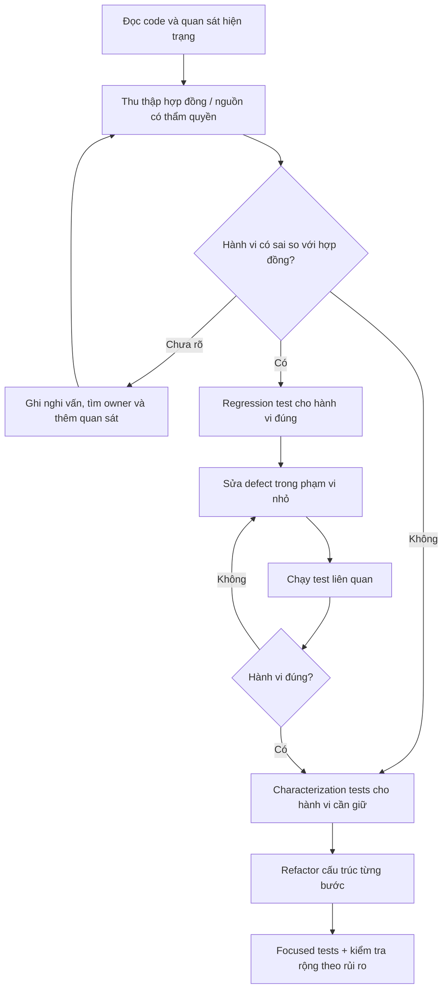

# Phân biệt hành vi cần giữ với lỗi đã được xác nhận

Khi tiếp nhận một module Java cũ, bạn thường thấy những hành vi không được mô tả đầy đủ: một phép tính có vẻ lệch ở đúng giá trị biên, một API trả về mã lỗi hơi khác thường, một tác vụ nền bỏ qua bản ghi thiếu dữ liệu, hoặc một luồng cập nhật gửi thông báo trước khi hoàn tất ghi database. Câu hỏi khó không chỉ là “mã đang làm gì?” mà còn là **“phần nào phải được giữ nguyên khi tái cấu trúc, phần nào là lỗi cần sửa, và phần nào chưa đủ bằng chứng để kết luận?”**

Nếu coi mọi hành vi hiện có là hợp đồng, ta có thể đóng băng bug vào test rồi khiến việc sửa lỗi sau này khó hơn. Nếu tự ý sửa mọi thứ trông có vẻ sai, ta có thể phá tương thích với consumer, dữ liệu lịch sử hoặc một ngoại lệ nghiệp vụ chưa được giải thích. Cả hai đều làm thay đổi mã hiện hữu trở nên rủi ro.

Trong chương **Mã hiện hữu** của `CODE_QUALITY_FUNDAMENTALS`, bài học này hướng dẫn cách phân biệt **hành vi cần giữ** với **lỗi đã được xác nhận**. Nội dung phục vụ mục tiêu hiểu những thuộc tính khiến mã nguồn **đáng tin cậy, dễ hiểu và dễ thay đổi**: muốn cải thiện cấu trúc an toàn, trước hết phải biết hệ thống đang cam kết điều gì, điều gì chỉ là hành vi tình cờ và điều gì đã được chứng minh là sai.

Sau bài học, bạn có thể xác định hợp đồng và hành vi quan sát được, đánh giá nguồn bằng chứng, viết characterization test mà không vô tình bảo vệ bug, tách sửa lỗi khỏi refactor, xử lý những trường hợp chưa rõ và review thay đổi với phạm vi rủi ro phù hợp.

> **Nguyên tắc:** Đừng mặc định “đang chạy” đồng nghĩa “đúng”, cũng đừng mặc định “trông lạ” đồng nghĩa “bug”. Hãy tìm bằng chứng, phân loại mức chắc chắn và ghi rõ quyết định trước khi thay đổi.

## 1. Ba khái niệm phải phân biệt

Khi đọc mã hiện hữu, cần tách ba câu hỏi:

1. **Hệ thống hiện đang làm gì?** Đây là hành vi quan sát được từ code, test, dữ liệu và môi trường.
2. **Hệ thống được yêu cầu phải làm gì?** Đây là hợp đồng hoặc kỳ vọng được xác nhận từ yêu cầu, chính sách và các bên có thẩm quyền.
3. **Khoảng cách giữa hai điều đó có phải lỗi đã được xác nhận không?** Cần bằng chứng để kết luận và xác định cách sửa.

Một hành vi có thể đã tồn tại lâu nhưng vẫn sai. Một hành vi có thể trông bất thường nhưng lại là ngoại lệ có chủ đích. Một trường hợp khác có thể chưa được mô tả và chưa có đủ bằng chứng để quyết định.

### 1.1. Hành vi quan sát được (observed behavior)

Là điều chương trình thực sự làm trong một điều kiện cụ thể. Ví dụ:

- API trả về `404` khi người dùng không có quyền xem tài nguyên.
- Phí giao hàng ở ngưỡng 300.000 VND vẫn là 30.000 VND.
- Tác vụ nền thử lại một message tối đa ba lần.
- Khi gửi email thất bại, đơn hàng vẫn được lưu.
- Bản ghi không có `updatedAt` được sắp xếp cuối danh sách.

Hành vi quan sát được có thể được xác nhận qua chạy chương trình, test, log, trace, dữ liệu thực tế hoặc kiểm tra code. Nhưng **quan sát được không tự động có nghĩa là được yêu cầu hoặc phải tiếp tục duy trì**.

### 1.2. Hành vi cần giữ (behavioral contract)

Là hành vi mà hệ thống cam kết với người dùng, consumer, hệ thống khác hoặc chính các thành phần nội bộ có liên quan. Hợp đồng có thể nằm trong:

- Đặc tả sản phẩm hoặc quy tắc nghiệp vụ đã được phê duyệt.
- API schema, tài liệu giao tiếp hoặc hợp đồng với đối tác.
- Quy định bảo mật, quyền truy cập, lưu trữ và tuân thủ.
- ADR hoặc quyết định kỹ thuật còn hiệu lực.
- Kiểm thử hợp đồng và các kiểm thử hồi quy được xác nhận.
- Hành vi thực tế đã được chấp nhận có chủ đích và có người sở hữu.

Không phải mọi chi tiết nội bộ đều là hợp đồng. Thứ tự gọi hai helper private có thể thay đổi nếu không ảnh hưởng kết quả, tác dụng phụ hoặc yêu cầu hiệu năng. Ngược lại, mã trạng thái HTTP, thứ tự sự kiện, đơn vị tiền và cách xử lý lỗi có thể là hợp đồng bên ngoài.

### 1.3. Lỗi đã được xác nhận (confirmed defect)

Là sự sai lệch có bằng chứng giữa hành vi hiện tại và một yêu cầu/hợp đồng có thẩm quyền, hoặc một vi phạm đã được xác minh về an toàn, bảo mật, dữ liệu hay vận hành.

Ví dụ:

- Quy tắc được phê duyệt nói ngưỡng miễn phí là **từ 300.000 VND trở lên**, nhưng code chỉ miễn phí khi **lớn hơn 300.000 VND**.
- API cho phép người dùng đọc tài liệu thuộc tenant khác, trái với chính sách phân quyền.
- Khi transaction rollback, hệ thống vẫn phát sự kiện xác nhận đơn đã tạo.
- Một thao tác retry có thể trừ tiền hai lần, trái với hợp đồng idempotency.
- Một đường lỗi bỏ qua đóng file hoặc trả connection về pool, đã được tái hiện và xác nhận.

Một defect có thể đã tồn tại lâu, được nhiều người sử dụng và có test xanh. Tuổi đời của bug không biến nó thành hợp đồng.

### 1.4. Trường hợp chưa rõ

Có những hành vi quan sát được nhưng không tìm thấy yêu cầu, quyết định hoặc người sở hữu có thể xác nhận. Khi đó, cách trung thực là ghi **chưa rõ**, thu thập thêm bằng chứng và hạn chế thay đổi có thể gây tác động lớn.

| Phân loại | Điều đã biết | Hành động phù hợp |
| --- | --- | --- |
| **Hợp đồng đã xác nhận** | Có yêu cầu/chính sách hoặc consumer contract rõ | Bảo vệ bằng test và giữ khi refactor |
| **Hành vi hiện tại đã quan sát** | Có thể tái hiện, nhưng chưa biết có phải cam kết | Ghi nhận và tìm nguồn xác nhận trước khi đổi |
| **Defect đã xác nhận** | Có bằng chứng hành vi vi phạm yêu cầu hoặc bất biến | Viết regression test, sửa lỗi có chủ đích |
| **Giả định hoặc nghi vấn** | Có dấu hiệu đáng ngờ nhưng thiếu bằng chứng | Điều tra, hỏi owner, không tự gắn nhãn bug |
| **Chi tiết triển khai không có ý nghĩa bên ngoài** | Có thể thay đổi mà không ảnh hưởng hợp đồng | Refactor nếu làm rõ cấu trúc và có kiểm chứng phù hợp |

## 2. Tìm bằng chứng ở đâu?

Không có một nguồn duy nhất luôn đúng cho mọi câu hỏi. Cần đối chiếu nhiều nguồn và hiểu **nguồn nào có thẩm quyền đối với loại quyết định đang xem xét**.

### 2.1. Nguồn bằng chứng thường gặp

| Nguồn | Có thể giúp xác nhận | Cần thận trọng |
| --- | --- | --- |
| **Yêu cầu sản phẩm/đặc tả đã duyệt** | Quy tắc nghiệp vụ, điều kiện và kết quả mong muốn | Có thể cũ hoặc không phản ánh thay đổi mới nhất |
| **Hợp đồng API/schema** | Trường, kiểu, mã lỗi, version và cách tương tác | Có thể không mô tả mọi quy tắc nghiệp vụ |
| **ADR/quyết định kỹ thuật** | Lý do và đánh đổi của một lựa chọn | Cần kiểm tra trạng thái còn hiệu lực hay đã bị thay thế |
| **Test hiện có** | Hành vi mà test đang mong đợi và bảo vệ | Test có thể thiếu, sai hoặc vô tình đóng băng bug |
| **Code hiện tại** | Cách triển khai và điều kiện thực tế | Code cho biết hiện trạng, không chứng minh ý định |
| **Incident/bug report có thể tái hiện** | Tác động và điều kiện gây lỗi | Cần phân biệt triệu chứng với nguyên nhân |
| **Log/trace/metrics** | Điều đã xảy ra trong môi trường cụ thể | Không tự giải thích điều đáng lẽ phải xảy ra |
| **Dữ liệu lịch sử** | Những trạng thái và trường hợp thực tế đã tồn tại | Dữ liệu có thể chứa lỗi cũ hoặc ngoại lệ migration |
| **Consumer/đối tác** | Kỳ vọng thực tế ở ranh giới tích hợp | Cần xác minh phiên bản và mức tương thích được cam kết |
| **Owner nghiệp vụ/kỹ thuật** | Bối cảnh, ngoại lệ và quyết định chưa được ghi | Ý kiến cần được ghi nhận đúng thẩm quyền và phạm vi |

### 2.2. Xem xét độ mới và phạm vi của nguồn

Một tài liệu cũ có thể nói ngưỡng miễn phí là 250.000 VND, trong khi chính sách được phê duyệt gần đây đã đổi thành 300.000 VND. Nếu chỉ đọc tài liệu đầu tiên, bạn có thể kết luận nhầm rằng code hiện tại sai.

Khi đối chiếu nguồn, hãy kiểm tra:

- Ngày hiệu lực và version.
- Phạm vi áp dụng: thị trường, tenant, loại khách hàng, phiên bản API.
- Người hoặc nhóm sở hữu nội dung.
- Quyết định mới nào đã thay thế tài liệu cũ.
- Điều kiện ngoại lệ và giai đoạn rollout.
- Dữ liệu đang chạy có thể còn tuân theo version cũ hay không.

**Mới hơn không luôn có nghĩa có thẩm quyền hơn.** Một comment trong PR hôm qua không nhất thiết vượt qua hợp đồng sản phẩm đã được phê duyệt. Cần xác định ai có quyền xác nhận từng loại yêu cầu.

### 2.3. Một test xanh không chứng minh hành vi là đúng

Giả sử test hiện tại viết:

```java
@Test
void chargesShippingAtTheThreshold() {
    assertEquals(330_000L, calculator.totalVnd(300_000L, false));
}
```

Test có thể xanh trong nhiều năm. Nhưng nếu chính sách được xác nhận là miễn phí **từ ngưỡng trở lên**, test đang bảo vệ hành vi sai. Test là bằng chứng về điều mà người viết test đã kỳ vọng, không phải nguồn chân lý độc lập.

Cần hỏi:

1. Ai viết test và dựa trên yêu cầu nào?
2. Test có được cập nhật khi chính sách đổi không?
3. Có consumer nào phụ thuộc vào hành vi này?
4. Test có cố tình bảo vệ một ngoại lệ tương thích không?
5. Có bằng chứng từ incident hoặc quyết định đã được phê duyệt không?

Không nên xóa test cũ chỉ vì thấy nó bất thường. Hãy xác định nó bảo vệ hợp đồng nào trước khi sửa.

## 3. Phân biệt characterization test với regression test

Hai loại test này có mục tiêu khác nhau.

- **Characterization test (test ghi nhận hành vi):** Ghi lại điều hệ thống hiện đang làm trong một tình huống để người sửa hiểu ảnh hưởng của refactor.
- **Regression test (test hồi quy):** Bảo vệ hành vi đúng đã được xác nhận, đặc biệt một lỗi đã được sửa để nó không tái xuất hiện.

Characterization test rất hữu ích khi làm việc với legacy code thiếu tài liệu. Nhưng nếu lấy mọi kết quả hiện tại làm kỳ vọng, ta có thể vô tình biến bug thành hợp đồng.

### 3.1. Ví dụ về test ghi nhận hành vi

Giả sử ta quan sát được:

- Tổng tiền dưới ngưỡng: tính phí chuẩn.
- Khách VIP dưới ngưỡng: miễn phí.
- Tổng tiền âm: bị từ chối.
- Đúng ngưỡng: hiện tại vẫn tính phí, nhưng có nghi vấn về yêu cầu.

Có thể ghi nhận những hành vi **chưa bị nghi ngờ** bằng characterization tests. Trường hợp đúng ngưỡng cần được đánh dấu riêng để xác minh, không vội khóa kết quả cũ thành expected value.

### 3.2. Test hồi quy cần bảo vệ kết quả đã xác nhận

Khi yêu cầu đã xác nhận rằng ngưỡng là bao gồm, regression test nên khẳng định kết quả mong muốn tại đúng giá trị biên. Test này có thể đỏ trước khi sửa defect, rồi xanh sau khi sửa.

Điều đó không có nghĩa ta viết test sai. Ta đang tạo một **test cho hợp đồng đúng** và dùng kết quả đỏ ban đầu làm bằng chứng rằng code hiện tại chưa đáp ứng hợp đồng.

## 4. Ví dụ Java 17: ngưỡng phí giao hàng có hành vi hiện tại khác hợp đồng

Xét một calculator cũ:

```java
final class LegacyShippingCalculator {
    long totalVnd(long subtotalVnd, boolean vip) {
        if (subtotalVnd < 0) {
            throw new IllegalArgumentException(
                    "Subtotal must be nonnegative");
        }

        long feeVnd = 30_000L;
        if (vip || subtotalVnd > 300_000L) {
            feeVnd = 0L;
        }

        return Math.addExact(subtotalVnd, feeVnd);
    }
}
```

Code hiện tại sử dụng điều kiện `> 300_000`. Giả sử đặc tả chính sách đang có hiệu lực xác nhận:

- Khách VIP luôn được miễn phí giao hàng.
- Khách thường có tổng tiền hàng **từ 300.000 VND trở lên** được miễn phí.
- Khách thường dưới ngưỡng chịu 30.000 VND.
- Tổng tiền hàng âm bị từ chối.

Khi đối chiếu, ta có:

| Đầu vào | Hành vi hiện tại | Hợp đồng đã xác nhận | Kết luận |
| --- | --- | --- | --- |
| 299.999 VND, khách thường | Tổng 329.999 VND | Tổng 329.999 VND | Khớp |
| 300.000 VND, khách thường | Tổng 330.000 VND | Tổng 300.000 VND | **Defect đã xác nhận** |
| 300.001 VND, khách thường | Tổng 300.001 VND | Tổng 300.001 VND | Khớp |
| 50.000 VND, khách VIP | Tổng 50.000 VND | Tổng 50.000 VND | Khớp |
| -1 VND | Ném `IllegalArgumentException` | Từ chối tổng âm | Khớp |

Điểm đáng chú ý: code không cần viết lại toàn bộ. Ta đã xác định **một sai lệch cụ thể tại giá trị biên**, còn các hành vi khác được bảo vệ khi sửa.

### 4.1. Characterization test cho các trường hợp đã quan sát và phù hợp

```java
import static org.junit.jupiter.api.Assertions.assertEquals;
import static org.junit.jupiter.api.Assertions.assertThrows;

import org.junit.jupiter.api.Test;

class LegacyShippingCalculatorCharacterizationTest {
    private final LegacyShippingCalculator calculator =
            new LegacyShippingCalculator();

    @Test
    void standardCustomerBelowThresholdPaysStandardFee() {
        assertEquals(329_999L,
                calculator.totalVnd(299_999L, false));
    }

    @Test
    void vipCustomerBelowThresholdGetsFreeShipping() {
        assertEquals(50_000L,
                calculator.totalVnd(50_000L, true));
    }

    @Test
    void negativeSubtotalIsRejected() {
        assertThrows(IllegalArgumentException.class,
                () -> calculator.totalVnd(-1L, false));
    }
}
```

Các test trên ghi nhận hành vi đã quan sát ở những trường hợp phù hợp với hợp đồng. Chúng tạo baseline để khi thay cấu trúc, ta biết các kết quả này vẫn được giữ.

### 4.2. Regression test cho defect đã xác nhận

Ta viết riêng test bảo vệ chính sách tại ngưỡng:

```java
import static org.junit.jupiter.api.Assertions.assertEquals;

import org.junit.jupiter.api.Test;

class ShippingThresholdRegressionTest {
    @Test
    void standardCustomerGetsFreeShippingAtInclusiveThreshold() {
        LegacyShippingCalculator calculator =
                new LegacyShippingCalculator();

        assertEquals(300_000L,
                calculator.totalVnd(300_000L, false));
    }
}
```

Với code cũ, test này **thất bại**: kết quả thực tế là 330.000 VND, trong khi kỳ vọng theo hợp đồng là 300.000 VND. Đây là một thất bại có chủ đích để làm lộ defect đã xác nhận.

Không nên viết characterization test theo cách dưới đây rồi coi nó là hợp đồng cần giữ:

```java
// Ví dụ KHÔNG nên dùng làm kỳ vọng lâu dài nếu đặc tả yêu cầu >=.
@Test
void recordsLegacyBugAtThreshold() {
    assertEquals(330_000L,
            new LegacyShippingCalculator()
                    .totalVnd(300_000L, false));
}
```

Có thể ghi kết quả 330.000 VND trong báo cáo điều tra hoặc ghi chú baseline, nhưng **không biến nó thành test hồi quy xanh lâu dài** khi đã biết nó trái yêu cầu.

## 5. Trình tự an toàn: ghi nhận, xác nhận, sửa bug rồi mới refactor

Khi một phần mã vừa có cấu trúc khó hiểu vừa có hành vi sai đã được xác nhận, nên tách các mục tiêu:

1. Ghi nhận những hành vi hiện có cần bảo vệ.
2. Xác nhận hợp đồng đúng và ghi rõ defect.
3. Viết regression test thể hiện kết quả đúng.
4. Sửa defect với thay đổi nhỏ nhất có thể.
5. Chạy lại các test liên quan và kiểm tra tác động.
6. Sau khi hành vi đã ổn định, refactor cấu trúc.
7. Sau mỗi bước refactor, tiếp tục chạy kiểm tra phù hợp.
8. Chạy bộ kiểm tra rộng ở mốc tích hợp/merge.

### 5.1. Bước sửa defect nhỏ nhất

```java
final class CorrectedShippingCalculator {
    long totalVnd(long subtotalVnd, boolean vip) {
        if (subtotalVnd < 0) {
            throw new IllegalArgumentException(
                    "Subtotal must be nonnegative");
        }

        long feeVnd = 30_000L;
        if (vip || subtotalVnd >= 300_000L) {
            feeVnd = 0L;
        }

        return Math.addExact(subtotalVnd, feeVnd);
    }
}
```

Thay đổi hành vi duy nhất là `>` thành `>=`. Test tại ngưỡng giờ phải xanh, đồng thời characterization tests về dưới ngưỡng, VIP và tổng âm vẫn xanh.

Trong repository thật, không cần giữ đồng thời hai class tên khác nhau như các lát cắt minh họa. Sau khi sửa, lớp cũ được cập nhật tại đúng vị trí và test được chạy với implementation thực tế.

### 5.2. Sau đó mới trích xuất chính sách

Khi defect đã được sửa và test xác nhận, ta có thể tách policy:

```java
final class ShippingFeePolicy {
    private static final long FREE_THRESHOLD_VND = 300_000L;
    private static final long STANDARD_FEE_VND = 30_000L;

    long feeFor(long subtotalVnd, boolean vip) {
        if (subtotalVnd < 0) {
            throw new IllegalArgumentException(
                    "Subtotal must be nonnegative");
        }

        return (vip || subtotalVnd >= FREE_THRESHOLD_VND)
                ? 0L : STANDARD_FEE_VND;
    }
}

final class OrderTotalCalculator {
    private final ShippingFeePolicy shipping;

    OrderTotalCalculator(ShippingFeePolicy shipping) {
        this.shipping = java.util.Objects.requireNonNull(shipping);
    }

    long totalVnd(long subtotalVnd, boolean vip) {
        return Math.addExact(
                subtotalVnd, shipping.feeFor(subtotalVnd, vip));
    }
}
```

Ở đây, **hợp đồng đã sửa** được giữ nguyên trong cấu trúc mới. Policy sở hữu ngưỡng và mức phí; calculator chỉ phối hợp phép tính tổng. Refactor không được âm thầm quay lại điều kiện `>` hoặc thay đổi thông điệp lỗi nếu thông điệp là hợp đồng cần giữ.

### 5.3. Test sau refactor

```java
import static org.junit.jupiter.api.Assertions.assertEquals;
import static org.junit.jupiter.api.Assertions.assertThrows;

import org.junit.jupiter.api.Test;

class ShippingFeePolicyTest {
    private final ShippingFeePolicy policy = new ShippingFeePolicy();

    @Test
    void chargesStandardFeeBelowThreshold() {
        assertEquals(30_000L, policy.feeFor(299_999L, false));
    }

    @Test
    void thresholdIsInclusive() {
        assertEquals(0L, policy.feeFor(300_000L, false));
    }

    @Test
    void vipGetsFreeShippingBelowThreshold() {
        assertEquals(0L, policy.feeFor(50_000L, true));
    }

    @Test
    void rejectsNegativeSubtotal() {
        assertThrows(IllegalArgumentException.class,
                () -> policy.feeFor(-1L, false));
    }

    @Test
    void detectsOverflowWhenAddingFee() {
        OrderTotalCalculator calculator =
                new OrderTotalCalculator(policy);

        assertThrows(ArithmeticException.class,
                () -> calculator.totalVnd(Long.MAX_VALUE, false));
    }
}
```

Bộ test này bảo vệ chính sách đã xác nhận và một trường hợp overflow của phép cộng. Nó không tự chứng minh endpoint HTTP, cấu hình dependency injection hoặc dữ liệu giá thực tế đúng; những ranh giới đó cần test tương ứng.

### 5.4. Sơ đồ trình tự thay đổi



Sơ đồ cho thấy **điều tra hành vi** và **thay đổi cấu trúc** là hai việc có thể liên hệ nhưng không nên trộn lẫn nếu điều đó làm mất khả năng xác định nguyên nhân.

## 6. Không phải mọi hành vi bất thường đều là bug

Legacy system thường có những hành vi đặc biệt vì lịch sử sản phẩm, hợp đồng đối tác hoặc dữ liệu cũ. Chúng có thể trông không đẹp nhưng vẫn cần được giữ.

### 6.1. Ngoại lệ tương thích ngược

Một API cũ có thể trả `200` với danh sách rỗng thay vì `404` khi không tìm thấy bản ghi. Thiết kế mới có thể thích `404` hơn, nhưng ứng dụng mobile cũ đã dựa vào `200` và parse body như một danh sách.

Trước khi thay đổi:

- Xác định consumer đang dùng phiên bản nào.
- Xem hợp đồng công khai đã cam kết điều gì.
- Kiểm tra khả năng rollout đồng thời.
- Cân nhắc versioning hoặc thời gian deprecation.
- Viết contract test cho cả consumer hiện tại và hành vi mới nếu cần.

**Không được đổi một hợp đồng đã công bố chỉ vì code hiện tại trông không theo ý thích của người refactor.** Nếu hợp đồng cần thay đổi, đó là một thay đổi có kế hoạch và quản lý tương thích.

### 6.2. Dữ liệu lịch sử và quy tắc phiên bản

Một đơn hàng được tạo năm trước có thể cần giữ cách tính thuế tại thời điểm đặt hàng. Nếu code hiện tại dùng một policy mới để tính lại toàn bộ đơn lịch sử, kết quả có thể thay đổi dù refactor không định thay nghiệp vụ.

Cần phân biệt:

- **Quy tắc áp dụng cho giao dịch mới.**
- **Quy tắc được lưu/version cùng giao dịch cũ.**
- **Cách hiển thị hoặc tái dựng dữ liệu lịch sử.**
- **Cách migration xử lý bản ghi thiếu version.**

Nếu dữ liệu cũ không chứa đủ thông tin để biết policy nào đã áp dụng, không nên tự suy đoán rồi ghi đè. Có thể cần đối chiếu chứng từ, audit log hoặc chủ sở hữu nghiệp vụ.

### 6.3. Thứ tự tác dụng phụ có thể là hợp đồng

Một quy trình cũ có thứ tự:

1. Ghi giao dịch.
2. Commit.
3. Gửi email xác nhận.

Có thể trông như một cách triển khai ngẫu nhiên, nhưng nếu email chỉ được gửi sau commit để tránh thông báo cho giao dịch đã rollback, thứ tự đó có ý nghĩa. Chuyển sang async hoặc outbox có thể tốt hơn, nhưng phải giữ điều kiện **không gửi thông báo cho giao dịch chưa commit**.

Cần test cả đường thành công và thất bại, không chỉ kiểm tra rằng hai phương thức đã được gọi.

### 6.4. Một hành vi xấu có thể được consumer phụ thuộc

Một consumer có thể đã dựa vào một lỗi cũ, ví dụ API luôn trả một trường `legacyCode` với giá trị mặc định dù trường đó không còn ý nghĩa. Đây là **dependency thực tế**, nhưng không nhất thiết là hợp đồng mong muốn.

Cần đánh giá số consumer, mức sử dụng và phương án chuyển đổi. Có thể cần telemetry, thông báo deprecation, version mới hoặc compatibility adapter. Việc consumer phụ thuộc vào bug không buộc nhóm phải giữ bug mãi mãi, nhưng làm cho việc sửa nó trở thành một thay đổi tương thích cần quản lý.

## 7. Khi chưa đủ bằng chứng, đừng tự biến nghi vấn thành quyết định

Có thể gặp code:

```java
if (customer.vip()) {
    return 0L;
}
if (subtotalVnd > 300_000L) {
    return 0L;
}
return 30_000L;
```

Bạn thấy điều kiện `>` đáng nghi. Nhưng chưa có đặc tả, không biết ngưỡng có bao gồm hay không và chưa tìm được owner.

Các bước hợp lý:

1. **Ghi lại quan sát:** ở đúng 300.000 VND, khách thường chịu 30.000 VND phí.
2. **Tìm bằng chứng:** đặc tả, lịch sử PR, tài liệu hỗ trợ, hóa đơn hoặc hợp đồng đối tác.
3. **Xác định phạm vi:** quy tắc áp dụng ở thị trường nào, từ ngày nào, cho loại đơn nào.
4. **Hỏi owner phù hợp:** người có thẩm quyền xác nhận chính sách, không chỉ người tình cờ sửa code trước.
5. **Đánh giá rủi ro tạm thời:** nếu tiếp tục hành vi có thể gây thiệt hại, cần biện pháp giảm thiểu trong lúc điều tra.
6. **Ghi trạng thái chưa rõ:** không đặt test kỳ vọng một cách tùy tiện.
7. **Quyết định sau khi có bằng chứng:** bảo vệ hành vi, sửa bug hoặc quản lý thay đổi hợp đồng.

### 7.1. Ghi nhận nghi vấn mà không đóng băng nó

Một ghi chú điều tra có thể có dạng:

```text
Observation:
  Standard customer at 300000 VND currently pays shipping fee.

Known contract:
  Not yet verified.

Evidence:
  Reproduced in current implementation.
  Existing tests do not cover the exact threshold.

Open questions:
  Is the threshold inclusive?
  Does the rule vary by market or effective date?

Next action:
  Confirm with the owner of shipping policy before changing behavior.
```

Đây là **mẫu ghi nhận điều tra**, không phải một ADR đã được chấp nhận. Nó phân biệt sự thật đã quan sát với giả định chưa được xác minh.

### 7.2. Khi phải giảm rủi ro trước khi hiểu hết

Nếu nghi vấn liên quan quyền truy cập, mất dữ liệu hoặc giao dịch tài chính, không nên để trạng thái “chưa rõ” trở thành lý do không hành động. Có thể:

- Tạm khóa một đường thao tác có nguy cơ.
- Thêm kiểm tra bảo vệ ở ranh giới có thẩm quyền.
- Giới hạn phạm vi hoặc lưu lượng.
- Tăng giám sát và cảnh báo.
- Đưa thay đổi vào quy trình ứng phó rủi ro thích hợp.

Biện pháp tạm thời cần ghi rõ phạm vi, người chịu trách nhiệm và điều kiện gỡ bỏ. **Giảm thiểu rủi ro không đồng nghĩa đã xác định đầy đủ nguyên nhân hoặc hoàn tất sửa lỗi.**

## 8. Những loại hành vi cần xem xét khi đọc legacy code

Đừng chỉ nhìn giá trị trả về. Một thay đổi có thể ảnh hưởng đến nhiều khía cạnh:

| Loại hành vi | Câu hỏi cần trả lời | Ví dụ kiểm chứng |
| --- | --- | --- |
| **Giá trị đầu ra** | Kết quả và đơn vị có giữ nguyên? | Test giá trị biên, làm tròn, overflow |
| **Lỗi** | Kiểu lỗi, mã lỗi, thông điệp hoặc thời điểm ném có phải hợp đồng? | Test exception/API response |
| **Trạng thái** | Bất biến và chuyển trạng thái nào được phép? | State transition tests |
| **Tác dụng phụ** | Có ghi database, gửi event, email, thanh toán hay audit không? | Integration test, spy khi tương tác là hợp đồng |
| **Thứ tự** | Bước nào phải hoàn tất trước bước nào? | Test thứ tự, transaction test |
| **Đồng thời** | Hai request chồng lấn có thể phá bất biến không? | Concurrency test, transaction/version checks |
| **Tài nguyên** | Ai sở hữu stream, connection, executor và khi nào đóng? | Close/shutdown tests, metrics |
| **API và serialization** | Field, status code, format, version có thay đổi? | Contract test, schema validation |
| **Bảo mật** | Ai được truy cập, dữ liệu nào được tiết lộ? | Authorization/security tests |
| **Hiệu năng** | Latency, throughput, allocation hoặc truy vấn có thay đổi? | Benchmark/profiling theo workload |
| **Thời gian và thứ tự dữ liệu** | Time zone, effective date, clock hoặc ordering có ảnh hưởng? | Clock-controlled tests, integration |
| **Khả năng vận hành** | Log, metric, trace và retry có giữ ý nghĩa? | Test quan sát và kiểm tra runbook |

### 8.1. Giá trị trả về giống nhau chưa đủ

Hai phiên bản có thể trả cùng `OrderResponse`, nhưng một phiên bản gửi email trước commit, phiên bản kia gửi sau commit. Nếu email là tác dụng phụ bên ngoài, hành vi không tương đương.

Tương tự, một phương thức có thể vẫn trả cùng giá trị nhưng gọi repository hai lần thay vì một lần. Nếu số lần truy vấn ảnh hưởng hiệu năng hoặc tính nhất quán, thay đổi này có thể quan trọng.

Hãy xác định **hợp đồng quan sát được theo ngữ cảnh**, không giới hạn nó vào một phép so sánh return value.

## 9. Khi refactor và sửa bug cùng xuất hiện trong một pull request

Đôi khi không thể tránh hoàn toàn việc một PR chứa cả hai. Nhưng nên làm rõ từng phần.

### 9.1. Tách commit hoặc tách bước khi có thể

Một chuỗi dễ review:

1. Thêm test ghi nhận hành vi hợp lệ đang có.
2. Thêm regression test cho bug đã xác nhận (ban đầu đỏ).
3. Sửa bug với thay đổi nhỏ nhất.
4. Chạy test và xác nhận hợp đồng đúng.
5. Refactor cấu trúc mà không thay đổi hành vi đã sửa.
6. Chạy test lại và kiểm tra diff cuối.

Nếu PR cần sửa lỗi khẩn cấp, có thể ưu tiên bug fix trước, sau đó refactor trong một PR tiếp theo. Mục tiêu là để reviewer phân biệt **đổi vì yêu cầu** với **đổi để cải thiện cấu trúc**.

### 9.2. Mô tả rõ phần hành vi cố ý thay đổi

Trong PR description, có thể viết:

```markdown
## Hành vi cần giữ
- Khách VIP được miễn phí giao hàng.
- Tổng tiền dưới ngưỡng áp dụng phí chuẩn.
- Tổng tiền âm bị từ chối.

## Defect đã xác nhận
- Chính sách quy định miễn phí từ 300.000 VND trở lên.
- Code cũ dùng điều kiện > 300.000 nên tính phí tại đúng ngưỡng.

## Thay đổi có chủ đích
- Đổi điều kiện thành >= 300.000.
- Thêm regression test tại giá trị biên.

## Refactor
- Trích xuất ShippingFeePolicy.
- Giữ nguyên chữ ký và kết quả của các trường hợp hợp lệ khác.

## Kiểm chứng
- Unit tests cho ngưỡng, VIP, input âm.
- Integration test cho các consumer sử dụng policy.
```

Mẫu này giúp người review hiểu **đâu là sửa bug, đâu là phần cấu trúc**, và bằng chứng nào hỗ trợ mỗi phần.

### 9.3. Không tách bằng cách che giấu thay đổi hành vi

Nếu một PR thay cả điều kiện nghiệp vụ, schema, mã lỗi và cấu trúc class, việc gọi toàn bộ là “refactor” khiến reviewer khó đánh giá. Hãy nêu rõ từng thay đổi có ảnh hưởng tới contract. Tên PR và mô tả cần phản ánh đúng nội dung cuối cùng.

## 10. Xử lý dữ liệu và trạng thái lịch sử

Một phần mã cũ có thể đã ghi dữ liệu theo những quy tắc khác nhau qua từng phiên bản. Khi refactor, dữ liệu hiện có trở thành một phần của hành vi cần hiểu.

Ví dụ bảng `orders` có trường `shipping_fee_vnd`, nhưng các đơn cũ được tạo trước khi chính sách miễn phí thay đổi. Không nên tính lại phí từ subtotal bằng policy hiện tại nếu điều đó làm thay đổi hóa đơn lịch sử.

### 10.1. Phân biệt dữ liệu nguồn với dữ liệu có thể tính lại

- **Dữ liệu giao dịch đã chốt:** thường cần giữ giá trị đã được cam kết tại thời điểm giao dịch.
- **Dữ liệu dẫn xuất/cache:** có thể tính lại nếu nguồn và quy tắc rõ.
- **Dữ liệu migration:** có thể cần mapping theo phiên bản và audit.
- **Dữ liệu thiếu/không hợp lệ:** cần điều tra và quy tắc xử lý rõ, không tự gán mặc định tùy tiện.

### 10.2. Trước migration cần biết trạng thái nào đã tồn tại

Một mô hình mới có thể loại bỏ tổ hợp trạng thái không hợp lệ. Nhưng database cũ có thể đã lưu các tổ hợp ấy do bug lịch sử. Trước khi thay:

1. Truy vấn/đếm các dạng dữ liệu cũ trong phạm vi cho phép.
2. Phân loại theo nguồn và thời gian tạo.
3. Xác định mapping có căn cứ hoặc nhóm cần xử lý thủ công.
4. Tạo migration có thể kiểm tra và có chiến lược rollback/forward-fix.
5. Test với bản sao dữ liệu đại diện đã được bảo vệ.
6. Theo dõi số bản ghi không map được sau triển khai.

**Đừng dùng một default để che dữ liệu chưa hiểu.** Một giá trị mặc định có thể biến lỗi dữ liệu thành hành vi sai khó phát hiện hơn.

## 11. Kiểm tra bảo mật: không giữ hành vi vi phạm chính sách

Đặc biệt với authorization và xử lý dữ liệu nhạy cảm, cần phân biệt **hành vi đang tồn tại** với **hành vi được phép**.

Nếu một endpoint hiện trả dữ liệu cho người dùng không có quyền, việc một client cũ đang dựa vào response đó không biến hành vi thành hợp đồng hợp lệ. Đây là rủi ro cần xử lý theo chính sách an ninh, đồng thời quản lý tác động tới consumer một cách có trách nhiệm.

Các bước cần xem:

- Xác định chủ sở hữu tài nguyên và chính sách quyền.
- Tái hiện đường truy cập trái phép trong môi trường an toàn.
- Kiểm tra mọi đường gọi: HTTP, job, queue, internal API.
- Viết test cho người có quyền và không có quyền, bao gồm tài nguyên thuộc tenant khác.
- Thêm biện pháp giảm thiểu theo mức độ rủi ro.
- Xem xét log/telemetry để phát hiện truy cập tương tự.
- Đánh giá thông báo và tương thích nếu response thay đổi.

Không nên trì hoãn việc đóng một đường truy cập nguy hiểm chỉ vì muốn hoàn tất characterization tests cho toàn module. **An toàn người dùng và dữ liệu có thể yêu cầu một nhịp xử lý riêng.**

## 12. Checklist trước khi thay đổi mã hiện hữu

Khi chuẩn bị refactor một phần legacy, hãy hỏi:

1. **Hiện trạng là gì?** Có thể tái hiện hành vi với đầu vào và môi trường cụ thể không?
2. **Hợp đồng mong muốn là gì?** Nguồn nào có thẩm quyền, version nào còn hiệu lực?
3. **Có hành vi nào chỉ là quan sát, chưa phải cam kết?**
4. **Có defect đã xác nhận không?** Bằng chứng nào cho thấy hành vi vi phạm yêu cầu?
5. **Test hiện tại bảo vệ điều gì?** Có test nào có thể đang đóng băng bug?
6. **Những hành vi nào cần characterization test?** Bao gồm giá trị biên, lỗi và tác dụng phụ?
7. **Có consumer hoặc dữ liệu lịch sử phụ thuộc không?** Cần quản lý tương thích/migration ra sao?
8. **Thay đổi có ảnh hưởng quyền, tiền, trạng thái hoặc dữ liệu không?** Có cần quy trình rủi ro riêng?
9. **Có thể tách bug fix khỏi refactor không?** Nếu không, PR có mô tả rõ từng phần?
10. **Test nào sẽ đỏ trước khi sửa defect?** Kỳ vọng mới có căn cứ không?
11. **Sau refactor, bằng chứng nào sẽ xanh?** Unit, integration, contract, concurrency hoặc security test?
12. **Còn điều gì chưa biết?** Ai cần xác nhận, theo dõi hoặc chấp nhận rủi ro?
13. **Có thay đổi nào không được phép làm trong phạm vi này?** Ví dụ API, event ordering, dữ liệu giao dịch cũ?
14. **Kết quả có được ghi lại đủ rõ không?** Reviewer có phân biệt được hành vi giữ, bug sửa và giả định chưa xác nhận?

## 13. Bài tập tự kiểm tra

**Câu 1.** Code hiện tại trả `330.000 VND` ở ngưỡng 300.000, nhưng đặc tả mới nhất nói khách thường từ ngưỡng trở lên được miễn phí. Nên phân loại hành vi hiện tại thế nào?

*Gợi ý:* Đây là hành vi quan sát được nhưng trái hợp đồng đã xác nhận, do đó là defect. Không nên biến kết quả 330.000 thành expected value lâu dài.

**Câu 2.** Một test cũ xanh trong nhiều năm khẳng định phí được tính tại đúng ngưỡng. Test đó có đủ chứng minh chính sách phải như vậy không?

*Gợi ý:* Không. Cần xác định test dựa trên yêu cầu/version nào, có bị lỗi thời hay không và nguồn nào có thẩm quyền.

**Câu 3.** Khi nào characterization test hữu ích?

*Gợi ý:* Khi làm việc với legacy code thiếu tài liệu, cần ghi lại hành vi thực tế ở các trường hợp cần giữ trước khi thay cấu trúc. Phải phân biệt test ghi nhận với test bảo vệ hợp đồng đúng.

**Câu 4.** Vì sao không nên thêm characterization test kỳ vọng kết quả sai đã biết tại giá trị biên?

*Gợi ý:* Nó sẽ đóng băng defect thành hành vi được bảo vệ, làm người sửa sau phải phá test hoặc tưởng kết quả sai là hợp đồng.

**Câu 5.** Một API trả `200` với danh sách rỗng dù người review thích `404`. Có thể đổi ngay không?

*Gợi ý:* Chưa. Cần xem API contract, consumer hiện tại và versioning. Hành vi có thể là hợp đồng tương thích đã công bố.

**Câu 6.** Một quy trình gửi email sau commit database. Refactor chuyển gửi email lên trước commit nhưng response và unit test vẫn giống. Điều gì có thể bị phá?

*Gợi ý:* Thứ tự tác dụng phụ: email có thể được gửi cho giao dịch rollback. Cần integration test và kiểm tra transaction/side effect.

**Câu 7.** Bạn nghi ngờ điều kiện `>` phải là `>=`, nhưng chưa tìm thấy đặc tả hoặc owner. Nên làm gì?

*Gợi ý:* Ghi lại hành vi hiện tại, điều kiện tái hiện, test còn thiếu và câu hỏi mở; tìm nguồn có thẩm quyền. Không tự sửa hoặc khóa kết quả tùy ý nếu chưa đánh giá rủi ro.

**Câu 8.** Một consumer phụ thuộc vào một bug đã tồn tại lâu. Điều đó có nghĩa phải giữ bug vĩnh viễn không?

*Gợi ý:* Không. Nhưng sửa lỗi trở thành thay đổi tương thích cần quản lý: xác định consumer, thông báo, version, migration và rollout.

**Câu 9.** Vì sao dữ liệu đơn hàng lịch sử không nên luôn được tính lại bằng chính sách phí hiện tại?

*Gợi ý:* Giao dịch có thể phải giữ giá trị đã cam kết tại thời điểm tạo. Cần lưu/version quy tắc và phân biệt dữ liệu giao dịch với dữ liệu dẫn xuất.

**Câu 10.** Một endpoint đang cho phép truy cập trái quyền nhưng không có incident nào được báo cáo. Có nên xem đó là hành vi cần giữ vì đã tồn tại không?

*Gợi ý:* Không. Xác minh chính sách bảo mật và phơi nhiễm; nếu vi phạm đã rõ, xử lý theo mức độ rủi ro. Thiếu incident không chứng minh an toàn.

**Câu 11.** Sau khi sửa bug tại ngưỡng, nhóm tách policy sang class riêng. Cần test những gì?

*Gợi ý:* Giữ test dưới ngưỡng, đúng ngưỡng, trên ngưỡng, VIP, input âm và các consumer sử dụng policy; thêm integration/contract test nếu wiring hoặc API bị ảnh hưởng.

**Câu 12.** Test regression mới đỏ trước khi sửa code. Có phải pipeline đã thất bại và thay đổi cần hủy không?

*Gợi ý:* Nếu test thể hiện hợp đồng đã xác nhận và thất bại đúng trên defect tái hiện, màu đỏ là bằng chứng mong đợi ở giai đoạn đó. Sau khi sửa bug, test phải xanh; nếu không, tiếp tục điều tra.

## Ghi nhớ

**Khi làm việc với mã hiện hữu, hãy phân biệt điều đang xảy ra, điều được cam kết và điều đã được chứng minh là sai.** Characterization test giúp ghi nhận hành vi cần hiểu; regression test bảo vệ hợp đồng đúng và lỗi đã sửa. Một test cũ xanh không tự chứng minh hành vi đúng, còn một đoạn code trông lạ không tự chứng minh có bug.

Trước khi thay đổi, tìm nguồn bằng chứng có thẩm quyền, kiểm tra version và consumer, ghi rõ phần chưa chắc chắn. Khi đã xác nhận defect, tạo test cho kết quả đúng, sửa trong phạm vi nhỏ rồi mới refactor; bảo vệ cả giá trị đầu ra, lỗi, trạng thái, tác dụng phụ, dữ liệu và tương thích cần thiết.

Cách làm này giúp tránh cả hai sai lầm: **đóng băng lỗi cũ thành hợp đồng** và **vô tình phá hành vi hợp lệ khi làm sạch code**. Đó là nền tảng để mã nguồn hiện hữu trở nên **đáng tin cậy, dễ hiểu và dễ thay đổi an toàn hơn**.
