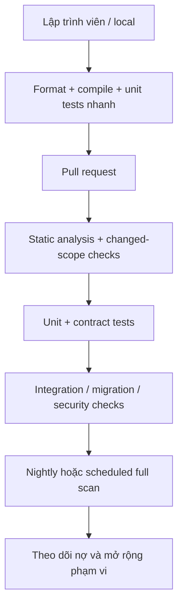

# Đưa kiểm tra tự động vào từng phạm vi có thể quản lý

Một hệ thống Java đã tồn tại nhiều năm có thể có hàng nghìn cảnh báo static analysis, test chạy rất lâu, module phụ thuộc vòng và một số khu vực chưa có kiểm thử. Nếu bật tất cả quality gate nghiêm ngặt trong một lần, CI có thể đỏ hàng loạt. Nếu bỏ qua toàn bộ cảnh báo cũ, những lỗi mới lại tiếp tục đi vào codebase. Nhóm cần một cách triển khai **từng phần, có phạm vi rõ và có thể đo được**.

Đưa kiểm tra tự động vào mã hiện hữu không phải là bật thật nhiều công cụ cùng lúc. Đó là quá trình chọn **đúng ranh giới**, thiết lập mức bảo vệ phù hợp, xử lý nợ cũ theo lộ trình và mở rộng khi nhóm đã có đủ bằng chứng vận hành. Trong chương **Mã hiện hữu** của **CODE_QUALITY_FUNDAMENTALS**, bài học này tập trung vào cách đưa kiểm tra vào từng phạm vi có thể quản lý. Chủ đề phục vụ mục tiêu module: hiểu những thuộc tính quyết định mã nguồn có **đáng tin cậy, dễ hiểu và dễ thay đổi hay không**.

## Mục tiêu học tập

Sau bài này, bạn có thể:

1. Khảo sát codebase hiện hữu và chọn phạm vi đầu tiên để tự động hóa kiểm tra.
2. Phân biệt baseline của nợ cũ với chất lượng của phần code mới hoặc vừa thay đổi.
3. Áp dụng kiểm tra theo tầng: file, package, module, pull request và toàn repository.
4. Bổ sung test characterization và test hồi quy trước khi siết gate ở khu vực rủi ro.
5. Tích hợp formatter, compiler, static analysis, test, coverage và dependency checks theo lộ trình.
6. Quản lý false positive, suppression, flaky tests và thời gian CI mà không làm mất tín hiệu.
7. Đo hiệu quả và mở rộng phạm vi dựa trên bằng chứng thay vì đặt một ngưỡng chung thiếu bối cảnh.

## 1. Vì sao cần triển khai theo phạm vi?

Trong một dự án mới, nhóm có thể thiết lập formatter, compiler warnings, unit tests và static analysis từ đầu. Trong một hệ thống đang chạy, codebase thường đã tích lũy:

- Những lớp chưa có test hoặc chỉ có test ở tầng tích hợp.
- Nhiều quy ước viết code khác nhau do lịch sử và nhiều nhóm đóng góp.
- Dependency cũ, plugin build cũ hoặc cấu hình CI khó nâng cấp.
- Cảnh báo đã tồn tại từ trước, trong đó có cả vấn đề thật và false positive.
- Module có mức rủi ro khác nhau: xử lý tiền, phân quyền, báo cáo nội bộ hoặc code sinh tự động.
- Test chậm, flaky hoặc cần môi trường bên ngoài.

Một thay đổi chính sách có phạm vi quá rộng có thể tạo ra hàng trăm lỗi không liên quan đến pull request hiện tại. Nhóm mất thời gian dọn dẹp, khó tìm regression mới và có thể bắt đầu tắt gate để tiếp tục giao hàng.

**Triển khai theo phạm vi** giúp nhóm:

1. Có thể bắt đầu từ một module hoặc một nhóm rule có rủi ro cao.
2. Quan sát false positive và thời gian CI trong điều kiện thực tế.
3. Tập trung ngăn vấn đề mới phát sinh trong khi xử lý nợ cũ theo kế hoạch.
4. Học từ một phạm vi nhỏ trước khi mở rộng chính sách.
5. Có tiêu chí rõ để biết khi nào phạm vi đó đủ ổn định để nâng mức kiểm tra.

### Phạm vi có thể quản lý là gì?

Một phạm vi tốt có **ranh giới nhận diện được, owner, tập kiểm tra và cách đánh giá kết quả**. Ví dụ:

| Phạm vi | Ví dụ | Khi nào hữu ích? |
| --- | --- | --- |
| **File/class** | Một parser đang được sửa. | Thử rule hoặc test trên một điểm có thay đổi. |
| **Package** | `com.example.billing.validation`. | Nhóm lớp có trách nhiệm gần nhau. |
| **Module** | `billing-core`. | Module có owner và build/test độc lập. |
| **Pull request** | Chỉ kiểm tra file/line thay đổi cùng phần liên quan. | Ngăn lỗi mới mà chưa phải sửa toàn bộ code cũ. |
| **Nhóm rule** | Nullness, resource leak, secret detection. | Tăng kiểm tra theo một loại rủi ro. |
| **Pipeline stage** | Fast checks trước, integration/security scans sau. | Quản lý thời gian phản hồi và chi phí CI. |
| **Service/repository** | Một dịch vụ hoặc toàn repository. | Mở rộng khi cách làm đã ổn định và có năng lực vận hành. |

Không nhất thiết phải chọn phạm vi nhỏ nhất. Một file đơn lẻ có thể không đủ để xác minh dependency hoặc transaction; một module độc lập có thể là đơn vị phù hợp hơn. **Ranh giới phải tương ứng với nơi có thể kiểm tra và chịu trách nhiệm**, không chỉ là nơi dễ viết cấu hình.

## 2. Bắt đầu bằng khảo sát, không bắt đầu bằng ngưỡng

Trước khi bật gate, cần hiểu hiện trạng. Một khảo sát ngắn nên trả lời:

- Codebase dùng JDK, build tool, framework và test framework nào?
- Những module nào build/test độc lập được?
- Test hiện tại chạy trong bao lâu, có flaky không, cần dịch vụ ngoài nào?
- Công cụ phân tích nào đang có, rule nào đang bật?
- Cảnh báo cũ tập trung ở module nào và thuộc loại rủi ro gì?
- Những phần nào thường thay đổi hoặc thường gây incident?
- Ai sở hữu từng module và ai chịu trách nhiệm cho CI?

### Lập bản đồ phạm vi

Ví dụ minh họa:

| Module | Mức độ thay đổi | Tác động khi lỗi | Test hiện tại | Owner |
| --- | --- | --- | --- | --- |
| `billing-core` | Cao | Rất cao | Unit test một phần | Payments team |
| `customer-profile` | Trung bình | Cao | Unit + API integration | Identity team |
| `admin-reporting` | Thấp | Trung bình | Integration test | Operations team |
| `legacy-import` | Thấp | Cao khi chạy batch | Ít test | Data platform team |

Không nên dùng bảng này như một thang điểm khách quan nếu chưa có dữ liệu. Nó là công cụ thảo luận để xác định **khu vực cần bảo vệ trước**. Module ít thay đổi nhưng có tác động cao vẫn có thể cần gate mạnh; module thay đổi thường xuyên nhưng chỉ phục vụ công cụ nội bộ có thể bắt đầu với một tập kiểm tra khác.

### Xem lịch sử thay đổi và lỗi

Những tín hiệu có ích:

- File thường xuyên cùng thay đổi trong một pull request.
- Khu vực có nhiều bug tái phát hoặc rollback.
- Những nhánh xử lý tiền, quyền, trạng thái và dữ liệu không hợp lệ.
- Test thường thất bại ngẫu nhiên hoặc phải chạy lại mới xanh.
- Dependency có advisory, hết hỗ trợ hoặc khó nâng cấp.
- Khu vực chỉ một vài người hiểu cách vận hành.

Đây là tín hiệu chọn phạm vi, không phải bằng chứng tự thân rằng code có lỗi. Ví dụ, file thay đổi thường xuyên có thể là module trung tâm được thiết kế tốt; cần xem thêm chi phí và sự cố thực tế.

## 3. Chọn lớp kiểm tra theo rủi ro và tốc độ phản hồi

Không phải mọi kiểm tra cần chạy ở cùng một thời điểm. Có thể chia pipeline thành nhiều lớp:



### Lớp nhanh

Thường chạy ở local hoặc đầu CI:

- Format/lint.
- Compile và type checking.
- Unit tests không cần dịch vụ bên ngoài.
- Kiểm tra secret đơn giản và một số rule static analysis có độ nhiễu thấp.

Mục tiêu là phản hồi nhanh để người viết sửa khi ngữ cảnh còn rõ.

### Lớp pull request

Chạy trên thay đổi mới:

- Unit tests của module và vùng liên quan.
- Static analysis theo rule quan trọng.
- API/schema compatibility nếu thay đổi hợp đồng.
- Kiểm tra dependency diff, license/security policy theo yêu cầu.
- Coverage diff hoặc kiểm tra test mới nếu công cụ hỗ trợ.

### Lớp đầy đủ hoặc định kỳ

Một số kiểm tra tốn thời gian hoặc cần môi trường đặc biệt:

- Full integration test và end-to-end test.
- Full repository static analysis.
- Mutation testing.
- Dependency/SBOM scan toàn bộ graph.
- Test migration từ schema cũ và restore.
- Kiểm thử tải hoặc security scan sâu.

Không có nghĩa kiểm tra chậm được phép bỏ qua mã mới. Với thay đổi có rủi ro cao, có thể cần chạy lớp đầy đủ trước khi merge hoặc phát hành. **Phân tầng là cách sắp xếp thời điểm và phạm vi**, không phải lý do giảm bảo vệ cho những thay đổi nguy hiểm.

## 4. Thiết lập baseline cho code cũ

Khi bật analyzer lần đầu, có thể có hàng nghìn finding. Nếu tất cả đều làm CI thất bại, nhóm sẽ khó phân biệt vấn đề mới và nợ cũ.

**Baseline** là bản ghi nhận trạng thái finding tại một thời điểm, dùng để so sánh về sau. Nó giúp nhóm tập trung vào finding mới hoặc sự suy giảm trong phạm vi được quản lý.

### Baseline không có nghĩa là miễn trừ mọi rủi ro

Một finding nằm trong baseline vẫn có thể là:

- Lỗi bảo mật nghiêm trọng.
- Rò rỉ tài nguyên.
- Bug logic có thể tái hiện.
- Vi phạm hợp đồng.

Baseline chỉ ghi nhận rằng finding đó đã tồn tại ở thời điểm chụp. Nó **không phải phê duyệt chấp nhận rủi ro**, không có nghĩa vấn đề an toàn và không thay thế owner, kế hoạch sửa hay waiver có thời hạn.

### Quy trình tạo baseline

1. Chọn phiên bản analyzer, rule set và cấu hình sẽ dùng.
2. Chạy scan trên commit đại diện cho hiện trạng.
3. Xuất finding với ID, rule, vị trí, severity và thông tin cần thiết.
4. Phân loại vấn đề nghiêm trọng cần xử lý ngay, false positive và nợ còn lại.
5. Lưu snapshot hoặc baseline theo cơ chế công cụ hỗ trợ.
6. Bật chính sách kiểm tra finding mới hoặc mức tăng theo phạm vi.
7. Review mọi thay đổi baseline; không tự cập nhật snapshot chỉ để làm CI xanh.

### Ví dụ cách theo dõi

```text
Baseline at commit: a1b2c3d
Scope: legacy-import
Analyzer: configured version and rule set

Existing findings:
  Critical: 0
  High: 4
  Medium: 38
  Low: 112

Pull request policy:
  New Critical/High findings: fail
  New Medium findings: review
  Existing findings: tracked with owner and remediation plan
```

Các con số chỉ là ví dụ, không phải ngưỡng mặc định. Một nhóm có thể cần chặn cả finding medium ở module thanh toán; một module khác có thể dùng review thủ công. Severity và policy phải phù hợp hệ thống.

### Baseline cần có thời hạn quản trị

Baseline cũ có thể trở nên sai khi:

- Rule set hoặc phiên bản scanner thay đổi.
- Code được di chuyển hoặc đổi cấu trúc.
- Finding được sửa nhưng snapshot không được cập nhật.
- Một finding cũ trở nên nghiêm trọng do endpoint được mở công khai hoặc dữ liệu thay đổi.

Nên ghi ngày tạo, commit, công cụ, phạm vi và người sở hữu. Định kỳ rà soát finding có rủi ro cao và xu hướng giảm nợ; đừng để baseline trở thành kho lưu trữ không ai đọc.

## 5. Kiểm tra code mới và phần vừa thay đổi

Một cách triển khai thực tế là **không làm chất lượng phần mới xấu đi**, đồng thời có lộ trình xử lý code cũ.

### Changed-code gate

Gate theo phần thay đổi có thể kiểm tra:

- Finding mới xuất hiện trong diff hoặc vùng liên quan.
- Test mới/được sửa phải chạy và pass.
- Không giảm coverage của phần code được đo nếu chính sách yêu cầu.
- Không thêm dependency vi phạm policy.
- Không tạo secret mới hoặc vi phạm quy tắc bắt buộc.

Nhưng “changed lines” không luôn bằng “changed behavior”. Một thay đổi nhỏ trong helper có thể ảnh hưởng nhiều caller; đổi schema có thể ảnh hưởng toàn bộ consumer. Do đó cần mở rộng phạm vi theo **dependency và impact**, không chỉ theo file được sửa.

### Ví dụ: thay đổi một phương thức dùng chung

Giả sử PR sửa:

```java
public long calculateTotal(long goodsMinor, long feeMinor) {
    return goodsMinor + feeMinor;
}
```

Đây là thay đổi trong một file, nhưng có thể được gọi từ checkout, hoàn tiền và báo cáo. Nếu gate chỉ chạy test nằm trong cùng package mà không chạy test consumer, regression có thể lọt.

Một cách kiểm soát:

1. Xác định caller hoặc module phụ thuộc vào API.
2. Chạy unit tests của module sở hữu phương thức.
3. Chạy contract/integration tests của các consumer quan trọng.
4. Thêm kiểm tra đầu vào âm và overflow nếu thuộc hợp đồng.
5. Nếu API công khai, kiểm tra source/binary/behavior compatibility.

**Không cần chạy mọi test toàn repository cho mọi thay đổi nhỏ**, nhưng phải có cách tìm ra phạm vi ảnh hưởng đủ tin cậy.

### Kiểm tra theo dependency graph

Một thay đổi ở module nền tảng có thể yêu cầu kiểm tra những module phụ thuộc trực tiếp hoặc gián tiếp. Nếu build system hỗ trợ task theo dependency graph, có thể chạy:

- Module bị thay đổi.
- Module consumer trực tiếp.
- Integration/contract tests của ranh giới bị ảnh hưởng.
- Full suite theo lịch hoặc trước mốc phát hành quan trọng.

Độ chính xác của phạm vi phụ thuộc vào cách build khai báo dependency, reflection, code generation và các tích hợp runtime. Khi không thể xác định tác động đáng tin, mở rộng test scope hoặc yêu cầu review chuyên môn.

## 6. Tạo test seam trong legacy code

Code cũ có thể tự tạo HTTP client, đọc system clock trực tiếp, truy cập static singleton hoặc thao tác DB ngay trong logic nghiệp vụ. Khi đó việc viết unit test khó vì không thể điều khiển đầu vào và phụ thuộc.

**Test seam** là một điểm cho phép kiểm soát hoặc thay thế dependency khi kiểm thử, thường thông qua constructor injection, interface nhỏ, function parameter hoặc adapter.

### Trước khi có seam

```java
import java.time.LocalDate;

final class MembershipService {
    boolean isExpired(long memberId) {
        // Ví dụ minh họa: truy vấn trực tiếp và đọc clock hệ thống.
        MemberRecord member = LegacyDatabase.load(memberId);
        return LocalDate.now().isAfter(member.expiresOn());
    }
}
```

Đoạn code minh họa phụ thuộc vào `LegacyDatabase` chưa được định nghĩa và thời gian hệ thống. Test phải dựng DB hoặc chờ thời gian; kết quả có thể khó tái lập.

### Tạo seam với interface và Clock

```java
import java.time.Clock;
import java.time.LocalDate;
import java.util.Objects;
import java.util.Optional;

record MemberRecord(long id, LocalDate expiresOn) {}

interface MemberRepository {
    Optional<MemberRecord> findById(long memberId);
}

final class MembershipService {
    private final MemberRepository repository;
    private final Clock clock;

    MembershipService(MemberRepository repository, Clock clock) {
        this.repository = Objects.requireNonNull(repository);
        this.clock = Objects.requireNonNull(clock);
    }

    boolean isExpired(long memberId) {
        MemberRecord member = repository.findById(memberId)
                .orElseThrow(() ->
                        new IllegalArgumentException("Member not found"));
        LocalDate today = LocalDate.now(clock);
        return today.isAfter(member.expiresOn());
    }
}
```

Test có thể dùng clock cố định và fake repository:

```java
import static org.junit.jupiter.api.Assertions.*;

import java.time.Clock;
import java.time.Instant;
import java.time.LocalDate;
import java.time.ZoneOffset;
import java.util.Optional;
import org.junit.jupiter.api.Test;

class MembershipServiceTest {
    @Test
    void expiresOnlyAfterTheStoredDate() {
        Clock clock = Clock.fixed(
                Instant.parse("2026-11-16T00:00:00Z"),
                ZoneOffset.UTC);
        MemberRepository repository = id -> Optional.of(
                new MemberRecord(id, LocalDate.of(2026, 11, 15)));
        MembershipService service =
                new MembershipService(repository, clock);

        assertTrue(service.isExpired(42L));
    }

    @Test
    void memberDoesNotExpireOnTheStoredDate() {
        Clock clock = Clock.fixed(
                Instant.parse("2026-11-16T00:00:00Z"),
                ZoneOffset.UTC);
        MemberRepository repository = id -> Optional.of(
                new MemberRecord(id, LocalDate.of(2026, 11, 16)));
        MembershipService service =
                new MembershipService(repository, clock);

        assertFalse(service.isExpired(42L));
    }
}
```

Ví dụ định nghĩa `isExpired` là “hôm nay **sau** ngày hết hạn”; ngày bằng nhau chưa hết hạn. Nếu nghiệp vụ định nghĩa hết hạn ngay đầu ngày ghi trên thẻ, cần đổi hợp đồng và test. **Test seam làm logic dễ kiểm chứng**, nhưng không tự xác minh adapter DB đọc đúng ngày, timezone hoặc kiểu dữ liệu; cần integration test ở ranh giới repository.

### Không tạo abstraction chỉ để làm test xanh

Một interface có duy nhất một implementation và không có ranh giới thay thế có thể chưa cần thiết. Tạo seam khi nó giúp:

- Tách logic thuần khỏi I/O hoặc thời gian.
- Kiểm soát dependency trong test.
- Đặt hợp đồng giữa domain/application và hạ tầng.
- Thay adapter mà không sửa logic nghiệp vụ.

Nếu interface chỉ chuyển tiếp một lời gọi mà không tạo giá trị kiểm thử hay kiến trúc, nó có thể làm code khó đọc hơn.

## 7. Bổ sung kiểm thử cho khu vực chưa được bảo vệ

Với legacy code, không phải lúc nào cũng có thể viết unit test hoàn hảo trước khi sửa. Có thể bắt đầu bằng các loại bằng chứng phù hợp:

| Loại test | Khi nào dùng? | Ví dụ |
| --- | --- | --- |
| **Characterization test** | Chưa hiểu đầy đủ hành vi cũ; cần ghi lại hành vi quan sát trước refactor. | Ghi input/output của parser legacy. |
| **Regression test** | Đã tìm thấy bug và muốn ngăn tái phát. | Giá trị đúng ngưỡng phí vận chuyển. |
| **Unit test** | Logic có thể cô lập, chạy nhanh. | Tính tổng, validation, state transition. |
| **Contract test** | Cần bảo vệ giao thức giữa provider và consumer. | Response API hoặc interface adapter. |
| **Integration test** | Hành vi phụ thuộc DB, filesystem, queue hoặc framework. | Transaction rollback, migration, serialization. |
| **End-to-end test** | Luồng người dùng quan trọng cần kiểm tra xuyên hệ thống. | Tạo đơn hàng và nhận trạng thái cuối. |

### Characterization test không phải đặc tả đúng

Test ghi lại kết quả hiện tại có thể đóng băng cả bug. Trước khi coi nó là kỳ vọng:

1. Xác định test chỉ ghi nhận hiện trạng hay bảo vệ yêu cầu đã được phê duyệt.
2. Đối chiếu với hợp đồng, hành vi đã công bố và dữ liệu thực tế.
3. Nếu hiện trạng sai, ghi rõ test tạm thời và tạo regression test theo hành vi đúng.
4. Tách bước sửa bug khỏi bước refactor nếu cần để review rõ.

### Ưu tiên test theo rủi ro

Một module cũ có hàng trăm phương thức. Không cần viết test cho tất cả cùng lúc. Bắt đầu từ:

- Tính tiền, số dư, quyền truy cập và chuyển trạng thái.
- Parse/serialize dữ liệu bên ngoài.
- Retry, idempotency, timeout và xử lý lỗi.
- Migration dữ liệu và thao tác có thể mất dữ liệu.
- Các nhánh thường gây incident hoặc thường xuyên thay đổi.

Với mỗi phạm vi, test phải có **assertion đủ mạnh**: không chỉ kiểm tra method không ném lỗi mà cần xác minh kết quả, trạng thái, side effect và trường hợp bị từ chối theo hợp đồng.

## 8. Bật static analysis và lint theo lộ trình

Static analysis có thể phát hiện null dereference, resource leak, bug pattern, vấn đề bảo mật hoặc quy ước. Nhưng với codebase cũ, bật mọi rule ngay có thể tạo quá nhiều finding.

### Một lộ trình ba giai đoạn

**Giai đoạn 1 — Quan sát**

- Chạy analyzer trên module được chọn.
- Lưu report và phân loại finding.
- Xác định rule có độ chính xác cao và rủi ro quan trọng.
- Chưa chặn mọi cảnh báo cũ; xử lý ngay finding nghiêm trọng theo policy.

**Giai đoạn 2 — Chặn finding mới**

- Tạo baseline cho finding cũ sau khi review.
- Chặn finding mới thuộc nhóm rule đã thống nhất.
- Giữ cảnh báo và owner cho finding cũ.
- Dùng suppression hẹp cho false positive đã xác minh.

**Giai đoạn 3 — Nâng mức bảo vệ**

- Xử lý dần finding cũ theo rủi ro.
- Mở rộng rule set khi false positive đã được kiểm soát.
- Chặn thêm nhóm finding trong module mới.
- Đưa kiểm tra toàn repository vào lịch định kỳ hoặc gate phát hành phù hợp.

### Chọn rule theo khả năng hành động

Một rule có giá trị khi:

- Finding có ý nghĩa và có thể xác minh.
- Nhóm hiểu cách sửa hoặc có owner điều tra.
- Mức nhiễu đủ thấp để cảnh báo không bị bỏ qua.
- Rule liên quan rủi ro mà module thực sự có.

Không nên bật rule chỉ vì công cụ cung cấp. Nếu rule không phù hợp framework hoặc pattern nội bộ, hãy cấu hình model, loại trừ phạm vi có căn cứ hoặc chọn công cụ khác.

### Suppression phải có trách nhiệm

Khi analyzer báo false positive, trước khi suppress:

1. Đọc rule và đường đi dữ liệu.
2. Kiểm tra hợp đồng hoặc invariant khiến cảnh báo không áp dụng.
3. Xem có thể sửa code để công cụ hiểu đúng không.
4. Nếu cần suppress, giới hạn vào finding/line/method nhỏ nhất mà công cụ hỗ trợ.
5. Ghi lý do và bằng chứng; theo dõi khi code hoặc rule thay đổi.

Không dùng suppression toàn file hoặc toàn package chỉ để làm số cảnh báo giảm. Suppression không thay thế waiver nếu quality gate yêu cầu người có thẩm quyền chấp nhận rủi ro.

## 9. Kiểm tra dependency và cấu hình build

Dependency check có thể được triển khai độc lập với việc refactor toàn bộ code:

- Xuất dependency tree cho từng module.
- Ghi nhận direct và transitive dependencies.
- Kiểm tra advisory, license và trạng thái hỗ trợ theo chính sách.
- Pin hoặc lock phiên bản để build có thể tái hiện khi phù hợp.
- Xem xét plugin build và JDK vì chúng cũng ảnh hưởng khả năng build/test.

### Chọn phạm vi nâng cấp

Không nên nâng đồng thời JDK, framework, ORM, HTTP client và test framework nếu chưa có test đủ mạnh. Có thể:

1. Bắt đầu từ một dependency có bản vá quan trọng hoặc hết hỗ trợ.
2. Kiểm tra module nào phụ thuộc trực tiếp/gián tiếp.
3. Chạy test module và consumer bị ảnh hưởng.
4. Thử trên nhánh riêng hoặc một module trước.
5. Ghi lại thay đổi API, cấu hình, hiệu năng và cách rollback.

Một dependency cũ không tự động là lỗ hổng; một dependency mới cũng không tự động an toàn. Đánh giá theo phiên bản, advisory, đường sử dụng, cấu hình và khả năng hỗ trợ.

### Ví dụ Gradle minh họa

Một dự án Gradle có thể dùng dependency insight để hiểu phiên bản được chọn:

```shell
./gradlew :billing-core:dependencyInsight \
  --dependency example-client \
  --configuration runtimeClasspath
```

Tên dependency và module là placeholder. Cấu hình có thể là `compileClasspath`, `testRuntimeClasspath` hoặc tên khác tùy project. Lệnh chỉ giúp xem vì sao một version được chọn; nó không đánh giá đầy đủ rủi ro bảo mật hay tính tương thích.

## 10. Tổ chức CI theo thời gian và mức rủi ro

CI là nơi thực thi chính sách một cách lặp lại. Nhưng nếu mọi kiểm tra chạy tuần tự và không phân loại, thời gian phản hồi có thể khiến nhóm tìm cách né pipeline.

### Ví dụ các stage

| Stage | Nội dung | Khi nào chạy? |
| --- | --- | --- |
| **Validate** | Format, compile, kiểm tra cấu hình build. | Mỗi PR. |
| **Fast tests** | Unit tests của module thay đổi và consumer trực tiếp. | Mỗi PR. |
| **Quality scan** | Static analysis, changed-code policy, secret checks. | Mỗi PR hoặc theo policy. |
| **Contract** | API/schema compatibility và contract tests. | Khi thay đổi ranh giới tương ứng. |
| **Integration** | DB, queue, filesystem và adapter thật/stub phù hợp. | Theo module hoặc mức rủi ro. |
| **Full suite** | Test toàn repository và full scan. | Theo lịch hoặc trước release. |
| **Deep analysis** | Mutation, load, security assessment. | Theo phạm vi rủi ro, release hoặc lịch. |

Có thể chạy một số stage song song nếu tài nguyên CI cho phép. Không nên chạy trùng cùng một bộ test ở nhiều stage mà không có mục đích rõ; cũng không nên cắt bỏ test quan trọng chỉ để giảm thời gian.

### Một ví dụ pipeline khái niệm

```yaml
stages:
  - validate
  - fast-test
  - quality
  - integration
  - scheduled-full

validate:
  script:
    - ./gradlew checkstyleMain compileJava

fast-test:
  script:
    - ./gradlew :billing-core:test

quality:
  script:
    - ./gradlew :billing-core:qualityScan

integration:
  script:
    - ./gradlew :billing-core:integrationTest

scheduled-full:
  rules:
    - if: '$SCHEDULED_FULL_SCAN == "true"'
  script:
    - ./gradlew test integrationTest jacocoTestReport
```

Đây là **pseudoconfiguration**, không phải YAML của một CI provider cụ thể. Task `qualityScan`, `integrationTest` và biến `SCHEDULED_FULL_SCAN` phải được định nghĩa trong dự án; không thể copy nguyên xi và kỳ vọng chạy được. Cú pháp stage, rule và biến khác nhau theo GitHub Actions, GitLab CI, Jenkins hoặc nền tảng khác.

### Quality gate cần có thông điệp rõ

Khi CI fail, người viết cần biết:

- Stage nào thất bại?
- Rule/test nào tạo lỗi?
- Đây là finding mới hay finding baseline?
- Có waiver còn hiệu lực không?
- Ai sở hữu bước tiếp theo?

Một trạng thái đỏ chung chung “quality failed” làm tăng thời gian điều tra và giảm niềm tin vào gate.

## 11. Chọn ngưỡng theo phạm vi, không áp một con số cho mọi module

Coverage, số warning hoặc thời gian CI có thể là tín hiệu hữu ích, nhưng ngưỡng phải được xác định theo rủi ro và cách đo.

### Ví dụ chính sách theo module

| Phạm vi | Kiểm tra ưu tiên | Cách áp dụng |
| --- | --- | --- |
| Billing/payment | Regression, boundary, idempotency, static security, dependency. | Gate chặt ở nhánh mới và contract quan trọng; review mọi waiver. |
| Customer profile | Validation, API compatibility, privacy, serialization. | Contract tests và schema checks khi đổi API. |
| Admin reporting | Query correctness, access control, export format. | Integration tests theo dữ liệu và quyền. |
| Legacy import | Parser edge cases, data reconciliation, retry/resume. | Test fixture đa dạng và migration checks. |

Các module có thể dùng cùng công cụ nhưng khác rule, stage và mức gate. Điều này không có nghĩa tiêu chuẩn bảo mật được phép thấp hơn ở module “ít quan trọng”; yêu cầu bắt buộc vẫn áp dụng toàn hệ thống.

### Đừng đặt coverage threshold mà không hiểu mẫu số

Trước khi đặt ngưỡng, xác định:

- Loại coverage: line, instruction, branch hay metric khác.
- Phạm vi production code và cách loại trừ generated code.
- Test task nào tạo report.
- Baseline hiện tại và phần code mới được đo ra sao.
- Assertion có kiểm chứng hành vi quan trọng không.

Coverage tăng không tự chứng minh chất lượng test tăng. Một test chạy qua dòng nhưng chỉ assert `not null` có thể không phát hiện kết quả sai.

### Ưu tiên chất lượng của thay đổi mới

Với module có nhiều nợ cũ, có thể:

- Yêu cầu test mới cho logic mới và bug được sửa.
- Không để branch coverage của vùng thay đổi giảm nếu công cụ đo đáng tin.
- Chặn finding mới nghiêm trọng.
- Lập kế hoạch xử lý finding cũ theo rủi ro.

Không nên dùng “changed code” như lý do bỏ qua một lỗ hổng ở dependency dùng chung hoặc tác động lan ra ngoài diff. Cần kiểm tra **phạm vi ảnh hưởng**, không chỉ dòng thay đổi.

## 12. Xử lý test flaky và kiểm tra quá chậm

Một pipeline chỉ đáng tin khi kết quả có thể lặp lại. Test flaky khiến người viết phải chạy lại nhiều lần và dần coi cảnh báo CI như nhiễu.

### Phân loại nguyên nhân

- Thời gian hệ thống hoặc timezone không được kiểm soát.
- Dữ liệu test dùng chung giữa test case.
- Thứ tự thực thi ảnh hưởng kết quả.
- Thread race hoặc timeout không ổn định.
- Dịch vụ bên ngoài hoặc network không đáng tin.
- Resource giới hạn hoặc test chạy song song gây tranh chấp.
- Test phụ thuộc vào trạng thái từ lần chạy trước.

### Hướng xử lý

1. Tạo reproduction và ghi lại điều kiện thất bại.
2. Cô lập dữ liệu, clock, network hoặc dependency nếu phù hợp.
3. Sửa nguyên nhân thay vì chỉ tăng timeout.
4. Nếu buộc phải quarantine, giới hạn đúng test, có owner, expiry và kiểm tra thay thế.
5. Theo dõi số lần fail, retry và thời gian test.
6. Đưa test trở lại gate khi điều kiện ổn định đã được chứng minh.

Không nên âm thầm bỏ test quan trọng khỏi pipeline vì nó hay fail. Nếu test duy nhất bảo vệ thanh toán hoặc migration bị quarantine, cần một biện pháp kiểm chứng thay thế trước khi phát hành.

### Quản lý thời gian CI

Những cách thường hữu ích:

- Chạy test module bị ảnh hưởng và consumer liên quan.
- Tách unit test nhanh khỏi integration test cần dịch vụ.
- Cache dependency/build artifact theo khóa an toàn.
- Chạy stage độc lập song song khi tài nguyên đủ.
- Tránh chạy lại cùng test nhiều lần trong một pipeline không có lý do.
- Chạy mutation/load/deep scan theo lịch hoặc trước mốc release phù hợp.

Cache không được làm mất tính đúng: cache key cần phản ánh JDK, build config, dependency lock và những input ảnh hưởng artifact. Nếu không, CI có thể dùng kết quả cũ cho code mới.

## 13. Quản lý ngoại lệ và suppression theo phạm vi

Trong quá trình triển khai, có thể gặp finding chưa thể sửa hoặc false positive. Cần phân biệt:

- **Baseline:** ghi nhận finding cũ để đo thay đổi.
- **Suppression:** đánh dấu một cảnh báo cụ thể đã được điều tra và không áp dụng trong ngữ cảnh xác định.
- **Waiver:** người có thẩm quyền chấp nhận một điều kiện gate chưa đạt trong phạm vi và thời hạn.
- **Defer:** hoãn xử lý vấn đề có thật theo kế hoạch.

Mỗi ngoại lệ cần:

1. Finding/rule ID và vị trí.
2. Phạm vi nhỏ nhất.
3. Lý do và bằng chứng.
4. Rủi ro còn lại và biện pháp giảm thiểu.
5. Owner và approver phù hợp.
6. Expiry hoặc review trigger.
7. Ticket/điều kiện hoàn tất.

Không tắt rule toàn repository vì một false positive. CI nên hiển thị finding được miễn và lý do, không làm nó biến mất khỏi báo cáo.

## 14. Đo hiệu quả triển khai

Để biết tự động hóa có cải thiện hệ thống hay chỉ làm CI phức tạp hơn, hãy theo dõi một nhóm chỉ số cân bằng:

| Chỉ số | Nó cho biết | Cần tránh diễn giải sai |
| --- | --- | --- |
| Thời gian phản hồi PR | Người viết phải đợi bao lâu để biết kết quả. | Không phải cứ ngắn hơn là tốt nếu bỏ kiểm tra quan trọng. |
| Tỷ lệ test flaky | Độ ổn định của kiểm tra. | Phải phân biệt lỗi test và lỗi hạ tầng. |
| Finding mới theo severity | Vấn đề mới có được ngăn sớm không. | Số finding có thể tăng do nâng rule set. |
| Nợ baseline còn lại | Tiến độ xử lý vấn đề cũ. | Không xóa finding chỉ để số giảm. |
| Coverage theo loại và phạm vi | Phần mã được chạy trong tập test. | Không đồng nghĩa yêu cầu đã được xác minh. |
| Mutation score (nếu đo) | Test có phát hiện một tập thay đổi lỗi nhân tạo không. | Phụ thuộc operator, equivalent mutant và scope. |
| Bug lọt production / rollback | Chất lượng kiểm chứng có cải thiện không. | Nhiều yếu tố khác ngoài CI ảnh hưởng. |
| Waiver quá hạn / gia hạn | Ngoại lệ có được quản lý không. | Không nên khuyến khích đóng waiver hình thức. |
| Tỷ lệ module có owner và gate | Phạm vi tự động hóa đã được mở rộng đến đâu. | Số module không phản ánh độ phù hợp của gate. |

### Ví dụ báo cáo theo phạm vi

```text
Scope: billing-core
Period: current quarter

Fast checks:
  Median PR feedback: 4 minutes
  Unit tests: stable

Quality:
  New critical findings: 0
  New high findings: 1 (resolved before merge)
  Existing baseline findings: 12 (down from 18)

Tests:
  Branch coverage: tracked for changed package
  Flaky integration tests: 2 under remediation

Exceptions:
  Active waivers: 1
  Expired waivers: 0

Next action:
  Add retry/idempotency integration coverage for payment adapter.
```

Các con số chỉ minh họa cách báo cáo. Một báo cáo tốt cho biết **phạm vi, khoảng thời gian, cách đo và hành động tiếp theo**, không chỉ nêu một tỷ lệ tổng.

## 15. Lộ trình mở rộng từ một module đến toàn hệ thống

Một kế hoạch có thể chia thành các vòng:

### Vòng 1 — Chọn pilot

Chọn module có owner rõ, build tương đối độc lập và có rủi ro đủ ý nghĩa. Không nhất thiết chọn module lớn nhất; mục tiêu là học được cách tích hợp và đo kết quả.

### Vòng 2 — Xây nền kiểm chứng

- Chạy formatter/compiler.
- Chạy unit test hiện có.
- Bổ sung test cho đường đi quan trọng.
- Chạy analyzer ở chế độ report.
- Ghi baseline và phân loại finding.

### Vòng 3 — Chặn thay đổi mới

- Gate finding mới có độ tin cậy/rủi ro phù hợp.
- Yêu cầu test cho logic thay đổi.
- Kiểm tra contract/dependency khi chạm ranh giới tương ứng.
- Xử lý suppression và waiver theo quy trình.

### Vòng 4 — Giảm nợ cũ

Ưu tiên finding ảnh hưởng bảo mật, dữ liệu, reliability và những khu vực thường xuyên thay đổi. Đưa công việc thành ticket có owner, không chỉ tạo danh sách cảnh báo.

### Vòng 5 — Chuẩn hóa và mở rộng

Khi pilot ổn định:

- Chia sẻ cấu hình rule và template CI phù hợp.
- Điều chỉnh cho đặc thù từng module.
- Đào tạo owner và người review.
- Đưa full scan vào lịch.
- Rà soát hiệu quả và chi phí định kỳ.

### Điều kiện chuyển sang phạm vi kế tiếp

Không chỉ dựa vào việc “pipeline đã xanh”. Nên xác nhận:

1. Kết quả ổn định qua nhiều lần chạy.
2. False positive đã được phân loại và có cách xử lý.
3. Owner hiểu cách điều tra finding.
4. Thời gian CI nằm trong mức nhóm chấp nhận.
5. Gate ngăn được vấn đề mới mà không chặn thay đổi vô lý.
6. Có cách xử lý waiver và finding cũ.
7. Có số liệu cho thấy việc triển khai tạo giá trị.

## 16. Những sai lầm phổ biến

**Bật toàn bộ rule và chặn mọi cảnh báo ngay ngày đầu.** Nợ cũ có thể lấn át finding mới và làm nhóm mất khả năng hành động.

**Tắt mọi rule để CI xanh.** Gate mất ý nghĩa và lỗi mới không còn được phát hiện.

**Xem baseline như danh sách lỗi được miễn vĩnh viễn.** Baseline chỉ ghi nhận hiện trạng; rủi ro vẫn cần owner và kế hoạch.

**Chỉ kiểm tra file thay đổi.** Thay đổi nhỏ có thể ảnh hưởng consumer, schema, dependency hoặc hành vi liên module.

**Đặt một ngưỡng coverage chung cho mọi module.** Mức rủi ro, phạm vi đo và khả năng kiểm thử khác nhau.

**Tạo interface cho mọi dependency chỉ để test.** Abstraction thừa làm cấu trúc khó hiểu và tăng chi phí.

**Dùng characterization test như đặc tả.** Test có thể đóng băng bug cũ; cần xác nhận hợp đồng trước khi coi kết quả là đúng.

**Quarantine test mà không có thời hạn.** Một lớp bảo vệ có thể biến mất lâu dài.

**Chạy full suite sau mọi thay đổi nhỏ mà không xem dependency.** Pipeline chậm và tốn tài nguyên mà không tăng bằng chứng tương xứng.

**Dùng changed-code gate để bỏ qua rủi ro ngoài diff.** Phải xét impact và consumer, không chỉ dòng bị sửa.

**Đánh giá thành công bằng số cảnh báo giảm.** Số giảm có thể do tắt rule, exclude file hoặc đổi cấu hình chứ không phải sửa vấn đề.

## 17. Checklist đưa kiểm tra tự động vào một phạm vi mới

Trước khi bật gate cho module/package:

1. **Owner:** ai chịu trách nhiệm cho code và kết quả CI?
2. **Phạm vi:** module, package, consumer và ranh giới nào bị ảnh hưởng?
3. **Rủi ro:** những hành vi nào cần bảo vệ trước tiên?
4. **Nền tảng:** JDK, build, test framework và scanner có phiên bản xác định không?
5. **Test:** có test nhanh, ổn định và assertion đủ mạnh không?
6. **Baseline:** finding cũ được ghi nhận và phân loại ra sao?
7. **Changed code:** finding mới và tác động lan truyền được phát hiện thế nào?
8. **Gate policy:** rule nào fail, rule nào review, rule nào theo lịch?
9. **Ngoại lệ:** suppression/waiver có scope, evidence, owner và expiry không?
10. **Thời gian CI:** stage nhanh/chậm có phù hợp nhịp làm việc không?
11. **Quan sát:** report có thể hiện finding, baseline, waiver và lỗi test rõ ràng không?
12. **Mở rộng:** điều kiện nào cho phép áp dụng chính sách sang module tiếp theo?

## 18. Câu hỏi tự kiểm tra

**Câu 1.** Một repository có 2.000 finding cũ khi lần đầu bật static analysis. Có nên chặn mọi PR cho đến khi sửa hết không?

*Gợi ý:* Không nhất thiết. Phân loại finding nghiêm trọng, tạo baseline có owner, chặn finding mới theo policy và lên lộ trình xử lý nợ cũ. Baseline không miễn trừ rủi ro nghiêm trọng.

**Câu 2.** Một thay đổi chỉ sửa một dòng ở utility dùng chung. Vì sao test trong cùng file/module có thể chưa đủ?

*Gợi ý:* Utility có thể được nhiều consumer sử dụng. Cần xác định dependency/impact và chạy contract hoặc test của những consumer quan trọng.

**Câu 3.** Vì sao characterization test có thể khiến nhóm giữ lại bug cũ?

*Gợi ý:* Nó ghi nhận hành vi đang quan sát, không tự chứng minh hành vi đó phù hợp yêu cầu. Cần đối chiếu hợp đồng và phân biệt test hiện trạng với regression test cho hành vi đúng.

**Câu 4.** Một nhóm muốn tắt test flaky duy nhất bảo vệ idempotency. Điều kiện nào cần có trước khi quarantine?

*Gợi ý:* Tái hiện nguyên nhân, giới hạn đúng test, có owner/expiry/ticket, giữ biện pháp kiểm chứng thay thế đủ mạnh và điều kiện đưa test trở lại.

**Câu 5.** Một module có line coverage 90%. Có thể kết luận module đã được kiểm thử tốt không?

*Gợi ý:* Chưa. Cần xem branch/condition, assertion, hợp đồng, test lỗi, tích hợp và các đường rủi ro. Coverage chỉ cho biết phần mã được thực thi theo cách đo.

**Câu 6.** Vì sao nâng đồng thời JDK, framework và database driver trong một PR lớn làm việc kiểm soát rủi ro khó hơn?

*Gợi ý:* Khi test hỏng hoặc hành vi thay đổi, khó xác định nguyên nhân; phạm vi tương thích rộng và rollback phức tạp. Chia bước giúp cô lập tác động.

**Câu 7.** Khi nào có thể mở rộng gate từ pilot sang module khác?

*Gợi ý:* Khi kết quả ổn định, owner hiểu finding, false positive được kiểm soát, thời gian CI chấp nhận được và gate ngăn được vấn đề mới mà không tạo nhiều nhiễu.

## Ghi nhớ

- **Đưa kiểm tra tự động vào mã hiện hữu nên diễn ra theo phạm vi có owner và ranh giới kiểm chứng được**, không bật mọi gate cùng lúc.
- **Baseline giúp quản lý finding cũ, không biến chúng thành an toàn hoặc được miễn trừ.** Vấn đề nghiêm trọng vẫn cần xử lý theo policy.
- **Changed-code gate cần xét impact và dependency**, không chỉ dòng code trực tiếp bị sửa.
- **Test seam, characterization test và regression test** giúp tạo bằng chứng từng bước; phải phân biệt hành vi cũ với hợp đồng đúng.
- **Static analysis, dependency checks, test và CI nên được phân tầng** theo rủi ro, độ tin cậy và thời gian phản hồi.
- **Suppression và quarantine cần scope, evidence, owner và expiry.** Không để ngoại lệ biến thành đường vòng vĩnh viễn.
- **Mở rộng khi có bằng chứng vận hành**, đo cả chất lượng phát hiện, thời gian CI, độ ổn định và chi phí bảo trì.

**Câu hỏi khi bật một gate mới:** “Phạm vi nào đang được bảo vệ, vấn đề mới nào gate sẽ ngăn, finding cũ được quản lý ra sao, ai chịu trách nhiệm và bằng chứng nào cho thấy cách kiểm tra này thực sự giúp codebase an toàn hơn?”
