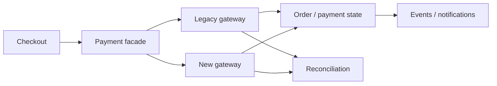
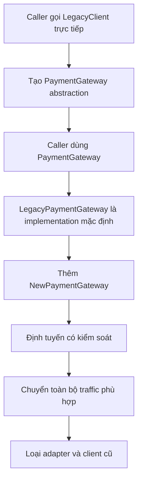
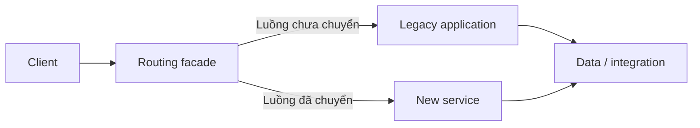
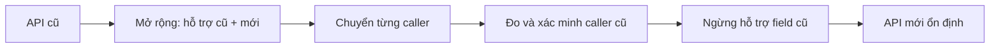
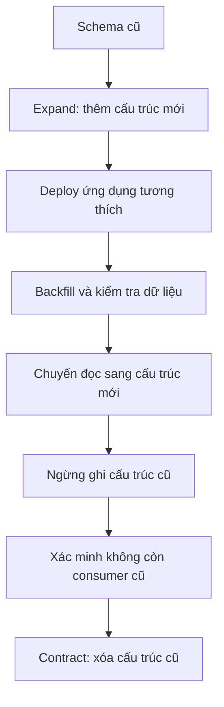
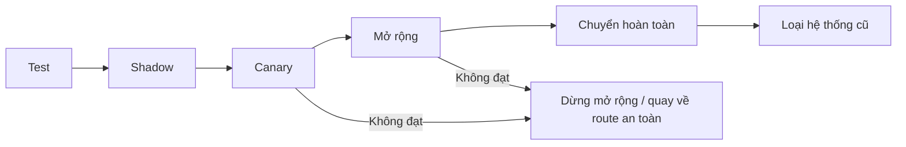

# Di chuyển từng phần và kiểm soát tương thích

> **Chương:** Mã hiện hữu  
> **Học phần:** CODE_QUALITY_FUNDAMENTALS — Hiểu những thuộc tính quyết định mã nguồn có đáng tin cậy, dễ hiểu và dễ thay đổi hay không.

Một hệ thống đã vận hành nhiều năm thường không thể được thay thế trong một lần. Nó có dữ liệu đang được sử dụng, client cũ, các dịch vụ tích hợp, quy trình vận hành và những hành vi mà tài liệu có thể chưa mô tả hết. Viết một hệ thống mới có thể dễ hơn việc thay thế an toàn hệ thống cũ, bởi **trong thời gian chuyển đổi, cả hai phiên bản đều có thể phải cùng tồn tại**.

Ví dụ, nhóm muốn chuyển cổng thanh toán từ một nhà cung cấp cũ sang một nhà cung cấp mới. Nếu đổi toàn bộ trong một đợt, lỗi cấu hình, khác biệt trạng thái giao dịch hoặc một callback chưa tương thích có thể ảnh hưởng mọi khách hàng. Nếu chỉ chuyển một phần mà không kiểm soát idempotency, cùng một yêu cầu có thể được gửi tới hai nhà cung cấp và dẫn đến thu tiền trùng. Nếu schema mới được triển khai trước nhưng ứng dụng cũ chưa hiểu cột hoặc trạng thái mới, quá trình rollback có thể làm mất khả năng đọc dữ liệu.

**Di chuyển từng phần** (*incremental migration*) chia thay đổi lớn thành những bước nhỏ có thể triển khai, quan sát và kiểm chứng. **Kiểm soát tương thích** bảo đảm các thành phần cũ và mới tiếp tục cộng tác đúng trong giai đoạn chuyển tiếp, đồng thời có đường quay lui hoặc tiến tiếp khi một bước không đạt.

Trong học phần **CODE_QUALITY_FUNDAMENTALS**, chủ đề này liên quan trực tiếp tới độ tin cậy, khả năng thay đổi và cấu trúc phụ thuộc của mã hiện hữu. Mục tiêu không phải chỉ tạo một kiến trúc mới; mục tiêu là thay đổi hệ thống đang phục vụ người dùng mà kiểm soát được hành vi và dữ liệu.

Sau bài học, bạn có thể:

- Chia một cuộc di chuyển lớn thành các bước có ranh giới và tiêu chí hoàn tất rõ.
- Xác định hợp đồng cần tương thích giữa caller, API, schema, event và dependency.
- Dùng adapter, facade hoặc seam để chuyển hướng một phần lưu lượng sang triển khai mới.
- Áp dụng trình tự mở rộng, chuyển dữ liệu, chuyển đọc và thu hẹp schema một cách an toàn.
- Chọn cách rollout, quan sát và rollback phù hợp với tác dụng phụ của hệ thống.
- Thiết kế kiểm thử cho giai đoạn hai phiên bản cùng tồn tại.
- Nhận diện các rủi ro như dual-write, retry, dữ liệu lệch, client cũ và migration không thể đảo ngược.

## 1. Vì sao di chuyển từng phần thường an toàn hơn một lần thay thế lớn?

Một cuộc thay thế toàn bộ (*big-bang migration*) thường có các đặc điểm:

- Nhiều thành phần thay đổi cùng lúc.
- Khó xác định nguyên nhân khi có lỗi.
- Kiểm thử toàn bộ tích hợp cần môi trường lớn và dữ liệu gần thực tế.
- Việc triển khai thường gắn với một thời điểm chuyển đổi có áp lực cao.
- Rollback có thể khó nếu schema hoặc dữ liệu đã thay đổi theo cách cũ không đọc được.

Di chuyển từng phần chia hệ thống theo **khả năng thay thế độc lập**. Nhóm có thể chuyển một luồng, một nhóm khách hàng hoặc một loại dữ liệu trước, quan sát kết quả rồi mới mở rộng.

| Cách tiếp cận | Đặc điểm | Rủi ro cần quản lý |
| --- | --- | --- |
| Big-bang | Chuyển toàn bộ cùng lúc | Phạm vi lỗi lớn, rollback khó, nhiều thay đổi đồng thời |
| Incremental | Chuyển theo bước hoặc theo nhóm chức năng | Hai phiên bản cùng tồn tại, cần hợp đồng tương thích |
| Strangler pattern | Chuyển dần các luồng qua một ranh giới định tuyến | Routing, dữ liệu dùng chung và trách nhiệm giữa cũ/mới |
| Branch by abstraction | Tạo abstraction ổn định rồi thay implementation phía sau | Abstraction sai hoặc kéo dài trạng thái chuyển tiếp |
| Expand-contract | Mở rộng schema/API trước, chuyển caller, rồi loại bỏ phần cũ | Trình tự triển khai và tương thích ngược/thuận |

Không có một kỹ thuật phù hợp cho mọi cuộc di chuyển. Chọn cách dựa trên **ranh giới nghiệp vụ, khả năng tách dữ liệu, số lượng caller, yêu cầu sẵn sàng và khả năng khôi phục**.

### 1.1. Di chuyển từng phần không có nghĩa giữ hai hệ thống mãi mãi

Giai đoạn chuyển tiếp có thể cần hai implementation, hai schema hoặc hai dạng API. Nhưng mỗi phần tạm thời phải có:

- Lý do tồn tại.
- Chủ sở hữu.
- Phạm vi sử dụng.
- Cách đo tiến độ chuyển đổi.
- Điều kiện kết thúc và loại bỏ.

Nếu không có tiêu chí kết thúc, adapter cũ, feature flag và logic tương thích có thể trở thành một phần phức tạp vĩnh viễn của hệ thống.

## 2. Bắt đầu bằng bản đồ hợp đồng và phụ thuộc

Trước khi thay implementation, hãy xác định **những bên đang dựa vào hành vi nào**.

Với một cổng thanh toán, các bên có thể gồm:

| Thành phần | Hợp đồng cần hiểu |
| --- | --- |
| Checkout API | Cách tạo yêu cầu thanh toán, xác thực và trả trạng thái |
| Payment service | Ý nghĩa của authorize, capture, refund và trạng thái trung gian |
| Nhà cung cấp cũ | Mã giao dịch, timeout, callback, retry và lỗi |
| Nhà cung cấp mới | Khác biệt về định danh, trạng thái, chữ ký callback và giới hạn |
| Order service | Khi nào đơn được coi là đã thanh toán |
| Reconciliation job | Cách đối soát giao dịch không có phản hồi cuối |
| Customer notification | Thời điểm gửi thông báo và cách tránh gửi trùng |
| Báo cáo/kế toán | Ý nghĩa và nguồn có thẩm quyền của số tiền, phí, trạng thái |

Một sơ đồ phụ thuộc đơn giản:



Sơ đồ chỉ là ví dụ khái niệm. Trong hệ thống thật, cần xác minh ai thực sự ghi trạng thái, callback đi qua đâu và reconciliation có gọi lại nhà cung cấp nào.

### 2.1. Ghi rõ hợp đồng quan sát được

Đối với mỗi ranh giới, ghi:

- Đầu vào hợp lệ, đơn vị và định danh.
- Kết quả thành công, từ chối và trạng thái chưa xác định.
- Loại lỗi, timeout và cách retry.
- Tác dụng phụ, thứ tự thực hiện và số lần có thể xảy ra.
- Tính idempotent và khóa dùng để nhận diện yêu cầu lặp.
- Định dạng dữ liệu, version và quy tắc tương thích.
- Ai sở hữu dữ liệu cuối cùng và cách đối soát.

Không chỉ ghi chữ ký hàm. Hai API cùng có phương thức `charge(amount)` vẫn có thể có hợp đồng khác nhau: một API trả về khi đã capture, API kia chỉ xác nhận đã nhận yêu cầu và sẽ gửi callback sau.

### 2.2. Phân loại điều phải giữ, điều được đổi và điều chưa rõ

| Nhóm | Ví dụ |
| --- | --- |
| Phải giữ | Một payment ID không được tạo hai lần capture cho cùng một yêu cầu |
| Được đổi có chủ đích | Provider reference có định dạng khác |
| Cần adapter chuyển đổi | Trạng thái `AUTHORIZED` của provider mới được ánh xạ vào trạng thái miền tương ứng |
| Chưa rõ cần xác minh | Timeout có thể xảy ra sau khi nhà cung cấp đã trừ tiền hay không |
| Ngoài phạm vi | Thay đổi giao diện checkout nếu không cần cho việc chuyển provider |

Một điểm chưa rõ về thanh toán, dữ liệu hoặc quyền không nên được lấp bằng giả định trong code. Cần xác nhận hợp đồng trước khi chuyển traffic thật.

## 3. Chọn một seam để tách hệ thống cũ và mới

*Seam* là ranh giới cho phép thay đổi một phần triển khai mà không phải sửa mọi caller. Trong Java, seam thường là interface, facade, adapter hoặc một điểm định tuyến.

Ví dụ, caller chỉ biết hợp đồng miền:

```java
// PaymentGateway.java
public interface PaymentGateway {
    PaymentResult authorize(PaymentCommand command);
}
```

```java
// PaymentCommand.java
public record PaymentCommand(
        String paymentId,
        long amountMinor,
        String currency,
        String accountId) {
}
```

```java
// PaymentResult.java
public record PaymentResult(
        String providerReference,
        PaymentStatus status) {
}
```

```java
// PaymentStatus.java
public enum PaymentStatus {
    APPROVED,
    DECLINED,
    PENDING
}
```

Các kiểu trên là hợp đồng nội bộ minh họa. `amountMinor` biểu diễn đơn vị nhỏ nhất của currency (ví dụ cent với một số tiền tệ), tránh giả định mọi currency có hai chữ số thập phân. Ứng dụng thực tế cần xác định chính xác đơn vị theo currency.

### 3.1. Adapter chuyển hợp đồng miền sang API nhà cung cấp

Có thể có hai implementation:

```java
// LegacyPaymentGateway.java — minh họa
public final class LegacyPaymentGateway implements PaymentGateway {
    private final LegacyPaymentClient client;

    public LegacyPaymentGateway(LegacyPaymentClient client) {
        this.client = client;
    }

    @Override
    public PaymentResult authorize(PaymentCommand command) {
        LegacyChargeResponse response = client.authorize(
                command.paymentId(),
                command.amountMinor(),
                command.currency());

        return LegacyPaymentMapper.toDomain(response);
    }
}
```

```java
// NewPaymentGateway.java — minh họa
public final class NewPaymentGateway implements PaymentGateway {
    private final NewProcessorClient client;

    public NewPaymentGateway(NewProcessorClient client) {
        this.client = client;
    }

    @Override
    public PaymentResult authorize(PaymentCommand command) {
        NewAuthorizationResponse response = client.createAuthorization(
                command.paymentId(),
                command.amountMinor(),
                command.currency(),
                command.accountId());

        return NewPaymentMapper.toDomain(response);
    }
}
```

`LegacyPaymentClient`, `NewProcessorClient`, các response và mapper là kiểu giả định của hai SDK, chưa được định nghĩa trong ví dụ. Hai adapter cần chuyển lỗi, trạng thái, định danh và đơn vị theo hợp đồng miền; không nên để kiểu SDK rò rỉ khắp codebase.

### 3.2. Vì sao không gọi provider mới trực tiếp từ mọi caller?

Nếu checkout, batch, refund và reconciliation đều biết API nhà cung cấp, cuộc di chuyển sẽ phải sửa nhiều nơi. Sau đó, một thay đổi ở provider lại lan ra toàn hệ thống.

Một seam ổn định giúp:

- Giữ caller phụ thuộc vào hợp đồng nội bộ.
- Tập trung chuyển đổi dữ liệu và lỗi tại adapter.
- Định tuyến theo nhóm hoặc feature flag.
- Test hai implementation theo cùng một contract suite.
- Loại bỏ implementation cũ khi đã chuyển hết caller và dữ liệu liên quan.

Không tạo interface chỉ để có thêm một lớp. Seam hữu ích khi nó biểu diễn **một hợp đồng thật sự ổn định** và cho phép tách implementation có lý do thay đổi độc lập.

## 4. Branch by abstraction: chuyển implementation phía sau hợp đồng

Một chiến lược phổ biến:

1. Tạo abstraction bao quanh chức năng cũ.
2. Chuyển các caller sang abstraction, nhưng vẫn dùng implementation cũ.
3. Viết contract tests cho abstraction.
4. Tạo implementation mới và kiểm tra độc lập.
5. Định tuyến một phần traffic sang implementation mới.
6. Chuyển dần toàn bộ traffic khi có đủ bằng chứng.
7. Loại implementation cũ và mã chuyển tiếp.



Lợi ích là có thể thay đổi caller trước, rồi thay implementation trong một bước riêng. Tuy nhiên, nếu abstraction không phản ánh đúng nghiệp vụ, nhóm có thể phải sửa interface nhiều lần hoặc nhồi thêm tham số tùy provider.

### 4.1. Không để hợp đồng nội bộ trở thành bản sao của SDK

Ví dụ không tốt:

```java
public interface PaymentGateway {
    NewProcessorResponse createAuthorization(
            NewProcessorRequest request);
}
```

Interface này chỉ bọc tên kiểu của provider mới. Caller vẫn phụ thuộc vào nhà cung cấp cụ thể và việc thay provider khác sẽ khó.

Một hợp đồng miền nên biểu đạt khái niệm ứng dụng cần, ví dụ `authorize(PaymentCommand)` và `PaymentResult`, còn adapter chịu trách nhiệm chuyển đổi.

### 4.2. Giữ tương thích trong lúc chuyển caller

Nếu có module chưa thể chuyển ngay, có thể giữ một facade hoặc adapter tương thích. Nhưng cần ghi rõ:

- Caller nào còn dùng API cũ.
- API cũ còn được hỗ trợ tới khi nào.
- Những hành vi nào phải giống giữa đường cũ và đường mới.
- Cách đo số caller còn lại.
- Điều kiện loại bỏ API cũ.

Không để facade tương thích tồn tại mãi mà không có chủ sở hữu hoặc kế hoạch loại bỏ.

## 5. Strangler pattern: thay thế dần theo luồng nghiệp vụ

*Strangler pattern* đặt một ranh giới phía trước hệ thống cũ. Các request đi qua ranh giới này và được định tuyến tới phần cũ hoặc phần mới. Theo thời gian, từng luồng được chuyển sang implementation mới; phần cũ thu hẹp dần.

Ví dụ một ứng dụng đơn hàng nguyên khối có các luồng:

- Xem lịch sử đơn.
- Tạo đơn mới.
- Hủy đơn.
- Hoàn tiền.

Nhóm có thể chuyển luồng tạo đơn trước, giữ đọc lịch sử ở hệ thống cũ, rồi chuyển hủy và hoàn tiền sau khi hợp đồng trạng thái đã được xác minh.



Trong giai đoạn chuyển tiếp, hai phần có thể dùng chung database hoặc tích hợp qua API/event. Đây thường là phần khó nhất: **định tuyến request dễ hơn bảo đảm dữ liệu và trạng thái nhất quán**.

### 5.1. Chuyển theo capability hoặc nhóm đối tượng

Có thể chuyển theo:

- Một capability có ranh giới rõ.
- Một loại giao dịch hoặc sản phẩm.
- Một tenant/nhóm khách hàng được chọn.
- Một khu vực hoặc nhóm tài khoản.
- Một luồng đọc trước, rồi luồng ghi sau.

Không nên chọn nhóm chỉ vì dễ định tuyến. Cần đảm bảo nhóm được chọn có thể vận hành độc lập, có cách hỗ trợ và đối soát khi lỗi.

### 5.2. Routing phải ổn định và có thể giải thích

Nếu một payment ID được gửi tới provider cũ ở lần đầu nhưng retry lại bị chuyển sang provider mới, cùng một giao dịch có thể tồn tại ở hai nơi. Routing cho thao tác có tác dụng phụ cần có quyết định ổn định, ví dụ lưu provider đã chọn gắn với payment ID hoặc account.

Không nên dùng random routing cho các lệnh thanh toán, ghi dữ liệu hoặc hoàn tiền. Tỷ lệ phần trăm rollout nên được chuyển thành quyết định xác định theo khóa ổn định và được lưu/kiểm soát khi cần.

## 6. Ví dụ Java: định tuyến có kiểm soát qua facade

Một facade có thể chọn implementation dựa trên chính sách định tuyến:

```java
// PaymentRoutePolicy.java
public interface PaymentRoutePolicy {
    boolean useNewGateway(PaymentCommand command);
}
```

```java
// SwitchingPaymentGateway.java
import java.util.Objects;

public final class SwitchingPaymentGateway implements PaymentGateway {
    private final PaymentGateway legacyGateway;
    private final PaymentGateway newGateway;
    private final PaymentRoutePolicy routePolicy;

    public SwitchingPaymentGateway(
            PaymentGateway legacyGateway,
            PaymentGateway newGateway,
            PaymentRoutePolicy routePolicy) {
        this.legacyGateway = Objects.requireNonNull(legacyGateway);
        this.newGateway = Objects.requireNonNull(newGateway);
        this.routePolicy = Objects.requireNonNull(routePolicy);
    }

    @Override
    public PaymentResult authorize(PaymentCommand command) {
        Objects.requireNonNull(command, "command");

        if (routePolicy.useNewGateway(command)) {
            return newGateway.authorize(command);
        }
        return legacyGateway.authorize(command);
    }
}
```

Đoạn code minh họa định tuyến một request tới **một** gateway theo chính sách. Nó không tự bảo đảm route ổn định qua retry; implementation của `PaymentRoutePolicy` phải dùng khóa phù hợp và/hoặc quyết định đã lưu. Trong hệ thống thật, cần xác minh payment ID đã được gán provider trước đó thì mọi lần retry tiếp tục dùng đúng provider.

### 6.1. Test bảo đảm mỗi request chỉ đi một đường

```java
import static org.junit.jupiter.api.Assertions.assertEquals;
import static org.junit.jupiter.api.Assertions.assertThrows;
import static org.mockito.Mockito.mock;
import static org.mockito.Mockito.never;
import static org.mockito.Mockito.verify;
import static org.mockito.Mockito.when;

import org.junit.jupiter.api.Test;

class SwitchingPaymentGatewayTest {
    @Test
    void routesToNewGatewayWhenPolicySelectsNew() {
        PaymentGateway legacy = mock(PaymentGateway.class);
        PaymentGateway newer = mock(PaymentGateway.class);
        PaymentCommand command =
                new PaymentCommand("PAY-1", 12500L, "USD", "ACCT-1");
        PaymentResult expected =
                new PaymentResult("NEW-REF-1", PaymentStatus.APPROVED);
        PaymentRoutePolicy policy = ignored -> true;
        when(newer.authorize(command)).thenReturn(expected);

        SwitchingPaymentGateway gateway =
                new SwitchingPaymentGateway(legacy, newer, policy);

        assertEquals(expected, gateway.authorize(command));
        verify(newer).authorize(command);
        verify(legacy, never()).authorize(command);
    }

    @Test
    void doesNotSilentlyFallbackAfterNewGatewayFails() {
        PaymentGateway legacy = mock(PaymentGateway.class);
        PaymentGateway newer = mock(PaymentGateway.class);
        PaymentCommand command =
                new PaymentCommand("PAY-2", 12500L, "USD", "ACCT-1");
        PaymentRoutePolicy policy = ignored -> true;
        when(newer.authorize(command))
                .thenThrow(new PaymentGatewayException("Timeout"));

        SwitchingPaymentGateway gateway =
                new SwitchingPaymentGateway(legacy, newer, policy);

        assertThrows(PaymentGatewayException.class,
                () -> gateway.authorize(command));
        verify(legacy, never()).authorize(command);
    }
}
```

`PaymentGatewayException` là kiểu ngoại lệ miền giả định. Ví dụ dùng Mockito để minh họa cách xác minh định tuyến; nếu dự án không dùng Mockito, có thể tạo fake gateway ghi lại lời gọi.

Test thứ hai cố ý bảo đảm facade không tự gửi lại lệnh sang gateway cũ sau khi gateway mới timeout. **Timeout không chứng minh nhà cung cấp chưa xử lý yêu cầu**. Nếu fallback tự động, hệ thống có thể tạo giao dịch thứ hai. Quy trình xử lý trạng thái chưa xác định cần dựa vào idempotency, truy vấn trạng thái và đối soát.

## 7. Kiểm soát tương thích API khi hai phiên bản cùng tồn tại

Một hệ thống có thể có producer mới và consumer cũ, hoặc ngược lại. Cần đánh giá tương thích theo chiều:

- **Backward compatibility:** phiên bản mới vẫn hỗ trợ caller/dữ liệu cũ.
- **Forward compatibility:** consumer hiện tại có thể xử lý dữ liệu hoặc producer mới trong phạm vi đã cam kết.
- **Source/binary compatibility:** caller Java cũ còn biên dịch/liên kết được hay không.
- **Behavioral compatibility:** cùng request nhưng kết quả, lỗi và tác dụng phụ có giữ hợp đồng không.

| Thay đổi API | Rủi ro tương thích | Cách tiếp cận thường an toàn hơn |
| --- | --- | --- |
| Thêm field response tùy chọn | Consumer cũ có thể từ chối field lạ nếu parser strict | Kiểm tra tolerant-reader behavior và contract tests |
| Thêm field request bắt buộc | Producer/client cũ không gửi field | Thêm optional/default trước, chuyển caller rồi mới bắt buộc |
| Đổi tên field | Caller cũ không tìm thấy field | Giai đoạn hỗ trợ tên cũ và mới, rồi deprecate có kế hoạch |
| Xóa field | Consumer cũ có thể còn cần | Đo caller, deprecate, chờ hết thời gian hỗ trợ |
| Thêm enum value | Consumer cũ có thể không xử lý giá trị lạ | Consumer có nhánh unknown/forward-compatible phù hợp |
| Đổi ý nghĩa status | Cùng tên nhưng hành vi khác | Dùng version/hợp đồng mới hoặc trạng thái miền rõ hơn |
| Đổi HTTP status hoặc exception | Retry/client handling có thể thay đổi | Contract tests và tài liệu hóa lỗi |

Không mặc định mọi JSON parser đều bỏ qua field lạ. Một số cấu hình strict sẽ từ chối. Tương tự, thêm enum value có thể làm client Java cũ ném lỗi hoặc đi vào nhánh mặc định sai.

### 7.1. Quy trình expand-contract cho API

Một thay đổi có thể chia thành:

1. **Expand:** server chấp nhận dạng cũ và dạng mới; response thêm field mới nhưng vẫn giữ field cũ.
2. **Migrate callers:** nâng cấp từng client để gửi/đọc field mới.
3. **Observe:** đo số client còn dùng field cũ và xác minh không còn request cũ trong phạm vi hỗ trợ.
4. **Deprecate:** thông báo thời hạn ngừng hỗ trợ, cung cấp hướng chuyển.
5. **Contract:** loại field cũ sau khi điều kiện tương thích được đáp ứng.



Nếu có client bên ngoài không thể quan sát trực tiếp, cần thời gian hỗ trợ, versioning hoặc cơ chế tương thích theo hợp đồng. Không xóa field chỉ vì repository nội bộ đã không còn tham chiếu.

## 8. Di chuyển schema và dữ liệu theo expand-migrate-contract

Thay đổi schema là nơi nhiều cuộc di chuyển gặp rủi ro rollback. Giả sử bảng `orders` đang lưu:

```sql
shipping_fee_vnd BIGINT NOT NULL
```

Nhóm muốn chuyển sang một mô hình phí mới có thêm `shipping_fee_minor` và `currency_code`. Nếu đổi tên/xóa cột cũ ngay, phiên bản ứng dụng cũ đang chạy có thể thất bại.

### 8.1. Trình tự mở rộng, chuyển dữ liệu, thu hẹp

| Giai đoạn | Schema | Ứng dụng | Mục tiêu |
| --- | --- | --- | --- |
| Expand | Thêm cột mới có thể nullable hoặc default phù hợp | Phiên bản cũ vẫn hoạt động; phiên bản mới có thể ghi dữ liệu mới | Schema tương thích hai phiên bản |
| Migrate | Cả cột cũ và mới tồn tại | Backfill dữ liệu cũ, kiểm tra sai khác | Dữ liệu mới được lấp đầy và xác minh |
| Switch reads | Cả hai cột vẫn tồn tại | Ứng dụng đọc cột mới, có giám sát | Chuyển nguồn đọc |
| Stop old writes | Cột cũ còn nhưng không còn được ghi | Tất cả writer đã chuyển | Xác nhận không còn phụ thuộc |
| Contract | Sau thời gian an toàn, bỏ cột cũ | Phiên bản cũ không còn chạy | Loại bỏ cấu trúc chuyển tiếp |



Đây là trình tự khái niệm. Migration thật phải xem engine database, lock, transaction, kích thước bảng, replication và cách rollback.

### 8.2. Backfill phải có thể tiếp tục và kiểm chứng

Với bảng lớn, không nên mặc định một lệnh update toàn bảng chạy trong một transaction ngắn. Cần xem:

- Chia batch theo khóa hoặc khoảng dữ liệu.
- Có thể chạy lại mà không tạo sai lệch không?
- Có checkpoint để tiếp tục sau lỗi?
- Có ảnh hưởng lock, replication lag hoặc tải production?
- Dữ liệu mới được tạo trong lúc backfill có bị bỏ sót không?
- Có thể đếm và đối chiếu số bản ghi, tổng tiền, checksum hoặc invariant không?

Backfill cần **idempotent hoặc có cơ chế tiến độ rõ**, tránh chạy lại làm ghi đè dữ liệu mới hơn bằng dữ liệu cũ.

### 8.3. Dual-write có rủi ro riêng

Một ứng dụng có thể ghi cả cột cũ và cột mới. Nếu hai cột trong cùng database và cùng transaction, có thể giữ tính nguyên tử ở mức transaction. Nhưng nếu một lần ghi đi qua hai dịch vụ hoặc hai datastore, một bên thành công còn bên kia thất bại có thể tạo dữ liệu lệch.

Không nên dùng dual-write phân tán kiểu:

```java
legacyStore.save(oldRecord);
newStore.save(newRecord);
```

Nếu lệnh thứ hai thất bại sau khi lệnh đầu thành công, hai nơi khác nhau. Retry mù có thể làm ghi trùng. Các lựa chọn cần đánh giá gồm:

- Một nguồn ghi có thẩm quyền, bên còn lại được cập nhật qua event/outbox.
- Change data capture (CDC) có checkpoint và khả năng phát lại.
- Transaction phân tán nếu hạ tầng và yêu cầu thật sự hỗ trợ, kèm hiểu biết về giới hạn vận hành.
- Một quy trình đối soát và sửa sai có kiểm soát.

**Outbox pattern** có thể giúp ghi trạng thái nghiệp vụ và event cần phát trong cùng transaction database; publisher phát event sau đó và consumer xử lý idempotent. Nó không tự bảo đảm event chỉ được giao đúng một lần; thường cần chấp nhận giao ít nhất một lần và thiết kế chống trùng.

## 9. Di chuyển event và message contract

Event thường sống lâu hơn một lần deploy. Consumer có thể được nâng cấp chậm hơn producer, hoặc một message nằm trong queue nhiều giờ trước khi được xử lý.

Khi thay schema event:

- Thêm field mới có thể yêu cầu default hoặc nullable semantics.
- Đổi tên/xóa field có thể phá consumer cũ.
- Thay ý nghĩa field giữ nguyên tên là thay đổi hợp đồng nguy hiểm.
- Thêm enum/status mới cần consumer biết cách xử lý giá trị chưa biết.
- Thay partition key có thể ảnh hưởng thứ tự xử lý.
- Thay version schema cần xác định chiến lược đọc và replay message cũ.

| Chiến lược | Khi phù hợp | Cần kiểm soát |
| --- | --- | --- |
| Additive schema | Thêm field tùy chọn | Consumer cũ có bỏ qua field lạ không? |
| Versioned event | Thay đổi cấu trúc/ý nghĩa lớn | Consumer nào đọc version nào? |
| Upcaster/translator | Chuẩn hóa message cũ sang mô hình mới | Quy tắc chuyển đổi và khả năng replay |
| Dual publish | Chuyển consumer theo từng nhóm | Không tạo hai tác dụng phụ cho cùng một nghiệp vụ |
| Stop old event | Sau khi consumer cũ đã chuyển | Queue backlog, replay và client ngoài |

### 9.1. Đừng phát hai event nghiệp vụ chỉ để so sánh

Nếu event kích hoạt email, thanh toán hoặc tạo shipment, phát cả event cũ và mới có thể thực hiện tác dụng phụ hai lần. Nếu cần shadow/compare, hãy dùng dữ liệu kiểm thử hoặc consumer chỉ đọc không tạo side effect, và xác định rõ message nào là nguồn có thẩm quyền.

### 9.2. Consumer phải xử lý message lặp và đến muộn

Di chuyển producer không loại bỏ retry và duplicate. Consumer cần dựa vào event ID hoặc khóa nghiệp vụ, lưu trạng thái xử lý và bảo đảm thao tác lặp không gây tác dụng phụ ngoài ý muốn. Với message cũ đến sau message mới, cần quy tắc version/sequence hoặc kiểm tra trạng thái để không ghi đè dữ liệu mới hơn.

## 10. Rollout từng phần và quan sát hành vi

Sau khi có seam, có thể chuyển traffic theo từng bước:

1. **Internal test:** chỉ môi trường test dùng implementation mới.
2. **Shadow/read-only:** gửi bản sao dữ liệu vào implementation mới để so kết quả nếu không tạo tác dụng phụ.
3. **Canary:** chuyển một nhóm nhỏ request/tenant đã chọn.
4. **Expand:** tăng phạm vi khi chỉ số và đối soát đạt.
5. **Complete:** chuyển toàn bộ luồng trong phạm vi.
6. **Retire:** dừng và loại implementation cũ sau khi xác minh không còn phụ thuộc.



### 10.1. Chọn cohort có thể quan sát và hỗ trợ

Một nhóm canary nên:

- Có quy mô đủ nhỏ để giới hạn hậu quả.
- Có dữ liệu và luồng đại diện cho trường hợp sử dụng quan trọng.
- Có thể xác định ổn định qua account/tenant/payment ID.
- Có đội ngũ hỗ trợ và cách tắt routing rõ.
- Không loại bỏ những trường hợp rủi ro cao khỏi kiểm tra chỉ để số liệu đẹp.

Không nên chuyển theo random ở mỗi request nếu cùng một nghiệp vụ có nhiều bước. Một khách hàng có thể tạo đơn ở provider mới nhưng callback/retry lại đi provider cũ nếu routing không ổn định.

### 10.2. Đo đúng những tín hiệu quan trọng

Với thanh toán, không chỉ đo HTTP success rate. Cần cân nhắc:

| Tín hiệu | Điều cần phát hiện |
| --- | --- |
| Tỷ lệ approved/declined theo provider và loại giao dịch | Khác biệt kết quả nghiệp vụ |
| Timeout và trạng thái pending | Giao dịch chưa có kết quả cuối |
| Tỷ lệ retry và duplicate | Nguy cơ lệnh lặp |
| Thời gian phản hồi | Suy giảm trải nghiệm hoặc timeout |
| Chênh lệch reconciliation | Giao dịch lệch giữa ứng dụng và provider |
| Số tiền/fee theo currency | Sai đơn vị hoặc mapping |
| Callback signature failures | Vấn đề xác thực hoặc tích hợp |
| Tỷ lệ lỗi theo cohort | Nhóm canary có vấn đề riêng |

Các metric cần tag phù hợp nhưng không ghi PAN, token thanh toán hoặc thông tin nhạy cảm vào label/log. Metric không thay thế đối soát dữ liệu giao dịch.

### 10.3. Shadow mode chỉ an toàn khi không gây tác dụng phụ

Với chức năng đọc, có thể gửi cùng một request đến implementation cũ và mới, so kết quả rồi chỉ trả kết quả cũ cho người dùng. Với lệnh ghi hoặc thanh toán, **không được nhân đôi request thật một cách tùy tiện**. Chỉ shadow phần tính toán thuần hoặc dùng sandbox/fake có kiểm soát; tuyệt đối không để hai provider cùng thực hiện capture cho một giao dịch thật.

## 11. Rollback, roll-forward và trạng thái chưa xác định

Rollback không đơn giản là đổi feature flag về false. Nếu ứng dụng mới đã ghi schema mà ứng dụng cũ không hiểu, nếu giao dịch đã đi qua provider mới hoặc event mới đã được phát, quay lại code cũ có thể không đủ.

### 11.1. Phân biệt rollback code với đảo ngược dữ liệu

| Thành phần | Câu hỏi trước rollback |
| --- | --- |
| Application code | Phiên bản cũ còn đọc/ghi schema hiện tại không? |
| Database schema | Migration có destructive hay chỉ additive? |
| Data backfill | Có thể giữ cột mới và chạy code cũ không? |
| Event/message | Consumer cũ có đọc message mới đã nằm trong queue không? |
| External provider | Giao dịch đã tạo ở provider mới có thể được tra cứu và xử lý tiếp không? |
| Side effects | Email, shipment hoặc capture đã xảy ra có thể đảo ngược không? |
| Feature flag | Route có ổn định với payment đang xử lý dở không? |

Một nguyên tắc hữu ích là **giữ phiên bản cũ tương thích với cấu trúc mở rộng trong giai đoạn rollback**, rồi chỉ contract sau khi không còn đường quay lại cần hỗ trợ.

### 11.2. Không fallback tự động sau timeout khi kết quả chưa xác định

Ví dụ:

```text
Ứng dụng gửi authorize tới provider mới
        |
        v
Provider có thể đã nhận và xử lý
        |
        v
Ứng dụng timeout trước khi nhận phản hồi
        |
        v
Ứng dụng không biết giao dịch đã được tạo hay chưa
```

Nếu gửi cùng lệnh sang provider cũ chỉ vì timeout, có thể tạo hai giao dịch. Trước khi retry hoặc đổi provider, cần:

1. Tra cứu trạng thái theo payment ID/provider reference.
2. Dùng idempotency key theo hợp đồng provider nếu được hỗ trợ.
3. Ghi nhận trạng thái `PENDING/UNKNOWN` thay vì tự coi là thất bại.
4. Đưa vào reconciliation khi không thể xác định ngay.
5. Chỉ thực hiện thao tác tiếp theo sau khi có bằng chứng đủ tin cậy.

### 11.3. Khi nào roll-forward an toàn hơn?

Nếu dữ liệu mới đã được tạo và code cũ không thể đọc, có thể cần sửa phiên bản mới để tương thích thay vì rollback. Quyết định phụ thuộc vào khả năng tương thích dữ liệu và mức độ side effect đã xảy ra.

Kế hoạch triển khai nên ghi trước:

- Điều kiện dừng rollout.
- Ai có quyền đổi routing.
- Những payment/order đang ở trạng thái pending sẽ được xử lý thế nào.
- Có thể quay lại phiên bản nào.
- Dữ liệu nào không thể đảo ngược.
- Cách đối soát và hỗ trợ người dùng bị ảnh hưởng.

## 12. Kiểm thử trong giai đoạn hai phiên bản cùng tồn tại

Test chỉ chạy với phiên bản mới chưa đủ để chứng minh tương thích. Cần kiểm tra những cặp producer/consumer hoặc writer/reader có thể xuất hiện trong rollout.

| Kiểu kiểm thử | Câu hỏi được trả lời |
| --- | --- |
| Unit test adapter | Mapping request, response, trạng thái và lỗi có đúng không? |
| Contract test | Implementation mới có giữ hợp đồng mà caller mong đợi không? |
| Consumer-driven contract | API/event có còn đáp ứng nhu cầu client đang triển khai không? |
| Compatibility test | Phiên bản cũ có đọc schema/message mới trong giai đoạn hỗ trợ không? |
| Migration test | Backfill, retry và chạy lại migration có an toàn không? |
| Integration test | Các thành phần phối hợp trên database/broker/provider test ra sao? |
| Shadow comparison | Kết quả đọc/tính toán giữa cũ và mới có sai khác không? |
| Load/soak test | Hệ thống mới có đáp ứng tải và thời gian dài không? |
| Failure injection | Timeout, duplicate, callback muộn và dependency lỗi được xử lý thế nào? |

### 12.1. Kiểm tra ma trận phiên bản

Trong một giai đoạn chuyển đổi, có thể cần kiểm tra:

| Producer / writer | Consumer / reader | Có thể xảy ra? | Cần xác minh |
| --- | --- | --- | --- |
| Cũ | Cũ | Có | Baseline |
| Mới | Cũ | Có nếu rollout không đồng bộ | Backward compatibility |
| Cũ | Mới | Có trong lúc nâng consumer trước | Forward compatibility/default |
| Mới | Mới | Có | Hợp đồng đích |

Với database, ma trận tương ứng là ứng dụng cũ/mới đọc/ghi schema mở rộng. Không phải mọi tổ hợp đều được hỗ trợ; cần **thiết kế rollout để tránh những tổ hợp không an toàn**, đồng thời test những tổ hợp có thể thực sự xuất hiện.

### 12.2. Test migration trên dữ liệu đại diện

Một migration có thể chạy thành công trên bảng rỗng nhưng thất bại với dữ liệu thật do null, duplicate, encoding hoặc kích thước. Nên dùng dữ liệu tổng hợp có phân bố và trường hợp biên tương đương, kiểm tra:

- Số bản ghi trước/sau.
- Khóa và quan hệ tham chiếu.
- Tổng tiền hoặc tổng hợp có ý nghĩa.
- Null/default và giá trị bất thường.
- Tính idempotent khi chạy lại.
- Thời gian, lock và tài nguyên.

Không sao chép dữ liệu production nhạy cảm vào môi trường test nếu chưa có cơ chế bảo vệ và quyền phù hợp.

## 13. Các lỗi thường gặp khi di chuyển từng phần

### 13.1. Chuyển traffic trước khi có seam rõ

Feature flag được thêm trực tiếp ở nhiều caller, mỗi nơi có logic chọn provider riêng. Khi cần dừng rollout, một số caller vẫn đi đường mới. Hãy tập trung routing ở ranh giới có thể kiểm tra và đo.

### 13.2. Dùng fallback mù sau mọi lỗi

Không phải lỗi nào cũng cho phép thử implementation khác. Timeout sau lệnh ghi có thể là trạng thái chưa xác định; fallback có thể nhân đôi tác dụng phụ. Phân biệt lỗi từ chối rõ ràng với timeout và lỗi kết nối.

### 13.3. Dual-write nhưng không có đối soát

Hai datastore có thể lệch khi một bên thành công và bên kia thất bại. Cần nguồn ghi có thẩm quyền, event/outbox hoặc cơ chế reconcile, không chỉ thêm một lệnh save thứ hai.

### 13.4. Contract schema quá sớm

Xóa field hoặc cột cũ khi vẫn còn consumer cũ có thể làm lỗi xuất hiện sau rollout. Chỉ contract sau khi có bằng chứng không còn caller/writer/reader cũ trong phạm vi hỗ trợ.

### 13.5. Giữ feature flag vĩnh viễn

Flag cũ làm tăng số nhánh, tăng tổ hợp test và khiến hành vi khó dự đoán. Mỗi flag chuyển đổi nên có owner, ngày xem lại và điều kiện loại bỏ.

### 13.6. Chuyển từng phần nhưng không giữ cùng một định danh nghiệp vụ

Nếu payment ID, order ID hoặc idempotency key thay đổi khi qua adapter, việc tra cứu, retry và đối soát có thể không nối được giao dịch cũ với giao dịch mới. Cần định nghĩa mapping và giữ correlation ID xuyên suốt.

### 13.7. So sánh output mà bỏ qua khác biệt hợp đồng hợp lệ

Provider mới có thể trả mã tham chiếu khác hoặc trạng thái chi tiết hơn. Không phải mọi byte khác nhau đều là lỗi. So sánh theo **ý nghĩa miền** và quy tắc đã thống nhất, không so chuỗi raw response một cách mù quáng.

### 13.8. Không xác định thời điểm ngừng hệ thống cũ

Nếu không đo caller, queue backlog, callback muộn và dữ liệu còn phụ thuộc, nhóm có thể tắt hệ thống cũ khi vẫn còn giao dịch đang xử lý. Cần một tiêu chí nghỉ hưu có bằng chứng, không chỉ một ngày dự kiến.

## 14. Kế hoạch di chuyển có thể review

Một kế hoạch tốt có thể trình bày theo từng giai đoạn:

| Giai đoạn | Thay đổi | Bằng chứng cần có | Điều kiện tiếp tục |
| --- | --- | --- | --- |
| 1. Khám phá | Bản đồ caller, hợp đồng, dữ liệu và lỗi | Inventory, contract, baseline | Ranh giới và rủi ro đã hiểu |
| 2. Tạo seam | Thêm interface/facade và adapter cũ | Test caller và contract | Hành vi cũ được giữ |
| 3. Xây implementation mới | Adapter mới, mapping và xử lý lỗi | Unit/contract/integration tests | Kết quả theo hợp đồng |
| 4. Shadow/canary | So sánh hoặc chuyển nhóm nhỏ | Metrics, reconciliation, alert | Không có sai lệch không chấp nhận |
| 5. Mở rộng | Tăng cohort, chuyển caller | Theo dõi theo nhóm và trạng thái | Đạt ngưỡng đã thống nhất |
| 6. Ngừng cũ | Dừng traffic, xử lý backlog | Không còn caller/giao dịch phụ thuộc | Owner xác nhận đủ điều kiện |
| 7. Contract | Xóa adapter/schema cũ | Compatibility tests và backup/restore plan | Không còn đường rollback cần hỗ trợ |

### 14.1. Ghi rõ điều kiện dừng

Ví dụ các điều kiện dừng rollout:

- Tỷ lệ giao dịch `PENDING/UNKNOWN` vượt ngưỡng đã thống nhất.
- Reconciliation phát hiện chênh lệch số tiền hoặc giao dịch.
- Callback signature failure tăng bất thường.
- Tỷ lệ decline thay đổi vượt mức có thể giải thích.
- Có dấu hiệu duplicate hoặc sai mapping currency.
- Latency/timeout vượt mục tiêu dịch vụ.

Ngưỡng cụ thể phải dựa trên baseline, SLO và yêu cầu nghiệp vụ của hệ thống thật; không lấy số minh họa trong tài liệu làm mặc định.

### 14.2. Ghi rõ trách nhiệm

Mỗi giai đoạn cần biết:

- Ai sở hữu implementation cũ và mới?
- Ai duyệt thay đổi schema/API?
- Ai theo dõi dashboard và nhận alert?
- Ai có quyền dừng rollout hoặc chuyển route?
- Ai đối soát giao dịch đang pending?
- Ai quyết định đã đủ điều kiện retire?

Không có người sở hữu rõ, một kế hoạch có thể đúng về kỹ thuật nhưng vẫn thất bại khi có sự cố.

## 15. Checklist tương thích trước khi chuyển bước

| Câu hỏi | Bằng chứng nên có |
| --- | --- |
| Ranh giới nghiệp vụ và caller đã được xác định? | Sơ đồ call path, inventory consumer |
| Hợp đồng cũ và mới đã rõ? | Request/response, lỗi, trạng thái, side effects |
| Adapter có giữ ngữ nghĩa miền? | Mapping test và contract test |
| Routing có ổn định qua retry? | Quyết định provider gắn với định danh giao dịch |
| Có fallback nguy hiểm sau timeout? | Xử lý trạng thái unknown và reconciliation |
| Schema mới tương thích ứng dụng cũ? | Expand-contract và ma trận phiên bản |
| Backfill có thể tiếp tục và đối soát? | Checkpoint, idempotency, invariant và số liệu |
| Dual-write có nguồn có thẩm quyền? | Transaction/outbox/CDC hoặc quy trình reconcile |
| Event consumer có xử lý version và duplicate? | Contract, replay và idempotency tests |
| Canary có cohort và metric rõ? | Routing ổn định, dashboard và điều kiện dừng |
| Rollback có an toàn với dữ liệu đã ghi? | Tương thích schema, giao dịch và event backlog |
| Có tiêu chí retire hệ thống cũ? | Không còn caller, queue và giao dịch phụ thuộc |
| Feature flag/adapter tạm có owner và thời hạn? | Danh sách loại bỏ sau chuyển đổi |

## 16. Bài tập thực hành

Một hệ thống Java đang dùng `LegacyPaymentGateway`. Nhóm muốn chuyển sang `NewPaymentGateway` trong khi checkout, batch và reconciliation vẫn đang chạy. Hợp đồng thanh toán hiện tại:

- Mỗi `paymentId` chỉ được authorize một lần về mặt nghiệp vụ.
- Timeout không chứng minh giao dịch chưa được xử lý.
- Trạng thái `PENDING` có thể được cập nhật sau callback.
- Báo cáo kế toán phải giữ provider reference và số tiền đã chốt.
- Client cũ chưa thể nâng cấp trong cùng một lần phát hành.

Hãy thực hiện:

1. Vẽ bản đồ caller và xác định seam phù hợp để caller không phụ thuộc SDK của provider.
2. Đề xuất các kiểu miền Java cho command, result và trạng thái; giải thích cách adapter ánh xạ trạng thái provider.
3. Thiết kế routing theo tenant hoặc payment ID sao cho retry của cùng giao dịch không đổi provider.
4. Nêu vì sao không được tự động fallback sang provider cũ sau timeout của provider mới.
5. Xây dựng trình tự expand-contract nếu cần thêm cột lưu provider và provider reference vào bảng payment.
6. Xác định cách backfill bản ghi cũ, đối chiếu dữ liệu và xử lý giao dịch pending trong lúc chuyển đổi.
7. Đề xuất contract tests và integration tests cho cả adapter cũ lẫn mới.
8. Chọn metric và điều kiện dừng cho canary. Không dùng riêng HTTP success rate làm bằng chứng.
9. Viết kế hoạch rollback, phân biệt rollback code với giao dịch đã được provider xử lý và schema đã mở rộng.
10. Định nghĩa điều kiện retire hệ thống cũ: caller, callback, queue backlog, reconciliation và báo cáo đã chuyển ra sao?
11. Nêu những khác biệt API/event nào có thể được thêm tương thích và những thay đổi nào cần version mới hoặc giai đoạn deprecation.
12. Viết một kế hoạch theo giai đoạn có owner, bằng chứng và tiêu chí tiếp tục cho mỗi bước.

**Gợi ý:** lời giải tốt không chỉ có một feature flag. Nó phải bảo đảm **một giao dịch có định danh và nguồn xử lý nhất quán**, dữ liệu không bị mất khi hai phiên bản cùng tồn tại, và nhóm có thể biết lúc nào nên dừng, quay lui hoặc tiến tiếp.

## Ghi nhớ

Di chuyển hệ thống hiện hữu an toàn cần **chia thay đổi theo ranh giới có thể kiểm chứng và giữ hợp đồng tương thích trong giai đoạn chuyển tiếp**. Hãy bắt đầu từ caller, dữ liệu và tác dụng phụ; tạo seam ổn định; chuyển từng luồng hoặc nhóm đối tượng; dùng expand-migrate-contract cho schema; kiểm thử các cặp phiên bản có thể cùng tồn tại; rollout có quan sát và điều kiện dừng. Đặc biệt, timeout, retry và dual-write có thể tạo trạng thái chưa xác định hoặc dữ liệu lệch, nên cần idempotency và đối soát. Chỉ loại phần cũ sau khi có bằng chứng không còn caller, dữ liệu hay giao dịch phụ thuộc. **Một cuộc di chuyển thành công không chỉ đưa code mới vào production; nó giữ cho hệ thống hoạt động đúng trong suốt quá trình chuyển đổi.**
