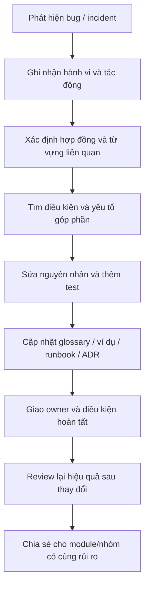

# Chia sẻ từ vựng, ví dụ tốt và bài học từ lỗi

Trong một nhóm phát triển, cùng một từ có thể được hiểu theo nhiều cách. Người làm sản phẩm nói “đơn đã thanh toán” khi cổng thanh toán vừa xác nhận yêu cầu; kế toán chỉ gọi là “đã thu tiền” sau khi giao dịch được đối soát; lập trình viên lại dùng trạng thái `PAID` ngay khi nhận callback. Một ngày nào đó, báo cáo doanh thu cộng cả giao dịch chưa được xác nhận cuối cùng. Lỗi không nhất thiết bắt đầu từ một thuật toán phức tạp. Nó có thể bắt đầu từ **một từ không được hiểu thống nhất**.

Nhóm cũng có thể giải thích một quy tắc bằng lời trong nhiều cuộc họp, nhưng không lưu ví dụ đủ rõ để người mới áp dụng. Khi lỗi xảy ra, mọi người sửa phần code nhìn thấy trước mắt mà không chia sẻ điều kiện đã khiến lỗi xuất hiện. Vài tháng sau, cùng một loại lỗi quay lại ở module khác.

Chất lượng phần mềm là kết quả của nhiều người cùng hiểu và giữ những hợp đồng chung. Trong chương **Cộng tác và trách nhiệm** của **CODE_QUALITY_FUNDAMENTALS**, bài học này tập trung vào việc chia sẻ **từ vựng, ví dụ tốt và bài học từ lỗi**. Điều này hỗ trợ mục tiêu của module: hiểu những thuộc tính quyết định mã nguồn có **đáng tin cậy, dễ hiểu và dễ thay đổi hay không**.

Tri thức chung không chỉ là tài liệu để đọc. Nó cần xuất hiện nhất quán trong tên biến, API, test, ví dụ, quy trình vận hành và cách nhóm trao đổi. Khi có lỗi, nhóm cần chuyển điều đã học thành thay đổi có thể kiểm chứng để người khác không phải lặp lại cùng một khám phá.

## Mục tiêu học tập

Sau bài này, bạn có thể:

1. Giải thích vì sao một từ vựng thống nhất giúp giảm hiểu sai giữa nghiệp vụ, code và vận hành.
2. Xây dựng glossary nhỏ có định nghĩa, ví dụ, ranh giới và người sở hữu thuật ngữ.
3. Đưa ngôn ngữ chung vào tên kiểu, phương thức, trạng thái, API và kiểm thử.
4. Viết ví dụ tốt có thể dùng để học, review và kiểm tra hợp đồng.
5. Phân biệt ví dụ minh họa với ví dụ đã được xác minh bằng code hoặc test.
6. Chuyển lỗi và sự cố thành bài học có nguyên nhân hệ thống, hành động cụ thể và bằng chứng hoàn tất.
7. Chia sẻ tri thức mà không đổ lỗi cá nhân hoặc làm lộ dữ liệu nhạy cảm.
8. Thiết lập vòng phản hồi để glossary, ví dụ và runbook luôn phù hợp với hệ thống hiện tại.

## 1. Vì sao nhóm cần một từ vựng chung?

Một hệ thống có nhiều tầng: sản phẩm, nghiệp vụ, API, domain model, database, báo cáo, kiểm thử và vận hành. Nếu mỗi tầng dùng một cách gọi khác nhau, người đọc phải liên tục dịch ý nghĩa:

| Cách gọi ở một nơi | Cách gọi ở nơi khác | Nguy cơ |
| --- | --- | --- |
| “Đơn đã thanh toán” | `paymentStatus = SUCCESS` | Có thể nhầm yêu cầu được chấp nhận với tiền đã được ghi nhận. |
| “Khách hàng mới” | `createdAt trong 30 ngày` | Có thể khác với định nghĩa khách hàng chưa từng mua hàng. |
| “Hủy đơn” | `status = CANCELLED` | Không rõ có hoàn tiền, giải phóng tồn kho hoặc hủy giao vận không. |
| “Số tiền còn lại” | `balance` | Có thể là số tiền phải trả, số dư ví hoặc hạn mức còn dùng. |
| “Đơn hoàn tất” | `status = COMPLETED` | Không rõ hoàn tất đóng gói, giao hàng hay đối soát. |

Vấn đề không nằm ở việc mọi người phải dùng đúng một chuỗi từ trong mọi ngữ cảnh. Vấn đề là **mỗi khái niệm cần có một định nghĩa đủ rõ và mối quan hệ với những khái niệm gần nghĩa**.

### Ngôn ngữ chung giúp giảm những chi phí nào?

- **Chi phí trao đổi:** ít phải hỏi lại “ý này có nghĩa gì?” hoặc giải thích lại trong mỗi pull request.
- **Chi phí đọc code:** tên kiểu và phương thức diễn đạt đúng khái niệm mà người làm nghiệp vụ nhận ra.
- **Chi phí tích hợp:** các service, API và event không vô tình dùng cùng một từ cho hai trạng thái khác nhau.
- **Chi phí kiểm thử:** test có tên theo quy tắc nghiệp vụ và giúp xác định chính xác hành vi đang được bảo vệ.
- **Chi phí onboarding:** người mới có nơi tra cứu thuật ngữ, ví dụ và các quyết định đã có.
- **Chi phí xử lý lỗi:** nhóm có thể mô tả sự cố bằng những trạng thái và điều kiện mà mọi người hiểu giống nhau.

Từ vựng chung không tự bảo đảm hệ thống đúng. Nó tạo nền tảng để đặc tả, code và kiểm thử cùng nói về một điều.

## 2. Xây dựng glossary nhỏ, có thể sử dụng được

**Glossary** là danh mục thuật ngữ được nhóm thống nhất. Nó không cần bắt đầu như một tài liệu lớn. Một bảng ngắn với những từ thường gây hiểu nhầm có thể tạo giá trị ngay.

### Mỗi thuật ngữ nên có gì?

| Thành phần | Câu hỏi cần trả lời |
| --- | --- |
| **Tên chuẩn** | Nhóm sẽ dùng từ nào trong trao đổi và tài liệu? |
| **Định nghĩa** | Khái niệm này chính xác có nghĩa gì? |
| **Ranh giới** | Nó khác những từ gần nghĩa nào? |
| **Ví dụ hợp lệ** | Một tình huống cụ thể nào thể hiện khái niệm? |
| **Phản ví dụ** | Trường hợp nào dễ bị nhầm nhưng không thuộc khái niệm? |
| **Biểu diễn trong code/API** | Tên kiểu, field, enum hoặc event nào tương ứng? |
| **Nguồn/owner** | Ai xác nhận ý nghĩa và tài liệu nào là nguồn chuẩn? |
| **Trạng thái/version** | Định nghĩa còn hiệu lực từ khi nào, có thay thế khái niệm cũ không? |

### Ví dụ glossary cho quy trình thanh toán

| Thuật ngữ chuẩn | Định nghĩa | Không đồng nghĩa với |
| --- | --- | --- |
| **Payment request accepted** | Nhà cung cấp đã tiếp nhận yêu cầu xử lý thanh toán. | Tiền đã được thu. |
| **Payment authorized** | Nhà cung cấp xác nhận có thể giữ hoặc cho phép khoản tiền theo hợp đồng. | Giao dịch đã capture/thu tiền. |
| **Payment captured** | Khoản tiền đã được capture theo quy trình của nhà cung cấp. | Tiền đã được đối soát vào tài khoản ngân hàng. |
| **Settlement reconciled** | Bản ghi giao dịch đã được đối chiếu với dữ liệu settlement theo quy trình kế toán. | Chỉ việc nhận callback thành công. |
| **Refund requested** | Hệ thống đã gửi yêu cầu hoàn tiền hoặc ghi nhận yêu cầu hoàn tiền. | Refund đã hoàn tất. |
| **Refund completed** | Kết quả hoàn tiền được xác nhận theo hợp đồng của nhà cung cấp và quy trình nội bộ. | Chỉ việc tạo yêu cầu hoàn tiền. |

Đây là **từ vựng minh họa**. Tên trạng thái và định nghĩa thực tế phải khớp với provider, hợp đồng sản phẩm và quy trình kế toán của tổ chức. Nếu provider dùng từ `settled` với một ý nghĩa khác, glossary phải ghi rõ thay vì áp một định nghĩa chung.

### Glossary cần có ranh giới, không chỉ từ đồng nghĩa

Một định nghĩa như “payment captured = thanh toán thành công” quá mơ hồ. Người đọc cần biết:

- Sự kiện nào xác nhận trạng thái?
- Có thể đảo ngược hay không?
- Trạng thái nào đến trước/sau?
- Ai là nguồn thông tin có thẩm quyền?
- Nếu nhận callback trùng hoặc đến muộn thì xử lý ra sao?

Một thuật ngữ có định nghĩa và ranh giới giúp người viết API chọn tên đúng, người review phát hiện nhầm lẫn và người vận hành hiểu trạng thái trong log.

### Tránh ép mọi module dùng một mô hình nếu khái niệm thật sự khác

Trong một hệ thống lớn, cùng từ “customer” có thể chỉ:

- Người mua hàng trong context bán hàng.
- Người sở hữu hợp đồng trong context billing.
- Người dùng đăng nhập trong context identity.

Các khái niệm có liên hệ nhưng không nhất thiết là cùng một entity hoặc cùng một vòng đời. Nếu một thuật ngữ mang ý nghĩa khác giữa các bounded context, glossary nên chỉ rõ **phạm vi sử dụng**, không ép chúng thành một model toàn cục.

## 3. Đưa ngôn ngữ chung vào code

Glossary chỉ hữu ích nếu nó ảnh hưởng đến cách nhóm đặt tên và thiết kế API. Nếu tài liệu gọi là `RefundRequested` nhưng code chỉ có `DONE`, `FAILED` và `PENDING` mà không nói rõ đối tượng nào đang pending, sự mơ hồ vẫn còn.

### Dùng tên thể hiện khái niệm

Tên quá chung:

```java
boolean processPayment(Order order);
```

Tên này không cho biết hàm tạo yêu cầu, authorize, capture hay đối soát. Kiểu trả về `boolean` cũng không thể hiện những trạng thái khác nhau.

Tên rõ hơn theo một hợp đồng cụ thể:

```java
PaymentAuthorization authorizePayment(PaymentRequest request);
```

Hoặc nếu phương thức thực sự capture:

```java
CaptureResult captureAuthorizedPayment(AuthorizationId authorizationId);
```

Không nên chọn tên theo ví dụ một cách máy móc. **Động từ trong tên phải phản ánh đúng tác dụng và thời điểm hoàn tất** của API. Một hàm chỉ gửi yêu cầu không được đặt tên như thể kết quả cuối cùng đã được xác nhận.

### Java 17: biểu diễn trạng thái bằng kiểu có ý nghĩa

Ví dụ mô hình hóa các giai đoạn thanh toán:

```java
public enum PaymentStatus {
    REQUESTED,
    AUTHORIZED,
    CAPTURED,
    SETTLEMENT_RECONCILED,
    DECLINED,
    CANCELLED
}
```

Enum này chỉ là **mô hình rút gọn**. Hệ thống thực tế có thể cần thêm trạng thái, trạng thái trung gian, trạng thái hoàn tiền hoặc phân biệt trạng thái nội bộ với trạng thái provider. Không nên dùng một enum duy nhất cho mọi quy trình nếu chúng có chuyển trạng thái và quyền sở hữu khác nhau.

Một kiểu ID riêng giúp tránh truyền nhầm các chuỗi:

```java
public record PaymentId(String value) {
    public PaymentId {
        if (value == null || value.isBlank()) {
            throw new IllegalArgumentException("Payment ID is required");
        }
    }
}

public record AuthorizationId(String value) {
    public AuthorizationId {
        if (value == null || value.isBlank()) {
            throw new IllegalArgumentException(
                    "Authorization ID is required");
        }
    }
}
```

`PaymentId` và `AuthorizationId` không thể thay thế nhau chỉ vì cả hai chứa `String`. Kiểu dữ liệu làm rõ thuật ngữ ngay tại compiler boundary.

### Không để tên code mâu thuẫn glossary

Nếu glossary phân biệt `RefundRequested` và `RefundCompleted`, code không nên đặt cả hai vào trạng thái `REFUNDED`. Khi phải giữ tên API cũ vì tương thích, có thể dùng adapter hoặc mapping rõ ràng và ghi lý do. Không nên đổi nghĩa của field cũ âm thầm.

## 4. Ví dụ tốt là một phần của tri thức dùng chung

Một ví dụ tốt giúp người khác thấy **cách áp dụng quy tắc trong tình huống cụ thể**. Nó nên nhỏ vừa đủ, nhưng có ngữ cảnh và kết quả kỳ vọng.

### Ví dụ nên có những thành phần nào?

1. **Mục tiêu:** ví dụ này minh họa quy tắc gì?
2. **Điều kiện:** dữ liệu, trạng thái và giả định ban đầu là gì?
3. **Hành động:** API hoặc thao tác nào được gọi?
4. **Kết quả kỳ vọng:** trạng thái, giá trị hoặc side effect nào phải xuất hiện?
5. **Phản ví dụ:** tình huống nào không được xử lý giống như ví dụ?
6. **Nguồn:** ví dụ dựa trên hợp đồng, test hay quyết định nào?
7. **Phạm vi/version:** ví dụ còn đúng cho phiên bản nào?

Ví dụ “gọi API này để hoàn tiền” chưa đủ. Một ví dụ tốt phải làm rõ đó là **gửi yêu cầu** hay **xác nhận hoàn tiền đã hoàn tất**.

### Ví dụ đúng và ví dụ dễ gây hiểu nhầm

**Mơ hồ:**

```java
paymentService.process(order);
assertTrue(order.isPaid());
```

Không rõ `process` đã authorize, capture hay chỉ gửi request. Cũng không biết `isPaid` được cập nhật từ đâu.

**Rõ hợp đồng hơn:**

```java
PaymentAuthorization authorization =
        paymentService.authorize(new PaymentRequest(order.id()));

assertEquals(PaymentStatus.AUTHORIZED, authorization.status());
```

Ví dụ này thể hiện rõ hành động và trạng thái đang khẳng định. Nó vẫn cần tài liệu cho biết authorize có giữ tiền, hết hạn khi nào và bước capture tiếp theo là gì.

### Ví dụ cần nói cả điều không xảy ra

Một ví dụ tốt thường bao gồm negative case:

- Khi authorize bị từ chối, đơn không được đánh dấu đã capture.
- Khi callback bị gửi trùng, cùng một payment không được ghi nhận hai lần.
- Khi refund mới được yêu cầu, báo cáo không được cộng nó như refund đã hoàn tất.
- Khi provider timeout, hệ thống không được suy đoán rằng giao dịch thất bại hoặc thành công nếu chưa xác minh trạng thái.

Các điều “không được xảy ra” thường bảo vệ những khác biệt ngữ nghĩa quan trọng hơn một ví dụ happy path đơn lẻ.

## 5. Biến ví dụ thành test có thể chạy

Ví dụ trong tài liệu giúp học nhanh, nhưng nếu chúng lệch implementation thì chúng trở thành nguồn hiểu sai. Với quy tắc quan trọng, hãy biến ví dụ thành **test có thể chạy hoặc contract example được kiểm tra tự động**.

### Một mô hình Java minh họa

```java
public enum RefundStatus {
    REQUESTED,
    COMPLETED,
    FAILED
}

public record RefundResult(
        String refundId,
        RefundStatus status) {}

interface RefundGateway {
    RefundResult requestRefund(String paymentReference, long amountMinor);
}

final class RefundService {
    private final RefundGateway gateway;

    RefundService(RefundGateway gateway) {
        this.gateway = gateway;
    }

    RefundResult requestRefund(String paymentReference, long amountMinor) {
        if (paymentReference == null || paymentReference.isBlank()) {
            throw new IllegalArgumentException(
                    "Payment reference is required");
        }
        if (amountMinor <= 0) {
            throw new IllegalArgumentException(
                    "Refund amount must be positive");
        }
        return gateway.requestRefund(paymentReference, amountMinor);
    }
}
```

Trong mô hình này, `requestRefund` trả về trạng thái do gateway xác nhận. Nếu gateway trả `REQUESTED`, service không được tự đổi thành `COMPLETED` chỉ vì request không ném exception.

### JUnit 5: bảo vệ khác biệt giữa requested và completed

```java
import static org.junit.jupiter.api.Assertions.*;

import org.junit.jupiter.api.Test;

class RefundServiceTest {
    @Test
    void keepsRequestedStatusWhenGatewayHasNotCompletedRefund() {
        RefundGateway gateway = (paymentReference, amountMinor) ->
                new RefundResult("RF-42", RefundStatus.REQUESTED);
        RefundService service = new RefundService(gateway);

        RefundResult result = service.requestRefund("PAY-42", 5_000L);

        assertEquals("RF-42", result.refundId());
        assertEquals(RefundStatus.REQUESTED, result.status());
    }

    @Test
    void preservesCompletedStatusWhenGatewayConfirmsCompletion() {
        RefundGateway gateway = (paymentReference, amountMinor) ->
                new RefundResult("RF-43", RefundStatus.COMPLETED);
        RefundService service = new RefundService(gateway);

        RefundResult result = service.requestRefund("PAY-43", 5_000L);

        assertEquals(RefundStatus.COMPLETED, result.status());
    }

    @Test
    void rejectsInvalidAmountBeforeCallingGateway() {
        java.util.concurrent.atomic.AtomicInteger calls =
                new java.util.concurrent.atomic.AtomicInteger();
        RefundGateway gateway = (paymentReference, amountMinor) -> {
            calls.incrementAndGet();
            return new RefundResult("RF-44", RefundStatus.REQUESTED);
        };
        RefundService service = new RefundService(gateway);

        assertThrows(IllegalArgumentException.class,
                () -> service.requestRefund("PAY-44", 0L));
        assertEquals(0, calls.get());
    }
}
```

Các test này là **ví dụ minh họa cho hợp đồng giả định**, không chứng minh gateway thật tuân thủ provider API. Adapter cần contract/integration test riêng cho mapping trạng thái, timeout, retry và callback. Khi ví dụ tài liệu được lấy từ test, hãy ghi rõ lớp test hoặc lệnh chạy để người đọc có thể xác minh.

### Ví dụ có thể chạy cần tránh phụ thuộc môi trường không kiểm soát

- Không dùng thời gian hiện tại nếu kết quả phụ thuộc ngày; inject `Clock` hoặc dùng thời điểm cố định.
- Không dùng dữ liệu production hoặc secret trong ví dụ.
- Không gọi API tính phí thật trong bài hướng dẫn.
- Không dựa vào thứ tự test hoặc dữ liệu còn sót trong database.
- Không bỏ import, setup hoặc giả định cần thiết nếu mục tiêu là copy/paste và chạy được.

Nếu ví dụ chỉ là pseudocode, hãy ghi rõ. Một code block trông giống Java hoàn chỉnh nhưng thiếu dependency hoặc dùng API không tồn tại dễ khiến người đọc mất thời gian và giảm niềm tin vào tài liệu.

## 6. Chia sẻ bài học từ lỗi mà không biến thành đổ lỗi cá nhân

Khi xảy ra incident, phản ứng tự nhiên có thể là tìm người viết dòng code gây lỗi. Nhưng nếu chỉ kết luận “người đó quên kiểm tra”, nhóm sẽ bỏ lỡ những điều kiện khiến lỗi dễ xảy ra:

- Tên trạng thái mơ hồ.
- Hợp đồng không nói rõ callback trùng.
- Test chỉ kiểm tra request được gửi, không kiểm tra kết quả cuối.
- Runbook không chỉ cách đối soát giao dịch.
- Alert không phân biệt refund requested và refund completed.
- Review không có owner xác nhận ngữ nghĩa.

**Học hỏi không đổ lỗi** (*blameless learning*) tập trung vào điều kiện hệ thống, thông tin có sẵn tại thời điểm quyết định và những hàng rào có thể cải thiện. Điều đó không có nghĩa bỏ qua trách nhiệm. Mỗi hành động khắc phục vẫn cần owner, thời hạn và cách xác minh; chỉ tránh biến sự cố thành phán xét tính cách.

### Câu hỏi nên đặt sau một lỗi

1. Người dùng hoặc hệ thống đã quan sát thấy điều gì?
2. Tác động thực tế là gì: dữ liệu, tiền, quyền truy cập, thời gian ngừng dịch vụ?
3. Sự kiện nào xảy ra theo thứ tự nào?
4. Điều kiện nào làm lỗi xuất hiện?
5. Vì sao test, review, alert hoặc quy trình hiện có không phát hiện sớm hơn?
6. Người thực hiện đã có thông tin và công cụ gì tại thời điểm đó?
7. Có những yếu tố góp phần nào: thuật ngữ, API, dữ liệu, dependency, cấu hình, tải, giao tiếp?
8. Thay đổi nào sẽ làm lỗi khó tái diễn hoặc dễ phát hiện hơn?
9. Làm sao biết hành động đã hoàn thành và có hiệu quả?

Không phải mọi incident đều cần một báo cáo dài. Mức độ phân tích nên tương xứng tác động và khả năng học được điều có ích.

## 7. Ví dụ bài học: nhầm “refund requested” với “refund completed”

Giả sử một service cũ thực hiện:

```java
RefundResult result = gateway.requestRefund(paymentRef, amountMinor);
if (result != null) {
    order.markRefunded();
}
```

Provider có thể trả `REQUESTED` trong khi xử lý hoàn tiền còn đang chờ. Nhưng code coi mọi response không null là hoàn tất. Báo cáo nội bộ ghi giảm doanh thu hoàn tiền ngay lập tức; người vận hành nhìn trạng thái `REFUNDED` và cho rằng tiền đã được hoàn.

### Phân tích sự cố

| Góc nhìn | Phát hiện |
| --- | --- |
| **Hành vi** | Order chuyển sang trạng thái refunded ngay khi có response. |
| **Hợp đồng provider** | Response có trạng thái requested, completed hoặc failed. |
| **Từ vựng** | `requestRefund` bị hiểu như thao tác hoàn tất. |
| **Kiểm thử** | Test chỉ kiểm tra gateway được gọi và response không null. |
| **Quan sát** | Dashboard chỉ hiển thị một trạng thái `REFUNDED`. |
| **Vận hành** | Runbook không phân biệt yêu cầu đang chờ với tiền đã được hoàn. |

Đây không chỉ là một điều kiện `if` sai. Nó là sự kết hợp giữa ngôn ngữ, contract, test, báo cáo và quy trình vận hành.

### Những hành động có thể ngăn tái diễn

- Định nghĩa riêng `RefundRequested`, `RefundCompleted` và `RefundFailed` trong glossary.
- Mapping trạng thái provider sang domain status có kiểm tra rõ.
- Chỉ đánh dấu order đã hoàn tiền khi có bằng chứng completion theo hợp đồng.
- Thêm test cho từng trạng thái, callback trùng và callback đến muộn.
- Cập nhật API/report để thể hiện trạng thái đang chờ.
- Cập nhật runbook đối soát refund.
- Thêm metric cho số refund pending quá thời hạn và cảnh báo phù hợp.

### Sửa code theo ngôn ngữ đã thống nhất

```java
final class RefundWorkflow {
    void applyGatewayResult(Order order, RefundResult result) {
        switch (result.status()) {
            case REQUESTED -> order.markRefundPending();
            case COMPLETED -> order.markRefunded();
            case FAILED -> order.markRefundFailed();
        }
    }
}
```

Đoạn code minh họa giả định `Order` có các phương thức chuyển trạng thái tương ứng và mọi transition được kiểm tra theo hợp đồng. Nó không bao gồm xác thực chữ ký callback, idempotency hay concurrency; các phần đó cần được thiết kế và kiểm thử riêng.

Điểm quan trọng là tên trạng thái trong code giờ phản ánh cùng khái niệm với glossary, test và dashboard. Người đọc không cần đoán `markRefunded()` có nghĩa là “đã gửi yêu cầu” hay “đã nhận xác nhận”.

## 8. Chuyển lỗi thành hành động học tập có thể kiểm chứng

Một bài học từ lỗi chỉ có giá trị lâu dài khi tạo ra **thay đổi trong hệ thống hoặc cách làm**. “Cẩn thận hơn lần sau” không phải một hành động có thể xác minh.

### Mẫu ghi nhận bài học

| Thành phần | Nội dung cần có |
| --- | --- |
| **Sự kiện** | Điều gì đã xảy ra, thời điểm và phạm vi ảnh hưởng. |
| **Tác động** | Người dùng, dữ liệu, dịch vụ hoặc mục tiêu nào bị ảnh hưởng. |
| **Điều kiện kích hoạt** | Input, trạng thái, tải, phiên bản hoặc trình tự sự kiện. |
| **Nguyên nhân gần** | Cơ chế trực tiếp tạo ra lỗi. |
| **Yếu tố góp phần** | Hợp đồng mơ hồ, test thiếu, quan sát yếu, ownership không rõ. |
| **Điều đã giúp phát hiện/khôi phục** | Alert, log, rollback, đối soát, người hỗ trợ. |
| **Hành động** | Thay đổi code, test, glossary, API, dashboard hoặc runbook. |
| **Owner và thời hạn** | Người chịu trách nhiệm, ngày dự kiến. |
| **Điều kiện hoàn tất** | Test/metric/diễn tập nào chứng minh thay đổi có hiệu quả. |

### Chuyển kết luận thành nhiều lớp bảo vệ

Ví dụ với lỗi refund:

| Kết luận | Hành động | Bằng chứng hoàn tất |
| --- | --- | --- |
| Hai trạng thái bị dùng lẫn. | Cập nhật glossary và enum domain. | Tên trong API/code/test cùng định nghĩa. |
| Test không kiểm tra requested. | Thêm JUnit test cho requested/completed/failed. | Test thất bại nếu requested bị đánh dấu completed. |
| Dashboard gộp trạng thái. | Thêm trạng thái pending riêng. | Dashboard phân biệt pending và completed. |
| Runbook không hướng dẫn đối soát. | Viết và diễn tập quy trình refund pending. | Diễn tập trên môi trường an toàn đạt kết quả. |
| Callback có thể đến trùng. | Thêm kiểm soát idempotency. | Test callback trùng không tạo side effect lần hai. |

Không nhất thiết phải tạo một ticket cho mỗi dòng nếu các hành động có thể nhóm hợp lý. Nhưng mỗi kết quả phải có **owner và cách xác minh**, không chỉ nằm trong biên bản họp.

## 9. Những dạng tri thức nên chia sẻ

Không có một loại tài liệu phù hợp cho mọi kiến thức. Hãy đặt thông tin ở nơi người cần nó sẽ tìm.

| Dạng tri thức | Nên chứa gì? | Ví dụ |
| --- | --- | --- |
| **Glossary** | Định nghĩa, ranh giới, tên chuẩn, owner. | Requested khác completed. |
| **API/Domain contract** | Input, output, trạng thái, lỗi, compatibility. | Refund request có thể trả pending. |
| **Executable example** | Mẫu code/test chạy được, version và giả định. | JUnit test cho callback trùng. |
| **ADR** | Bối cảnh, lựa chọn, đánh đổi và hệ quả. | Tại sao trạng thái refund do webhook xác nhận. |
| **Runbook** | Cách điều tra, xử lý và khôi phục. | Đối soát refund pending quá hạn. |
| **Post-incident review** | Timeline, tác động, điều kiện và hành động học tập. | Sự cố gộp pending thành completed. |
| **Onboarding guide** | Cách chạy, test, debug và tìm owner. | Bắt đầu với module payment. |
| **FAQ / troubleshooting** | Câu hỏi lặp và cách xác minh. | Vì sao payment request accepted chưa phải captured? |

### Chọn nơi lưu có nguồn chuẩn

Nếu cùng một định nghĩa được sao chép vào wiki, README, API spec và slide onboarding, chúng có thể nhanh chóng lệch nhau. Hãy chọn **nguồn chuẩn** cho mỗi loại thông tin, rồi liên kết từ nơi khác:

- API schema là nguồn cho cấu trúc wire contract.
- Glossary là nguồn cho định nghĩa thuật ngữ nghiệp vụ.
- ADR là nguồn cho lý do lựa chọn kiến trúc.
- Test là bằng chứng thực thi cho hành vi được kiểm tra.
- Runbook là hướng dẫn thao tác vận hành hiện hành.

Không nên coi test là thay thế hoàn toàn cho tài liệu: test có thể cho biết kết quả nhưng không giải thích lý do nghiệp vụ. Tương tự, tài liệu không thay thế test: một câu mô tả không tự chứng minh code đang thực hiện đúng.

## 10. Chia sẻ ví dụ tốt trong quá trình làm việc

Ví dụ tốt nên được tạo ra gần nơi tri thức được phát hiện, không chờ đến khi nhóm có thời gian viết một tài liệu tổng hợp.

### Trong pull request

- Dùng tên test diễn đạt quy tắc nghiệp vụ.
- Thêm input/output nhỏ cho trường hợp dễ hiểu nhầm.
- Liên kết glossary hoặc contract khi thay đổi trạng thái/API.
- Ghi rõ ví dụ nào là minh họa và ví dụ nào là hành vi đã xác nhận.
- Nếu một pattern sẽ được dùng lại, trích thành helper/template có owner.

### Trong review và thiết kế

- Khi có bất đồng về thuật ngữ, cập nhật định nghĩa trước khi nhân rộng tên.
- Khi chọn giữa hai thiết kế, ghi trade-off và điều kiện xem lại.
- Yêu cầu ví dụ về input hợp lệ, không hợp lệ và trường hợp biên.
- Đừng biến ví dụ của một module thành quy tắc chung nếu context khác nhau.

### Trong onboarding

Một ví dụ onboarding nên có:

1. Cách build/test một module.
2. Một luồng nghiệp vụ nhỏ từ API tới domain và adapter.
3. Glossary các từ quan trọng.
4. Test đại diện và cách chạy.
5. Cách tìm owner, runbook và ADR liên quan.
6. Một lỗi thường gặp và cách điều tra an toàn.

Người mới cần học **cách suy nghĩ và cách xác minh**, không chỉ copy một đoạn code.

## 11. Quản lý thay đổi của từ vựng và ví dụ

Từ vựng chung không bất biến. Sản phẩm thay đổi, provider đổi API, quy trình kế toán đổi hoặc một khái niệm cũ được tách thành hai khái niệm mới.

Khi thay định nghĩa:

1. Ghi tên cũ, tên mới và lý do thay đổi.
2. Xác định những API, field, event, database và báo cáo đang dùng tên cũ.
3. Phân biệt đổi tên cùng ngữ nghĩa với thay đổi ngữ nghĩa.
4. Nếu cần, tạo adapter hoặc versioned contract.
5. Cập nhật glossary, code examples, test và runbook có liên quan.
6. Ghi thời điểm có hiệu lực và thời gian hỗ trợ thuật ngữ/API cũ.

### Ví dụ: đổi từ “đã thanh toán” thành các trạng thái cụ thể

Nếu trước đây `PAID` được dùng cho cả authorized và captured, không nên chỉ đổi tên enum. Cần:

- Kiểm tra dữ liệu lịch sử có thể phân biệt hai trạng thái không.
- Xác định báo cáo cũ đang hiểu `PAID` theo nghĩa nào.
- Định nghĩa mapping từ provider status.
- Có kế hoạch migration nếu persisted state không đủ thông tin.
- Không tự suy đoán trạng thái lịch sử khi không có bằng chứng.

**Đổi từ vựng có thể là thay đổi dữ liệu và hợp đồng**, không chỉ là chỉnh sửa chữ trong code.

### Ví dụ tài liệu cần có version và giả định

Một đoạn hướng dẫn tốt nên nêu:

```text
Áp dụng cho: Payment API v2
Domain model: payment-status model v3
Provider adapter: phiên bản đã được kiểm thử trong release hiện tại
Giả định: webhook đã được xác thực trước khi gọi workflow
Không áp dụng: luồng settlement/reconciliation
```

Thông tin version và giới hạn giúp người đọc không áp dụng ví dụ đúng trong một context vào context khác.

## 12. Trách nhiệm duy trì tri thức chung

Tri thức không phải việc riêng của technical writer hoặc một senior engineer. Mỗi thay đổi có thể làm thay đổi một phần hiểu biết chung.

| Vai trò | Đóng góp |
| --- | --- |
| **Product/domain owner** | Xác nhận định nghĩa nghiệp vụ và các trường hợp ngoại lệ. |
| **Developer** | Dùng từ vựng nhất quán trong code, test và API adapter. |
| **Reviewer** | Phát hiện tên mơ hồ, ví dụ sai và hợp đồng chưa rõ. |
| **QA/test engineer** | Biến quy tắc thành kịch bản, phản ví dụ và test có thể chạy. |
| **Operations/SRE** | Cập nhật trạng thái, metric, runbook và bài học vận hành. |
| **Module owner** | Duy trì glossary, ADR và ví dụ thuộc phạm vi module. |
| **Technical writer/enablement** | Hỗ trợ cấu trúc, khả năng tìm kiếm và tính nhất quán của tài liệu. |

Một người có thể đảm nhiệm nhiều vai trò, nhưng **mỗi nguồn tri thức quan trọng cần có owner rõ**. Nếu không, mọi người đều nghĩ người khác sẽ cập nhật.

### Cách tạo vòng phản hồi nhẹ

Sau mỗi thay đổi hoặc incident, hỏi:

- Có thuật ngữ nào bị hiểu khác nhau không?
- Có ví dụ nào đã lỗi thời hoặc thiếu phản ví dụ không?
- Test nào cần được thêm để giữ bài học?
- Runbook hoặc ADR nào bị ảnh hưởng?
- Ai sở hữu việc cập nhật và khi nào hoàn tất?

Không cần mở một cuộc họp lớn cho mọi thay đổi. Một mục checklist trong PR hoặc một bước trong incident review có thể đủ để bắt đầu.

## 13. Đo xem việc chia sẻ tri thức có hiệu quả không

Không thể đo đầy đủ mức độ hiểu chung bằng một con số, nhưng có những tín hiệu giúp nhóm nhận ra vấn đề:

| Tín hiệu | Có thể cho biết | Cần thận trọng |
| --- | --- | --- |
| Comment review hỏi lại định nghĩa lặp lại. | Thuật ngữ hoặc hợp đồng chưa rõ. | Không phải mọi câu hỏi đều do tài liệu kém. |
| Bug cùng loại xuất hiện ở nhiều module. | Bài học chưa được chia sẻ hoặc hàng rào chưa đủ. | Cần xác định cùng nguyên nhân hay chỉ giống triệu chứng. |
| Onboarding mất nhiều thời gian để hiểu domain. | Glossary/ví dụ/owner khó tìm. | Có thể còn phụ thuộc độ phức tạp của sản phẩm. |
| Runbook không được dùng hoặc không khớp. | Tài liệu vận hành có thể lỗi thời. | Cần diễn tập để kiểm tra thay vì chỉ đo lượt xem. |
| Ví dụ tài liệu không chạy được. | Tri thức có thể lệch implementation hoặc thiếu giả định. | Một ví dụ pseudocode vẫn hợp lệ nếu ghi rõ. |
| Số incident lặp lại giảm. | Hành động học tập có thể hiệu quả. | Cần xét lưu lượng, mức thay đổi và khả năng phát hiện. |
| Tỷ lệ test regression cho lỗi cũ. | Bài học đã được chuyển thành bảo vệ tự động. | Số lượng test không phản ánh độ mạnh của assertion. |

### Ưu tiên chất lượng hơn số lượng tài liệu

Một glossary 20 thuật ngữ có định nghĩa rõ, owner và được dùng trong code có thể hữu ích hơn 200 trang wiki không ai cập nhật. Một test nhỏ cho trường hợp refund pending có thể ngăn lỗi tái diễn tốt hơn một bài học dài chỉ nói “hãy cẩn thận”.

Hãy đo **khả năng tìm thấy, độ đúng, mức sử dụng và khả năng xác minh** của tri thức, không chỉ số trang hoặc số lượt đọc.

## 14. Bảo vệ thông tin khi chia sẻ lỗi và ví dụ

Chia sẻ bài học không có nghĩa công khai mọi dữ liệu từ incident.

Không đưa vào ví dụ hoặc tài liệu:

- API token, password, private key, session cookie.
- Thông tin định danh khách hàng hoặc dữ liệu cá nhân không cần thiết.
- Dữ liệu thanh toán thật, account number hoặc thông tin nhạy cảm.
- Log đầy đủ có chứa header, payload hoặc secret.
- Chi tiết khai thác chưa được xử lý nếu việc công bố có thể làm tăng rủi ro.

Thay vào đó:

- Dùng dữ liệu giả có hình dạng đại diện.
- Mask hoặc loại bỏ trường nhạy cảm.
- Lưu bằng chứng đầy đủ ở hệ thống có phân quyền và liên kết tham chiếu.
- Chia sẻ bài học kỹ thuật ở mức cần thiết, theo quy trình công bố lỗ hổng của tổ chức.
- Ghi rõ giới hạn và điều kiện tái hiện để người khác không nhầm ví dụ với dữ liệu production.

Một bài học có thể được chia sẻ rộng mà không cần chia sẻ toàn bộ payload hoặc danh tính người dùng bị ảnh hưởng.

## 15. Quy trình biến một lỗi thành tri thức dùng chung



### Bước 1 — Ghi nhận sự kiện, không vội kết luận

Thu thập timeline, input, trạng thái, phiên bản và tác động. Tách dữ kiện đã xác minh khỏi giả thuyết.

### Bước 2 — Làm rõ từ ngữ và hợp đồng

Kiểm tra những từ trong ticket, API, log, code và trao đổi có cùng ý nghĩa không. Nếu một trạng thái mơ hồ, xác nhận định nghĩa với owner.

### Bước 3 — Xác định nguyên nhân và điều kiện góp phần

Xem cả code, test, dependency, cấu hình, observability, tài liệu và quy trình. Tránh dừng ở “dòng code nào gây lỗi” nếu còn điều kiện hệ thống khiến lỗi dễ xuất hiện.

### Bước 4 — Thêm hàng rào có thể kiểm chứng

Sửa code, thêm regression test, contract test, alert hoặc validation phù hợp. Không phải mọi bài học đều cần thay code; đôi khi thay schema, runbook hoặc ownership mới giải quyết được nguyên nhân.

### Bước 5 — Cập nhật nguồn tri thức

Sửa glossary, ví dụ, ADR và runbook có liên quan. Chọn nguồn chuẩn, tránh sao chép định nghĩa sang nhiều nơi mà không có liên kết.

### Bước 6 — Xác nhận hành động có hiệu quả

Chạy test, diễn tập runbook hoặc xem metric sau triển khai. Đóng action khi có bằng chứng, không chỉ khi đã viết tài liệu hoặc chuyển ticket sang Done.

### Bước 7 — Chia sẻ đúng phạm vi

Nếu bài học liên quan nhiều module, thông báo cho owner các module đó và chỉ ra cách áp dụng. Không gửi một thông điệp chung chung “hãy cẩn thận hơn”.

## 16. Những sai lầm thường gặp

**Tạo glossary quá lớn ngay từ đầu.** Danh sách dài khó duy trì và nhiều thuật ngữ không ai cần tra. Bắt đầu từ những từ gây lỗi hoặc hiểu nhầm lặp lại.

**Định nghĩa chỉ bằng từ đồng nghĩa.** “Captured nghĩa là thanh toán thành công” không giải thích điều kiện, nguồn xác nhận hay ranh giới với settlement.

**Ép mọi bounded context dùng cùng một model.** Các khái niệm gần nhau có thể có ownership và vòng đời khác nhau; hãy ghi rõ phạm vi.

**Ví dụ thiếu điều kiện hoặc expected result.** Người đọc copy nhưng không biết kết quả đúng và giới hạn áp dụng.

**Code sample không chạy nhưng trình bày như code hoàn chỉnh.** Thiếu dependency, import hoặc API giả làm người đọc mất thời gian; cần ghi rõ pseudocode nếu không thể chạy.

**Test chỉ kiểm tra happy path.** Bài học về callback trùng, timeout hoặc trạng thái pending sẽ không được bảo vệ.

**Blame một cá nhân rồi kết thúc review.** Nguyên nhân hệ thống, test thiếu, thuật ngữ mơ hồ và quy trình chưa rõ vẫn tồn tại.

**Viết postmortem nhưng không có hành động.** Bài học không có owner, thời hạn và điều kiện xác minh sẽ khó thay đổi hệ thống.

**Tài liệu được sao chép ở nhiều nơi.** Các bản sao lệch nhau và không biết đâu là nguồn chuẩn.

**Để một người sở hữu toàn bộ tri thức.** Người đó trở thành điểm nghẽn; cần chia sẻ ownership và làm cho thông tin dễ tìm.

**Chia sẻ log thật không lọc dữ liệu.** Có thể làm lộ secret hoặc dữ liệu cá nhân; ví dụ nên dùng dữ liệu giả.

**Đánh giá tri thức bằng số trang.** Nhiều tài liệu không đồng nghĩa người khác hiểu và áp dụng được.

## 17. Checklist cho nhóm

Khi thêm một thuật ngữ, ví dụ hoặc bài học:

1. **Định nghĩa:** thuật ngữ có một nghĩa đủ rõ trong context không?
2. **Ranh giới:** đã phân biệt với từ gần nghĩa và trạng thái liền kề chưa?
3. **Tên trong code:** field, method, enum và event có phản ánh cùng ý nghĩa không?
4. **Ví dụ:** có điều kiện đầu vào, hành động và kết quả kỳ vọng không?
5. **Phản ví dụ:** có trường hợp dễ nhầm nhưng không thuộc quy tắc không?
6. **Kiểm chứng:** ví dụ quan trọng có test hoặc contract check không?
7. **Nguồn chuẩn:** glossary, API spec, ADR hay runbook nào là nguồn có thẩm quyền?
8. **Version/phạm vi:** ví dụ đúng với phiên bản và bounded context nào?
9. **Bài học:** có phân tích điều kiện hệ thống thay vì chỉ đổ lỗi cá nhân không?
10. **Hành động:** mỗi việc cải thiện có owner, thời hạn và điều kiện hoàn tất không?
11. **Bảo mật:** dữ liệu, log và ví dụ đã được làm sạch chưa?
12. **Duy trì:** ai sẽ xem lại khi code, API hoặc quy trình thay đổi?

## 18. Câu hỏi tự kiểm tra

**Câu 1.** Vì sao `payment requested` và `payment completed` cần được định nghĩa riêng?

*Gợi ý:* Một trạng thái mô tả yêu cầu đã được tiếp nhận; trạng thái kia mô tả kết quả cuối theo hợp đồng. Nhầm lẫn có thể làm báo cáo, trạng thái đơn hoặc kế toán sai.

**Câu 2.** Một glossary định nghĩa “refund thành công” nhưng không nói ai xác nhận và có bao gồm trạng thái pending không. Nó thiếu gì?

*Gợi ý:* Thiếu nguồn xác nhận, ranh giới với trạng thái gần nghĩa, điều kiện chuyển trạng thái và ví dụ/phản ví dụ.

**Câu 3.** Tại sao một ví dụ code trong tài liệu nên có expected result và phạm vi/version?

*Gợi ý:* Người đọc biết kết quả cần đạt, điều kiện áp dụng và tránh copy một ví dụ đúng ở phiên bản/context khác sang nơi không phù hợp.

**Câu 4.** Sau incident, nhóm chỉ ghi “developer quên kiểm tra trạng thái”. Vì sao chưa đủ?

*Gợi ý:* Chưa tìm điều kiện góp phần như glossary mơ hồ, contract thiếu, test không có trạng thái pending, dashboard gộp trạng thái và review thiếu bằng chứng.

**Câu 5.** Khi nào nên tạo một thuật ngữ riêng trong từng bounded context thay vì dùng chung một kiểu domain?

*Gợi ý:* Khi cùng một từ có ý nghĩa, ownership, vòng đời hoặc invariant khác nhau giữa các context. Cần ghi rõ mapping tại ranh giới tích hợp.

**Câu 6.** Một bài học có ba action nhưng không có owner. Điều gì có thể xảy ra?

*Gợi ý:* Mọi người nghĩ người khác sẽ làm, action không hoàn tất và lỗi có thể tái diễn. Cần owner, thời hạn và điều kiện xác minh.

**Câu 7.** Tại sao test JUnit cho RefundService chưa đủ để chứng minh provider thật trả đúng trạng thái?

*Gợi ý:* Unit test dùng fake gateway. Cần contract/integration test cho mapping response, timeout, callback và hành vi provider.

**Câu 8.** Làm sao chia sẻ bài học từ log incident mà không lộ dữ liệu người dùng?

*Gợi ý:* Dùng dữ liệu giả hoặc đã mask, loại bỏ token/secret, lưu bằng chứng đầy đủ ở nơi có phân quyền và chỉ chia sẻ thông tin cần thiết.

## Ghi nhớ

- **Từ vựng chung là một phần của hợp đồng phần mềm.** Định nghĩa và ranh giới rõ giúp sản phẩm, code, test và vận hành cùng hiểu một khái niệm.
- **Glossary cần có owner, ví dụ và phạm vi**, không chỉ danh sách từ đồng nghĩa; những bounded context khác nhau có thể cần định nghĩa riêng.
- **Ví dụ tốt có điều kiện, hành động, expected result và phản ví dụ.** Với quy tắc quan trọng, hãy biến ví dụ thành test hoặc contract có thể chạy.
- **Bài học từ lỗi cần tìm điều kiện hệ thống**, không dừng ở việc quy trách nhiệm cho một cá nhân.
- **Mọi hành động học tập cần owner và bằng chứng hoàn tất.** Cập nhật code, test, glossary, ADR, dashboard hoặc runbook theo nguyên nhân thực.
- **Chọn nguồn chuẩn và giữ tri thức cập nhật.** Tránh tài liệu sao chép lệch nhau, ví dụ lỗi thời hoặc log chứa dữ liệu nhạy cảm.

**Câu hỏi sau mỗi lần hiểu sai hoặc xảy ra lỗi:** “Thuật ngữ, ví dụ, test hay quy trình nào đang thiếu hoặc mơ hồ khiến hai người có thể hiểu khác nhau, và thay đổi nào sẽ giúp người tiếp theo nhận ra đúng hợp đồng ngay từ đầu?”
