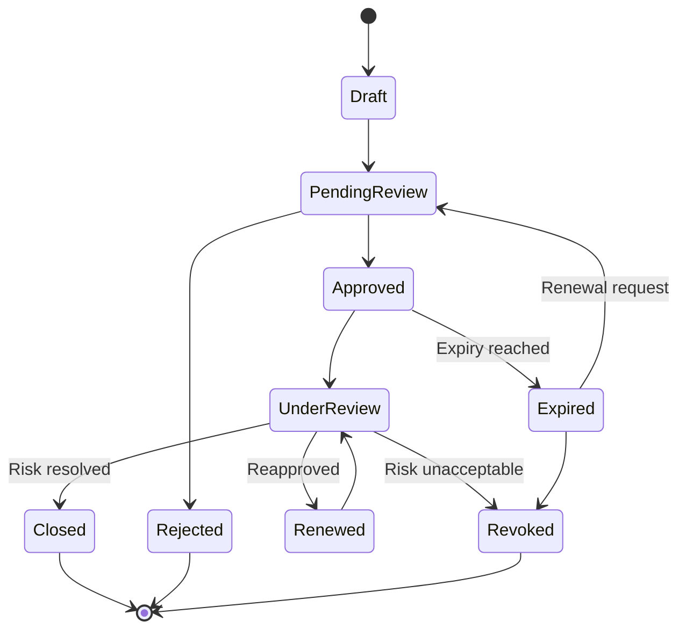
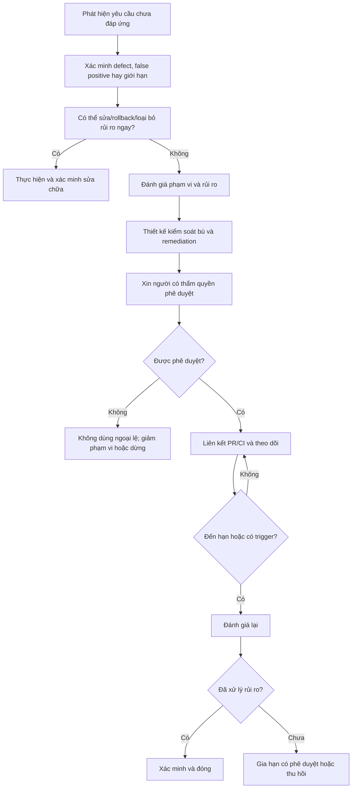

# Ghi nhận ngoại lệ và quyết định chấp nhận rủi ro

Trong module `CODE_QUALITY_FUNDAMENTALS`, chúng ta học cách xây dựng mã nguồn **đáng tin cậy, dễ hiểu và dễ thay đổi**. Ở chương **Cộng tác và trách nhiệm**, một phần công việc của nhóm phát triển là xử lý những trường hợp không thể đáp ứng đầy đủ một quy tắc chất lượng ngay lập tức. Khi đó, nhóm cần ghi nhận ngoại lệ và quyết định chấp nhận rủi ro một cách có trách nhiệm.

Ví dụ, một dịch vụ cũ đang dùng thư viện chưa nâng cấp được vì phiên bản mới làm thay đổi giao thức với hệ thống đối tác. Quy tắc nội bộ yêu cầu chỉ dùng phiên bản còn được hỗ trợ. Nhóm có thể cần một khoảng thời gian để kiểm tra tương thích và triển khai nâng cấp. Trong thời gian đó, việc tiếp tục dùng thư viện cũ tạo ra rủi ro bảo mật hoặc vận hành. Một câu ghi chú “tạm chấp nhận” trong PR không đủ để những người khác biết ai đã quyết định, rủi ro nào được chấp nhận, biện pháp giảm thiểu nào đang có và khi nào phải xem xét lại.

**Ngoại lệ không làm cho rủi ro biến mất.** Nó ghi nhận rằng một yêu cầu chưa được đáp ứng trong một phạm vi và khoảng thời gian cụ thể, cùng với quyết định có thẩm quyền về cách xử lý rủi ro còn lại. Quyết định tốt phải có căn cứ, chủ sở hữu, biện pháp kiểm soát và điều kiện hết hiệu lực.

Sau bài học, bạn có thể:

- Phân biệt lỗi, ngoại lệ kỹ thuật, miễn trừ tạm thời và quyết định chấp nhận rủi ro.
- Mô tả rủi ro bằng tài sản, mối đe dọa, điểm yếu, khả năng xảy ra và hậu quả.
- Phân biệt rủi ro vốn có với rủi ro còn lại sau biện pháp kiểm soát.
- Ghi nhận phạm vi, lý do, người phê duyệt, chủ sở hữu, thời hạn và điều kiện thu hồi ngoại lệ.
- Đề xuất biện pháp giảm thiểu có thể kiểm chứng thay vì chỉ ghi lời hứa.
- Theo dõi ngoại lệ qua PR, issue, ADR, quality gate và hoạt động vận hành.
- Truyền đạt quyết định để nhóm khác hiểu giới hạn và trách nhiệm của mình.

## 1. Ngoại lệ là gì và không phải là gì?

Một **ngoại lệ (exception)** là quyết định có kiểm soát cho phép một trường hợp cụ thể chưa đáp ứng một quy tắc hoặc tiêu chí thông thường. Ngoại lệ có thể cần thiết khi:

- Một phụ thuộc chưa thể nâng cấp mà không gây gián đoạn lớn.
- Một module cũ chưa đáp ứng tiêu chí coverage mới, trong khi nhóm đang có kế hoạch xử lý theo từng phần.
- Một bước kiểm tra tự động bị gián đoạn do hạ tầng và cần một quy trình phát hành khẩn cấp có kiểm soát.
- Một cảnh báo analyzer được xác nhận là false positive trong một phạm vi cụ thể.
- Một ràng buộc tương thích khiến việc thay đổi ngay lập tức gây lỗi cho client đang hoạt động.

Tuy nhiên, cần phân biệt các khái niệm:

| Khái niệm | Ý nghĩa | Ví dụ |
| --- | --- | --- |
| **Defect/vi phạm** | Hành vi hoặc trạng thái hiện tại không đáp ứng yêu cầu | Endpoint cho phép người dùng xem dữ liệu của tài khoản khác |
| **Exception/ngoại lệ** | Một trường hợp cụ thể được cho phép xử lý khác quy tắc thông thường theo quyết định có kiểm soát | Tạm giữ phiên bản thư viện cũ trong một dịch vụ đã cô lập |
| **Waiver/miễn trừ** | Quyết định cho phép không áp dụng một yêu cầu trong phạm vi và thời hạn xác định | Miễn một rule style cho mã được sinh tự động |
| **Risk acceptance/chấp nhận rủi ro** | Người có thẩm quyền hiểu rủi ro còn lại và quyết định tiếp tục trong giới hạn đã nêu | Chấp nhận khả năng phải rollback trong cửa sổ triển khai đã phê duyệt |
| **Compensating control/biện pháp kiểm soát bù** | Kiểm soát khác làm giảm khả năng hoặc hậu quả của rủi ro | Cô lập dịch vụ, giới hạn truy cập, tăng giám sát và có kế hoạch rollback |
| **False positive** | Công cụ báo vấn đề nhưng điều tra cho thấy tình huống không vi phạm quy tắc theo ngữ cảnh | Analyzer hiểu nhầm một API wrapper luôn kiểm tra null |

Các khái niệm này liên quan nhưng không thay thế nhau. Một false positive đã được xác minh có thể cần suppression có phạm vi; một lỗi thật có thể cần sửa hoặc một ngoại lệ tạm thời được phê duyệt. **Gắn nhãn waiver không biến một defect thành không có rủi ro.**

### Ngoại lệ không phải cách làm cho dashboard xanh

Không nên dùng ngoại lệ để:

- Che lỗi thật mà không điều tra nguyên nhân.
- Tắt toàn bộ analyzer chỉ vì một finding khó xử lý.
- Bỏ qua test bắt buộc mà không có bằng chứng thay thế hoặc phê duyệt phù hợp.
- Duy trì một quyết định tạm thời vô thời hạn.
- Chuyển trách nhiệm cho người review bằng một câu “đã được team đồng ý”.
- Hợp thức hóa hành vi không tuân thủ yêu cầu bắt buộc mà người phê duyệt không có quyền miễn trừ.

Ngoại lệ tốt làm cho tình trạng rủi ro **dễ nhìn thấy và dễ quản lý hơn**. Nếu sau khi tạo ngoại lệ, người khác không thể biết điều gì đang được miễn, lý do là gì và khi nào phải xem lại, hồ sơ đó chưa đủ.

## 2. Xác định rủi ro trước khi đề nghị chấp nhận

Một quyết định chấp nhận rủi ro cần mô tả được **điều gì có thể xảy ra và hậu quả của nó**. “Mã này chưa đẹp” hoặc “có thể có vấn đề” không đủ cụ thể để đánh giá.

Có thể bắt đầu bằng bốn thành phần:

1. **Tài sản hoặc mục tiêu cần bảo vệ:** dữ liệu khách hàng, tính đúng đắn của thanh toán, khả năng phát hành, tính sẵn sàng của dịch vụ, hợp đồng API.
2. **Mối đe dọa hoặc tình huống:** điều gì có thể xảy ra, do người dùng, hệ thống ngoài, lỗi triển khai, dữ liệu bất thường hoặc thay đổi tương lai?
3. **Điểm yếu/điều kiện tạo rủi ro:** thiếu kiểm tra, phụ thuộc hết hỗ trợ, test chưa bao phủ, quyền truy cập quá rộng, quy trình rollback chưa được thử.
4. **Hậu quả và phạm vi:** ai hoặc thành phần nào bị ảnh hưởng, mức độ nghiêm trọng, khả năng khôi phục và tác động nếu xảy ra.

Ví dụ:

> **Mô tả mơ hồ:** “Dùng thư viện cũ có rủi ro.”
>
> **Mô tả có thể đánh giá:** “Dịch vụ tạo hóa đơn vẫn dùng phiên bản thư viện PDF đã hết hỗ trợ. Nếu đầu vào do người dùng kiểm soát khai thác lỗ hổng trong phiên bản này, tiến trình tạo hóa đơn có thể bị chiếm quyền hoặc gián đoạn. Dịch vụ đang chạy với quyền ghi vào một vùng lưu trữ dùng chung; phạm vi ảnh hưởng có thể vượt một yêu cầu đơn lẻ.”

Mô tả thứ hai giúp nhóm điều tra được phiên bản, đường đầu vào, quyền của tiến trình, phạm vi dữ liệu và biện pháp cô lập.

### Xác định khả năng xảy ra và hậu quả

Một cách thảo luận định tính:

| Khả năng xảy ra | Gợi ý đánh giá |
| --- | --- |
| Thấp | Cần nhiều điều kiện hiếm; đã có kiểm soát đáng tin làm giảm khả năng |
| Trung bình | Có thể xảy ra trong điều kiện vận hành bình thường hoặc đã từng xuất hiện |
| Cao | Điều kiện xảy ra thường xuyên, dễ kích hoạt hoặc đã có dấu hiệu lặp lại |

| Mức hậu quả | Gợi ý đánh giá |
| --- | --- |
| Thấp | Ảnh hưởng nhỏ, dễ khôi phục, không ảnh hưởng dữ liệu hoặc cam kết quan trọng |
| Trung bình | Gây gián đoạn có giới hạn, cần xử lý thủ công hoặc ảnh hưởng một nhóm người dùng |
| Cao | Có thể mất/lộ dữ liệu, giao dịch sai, gián đoạn diện rộng hoặc vi phạm cam kết nghiêm trọng |
| Rất cao | Có hậu quả nghiêm trọng, khó khôi phục hoặc ảnh hưởng an toàn, pháp lý hay hoạt động thiết yếu |

Đây là thang minh họa; tổ chức có thể dùng ma trận và thuật ngữ khác. Không nên tự gán xác suất chính xác nếu không có dữ liệu. Điều quan trọng là ghi **căn cứ cho đánh giá**: lịch sử sự cố, mức phơi nhiễm, khả năng khai thác, số lượng người dùng, biện pháp kiểm soát và độ khó khôi phục.

### Rủi ro vốn có và rủi ro còn lại

- **Rủi ro vốn có (inherent risk):** rủi ro trước khi tính các biện pháp kiểm soát hiện có hoặc dự kiến.
- **Rủi ro còn lại (residual risk):** phần rủi ro vẫn tồn tại sau khi các biện pháp kiểm soát đã được triển khai và xác minh.

Ví dụ, thư viện cũ có rủi ro vốn có cao do có lỗ hổng liên quan. Việc cô lập dịch vụ, giới hạn đầu vào, chạy với quyền tối thiểu và tăng giám sát có thể giảm khả năng hoặc hậu quả. Nhưng nếu lỗ hổng vẫn tồn tại, rủi ro còn lại **không bằng không**. Hồ sơ phải mô tả kiểm soát nào đã hoạt động, bằng chứng nào xác nhận và phần nào vẫn chưa được giải quyết.

### Không nhầm rủi ro với sự bất định

Đôi khi nhóm không biết xác suất hoặc hậu quả vì thiếu thông tin. Đây là **bất định**, không phải bằng chứng rủi ro thấp. Ví dụ chưa từng có sự cố không chứng minh hệ thống an toàn nếu log không đủ để phát hiện sự cố. Khi thiếu dữ liệu, cần ghi điều chưa biết, cách thu thập thêm thông tin và mức thận trọng cần thiết.

## 3. Chọn cách xử lý: tránh, giảm, chuyển giao hay chấp nhận

Chấp nhận rủi ro chỉ là một trong những lựa chọn. Trước khi xin ngoại lệ, hãy cân nhắc những phương án khác:

| Phương án | Ý nghĩa | Ví dụ |
| --- | --- | --- |
| **Tránh (avoid)** | Thay đổi kế hoạch để loại bỏ tình huống gây rủi ro | Không đưa tính năng dùng thư viện chưa được hỗ trợ vào bản phát hành |
| **Giảm thiểu (mitigate)** | Thêm kiểm soát để giảm khả năng xảy ra hoặc hậu quả | Cô lập tiến trình, giới hạn quyền, kiểm tra đầu vào, bổ sung test và giám sát |
| **Chuyển giao/chia sẻ (transfer/share)** | Chuyển một phần trách nhiệm hoặc tổn thất theo hợp đồng/bảo hiểm/dịch vụ | Dùng nhà cung cấp có SLA và điều khoản xử lý sự cố phù hợp |
| **Chấp nhận (accept)** | Có thẩm quyền quyết định tiếp tục trong giới hạn rủi ro còn lại | Chấp nhận một khoảng thời gian ngắn với kiểm soát bù và lịch thay thế |

Chuyển giao không loại bỏ hoàn toàn trách nhiệm của tổ chức. Dùng dịch vụ ngoài vẫn có thể để lại rủi ro về dữ liệu, khả năng sẵn sàng, hợp đồng, phụ thuộc và giám sát nhà cung cấp.

### Khi nào chấp nhận có thể hợp lý?

Một quyết định tạm thời có thể hợp lý khi:

- Có lý do kinh doanh/vận hành cụ thể để chưa thể xử lý ngay.
- Phạm vi ảnh hưởng đã được xác định và giới hạn.
- Các phương án tránh hoặc giảm thiểu đã được cân nhắc.
- Biện pháp kiểm soát bù khả thi và có thể kiểm tra.
- Người phê duyệt có thẩm quyền với loại rủi ro và phạm vi đó.
- Có chủ sở hữu xử lý phần việc còn lại, thời hạn và điều kiện xem lại.
- Rủi ro còn lại nằm trong mức tổ chức cho phép.

Ngược lại, nếu rủi ro có thể gây hậu quả không thể chấp nhận hoặc vi phạm yêu cầu bắt buộc mà không có thẩm quyền miễn trừ, không nên dùng ngoại lệ kỹ thuật để tiếp tục. Khi đó phải dừng, giảm phạm vi, chọn phương án an toàn hơn hoặc chuyển cấp có thẩm quyền xử lý.

### Ma trận rủi ro chỉ là công cụ hỗ trợ

Một ma trận khả năng xảy ra × hậu quả có thể giúp ưu tiên thảo luận:

| Khả năng / Hậu quả | Thấp | Trung bình | Cao | Rất cao |
| --- | --- | --- | --- | --- |
| Thấp | Thấp | Thấp | Trung bình | Cao |
| Trung bình | Thấp | Trung bình | Cao | Rất cao |
| Cao | Trung bình | Cao | Rất cao | Rất cao |

Ma trận này chỉ minh họa cách xếp loại, không phải chuẩn bắt buộc. Một sự kiện hiếm nhưng có hậu quả đặc biệt nghiêm trọng vẫn có thể cần biện pháp ngăn chặn mạnh. Đừng để điểm số tổng hợp che khuất **một hậu quả không thể chấp nhận**.

## 4. Hồ sơ ngoại lệ cần có những gì?

Một hồ sơ tốt phải giúp người không tham gia cuộc thảo luận ban đầu hiểu được **quyết định, phạm vi và trách nhiệm**. Tùy quy mô, hồ sơ có thể nằm trong issue, ADR, hệ thống quản lý rủi ro hoặc ticket tuân thủ. Dù lưu ở đâu, cần có liên kết từ PR hoặc quality gate liên quan.

### Các trường thông tin cốt lõi

| Trường | Nội dung cần ghi |
| --- | --- |
| **ID và trạng thái** | Mã tham chiếu ổn định; draft, pending, approved, rejected, expired, revoked hoặc closed |
| **Quy tắc bị ngoại lệ** | Rule/policy/quality gate nào chưa được đáp ứng; phiên bản hoặc tiêu chí cụ thể |
| **Phạm vi** | Dịch vụ, module, endpoint, repo, môi trường, dữ liệu hoặc nhóm người dùng bị ảnh hưởng |
| **Mô tả hiện trạng** | Điều gì đang xảy ra, từ khi nào, trong điều kiện nào |
| **Lý do** | Vì sao chưa thể đáp ứng yêu cầu ngay; các lựa chọn đã cân nhắc |
| **Rủi ro vốn có** | Tình huống, khả năng xảy ra, hậu quả và căn cứ đánh giá |
| **Biện pháp kiểm soát bù** | Kiểm soát cụ thể, người thực hiện, cách xác minh và bằng chứng |
| **Rủi ro còn lại** | Điều gì vẫn có thể xảy ra sau kiểm soát |
| **Chủ sở hữu** | Người chịu trách nhiệm theo dõi và hoàn thành hành động |
| **Người phê duyệt** | Người/nhóm có thẩm quyền chấp nhận loại rủi ro đó |
| **Ngày bắt đầu và hết hạn** | Khoảng thời gian ngoại lệ có hiệu lực |
| **Điều kiện xem lại/thu hồi** | Ngày định kỳ hoặc sự kiện khiến quyết định phải được đánh giá lại |
| **Kế hoạch xử lý lâu dài** | Công việc, mốc dự kiến, phụ thuộc và liên kết issue/PR |
| **Bằng chứng và lịch sử** | Log, test, scan, quyết định review, thay đổi trạng thái và người thực hiện |

Một hồ sơ không cần dài dòng, nhưng không được bỏ qua các trường quyết định **ai chịu trách nhiệm, ai chấp nhận và khi nào quyết định hết hiệu lực**.

### Mẫu ghi nhận ngoại lệ minh họa

```yaml
exception:
  id: EXC-2026-014
  title: Temporary use of legacy PDF library
  status: approved
  policy:
    id: DEPENDENCY-SUPPORT
    requirement: "Production dependencies must be supported"
  scope:
    service: invoice-renderer
    environments:
      - production
    excluded:
      - new services
  rationale: >
    The supported replacement changes output behavior and requires
    compatibility verification with existing invoice templates.
  risk:
    inherent:
      likelihood: medium
      impact: high
    residual:
      likelihood: low
      impact: high
    description: >
      A vulnerability in the legacy dependency could affect invoice
      rendering. Process isolation reduces exposure but does not remove it.
  controls:
    - id: CTL-1
      description: Run renderer with restricted filesystem permissions
      owner: platform-team
      evidence: "deployment configuration review"
    - id: CTL-2
      description: Restrict input size and accepted template sources
      owner: invoice-team
      evidence: "validation tests and request limits"
  owner: invoice-team
  approver: engineering-risk-owner
  approved_at: 2026-11-16
  expires_at: 2027-01-15
  review_triggers:
    - replacement compatibility verified
    - relevant security advisory published
  remediation_issue: "INV-482"
```

Đây là **mẫu minh họa**, không phải schema chuẩn của công cụ quản trị rủi ro. Giá trị khả năng/hậu quả, tên nhóm, ID và ngày phải được xác định trong bối cảnh thực tế. Đặc biệt, không sao chép ví dụ rồi coi một biện pháp kiểm soát là đã hoạt động: cần bằng chứng thực thi và người chịu trách nhiệm xác nhận.

### Phạm vi phải đủ hẹp

Một ngoại lệ “cho toàn bộ repository” có thể che nhiều thành phần không liên quan. Hãy giới hạn:

- **Theo thành phần:** chỉ dịch vụ hoặc module có lý do.
- **Theo rule:** chỉ yêu cầu thực sự bị ảnh hưởng.
- **Theo môi trường:** phân biệt local, test, staging và production.
- **Theo luồng dữ liệu:** chỉ loại đầu vào hoặc tích hợp liên quan.
- **Theo thời gian:** có ngày hết hạn, không chỉ ghi “tạm thời”.

Nếu cần mở rộng phạm vi, phải cập nhật hồ sơ và xin phê duyệt lại theo quy trình. Không nên để một ngoại lệ ban đầu cho một module tự động áp dụng cho dịch vụ mới.

## 5. Biện pháp kiểm soát bù phải cụ thể và kiểm chứng được

“Theo dõi chặt hơn” hoặc “cẩn thận khi deploy” không phải biện pháp kiểm soát đủ rõ. Một kiểm soát cần trả lời:

1. **Làm gì?** Hành động kỹ thuật hoặc quy trình cụ thể.
2. **Ai sở hữu?** Nhóm hoặc vai trò chịu trách nhiệm thực hiện.
3. **Áp dụng ở đâu?** Ranh giới và môi trường được bảo vệ.
4. **Xác minh thế nào?** Test, config review, log, alert hoặc bằng chứng khác.
5. **Nếu thất bại thì sao?** Hành động ngăn chặn, rollback hoặc escalation.

### Ví dụ kiểm soát có thể kiểm tra

| Rủi ro | Kiểm soát bù | Bằng chứng cần giữ |
| --- | --- | --- |
| Thư viện cũ có thể bị khai thác qua đầu vào | Chỉ chấp nhận nguồn template tin cậy, giới hạn kích thước, cô lập tiến trình và quyền tối thiểu | Test validation, cấu hình triển khai, kiểm tra quyền |
| Test tích hợp bị gián đoạn do DB test | Chạy kiểm tra bù trên môi trường được kiểm soát trước phát hành; giữ gate blocked cho đến khi có kết quả | Report test, revision, người xác nhận |
| Một rule analyzer là false positive | Suppression đúng finding/vị trí với lý do và thời hạn; rule vẫn bật ở phần còn lại | Finding ID, review, report sau suppression |
| Migration chưa thể áp dụng đồng loạt | Migration tương thích ngược, kiểm tra dữ liệu và kế hoạch rollback/forward-fix | Kết quả thử trên bản sao dữ liệu, checksum, runbook |
| Thiếu test hiệu năng cho một luồng ít dùng | Giới hạn tải/traffic, theo dõi latency và error rate, có ngưỡng dừng | Dashboard, alert, kết quả thử tải đại diện |
| API cũ chưa thể bỏ | Giới hạn consumer, log usage, thông báo thời điểm ngừng hỗ trợ | Báo cáo client, kế hoạch migration, mốc deprecation |

Kiểm soát bù có thể giảm **khả năng xảy ra**, **hậu quả**, hoặc cả hai. Chẳng hạn cô lập tiến trình giảm phạm vi ảnh hưởng; alert không ngăn lỗi xảy ra nhưng có thể rút ngắn thời gian phát hiện và khôi phục. Hồ sơ nên nêu rõ loại tác dụng của từng kiểm soát.

### Không nhầm phát hiện với ngăn chặn

- Log giúp điều tra nhưng không nhất thiết ngăn thao tác trái phép.
- Alert giúp phát hiện nhưng chỉ hữu ích nếu có người nhận, ngưỡng đúng và quy trình phản ứng.
- Test giúp phát hiện hồi quy trước merge nhưng không bảo vệ dữ liệu production khi có một đường gọi khác chưa được kiểm tra.
- Backup giúp phục hồi dữ liệu nếu đã được thử và có RPO/RTO phù hợp; việc có file backup không chứng minh khôi phục thành công.
- Review thủ công có thể giảm rủi ro nhưng phụ thuộc checklist, người review và bằng chứng được xem.

Vì vậy, không nên ghi “đã có monitoring” như bằng chứng rằng rủi ro đã được giảm đầy đủ. Cần chứng minh **tín hiệu được thu, cảnh báo hoạt động và người chịu trách nhiệm có thể hành động**.

## 6. Ai đề xuất, ai phê duyệt và ai theo dõi?

Một quyết định rủi ro không nên mơ hồ về trách nhiệm. Người phát hiện vấn đề, người trực tiếp sửa mã và người có quyền chấp nhận rủi ro có thể là những người khác nhau.

| Vai trò | Trách nhiệm |
| --- | --- |
| **Người đề xuất** | Mô tả ngoại lệ, lý do, phạm vi, lựa chọn và bằng chứng ban đầu |
| **Chủ sở hữu rủi ro** | Chịu trách nhiệm theo dõi rủi ro còn lại và bảo đảm các kiểm soát được duy trì |
| **Người phê duyệt** | Xác nhận có thẩm quyền, hiểu tác động và chấp nhận mức rủi ro trong phạm vi cho phép |
| **Người thực hiện kiểm soát** | Triển khai, kiểm tra và lưu bằng chứng cho biện pháp giảm thiểu |
| **Reviewer kỹ thuật** | Đánh giá tính đúng đắn, phạm vi ảnh hưởng, test và khả năng vận hành |
| **Nhóm vận hành/bảo mật/chuyên môn liên quan** | Đưa ra đánh giá theo lĩnh vực khi rủi ro vượt phạm vi của nhóm phát triển |

Trong nhóm nhỏ, một người có thể kiêm nhiều vai trò, nhưng hồ sơ vẫn nên chỉ rõ **ai đang đảm nhiệm từng trách nhiệm**. Nếu người đề xuất cũng là người phê duyệt, cần kiểm tra quy định nội bộ về độc lập phê duyệt, đặc biệt với rủi ro cao.

### Người review PR không mặc nhiên có quyền chấp nhận mọi rủi ro

Một reviewer có thể đồng ý về cách triển khai kỹ thuật nhưng không có thẩm quyền miễn trừ một yêu cầu bảo mật, dữ liệu hoặc vận hành. Ngược lại, người quản lý có quyền chấp nhận rủi ro kinh doanh vẫn cần ý kiến kỹ thuật để hiểu chính xác khả năng và hậu quả.

Phải xác định **quyền phê duyệt theo loại rủi ro và mức độ ảnh hưởng**. Ví dụ, một ngoại lệ style cục bộ có thể được maintainer chấp nhận; ngoại lệ cho kiểm soát bảo mật hoặc dữ liệu nhạy cảm có thể cần vai trò chuyên môn/ủy quyền khác. Không suy đoán quyền hạn từ chức danh chung hoặc từ việc một người có quyền merge PR.

### Tách quyết định chấp nhận khỏi việc hoàn thành công việc

Người phê duyệt có thể chấp nhận rủi ro còn lại trong một thời gian, nhưng chủ sở hữu vẫn phải:

- Triển khai và duy trì kiểm soát bù.
- Theo dõi điều kiện hết hiệu lực.
- Cập nhật trạng thái và bằng chứng.
- Thực hiện kế hoạch khắc phục.
- Báo ngay nếu rủi ro thay đổi hoặc kiểm soát không còn hoạt động.

“Đã được duyệt” không có nghĩa công việc kết thúc. Nó bắt đầu một giai đoạn **theo dõi có trách nhiệm**.

## 7. Thời hạn, điều kiện xem lại và thu hồi ngoại lệ

Một ngoại lệ không có hạn dùng dễ trở thành quy tắc ngầm. Hồ sơ cần có **ngày hết hạn hoặc điều kiện kết thúc rõ ràng**, và một lịch xem lại trước khi tới hạn.

### Ba loại mốc cần phân biệt

- **Ngày hết hạn (expiry):** thời điểm sau đó ngoại lệ không còn được coi là hợp lệ nếu chưa phê duyệt lại.
- **Ngày xem lại (review date):** thời điểm chủ sở hữu đánh giá tiến độ, kiểm soát và mức rủi ro; có thể sớm hơn ngày hết hạn.
- **Sự kiện kích hoạt (trigger):** sự kiện khiến phải đánh giá lại ngay, dù chưa tới ngày xem lại.

Ví dụ trigger:

- Có advisory bảo mật mới liên quan đến phụ thuộc.
- Biện pháp kiểm soát bị vô hiệu hóa hoặc alert không hoạt động.
- Dịch vụ được mở rộng sang môi trường hoặc nhóm người dùng mới.
- Có sự cố, near miss hoặc phát hiện mới làm thay đổi đánh giá khả năng/hậu quả.
- Phiên bản thay thế đã được xác minh tương thích.
- Hợp đồng đối tác hoặc yêu cầu nghiệp vụ thay đổi.
- Người sở hữu rủi ro hoặc người phê duyệt thay đổi vai trò.

### Khi ngoại lệ hết hạn

Không nên mặc định tự động kéo dài. Chủ sở hữu cần chọn một trong các trạng thái:

1. **Closed/Resolved:** yêu cầu ban đầu đã được đáp ứng, kiểm tra xác nhận và ngoại lệ được đóng.
2. **Renewed/Approved again:** vẫn cần ngoại lệ; đánh giá lại rủi ro, cập nhật kiểm soát và xin phê duyệt mới.
3. **Revoked:** rủi ro không còn được chấp nhận; dừng luồng liên quan, rollback hoặc áp dụng phương án tránh rủi ro.
4. **Expired:** thời hạn đã qua mà chưa có quyết định gia hạn; hệ thống cần xử lý theo policy, không tự coi là còn hiệu lực.

Nếu một ngoại lệ hết hạn nhưng dịch vụ vẫn tiếp tục chạy, đó là một tình trạng cần được nhìn thấy và xử lý. Đừng để trường ngày hết hạn chỉ mang tính trang trí.

### Ví dụ vòng đời ngoại lệ



Tên trạng thái có thể khác nhau giữa công cụ quản lý. Điều quan trọng là phân biệt **đang chờ**, **đã được phê duyệt**, **đang theo dõi**, **đã hết hạn**, **đã thu hồi** và **đã giải quyết**.

## 8. Gắn hồ sơ ngoại lệ với PR, issue và quality gate

Ngoại lệ cần liên kết với nơi phát sinh và nơi theo dõi công việc. Nếu chỉ tồn tại trong một cuộc trò chuyện, nhóm khác hoặc người trực ca sau khó tìm được lý do.

Một cách tổ chức có thể là:

- **Issue/risk record:** mô tả rủi ro, phạm vi, owner, approver, expiry, controls và remediation.
- **PR:** liên kết tới hồ sơ ngoại lệ; giải thích phần nào trong diff dựa trên quyết định đó.
- **ADR:** lưu quyết định kiến trúc có tác động lâu dài, các lựa chọn và lý do.
- **CI/quality gate:** liên kết exception ID với finding cụ thể; xác minh suppression/waiver không rộng hơn phạm vi được duyệt.
- **Runbook/monitoring:** hướng dẫn phản ứng nếu kiểm soát bù phát hiện vấn đề.

### Ví dụ PR có ngoại lệ

Một mô tả PR phù hợp có thể nêu:

> “PR này giữ nguyên phiên bản parser cũ trong dịch vụ `invoice-renderer` theo ngoại lệ `EXC-2026-014`. Ngoại lệ chỉ áp dụng cho dịch vụ và môi trường production đã ghi trong hồ sơ; các dịch vụ mới không được dùng phụ thuộc này. Kiểm soát bù gồm giới hạn nguồn template, giới hạn kích thước đầu vào và quyền filesystem tối thiểu. Chủ sở hữu theo dõi remediation `INV-482`; ngoại lệ hết hạn ngày đã ghi trong hồ sơ. Bằng chứng cấu hình và test validation được đính kèm.”

PR cũng cần cho thấy code/config thực tế khớp phạm vi ngoại lệ. Một link tới ticket không đủ nếu diff mở rộng dependency sang một dịch vụ khác hoặc tắt thêm rule không nằm trong quyết định.

### Quality gate có thể hỗ trợ ngoại lệ có kiểm soát

Với finding analyzer đã được xác minh là false positive, hệ thống có thể hỗ trợ suppression theo finding ID, đường dẫn hoặc rule cụ thể. Nhưng cần:

- Giữ rule bật cho phần còn lại.
- Liên kết suppression với exception/risk record.
- Giới hạn phạm vi tối thiểu.
- Có lý do và thời hạn nếu công cụ hỗ trợ.
- Kiểm tra định kỳ finding còn tồn tại hay đã thay đổi fingerprint.
- Không cho suppression che những finding mới không liên quan.

Nếu công cụ không hỗ trợ expiry hoặc liên kết hồ sơ, nhóm cần cơ chế kiểm tra ngoài, ví dụ danh sách ngoại lệ được review định kỳ. Không giả định một annotation suppression tự hết hạn nếu ngôn ngữ hoặc analyzer không có hành vi đó.

### Ví dụ cấu hình suppression có phạm vi

Đây là cấu trúc khái niệm, không phải cú pháp của một analyzer:

```yaml
suppression:
  rule: NULL_DEREFERENCE
  finding: "invoice-renderer:InvoiceMapper:mapLegacyField"
  exceptionId: EXC-2026-014
  reason: "Verified analyzer false positive for this wrapper contract"
  owner: invoice-team
  expiresAt: 2027-01-15
  reviewRequired: true
```

Một finding được miễn vì false positive không giống một lỗ hổng thật được chấp nhận. Hồ sơ cần nói rõ **đã xác minh không có vi phạm** hay **vi phạm tồn tại nhưng rủi ro được chấp nhận tạm thời**. Hai quyết định này có căn cứ và trách nhiệm khác nhau.

## 9. Quy trình đề xuất và phê duyệt ngoại lệ

Một quy trình nhất quán giúp nhóm xử lý nhanh mà vẫn giữ được trách nhiệm:

**Bước 1 — Phát hiện và mô tả.** Ghi rule hoặc yêu cầu chưa đáp ứng, thành phần bị ảnh hưởng, bằng chứng và thời điểm phát hiện.

**Bước 2 — Xác minh tình huống.** Phân biệt defect thật, false positive, thiếu bằng chứng, lỗi môi trường hay giới hạn tương thích. Không xin waiver trước khi hiểu mình đang xử lý loại vấn đề nào.

**Bước 3 — Xem xét lựa chọn.** Có thể sửa ngay, rollback, tắt tính năng, cô lập, thay phụ thuộc, giảm phạm vi hoặc chấp nhận tạm thời? Nêu lý do loại bỏ phương án an toàn hơn nếu có.

**Bước 4 — Đánh giá rủi ro.** Xác định khả năng, hậu quả, phạm vi, rủi ro vốn có và rủi ro còn lại sau kiểm soát.

**Bước 5 — Định nghĩa kiểm soát và kế hoạch khắc phục.** Mỗi hành động có owner, cách xác minh, mốc thời gian và phương án nếu kiểm soát thất bại.

**Bước 6 — Xin đúng người phê duyệt.** Chuyển hồ sơ tới người có thẩm quyền theo loại và mức rủi ro. Nếu chưa có phê duyệt, trạng thái vẫn là pending; không triển khai dựa trên giả định im lặng đồng nghĩa đồng ý.

**Bước 7 — Liên kết với thay đổi.** Gắn exception ID vào PR, issue, CI hoặc runbook liên quan. Kiểm tra phạm vi diff không vượt phạm vi được duyệt.

**Bước 8 — Theo dõi trong thời hạn.** Chủ sở hữu kiểm tra controls, trigger, tiến độ remediation và báo cáo khi có thay đổi.

**Bước 9 — Đóng, gia hạn hoặc thu hồi.** Xác minh yêu cầu đã được đáp ứng hoặc đánh giá lại rủi ro và xin phê duyệt mới trước khi hết hạn.

### Sơ đồ quyết định



Sơ đồ là quy trình khái niệm. Trong tình huống khẩn cấp, tổ chức có thể có quy trình phê duyệt nhanh, nhưng vẫn cần lưu **ai quyết định, dựa trên thông tin nào, phạm vi nào và khi nào phải xem lại**.

## 10. Ngoại lệ khẩn cấp và quyết định trong sự cố

Trong một sự cố production, nhóm có thể cần hành động trước khi hoàn tất hồ sơ thông thường. Ví dụ, tạm tắt một kiểm tra gây lỗi triển khai để khôi phục dịch vụ, hoặc rollback một phụ thuộc vừa gây crash.

Quy trình khẩn cấp nên xác định trước:

- Ai có quyền tuyên bố tình huống khẩn cấp.
- Những loại kiểm soát nào có thể được thay đổi và giới hạn nào không được vượt qua.
- Kênh ghi nhận quyết định trong lúc xử lý.
- Kiểm soát tạm thời nào phải được duy trì.
- Ai cập nhật hồ sơ sau khi dịch vụ ổn định.
- Thời hạn hậu kiểm và điều kiện đóng ngoại lệ.

### Ghi nhận tối thiểu ngay trong sự cố

Trong lúc cần phản ứng nhanh, tối thiểu nên lưu:

1. Mã sự cố và thời điểm.
2. Người chỉ huy hoặc người ra quyết định.
3. Kiểm soát nào bị thay đổi và phạm vi ảnh hưởng.
4. Lý do cần thay đổi ngay, cùng lựa chọn đã cân nhắc.
5. Rủi ro mới phát sinh và biện pháp giảm thiểu.
6. Kết quả quan sát sau thao tác và quyết định tiếp theo.

Sau khi ổn định, hoàn thiện hồ sơ, review độc lập khi cần và tạo công việc khôi phục kiểm soát. Một thay đổi khẩn cấp không nên trở thành cấu hình vĩnh viễn mà không ai biết.

### Ví dụ: tạm bỏ một bước kiểm tra trong pipeline

Giả sử dịch vụ CI dùng để kiểm tra dependency gặp sự cố, trong khi một bản sửa khẩn cấp cần khôi phục lỗi production. Cần phân biệt:

- **Bước quét không chạy được:** chưa có bằng chứng từ lần quét này; không được ghi “không có lỗ hổng”.
- **Bước quét đã chạy và có finding:** có kết quả cần phân loại; không được gọi là lỗi hạ tầng.
- **Ngoại lệ phát hành khẩn cấp:** quyết định có thẩm quyền cho phép tiếp tục trong một phạm vi nhất định, kèm kiểm tra thay thế và kế hoạch chạy bù.

Biện pháp bù có thể gồm kiểm tra dependency lockfile bằng công cụ thay thế đã được xác minh, giới hạn thành phần thay đổi, không thêm dependency mới, review bảo mật tập trung và chạy lại scan ngay khi dịch vụ phục hồi. Các biện pháp này chỉ có giá trị nếu **phù hợp với rủi ro cụ thể** và có bằng chứng thực thi.

Nếu kiểm soát bị bỏ qua là yêu cầu bắt buộc theo hợp đồng hoặc quy định mà người phê duyệt không có quyền miễn, quy trình khẩn cấp nội bộ không thể tự tạo quyền miễn trừ đó. Khi không thể xác nhận thẩm quyền, phải chọn phương án an toàn hơn hoặc chuyển cấp theo quy trình phù hợp.

## 11. Theo dõi ngoại lệ như một danh mục có trách nhiệm

Một nhóm có nhiều ngoại lệ cần quản lý chúng như một danh mục rủi ro, không để mỗi PR tự ghi chú riêng. Việc tổng hợp giúp nhận ra:

- Ngoại lệ nào sắp hết hạn.
- Thành phần nào đang có nhiều rủi ro được chấp nhận.
- Biện pháp kiểm soát nào thường xuyên thất bại.
- Công việc remediation nào bị trễ.
- Ngoại lệ nào đã hết lý do nhưng chưa đóng.
- Cùng một nguyên nhân đang tạo ra nhiều ngoại lệ khác nhau.

### Các chỉ số hữu ích

| Chỉ số | Câu hỏi hỗ trợ | Cách diễn giải thận trọng |
| --- | --- | --- |
| Số ngoại lệ đang hiệu lực theo mức rủi ro | Nhóm đang chấp nhận bao nhiêu rủi ro? | Cần xem phạm vi và hậu quả, không chỉ tổng số |
| Tỷ lệ ngoại lệ quá hạn | Quy trình theo dõi có hoạt động không? | Một ngoại lệ quá hạn ở hệ thống trọng yếu có thể quan trọng hơn nhiều ngoại lệ style |
| Thời gian trung bình tới khi đóng | Nợ/ngoại lệ tồn tại bao lâu? | Phân bố có thể lệch; xem từng trường hợp quan trọng |
| Tỷ lệ kiểm soát bù được xác minh | Các biện pháp giảm thiểu có thực sự hoạt động? | Phải xác định tiêu chí “đã xác minh” |
| Số lần gia hạn | Ngoại lệ tạm có đang trở thành lâu dài? | Gia hạn không tự động sai, nhưng cần xem lại giả định và phương án gốc |
| Sự cố liên quan ngoại lệ | Rủi ro được chấp nhận có xảy ra không? | Không có sự cố không chứng minh rủi ro bằng không |
| Remediation trễ hạn | Năng lực xử lý rủi ro có đủ không? | Cần phân tích phụ thuộc, nguồn lực và ưu tiên |

Không dùng số lượng ngoại lệ thấp làm mục tiêu duy nhất. Nếu nhóm sợ tạo hồ sơ, họ có thể ngừng ghi nhận thay vì giảm rủi ro. Mục tiêu là **minh bạch, có kiểm soát và xử lý đúng ưu tiên**.

### Rà soát định kỳ

Một buổi rà soát danh mục có thể:

1. Xem ngoại lệ sắp hết hạn hoặc đã quá hạn.
2. Kiểm tra bằng chứng controls và trạng thái remediation.
3. Đánh giá trigger mới, thay đổi kiến trúc, dữ liệu và môi trường.
4. Xác định ngoại lệ có thể đóng hoặc thu hẹp phạm vi.
5. Chọn trường hợp cần escalation vì rủi ro vượt mức chấp nhận.
6. Cập nhật owner, approver và thời hạn tiếp theo.

Tần suất cần phù hợp với mức rủi ro. Một ngoại lệ ảnh hưởng dữ liệu nhạy cảm có thể cần theo dõi thường xuyên hơn một waiver style cục bộ. Không áp dụng lịch hàng quý cho mọi trường hợp chỉ vì thuận tiện.

## 12. Ví dụ xuyên suốt: chấp nhận tạm thời một phụ thuộc cũ

Giả sử nhóm phát triển dịch vụ tạo hóa đơn. Một thư viện PDF đang dùng đã hết thời gian hỗ trợ. Phiên bản thay thế còn được hỗ trợ nhưng có khác biệt trong cách xuống dòng và nhúng font, nên hóa đơn lịch sử có thể đổi hình thức nếu thay ngay. Nhóm phải cân bằng **rủi ro tiếp tục dùng thư viện cũ** với **rủi ro làm sai tài liệu đã phát hành**.

### 12.1. Xác minh vấn đề

Nhóm cần thu thập:

- Phiên bản và trạng thái hỗ trợ của thư viện.
- Advisory bảo mật có liên quan, điều kiện khai thác và việc dịch vụ có dùng đường bị ảnh hưởng không.
- Nguồn dữ liệu đi vào bộ dựng PDF, đặc biệt trường nào do người dùng hoặc đối tác kiểm soát.
- Quyền filesystem, network và quyền truy cập dữ liệu của tiến trình.
- Phạm vi hóa đơn bị ảnh hưởng và yêu cầu bảo toàn bản đã phát hành.
- Kết quả thử nghiệm phiên bản thay thế với các mẫu hóa đơn đại diện.

Chỉ biết “đã hết hỗ trợ” chưa đủ để kết luận mức rủi ro cụ thể; cũng không đủ để kết luận có thể tiếp tục an toàn. Cần đánh giá mức phơi nhiễm và hậu quả theo thực tế dịch vụ.

### 12.2. So sánh phương án

| Phương án | Lợi ích | Rủi ro/chi phí |
| --- | --- | --- |
| Thay ngay thư viện mới | Loại bỏ phụ thuộc cũ sớm | Có thể đổi nội dung/định dạng hóa đơn; cần kiểm thử và xác nhận tương thích |
| Tắt chức năng tạo PDF tạm thời | Loại bỏ đường thực thi có rủi ro | Gián đoạn quy trình hóa đơn và hoạt động kinh doanh |
| Giữ thư viện cũ không kiểm soát | Tránh thay đổi hành vi ngay | Không giảm rủi ro từ phụ thuộc hết hỗ trợ |
| Giữ tạm với kiểm soát bù và thời hạn ngắn | Có thời gian xác minh thay thế | Rủi ro còn lại vẫn tồn tại; cần kiểm soát và giám sát thực sự |

### 12.3. Định nghĩa kiểm soát bù

Nhóm có thể đề xuất:

- Chỉ nhận template từ nguồn đã xác thực; không cho người dùng tải lên template tùy ý.
- Kiểm tra và giới hạn kích thước, số trang, font và loại tài nguyên tham chiếu.
- Chạy renderer trong container/tiến trình có quyền tối thiểu, filesystem riêng và network bị giới hạn.
- Giới hạn CPU, memory và thời gian xử lý để tránh làm cạn tài nguyên.
- Theo dõi lỗi bất thường, crash, thời gian tạo file và đầu vào bị từ chối.
- Giữ bản sao hóa đơn đã phát hành theo quy trình lưu trữ hiện hành; không âm thầm dựng lại lịch sử bằng thư viện mới.
- Kiểm thử tương thích trên tập mẫu đại diện và lên kế hoạch chuyển đổi sau khi có xác nhận.

Mỗi kiểm soát phải được kiểm tra bằng cấu hình, test hoặc bằng chứng vận hành. Nếu container có quyền truy cập toàn bộ filesystem, việc ghi “đã cô lập” trong hồ sơ không làm giảm rủi ro.

### 12.4. Ghi quyết định và điều kiện kết thúc

Một quyết định có thể viết:

> “Chấp nhận tạm thời việc dùng thư viện PDF hiện tại chỉ trong dịch vụ `invoice-renderer`, do phiên bản thay thế chưa được xác minh tương thích với mẫu hóa đơn đã phát hành. Rủi ro còn lại là khả năng lỗ hổng của thư viện cũ ảnh hưởng tới tiến trình tạo hóa đơn. Kiểm soát bù gồm giới hạn nguồn template/đầu vào, quyền tiến trình tối thiểu, cô lập tài nguyên và giám sát lỗi. Nhóm hóa đơn sở hữu việc nâng cấp; người có thẩm quyền theo quy trình rủi ro phê duyệt. Ngoại lệ có ngày hết hạn và phải đánh giá lại ngay khi có advisory liên quan hoặc khi kiểm thử tương thích hoàn tất. Nếu kiểm soát bù không hoạt động, dừng đường tạo PDF hoặc áp dụng phương án khẩn cấp đã duyệt.”

Đây là ví dụ diễn đạt, không phải quyết định thật hoặc khuyến nghị cho một thư viện cụ thể. **Người phê duyệt phải dựa trên thông tin đã xác minh và quyền hạn thực tế**. Nếu rủi ro vượt mức cho phép, nhóm cần dừng hoặc giảm phạm vi thay vì kéo dài ngoại lệ.

### 12.5. Theo dõi và đóng

Trong thời hạn, nhóm:

1. Kiểm tra định kỳ cấu hình cô lập và alert.
2. Theo dõi advisory mới và sự cố liên quan.
3. Chạy test tương thích với phiên bản thay thế.
4. Lưu kết quả kiểm thử trên mẫu hóa đơn đã được phê duyệt.
5. Triển khai theo kế hoạch chuyển đổi và kiểm tra dữ liệu đầu ra.
6. Đóng ngoại lệ chỉ sau khi xác minh dịch vụ không còn dùng phụ thuộc cũ trong phạm vi đã nêu.

Nếu phát hiện thư viện cũ bị khai thác hoặc biện pháp cô lập thất bại, trigger yêu cầu đánh giá ngay; không chờ tới ngày hết hạn.

## 13. Giao tiếp về ngoại lệ mà không đổ lỗi

Ngoại lệ thường liên quan đến áp lực thời gian, thiếu nguồn lực hoặc quyết định trước đây. Nếu thảo luận theo hướng tìm người có lỗi, mọi người có xu hướng giấu thông tin hoặc né ghi nhận rủi ro. Mục tiêu của hồ sơ là giúp tổ chức **hiểu tình trạng và đưa ra quyết định có trách nhiệm**, không tạo một bản kiểm điểm cá nhân.

### Mô tả sự kiện và tác động, tránh phán xét

| Cách viết thiếu hữu ích | Cách viết có thể hành động |
| --- | --- |
| “Team trước làm sai nên giờ không nâng cấp được.” | “Phiên bản hiện tại phụ thuộc API cũ; nâng cấp làm thay đổi output ở ba mẫu hóa đơn đã xác nhận.” |
| “Dev quên viết test.” | “Đường xử lý timeout chưa có test; lần gần nhất request bị retry đã tạo hai bản ghi.” |
| “Security bắt buộc quá nhiều rule.” | “Rule này đang chặn một finding; cần xác minh false positive hay rủi ro thật và xác định phạm vi miễn trừ nếu có.” |
| “Cứ tạm bỏ đi, chắc không sao.” | “Đề xuất ngoại lệ trong phạm vi X, với rủi ro Y, kiểm soát Z và thời hạn T; chờ người có thẩm quyền phê duyệt.” |

### Trao đổi đủ thông tin cho từng đối tượng

- **Nhóm phát triển:** biết hành vi cần giữ, code nào chịu ảnh hưởng, kiểm soát nào phải triển khai.
- **Reviewer/maintainer:** biết lý do, phạm vi diff, bằng chứng test và điều kiện chấp nhận.
- **Vận hành/on-call:** biết tín hiệu cảnh báo, cách phản ứng, giới hạn và điều kiện rollback.
- **Người phê duyệt:** biết lựa chọn, hậu quả, rủi ro còn lại, kiểm soát, thời hạn và quyền hạn cần dùng.
- **Nhóm phụ thuộc/client:** biết API hoặc hành vi nào được duy trì, thay đổi hay sắp hết hỗ trợ.

Không cần gửi toàn bộ chi tiết kỹ thuật cho mọi người. Nhưng người chịu trách nhiệm phải có đủ thông tin để thực hiện công việc và nhận biết khi điều kiện đã thay đổi.

### Khi có bất đồng

Nếu nhóm phát triển và người phê duyệt đánh giá rủi ro khác nhau:

1. Làm rõ các giả định khác nhau.
2. Tìm dữ liệu hoặc phép thử có thể xác minh.
3. Xem lại phạm vi và khả năng giảm thiểu.
4. Chuyển cấp theo quy trình nếu quyền quyết định không rõ.
5. Ghi lại ý kiến khác biệt và quyết định cuối cùng.

Không nên xóa ý kiến phản biện khỏi hồ sơ chỉ vì quyết định đã được đưa ra. Một ghi nhận ngắn về giả định còn tranh luận giúp lần review sau hiểu vì sao quyết định có thể cần thay đổi.

## 14. Những sai lầm thường gặp

| Sai lầm | Vì sao nguy hiểm | Cách làm phù hợp |
| --- | --- | --- |
| Ghi “được team đồng ý” nhưng không có người phê duyệt | Không rõ ai có thẩm quyền và ai chịu trách nhiệm | Ghi vai trò/người phê duyệt và căn cứ thẩm quyền |
| Ngoại lệ không có phạm vi | Có thể bị áp dụng cho thành phần khác | Giới hạn module, rule, môi trường và luồng dữ liệu |
| Không có ngày hết hạn | Quyết định tạm trở thành mặc định | Đặt expiry, review date và trigger |
| Chỉ ghi rủi ro vốn có | Không biết kiểm soát đã giảm được gì | Ghi residual risk và bằng chứng controls |
| Ghi “đã có monitoring” mà không thử alert | Tín hiệu có thể không ai nhận hoặc không hành động | Kiểm tra alert, owner, runbook và diễn tập khi phù hợp |
| Dùng suppression rộng cho một finding | Có thể che lỗi mới không liên quan | Giới hạn finding/rule/path tối thiểu |
| Chấp nhận rủi ro mà không có remediation | Không có đường thoát khỏi ngoại lệ tạm | Tạo issue, owner, mốc và điều kiện hoàn tất |
| Tự gia hạn vì chưa kịp sửa | Không đánh giá lại giả định hoặc mức rủi ro | Đánh giá và phê duyệt lại trước khi hết hạn |
| Coi rerun pass là đã hết flaky | Bỏ qua bằng chứng lần fail đầu | Lưu lịch sử, điều tra nguyên nhân và xác minh độ ổn định |
| Dùng ngoại lệ nội bộ để bỏ yêu cầu bắt buộc bên ngoài | Người phê duyệt có thể không có quyền miễn | Xác định thẩm quyền và chuyển cấp phù hợp |
| Đóng ngoại lệ chỉ vì ticket remediation hoàn tất | Có thể chưa xác minh trạng thái triển khai | Kiểm tra code/config thực tế và bằng chứng sau triển khai |
| Đo thành công bằng số ngoại lệ giảm | Có thể khuyến khích không ghi nhận rủi ro | Đánh giá chất lượng kiểm soát, thời gian xử lý và sự minh bạch |

## 15. Bài tập thực hành

### Bài 1 — Phân loại tình huống

Một analyzer báo null dereference trong phương thức gọi wrapper đã được chứng minh luôn trả về giá trị không null. Một finding khác báo thư viện đang dùng có lỗ hổng liên quan tới đường xử lý dữ liệu do người dùng kiểm soát. Hãy phân biệt false positive và rủi ro thật; nêu bằng chứng cần thu thập và cách xử lý cho từng trường hợp.

### Bài 2 — Viết mô tả rủi ro

Một service dùng thư viện hết hỗ trợ nhưng chỉ nhận dữ liệu từ một đối tác. Viết mô tả rủi ro theo bốn thành phần: tài sản, tình huống/mối đe dọa, điểm yếu và hậu quả. Liệt kê dữ liệu còn thiếu để đánh giá khả năng xảy ra và phạm vi ảnh hưởng.

### Bài 3 — Chọn phương án xử lý

Một test tích hợp bắt buộc bị blocked do DB test không sẵn sàng trong khi cần phát hành bản sửa lỗi production. So sánh tránh, giảm thiểu, chuyển giao/chia sẻ và chấp nhận. Nêu điều kiện nào khiến việc phát hành phải dừng và ai cần phê duyệt theo quy trình của tổ chức.

### Bài 4 — Hoàn thiện hồ sơ ngoại lệ

Tạo một bản ghi cho việc tạm giữ phiên bản thư viện cũ. Hồ sơ phải có rule, phạm vi, lý do, rủi ro vốn có/còn lại, controls, owner, approver, expiry, trigger, remediation issue và bằng chứng. Không dùng dữ liệu ví dụ như thể đó là kết quả đã được xác minh.

### Bài 5 — Kiểm tra biện pháp bù

Nhóm ghi “đã có monitoring” để chấp nhận một ngoại lệ. Hãy thiết kế phép kiểm tra chứng minh log được thu, alert được phát, người nhận được thông báo và runbook có thể thực hiện. Phân biệt khả năng phát hiện với khả năng ngăn chặn.

### Bài 6 — Xác định quyền phê duyệt

Một reviewer kỹ thuật đồng ý với waiver style, nhưng PR đồng thời xin bỏ một security gate. Hãy xác định vì sao hai quyết định có thể cần người phê duyệt khác nhau. Nêu cách xử lý khi không rõ người có thẩm quyền.

### Bài 7 — Hết hạn và gia hạn

Một ngoại lệ hết hạn sau 30 ngày nhưng remediation chưa hoàn thành. Hãy lập các lựa chọn đóng, gia hạn hoặc thu hồi; nêu thông tin phải đánh giá lại, bằng chứng controls và cách tránh gia hạn tự động.

### Bài 8 — Ngoại lệ khẩn cấp

Trong sự cố, nhóm tạm bỏ một bước quét dependency để khôi phục dịch vụ. Hãy ghi nhận quyết định tối thiểu trong lúc xử lý và hồ sơ hậu kiểm. Giải thích vì sao “scan không chạy” không thể được báo thành “không có lỗ hổng”.

### Bài 9 — Theo dõi danh mục

Một nhóm có 20 ngoại lệ, trong đó 5 ngoại lệ đã quá hạn, 3 ngoại lệ được gia hạn hai lần và 2 ngoại lệ không có bằng chứng kiểm soát bù. Hãy đề xuất cách phân loại và ưu tiên xử lý. Không chỉ xếp hạng theo số lượng; xem mức rủi ro và phạm vi ảnh hưởng.

### Bài 10 — Viết thông điệp cho các bên liên quan

Soạn một cập nhật ngắn cho nhóm phát triển, vận hành và người phê duyệt về một ngoại lệ đang hiệu lực. Mỗi nhóm cần biết thông tin gì để thực hiện trách nhiệm? Giữ nội dung khách quan, nêu rõ giới hạn và tránh đổ lỗi.

**Tiêu chí tự đánh giá:** lời giải phải nối được **yêu cầu chưa đáp ứng → rủi ro cụ thể → lựa chọn xử lý → kiểm soát bù → người chịu trách nhiệm/phê duyệt → thời hạn và trigger → bằng chứng đóng**. Một câu “đã được chấp nhận” không đủ nếu thiếu phạm vi, thẩm quyền và kế hoạch theo dõi.

## Ghi nhớ

**Ghi nhận ngoại lệ là cách làm cho rủi ro được nhìn thấy và quản lý có trách nhiệm.** Trước khi chấp nhận, hãy xác minh vấn đề, mô tả khả năng và hậu quả, xem xét phương án tránh hoặc giảm thiểu, rồi ghi rõ phạm vi, rủi ro còn lại, kiểm soát bù, chủ sở hữu, người phê duyệt và thời hạn. Liên kết hồ sơ với PR, issue, CI và runbook; theo dõi trigger; đóng, gia hạn hoặc thu hồi dựa trên bằng chứng. Một ngoại lệ được duyệt không làm cho defect biến mất và không thay thế yêu cầu bắt buộc nằm ngoài thẩm quyền. Mục tiêu là giúp các nhóm cộng tác minh bạch, hiểu trách nhiệm và giữ phần mềm **đáng tin cậy, dễ hiểu và dễ thay đổi**.

