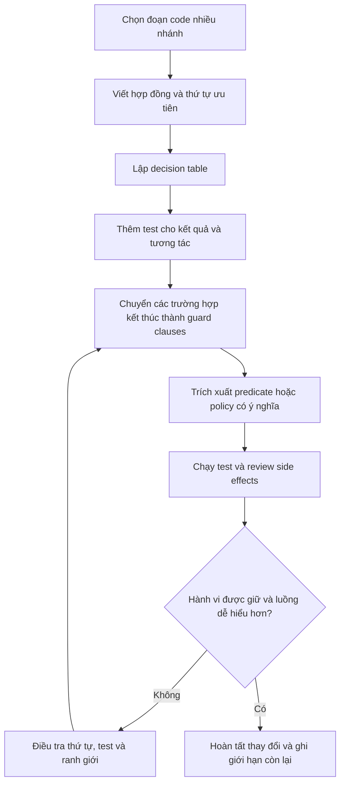

# Giảm độ phức tạp của một đoạn xử lý có nhiều nhánh

## 1. Mục tiêu là làm luồng quyết định dễ hiểu và dễ kiểm chứng

Một đoạn xử lý có nhiều nhánh thường bắt đầu khá đơn giản: kiểm tra đầu vào, xác định trạng thái, áp dụng chính sách rồi trả kết quả. Sau nhiều lần bổ sung yêu cầu, các điều kiện lồng nhau xuất hiện, cùng một quy tắc được kiểm tra ở nhiều nơi và thứ tự các nhánh trở nên quan trọng. Người sửa có thể không biết một điều kiện mới nên đặt ở trên hay dưới, hoặc một thay đổi nhỏ có làm đổi kết quả của các trường hợp khác hay không.

Trong module `CODE_QUALITY_FUNDAMENTALS`, người học tìm hiểu **những thuộc tính quyết định mã nguồn có đáng tin cậy, dễ hiểu và dễ thay đổi hay không**. Thuộc chương **Thực hành**, bài này hướng dẫn cách **giảm độ phức tạp của một đoạn xử lý có nhiều nhánh** bằng cách làm rõ quy tắc, thứ tự ưu tiên và ranh giới trách nhiệm.

Mục tiêu không phải xóa càng nhiều `if` càng tốt hoặc ép mọi phương thức xuống một số dòng cố định. Một đoạn code có ít nhánh nhưng dùng nhiều trạng thái ngầm vẫn khó hiểu; một đoạn code có nhiều nhánh nhưng được tổ chức theo bảng quyết định rõ ràng có thể dễ kiểm tra hơn.

Khi thực hành, hãy trả lời năm câu hỏi:

1. Những điều kiện nào thực sự quyết định kết quả?
2. Các điều kiện có thứ tự ưu tiên hay có thể độc lập?
3. Những tổ hợp đầu vào nào cần được kiểm thử?
4. Có thể tách bước hoặc chính sách mà không che giấu luồng điều khiển không?
5. Bằng chứng nào cho thấy refactor giữ nguyên hành vi đã được xác nhận?

Sau bài học, bạn có thể nhận diện nhánh lồng nhau và điều kiện trùng lặp, chuyển các trường hợp kết thúc sớm thành guard clauses, dùng decision table để làm rõ ưu tiên, trích xuất predicate hoặc policy, viết test cho biên và tương tác quan trọng, đồng thời biết khi nào không nên áp dụng pattern phức tạp hơn.

## 2. Độ phức tạp của nhánh đến từ đâu?

Một nhánh là một điểm mà chương trình chọn đường thực thi dựa trên điều kiện, ví dụ `if`, `else if`, `switch`, toán tử điều kiện hoặc điều kiện lặp. Nhiều nhánh không tự động là xấu. Vấn đề xuất hiện khi người đọc khó xác định:

- Điều kiện nào được đánh giá trước.
- Nhánh nào có thể xảy ra đồng thời.
- Nhánh nào loại trừ nhánh khác.
- Điều kiện nào lặp lại với cách viết hơi khác.
- Giá trị nào được gán ở từng đường đi.
- Một thay đổi có thể làm ảnh hưởng các trường hợp nào.
- Những đường đi nào đã có test bảo vệ.

### 2.1. Nhánh lồng nhau làm tăng công suy luận

Ví dụ minh họa:

```java
if (orderIsValid) {
    if (paymentIsAuthorized) {
        if (stockIsAvailable) {
            if (customerIsEligible) {
                applyDiscount();
            } else {
                useRegularPrice();
            }
        } else {
            rejectOrder();
        }
    } else {
        waitForPayment();
    }
} else {
    rejectInvalidOrder();
}
```

Để hiểu kết quả của `applyDiscount()`, người đọc phải nhớ toàn bộ điều kiện bên ngoài. Khi thêm một trạng thái như “cần kiểm tra thủ công”, việc đặt nhánh ở sai tầng có thể khiến trường hợp ấy bị bỏ qua hoặc bị xử lý hai lần.

### 2.2. Nhiều điều kiện có thể tạo ra tổ hợp lớn

Nếu có \(n\) điều kiện Boolean độc lập, về lý thuyết có thể có đến \(2^n\) tổ hợp đầu vào. Không phải tất cả tổ hợp đều hợp lệ hoặc đều cần một test riêng, nhưng con số này giải thích vì sao một phương thức lớn có thể nhanh chóng khó kiểm tra.

Ví dụ, sáu điều kiện Boolean có tối đa 64 tổ hợp. Nếu nghiệp vụ chỉ cho phép 12 tổ hợp, cần ghi rõ ràng buộc để người đọc và test không phải tự suy đoán.

### 2.3. Điều kiện trùng lặp dễ lệch nhau

Hai nhánh có thể cùng kiểm tra “khách hàng đủ điều kiện” nhưng một nơi dùng `>=`, nơi khác dùng `>`. Một thay đổi chính sách chỉ sửa một nhánh sẽ tạo hành vi không nhất quán.

### 2.4. Thứ tự ưu tiên là một phần của nghiệp vụ

Giả sử đơn hàng vừa bị đánh dấu rủi ro, vừa đang chờ thanh toán. Kết quả là “chờ thanh toán” hay “chuyển kiểm tra thủ công”? Không thể trả lời chỉ bằng cách đếm nhánh. Phải xác định quy tắc ưu tiên với người sở hữu nghiệp vụ và diễn đạt nó trong code, bảng quyết định hoặc test.

## 3. Phân biệt cyclomatic complexity và cognitive complexity

Hai khái niệm thường được dùng để thảo luận độ phức tạp, nhưng chúng nhìn vào những khía cạnh khác nhau.

| Khái niệm | Đo điều gì ở mức khái quát? | Điều cần nhớ |
| --- | --- | --- |
| **Cyclomatic complexity** | Số đường đi độc lập về mặt cấu trúc điều khiển; thường được ước lượng từ số điểm quyết định cộng một | Gợi ý mức độ cần xem xét test đường đi, không đo trực tiếp khả năng hiểu |
| **Cognitive complexity** | Mức khó theo dõi luồng điều khiển, đặc biệt khi có lồng nhau hoặc chuyển hướng suy nghĩ | Giúp nhận diện code khiến người đọc phải giữ nhiều ngữ cảnh |
| **Số dòng / số nhánh** | Kích thước hoặc số cấu trúc nhìn thấy | Không đủ để kết luận chất lượng |
| **Test coverage** | Phần code/nhánh được chạy theo cách công cụ định nghĩa | Không chứng minh assertion đủ mạnh hoặc mọi tổ hợp đã được xác minh |

Cyclomatic complexity thường được mô tả bằng công thức:

\[
M = E - N + 2P
\]

Trong đó \(E\) là số cạnh, \(N\) là số nút trong control-flow graph và \(P\) là số thành phần liên thông. Với một hàm đơn giản, cách ước lượng phổ biến là **một cộng với số điểm quyết định**. Công cụ khác nhau có thể xử lý các cấu trúc như `catch`, `case`, điều kiện Boolean và toán tử logic theo quy ước riêng.

### 3.1. Guard clauses thường giảm lồng nhau, không nhất thiết giảm cyclomatic complexity

Chuyển một chuỗi điều kiện lồng nhau thành các lần trả về sớm có thể làm luồng dễ đọc hơn. Nhưng nếu số quyết định vẫn giữ nguyên, cyclomatic complexity của phương thức có thể không giảm. Đừng tuyên bố đã “giảm số đường đi” chỉ vì số cấp thụt lề ít hơn.

### 3.2. Extract Method có thể làm một phương thức đơn giản hơn nhưng không xóa tổng độ phức tạp

Tách logic sang một phương thức có tên rõ giúp người đọc tập trung vào một phần quyết định. Tuy nhiên, tổng số điều kiện trong hệ thống không tự biến mất. Nếu chỉ chuyển 20 nhánh sang một class khác để làm dashboard đẹp hơn, rủi ro nghiệp vụ vẫn còn.

### 3.3. Không tối ưu một con số riêng lẻ

Một phương thức có complexity thấp nhưng gọi nhiều helper tên mơ hồ có thể khó hiểu hơn. Ngược lại, một hàm kiểm tra quyền truy cập có vài nhánh rõ ràng là cần thiết. Metric nên giúp tìm vùng cần review, không phải mục tiêu để cắt code máy móc.

## 4. Trước khi refactor: xác định hợp đồng và thứ tự quyết định

Trước khi thay đổi code có nhiều nhánh, hãy ghi lại:

- Những trạng thái đầu vào có thể có.
- Điều kiện nào là không hợp lệ.
- Điều kiện nào ưu tiên cao hơn.
- Những kết quả nào có thể trả về.
- Nhánh nào có tác dụng phụ.
- Exception nào thuộc hợp đồng.
- Có trạng thái nào không được phép xuất hiện không.
- Hành vi nào đã được xác nhận là đúng và hành vi nào đang là bug.

Đừng xem implementation hiện tại là đặc tả tuyệt đối. Nếu code cũ có bug, test characterization có thể ghi nhận điều đang xảy ra, nhưng cần một quyết định riêng về hành vi đúng.

### 4.1. Ghi rõ thứ tự ưu tiên bằng lời

Bài thực hành dùng ví dụ **định tuyến xử lý đơn hàng** với chính sách giả định sau:

1. Tổng tiền không dương: từ chối vì đơn không hợp lệ.
2. Đơn bị chặn bởi kiểm tra gian lận: từ chối vì rủi ro.
3. Thanh toán bị từ chối: từ chối đơn.
4. Thanh toán đang chờ: giữ đơn ở trạng thái chờ.
5. Thanh toán đã được xác nhận nhưng cần xem xét gian lận: chuyển kiểm tra thủ công.
6. Hết hàng: tạo backorder nếu được phép, nếu không thì từ chối.
7. Có hàng và khách VIP chọn giao nhanh: giao ưu tiên.
8. Có hàng và chọn giao nhanh: giao nhanh.
9. Các trường hợp còn lại: giao tiêu chuẩn.

**Quy tắc đầu tiên khớp sẽ quyết định kết quả.** Vì vậy, một đơn vừa bị chặn do gian lận vừa đang chờ thanh toán sẽ bị từ chối do rủi ro. Một đơn đang chờ thanh toán nhưng hết hàng vẫn ở trạng thái chờ thanh toán theo thứ tự đã xác nhận.

Đây là ưu tiên nghiệp vụ của ví dụ, không phải quy tắc phổ quát cho mọi hệ thống đặt hàng. Trong dự án thật, phải xác nhận thứ tự với người sở hữu nghiệp vụ.

### 4.2. Bảng quyết định làm rõ các trường hợp

| Ưu tiên | Điều kiện | Kết quả |
| ---: | --- | --- |
| 1 | Tổng tiền ≤ 0 | `INVALID_ORDER` |
| 2 | Fraud = `BLOCKED` | `REJECT_FRAUD` |
| 3 | Payment = `DECLINED` | `REJECT_PAYMENT` |
| 4 | Payment = `PENDING` | `WAIT_FOR_PAYMENT` |
| 5 | Fraud = `REVIEW` | `MANUAL_REVIEW` |
| 6 | Inventory = `OUT_OF_STOCK` và cho phép backorder | `BACKORDER` |
| 7 | Inventory = `OUT_OF_STOCK` và không cho phép backorder | `REJECT_OUT_OF_STOCK` |
| 8 | VIP và giao nhanh | `PRIORITY_SHIPPING` |
| 9 | Giao nhanh | `EXPEDITED_SHIPPING` |
| 10 | Không có điều kiện nào ở trên | `STANDARD_SHIPPING` |

Bảng này giúp reviewer phát hiện một thay đổi thứ tự ngoài ý muốn. Ví dụ, nếu nhánh hết hàng được đưa lên trước trạng thái thanh toán đang chờ, kết quả của một tổ hợp đầu vào sẽ đổi.

### 4.3. Phân biệt điều kiện loại trừ và điều kiện kết hợp

Một số trạng thái loại trừ nhau theo kiểu dữ liệu: payment chỉ có một trạng thái tại một thời điểm. Những điều kiện khác có thể kết hợp: VIP và giao nhanh đều có thể đúng; fraud review và payment pending cũng có thể cùng xuất hiện. Test cần tập trung vào **các tương tác làm thay đổi kết quả**, không chỉ từng điều kiện đứng riêng.

## 5. Đọc một đoạn xử lý lồng nhau và tìm điểm gây khó

Hãy bắt đầu bằng việc gạch ra:

1. Các điều kiện đầu vào.
2. Các nhánh kết thúc.
3. Các nhánh có thể lồng nhau.
4. Các điều kiện lặp lại.
5. Các đoạn có tác dụng phụ.
6. Các quy tắc có thể đặt tên.
7. Các đường đi chưa có test.

Một kỹ thuật hữu ích là viết mỗi nhánh thành câu tiếng Việt. Nếu phải dùng nhiều từ “nếu”, “trừ khi”, “trong trường hợp trước đó chưa...” để mô tả một kết quả, có thể quy tắc đang cần được tách hoặc đưa vào decision table.

### 5.1. Ví dụ code ban đầu

Đoạn dưới là phiên bản lồng nhau minh họa. Các kiểu dữ liệu sẽ được định nghĩa đầy đủ ở phần triển khai sau.

```java
Decision decide(OrderFacts facts) {
    if (facts.totalCents() <= 0) {
        return Decision.INVALID_ORDER;
    } else {
        if (facts.fraudStatus() == FraudStatus.BLOCKED) {
            return Decision.REJECT_FRAUD;
        } else {
            if (facts.paymentStatus() == PaymentStatus.DECLINED) {
                return Decision.REJECT_PAYMENT;
            } else {
                if (facts.paymentStatus() == PaymentStatus.PENDING) {
                    return Decision.WAIT_FOR_PAYMENT;
                } else {
                    if (facts.fraudStatus() == FraudStatus.REVIEW) {
                        return Decision.MANUAL_REVIEW;
                    } else {
                        if (facts.inventoryStatus()
                                == InventoryStatus.OUT_OF_STOCK) {
                            if (facts.allowBackorder()) {
                                return Decision.BACKORDER;
                            } else {
                                return Decision.REJECT_OUT_OF_STOCK;
                            }
                        } else {
                            if (facts.customerTier() == CustomerTier.VIP) {
                                if (facts.expedited()) {
                                    return Decision.PRIORITY_SHIPPING;
                                } else {
                                    return Decision.STANDARD_SHIPPING;
                                }
                            } else {
                                if (facts.expedited()) {
                                    return Decision.EXPEDITED_SHIPPING;
                                } else {
                                    return Decision.STANDARD_SHIPPING;
                                }
                            }
                        }
                    }
                }
            }
        }
    }
}
```

Đoạn này vẫn có thể cho kết quả đúng theo bảng quyết định, nhưng cấu trúc buộc người đọc phải lần theo nhiều tầng. Nó cũng lặp kết quả `STANDARD_SHIPPING` ở hai nhánh khách hàng.

Không phải mọi `else` đều sai. Khi hai nhánh có cấu trúc đối xứng hoặc cần giữ một vùng tài nguyên, `else` có thể làm mối quan hệ rõ hơn. Trong ví dụ này, các trường hợp từ chối/chờ là những kết thúc sớm, nên có thể đưa lên đầu để làm phần xử lý bình thường nổi bật hơn.

## 6. Kỹ thuật thứ nhất: dùng guard clauses cho trường hợp kết thúc sớm

**Guard clause** là điều kiện kiểm tra một trường hợp cần kết thúc sớm, thường trả về kết quả hoặc ném exception ngay. Kỹ thuật này hữu ích khi một số điều kiện loại trừ đường xử lý bình thường.

Ví dụ:

```java
if (facts.totalCents() <= 0) {
    return Decision.INVALID_ORDER;
}
if (facts.fraudStatus() == FraudStatus.BLOCKED) {
    return Decision.REJECT_FRAUD;
}
if (facts.paymentStatus() == PaymentStatus.DECLINED) {
    return Decision.REJECT_PAYMENT;
}
```

Người đọc thấy ngay những trường hợp không đi tiếp. Phần còn lại chỉ xử lý đơn hợp lệ qua các bước tiếp theo.

### 6.1. Giữ đúng thứ tự ưu tiên

Guard clauses không được sắp xếp theo sở thích hoặc theo điều kiện “trông quan trọng nhất”. Nếu bảng quyết định nói fraud block ưu tiên hơn payment pending, code phải giữ đúng thứ tự ấy.

Một cách review là so từng dòng guard với bảng ưu tiên và kiểm tra các tổ hợp có thể cùng đúng. Nếu hai điều kiện không thể cùng đúng theo kiểu dữ liệu, không cần tạo test tổ hợp giả tạo.

### 6.2. Tránh guard clause có side effect khó thấy

Một guard clause nên dễ đọc như “nếu điều kiện không hợp lệ thì trả kết quả”. Nếu nó đồng thời ghi database, phát event và thay đổi trạng thái dùng chung, người đọc có thể không thấy side effect xảy ra trước nhánh sau.

Khi cần side effect, hãy đặt tên hành động rõ ràng và bảo vệ transaction. Ví dụ, kiểm tra đầu vào trước khi ghi; không di chuyển validation xuống sau thao tác ghi chỉ để tạo return sớm.

### 6.3. Không dùng return sớm nếu nó bỏ qua cleanup bắt buộc

Nếu code đang giữ lock, mở stream hoặc cấp phát tài nguyên, phải bảo đảm mọi đường thoát đều giải phóng đúng cách. Java có thể dùng `try-with-resources`, `finally` hoặc abstraction quản lý tài nguyên. Guard clause không phải lý do để bỏ qua cleanup.

## 7. Kỹ thuật thứ hai: trích xuất điều kiện có ý nghĩa

Một điều kiện phức tạp có thể được đặt tên để người đọc hiểu lý do của quyết định.

Trước:

```java
if (customer.tier() == VIP
        && order.totalCents() >= VIP_THRESHOLD
        && !customer.isSuspended()
        && order.region().supportsPriority()) {
    // ...
}
```

Sau:

```java
if (qualifiesForPriorityHandling(customer, order)) {
    // ...
}
```

Tên predicate nên diễn tả một mệnh đề có thể trả lời đúng/sai. Ví dụ:

- `isPaymentReady(...)`
- `requiresManualReview(...)`
- `canCreateBackorder(...)`
- `qualifiesForPriorityHandling(...)`

### 7.1. Predicate phải có nghĩa ổn định

Không đặt tên `isValid(...)` cho một điều kiện chỉ kiểm tra tồn kho. Tên quá rộng khiến caller tin rằng nhiều quy tắc khác đã được kiểm tra.

Nếu predicate đọc dữ liệu hoặc có side effect, tên nên nói rõ. Một hàm `hasAvailableStock(...)` nghe như truy vấn; nếu nó đồng thời giữ hàng, tên `reserveStockIfAvailable(...)` phù hợp hơn.

### 7.2. Không trích xuất một điều kiện đơn giản chỉ để tăng số method

`if (amount > 0)` thường không cần một method `isAmountPositive` nếu tên biến và ngữ cảnh đã rõ. Extract predicate hữu ích khi nó:

- Đại diện một quy tắc nghiệp vụ có tên.
- Được dùng ở nhiều nơi với cùng hợp đồng.
- Làm giảm một biểu thức dài khó kiểm tra.
- Tạo điểm test riêng có giá trị.
- Che giấu một chi tiết thấp hơn mức trừu tượng của caller.

### 7.3. Không thay đổi thứ tự đánh giá nếu biểu thức có side effect

Các điều kiện nên thuần và không gây tác dụng phụ. Nếu biểu thức gọi phương thức làm thay đổi trạng thái, chuyển nó vào helper có thể vô tình thay đổi số lần hoặc thứ tự gọi. Hãy tách việc truy vấn/trạng thái khỏi quyết định khi có thể.

## 8. Kỹ thuật thứ ba: tách các chính sách độc lập

Nếu một đoạn xử lý quyết định nhiều chính sách khác nhau, có thể tách chúng thành hàm hoặc class nhỏ:

- Quyết định thanh toán đã sẵn sàng chưa.
- Quyết định cần kiểm tra gian lận không.
- Quyết định có thể tạo backorder không.
- Chọn phương thức vận chuyển.

Tách theo **lý do thay đổi** chứ không theo từng dòng code. Nếu chỉ có một hàm thuần nhỏ và một caller, method riêng có thể đủ; chưa cần Strategy, factory hoặc registry.

### 8.1. Khi nào dùng switch hoặc decision table?

`switch` trên enum phù hợp khi một trạng thái có nhiều kết quả rõ ràng và các trường hợp có thể liệt kê đầy đủ. Decision table phù hợp khi kết quả phụ thuộc vào tổ hợp nhiều điều kiện và thứ tự ưu tiên cần được review.

Một bảng quyết định có thể trở thành test cases, tài liệu hoặc cấu hình. Nhưng nếu bảng chỉ là một spreadsheet không được đồng bộ với implementation, nó có thể nhanh chóng lỗi thời.

### 8.2. Khi nào dùng polymorphism hoặc Strategy?

Cân nhắc Strategy khi các biến thể có **thuật toán khác nhau**, có thể thay đổi độc lập hoặc được chọn theo cấu hình/domain. Không dùng polymorphism chỉ để tránh một vài `if` trên enum. Một `switch` nhỏ, exhaustive và rõ có thể tốt hơn nhiều class chỉ chuyển tiếp.

### 8.3. Khi nào dùng rule engine?

Rule engine phù hợp khi số lượng rule lớn, thay đổi thường xuyên bởi nhóm nghiệp vụ, cần quản lý phiên bản hoặc giải thích quyết định. Nó mang theo chi phí mô hình hóa, debug, quan sát và kiểm thử. Với một quyết định 6–8 nhánh ổn định, code Java có tên rõ thường đơn giản hơn.
+## 9. Refactor ví dụ: từ nhánh lồng nhau sang guard clauses

Ta giữ nguyên bảng ưu tiên đã xác nhận ở phần 4. Mục tiêu là làm các trường hợp kết thúc sớm hiện rõ ở đầu phương thức, rồi gom phần lựa chọn giao hàng vào đoạn cuối.

### 9.1. Mô hình dữ liệu đầu vào

Dùng enum thay cho chuỗi tùy ý giúp giới hạn trạng thái hợp lệ. Record gom các dữ kiện cần thiết vào một đối tượng có tên.

```java
import java.util.Objects;

public final class OrderRoutingPolicy {
    public enum PaymentStatus {
        AUTHORIZED,
        PENDING,
        DECLINED
    }

    public enum FraudStatus {
        CLEAR,
        REVIEW,
        BLOCKED
    }

    public enum InventoryStatus {
        AVAILABLE,
        OUT_OF_STOCK
    }

    public enum CustomerTier {
        STANDARD,
        VIP
    }

    public enum Decision {
        INVALID_ORDER,
        REJECT_FRAUD,
        REJECT_PAYMENT,
        WAIT_FOR_PAYMENT,
        MANUAL_REVIEW,
        BACKORDER,
        REJECT_OUT_OF_STOCK,
        PRIORITY_SHIPPING,
        EXPEDITED_SHIPPING,
        STANDARD_SHIPPING
    }

    public record OrderFacts(
            long totalCents,
            PaymentStatus paymentStatus,
            FraudStatus fraudStatus,
            InventoryStatus inventoryStatus,
            CustomerTier customerTier,
            boolean allowBackorder,
            boolean expedited) {

        public OrderFacts {
            Objects.requireNonNull(paymentStatus, "paymentStatus");
            Objects.requireNonNull(fraudStatus, "fraudStatus");
            Objects.requireNonNull(inventoryStatus, "inventoryStatus");
            Objects.requireNonNull(customerTier, "customerTier");
        }
    }

    private OrderRoutingPolicy() {}
}
```

Trong ví dụ, tổng tiền không dương được biểu diễn thành kết quả `INVALID_ORDER` để cho thấy một nhánh nghiệp vụ. Các enum không nhận `null` vì record kiểm tra ngay tại biên tạo dữ liệu. Nếu dự án muốn `null` được hiểu là “chưa xác định”, cần mô hình hóa trạng thái đó thành enum riêng thay vì dùng null ngầm.

### 9.2. Phương thức sau refactor

Thêm phương thức sau vào class `OrderRoutingPolicy`:

```java
public static Decision decide(OrderFacts facts) {
    Objects.requireNonNull(facts, "facts");

    if (facts.totalCents() <= 0) {
        return Decision.INVALID_ORDER;
    }
    if (facts.fraudStatus() == FraudStatus.BLOCKED) {
        return Decision.REJECT_FRAUD;
    }
    if (facts.paymentStatus() == PaymentStatus.DECLINED) {
        return Decision.REJECT_PAYMENT;
    }
    if (facts.paymentStatus() == PaymentStatus.PENDING) {
        return Decision.WAIT_FOR_PAYMENT;
    }
    if (facts.fraudStatus() == FraudStatus.REVIEW) {
        return Decision.MANUAL_REVIEW;
    }
    if (facts.inventoryStatus() == InventoryStatus.OUT_OF_STOCK) {
        return facts.allowBackorder()
                ? Decision.BACKORDER
                : Decision.REJECT_OUT_OF_STOCK;
    }
    if (facts.customerTier() == CustomerTier.VIP && facts.expedited()) {
        return Decision.PRIORITY_SHIPPING;
    }
    if (facts.expedited()) {
        return Decision.EXPEDITED_SHIPPING;
    }
    return Decision.STANDARD_SHIPPING;
}
```

Phương thức này làm rõ ba nhóm:

1. **Trường hợp dừng sớm:** dữ liệu không hợp lệ, rủi ro, thanh toán chưa hoàn tất hoặc cần review.
2. **Tình huống tồn kho:** chỉ xử lý backorder sau khi các điều kiện ưu tiên cao hơn đã được loại trừ.
3. **Lựa chọn giao hàng:** VIP giao nhanh, giao nhanh thông thường hoặc tiêu chuẩn.

### 9.3. Điều gì thay đổi và điều gì được giữ?

| Khía cạnh | Trước | Sau |
| --- | --- | --- |
| Thứ tự ưu tiên | Ẩn trong các tầng lồng nhau | Thể hiện theo thứ tự guard clauses |
| Trường hợp kết thúc | Nằm sâu trong nhánh | Nằm ở đầu phương thức |
| Quy tắc hết hàng | Lồng thêm một điều kiện backorder | Một nhánh có kết quả tường minh |
| Giao hàng VIP | Lồng theo tier rồi expedited | Một predicate kết hợp có tên miền rõ |
| Kết quả tiêu chuẩn | Lặp ở hai nhánh | Một kết quả mặc định ở cuối |
| Tổng số điều kiện | Có các điểm quyết định tương ứng | Vẫn còn các điểm quyết định nghiệp vụ |

Refactor này chủ yếu giảm **độ sâu lồng nhau và công theo dõi luồng**. Nó không loại bỏ các quy tắc, và không nên tuyên bố cyclomatic complexity đã giảm chỉ vì phương thức phẳng hơn.

### 9.4. Không để nhánh mặc định che trạng thái chưa được mô hình hóa

`STANDARD_SHIPPING` chỉ là kết quả mặc định khi mọi điều kiện trước đó đã được loại trừ. Nếu sau này thêm trạng thái `PAYMENT_UNKNOWN` hoặc `INVENTORY_CHECKING`, cần quyết định rõ vị trí và kết quả của nó. Đừng mặc định mọi trạng thái mới đều được giao tiêu chuẩn.

## 10. JUnit 5: kiểm thử kết quả, biên và thứ tự ưu tiên

Một bài test cho mỗi enum chưa đủ. Cần kiểm tra các tương tác có thể làm thay đổi kết quả do thứ tự ưu tiên.

Đặt test trong tệp `OrderRoutingPolicyTest.java`:

```java
import static org.junit.jupiter.api.Assertions.assertEquals;
import org.junit.jupiter.api.Test;

class OrderRoutingPolicyTest {
    private OrderRoutingPolicy.OrderFacts facts(
            long totalCents,
            OrderRoutingPolicy.PaymentStatus payment,
            OrderRoutingPolicy.FraudStatus fraud,
            OrderRoutingPolicy.InventoryStatus inventory,
            OrderRoutingPolicy.CustomerTier tier,
            boolean allowBackorder,
            boolean expedited) {
        return new OrderRoutingPolicy.OrderFacts(
                totalCents, payment, fraud, inventory,
                tier, allowBackorder, expedited);
    }

    @Test
    void rejectsNonPositiveTotal() {
        var order = facts(
                0,
                OrderRoutingPolicy.PaymentStatus.AUTHORIZED,
                OrderRoutingPolicy.FraudStatus.CLEAR,
                OrderRoutingPolicy.InventoryStatus.AVAILABLE,
                OrderRoutingPolicy.CustomerTier.STANDARD,
                false,
                false);

        assertEquals(OrderRoutingPolicy.Decision.INVALID_ORDER,
                OrderRoutingPolicy.decide(order));
    }

    @Test
    void fraudBlockTakesPriorityOverPendingPayment() {
        var order = facts(
                10_000,
                OrderRoutingPolicy.PaymentStatus.PENDING,
                OrderRoutingPolicy.FraudStatus.BLOCKED,
                OrderRoutingPolicy.InventoryStatus.OUT_OF_STOCK,
                OrderRoutingPolicy.CustomerTier.VIP,
                true,
                true);

        assertEquals(OrderRoutingPolicy.Decision.REJECT_FRAUD,
                OrderRoutingPolicy.decide(order));
    }

    @Test
    void rejectsDeclinedPayment() {
        var order = facts(
                10_000,
                OrderRoutingPolicy.PaymentStatus.DECLINED,
                OrderRoutingPolicy.FraudStatus.CLEAR,
                OrderRoutingPolicy.InventoryStatus.AVAILABLE,
                OrderRoutingPolicy.CustomerTier.STANDARD,
                false,
                false);

        assertEquals(OrderRoutingPolicy.Decision.REJECT_PAYMENT,
                OrderRoutingPolicy.decide(order));
    }

    @Test
    void waitsForPaymentBeforeConsideringStock() {
        var order = facts(
                10_000,
                OrderRoutingPolicy.PaymentStatus.PENDING,
                OrderRoutingPolicy.FraudStatus.CLEAR,
                OrderRoutingPolicy.InventoryStatus.OUT_OF_STOCK,
                OrderRoutingPolicy.CustomerTier.STANDARD,
                true,
                false);

        assertEquals(OrderRoutingPolicy.Decision.WAIT_FOR_PAYMENT,
                OrderRoutingPolicy.decide(order));
    }

    @Test
    void sendsReviewCasesToManualReviewAfterPaymentIsAuthorized() {
        var order = facts(
                10_000,
                OrderRoutingPolicy.PaymentStatus.AUTHORIZED,
                OrderRoutingPolicy.FraudStatus.REVIEW,
                OrderRoutingPolicy.InventoryStatus.AVAILABLE,
                OrderRoutingPolicy.CustomerTier.STANDARD,
                false,
                false);

        assertEquals(OrderRoutingPolicy.Decision.MANUAL_REVIEW,
                OrderRoutingPolicy.decide(order));
    }

    @Test
    void createsBackorderWhenAllowed() {
        var order = facts(
                10_000,
                OrderRoutingPolicy.PaymentStatus.AUTHORIZED,
                OrderRoutingPolicy.FraudStatus.CLEAR,
                OrderRoutingPolicy.InventoryStatus.OUT_OF_STOCK,
                OrderRoutingPolicy.CustomerTier.STANDARD,
                true,
                false);

        assertEquals(OrderRoutingPolicy.Decision.BACKORDER,
                OrderRoutingPolicy.decide(order));
    }

    @Test
    void rejectsOutOfStockWhenBackorderIsDisabled() {
        var order = facts(
                10_000,
                OrderRoutingPolicy.PaymentStatus.AUTHORIZED,
                OrderRoutingPolicy.FraudStatus.CLEAR,
                OrderRoutingPolicy.InventoryStatus.OUT_OF_STOCK,
                OrderRoutingPolicy.CustomerTier.STANDARD,
                false,
                false);

        assertEquals(OrderRoutingPolicy.Decision.REJECT_OUT_OF_STOCK,
                OrderRoutingPolicy.decide(order));
    }

    @Test
    void vipWithExpeditedShippingGetsPriorityShipping() {
        var order = facts(
                10_000,
                OrderRoutingPolicy.PaymentStatus.AUTHORIZED,
                OrderRoutingPolicy.FraudStatus.CLEAR,
                OrderRoutingPolicy.InventoryStatus.AVAILABLE,
                OrderRoutingPolicy.CustomerTier.VIP,
                false,
                true);

        assertEquals(OrderRoutingPolicy.Decision.PRIORITY_SHIPPING,
                OrderRoutingPolicy.decide(order));
    }

    @Test
    void standardCustomerCanStillChooseExpeditedShipping() {
        var order = facts(
                10_000,
                OrderRoutingPolicy.PaymentStatus.AUTHORIZED,
                OrderRoutingPolicy.FraudStatus.CLEAR,
                OrderRoutingPolicy.InventoryStatus.AVAILABLE,
                OrderRoutingPolicy.CustomerTier.STANDARD,
                false,
                true);

        assertEquals(OrderRoutingPolicy.Decision.EXPEDITED_SHIPPING,
                OrderRoutingPolicy.decide(order));
    }

    @Test
    void defaultsToStandardShipping() {
        var order = facts(
                10_000,
                OrderRoutingPolicy.PaymentStatus.AUTHORIZED,
                OrderRoutingPolicy.FraudStatus.CLEAR,
                OrderRoutingPolicy.InventoryStatus.AVAILABLE,
                OrderRoutingPolicy.CustomerTier.STANDARD,
                false,
                false);

        assertEquals(OrderRoutingPolicy.Decision.STANDARD_SHIPPING,
                OrderRoutingPolicy.decide(order));
    }
}
```

Bộ test minh họa bao phủ các kết quả chính, giá trị không hợp lệ, nhánh hết hàng và những tổ hợp quan trọng liên quan đến ưu tiên. Các test dùng expected cố định từ bảng quyết định, không gọi chính implementation để tự tạo expected.

### 10.1. Vì sao cần test tương tác?

Nếu chỉ test riêng `fraudStatus = BLOCKED` và riêng `paymentStatus = PENDING`, ta chưa biết kết quả khi cả hai cùng đúng. Test `fraudBlockTakesPriorityOverPendingPayment` bảo vệ chính sách ưu tiên. Test `waitsForPaymentBeforeConsideringStock` bảo vệ một ưu tiên khác.

Không cần kiểm tra mọi tổ hợp tùy ý. Hãy chọn tổ hợp có khả năng làm đổi quyết định hoặc có hậu quả cao nếu thứ tự sai.

### 10.2. Test null ở đúng ranh giới

Record `OrderFacts` kiểm tra enum null khi tạo đối tượng. Nếu muốn xác nhận điều đó, có thể thêm test:

```java
@Test
void rejectsNullPaymentStatusAtConstruction() {
    assertThrows(NullPointerException.class,
            () -> new OrderRoutingPolicy.OrderFacts(
                    10_000,
                    null,
                    OrderRoutingPolicy.FraudStatus.CLEAR,
                    OrderRoutingPolicy.InventoryStatus.AVAILABLE,
                    OrderRoutingPolicy.CustomerTier.STANDARD,
                    false,
                    false));
}
```

Đây là kiểm tra hợp đồng tạo dữ liệu. Nó không thay thế validation ở HTTP/message boundary; lớp tiếp nhận vẫn cần chuyển đầu vào không hợp lệ thành phản hồi phù hợp.

## 11. Chọn test theo rủi ro thay vì cố bao phủ mọi tổ hợp

Với nhiều điều kiện, số tổ hợp có thể tăng nhanh. Một chiến lược test hợp lý kết hợp:

- **Branch coverage:** mỗi nhánh quan trọng đã được thực thi ít nhất một lần.
- **Boundary tests:** giá trị ngay dưới, bằng và ngay trên ngưỡng.
- **Decision/condition coverage:** từng quyết định và điều kiện thành phần được đánh giá cả đúng lẫn sai khi phù hợp.
- **Pairwise testing:** kiểm tra các cặp giá trị khi nhiều yếu tố tương tác, đặc biệt với cấu hình lớn.
- **Priority tests:** các trường hợp nhiều điều kiện cùng đúng để xác nhận thứ tự.
- **Property-based tests:** kiểm tra các thuộc tính tổng quát trên nhiều dữ liệu sinh tự động.
- **Integration tests:** xác nhận dữ liệu và trạng thái được truyền vào từ adapter thật.

### 11.1. Branch coverage không chứng minh mọi tổ hợp đã đúng

Một test có thể đi qua nhánh fraud block và một test khác đi qua nhánh payment pending, nhưng không kiểm tra khi hai trạng thái cùng xuất hiện. Nếu ưu tiên giữa chúng quan trọng, cần test kết hợp riêng.

### 11.2. Pairwise không đủ cho mọi rủi ro

Pairwise testing đảm bảo mỗi cặp giá trị xuất hiện trong một số tổ hợp, giúp giảm số lượng test khi có nhiều tham số. Nhưng lỗi có thể chỉ xảy ra khi ba hoặc nhiều điều kiện cùng đúng. Với quy tắc thanh toán, phân quyền hoặc dữ liệu có hậu quả cao, hãy bổ sung tổ hợp rủi ro đã biết và các bất biến quan trọng.

### 11.3. Property-based test cho bất biến tổng quát

Ví dụ, nếu mọi đơn có `totalCents <= 0` đều phải trả `INVALID_ORDER` bất kể các trạng thái khác, đây là một property có thể kiểm tra với nhiều tổ hợp. Tuy nhiên, test sinh dữ liệu phải tôn trọng mô hình đầu vào và giới hạn hợp lệ; dữ liệu null bị record chặn ngay từ constructor thì không thể được coi là đầu vào hợp lệ của `decide`.

## 12. Khi nào nên dùng decision table, switch, Strategy hoặc rule engine?

Không có một kỹ thuật duy nhất phù hợp cho mọi đoạn code có nhiều nhánh.

| Cấu trúc | Dùng khi | Cẩn trọng khi |
| --- | --- | --- |
| Guard clauses | Có các trường hợp kết thúc sớm và thứ tự ưu tiên rõ | Return sớm có thể bỏ qua cleanup hoặc side effect |
| Extract predicate | Điều kiện dài có ý nghĩa nghiệp vụ | Helper tên chung chung hoặc chỉ chuyển một biểu thức tầm thường |
| Extract policy | Các quy tắc có lý do thay đổi độc lập | Tách quá nhỏ làm người đọc phải nhảy nhiều nơi |
| Switch trên enum | Một trạng thái phân nhánh theo tập giá trị hữu hạn | Kết hợp nhiều chiều điều kiện thành switch lồng nhau |
| Decision table | Tổ hợp điều kiện và thứ tự ưu tiên cần được xem xét | Bảng không được đồng bộ với code/tests |
| Strategy / polymorphism | Các biến thể có thuật toán khác nhau và thay đổi độc lập | Tạo nhiều class chỉ để tránh vài nhánh |
| Rule engine | Nhiều rule động, có versioning/ownership riêng | Chi phí debug, giải thích và vận hành cao |

### 12.1. Ví dụ switch cho một chiều trạng thái

`switch` trên enum phù hợp khi một trạng thái có nhiều kết quả rõ ràng và các trường hợp có thể liệt kê đầy đủ. Ví dụ Java 17:

```java
import java.util.Optional;

Optional<Decision> paymentDecision(PaymentStatus status) {
    return switch (status) {
        case DECLINED -> Optional.of(Decision.REJECT_PAYMENT);
        case PENDING -> Optional.of(Decision.WAIT_FOR_PAYMENT);
        case AUTHORIZED -> Optional.empty();
    };
}
```

Đoạn này chỉ minh họa switch expression exhaustive. Trong hệ thống thật, `AUTHORIZED` không nhất thiết đồng nghĩa giao tiêu chuẩn; nó chỉ có nghĩa chưa cần quyết định dựa trên payment status. Nếu cần biểu diễn “chưa có quyết định”, hãy dùng kiểu kết quả riêng như `Optional<Decision>` hoặc tách bước phân loại thành một enum nội bộ. Không để null trở thành trạng thái ngầm khó hiểu.

### 12.2. Khi nào tách thành nhiều bước?

Nếu một phương thức vừa xác thực dữ liệu, vừa đọc database, vừa quyết định chính sách và ghi kết quả, tách các bước theo ranh giới trách nhiệm có thể hữu ích. Tuy nhiên, phải giữ thứ tự và transaction. Không chuyển thao tác ghi ra ngoài transaction chỉ vì muốn method ngắn hơn.

### 12.3. Rule engine là một lựa chọn kiến trúc, không phải thuốc chữa mọi if

Rule engine có thể phù hợp khi business rules thay đổi độc lập, cần cấu hình/versioning, audit và giải thích quyết định. Với một tập điều kiện nhỏ, ổn định và được version cùng code, Java thuần thường dễ kiểm thử và vận hành hơn.

## 13. Những sai lầm thường gặp khi giảm độ phức tạp

| Sai lầm | Vì sao gây hại | Cách cải thiện |
| --- | --- | --- |
| Chỉ xóa `else` mà không ghi thứ tự ưu tiên | Có thể đổi kết quả khi nhiều điều kiện cùng đúng | Lập decision table và test precedence |
| Đưa guard clause lên đầu theo cảm tính | Điều kiện ưu tiên thấp có thể che điều kiện quan trọng | Xác nhận thứ tự với chủ nghiệp vụ |
| Gộp nhiều điều kiện thành một Boolean dài | Che mất lý do và tương tác của từng điều kiện | Đặt tên predicate theo quy tắc |
| Tách mọi `if` thành method riêng | Tăng điểm nhảy, khó theo dõi | Chỉ tách điều kiện có ý nghĩa |
| Dùng `switch` lồng nhau cho mọi chiều | Vẫn tạo tổ hợp và nesting lớn | Tách rule theo trách nhiệm hoặc dùng bảng |
| Thêm Strategy cho một biến thể | Tăng class và wiring không cần thiết | Dùng enum/switch rõ khi phù hợp |
| Chuyển nhánh thành cấu hình không kiểm soát | Lỗi chính sách khó review và version | Version hóa, validate và test cấu hình |
| Dùng default cho trạng thái chưa biết | Trạng thái mới có thể bị xử lý như bình thường | Mô hình hóa UNKNOWN/PENDING tường minh |
| Chỉ test từng nhánh riêng lẻ | Bỏ sót tương tác và thứ tự ưu tiên | Test các tổ hợp có ý nghĩa |
| Tối ưu cyclomatic score | Có thể chỉ chuyển complexity sang helper | Đánh giá khả năng đọc và tổng rủi ro |
| Dùng side effect trong predicate | Số lần/thứ tự gọi có thể thay đổi | Predicate thuần, hành động tách riêng |
| Return sớm khi đang giữ tài nguyên | Bỏ qua cleanup hoặc commit cần thiết | try-with-resources/finally/transaction |
| Trộn refactor với đổi nghiệp vụ | Khó biết test fail do cấu trúc hay quy tắc mới | Tách thay đổi hành vi và cấu trúc |
| Viết test expected bằng chính hàm đang test | Test luôn xác nhận kết quả của chính implementation | Expected độc lập từ hợp đồng |

### 13.1. Tránh biểu thức Boolean phủ định kép

Điều kiện như `if (!(!eligible || suspended))` khó đọc hơn cách diễn đạt trực tiếp. Nếu điều kiện có ý nghĩa nghiệp vụ, hãy đặt tên predicate hoặc viết lại biểu thức theo mệnh đề tích cực khi tương đương.

### 13.2. Đừng biến một phương thức thành danh sách return không có cấu trúc

Guard clauses giúp các trường hợp kết thúc sớm rõ ràng, nhưng nếu phương thức có 25 return nằm rải rác và không có nhóm ý nghĩa, người đọc vẫn khó theo dõi. Khi đó, hãy xem xét decision table, tách policy hoặc trả về kiểu kết quả mô tả trạng thái.

## 14. Quy trình thực hành từng bước

Một quy trình có thể áp dụng cho đoạn code hiện hữu:

1. **Chọn một phương thức cụ thể:** xác định đầu vào, đầu ra và caller.
2. **Viết hợp đồng bằng lời:** liệt kê trạng thái, trường hợp biên và thứ tự ưu tiên.
3. **Tạo decision table:** một hàng cho mỗi kết quả hoặc rule ưu tiên.
4. **Bổ sung test hiện trạng:** ghi nhận hành vi cần giữ và tách riêng bug đã biết.
5. **Xác định nhánh kết thúc sớm:** validation, từ chối, chờ hoặc chuyển review.
6. **Chuyển thành guard clauses:** giữ nguyên thứ tự đã xác nhận.
7. **Đặt tên predicate:** chỉ trích xuất điều kiện có ý nghĩa.
8. **Tách policy khi có lý do thay đổi độc lập:** tránh tạo abstraction thừa.
9. **Viết test tương tác:** kiểm tra các điều kiện cùng đúng và nhánh có ưu tiên.
10. **So sánh trước/sau:** kết quả, exception, side effect và số nơi cần hiểu.
11. **Review diff:** bảo đảm không đổi hợp đồng ngoài mục tiêu.
12. **Đo lại nếu cần:** dùng complexity metric như tín hiệu phụ, đồng thời xem thời gian review và lỗi hồi quy.



### 14.1. Chia thay đổi để dễ review

Nếu cùng lúc đổi cấu trúc, sửa bug và thay chính sách, hãy tách commit hoặc pull request theo khả năng. Một trình tự thường dễ kiểm chứng là:

- Thêm test mô tả hợp đồng đúng.
- Sửa bug nếu có.
- Refactor cấu trúc giữ nguyên hành vi đã được xác nhận.
- Thêm policy mới trong một thay đổi nghiệp vụ riêng.

### 14.2. Không cần chạy mọi loại test cho mọi refactor

Một hàm thuần có thể cần unit tests và compile. Một nhánh liên quan database transaction cần integration tests. Một quyết định quyền truy cập cần test security và caller. Chọn tầng test theo rủi ro, không chạy nhiều test không liên quan chỉ để làm pipeline dài.

## 15. Checklist review

Khi review một thay đổi giảm độ phức tạp, hãy hỏi:

1. Mục tiêu cụ thể là giảm nesting, trùng lặp, công hiểu hay nguy cơ sai?
2. Hợp đồng và thứ tự ưu tiên đã được xác nhận chưa?
3. Có trường hợp nào nhiều điều kiện cùng đúng không?
4. Guard clauses có giữ đúng thứ tự và kết quả không?
5. Predicate mới có tên diễn đạt đúng quy tắc không?
6. Có side effect trong điều kiện hoặc helper không?
7. Mọi đường thoát có giữ cleanup và transaction không?
8. Trạng thái UNKNOWN/NULL có được mô hình hóa tường minh không?
9. Decision table có khớp với implementation và test không?
10. Test có expected độc lập và kiểm tra biên không?
11. Các tương tác quan trọng có test precedence không?
12. Có test nào khóa chặt helper/private implementation không cần thiết?
13. Có tạo Strategy, factory hoặc rule engine quá sớm không?
14. Cyclomatic/cognitive metric được diễn giải đúng giới hạn không?
15. Có trộn bug fix hoặc thay đổi nghiệp vụ với refactor không?
16. Caller, API và dữ liệu hiện hữu có bị ảnh hưởng không?
17. Sau thay đổi, người đọc có hiểu luồng chính nhanh hơn không?

## 16. Bài tập thực hành

### Bài 1 — Chuyển nhánh lồng nhau thành guard clauses

Một phương thức xử lý yêu cầu có các điều kiện: đầu vào sai, tài khoản bị khóa, thanh toán từ chối, thanh toán đang chờ, tồn kho thiếu và giao nhanh. Hãy viết bảng ưu tiên, sau đó chuyển đoạn code lồng nhau thành guard clauses. Tạo ít nhất hai test chứng minh thứ tự ưu tiên.

### Bài 2 — Phát hiện điều kiện trùng lặp

Hai nhánh đều kiểm tra khách VIP và tổng tiền, nhưng một nơi dùng `>= 50000`, nhánh còn lại dùng `> 50000`. Hãy xác minh quy tắc đúng, tạo test dưới/bằng/trên ngưỡng và trích xuất predicate có tên rõ.

### Bài 3 — Chọn giữa switch và Strategy

Một hệ thống có ba cách tính phí giao hàng, mỗi cách có thuật toán và dữ liệu riêng, được chọn theo loại hợp đồng khách hàng. Hãy quyết định dùng switch hay Strategy. Nêu lý do, cách kiểm thử từng biến thể và cách thêm loại mới mà không tạo phụ thuộc vòng.

### Bài 4 — Nhiều điều kiện kết hợp

Một quyết định quyền truy cập phụ thuộc vai trò, trạng thái tài khoản, tenant và loại tài nguyên. Hãy lập decision table, phân biệt trạng thái loại trừ và kết hợp, chọn các test tương tác quan trọng và giải thích vì sao branch coverage riêng lẻ chưa đủ.

### Bài 5 — Default branch che trạng thái mới

Một enum được thêm `PAYMENT_UNKNOWN`, nhưng code mặc định mọi trạng thái chưa biết sang `APPROVED`. Hãy xác định rủi ro, thay đổi kiểu kết quả hoặc nhánh mặc định, và viết test bảo đảm trạng thái chưa xác định không được xem là thành công.

### Bài 6 — Guard clause bỏ qua cleanup

Một phương thức mở file, lấy lock rồi có nhiều return sớm khi validation thất bại. Hãy xác định các đường thoát có thể làm rò tài nguyên, viết lại bằng try-with-resources/finally và thiết kế test xác nhận cleanup.

### Bài 7 — Độ phức tạp giảm trên dashboard nhưng code khó đọc hơn

Một nhóm tách 15 helper, mỗi helper có một điều kiện, khiến complexity của method chính giảm nhưng người review phải mở nhiều file. Hãy đánh giá lợi ích thực, gộp những helper không có ý nghĩa và đề xuất tiêu chí review thay cho một con số duy nhất.

### Bài 8 — Thay đổi thứ tự ưu tiên

Một đoạn code cũ xử lý fraud block trước payment pending. Một PR chuyển payment pending lên trước để “tránh từ chối nhầm”. Hãy xác định đây là refactor hay thay đổi nghiệp vụ, viết test cho tổ hợp cả hai trạng thái và nêu người cần xác nhận quyết định.

### Bài 9 — Tách predicate có side effect

Một điều kiện gọi `reserveStock()` rồi kiểm tra kết quả trong biểu thức Boolean. Người sửa tách nó thành `hasStock()` nhưng vô tình gọi hai lần. Hãy phân tích thay đổi số lần side effect, đổi thiết kế thành query/command rõ ràng và viết test xác nhận chỉ reserve một lần.

### Bài 10 — Tối ưu test cho nhiều tổ hợp

Một phương thức có 5 enum và 3 Boolean, tạo ra rất nhiều tổ hợp. Hãy xác định tổ hợp không hợp lệ, dùng pairwise cho các tương tác thông thường, bổ sung test cho rủi ro cao và giải thích giới hạn của chiến lược giảm số test.

Với mỗi bài, hãy trình bày **hợp đồng → điều kiện và thứ tự → cấu trúc refactor → test cần có → rủi ro còn lại**.

## 17. Ghi nhớ

- **Giảm độ phức tạp là làm luồng quyết định dễ hiểu và kiểm chứng hơn**, không phải xóa mọi nhánh hoặc đạt một ngưỡng metric.
- **Thứ tự ưu tiên là một phần của nghiệp vụ.** Trước khi chuyển nhánh, hãy viết rõ trường hợp nào thắng khi nhiều điều kiện cùng đúng.
- **Guard clauses giảm nesting**, nhưng không nhất thiết giảm cyclomatic complexity hoặc số đường đi độc lập.
- **Extract predicate khi điều kiện có ý nghĩa.** Tên phải mô tả đúng mệnh đề và không che giấu side effect.
- **Tách policy theo lý do thay đổi.** Không tạo Strategy, factory hoặc rule engine nếu một switch/hàm thuần đã đủ rõ.
- **Decision table giúp nhìn toàn bộ rule.** Nó cần được đồng bộ với code và test để không trở thành tài liệu lỗi thời.
- **Test cả giá trị biên lẫn tương tác.** Branch coverage không chứng minh các tổ hợp ưu tiên đã đúng; pairwise cũng không bắt mọi lỗi nhiều chiều.
- **Bảo vệ cleanup, transaction và side effect.** Return sớm không được làm thay đổi thứ tự ghi dữ liệu hoặc giải phóng tài nguyên.
- **Tách refactor khỏi sửa bug và đổi nghiệp vụ.** Bằng chứng phải cho biết thay đổi nào giữ hành vi và thay đổi nào có chủ đích đổi kết quả.
- **Đánh giá bằng khả năng hiểu và sửa.** Metric hỗ trợ review; tiêu chí cuối là người tiếp theo có thể dự đoán và kiểm chứng hành vi dễ dàng hơn.

Một đoạn xử lý nhiều nhánh trở nên dễ thay đổi khi **quy tắc được gọi tên, thứ tự được xác nhận, các trường hợp quan trọng có test và cấu trúc code cho thấy rõ đường đi**. Khi đó, người phát triển có thể bổ sung một điều kiện mới mà không phải lần theo một mê cung lồng nhau hoặc đoán xem nhánh nào sẽ thắng.
