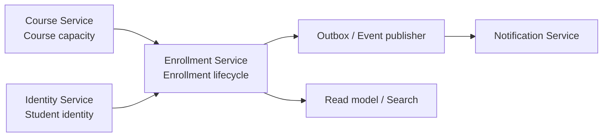

# Làm rõ quyền sở hữu và bất biến của mô hình dữ liệu

Một nền tảng học trực tuyến có lớp học tối đa 30 chỗ. Hai học viên cùng đăng ký suất cuối gần như đồng thời. Cả hai request đều đọc thấy còn một chỗ, đều ghi đăng ký thành công và hệ thống có 31 học viên. Một lỗi khác xảy ra khi cùng một học viên gửi lại request do mạng chậm: hệ thống tạo hai bản ghi đăng ký. Các câu lệnh riêng lẻ có thể hợp lệ, nhưng **mô hình dữ liệu không có một nơi bảo vệ nhất quán các quy tắc của nó**.

Trong chương **Thực hành** của module **CODE_QUALITY_FUNDAMENTALS**, bài học này tập trung vào cách làm rõ **ai sở hữu dữ liệu, ai được phép thay đổi dữ liệu và những bất biến nào phải luôn đúng**. Khi quyền sở hữu và bất biến được xác định rõ, mã nguồn dễ hiểu hơn, kiểm thử có mục tiêu hơn và thay đổi ít tạo ra sai lệch giữa các thành phần.

Một mô hình dữ liệu tốt không chỉ mô tả các trường và quan hệ. Nó còn diễn đạt **ý nghĩa, vòng đời, quyền cập nhật và các điều kiện hợp lệ** của dữ liệu trong hệ thống.

## 1. Quyền sở hữu dữ liệu và bất biến là gì?

Hai khái niệm này liên quan nhưng trả lời hai câu hỏi khác nhau.

- **Quyền sở hữu dữ liệu (data ownership):** thành phần, aggregate hoặc nhóm chịu trách nhiệm định nghĩa ý nghĩa của dữ liệu, cho phép thay đổi dữ liệu và duy trì hợp đồng liên quan.
- **Bất biến (invariant):** điều kiện phải luôn đúng tại những ranh giới mà mô hình cam kết, chẳng hạn số chỗ còn lại không âm hoặc một học viên không có hai đăng ký đang hiệu lực trong cùng lớp.

Ví dụ, lớp học sở hữu thông tin sức chứa và danh sách đăng ký. Quy tắc “số đăng ký hợp lệ không vượt sức chứa” là một bất biến. API đăng ký có thể điều phối yêu cầu, nhưng nếu bất kỳ controller nào cũng tự giảm số chỗ thì quy tắc sở hữu đã bị phân tán.

### 1.1. Phân biệt dữ liệu, người sử dụng dữ liệu và chủ sở hữu dữ liệu

Một dữ liệu có thể được nhiều thành phần đọc nhưng vẫn cần một nơi có quyền quyết định cập nhật.

| Khái niệm | Câu hỏi | Ví dụ |
| --- | --- | --- |
| **Người đọc (consumer)** | Thành phần nào cần biết giá trị? | Trang khóa học đọc số chỗ còn lại |
| **Người ghi (writer)** | Thành phần nào thực hiện thay đổi? | Enrollment service ghi đăng ký |
| **Chủ sở hữu (owner)** | Ai định nghĩa ý nghĩa và quy tắc thay đổi? | Thành phần quản lý vòng đời đăng ký và sức chứa |
| **Nguồn dữ liệu có thẩm quyền (source of truth)** | Nơi nào được coi là trạng thái chuẩn khi có bản sao khác nhau? | Database của dịch vụ quản lý khóa học |
| **Bản chiếu (projection/read model)** | Bản sao nào phục vụ đọc hoặc báo cáo? | Cache số chỗ hiển thị trên trang chủ |

Một hệ thống có thể có nhiều consumer và nhiều read model. Điều quan trọng là **không để nhiều thành phần tự nhận quyền quyết định cùng một dữ liệu mà không có quy tắc phối hợp**.

### 1.2. Bất biến khác với validation đơn lẻ

Validation thường kiểm tra một đầu vào tại một thời điểm: tên không rỗng, số lượng dương, email đúng định dạng. Bất biến mô tả điều kiện mà trạng thái của mô hình phải duy trì qua mọi thao tác hợp lệ.

| Validation đầu vào | Bất biến trạng thái |
| --- | --- |
| `quantity > 0` | Tổng số vé đã bán không vượt sức chứa |
| `discount >= 0` | Tổng tiền phải trả không âm theo chính sách đã định |
| `studentId != null` | Một học viên không có hai đăng ký đang hiệu lực cho cùng lớp |
| `newStatus != null` | Đơn hàng chỉ chuyển qua những trạng thái được phép |
| Tệp có phần mở rộng hợp lệ | Tài nguyên tệp chỉ được tham chiếu khi đã được lưu và kiểm tra quyền |

Một đầu vào riêng lẻ có thể hợp lệ nhưng chuỗi thao tác vẫn phá bất biến. Ví dụ hai request đều có số lượng bằng 1, nhưng cùng giữ suất cuối. Vì vậy review cần nhìn cả **trạng thái trước, thao tác chuyển đổi và trạng thái sau**.

## 2. Bắt đầu bằng việc xác định ý nghĩa và vòng đời dữ liệu

Trước khi tạo lớp Java hoặc bảng SQL, hãy mô tả dữ liệu bằng ngôn ngữ nghiệp vụ.

Với hệ thống đăng ký khóa học, có thể có:

- **Course:** khóa học hoặc lớp học cụ thể, có sức chứa và thời gian mở đăng ký.
- **Student:** học viên có danh tính trong nền tảng.
- **Enrollment:** một lần đăng ký của một học viên vào một lớp.
- **WaitlistEntry:** yêu cầu chờ khi lớp đã đầy, nếu sản phẩm hỗ trợ danh sách chờ.
- **EnrollmentEvent:** sự kiện thông báo một thay đổi đã được xác nhận.

Tên bảng và tên class không tự quyết định quyền sở hữu. Cần làm rõ **ai tạo, ai sửa, ai hủy, ai được đọc và khi nào dữ liệu hết hiệu lực**.

### 2.1. Lập bảng vòng đời

| Dữ liệu | Được tạo khi nào? | Ai được thay đổi? | Điều kiện kết thúc vòng đời |
| --- | --- | --- | --- |
| Course | Người quản lý tạo lớp | Course management | Lưu trữ/đóng theo chính sách |
| Student | Tài khoản học viên được tạo | Identity/account service | Vô hiệu hóa hoặc xóa theo chính sách dữ liệu |
| Enrollment | Đăng ký được chấp nhận | Enrollment service | Hủy, hoàn tất hoặc hết hiệu lực theo quy tắc |
| WaitlistEntry | Học viên xin vào danh sách chờ | Waitlist owner | Được mời, rút yêu cầu hoặc hết hạn |
| EnrollmentEvent | Có thay đổi đăng ký đã commit | Outbox/publisher flow | Đã xử lý hoặc hết hạn lưu theo chính sách |

Bảng này giúp phát hiện câu hỏi quan trọng: khi khóa học bị hủy, enrollment có bị xóa không, chuyển trạng thái hay giữ lại để audit? Nếu chỉ cascade delete tất cả, báo cáo và lịch sử của học viên có thể mất.

### 2.2. Xác định ai có quyền ghi

Một quy ước hữu ích là **mỗi quy tắc quan trọng có một nơi sở hữu quyết định**. Không nhất thiết toàn hệ thống chỉ có một writer, nhưng mọi đường ghi phải tuân theo cùng hợp đồng.

Ví dụ:

- Course management sở hữu việc thay đổi sức chứa.
- Enrollment service sở hữu việc chấp nhận, hủy và chuyển trạng thái đăng ký.
- Identity service sở hữu danh tính học viên.
- Notification service sở hữu việc gửi email, nhưng không tự quyết định đăng ký có hợp lệ hay không.
- Read model có thể lưu bản sao số chỗ để hiển thị, nhưng không được dùng bản sao đó làm nguồn cuối cùng để chấp nhận đăng ký.

Nếu notification service nhận một sự kiện đăng ký, nó có quyền tạo thông báo theo hợp đồng. Nó không nên tự giảm sức chứa hoặc sửa trạng thái enrollment.

## 3. Chọn ranh giới bất biến phù hợp

Không phải mọi bất biến đều có cùng phạm vi. Một số chỉ liên quan đến một giá trị; một số cần phối hợp nhiều bản ghi hoặc nhiều dịch vụ.

| Phạm vi | Ví dụ bất biến | Nơi thường phù hợp để bảo vệ |
| --- | --- | --- |
| **Value object** | Số tiền không âm, mã định danh không rỗng | Constructor/factory của kiểu giá trị |
| **Entity** | Trạng thái chỉ chuyển theo quy tắc hợp lệ | Phương thức hành vi của entity |
| **Aggregate** | Số đăng ký hợp lệ không vượt sức chứa trong một lớp | Aggregate root và transaction lưu aggregate |
| **Database** | Không trùng cặp lớp-học viên; khóa ngoại phải tồn tại | Unique constraint, foreign key, check constraint |
| **Nhiều aggregate** | Một học viên không vượt giới hạn đăng ký toàn nền tảng | Transaction/constraint phù hợp hoặc quy trình điều phối có kiểm soát |
| **Nhiều dịch vụ** | Một khoản thanh toán logic không bị thu hai lần | Idempotency, source of truth và hợp đồng giữa dịch vụ |

Các vị trí này có thể bổ sung nhau. Validation ở Java cải thiện thông báo và giữ mô hình nội bộ hợp lệ; constraint trong database bảo vệ trước các writer đồng thời hoặc đường ghi khác.

### 3.1. Không đưa mọi thứ vào một aggregate khổng lồ

Một aggregate là ranh giới nhất quán mà trong đó các quy tắc liên quan được bảo vệ như một đơn vị. Nếu gom toàn bộ học viên, tất cả khóa học, đăng ký và thông báo vào một aggregate, mỗi thao tác nhỏ có thể cần tải và khóa quá nhiều dữ liệu.

Ngược lại, chia mỗi trường thành một aggregate độc lập có thể làm bất biến quan trọng không còn được bảo vệ trong cùng một giao dịch.

Câu hỏi lựa chọn ranh giới:

1. Những dữ liệu nào phải thay đổi cùng nhau để không tạo trạng thái vô hiệu?
2. Những quy tắc nào cần được bảo đảm ngay khi một thao tác hoàn tất?
3. Có thể chấp nhận nhất quán trễ cho phần dữ liệu nào?
4. Quy mô dữ liệu và tần suất cập nhật có cho phép tải cùng nhau không?
5. Thành phần nào có đủ ngữ cảnh để quyết định thay đổi?

### 3.2. Ví dụ ranh giới cho đăng ký lớp

Một mô hình ban đầu có thể đặt:

- CourseRoster sở hữu sức chứa và tập học viên đăng ký đang hiệu lực.
- Student là thực thể được tham chiếu bằng ID; roster không sở hữu toàn bộ hồ sơ cá nhân.
- Enrollment giữ trạng thái và thời điểm của một lần đăng ký.
- Notification là tác dụng phụ được tạo từ sự kiện đã xác nhận.

Không nhất thiết phải dùng đúng các class này trong mọi dự án. Điều quan trọng là **quy tắc sức chứa không bị quyết định độc lập ở nhiều nơi** và **quyền sửa hồ sơ học viên không bị chuyển sang enrollment chỉ vì có foreign key**.

## 4. Ví dụ Java 17: mô hình roster giữ bất biến cục bộ

Ta xây một mô hình thuần để diễn đạt quy tắc đăng ký trong phạm vi một roster đã được nạp. Ví dụ này minh họa **bất biến trong bộ nhớ**, chưa giải quyết đồng thời giữa nhiều tiến trình hoặc lưu bền.

Tệp CourseRoster.java:

```java
package com.example.datamodel;

import java.util.Objects;
import java.util.Set;
import java.util.UUID;

public final class CourseRoster {
    public record CourseId(UUID value) {
        public CourseId {
            Objects.requireNonNull(value, "value");
        }
    }

    public record StudentId(UUID value) {
        public StudentId {
            Objects.requireNonNull(value, "value");
        }
    }

    public enum EnrollmentStatus {
        ENROLLED,
        ALREADY_ENROLLED,
        COURSE_FULL
    }

    public record EnrollmentDecision(
            EnrollmentStatus status,
            CourseRoster roster) {}

    private final CourseId courseId;
    private final int capacity;
    private final Set<StudentId> enrolledStudents;
    private final long version;

    public CourseRoster(
            CourseId courseId,
            int capacity,
            Set<StudentId> enrolledStudents,
            long version) {

        this.courseId = Objects.requireNonNull(courseId, "courseId");
        this.enrolledStudents =
                Set.copyOf(Objects.requireNonNull(
                        enrolledStudents, "enrolledStudents"));

        if (capacity < 0) {
            throw new IllegalArgumentException(
                    "capacity must be non-negative");
        }
        if (this.enrolledStudents.size() > capacity) {
            throw new IllegalArgumentException(
                    "enrolled students exceed capacity");
        }
        if (version < 0) {
            throw new IllegalArgumentException(
                    "version must be non-negative");
        }

        this.capacity = capacity;
        this.version = version;
    }

    public EnrollmentDecision enroll(StudentId studentId) {
        Objects.requireNonNull(studentId, "studentId");

        if (enrolledStudents.contains(studentId)) {
            return new EnrollmentDecision(
                    EnrollmentStatus.ALREADY_ENROLLED, this);
        }

        if (enrolledStudents.size() >= capacity) {
            return new EnrollmentDecision(
                    EnrollmentStatus.COURSE_FULL, this);
        }

        var updated = new java.util.HashSet<>(enrolledStudents);
        updated.add(studentId);

        return new EnrollmentDecision(
                EnrollmentStatus.ENROLLED,
                new CourseRoster(courseId, capacity, updated,
                        Math.addExact(version, 1L)));
    }

    public CourseId courseId() {
        return courseId;
    }

    public int capacity() {
        return capacity;
    }

    public int enrolledCount() {
        return enrolledStudents.size();
    }

    public int availableSeats() {
        return capacity - enrolledStudents.size();
    }

    public long version() {
        return version;
    }

    public Set<StudentId> enrolledStudents() {
        return enrolledStudents;
    }
}
```

### 4.1. Những bất biến mà class này bảo vệ

- courseId không null.
- capacity không âm.
- Tập học viên không null và không chứa phần tử null; Set.copyOf tạo bản sao bất biến.
- Số học viên đăng ký không vượt sức chứa.
- version không âm.
- Một học viên không thể xuất hiện hai lần trong tập.
- Thao tác enroll trả về roster mới khi thành công; roster cũ không bị sửa.

Dùng immutable state giúp người đọc biết một instance đã được tạo thì trạng thái bên trong không thay đổi. Nó cũng giúp kiểm thử dễ hơn vì kết quả của thao tác là một giá trị mới.

### 4.2. Những gì class này chưa bảo vệ

Đây không phải giải pháp hoàn chỉnh cho hệ thống đăng ký nhiều node:

- Hai request có thể nạp cùng phiên bản roster rồi cùng tạo roster mới có một chỗ được giữ.
- Nếu lưu cả hai kết quả mà không kiểm tra version, một cập nhật có thể ghi đè cập nhật còn lại.
- Set chỉ chống trùng trong một instance; database vẫn cần ràng buộc chống đăng ký trùng.
- Việc ghi roster, tạo enrollment và tạo ý định phát sự kiện cần transaction phù hợp.
- Nếu sức chứa có thể giảm, cần quy tắc xử lý khi số đăng ký hiện tại đã vượt sức chứa mới.

**Bất biến trong object chỉ bảo vệ phạm vi object.** Review phải xác định ranh giới lưu bền và đồng thời để biết cần thêm cơ chế nào.

## 5. Kiểm thử bất biến thay vì kiểm tra cấu trúc nội bộ

Tệp CourseRosterTest.java dùng JUnit 5:

```java
package com.example.datamodel;

import static org.junit.jupiter.api.Assertions.assertEquals;
import static org.junit.jupiter.api.Assertions.assertSame;

import java.util.Set;
import java.util.UUID;
import org.junit.jupiter.api.Test;

class CourseRosterTest {
    private static CourseRoster.StudentId student(String value) {
        return new CourseRoster.StudentId(UUID.fromString(value));
    }

    private static CourseRoster roster(
            int capacity,
            CourseRoster.StudentId... students) {
        return new CourseRoster(
                new CourseRoster.CourseId(UUID.randomUUID()),
                capacity,
                Set.of(students),
                0L);
    }

    @Test
    void enrollingWithinCapacityReturnsNewRoster() {
        var first = student("00000000-0000-0000-0000-000000000001");
        var second = student("00000000-0000-0000-0000-000000000002");
        var original = roster(2, first);

        var decision = original.enroll(second);

        assertEquals(CourseRoster.EnrollmentStatus.ENROLLED,
                decision.status());
        assertEquals(1, original.enrolledCount());
        assertEquals(2, decision.roster().enrolledCount());
        assertEquals(0, decision.roster().availableSeats());
        assertEquals(1L, decision.roster().version());
    }

    @Test
    void duplicateEnrollmentDoesNotChangeRoster() {
        var first = student("00000000-0000-0000-0000-000000000001");
        var original = roster(2, first);

        var decision = original.enroll(first);

        assertEquals(CourseRoster.EnrollmentStatus.ALREADY_ENROLLED,
                decision.status());
        assertSame(original, decision.roster());
        assertEquals(1, original.enrolledCount());
    }

    @Test
    void fullCourseRejectsAnotherStudentWithoutChangingState() {
        var first = student("00000000-0000-0000-0000-000000000001");
        var second = student("00000000-0000-0000-0000-000000000002");
        var third = student("00000000-0000-0000-0000-000000000003");
        var original = roster(2, first, second);

        var decision = original.enroll(third);

        assertEquals(CourseRoster.EnrollmentStatus.COURSE_FULL,
                decision.status());
        assertSame(original, decision.roster());
        assertEquals(2, original.enrolledCount());
        assertEquals(0, original.availableSeats());
    }

    @Test
    void rejectsInitialStateThatAlreadyBreaksCapacityInvariant() {
        var first = student("00000000-0000-0000-0000-000000000001");
        var second = student("00000000-0000-0000-0000-000000000002");

        org.junit.jupiter.api.Assertions.assertThrows(
                IllegalArgumentException.class,
                () -> roster(1, first, second));
    }
}
```

Các test này kiểm tra **hành vi và bất biến công khai**: đăng ký thành công, đăng ký trùng, lớp đầy và trạng thái khởi tạo sai. Chúng không cần truy cập field private hoặc xác nhận số lần gọi một helper nội bộ.

Một bộ test có thể bổ sung property-based testing để tạo nhiều tập học viên và xác nhận sau mọi chuỗi thao tác:

```text
0 <= enrolledCount <= capacity
availableSeats = capacity - enrolledCount
mỗi StudentId xuất hiện tối đa một lần
từ chối thao tác không làm thay đổi roster
```

Property-based test đặc biệt hữu ích khi có nhiều chuỗi thao tác hoặc tổ hợp dữ liệu. Tuy nhiên, nó vẫn kiểm tra mô hình được thực thi; **test oracle phải được xây dựng từ quy tắc nghiệp vụ đã xác nhận**.

## 6. Database là lớp bảo vệ cần thiết cho dữ liệu dùng chung

Khi nhiều application instance cùng ghi dữ liệu, bất biến xuyên request cần được bảo vệ ở nơi có thẩm quyền đối với trạng thái dùng chung.

Ví dụ schema đơn giản:

```sql
CREATE TABLE course (
    course_id UUID PRIMARY KEY,
    capacity INTEGER NOT NULL CHECK (capacity >= 0),
    enrolled_count INTEGER NOT NULL DEFAULT 0
        CHECK (enrolled_count >= 0 AND enrolled_count <= capacity),
    version BIGINT NOT NULL DEFAULT 0 CHECK (version >= 0)
);

CREATE TABLE enrollment (
    enrollment_id UUID PRIMARY KEY,
    course_id UUID NOT NULL REFERENCES course(course_id),
    student_id UUID NOT NULL,
    status VARCHAR(20) NOT NULL,
    created_at TIMESTAMP NOT NULL
);

-- Ví dụ PostgreSQL: chỉ cấm trùng enrollment đang ACTIVE.
CREATE UNIQUE INDEX uq_active_course_student
    ON enrollment(course_id, student_id)
    WHERE status = 'ACTIVE';
```

Schema này minh họa khóa chính, khóa ngoại, miền giá trị và ràng buộc không trùng. **Nó chưa đủ để bảo vệ sức chứa** vì tổng số enrollment đang hiệu lực là một bất biến liên quan nhiều dòng. Cần thêm chiến lược cập nhật nguyên tử và transaction.

### 6.1. Cập nhật có điều kiện trong transaction

Một cách tiếp cận là giữ bộ đếm enrolled_count trên hàng course và chỉ tăng khi còn chỗ:

```sql
BEGIN;

UPDATE course
SET enrolled_count = enrolled_count + 1,
    version = version + 1
WHERE course_id = :courseId
  AND enrolled_count < capacity;

-- Ứng dụng phải xác nhận đúng 1 hàng được cập nhật.
-- Nếu không cập nhật được hàng nào: lớp đầy hoặc không tồn tại.
-- Chỉ khi cập nhật đúng 1 hàng mới INSERT enrollment.

INSERT INTO enrollment (
    enrollment_id, course_id, student_id, status, created_at
) VALUES (
    :enrollmentId, :courseId, :studentId, 'ACTIVE', CURRENT_TIMESTAMP
);

COMMIT;
```

Đây là **mẫu SQL khái niệm**; cú pháp transaction, xử lý xung đột và isolation tùy DBMS. Ứng dụng phải xử lý đúng trường hợp INSERT vi phạm unique constraint: rollback toàn transaction để không giữ bộ đếm đã tăng nếu đăng ký không được tạo.

Nếu chỉ dùng câu UPDATE mà không xác nhận số dòng bị ảnh hưởng, ứng dụng có thể tiếp tục insert dù không giữ được chỗ. Nếu insert và update không cùng transaction, một lỗi giữa hai bước có thể làm bộ đếm sai.

### 6.2. Bộ đếm lưu trữ hay tính từ bảng đăng ký?

Có hai cách phổ biến:

| Cách | Ưu điểm | Chi phí/rủi ro |
| --- | --- | --- |
| Tính số đăng ký hiệu lực bằng COUNT(*) | Tránh duy trì bộ đếm trùng lặp | Cần bảo vệ thao tác đếm và tạo đăng ký khỏi race; truy vấn có thể tốn hơn |
| Lưu enrolled_count trên course | Kiểm tra và cập nhật nhanh | Bộ đếm là dữ liệu dẫn xuất, phải cập nhật nguyên tử và đối soát được |

Nếu lưu bộ đếm, cần nêu bất biến:

```text
0 <= enrolled_count <= capacity
enrolled_count = COUNT(enrollment WHERE status = 'ACTIVE')
```

Hai biểu thức này cần được duy trì bởi mọi thao tác tạo, hủy và khôi phục đăng ký. Một đường cập nhật quên giảm bộ đếm khi hủy sẽ làm dữ liệu lệch. Cần test cả đường thành công lẫn rollback và có quy trình đối soát khi phát hiện sai lệch.

### 6.3. Ràng buộc database không thay thế quy tắc nghiệp vụ

Unique constraint chống hai bản ghi cùng cặp lớp-học viên. Nó không tự quyết định:

- Đăng ký CANCELLED có cho phép tạo bản ghi mới không?
- Học viên bị khóa tài khoản có được đăng ký không?
- Lớp đang mở, đóng hay đã bắt đầu?
- Có ưu tiên học viên trong danh sách chờ không?
- Khi giảm sức chứa xuống thấp hơn số đăng ký hiện tại, xử lý ra sao?

Database bảo vệ những điều kiện phù hợp với khả năng của schema. Các quy tắc chuyển trạng thái và quyết định nghiệp vụ vẫn cần được sở hữu và kiểm tra ở lớp phù hợp.

## 7. Phân biệt dữ liệu chuẩn, dữ liệu dẫn xuất và bản sao

Một nguyên nhân thường gặp của sai lệch là nhiều nơi lưu cùng một ý nghĩa nhưng không xác định cách đồng bộ.

Ví dụ, số chỗ còn lại có thể được tính từ:

```text
availableSeats = capacity - activeEnrollmentCount
```

Nếu hệ thống đồng thời lưu capacity, activeEnrollmentCount, availableSeats ở ba nơi mà không định nghĩa quan hệ, một thao tác có thể cập nhật hai trường và quên trường thứ ba.

| Loại dữ liệu | Ví dụ | Quy tắc sở hữu |
| --- | --- | --- |
| **Nguồn chuẩn** | Enrollment records và capacity đã được xác nhận | Owner quyết định thay đổi |
| **Dữ liệu dẫn xuất** | Số đăng ký đang hiệu lực | Được tính từ nguồn chuẩn hoặc duy trì theo invariant rõ |
| **Read model/cache** | Số chỗ hiển thị trên trang tìm kiếm | Có thể trễ; không dùng làm quyết định cuối nếu không được bảo đảm |
| **Snapshot** | Số tiền và chính sách tại lúc chốt đơn | Bảo toàn ngữ nghĩa lịch sử theo hợp đồng |
| **Event** | EnrollmentCreated | Ghi lại một sự kiện đã xảy ra, không phải nơi tùy ý sửa trạng thái gốc |

### 7.1. Khi nào có thể chấp nhận nhất quán trễ?

Một trang danh sách khóa học có thể hiển thị số chỗ từ cache và chậm vài giây. Điều đó có thể chấp nhận nếu khi đăng ký, hệ thống xác minh lại ở nguồn chuẩn.

Ngược lại, nếu API chấp nhận đăng ký dựa trên cache cũ, người dùng có thể nhận xác nhận rồi bị từ chối sau đó. Đây là thay đổi về **hợp đồng trải nghiệm**, cần được quyết định rõ.

Một thỏa thuận tốt ghi:

- Dữ liệu nào có thể trễ.
- Độ trễ tối đa được chấp nhận.
- Hành động nào phải xác minh nguồn chuẩn.
- Người dùng thấy trạng thái nào khi dữ liệu cache khác nguồn chuẩn.
- Cách đo và cảnh báo độ trễ đồng bộ.

## 8. Quyền sở hữu khi dữ liệu đi qua nhiều dịch vụ

Trong kiến trúc nhiều dịch vụ, mỗi dịch vụ nên sở hữu dữ liệu và quy tắc trong phạm vi của nó. Dịch vụ khác tương tác qua API hoặc event contract thay vì cập nhật trực tiếp bảng nội bộ.

Ví dụ:



Sơ đồ minh họa trách nhiệm:

- Course Service sở hữu sức chứa và vòng đời lớp.
- Identity Service sở hữu danh tính và trạng thái tài khoản.
- Enrollment Service sở hữu đăng ký và quyết định chấp nhận đăng ký.
- Notification Service sở hữu việc gửi thông báo theo sự kiện.
- Read model phục vụ truy vấn, có thể được cập nhật bất đồng bộ.

Nếu Enrollment Service cần biết học viên có hợp lệ, nó gọi hợp đồng Identity hoặc dùng một dữ liệu tham chiếu được đồng bộ theo chính sách. Nó không nên tự sửa bảng tài khoản của Identity Service.

### 8.1. Không nhầm quyền sở hữu với quyền truy cập

Một dịch vụ có thể được phép đọc dữ liệu nhưng không có quyền thay đổi. Một báo cáo có thể cần đọc dữ liệu enrollment, nhưng không được tự sửa trạng thái đăng ký để “làm sạch” số liệu.

Quyền truy cập cần được giới hạn theo mục đích:

- Read-only cho báo cáo và phân tích.
- API command cho thay đổi nghiệp vụ.
- Event subscription cho phản ứng với thay đổi đã xác nhận.
- Migration có kiểm soát cho thay đổi schema.
- Quyền admin riêng cho thao tác vận hành đặc biệt.

### 8.2. Khi cần nhiều dịch vụ cùng tham gia một quy trình

Một đăng ký có thể cần xác nhận danh tính, giữ chỗ, thu phí và gửi email. Không thể giả định một transaction database duy nhất bao trùm mọi dịch vụ.

Cần xác định:

- Bước nào là quyết định có thẩm quyền?
- Trạng thái trung gian nào được phép tồn tại?
- Nếu một bước thất bại, có bù trừ (compensation) không?
- Event nào được phát sau khi một thay đổi đã commit?
- Retry và xử lý trùng được bảo vệ thế nào?
- Ai sở hữu quy trình tổng thể và cách đối soát?

Không nên gọi một workflow phân tán là atomic nếu thực tế nó có thể để lại trạng thái trung gian. Hãy mô hình hóa trạng thái và phục hồi một cách trung thực.

## 9. Thay đổi sức chứa: một ví dụ về bất biến bị ảnh hưởng bởi nhiều thao tác

Ban đầu lớp có 30 chỗ và 25 học viên đang đăng ký. Người quản lý muốn giảm sức chứa xuống 20.

Thao tác này làm phát sinh câu hỏi: bất biến enrolledCount <= capacity không thể đúng ngay sau khi thay đổi nếu vẫn giữ nguyên cả 25 đăng ký.

Nhóm phải xác định chính sách:

1. Có từ chối giảm sức chứa dưới số đăng ký hiện tại không?
2. Có hủy một số đăng ký theo thứ tự ưu tiên không?
3. Có chuyển người học sang danh sách chờ?
4. Có chỉ áp dụng sức chứa mới cho đăng ký tương lai nhưng vẫn giữ chỗ đã cam kết?
5. Ai có quyền quyết định và thông báo cho học viên?

Không nên tự chọn cách xử lý bằng một câu lệnh UPDATE capacity = 20. Thay đổi này ảnh hưởng một bất biến và hợp đồng với người dùng.

### 9.1. Bảng quyết định cho thay đổi sức chứa

| Trạng thái hiện tại | Yêu cầu mới | Quyết định cần được xác nhận |
| --- | --- | --- |
| 15 đăng ký, sức chứa 30 | Giảm còn 20 | Có thể giảm nếu không vi phạm bất biến |
| 25 đăng ký, sức chứa 30 | Giảm còn 20 | Từ chối hoặc có chính sách xử lý đăng ký hiện hữu |
| 30 đăng ký, sức chứa 30 | Tăng lên 35 | Cho phép nếu quyền quản lý và điều kiện lớp hợp lệ |
| 30 đăng ký, sức chứa 30 | Giữ nguyên 30 | Không thay đổi |
| Lớp đã bắt đầu | Tăng/giảm sức chứa | Có thể bị cấm theo trạng thái khóa học |

### 9.2. Tách quyết định nghiệp vụ khỏi cập nhật kỹ thuật

Một phương thức có thể biểu đạt ý định:

```java
public CapacityChangeResult changeCapacity(
        CourseRoster roster, int newCapacity) {

    if (newCapacity < roster.enrolledCount()) {
        return CapacityChangeResult.REQUIRES_ENROLLMENT_POLICY;
    }

    return CapacityChangeResult.ACCEPTED;
}
```

Đây là mã giả rút gọn để minh họa rằng **quyết định phải được đưa ra trước khi lưu**. Hệ thống thật cần kiểm tra quyền quản lý, trạng thái khóa học, transaction, version và chính sách đã được chấp thuận. Kết quả REQUIRES_ENROLLMENT_POLICY giúp tránh tự động làm mất dữ liệu đăng ký.

## 10. Migration và dữ liệu cũ cũng phải tuân theo bất biến mới

Khi thêm một bất biến vào mô hình, dữ liệu đã tồn tại có thể không thỏa điều kiện mới.

Ví dụ, nhóm thêm unique constraint cho cặp course_id và student_id nhưng database đã có bản ghi trùng. Migration sẽ thất bại nếu không xử lý dữ liệu trước.

Quy trình an toàn:

1. **Đo hiện trạng:** tìm bản ghi trùng, dữ liệu null hoặc trạng thái không hợp lệ.
2. **Chốt cách xử lý:** giữ bản ghi nào, gộp hay chuyển trạng thái, ai phê duyệt?
3. **Tạo migration có thể kiểm tra:** chạy trên bản sao dữ liệu đại diện.
4. **Triển khai tương thích:** nếu ứng dụng cũ và mới chạy song song, cả hai phải không tạo thêm dữ liệu sai.
5. **Bật constraint hoặc chuyển writer:** sau khi dữ liệu và ứng dụng đã sẵn sàng.
6. **Đối soát:** xác nhận số lượng và invariant sau migration.
7. **Theo dõi:** log lỗi constraint, tỷ lệ từ chối và sai lệch dữ liệu.

### 10.1. Tránh migration âm thầm xóa dữ liệu

Một câu lệnh xóa bản ghi trùng mà không có quy tắc lựa chọn có thể xóa lịch sử hoặc quyền lợi của học viên. Dữ liệu trùng không chỉ là hai dòng giống nhau; chúng có thể có trạng thái, thời gian và thanh toán khác nhau.

Cần xác định **ngữ nghĩa nghiệp vụ của từng bản ghi**, không chỉ so sánh các cột để chọn dòng giữ lại.

## 11. Quyền sở hữu và bất biến cần được thể hiện trong hợp đồng mã

Một mô hình rõ giúp người đọc biết thay đổi nào được phép. Các kỹ thuật có thể hỗ trợ:

- Constructor/factory bảo vệ trạng thái khởi tạo.
- Value object thể hiện đơn vị và miền giá trị.
- Aggregate root kiểm soát chuyển đổi trạng thái.
- Phương thức có tên nghiệp vụ thay vì setter tự do.
- Repository cung cấp thao tác lưu/đọc theo ranh giới.
- Database constraint bảo vệ tính duy nhất và tham chiếu.
- Event contract mô tả sự kiện đã xảy ra.
- Read model phân biệt rõ dữ liệu chuẩn với dữ liệu dẫn xuất.

### 11.1. Hạn chế setter công khai cho trạng thái có bất biến

Ví dụ:

```java
// Mô hình dễ phá bất biến:
public class Course {
    public int capacity;
    public int enrolledCount;
}
```

Bất kỳ thành phần nào cũng có thể gán capacity = -10 hoặc enrolledCount = 1000. Người đọc không biết quy tắc nào phải chạy khi thay đổi.

Một API hướng hành vi rõ hơn:

```java
public interface CourseCapacity {
    int capacity();
    int enrolledCount();
    int availableSeats();

    CapacityChangeResult changeCapacity(int newCapacity);
    EnrollmentResult reserve(StudentId studentId);
    EnrollmentResult cancel(StudentId studentId);
}
```

Interface này là phác thảo hợp đồng, không phải triển khai hoàn chỉnh. Nó diễn đạt những thao tác hợp lệ và giấu cách lưu trữ. Cần quyết định các thao tác này có thuộc cùng aggregate hay repository/application service điều phối chúng.

### 11.2. Không phải mọi field đều cần che giấu

Một record bất biến chứa dữ liệu thuần, không có quy tắc chuyển trạng thái, có thể công khai accessor mà không gây vấn đề. Mục tiêu không phải tạo getter/setter hoặc interface cho mọi class. Hãy đóng gói khi **có bất biến hoặc quyền cập nhật cần được bảo vệ**.

## 12. Review quyền sở hữu và bất biến trong pull request

Một review có thể dùng những câu hỏi sau:

| Nhóm câu hỏi | Câu hỏi cụ thể |
| --- | --- |
| Ý nghĩa dữ liệu | Tên và đơn vị có rõ? Giá trị là snapshot hay giá hiện tại? |
| Owner | Thành phần nào là nơi quyết định cập nhật? Có writer nào khác không? |
| Invariant | Điều kiện nào phải luôn đúng trước và sau thao tác? |
| Boundary | Bất biến nằm trong object, aggregate, DB hay xuyên dịch vụ? |
| Concurrency | Hai request đồng thời có thể cùng vượt qua kiểm tra không? |
| Failure path | Nếu bước thứ hai thất bại, dữ liệu bước đầu được rollback hay đối soát? |
| Derived data | Counter/cache/projection được cập nhật và sửa sai thế nào? |
| Lifecycle | Tạo, hủy, lưu trữ và xóa dữ liệu theo quy tắc nào? |
| Migration | Dữ liệu cũ có đáp ứng bất biến mới không? |
| Evidence | Test nào chứng minh từng bất biến? Có test dùng DB thật khi cần không? |

Một nhận xét review có ích nên chỉ ra **bất biến cụ thể và đường đi có thể phá nó**.

Ví dụ:

> Hai request có thể cùng đọc availableSeats = 1 rồi cùng tạo enrollment. Bất biến sức chứa cần được bảo vệ tại database dùng chung. Có thể cập nhật có điều kiện trong cùng transaction với insert enrollment và thêm integration test cho hai request tranh suất cuối không?

Nhận xét này có kịch bản, hậu quả và hướng kiểm chứng. Nó cụ thể hơn “cần xử lý race condition”.

## 13. Bài thực hành: lập bản đồ ownership và invariant

Dùng tình huống sau để thực hành trên một mô hình dữ liệu.

**Bối cảnh:** hệ thống đăng ký khóa học có các bảng/khái niệm:

- Course gồm courseId, capacity và status.
- Student gồm studentId và accountStatus.
- Enrollment gồm enrollmentId, courseId, studentId, status và createdAt.
- WaitlistEntry gồm entryId, courseId, studentId, position và status.
- Notification gồm notificationId, eventId và deliveryStatus.

Yêu cầu đã được xác nhận:

1. Mỗi lớp có sức chứa không âm.
2. Số enrollment ở trạng thái ACTIVE không vượt sức chứa.
3. Mỗi học viên có tối đa một enrollment ACTIVE trong một lớp.
4. Chỉ tài khoản học viên hợp lệ mới được đăng ký.
5. Hủy đăng ký phải giải phóng chỗ đúng một lần.
6. Nếu lớp đầy và danh sách chờ được bật, yêu cầu có thể tạo một WaitlistEntry.
7. Email chỉ được gửi sau khi trạng thái đăng ký hoặc danh sách chờ đã được ghi nhận thành công.
8. Hệ thống có nhiều application instance cùng dùng một database.

### Bài tập A — Xác định owner

Với từng dữ liệu, hãy ghi:

- Ai sở hữu ý nghĩa và vòng đời?
- Ai được phép ghi?
- Thành phần nào chỉ được đọc?
- Nguồn chuẩn nằm ở đâu?
- Có bản sao/cache/read model nào không?

### Bài tập B — Liệt kê invariant

Ít nhất hãy xác định:

- capacity không âm.
- Số enrollment ACTIVE không vượt capacity.
- Không có cặp courseId và studentId trùng trạng thái ACTIVE.
- Enrollment ACTIVE phải tham chiếu Course và Student tồn tại.
- Một lần hủy chỉ giải phóng chỗ một lần.
- Notification chỉ được phát từ sự kiện đăng ký đã commit.

Phân loại mỗi invariant theo phạm vi: value object, entity, aggregate, database hay nhiều dịch vụ.

### Bài tập C — Thiết kế thao tác đồng thời

Hai request cùng đăng ký suất cuối. Mô tả:

- Dữ liệu mỗi request đọc.
- Điểm xảy ra cạnh tranh.
- Cơ chế transaction/constraint bảo vệ.
- Kết quả của request thắng và request thua.
- Trạng thái DB sau cả hai request.

### Bài tập D — Xử lý hủy đăng ký

Hai request hủy cùng một enrollment. Nếu cả hai đều giảm enrolled_count, bộ đếm sẽ sai. Hãy nêu cách bảo đảm chỉ một chuyển trạng thái ACTIVE sang CANCELLED thành công và chỉ lần chuyển trạng thái đó mới giải phóng chỗ.

### Bài tập E — Kiểm thử và migration

Đề xuất:

- Unit test cho bất biến của CourseRoster.
- Integration test cho unique constraint và sức chứa.
- Test concurrency cho hai request tranh suất cuối.
- Test idempotency cho hai request hủy cùng enrollment.
- Kiểm tra dữ liệu trùng trước khi thêm constraint.
- Đối soát enrolled_count với số enrollment ACTIVE.

### Gợi ý tự đối chiếu

- Enrollment service có thể sở hữu vòng đời đăng ký; Course management sở hữu sức chứa và trạng thái khóa học; Identity service sở hữu tài khoản.
- Database cần bảo vệ tính duy nhất và thao tác cập nhật sức chứa vì nhiều instance cùng ghi.
- Hủy đăng ký cần chuyển trạng thái có điều kiện, ví dụ chỉ cập nhật khi trạng thái hiện tại là ACTIVE; chỉ khi đúng một dòng chuyển đổi thì mới giảm bộ đếm.
- Email không nên được gửi trước khi thay đổi đăng ký được commit. Outbox có thể lưu ý định phát trong cùng transaction rồi worker gửi sau.
- Cache/read model có thể trễ, nhưng quyết định giữ chỗ phải dựa vào nguồn chuẩn.
- Migration cần xử lý bản ghi trùng trước khi bật unique constraint, theo quy tắc được người sở hữu nghiệp vụ phê duyệt.

## 14. Những ngộ nhận thường gặp

| Ngộ nhận | Vì sao chưa đúng | Cách suy nghĩ phù hợp |
| --- | --- | --- |
| “Có foreign key là đã có ownership.” | FK chỉ bảo vệ tham chiếu, không định nghĩa ai được thay đổi | Xác định owner và quyền ghi |
| “Mọi validation đặt ở controller là đủ.” | Các đường ghi khác có thể bỏ qua controller | Bảo vệ bất biến ở ranh giới mô hình và DB phù hợp |
| “Một object Java hợp lệ thì database cũng an toàn.” | Nhiều instance có trạng thái riêng | Kiểm tra transaction/constraint tại nguồn dùng chung |
| “Dùng Set là chống đăng ký trùng toàn hệ thống.” | Set chỉ có phạm vi instance trong bộ nhớ | Unique constraint và thao tác lưu có kiểm soát |
| “Counter và danh sách luôn tự nhất quán.” | Một đường cập nhật có thể quên thay đổi một phía | Định nghĩa invariant và đối soát dữ liệu dẫn xuất |
| “Cứ thêm setter để service cập nhật thuận tiện.” | Quy tắc chuyển trạng thái bị phân tán | Cung cấp hành vi có tên và giới hạn quyền ghi |
| “Gom tất cả vào một aggregate là an toàn nhất.” | Aggregate quá lớn gây khóa, tải và coupling | Chọn ranh giới theo invariant cần bảo vệ |
| “Mỗi bảng nên thuộc một microservice riêng.” | Chia quá nhỏ có thể làm giao dịch phân tán phức tạp | Xác định bounded context và ownership trước |
| “Xóa dữ liệu liên quan khi parent bị xóa luôn đúng.” | Có thể mất lịch sử, audit hoặc nghĩa vụ dữ liệu | Xác định vòng đời và retention |
| “Cache có số chỗ mới nhất nên có thể quyết định đăng ký.” | Cache có thể trễ hoặc cập nhật không nguyên tử | Xác minh tại nguồn chuẩn khi chấp nhận đăng ký |
| “Unique constraint giải quyết mọi bất biến.” | Nó không tự bảo vệ tổng sức chứa hoặc workflow | Kết hợp constraint, transaction và policy |
| “Unit test xanh chứng minh concurrency an toàn.” | Unit test object không mô phỏng nhiều node và DB | Integration/concurrency test tại ranh giới thật |

## 15. Ghi nhớ

- **Quyền sở hữu xác định ai có quyền định nghĩa và thay đổi dữ liệu**; nhiều thành phần có thể đọc nhưng không nên tùy ý cùng quyết định trạng thái.
- **Bất biến mô tả điều kiện trạng thái phải luôn đúng**, không chỉ là validation của một request.
- **Đặt bất biến ở đúng ranh giới:** value object, entity, aggregate, database hoặc hợp đồng giữa dịch vụ.
- **Chọn aggregate theo nhu cầu nhất quán**, tránh cả aggregate khổng lồ lẫn những phần quá nhỏ không bảo vệ được quy tắc.
- **Phân biệt nguồn chuẩn với dữ liệu dẫn xuất/cache/read model**, và nêu rõ độ trễ được phép.
- **Dùng transaction và constraint cho dữ liệu dùng chung**, vì bảo vệ trong một JVM không đủ cho nhiều application instance.
- **Quản lý vòng đời và migration**, đặc biệt khi thêm bất biến mới vào dữ liệu cũ.
- **Kiểm thử hành vi và bất biến**, bao gồm đường lỗi, thao tác lặp và cạnh tranh.
- **Review theo owner và invariant cụ thể**, không chỉ theo số field hoặc số class.

Khi quyền sở hữu và bất biến được diễn đạt rõ, nhóm biết **ai được quyết định, trạng thái nào hợp lệ, thay đổi nào phải đi qua đâu và bằng chứng nào chứng minh dữ liệu vẫn nhất quán**. Đó là nền tảng để mô hình dữ liệu dễ hiểu, an toàn khi có nhiều người cùng phát triển và đáng tin cậy khi hệ thống vận hành thực tế.
