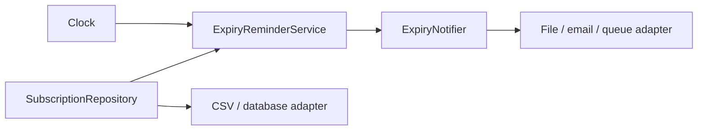

# Tách phụ thuộc thời gian hoặc I/O để tăng khả năng kiểm thử

Một service kiểm tra subscription đã hết hạn, đọc dữ liệu từ file và ghi thông báo vào outbox. Logic nhìn qua khá đơn giản: lấy ngày hôm nay, so sánh với ngày hết hạn, rồi ghi những subscription cần nhắc. Nhưng khi test, service lại đọc đồng hồ thật và truy cập filesystem thật. Kết quả phụ thuộc ngày chạy, timezone, trạng thái file và quyền truy cập của máy. Test có thể xanh hôm nay nhưng thất bại vào ngày mai, hoặc phải dựng cả môi trường chỉ để kiểm tra một điều kiện ngày.

Trong bài thực hành thuộc chương **Thực hành** của **CODE_QUALITY_FUNDAMENTALS**, bạn sẽ tách các phụ thuộc thời gian và I/O khỏi logic nghiệp vụ để kiểm thử được bằng dữ liệu xác định. Điều này phục vụ mục tiêu module: hiểu những thuộc tính quyết định mã nguồn có **đáng tin cậy, dễ hiểu và dễ thay đổi hay không**.

Bạn sẽ bắt đầu từ một đoạn Java có gọi trực tiếp `LocalDate.now()` và `Files`, sau đó tạo các ranh giới nhỏ để thay đồng hồ, nguồn dữ liệu và nơi gửi thông báo trong unit test. Cuối bài, adapter filesystem vẫn được kiểm tra bằng integration test trên thư mục tạm.

## Mục tiêu thực hành

Hoàn thành bài này, bạn có thể:

1. Nhận diện phụ thuộc không xác định như system clock, filesystem và network.
2. Giải thích vì sao gọi trực tiếp thời gian hoặc I/O làm test khó tái lập.
3. Tiêm `Clock` để kiểm soát ngày giờ trong test.
4. Tách repository và notifier thành các interface có hợp đồng nhỏ.
5. Viết unit test với fake để kiểm tra logic và side effect.
6. Viết integration test cho adapter file bằng `@TempDir`.
7. Kiểm tra trường hợp biên, lỗi I/O, timezone và giới hạn của thiết kế.

## 1. Bối cảnh và hợp đồng của bài tập

Ứng dụng có danh sách subscription với ba trường:

| Trường | Ý nghĩa |
| --- | --- |
| `id` | Mã subscription. |
| `email` | Địa chỉ nhận thông báo. |
| `expiresOn` | Ngày subscription hết hạn. |

Quy tắc nghiệp vụ trong bài:

- Subscription hết hạn nếu `expiresOn` **nhỏ hơn ngày hôm nay**.
- Subscription có `expiresOn` bằng hôm nay vẫn còn hiệu lực hết ngày đó.
- Subscription có ngày hết hạn trong tương lai không được nhắc.
- Mỗi subscription hết hạn tạo một dòng thông báo trong outbox.
- Nếu đọc nguồn dữ liệu hoặc ghi outbox gặp lỗi I/O, service báo lỗi cho caller.

Đây là hợp đồng đơn giản để thực hành. Hệ thống thật có thể cần quy tắc theo giờ, múi giờ của khách hàng, thời gian gia hạn, trạng thái hủy hoặc chính sách gửi nhắc trước ngày hết hạn. Không tự thêm các quy tắc ấy nếu chưa có yêu cầu.

Ví dụ dữ liệu CSV:

```csv
id,email,expiresOn
SUB-101,linh@example.test,2026-11-15
SUB-102,nam@example.test,2026-11-16
SUB-103,mai@example.test,2026-11-20
```

Nếu ngày nghiệp vụ là 2026-11-16:

| Subscription | Ngày hết hạn | Kết quả |
| --- | --- | --- |
| `SUB-101` | 2026-11-15 | Gửi nhắc. |
| `SUB-102` | 2026-11-16 | Chưa gửi nhắc. |
| `SUB-103` | 2026-11-20 | Chưa gửi nhắc. |

## 2. Nhận diện phụ thuộc trong code ban đầu

Giả sử service cũ được viết như sau:

**`LegacyExpiryReminder.java`**

```java
import java.io.IOException;
import java.nio.charset.StandardCharsets;
import java.nio.file.Files;
import java.nio.file.Path;
import java.nio.file.StandardOpenOption;
import java.time.LocalDate;
import java.util.List;

final class LegacyExpiryReminder {
    int notifyExpired(Path inputFile, Path outboxFile)
            throws IOException {
        LocalDate today = LocalDate.now();
        List<String> lines = Files.readAllLines(
                inputFile, StandardCharsets.UTF_8);

        int notified = 0;
        for (int i = 1; i < lines.size(); i++) {
            String[] fields = lines.get(i).split(",", -1);
            String id = fields[0];
            String email = fields[1];
            LocalDate expiresOn = LocalDate.parse(fields[2]);

            if (expiresOn.isBefore(today)) {
                String message = id + "," + email + ",EXPIRED"
                        + System.lineSeparator();
                Files.writeString(
                        outboxFile,
                        message,
                        StandardCharsets.UTF_8,
                        StandardOpenOption.CREATE,
                        StandardOpenOption.APPEND);
                notified++;
            }
        }
        return notified;
    }
}
```

Đoạn code được cố ý giữ đơn giản để làm lộ các vấn đề:

1. `LocalDate.now()` đọc đồng hồ hệ thống, nên test không tự chọn được ngày.
2. `Files.readAllLines()` truy cập filesystem thật.
3. `Files.writeString()` vừa tạo side effect vừa nằm trong vòng lặp nghiệp vụ.
4. Không thể thay nguồn subscription hoặc nơi gửi thông báo bằng fake một cách trực tiếp.
5. Dữ liệu CSV sai định dạng có thể gây exception khó hiểu.

Đoạn parser chỉ dành cho CSV đơn giản, trong đó các trường không chứa dấu phẩy hoặc dấu xuống dòng. CSV production cần parser tuân thủ định dạng, xử lý quoting, escaping và encoding theo hợp đồng.

### Câu hỏi trước khi sửa

- Phần nào là quy tắc nghiệp vụ có thể kiểm tra độc lập?
- Phần nào chỉ là chi tiết lấy ngày hoặc đọc/ghi dữ liệu?
- Test cần điều khiển ngày nào?
- Làm thế nào xác nhận service không ghi thông báo cho subscription chưa hết hạn?
- Khi ghi thông báo thứ hai thất bại sau khi dòng đầu đã ghi, hệ thống có thể ở trạng thái nào?

## 3. Phân biệt logic thuần và tác dụng phụ

Một cách chia trách nhiệm đơn giản:



Service điều phối quy tắc. `Clock` cung cấp thời điểm hiện tại. Repository đọc dữ liệu. Notifier thực hiện side effect. Trong unit test, ba dependency này có thể được thay bằng fixed clock và fake.

Không cần tạo interface cho mọi dòng code. Chỉ tách những ranh giới có lý do: thời gian có thể thay đổi kết quả; filesystem hoặc network là tác dụng phụ; các ranh giới này cần được kiểm soát trong test và có thể có nhiều implementation.

## 4. Bước 1 — Tách thời gian bằng `Clock`

Java cung cấp `java.time.Clock` để truyền nguồn thời gian vào code. Thay vì gọi `LocalDate.now()` trực tiếp:

```java
LocalDate today = LocalDate.now();
```

hãy dùng:

```java
LocalDate today = LocalDate.now(clock);
```

`Clock` là abstraction có sẵn trong JDK. Production có thể dùng clock hệ thống; test có thể dùng clock cố định.

### Chọn timezone có chủ đích

`LocalDate.now(clock)` lấy ngày theo timezone của `Clock`. Vì vậy, timezone là một phần của hợp đồng thời gian, không nên để nó vô tình phụ thuộc máy chạy.

Ví dụ composition root của một hệ thống có ngày nghiệp vụ theo giờ Việt Nam:

```java
import java.time.Clock;
import java.time.ZoneId;

Clock businessClock =
        Clock.system(ZoneId.of("Asia/Ho_Chi_Minh"));
```

Nếu hệ thống dùng UTC hoặc timezone khác, hãy cấu hình theo quy tắc nghiệp vụ thực tế. Không nên chọn timezone theo nơi đặt server nếu ngày nghiệp vụ được định nghĩa theo vùng của khách hàng.

### Test dùng clock cố định

```java
import java.time.Clock;
import java.time.Instant;
import java.time.ZoneOffset;

Clock fixedClock = Clock.fixed(
        Instant.parse("2026-11-16T00:00:00Z"),
        ZoneOffset.UTC);
```

Mọi lần gọi `LocalDate.now(fixedClock)` đều cho ngày `2026-11-16` theo UTC. Test không phải chờ đến một thời điểm thật hoặc thay đổi đồng hồ máy.

**Lưu ý:** `Clock.fixed` cố định cả thời điểm và timezone. Nếu muốn kiểm tra chuyển ngày qua nửa đêm, hãy tạo các fixed clock khác nhau hoặc dùng `Clock.offset` với một clock có chủ đích. Tránh `Thread.sleep()` để đợi ngày/giờ thay đổi.

## 5. Bước 2 — Tạo các kiểu dữ liệu và cổng I/O

Đầu tiên mô hình hóa subscription:

**`Subscription.java`**

```java
import java.time.LocalDate;
import java.util.Objects;

public record Subscription(
        String id,
        String email,
        LocalDate expiresOn) {

    public Subscription {
        if (id == null || id.isBlank()) {
            throw new IllegalArgumentException("ID is required");
        }
        if (email == null || email.isBlank()) {
            throw new IllegalArgumentException("Email is required");
        }
        Objects.requireNonNull(expiresOn, "expiresOn");
    }
}
```

Tiếp theo khai báo hai interface:

**`SubscriptionRepository.java`**

```java
import java.io.IOException;
import java.util.List;

public interface SubscriptionRepository {
    List<Subscription> findAll() throws IOException;
}
```

**`ExpiryNotifier.java`**

```java
import java.io.IOException;

public interface ExpiryNotifier {
    void notifyExpired(Subscription subscription) throws IOException;
}
```

Hai interface biểu diễn hợp đồng ứng dụng cần:

- Repository trả về danh sách subscription; caller không cần biết dữ liệu đến từ CSV, DB hay API.
- Notifier nhận một subscription cần nhắc; caller không cần biết thông báo được ghi vào file, gửi email hay đẩy vào queue.

`IOException` được giữ trong hợp đồng vì các adapter hiện tại có thể gặp lỗi I/O. Một hệ thống lớn có thể định nghĩa exception ứng dụng riêng, phân loại retryable/non-retryable hoặc dùng kết quả lỗi có cấu trúc. Bài tập giữ exception chuẩn để tập trung vào việc tách phụ thuộc.

## 6. Bước 3 — Viết service có thể kiểm thử

**`ExpiryReminderService.java`**

```java
import java.io.IOException;
import java.time.Clock;
import java.time.LocalDate;
import java.util.Objects;

public final class ExpiryReminderService {
    private final SubscriptionRepository repository;
    private final ExpiryNotifier notifier;
    private final Clock clock;

    public ExpiryReminderService(
            SubscriptionRepository repository,
            ExpiryNotifier notifier,
            Clock clock) {
        this.repository = Objects.requireNonNull(repository);
        this.notifier = Objects.requireNonNull(notifier);
        this.clock = Objects.requireNonNull(clock);
    }

    public int notifyExpiredSubscriptions() throws IOException {
        LocalDate today = LocalDate.now(clock);
        int notified = 0;

        for (Subscription subscription : repository.findAll()) {
            if (subscription.expiresOn().isBefore(today)) {
                notifier.notifyExpired(subscription);
                notified++;
            }
        }
        return notified;
    }
}
```

Service không còn biết file path hoặc cách ghi file. Nó chỉ biết:

1. Lấy ngày theo clock đã được cung cấp.
2. Đọc danh sách qua repository.
3. Áp dụng điều kiện `expiresOn().isBefore(today)`.
4. Gọi notifier cho những subscription hết hạn.
5. Trả về số thông báo đã gửi thành công theo luồng thực thi.

Biến `notified` chỉ tăng sau khi notifier hoàn tất. Nếu notifier ném `IOException` ở giữa vòng lặp, phương thức ném lỗi và các thông báo đã ghi trước đó vẫn có thể tồn tại. Đây là hành vi **partial side effect** cần hiểu rõ. Trong hệ thống thực, có thể cần transactional outbox, idempotency key, retry hoặc cơ chế lưu trạng thái gửi để tránh gửi trùng.

## 7. Bước 4 — Viết fake cho unit test

Fake là implementation đơn giản được viết để kiểm tra hành vi của code gọi nó. Fake trong bài sẽ giữ dữ liệu trong bộ nhớ và ghi lại subscription được thông báo.

**`InMemorySubscriptionRepository.java`**

```java
import java.util.List;

final class InMemorySubscriptionRepository
        implements SubscriptionRepository {
    private final List<Subscription> subscriptions;

    InMemorySubscriptionRepository(List<Subscription> subscriptions) {
        this.subscriptions = List.copyOf(subscriptions);
    }

    @Override
    public List<Subscription> findAll() {
        return subscriptions;
    }
}
```

**`RecordingExpiryNotifier.java`**

```java
import java.util.ArrayList;
import java.util.List;

final class RecordingExpiryNotifier implements ExpiryNotifier {
    private final List<Subscription> notified = new ArrayList<>();

    @Override
    public void notifyExpired(Subscription subscription) {
        notified.add(subscription);
    }

    List<Subscription> notified() {
        return List.copyOf(notified);
    }
}
```

Hai fake này không truy cập filesystem hoặc network. Test có thể tạo dữ liệu tùy ý và kiểm tra chính xác những subscription được chọn.

### Unit test cho điều kiện ngày

**`ExpiryReminderServiceTest.java`**

```java
import static org.junit.jupiter.api.Assertions.*;

import java.time.Clock;
import java.time.Instant;
import java.time.LocalDate;
import java.time.ZoneOffset;
import java.util.List;
import org.junit.jupiter.api.Test;

class ExpiryReminderServiceTest {
    private static Clock fixedClock() {
        return Clock.fixed(
                Instant.parse("2026-11-16T00:00:00Z"),
                ZoneOffset.UTC);
    }

    @Test
    void notifiesOnlySubscriptionsExpiredBeforeToday() throws Exception {
        List<Subscription> data = List.of(
                new Subscription(
                        "SUB-101", "linh@example.test",
                        LocalDate.of(2026, 11, 15)),
                new Subscription(
                        "SUB-102", "nam@example.test",
                        LocalDate.of(2026, 11, 16)),
                new Subscription(
                        "SUB-103", "mai@example.test",
                        LocalDate.of(2026, 11, 20)));

        var repository = new InMemorySubscriptionRepository(data);
        var notifier = new RecordingExpiryNotifier();
        var service = new ExpiryReminderService(
                repository, notifier, fixedClock());

        int count = service.notifyExpiredSubscriptions();

        assertEquals(1, count);
        assertEquals(List.of("SUB-101"),
                notifier.notified().stream()
                        .map(Subscription::id)
                        .toList());
    }

    @Test
    void doesNotNotifyWhenExpiryDateIsToday() throws Exception {
        var repository = new InMemorySubscriptionRepository(List.of(
                new Subscription(
                        "SUB-102", "nam@example.test",
                        LocalDate.of(2026, 11, 16))));
        var notifier = new RecordingExpiryNotifier();
        var service = new ExpiryReminderService(
                repository, notifier, fixedClock());

        assertEquals(0, service.notifyExpiredSubscriptions());
        assertTrue(notifier.notified().isEmpty());
    }

    @Test
    void doesNotNotifyFutureSubscriptions() throws Exception {
        var repository = new InMemorySubscriptionRepository(List.of(
                new Subscription(
                        "SUB-103", "mai@example.test",
                        LocalDate.of(2026, 11, 20))));
        var notifier = new RecordingExpiryNotifier();
        var service = new ExpiryReminderService(
                repository, notifier, fixedClock());

        assertEquals(0, service.notifyExpiredSubscriptions());
        assertTrue(notifier.notified().isEmpty());
    }
}
```

Test xác minh ba điểm: ngày trước hôm nay được nhắc, ngày bằng hôm nay chưa được nhắc, ngày trong tương lai chưa được nhắc. Giá trị expected được lấy từ hợp đồng bài tập, không được tính lại bằng cùng logic của service.

### Kiểm tra lỗi đọc repository

Service cần giữ hành vi lỗi rõ ràng. Ta có thể dùng lambda vì `SubscriptionRepository` chỉ có một phương thức:

```java
import static org.junit.jupiter.api.Assertions.*;

import java.io.IOException;
import java.time.Clock;
import java.time.Instant;
import java.time.ZoneOffset;
import org.junit.jupiter.api.Test;

class ExpiryReminderFailureTest {
    @Test
    void repositoryFailureIsPropagatedBeforeAnyNotification()
            throws Exception {
        SubscriptionRepository brokenRepository = () -> {
            throw new IOException("Cannot read subscriptions");
        };
        RecordingExpiryNotifier notifier =
                new RecordingExpiryNotifier();
        Clock clock = Clock.fixed(
                Instant.parse("2026-11-16T00:00:00Z"),
                ZoneOffset.UTC);

        var service = new ExpiryReminderService(
                brokenRepository, notifier, clock);

        assertThrows(IOException.class,
                service::notifyExpiredSubscriptions);
        assertTrue(notifier.notified().isEmpty());
    }
}
```

Vì repository đọc toàn bộ danh sách trước khi trả về, lỗi đọc xảy ra trước vòng lặp và không có thông báo nào được gửi. Nếu thiết kế repository streaming từng hàng, bảo đảm này có thể khác; cần xác định hợp đồng lỗi theo cách triển khai thực tế.

## 8. Bước 5 — Đưa filesystem vào adapter riêng

Unit test của service không cần file thật. Tuy vậy, ta vẫn cần kiểm tra adapter CSV và adapter outbox để bảo đảm chúng đọc/ghi đúng định dạng.

### Adapter đọc CSV

**`CsvSubscriptionRepository.java`**

```java
import java.io.IOException;
import java.nio.charset.StandardCharsets;
import java.nio.file.Files;
import java.nio.file.Path;
import java.time.LocalDate;
import java.time.format.DateTimeParseException;
import java.util.ArrayList;
import java.util.List;
import java.util.Objects;

public final class CsvSubscriptionRepository
        implements SubscriptionRepository {
    private final Path inputFile;

    public CsvSubscriptionRepository(Path inputFile) {
        this.inputFile = Objects.requireNonNull(inputFile);
    }

    @Override
    public List<Subscription> findAll() throws IOException {
        List<String> lines = Files.readAllLines(
                inputFile, StandardCharsets.UTF_8);
        if (lines.isEmpty()) {
            return List.of();
        }

        List<Subscription> result = new ArrayList<>();
        for (int index = 1; index < lines.size(); index++) {
            String line = lines.get(index);
            if (line.isBlank()) {
                continue;
            }

            String[] fields = line.split(",", -1);
            if (fields.length != 3) {
                throw new IOException(
                        "Invalid CSV row at line " + (index + 1));
            }

            try {
                result.add(new Subscription(
                        fields[0],
                        fields[1],
                        LocalDate.parse(fields[2])));
            } catch (IllegalArgumentException exception) {
                throw new IOException(
                        "Invalid subscription at line " + (index + 1),
                        exception);
            }
        }
        return List.copyOf(result);
    }
}
```

Adapter sở hữu chi tiết `Path`, UTF-8, parse ngày và cách báo lỗi theo dòng. Service không phải biết CSV được mã hóa ra sao.

Đây vẫn là parser CSV rút gọn: `split(",")` không xử lý dấu phẩy nằm trong field có quote, quote escape hoặc newline trong field. Nếu dữ liệu thật cần các trường hợp đó, dùng thư viện CSV phù hợp và kiểm tra adapter theo định dạng được cam kết.

### Adapter ghi outbox file

**`FileExpiryNotifier.java`**

```java
import java.io.IOException;
import java.nio.charset.StandardCharsets;
import java.nio.file.Files;
import java.nio.file.Path;
import java.nio.file.StandardOpenOption;
import java.util.Objects;

public final class FileExpiryNotifier implements ExpiryNotifier {
    private final Path outboxFile;

    public FileExpiryNotifier(Path outboxFile) {
        this.outboxFile = Objects.requireNonNull(outboxFile);
    }

    @Override
    public void notifyExpired(Subscription subscription)
            throws IOException {
        String line = subscription.id() + ","
                + subscription.email() + ",EXPIRED"
                + System.lineSeparator();

        Files.writeString(
                outboxFile,
                line,
                StandardCharsets.UTF_8,
                StandardOpenOption.CREATE,
                StandardOpenOption.APPEND);
    }
}
```

Đây là adapter minh họa. File append không cung cấp đảm bảo exactly-once trong trường hợp process crash, chạy song song hoặc retry. Nếu outbox là cơ chế gửi thông báo production, cần thiết kế định danh idempotency, đồng bộ ghi, locking/transaction và worker giao nhận phù hợp.

## 9. Bước 6 — Integration test với thư mục tạm

JUnit 5 cung cấp `@TempDir` để tạo thư mục riêng cho test. Mỗi test có thể dùng file đầu vào và outbox tách biệt, tránh phụ thuộc dữ liệu trên máy.

**`FileAdaptersIntegrationTest.java`**

```java
import static org.junit.jupiter.api.Assertions.*;

import java.nio.charset.StandardCharsets;
import java.nio.file.Files;
import java.nio.file.Path;
import java.time.Clock;
import java.time.Instant;
import java.time.ZoneOffset;
import org.junit.jupiter.api.Test;
import org.junit.jupiter.api.io.TempDir;

class FileAdaptersIntegrationTest {
    @TempDir
    Path tempDir;

    @Test
    void readsCsvAndAppendsOnlyExpiredSubscriptions()
            throws Exception {
        Path input = tempDir.resolve("subscriptions.csv");
        Path outbox = tempDir.resolve("outbox.txt");

        Files.writeString(
                input,
                """
                id,email,expiresOn
                SUB-101,linh@example.test,2026-11-15
                SUB-102,nam@example.test,2026-11-16
                SUB-103,mai@example.test,2026-11-20
                """,
                StandardCharsets.UTF_8);

        Clock clock = Clock.fixed(
                Instant.parse("2026-11-16T00:00:00Z"),
                ZoneOffset.UTC);
        var repository = new CsvSubscriptionRepository(input);
        var notifier = new FileExpiryNotifier(outbox);
        var service = new ExpiryReminderService(
                repository, notifier, clock);

        assertEquals(1, service.notifyExpiredSubscriptions());

        String output = Files.readString(
                outbox, StandardCharsets.UTF_8);
        assertEquals(
                "SUB-101,linh@example.test,EXPIRED"
                        + System.lineSeparator(),
                output);
    }

    @Test
    void invalidCsvRowReportsItsLineNumber() throws Exception {
        Path input = tempDir.resolve("invalid.csv");
        Files.writeString(
                input,
                "id,email,expiresOn\n"
                        + "SUB-101,linh@example.test,not-a-date\n",
                StandardCharsets.UTF_8);

        var repository = new CsvSubscriptionRepository(input);

        java.io.IOException exception = assertThrows(
                java.io.IOException.class,
                repository::findAll);
        assertTrue(exception.getMessage().contains("line 2"));
    }
}
```

Integration test này dùng filesystem thật nhưng **chỉ trong thư mục tạm do JUnit quản lý**. Nó kiểm tra cách repository đọc CSV và notifier append nội dung. Unit test trước đó vẫn là nơi kiểm tra phần lớn các trường hợp logic vì chúng chạy nhanh và ít phụ thuộc.

### Chạy test trong dự án

Nếu dự án đã cấu hình Gradle với JUnit Jupiter, lệnh thường dùng là:

```shell
./gradlew test
```

Đây là hướng dẫn chạy trong project có task `test` và dependency JUnit 5 tương ứng. Bài tập này không thay đổi build file; nếu project dùng Maven hoặc cấu hình test khác, dùng lệnh và dependency theo dự án.

## 10. Thực hành theo từng nhiệm vụ

Hãy làm từng nhiệm vụ theo thứ tự. Không cần copy toàn bộ lời giải ngay; thử tự hoàn thành trước rồi đối chiếu với các ví dụ ở trên.

### Nhiệm vụ A — Tìm các nguồn không xác định

Đọc `LegacyExpiryReminder` và ghi ra:

- Nơi đọc thời gian hệ thống.
- Nơi đọc file.
- Nơi ghi file.
- Quy tắc nghiệp vụ nào đang trộn với I/O.
- Những điều kiện nào khó test ổn định.

**Kết quả mong đợi:** danh sách ít nhất ba phụ thuộc bên ngoài và một mô tả quy tắc hết hạn.

### Nhiệm vụ B — Tiêm `Clock`

1. Thêm trường `Clock` vào service.
2. Nhận clock qua constructor.
3. Thay `LocalDate.now()` bằng `LocalDate.now(clock)`.
4. Chọn timezone rõ ở composition root.
5. Viết test cho hôm qua, hôm nay và ngày mai.

**Kết quả mong đợi:** test không phụ thuộc ngày thật và không dùng `sleep`.

### Nhiệm vụ C — Tách repository và notifier

1. Tạo `SubscriptionRepository`.
2. Tạo `ExpiryNotifier`.
3. Chuyển phần quyết định subscription nào cần nhắc vào service.
4. Viết fake trong bộ nhớ.
5. Xác minh service không biết `Path`, `Files` hoặc định dạng CSV.

**Kết quả mong đợi:** unit test không cần tạo file hoặc gọi network.

### Nhiệm vụ D — Viết adapter thật

1. Tạo `CsvSubscriptionRepository`.
2. Tạo `FileExpiryNotifier`.
3. Dùng UTF-8 rõ ràng.
4. Xử lý dòng lỗi với thông báo có số dòng.
5. Viết integration test bằng `@TempDir`.

**Kết quả mong đợi:** adapter được kiểm tra riêng và không dùng file production.

### Nhiệm vụ E — Kiểm tra lỗi và giới hạn

Thử trả lời và viết test nếu phù hợp:

- File đầu vào không tồn tại thì sao?
- File chỉ có header thì sao?
- Ngày hết hạn không parse được thì sao?
- Notifier lỗi sau khi đã ghi một thông báo thì service báo gì?
- Nếu job chạy hai lần, có gửi trùng không?
- Nếu chạy đồng thời hai instance, outbox có thể có dòng trùng không?
- Ngày nghiệp vụ khác ngày UTC thì kết quả thay đổi thế nào?

**Kết quả mong đợi:** phân biệt được lỗi mà service xử lý, lỗi adapter báo lên và rủi ro cần thiết kế ở tầng vận hành.

## 11. Bảng kiểm tra hành vi

Với clock cố định tại ngày `2026-11-16` theo UTC:

| Input / tình huống | Kết quả kỳ vọng | Bằng chứng |
| --- | --- | --- |
| Hết hạn `2026-11-15` | Được nhắc | Unit test. |
| Hết hạn `2026-11-16` | Không nhắc | Boundary test. |
| Hết hạn `2026-11-17` | Không nhắc | Unit test. |
| Danh sách rỗng | Trả `0`, không ghi | Unit test. |
| Repository ném `IOException` | Lỗi được truyền lên, không gửi | Failure test. |
| Outbox không ghi được | Lỗi được truyền lên | Adapter/integration test. |
| CSV sai định dạng | Báo lỗi kèm số dòng | Repository test. |
| Chạy service hai lần | Theo thiết kế hiện tại có thể ghi trùng | Test/đánh giá idempotency. |

Hai dòng cuối giúp nhận ra rằng **tách phụ thuộc không tự giải quyết mọi vấn đề**. Nó làm hành vi dễ kiểm thử hơn, nhờ đó nhóm có thể phát hiện và quyết định cách xử lý các vấn đề còn lại.

## 12. Các lỗi thiết kế thường gặp khi tách phụ thuộc

### Gọi `LocalDate.now()` ở nhiều nơi

Nếu mỗi lớp tự đọc clock, một thao tác chạy qua thời điểm nửa đêm có thể dùng hai ngày khác nhau. Hãy lấy thời điểm từ một clock được truyền vào và dùng nhất quán trong use case.

### Dùng clock hệ thống trong test

Test gọi `Clock.systemDefaultZone()` vẫn phụ thuộc máy. Unit test cần `Clock.fixed` hoặc clock điều khiển được. Production mới dùng clock hệ thống qua composition root.

### Dùng `Thread.sleep()` để chờ thời gian

Sleep làm test chậm và không đảm bảo đúng thời điểm do scheduler, timezone hoặc tải máy. Dùng fixed clock và kiểm tra logic trực tiếp.

### Mock mọi thứ

Mock `LocalDate`, `Files`, từng helper và mọi object nhỏ làm test phản chiếu implementation, khó bảo trì. `Clock` là abstraction có sẵn; repository/notifier là ranh giới I/O có ý nghĩa. Chỉ tạo seam nơi cần điều khiển tác dụng phụ.

### Interface không có ý nghĩa

Tạo `IStringFormatter`, `IListFactory` hoặc interface cho một hàm thuần không cần thay thế chỉ để tăng số abstraction có thể làm code rối hơn. Hãy tách dependency có tính biến đổi, I/O hoặc cần được thay thế ở test.

### Đưa `Path` vào domain service

Nếu service nghiệp vụ nhận `Path`, nó vẫn biết filesystem. Đưa `Path` vào adapter; domain/application chỉ nhận kiểu dữ liệu và hợp đồng cần thiết.

### Nuốt lỗi I/O

Không nên catch `IOException` rồi trả danh sách rỗng hoặc coi thông báo đã gửi. Làm vậy biến lỗi vận hành thành kết quả có vẻ hợp lệ. Nếu cần retry/fallback, định nghĩa rõ và test hành vi đó.

### Giả định ghi file là exactly-once

Append vào file không bảo đảm một thông báo chỉ xuất hiện một lần. Process có thể crash sau khi ghi nhưng trước khi cập nhật trạng thái; lần chạy lại có thể ghi lần nữa. Production cần idempotency hoặc outbox có trạng thái gửi.

### Quên charset và timezone

Charset mặc định và timezone mặc định của máy có thể khác giữa local, CI và production. Chỉ định UTF-8 và timezone theo hợp đồng.

## 13. Mở rộng: tách network I/O theo cùng nguyên tắc

Nếu service cần gọi HTTP để kiểm tra trạng thái subscription, không nên để logic ngày tháng tự dựng HTTP client. Hãy tạo một port có ngữ nghĩa:

```java
interface SubscriptionStatusProvider {
    SubscriptionStatus findStatus(String subscriptionId);
}
```

Service dùng `SubscriptionStatusProvider`; adapter HTTP chịu trách nhiệm:

- URL, header và authentication.
- Timeout, retry và mapping HTTP status.
- Parse response và xử lý schema không hợp lệ.
- Logging/metrics phù hợp, không ghi secret.

Unit test dùng fake provider để kiểm tra logic; adapter có contract/integration test với stub server hoặc môi trường phù hợp. Không nên dùng mock HTTP client ở mọi test nghiệp vụ nếu điều cần kiểm tra chỉ là quyết định của service.

### Timeout và retry cũng là một phần của hợp đồng

Tách interface không tự quyết định:

- Timeout bao lâu?
- Lỗi nào retry được?
- Retry có thể gây gửi thông báo hoặc giao dịch trùng không?
- Có giới hạn số lần và backoff không?
- Caller nhận exception, kết quả lỗi hay trạng thái pending?

Những quyết định này cần được mô tả và kiểm thử ở tầng adapter/use case phù hợp. Một fake luôn trả kết quả thành công không thể chứng minh xử lý timeout của HTTP adapter đúng.

## 14. Đánh giá kết quả sau refactor

Trước khi coi bài thực hành hoàn tất, so sánh:

| Tiêu chí | Trước refactor | Sau refactor |
| --- | --- | --- |
| Kiểm soát thời gian | Gọi `LocalDate.now()` trực tiếp. | Nhận `Clock` qua constructor. |
| Unit test | Cần file và ngày hệ thống. | Dùng fixed clock và fake. |
| Đọc dữ liệu | Service biết `Path` và CSV. | Repository adapter sở hữu filesystem/CSV. |
| Gửi thông báo | Service gọi `Files.writeString`. | Notifier adapter sở hữu side effect. |
| Test adapter | Khó phân biệt logic và I/O. | `@TempDir` kiểm tra adapter thật. |
| Xử lý lỗi | Dễ trộn exception với logic. | Hợp đồng I/O khai báo rõ `IOException`. |
| Rủi ro còn lại | Ngày không xác định, I/O gắn chặt. | Còn cần giải quyết idempotency, partial side effect và định dạng CSV thực tế. |

Refactor tốt không có nghĩa code không còn rủi ro. Nó làm **ranh giới, giả định và hành vi dễ nhìn thấy và dễ kiểm chứng hơn**.

## 15. Tiêu chí hoàn thành bài tập

Bạn có thể tự đánh dấu khi:

- [ ] Không còn gọi `LocalDate.now()` trực tiếp bên trong service nghiệp vụ.
- [ ] Service nhận `Clock` qua constructor và timezone được cấu hình có chủ đích.
- [ ] Service không trực tiếp dùng `Path`, `Files` hoặc format CSV.
- [ ] Repository và notifier có interface/hợp đồng nhỏ, rõ nghĩa.
- [ ] Unit test dùng fixed clock và fake, không phụ thuộc ngày máy.
- [ ] Có test cho ngày trước, đúng ngày và sau ngày hết hạn.
- [ ] Có test cho input lỗi và lỗi repository phù hợp hợp đồng.
- [ ] Adapter file được kiểm tra bằng `@TempDir`.
- [ ] Encoding và cách xử lý lỗi được chỉ định rõ.
- [ ] Đã nhận diện partial side effect và nguy cơ gửi trùng.
- [ ] Không dùng `Thread.sleep()` hoặc mock static clock để điều khiển ngày.
- [ ] Các abstraction được tạo ra đều có lý do kiểm thử hoặc ranh giới kiến trúc.

## 16. Câu hỏi tự kiểm tra

**Câu 1.** Vì sao `LocalDate.now()` trực tiếp trong service làm unit test khó ổn định?

*Gợi ý:* Kết quả phụ thuộc ngày và timezone thật của máy, có thể đổi giữa các lần chạy hoặc qua nửa đêm. Tiêm `Clock` giúp test cố định thời điểm.

**Câu 2.** `Clock.fixed` giải quyết vấn đề gì và không giải quyết vấn đề gì?

*Gợi ý:* Nó kiểm soát nguồn thời gian trong test; nó không kiểm tra timezone production được cấu hình đúng hay đồng hồ hệ thống thực có chính xác.

**Câu 3.** Vì sao `ExpiryReminderService` không nên nhận `Path`?

*Gợi ý:* `Path` là chi tiết filesystem. Service cần danh sách subscription và khả năng gửi thông báo; repository/notifier adapter chịu trách nhiệm I/O.

**Câu 4.** Unit test dùng fake notifier đã đủ chứng minh file outbox ghi đúng UTF-8 chưa?

*Gợi ý:* Chưa. Fake chỉ kiểm tra service gọi notifier; cần integration test cho `FileExpiryNotifier` trên filesystem tạm.

**Câu 5.** Nếu notifier ghi được một thông báo rồi ném lỗi ở thông báo tiếp theo, điều gì có thể xảy ra?

*Gợi ý:* Một phần side effect đã tồn tại dù service báo lỗi. Cần hiểu partial completion và cân nhắc idempotency, trạng thái gửi hoặc transactional outbox.

**Câu 6.** Vì sao `Thread.sleep()` không phải cách tốt để test logic hết hạn?

*Gợi ý:* Test chậm, phụ thuộc scheduler và vẫn có thể chạy lệch thời điểm. Fixed clock cho kết quả xác định mà không phải chờ.

**Câu 7.** Có nên tạo interface cho mọi phương thức để test dễ hơn không?

*Gợi ý:* Không. Tạo seam ở ranh giới có dependency biến đổi hoặc side effect; logic thuần thường có thể test trực tiếp.

**Câu 8.** Nếu ngày nghiệp vụ tính theo timezone của khách hàng, chỉ tiêm một `Clock.systemUTC()` có đủ không?

*Gợi ý:* Không nhất thiết. Hợp đồng phải xác định timezone dùng để quyết định ngày; có thể cần clock/zone theo tenant hoặc customer, và test các trường hợp qua nửa đêm.

## Ghi nhớ

- **Thời gian và I/O là các phụ thuộc không xác định** nếu service tự đọc đồng hồ hoặc tự truy cập hạ tầng.
- **Tiêm `Clock`** giúp kiểm soát thời điểm và timezone trong test; dùng fixed clock thay vì `sleep`.
- **Tách repository/notifier thành port nhỏ** giúp unit test tập trung vào quy tắc nghiệp vụ, còn adapter được kiểm tra riêng.
- **Fake và integration test có vai trò khác nhau:** fake kiểm tra quyết định của service; `@TempDir` kiểm tra filesystem adapter thật.
- **Không che giấu lỗi I/O hoặc giả định exactly-once.** Partial side effect, retry và idempotency cần hợp đồng riêng.
- **Chỉ tạo abstraction có mục đích.** Mục tiêu là làm logic dễ kiểm chứng và thay đổi, không phải tăng số interface.

**Câu hỏi khi gặp một test khó tái lập:** “Kết quả đang phụ thuộc vào thời gian, môi trường hay tác dụng phụ nào mà tôi chưa kiểm soát, và có thể đưa phụ thuộc đó qua một ranh giới nhỏ để kiểm tra riêng không?”
