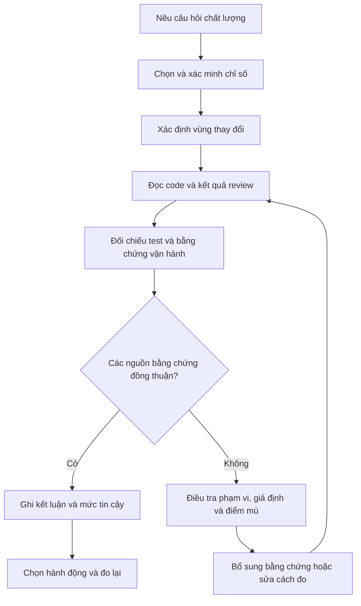

# So sánh chỉ số với kết quả rà soát định tính

## 1. Mục tiêu bài học

Trong chương **Thực hành** của module **CODE_QUALITY_FUNDAMENTALS**, chúng ta thực hành kết hợp **chỉ số chất lượng** với **nhận định từ code review** để đánh giá một thay đổi hoặc một khu vực mã nguồn. Chỉ số giúp nhìn thấy xu hướng và phạm vi; review định tính giúp giải thích ý nghĩa của chúng trong bối cảnh nghiệp vụ, kiến trúc và cách hệ thống vận hành.

Module hướng đến việc **hiểu những thuộc tính quyết định mã nguồn có đáng tin cậy, dễ hiểu và dễ thay đổi hay không**. Một con số đẹp không tự chứng minh mã tốt; một nhận xét review có vẻ thuyết phục cũng cần bằng chứng và bối cảnh. Kết hợp hai nguồn giúp nhóm tránh kết luận vội vàng và chọn hành động cải thiện đúng nguyên nhân.

Sau bài học, bạn có thể:

- Phân biệt điều mà **chỉ số định lượng** đo được với điều mà **rà soát định tính** có thể giải thích.
- Kiểm tra phạm vi, định nghĩa, thời điểm và chất lượng dữ liệu trước khi so sánh số liệu.
- Đối chiếu các chỉ số như complexity, coupling, coverage và code churn với kết quả đọc mã.
- Xử lý tình huống chỉ số và nhận định review đồng thuận hoặc mâu thuẫn.
- Dùng ví dụ Java 17 về luồng báo giá đơn hàng để thực hành phân tích.
- Viết kết luận có căn cứ, nêu rõ rủi ro, bằng chứng còn thiếu và hành động tiếp theo thay vì xếp hạng mã nguồn bằng một điểm tổng.

## 2. Hai nguồn bằng chứng trả lời hai loại câu hỏi

**Chỉ số định lượng** chuyển một thuộc tính thành số liệu có thể theo dõi, so sánh hoặc đặt ngưỡng. Ví dụ:

- Cyclomatic complexity hoặc cognitive complexity của một phương thức.
- Fan-in/fan-out, số phụ thuộc giữa package hoặc số chu kỳ kiến trúc.
- Line/branch coverage của một tập kiểm thử.
- Code churn, số lần một file thay đổi hoặc số file bị tác động.
- Tỷ lệ issue theo severity, thời gian xử lý cảnh báo hoặc số lần build thất bại.

**Rà soát định tính** đọc mã và bối cảnh để xác định ý nghĩa của một lựa chọn:

- Một phương thức có nhiều nhánh vì nghiệp vụ thật sự phức tạp hay vì nhiều trách nhiệm bị trộn?
- Một class có fan-out cao vì nó là composition root hợp lệ hay đang phụ thuộc sai tầng?
- Test coverage thấp ở một nhánh ít rủi ro hay bỏ trống logic tính tiền quan trọng?
- Một file thay đổi thường xuyên vì nó sở hữu chính sách trung tâm hay vì nhiều nhóm đang sửa cùng một nơi?
- Một test xanh có xác nhận đúng hợp đồng hay chỉ kiểm tra chi tiết nội bộ?

| Nguồn bằng chứng | Mạnh ở điểm nào? | Không tự trả lời được điều gì? |
| --- | --- | --- |
| **Chỉ số** | Nhận diện xu hướng, vùng bất thường, phạm vi và thay đổi qua thời gian | Vì sao số tăng, hành vi có đúng nghiệp vụ không, rủi ro thực tế là gì |
| **Code review** | Hiểu ngữ nghĩa, trách nhiệm, hợp đồng, tác dụng phụ và đánh đổi | Không tự cung cấp số liệu quy mô lớn hoặc xu hướng dài hạn |
| **Kiểm thử** | Xác minh các hành vi và trường hợp đã được mô tả | Không chứng minh mọi đầu vào, mọi môi trường hoặc toàn bộ kiến trúc |
| **Quan sát vận hành** | Cho biết lỗi, độ trễ và tải thực tế đã xảy ra | Không bao quát các đường chưa được kích hoạt hoặc tương lai |

Không nguồn nào thay thế hoàn toàn nguồn khác. Một đánh giá vững chắc cần biết **mỗi bằng chứng đang chứng minh điều gì và có giới hạn nào**.

## 3. Trước khi so sánh, xác nhận số liệu có cùng ý nghĩa

Một biểu đồ có thể rất đẹp nhưng không hữu ích nếu hai lần đo không cùng phạm vi. Trước khi so sánh, hãy kiểm tra:

1. **Đơn vị đo:** class, method, package, module, repository hay pull request?
2. **Định nghĩa:** complexity dùng thuật toán nào? Fan-out đếm class hay package? Coverage tính line hay branch?
3. **Phạm vi mã:** production source, test source, generated code và dependency ngoài có được đưa vào không?
4. **Thời điểm:** số liệu được tạo từ cùng commit hay một báo cáo cũ?
5. **Cấu hình:** phiên bản analyzer, rule profile và exclusion có giống nhau không?
6. **Mẫu so sánh:** PR nhỏ có đang bị so với toàn repository hoặc hai module có trách nhiệm rất khác nhau không?
7. **Độ tin cậy:** scanner có hoàn tất, test có thực sự chạy, dữ liệu có thiếu hoặc stale không?

Ví dụ, coverage tăng từ 72% lên 86% có thể do:

- Thêm test có giá trị cho logic production.
- Xóa nhiều dòng code chưa được test.
- Đưa một thư mục khó test ra khỏi phạm vi coverage.
- Thay đổi cách công cụ tính coverage.

Chỉ số cuối cùng giống nhau nhưng ý nghĩa khác nhau. **Không diễn giải xu hướng trước khi xác nhận cách đo**.

### Ghi rõ phạm vi và mốc đo

Khi báo cáo, nên ghi theo dạng:

```text
Commit: 4f8c2d1
Scope: src/main/java/com/example/checkout
Metric: branch coverage
Tool/config: JaCoCo <version>, same report configuration
Comparison: main branch at merge base
Result: 78% -> 84%
```

Đây là ví dụ về thông tin cần lưu, không phải một kết quả đã chạy trong repository cụ thể. Nếu không biết phiên bản công cụ hoặc commit tham chiếu, hãy ghi rõ **chưa xác minh** thay vì trình bày số liệu như sự thật chắc chắn.

## 4. Tình huống thực hành: thay đổi luồng báo giá đơn hàng

Giả sử một ứng dụng Java có use case **xem trước tổng tiền**. Yêu cầu được xác nhận:

- Mỗi dòng hàng có SKU hợp lệ và số lượng nguyên dương.
- Giá đơn vị được đọc qua hợp đồng catalog, tính bằng VND nguyên và không âm.
- Phí giao hàng là 30.000 VND nếu tiền hàng dưới 500.000 VND; từ 500.000 VND trở lên thì miễn phí.
- Kết quả gồm tiền hàng, phí giao hàng và tổng.
- Preview chỉ đọc: không giữ tồn kho, không tạo đơn và không thu tiền.
- Phép nhân/cộng tiền không được tràn âm thầm.

Một PR tách phần tính phí ra khỏi service hiện tại. Nhóm thu được bộ số liệu **giả định** sau:

| Chỉ số | Trước thay đổi | Sau thay đổi | Ghi chú |
| --- | ---: | ---: | --- |
| Cyclomatic complexity của `CheckoutPreviewService.preview` | 14 | 8 | Theo cùng analyzer và cùng phạm vi method |
| Fan-out của package application | 9 | 7 | Đếm package phụ thuộc trực tiếp |
| Branch coverage của luồng báo giá | 76% | 88% | Cùng test scope và cấu hình |
| Số issue maintainability mức cao trong module | 12 | 10 | Hai issue cũ đã được xác nhận xử lý |
| Code churn của service trong 30 ngày | 18 lần sửa | 17 lần sửa | Số lần commit chạm file, không phải số lỗi |

Các số liệu này là **dữ liệu học tập để phân tích**, không phải ngưỡng chất lượng phổ quát. Không thể chỉ nhìn bảng và kết luận PR chắc chắn tốt hơn. Cần xem điều gì đã đổi, test nào được thêm và code review phát hiện điều gì.

## 5. Kết quả rà soát định tính của cùng PR

Reviewer đọc luồng từ endpoint đến service, policy và adapter, sau đó ghi nhận:

**Điểm tích cực**

- Quy tắc miễn phí vận chuyển được đặt trong một policy riêng; ngưỡng 500.000 VND có tên và có test ở hai phía.
- Application phụ thuộc interface đọc giá, không tạo trực tiếp lớp JDBC.
- Các phép nhân và cộng tiền dùng phép toán kiểm tra tràn.
- Preview không còn gọi cổng giữ tồn kho hoặc cổng thanh toán.

**Vấn đề cần làm rõ**

- Test branch coverage mới tăng, nhưng chưa có test chứng minh adapter production xử lý SKU không tồn tại theo đúng hợp đồng.
- Một nhánh lỗi của catalog được ánh xạ thành response chung; cần xác nhận mã lỗi công khai có tương thích với caller cũ không.
- Package application có fan-out giảm, nhưng composition root tăng fan-out vì hiện thực trách nhiệm lắp ghép. Đây có thể là thay đổi hợp lý.

**Kết luận review ban đầu**

PR có cải thiện cấu trúc và bổ sung bằng chứng cho logic tính phí. Tuy nhiên, trước khi merge cần xác minh contract lỗi của endpoint và thêm hoặc dẫn tới integration test cho adapter catalog. Các số liệu hỗ trợ nhận định này, nhưng **không thay thế việc kiểm tra hợp đồng và đường lỗi**.

### Đoạn mã giúp giải thích số liệu và nhận xét

Một phiên bản cũ có thể gom đọc giá, tính phí và tác dụng phụ vào cùng service:

```java
// Minh họa phiên bản trước: dependency cụ thể và side effect trong preview.
final class CheckoutPreviewBefore {
    private final JdbcPriceCatalog catalog;
    private final StockReservation reservation;
    private final PaymentGateway payment;

    CheckoutPreviewBefore(
            JdbcPriceCatalog catalog,
            StockReservation reservation,
            PaymentGateway payment) {
        this.catalog = catalog;
        this.reservation = reservation;
        this.payment = payment;
    }

    long preview(String sku, int quantity) {
        if (sku == null || sku.isBlank()) {
            throw new IllegalArgumentException("sku required");
        }
        if (quantity <= 0) {
            throw new IllegalArgumentException("quantity must be positive");
        }
        long unitPrice = catalog.findUnitPriceVnd(sku);
        if (unitPrice < 0) {
            throw new IllegalStateException("negative catalog price");
        }
        long subtotal = Math.multiplyExact(unitPrice, (long) quantity);
        long shipping = subtotal >= 500_000L ? 0L : 30_000L;
        reservation.reserve(sku, quantity);
        payment.charge(Math.addExact(subtotal, shipping));
        return Math.addExact(subtotal, shipping);
    }
}
```

Reviewer có thể chỉ ra hai vấn đề khác nhau: service phụ thuộc trực tiếp vào adapter JDBC, và một thao tác preview lại giữ tồn kho/thu tiền. Complexity của phương thức không tự mô tả hai vấn đề này; review cần truy vết **loại phụ thuộc** và **tác dụng phụ**.

Sau khi làm rõ hợp đồng, phần tính toán có thể phụ thuộc vào các năng lực nhỏ:

```java
// Các hợp đồng được application sử dụng.
interface PriceCatalog {
    long unitPriceVnd(String sku);
}

interface ShippingFeePolicy {
    long feeVnd(long subtotalVnd);
}

record PreviewQuote(long subtotalVnd, long shippingFeeVnd, long totalVnd) {}

final class CheckoutPreviewAfter {
    private final PriceCatalog catalog;
    private final ShippingFeePolicy shippingPolicy;

    CheckoutPreviewAfter(
            PriceCatalog catalog, ShippingFeePolicy shippingPolicy) {
        this.catalog = catalog;
        this.shippingPolicy = shippingPolicy;
    }

    PreviewQuote preview(String sku, int quantity) {
        if (sku == null || sku.isBlank()) {
            throw new IllegalArgumentException("sku required");
        }
        if (quantity <= 0) {
            throw new IllegalArgumentException("quantity must be positive");
        }
        long unitPrice = catalog.unitPriceVnd(sku);
        if (unitPrice < 0) {
            throw new IllegalStateException("negative catalog price");
        }
        long subtotal = Math.multiplyExact(unitPrice, (long) quantity);
        long shipping = shippingPolicy.feeVnd(subtotal);
        if (shipping < 0) {
            throw new IllegalStateException("negative shipping fee");
        }
        return new PreviewQuote(
                subtotal, shipping, Math.addExact(subtotal, shipping));
    }
}
```

Đây là ví dụ rút gọn để so sánh thiết kế; các interface không thay thế implementation adapter hoặc cấu hình ứng dụng. Điểm quan trọng là service preview không còn giữ cổng reservation/payment. Một composition root có thể lắp JdbcPriceCatalog và policy thật vào constructor. Nếu chỉ số fan-out giảm đồng thời review xác nhận các phụ thuộc sai đã được loại bỏ, hai nguồn bằng chứng hỗ trợ cùng một kết luận. Nếu chỉ số giảm vì analyzer không quét dependency động, review vẫn phải xem cấu hình và wiring thực tế.

## 6. Đối chiếu từng chỉ số với điều reviewer quan sát

### 6.1. Complexity giảm: có thể là tín hiệu tốt, cần xem logic đã đi đâu

Cyclomatic complexity thường ước lượng số đường đi độc lập trong luồng điều khiển của một phương thức. Khi số giảm từ 14 xuống 8, có thể phương thức dễ theo dõi hơn.

Nhưng reviewer cần hỏi:

- Những nhánh đã biến mất có được xử lý trong policy mới không?
- Tổng complexity của cả nhóm phương thức có tăng đáng kể không?
- Có chuyển logic sang một lớp khác mà không làm rõ trách nhiệm?
- Có bỏ mất một nhánh lỗi hoặc điều kiện nghiệp vụ?
- Test có bao phủ các nhánh quan trọng sau khi di chuyển logic?

Nếu `preview` giảm complexity từ 14 xuống 8 nhưng policy mới tăng từ 2 lên 9 và nhiều nhánh bị phân tán qua các helper không có ý nghĩa, lợi ích có thể chỉ là **di chuyển con số**.

Ngược lại, nếu logic được tách theo chính sách có tên, mỗi thành phần dễ kiểm thử và luồng chính rõ hơn, thay đổi có thể là cải thiện thật dù tổng số nhánh toàn module không giảm.

### 6.2. Fan-out giảm: kiểm tra chiều phụ thuộc và vai trò

Fan-out thấp hơn có thể cho thấy application biết ít package hơn. Điều này có ích nếu trước đó application phụ thuộc trực tiếp vào adapter, ORM hoặc HTTP client.

Tuy nhiên:

- Một composition root có fan-out cao là bình thường nếu nó lắp ghép các adapter.
- Một class facade có thể có nhiều phụ thuộc nhưng vẫn có một trách nhiệm điều phối rõ.
- Một package có fan-out thấp nhưng phụ thuộc sai vào một package rất biến động vẫn có thể tạo rủi ro.
- Nếu dependency được giấu qua reflection hoặc cấu hình, số liệu import tĩnh có thể giảm mà quan hệ thực tế vẫn còn.

Reviewer nên kiểm tra **các cạnh đã bị loại bỏ và các cạnh mới xuất hiện**, không chỉ so tổng fan-out. Hỏi: “Application không còn biết JDBC vì đã chuyển qua port, hay vì dependency được tạo động từ cấu hình?”

### 6.3. Coverage tăng: xem test có kiểm tra hành vi quan trọng không

Branch coverage tăng từ 76% lên 88% là tín hiệu tích cực nếu:

- Phạm vi source và cấu hình đo không đổi.
- Test mới xác minh hợp đồng, không chỉ chạy qua nhánh.
- Các đường lỗi và biên nghiệp vụ quan trọng được kiểm tra.
- Test không phụ thuộc vào mock quá nhiều đến mức bỏ qua adapter thật.

Coverage không đo trực tiếp chất lượng assertion. Một test có thể chạy qua nhánh nhưng không kiểm tra kết quả; khi đó coverage tăng mà bằng chứng về tính đúng đắn không tăng tương ứng.

Ví dụ test chỉ gọi:

```java
service.preview(request);
```

đã có thể thực thi nhánh, nhưng nếu không assert response, lỗi hoặc tác dụng phụ thì chưa chứng minh hợp đồng.

Reviewer cần xem **điều test khẳng định**, không chỉ số dòng/nhánh đã chạy.

### 6.4. Issue maintainability giảm: xác nhận issue nào đã được giải quyết

Số issue mức cao giảm từ 12 xuống 10 có thể là cải thiện. Nhưng cần kiểm tra:

- Hai issue nào đã biến mất?
- Chúng được sửa hay chỉ bị đổi rule, suppression hoặc exclusion?
- Có issue mới xuất hiện nhưng tổng số vẫn giảm không?
- Severity hoặc fingerprint có thay đổi sau khi nâng analyzer?
- Baseline có được cập nhật theo quy trình không?

Một issue bị ẩn khỏi báo cáo không đồng nghĩa vấn đề đã được sửa. Reviewer nên đối chiếu **danh tính issue, diff và lý do đóng**.

### 6.5. Code churn gần như không đổi: chưa đủ kết luận

Code churn phản ánh file hoặc vùng mã thường xuyên bị thay đổi theo cách công cụ định nghĩa. Nó có thể giúp tìm vùng hay biến động.

Churn cao có thể xuất phát từ:

- File sở hữu chính sách trung tâm và thay đổi theo yêu cầu thật.
- Nhiều trách nhiệm bị đặt trong một file.
- API chưa ổn định hoặc nhiều nhóm cùng sửa.
- Một giai đoạn phát triển tính năng sôi động.

Churn thấp cũng không chứng minh code tốt; một module quan trọng có thể ít thay đổi nhưng chứa lỗi nghiêm trọng chưa được phát hiện.

Trong ví dụ, churn giảm từ 18 xuống 17 lần sửa không phải bằng chứng đáng kể nếu không biết **ai sửa, vì lý do nào, và phạm vi file có thay đổi không**.

## 7. Khi chỉ số và review đồng thuận

Tình huống dễ đánh giá nhất là hai nguồn bằng chứng cùng chỉ về một vấn đề.

Ví dụ:

- Fan-out của application cao.
- Reviewer thấy service import trực tiếp JDBC, payment gateway và notification adapter.
- Test phải dựng nhiều đối tượng hạ tầng để kiểm tra phép tính giá.
- Sau khi đưa các cổng cần thiết vào hợp đồng application, fan-out giảm và unit test dùng fake đơn giản hơn.

Khi đó, các bằng chứng bổ sung cho nhau:

| Bằng chứng | Điều cho thấy |
| --- | --- |
| Fan-out trước/sau | Phạm vi phụ thuộc trực tiếp đã thay đổi |
| Diff import/constructor | Cụ thể phụ thuộc nào đã được chuyển |
| Code review | Vì sao các phụ thuộc đó không thuộc trách nhiệm của application |
| Unit test | Logic nghiệp vụ có thể kiểm tra mà không cần adapter thật |
| Integration test | Wiring và adapter production vẫn hoạt động đúng |

Kết luận có thể viết:

> “Thay đổi giảm phụ thuộc trực tiếp của application vào hạ tầng và đưa việc lắp ghép về composition root. Review xác nhận các cổng mới phản ánh đúng nhu cầu use case; unit test không còn cần dựng JDBC để kiểm tra phép tính. Integration test xác nhận adapter vẫn trả giá theo hợp đồng.”

Đây là kết luận tốt vì nó nêu **thay đổi, bằng chứng và phạm vi**. Nó không nói “fan-out thấp hơn nên kiến trúc tốt hơn” một cách máy móc.

## 8. Khi chỉ số và review mâu thuẫn

Mâu thuẫn là tình huống quan trọng để luyện cách suy luận. Không nên mặc định một nguồn luôn đúng.

### Trường hợp A: complexity giảm nhưng review phát hiện logic bị bỏ sót

Một phương thức giảm từ 14 nhánh xuống 8 vì nhóm gom các điều kiện lỗi vào một helper. Nhưng reviewer nhận ra helper trả phí bằng 0 khi catalog timeout, trong khi hợp đồng yêu cầu báo lỗi.

**Diễn giải:** Chỉ số cho biết cấu trúc luồng điều khiển của method thay đổi; nó không chứng minh semantics được giữ. Cần sửa đường lỗi và thêm test. Complexity giảm vẫn có thể là lợi ích cấu trúc, nhưng PR chưa đạt hợp đồng.

### Trường hợp B: fan-out tăng nhưng thiết kế rõ hơn

Một composition root mới được thêm và có fan-out tăng từ 4 lên 9. Nó là nơi duy nhất tạo adapter và truyền các interface vào use case.

**Diễn giải:** Fan-out cao có thể đúng với vai trò lắp ghép. Review xác nhận các module nghiệp vụ không phụ thuộc ngược vào adapter. Không nên yêu cầu giảm fan-out ở composition root chỉ để đẹp dashboard.

### Trường hợp C: coverage giảm nhưng kiểm thử có giá trị hơn

Một nhóm xóa nhiều test snapshot khóa vào private implementation, thay bằng một số integration test kiểm tra hợp đồng thực tế. Coverage line giảm từ 91% xuống 87%.

**Diễn giải:** Cần xem phạm vi và loại test đã thay đổi. Coverage giảm có thể làm mất bằng chứng ở một số nhánh, nhưng cũng có thể do test mới kiểm tra ở boundary và bỏ code test-only. Không kết luận tốt/xấu chỉ từ tỷ lệ; xác định các hành vi nào không còn được kiểm tra.

### Trường hợp D: issue giảm nhưng reviewer thấy rủi ro mới

Analyzer báo ít issue hơn sau khi một thư mục được thêm vào exclusion. Reviewer thấy chính thư mục đó chứa logic xác thực request.

**Diễn giải:** Chỉ số giảm vì phạm vi quét thay đổi, không phải code được cải thiện. Cần khôi phục phạm vi hoặc có lý do kỹ thuật cụ thể cho exclusion và bổ sung kiểm tra phù hợp.

### Trường hợp E: code churn cao nhưng thay đổi có chủ đích

Một module chính sách giá thay đổi nhiều vì các chương trình bán hàng được cập nhật thường xuyên. Review thấy mỗi thay đổi được cô lập trong policy và test theo bảng giá.

**Diễn giải:** Churn phản ánh biến động nghiệp vụ, không tự chứng minh module thiết kế kém. Cần kiểm tra xem thay đổi có lan sang caller không, có giữ hợp đồng và có được kiểm thử đúng không.

## 9. Quy trình thực hành: từ số liệu đến kết luận

Có thể dùng quy trình sau cho một PR hoặc một đợt cải tiến module:

1. **Xác định câu hỏi:** muốn đánh giá độ phức tạp, phụ thuộc, khả năng test hay rủi ro thay đổi?
2. **Chọn chỉ số phù hợp:** không thu thập mọi số có thể đo nếu không phục vụ câu hỏi.
3. **Xác minh cách đo:** phạm vi, định nghĩa, commit, công cụ và dữ liệu có đầy đủ không?
4. **Xác định vùng bất thường:** con số tăng/giảm ở method, package hoặc module nào?
5. **Đọc code và review hiện có:** truy vết nguyên nhân và xem hợp đồng bị ảnh hưởng.
6. **Đối chiếu test:** kiểm tra assertion, đường biên, lỗi và tác dụng phụ.
7. **Kiểm tra vận hành khi phù hợp:** xem log, metric hoặc trace nếu câu hỏi liên quan hành vi production.
8. **Phân loại kết quả:** đồng thuận, mâu thuẫn, chưa đủ bằng chứng hoặc số liệu không so sánh được.
9. **Chọn hành động:** sửa code, bổ sung test, đổi rule đo, cập nhật tài liệu hoặc chấp nhận đánh đổi có lý do.
10. **Đo lại cùng phạm vi:** xác nhận tác động sau thay đổi và ghi giới hạn còn lại.



## 10. Phân biệt kết luận, giả thuyết và hành động

Một báo cáo nên tách ba phần:

### Kết luận có bằng chứng

Ví dụ:

> “Fan-out của package application giảm từ 9 xuống 7 theo cùng công cụ và phạm vi package. Diff cho thấy hai phụ thuộc trực tiếp vào adapter đã được thay bằng interface do application sở hữu.”

### Giả thuyết cần xác minh

Ví dụ:

> “Việc tách policy có thể làm giảm số lần sửa CheckoutPreviewService khi ngưỡng phí thay đổi. Chưa có đủ lịch sử sau triển khai để xác nhận tác động này.”

### Hành động cụ thể

Ví dụ:

> “Bổ sung integration test cho trường hợp catalog không tìm thấy SKU và xác minh endpoint trả đúng mã lỗi đã công bố.”

Không viết:

> “Chất lượng đã tăng 20% vì coverage tăng 12 điểm.”

Coverage tăng 12 điểm phần trăm không đồng nghĩa chất lượng tăng 12% hay 20%. Đó là hai đại lượng khác nhau; cần mô tả chính xác **coverage thay đổi bao nhiêu và bằng chứng nào được bổ sung**.

## 11. Đọc một nhóm chỉ số thay vì tìm một điểm tổng

Không có một chỉ số đơn lẻ đại diện đầy đủ cho chất lượng mã. Một nhóm chỉ số có thể giúp nhìn nhiều chiều:

| Thuộc tính | Chỉ số định lượng có thể xem | Câu hỏi định tính cần đặt |
| --- | --- | --- |
| **Độ phức tạp** | Cyclomatic/cognitive complexity, số nhánh | Nhánh có phản ánh quy tắc nghiệp vụ hay trách nhiệm bị trộn? |
| **Phụ thuộc** | Fan-in/fan-out, Ca/Ce, SCC, dependency count | Chiều phụ thuộc có đúng ranh giới và lý do thay đổi không? |
| **Khả năng kiểm thử** | Line/branch coverage, thời gian chạy test | Assertion có kiểm tra hợp đồng và lỗi quan trọng không? |
| **Khả năng bảo trì** | Issue maintainability, code churn, duplication | Cấu trúc có giúp thay đổi tập trung và dễ hiểu không? |
| **Độ tin cậy** | Defect rate, test failure, escaped defects | Lỗi xuất hiện trong luồng nào, có tác động dữ liệu/người dùng ra sao? |
| **Hiệu năng** | Latency, throughput, allocation, CPU | Có đo đúng workload và hiểu trade-off không? |

Một dashboard tốt không nhất thiết có nhiều biểu đồ. Nó cần trả lời câu hỏi rõ ràng và giúp người xem biết **khi nào cần đọc sâu hơn**.

## 12. Tránh biến chỉ số thành mục tiêu để tối ưu hình thức

Khi một con số trở thành mục tiêu cứng, nhóm có thể tối ưu con số mà không cải thiện thuộc tính cần đo.

Ví dụ:

- Giảm complexity bằng cách chuyển toàn bộ nhánh vào nhiều helper nhỏ, khiến người đọc phải nhảy qua nhiều file.
- Tăng coverage bằng test chỉ gọi code mà không assert kết quả.
- Giảm fan-out bằng reflection hoặc chuỗi tên lớp, trong khi phụ thuộc động vẫn còn.
- Giảm issue bằng cách tắt rule hoặc mở rộng exclusion.
- Giảm churn bằng cách gom nhiều trách nhiệm vào một file ít được sửa, nhưng file đó trở nên khó review.

Đây là dạng **Goodhart's law** trong quản trị chỉ số: khi thước đo trở thành mục tiêu duy nhất, hành vi có thể bị điều chỉnh để tối ưu con số thay vì mục đích ban đầu.

### Cách giảm nguy cơ gaming metric

1. Dùng nhiều nguồn bằng chứng, không dùng một điểm tổng để quyết định.
2. Review định nghĩa và phạm vi đo khi chỉ số thay đổi bất thường.
3. Đọc diff và kiểm tra issue cụ thể, không chỉ nhìn dashboard.
4. Đặt ngưỡng như tín hiệu cần xem xét, không coi là quy luật tự nhiên.
5. Không xếp hạng cá nhân bằng số bug, số comment, coverage hoặc churn.
6. Ghi nhận khi chỉ số không phù hợp với loại thành phần, ví dụ composition root hoặc generated code.

## 13. Mẫu ghi nhận kết quả so sánh

Có thể dùng mẫu ngắn sau trong review lớn hoặc báo cáo cải tiến:

```text
Phạm vi:
- Commit/PR:
- Module/package:
- Hợp đồng hoặc mục tiêu thay đổi:

Chỉ số:
- Tên chỉ số và định nghĩa:
- Công cụ/cấu hình:
- Trước -> Sau:
- Phạm vi và mốc so sánh:

Nhận định định tính:
- Điều reviewer quan sát:
- Bằng chứng trong code/test:
- Tác động tới caller, dữ liệu hoặc vận hành:

Đối chiếu:
- Điểm đồng thuận:
- Điểm mâu thuẫn/chưa rõ:
- Điểm mù của số liệu:

Kết luận:
- Điều có thể khẳng định:
- Giả thuyết còn cần kiểm chứng:
- Hành động tiếp theo và owner:
```

Mẫu này không cần điền mọi trường cho một PR nhỏ. Dùng khi thay đổi có tác động kiến trúc, rủi ro cao hoặc cần giải thích quyết định cho nhiều nhóm.

## 14. Bài tập thực hành

### Bài tập 1 — chỉ số giảm, hành vi có tốt hơn?

Một PR báo:

- Complexity của `InvoiceService.calculate` giảm từ 16 xuống 7.
- Branch coverage tăng từ 70% lên 90%.
- Reviewer phát hiện nhánh xử lý invoice đã hủy không còn được gọi.

**Câu hỏi:**

1. Có thể kết luận chất lượng tăng chỉ từ hai chỉ số không?
2. Cần xác minh điều gì trong hợp đồng và test?
3. Nhận xét review nào cần được xử lý trước merge?

**Gợi ý:** Chưa thể kết luận. Cần xác nhận invoice đã hủy phải bị từ chối hay có hành vi riêng, kiểm tra test mới có thực sự bao phủ nhánh đó không và vì sao nhánh cũ biến mất. Nếu hợp đồng yêu cầu xử lý invoice đã hủy, việc bỏ nhánh là lỗi cần sửa dù complexity/coverage trông tốt.

### Bài tập 2 — fan-out tăng ở composition root

Sau khi tách adapter, fan-out của package `bootstrap` tăng từ 4 lên 9; fan-out của `application` giảm từ 8 xuống 3. Reviewer xác nhận application chỉ phụ thuộc interface, còn bootstrap tạo và nối các hiện thực.

**Câu hỏi:** Có nên yêu cầu giảm fan-out bootstrap không? Bằng chứng nào cho thấy thay đổi có thể hợp lý?

**Gợi ý:** Không nên áp một ngưỡng máy móc. Composition root có trách nhiệm biết các adapter để lắp ghép. Kiểm tra dependency graph, import và test wiring để xác nhận phụ thuộc nằm đúng nơi; application không còn phụ thuộc ngược.

### Bài tập 3 — coverage cao nhưng test yếu

Coverage đạt 98%, nhưng phần lớn test chỉ gọi method và không assert kết quả. Reviewer thấy không có test cho giá âm hoặc tràn số.

**Câu hỏi:** Cần viết nhận định thế nào để không phủ nhận số liệu nhưng chỉ ra điểm thiếu?

**Gợi ý:** Nêu rằng coverage cho thấy code đã được thực thi trong phạm vi đo, nhưng assertion chưa xác minh hợp đồng ở các ca giá âm/tràn số. Đề nghị test kiểm tra kết quả hoặc lỗi cụ thể; không dùng 98% như bằng chứng đủ.

### Bài tập 4 — issue giảm sau khi đổi cấu hình

Issue maintainability giảm từ 30 xuống 12 sau khi thư mục `src/main/java` được thêm vào exclusion.

**Câu hỏi:** Đây có phải cải thiện chất lượng? Cần kiểm tra gì?

**Gợi ý:** Không thể kết luận. Phạm vi quét đã thay đổi và có thể loại bỏ phần lớn code sản phẩm. Kiểm tra file list, lý do exclusion, so sánh lại cùng phạm vi và xác định issue nào thực sự đã sửa.

### Bài tập 5 — churn cao nhưng thay đổi có kiểm soát

`ShippingPolicy` được sửa 15 lần trong tháng, nhưng mỗi PR chỉ thay một quy tắc, có test theo bảng giá và không làm caller đổi.

**Câu hỏi:** Churn cao có đủ để đề xuất tách module không?

**Gợi ý:** Chưa đủ. Churn có thể phản ánh chính sách thường xuyên thay đổi. Cần xem nhiều nhóm có sửa cùng file không, thời gian review, xung đột merge, phạm vi ảnh hưởng và liệu policy đã có ranh giới phù hợp chưa.

### Bài tập 6 — viết kết luận có căn cứ

Một PR có fan-out giảm, branch coverage tăng và hai issue cũ được sửa. Review vẫn phát hiện contract test cho adapter chưa có.

**Yêu cầu:** Viết kết luận 3–5 câu, nêu rõ điều đã cải thiện, rủi ro còn lại và hành động tiếp theo.

**Gợi ý:** Có thể nói cấu trúc phụ thuộc và test nhánh đã cải thiện theo cùng phạm vi đo; hai issue cụ thể đã được xác nhận xử lý. Tuy nhiên, integration/contract behavior của adapter chưa được kiểm chứng nên chưa đủ bằng chứng cho đường dữ liệu production. Cần bổ sung hoặc dẫn tới test contract trước khi kết luận toàn bộ luồng đã được bảo vệ.

## 15. Checklist khi so sánh chỉ số với review

- **Câu hỏi đánh giá rõ ràng:** chỉ số đang phục vụ quyết định nào?
- **Cùng phạm vi và định nghĩa:** trước/sau có cùng công cụ, source scope và commit reference không?
- **Không chỉ nhìn tổng số:** issue, dependency và nhánh nào thực sự thay đổi?
- **Review có ngữ cảnh:** người đọc đã hiểu mục đích, hợp đồng và trách nhiệm của thành phần chưa?
- **Test có assertion có ý nghĩa:** coverage tăng có đi kèm kiểm tra kết quả và đường lỗi không?
- **Chỉ số và nhận định có được đối chiếu:** chúng đồng thuận hay mâu thuẫn? Vì sao?
- **Giới hạn được ghi rõ:** scanner, test hoặc dữ liệu vận hành còn điểm mù nào?
- **Không tối ưu hình thức:** thay đổi có cải thiện khả năng hiểu và sửa mã hay chỉ làm số đẹp?
- **Kết luận phân biệt sự thật và giả thuyết:** điều nào đã chứng minh, điều nào cần theo dõi?
- **Hành động có owner:** cần sửa, bổ sung test, thay cách đo hay chấp nhận đánh đổi nào?

## 16. Ghi nhớ

**So sánh chỉ số với kết quả rà soát định tính** là cách dùng số liệu đúng vai trò: chỉ số giúp phát hiện xu hướng và vùng cần chú ý; review giải thích trách nhiệm, hợp đồng, tác động và lý do phía sau con số. Trước khi kết luận, hãy xác nhận cùng phạm vi đo, đọc issue và diff cụ thể, đối chiếu với test và bằng chứng vận hành. Khi các nguồn đồng thuận, ghi rõ điều đã được xác nhận; khi chúng mâu thuẫn, điều tra giả định và điểm mù thay vì chọn một nguồn theo cảm tính. Một đánh giá tốt kết thúc bằng **kết luận có giới hạn rõ ràng và hành động cải thiện cụ thể**, giúp mã nguồn đáng tin cậy, dễ hiểu và dễ thay đổi hơn.
