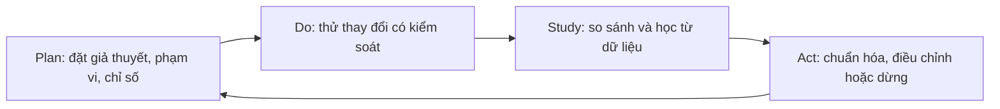

# Thử nghiệm trên một phạm vi nhỏ

Nhóm phát triển nhận thấy pull request thường chờ CI lâu, nhiều lỗi hồi quy chỉ được phát hiện sau khi merge và mọi người đang tranh luận xem có nên bật thêm quality gate hay không. Một đề xuất là bật toàn bộ static analysis và test nghiêm ngặt cho cả repository. Đề xuất khác là chỉ thêm một vài kiểm tra vào module đang thay đổi nhiều nhất. Nếu triển khai đồng loạt, nhóm khó biết kiểm tra nào tạo giá trị, kiểm tra nào gây nhiễu và vì sao thời gian phản hồi tăng.

**Thử nghiệm trên một phạm vi nhỏ** giúp nhóm kiểm tra một giả thuyết cải thiện trong điều kiện có thể quan sát, giới hạn rủi ro và học trước khi mở rộng. Thay vì thay đổi toàn bộ quy trình cùng lúc, nhóm chọn một module, một luồng công việc hoặc một nhóm người dùng; đo hiện trạng; thử thay đổi; đánh giá kết quả; rồi quyết định bước tiếp theo.

Trong chương **Cải thiện liên tục** của **CODE_QUALITY_FUNDAMENTALS**, bài học này tập trung vào cách thiết kế và thực hiện một thử nghiệm nhỏ. Điều đó hỗ trợ mục tiêu module: hiểu những thuộc tính quyết định mã nguồn có **đáng tin cậy, dễ hiểu và dễ thay đổi hay không**.

Thử nghiệm nhỏ không phải là làm qua loa. Nó cần một câu hỏi rõ, phạm vi có ranh giới, bằng chứng trước và sau, điều kiện dừng và người chịu trách nhiệm. Giá trị của thử nghiệm nằm ở **khả năng học được điều gì từ thay đổi**, kể cả khi kết quả không như mong đợi.

## Mục tiêu học tập

Sau bài này, bạn có thể:

1. Chuyển một ý tưởng cải thiện thành giả thuyết có thể kiểm tra.
2. Chọn phạm vi pilot đủ nhỏ để kiểm soát nhưng đủ đại diện để học.
3. Thu thập baseline và chọn chỉ số phản ánh cả lợi ích lẫn chi phí.
4. Thiết kế cách so sánh trước/sau hoặc giữa các phạm vi mà không kết luận quá mức.
5. Thực hiện thử nghiệm theo vòng Plan–Do–Study–Act (PDSA).
6. Đặt guardrail, điều kiện dừng và kế hoạch rollback trước khi bắt đầu.
7. Quyết định mở rộng, điều chỉnh, thử lại hoặc dừng dựa trên bằng chứng.
8. Chuyển kết quả thành quy trình có owner và tiếp tục theo dõi sau khi mở rộng.

## 1. Vì sao nên thử nghiệm trước khi mở rộng?

Một thay đổi cải thiện chất lượng thường có cả lợi ích và chi phí:

- Thêm test có thể phát hiện regression sớm nhưng làm CI lâu hơn.
- Bật static analysis có thể tìm lỗi mới nhưng cũng tạo false positive.
- Chia module có thể giảm coupling nhưng cần thời gian di trú và cập nhật build.
- Thay cách review có thể làm comment rõ hơn nhưng ban đầu cần hướng dẫn nhóm.
- Thêm bước kiểm tra dependency có thể giảm rủi ro nhưng cần người điều tra cảnh báo.

Nếu triển khai trên toàn hệ thống cùng lúc, khi kết quả thay đổi ta khó xác định **thay đổi nào tạo tác động**. Một pilot giới hạn giúp quan sát gần hơn, sửa thiết kế trước khi chi phí nhân rộng tăng lên.

### Thử nghiệm nhỏ khác với triển khai nhỏ

Triển khai một tính năng cho một nhóm người dùng có thể chỉ là rollout theo giai đoạn. Một thử nghiệm có chủ đích còn cần:

1. Câu hỏi hoặc giả thuyết được viết trước.
2. Baseline để biết hiện trạng.
3. Chỉ số và cách thu thập đã xác định.
4. Phạm vi thử và thời gian quan sát.
5. Guardrail để bảo vệ người dùng và hệ thống.
6. Tiêu chí quyết định sau thử nghiệm.

Nếu nhóm chỉ bật một cấu hình ở một module rồi kết luận “có vẻ tốt”, đó là một thay đổi nhỏ, nhưng chưa chắc là một thử nghiệm có bằng chứng.

### Thử nghiệm không thay thế các yêu cầu bắt buộc

Không được dùng pilot để trì hoãn một bản vá bảo mật khẩn cấp, bỏ qua yêu cầu pháp lý hoặc thử một thay đổi có nguy cơ gây mất dữ liệu không kiểm soát. Những yêu cầu bắt buộc vẫn phải được đáp ứng trong toàn bộ phạm vi áp dụng. Thử nghiệm phù hợp với những lựa chọn cải thiện có thể đánh giá và triển khai an toàn theo từng bước.

## 2. Viết giả thuyết trước khi chọn giải pháp

Một ý tưởng thường bắt đầu bằng lời nhận xét:

> “CI đang chậm, cần tối ưu pipeline.”

Nhận xét này chưa nói rõ nguyên nhân, mục tiêu hoặc cách xác nhận thành công. Có thể chuyển thành giả thuyết:

> “Nếu chạy unit test nhanh và kiểm tra finding mới có độ tin cậy cao ở stage đầu cho module billing-core, nhóm sẽ nhận phản hồi sớm hơn mà không làm tăng lỗi nghiêm trọng lọt qua gate.”

Giả thuyết tốt có thể bị bác bỏ bởi kết quả. Nếu bất kỳ kết quả nào cũng được diễn giải là thành công, nhóm chưa có giả thuyết kiểm chứng được.

### Mẫu giả thuyết

```text
Trong [phạm vi / nhóm / quy trình],
nếu chúng ta [thay đổi cụ thể],
thì [kết quả có thể quan sát] sẽ thay đổi theo [hướng / mức kỳ vọng],
vì [cơ chế hoặc nguyên nhân được cho là đúng].

Chúng ta sẽ đánh giá bằng [chỉ số và nguồn dữ liệu],
trong [khoảng thời gian / số lần chạy],
và dừng nếu [điều kiện guardrail].
```

Ví dụ:

```text
Trong module billing-core,
nếu thêm test cho điều kiện biên và chạy unit test của module
trước các stage integration dài,
thì thời gian phát hiện lỗi logic trong PR sẽ giảm
mà tỷ lệ lỗi nghiêm trọng sau merge không tăng,
vì những lỗi có thể kiểm tra nhanh được phát hiện gần nơi sửa.

Đánh giá bằng thời gian từ lúc mở PR đến kết quả test đầu tiên,
tỷ lệ test flaky, finding mới và bug hồi quy.
Dừng hoặc điều chỉnh nếu CI vượt ngân sách thời gian
hoặc phát sinh lỗi dữ liệu/thanh toán.
```

Đây là giả thuyết minh họa, chưa phải kết quả đã được chứng minh. Khi viết giả thuyết, hãy tránh dùng mục tiêu mơ hồ như “code sạch hơn”, “developer vui hơn” nếu chưa xác định cách quan sát hoặc thu thập phản hồi.

### Phân biệt mục tiêu, giải pháp và giả thuyết

| Thành phần | Ví dụ |
| --- | --- |
| **Vấn đề** | Lỗi điều kiện biên chỉ được phát hiện sau khi merge. |
| **Mục tiêu** | Phát hiện lỗi sớm hơn trong vòng đời PR. |
| **Giải pháp thử** | Thêm unit test biên và chạy chúng ở stage nhanh. |
| **Giả thuyết** | Stage nhanh sẽ phát hiện nhóm lỗi này trước khi chạy integration test. |
| **Bằng chứng** | Thời gian phản hồi, lỗi được phát hiện ở từng stage và bug sau merge. |

Không nên bắt đầu bằng cách yêu thích một công cụ rồi tìm lý do để dùng nó. Hãy bắt đầu từ vấn đề và chọn thay đổi có khả năng giải quyết nguyên nhân.

## 3. Chọn phạm vi pilot phù hợp

Phạm vi quá rộng làm thử nghiệm khó kiểm soát; phạm vi quá nhỏ hoặc quá đặc thù có thể không đại diện cho nơi sẽ áp dụng sau này.

### Tiêu chí chọn phạm vi

Một phạm vi pilot phù hợp thường có:

1. **Ranh giới rõ:** module, package, pipeline stage, nhóm PR hoặc một luồng nghiệp vụ.
2. **Owner sẵn sàng:** có người chịu trách nhiệm triển khai, hỗ trợ và giải thích kết quả.
3. **Mức rủi ro có thể quản lý:** thử nghiệm không đặt dữ liệu hoặc người dùng vào nguy cơ không chấp nhận được.
4. **Khả năng đo:** có thể thu thập baseline và dữ liệu sau thay đổi.
5. **Đại diện cho vấn đề:** phạm vi có biểu hiện mà nhóm muốn cải thiện.
6. **Khả năng rollback:** có thể quay lại cấu hình hoặc quy trình trước nếu guardrail bị vi phạm.
7. **Quy mô đủ học:** có đủ lần sử dụng hoặc thay đổi để quan sát, không chỉ một trường hợp đơn lẻ.

### Ví dụ chọn phạm vi

| Phạm vi có thể chọn | Ưu điểm | Rủi ro / giới hạn |
| --- | --- | --- |
| Một class có test độc lập | Rất dễ kiểm soát và tái hiện. | Có thể không phản ánh thời gian CI hay tương tác module. |
| Một package nghiệp vụ | Có nhiều test và caller gần nhau. | Có thể còn phụ thuộc module khác. |
| Một module có owner | Có ranh giới build, test và trách nhiệm tương đối rõ. | Kết quả có thể không đại diện cho module khác. |
| Một nhóm PR của một team | Phản ánh cách làm thực tế. | Khó so sánh nếu loại công việc khác nhau. |
| Toàn repository | Phản ánh toàn hệ thống. | Thường quá rộng cho lần thử đầu và khó quy nguyên nhân. |

**Chọn phạm vi theo câu hỏi đang kiểm tra.** Nếu thử một test seam, một service có phụ thuộc thời gian có thể đủ. Nếu thử thời gian CI, cần một module có đủ PR và pipeline run. Nếu thử quy trình review, cần quan sát cả người viết lẫn reviewer.

### Pilot, canary và rollout không hoàn toàn giống nhau

- **Pilot** kiểm tra cách làm trong phạm vi nhỏ để học về tính phù hợp, chi phí và tác động.
- **Canary** đưa một phiên bản/thay đổi đến một phần lưu lượng hoặc instance để quan sát rủi ro vận hành trước khi mở rộng.
- **Rollout theo giai đoạn** là quá trình tăng dần phạm vi triển khai sau khi có quyết định.

Một pilot có thể dùng canary như kỹ thuật triển khai, nhưng không phải mọi canary đều là một thử nghiệm cải tiến đầy đủ. Pilot cần câu hỏi, baseline và tiêu chí đánh giá.

## 4. Thu thập baseline trước khi thay đổi

Baseline là dữ liệu mô tả hiện trạng trong phạm vi và khoảng thời gian xác định. Nó giúp trả lời: **nếu không thử thay đổi, tình hình thường như thế nào?**

Ví dụ khi muốn cải thiện phản hồi CI, baseline có thể gồm:

- Thời gian từ lúc mở PR đến kết quả kiểm tra đầu tiên.
- Tổng thời gian pipeline và thời gian từng stage.
- Tỷ lệ test flaky hoặc số lần retry.
- Finding mới theo severity.
- Số bug được phát hiện sau merge có liên quan đến phạm vi.
- Số lần developer phải chạy lại pipeline.

### Ghi rõ cách đo

Một chỉ số chỉ hữu ích khi biết:

| Thành phần | Cần ghi |
| --- | --- |
| **Định nghĩa** | Chính xác đang đo khoảng thời gian hoặc sự kiện nào? |
| **Đơn vị** | Giây, phút, phần trăm, số lần hay số bug? |
| **Nguồn** | CI, issue tracker, test report, incident system hay khảo sát? |
| **Phạm vi** | Module, nhánh, nhóm, loại PR nào? |
| **Khoảng thời gian** | Dữ liệu được lấy từ ngày nào đến ngày nào? |
| **Cách tổng hợp** | Median, percentile, tỷ lệ hay tổng số? |
| **Giới hạn** | Thiếu dữ liệu, sampling hoặc thay đổi cấu hình nào ảnh hưởng kết quả? |

Với thời gian CI, median thường ít bị một pipeline bất thường chi phối hơn mean; p90/p95 giúp nhìn phần trải nghiệm chậm. Không nên chỉ dùng trung bình nếu phân phối có đuôi dài.

### Baseline phải đủ đại diện

Một ngày có ít PR không đủ mô tả quy trình thường lệ. Hãy chọn khoảng quan sát có:

- Các ngày làm việc và lịch release thường gặp.
- Đủ số lần chạy để nhìn biến động.
- Loại PR tương tự phạm vi pilot.
- Cấu hình CI và tài nguyên tương đối ổn định.

Không có một số ngày hoặc số mẫu chung cho mọi thử nghiệm. Nếu số mẫu nhỏ, hãy ghi rõ mức bất định và tránh kết luận mạnh.

### Ghi nhận thay đổi đồng thời

Trong thời gian pilot, có thể đồng thời nâng JDK, thay runner CI hoặc tăng số người trong team. Những yếu tố này làm kết quả trước/sau khó so sánh. Hãy ghi các thay đổi có khả năng ảnh hưởng và nếu có thể, tránh gộp nhiều cải tiến lớn vào cùng một thử nghiệm.

## 5. Chọn chỉ số cân bằng

Một cải tiến có thể làm một chỉ số tốt lên nhưng gây hại ở nơi khác. Ví dụ pipeline nhanh hơn vì bỏ integration test; tốc độ tăng nhưng độ tin cậy giảm.

Nên theo dõi ít nhất ba nhóm:

### Chỉ số kết quả (outcome)

Đo mục tiêu cuối cùng:

- Số bug hồi quy lọt sau merge.
- Tỷ lệ incident thuộc phạm vi.
- Thời gian hoàn thành một thay đổi.
- Thời gian khôi phục khi lỗi.
- Tỷ lệ thay đổi được triển khai thành công.

### Chỉ số dẫn dắt (leading)

Cho biết cơ chế cải thiện có đang hoạt động:

- Thời gian đến kết quả test đầu tiên.
- Tỷ lệ PR có test cho nhánh mới.
- Tỷ lệ finding mới được phát hiện trước merge.
- Số lần test flaky/retry.
- Thời gian review hoặc số vòng trao đổi để làm rõ hợp đồng.

### Guardrail

Phát hiện tác động phụ không được phép:

- Không tăng lỗi nghiêm trọng sau merge.
- Không làm vượt ngân sách CI đã thống nhất.
- Không giảm kiểm tra bảo mật bắt buộc.
- Không gây tăng lỗi dữ liệu hoặc giao dịch.
- Không tạo thêm quá nhiều false positive hoặc waiver quá hạn.
- Không làm tăng thời gian chờ của nhóm vượt mức chấp nhận.

### Ví dụ bảng chỉ số

| Nhóm | Chỉ số | Cách diễn giải |
| --- | --- | --- |
| Outcome | Bug hồi quy sau merge trong module | Có cải thiện độ tin cậy không? |
| Leading | Thời gian đến kết quả unit test đầu tiên | Nhóm có nhận phản hồi sớm hơn không? |
| Leading | Tỷ lệ test flaky | Kết quả gate có đáng tin không? |
| Guardrail | Finding nghiêm trọng lọt qua gate | Thay đổi có làm giảm bảo vệ không? |
| Guardrail | Thời gian pipeline p90 | Nhóm có phải chờ quá lâu không? |
| Guardrail | Waiver/exception mới | Gate có tạo nhiễu hoặc đường vòng không? |

Không nên tối ưu một chỉ số đơn lẻ. Nếu số bug sau merge giảm nhưng thời gian CI tăng gấp đôi, cần xem lợi ích có đáng chi phí và có cách tối ưu khác không.

## 6. Thiết kế cách so sánh

Sau khi có baseline, nhóm cần cách xác định thay đổi có liên quan đến kết quả hay không.

### So sánh trước và sau

Đây là cách đơn giản:

1. Đo phạm vi trong một khoảng thời gian trước pilot.
2. Áp dụng thay đổi.
3. Đo cùng chỉ số trong khoảng thời gian sau pilot.
4. So sánh với định nghĩa và phạm vi nhất quán.

Ưu điểm là dễ thực hiện. Hạn chế là kết quả có thể bị ảnh hưởng bởi seasonality, loại PR, thay đổi nhân sự, tải CI hoặc release.

### So sánh với phạm vi tương tự

Nếu có hai module hoặc nhóm tương đối tương đồng, một bên có thể thử trước, bên còn lại tiếp tục quy trình hiện tại trong thời gian ngắn. Nhóm so sánh giúp nhìn xu hướng chung, nhưng chỉ có giá trị nếu hai phạm vi đủ giống về độ phức tạp, tải và loại thay đổi.

Không nên cố tình giữ một nhóm không được hưởng biện pháp an toàn hoặc chất lượng bắt buộc chỉ để tạo đối chứng. Những yêu cầu nền tảng áp dụng cho tất cả vẫn phải được giữ.

### Chọn thiết kế phù hợp với khả năng

| Cách so sánh | Khi phù hợp | Điểm yếu |
| --- | --- | --- |
| Trước/sau trong cùng phạm vi | Không có nhóm so sánh phù hợp. | Dễ bị yếu tố thời gian khác gây nhiễu. |
| Pilot và phạm vi tương tự | Có hai module/nhóm có đặc tính gần nhau. | Khó bảo đảm hai phạm vi thực sự tương đồng. |
| Rollout theo đợt | Có thể mở rộng dần và quan sát theo từng nhóm. | Xu hướng thời gian và thay đổi giữa các đợt có thể ảnh hưởng. |
| Thử nghiệm ngẫu nhiên | Có đủ mẫu, có thể phân nhóm công bằng và rủi ro thấp. | Không phù hợp với mọi thay đổi kỹ thuật hoặc yêu cầu bắt buộc. |

Trong cải thiện kỹ thuật nội bộ, thường không cần thiết kế thí nghiệm thống kê phức tạp. Nhưng nhóm vẫn cần ghi **điều gì được thay đổi, phạm vi nào chịu tác động và giới hạn của phép so sánh**.

### Tránh kết luận nhân quả quá mức

Nếu thời gian CI giảm sau khi thêm cache, chưa chắc cache là nguyên nhân duy nhất. Có thể runner vừa được nâng CPU hoặc số PR trong kỳ thấp hơn. Hãy viết:

> “Trong pilot, median thời gian phản hồi giảm; kết quả phù hợp với giả thuyết nhưng runner cũng được nâng cấp trong cùng giai đoạn nên chưa thể quy toàn bộ cải thiện cho cache.”

Cách diễn đạt này hữu ích hơn “cache đã làm CI nhanh hơn 40%” nếu thiết kế không tách được các yếu tố.

## 7. Ví dụ xuyên suốt: thử quality gate ở một module

Giả sử nhóm có repository Java gồm nhiều module. Module `billing-core` thường xuyên thay đổi và có owner rõ. Nhóm muốn cải thiện việc phát hiện lỗi mới mà không chặn toàn repository vì các finding legacy.

### Vấn đề quan sát

- Một số lỗi điều kiện biên được phát hiện sau merge.
- Static analysis đã có nhưng report quá rộng, chứa nhiều finding cũ.
- Developer phải chờ integration test mới biết lỗi logic thuần.
- Nhóm chưa biết thêm gate sẽ ảnh hưởng thời gian PR thế nào.

### Giả thuyết pilot

```text
Trong module billing-core,
nếu chạy unit tests nhanh và static analysis
cho finding mới thuộc nhóm rule có độ tin cậy cao ở PR stage,
thì nhóm sẽ phát hiện vấn đề sớm hơn mà không làm p90 thời gian
phản hồi vượt ngân sách CI và không giảm các kiểm tra hiện có.
```

### Phạm vi thử

| Thành phần | Quyết định |
| --- | --- |
| Module | `billing-core`. |
| Nhóm tham gia | Owner module và các developer thường xuyên sửa module. |
| Thay đổi | Thêm stage unit test nhanh và gate finding mới cho một tập rule đã chọn. |
| Không thay đổi | Các gate bảo mật bắt buộc và integration test hiện tại vẫn giữ. |
| Baseline | PR/pipeline runs trong giai đoạn trước pilot. |
| Thời gian | Một chu kỳ quan sát đủ số PR đại diện; xác định trước ngày đánh giá. |
| Rollback | Tắt stage pilot hoặc chuyển rule sang report-only theo quy trình, giữ nguyên gate bắt buộc. |
| Owner | Module owner. |

### Chọn rule

Không bật toàn bộ rule ngay. Nhóm có thể bắt đầu với:

- Finding có độ tin cậy cao và tác động correctness rõ.
- Null dereference hoặc resource leak nếu analyzer phù hợp framework.
- Dependency finding mới thuộc policy đã thống nhất.

Những rule có nhiều false positive được chạy ở chế độ report-only để phân loại trước. Không miễn trừ hoặc hạ severity chỉ để đạt mục tiêu pilot.

### Quy tắc gate

1. Unit test của module phải pass.
2. Finding mới thuộc tập rule đã chọn phải được xử lý hoặc có waiver hợp lệ theo policy.
3. Baseline cũ được theo dõi riêng; finding nghiêm trọng vẫn phải xử lý theo quy trình bắt buộc.
4. Integration test và các kiểm tra bảo mật hiện có không bị bỏ.
5. Pipeline ghi nhận thời gian từng stage, retry và kết quả finding.

Đây là ví dụ chính sách cho một pilot, không phải cấu hình áp dụng cho mọi dự án. Danh sách rule, severity và điều kiện release phải được owner xác nhận.

## 8. Lập experiment charter trước khi chạy

Một bản kế hoạch ngắn giúp tất cả người tham gia hiểu cùng một thử nghiệm.

```markdown
# Pilot charter: Quality gate cho billing-core

## Vấn đề
Lỗi mới ở module đôi khi chỉ được phát hiện sau merge;
report static analysis đang lẫn finding legacy.

## Giả thuyết
Unit tests nhanh và gate finding mới có độ tin cậy cao
sẽ phát hiện vấn đề sớm hơn, trong ngân sách CI đã thống nhất.

## Phạm vi
- Module: billing-core
- Pull request thay đổi module
- Owner: billing-core maintainers

## Thay đổi
- Thêm unit-test stage sớm
- Gate finding mới thuộc rule set đã chọn
- Giữ nguyên integration/security gates hiện hành

## Baseline và chỉ số
- PR feedback time: median và p90
- Unit-test duration và flaky rate
- Finding mới theo severity
- Bug hồi quy sau merge
- Waiver và false-positive count

## Guardrails
- Không bỏ gate bảo mật bắt buộc
- Không tăng lỗi nghiêm trọng sau merge
- p90 CI không vượt ngân sách đã duyệt

## Thời gian và quyết định
Đánh giá vào ngày đã thống nhất sau khi có đủ PR đại diện.
Quyết định: mở rộng / điều chỉnh / thử lại / dừng.

## Rollback
Có thể chuyển rule pilot về report-only hoặc gỡ stage thử;
các gate bắt buộc vẫn giữ.
```

Charter này cần được hoàn thiện với baseline thực tế, ngân sách CI, ngày đánh giá và người phê duyệt trước khi bắt đầu. Không dùng các mục tiêu số tùy ý nếu nhóm chưa có dữ liệu.

## 9. Thực hiện theo vòng Plan–Do–Study–Act

PDSA là một vòng cải tiến ngắn:



### Plan — Lập kế hoạch

- Nêu vấn đề và nguyên nhân giả định.
- Viết giả thuyết có thể bị bác bỏ.
- Chọn phạm vi và owner.
- Thu thập baseline.
- Chọn chỉ số outcome, leading và guardrail.
- Xác định cách so sánh, khoảng thời gian và số mẫu tối thiểu hợp lý.
- Xác định điều kiện dừng và rollback.

### Do — Thực hiện

- Triển khai đúng phạm vi đã chọn.
- Ghi lại phiên bản, cấu hình và thời điểm thay đổi.
- Theo dõi lỗi, false positive, thời gian CI và phản hồi người dùng.
- Không thay nhiều yếu tố ngoài kế hoạch nếu không cần thiết.
- Nếu phải thay đổi giả thuyết hoặc phạm vi, ghi lại để tránh trộn kết quả.

### Study — Phân tích

- So sánh với baseline theo cùng định nghĩa.
- Kiểm tra dữ liệu thiếu, outlier và thay đổi môi trường.
- Đánh giá cả lợi ích, chi phí và guardrail.
- Đọc phản hồi định tính từ người tham gia.
- Xác định điều gì được chứng minh, điều gì mới chỉ là giả thuyết.

### Act — Quyết định

Chọn một trong các hướng:

1. **Adopt:** chuẩn hóa và mở rộng nếu kết quả đủ tốt, rủi ro được kiểm soát.
2. **Adapt:** điều chỉnh rule, stage, phạm vi hoặc cách đo rồi thử vòng tiếp theo.
3. **Repeat:** chưa đủ mẫu hoặc có yếu tố gây nhiễu; cần thử lại với thiết kế tốt hơn.
4. **Abandon:** giả thuyết không được hỗ trợ hoặc chi phí/rủi ro lớn hơn lợi ích.

“Không mở rộng” không có nghĩa thử nghiệm thất bại vô ích. Nếu nhóm phát hiện một giải pháp làm CI chậm hơn mà không giảm lỗi, đó là tri thức giúp tránh triển khai rộng.

## 10. Theo dõi trong khi thử nghiệm

Không chờ đến ngày kết thúc mới phát hiện guardrail đã bị vi phạm. Nên theo dõi theo chu kỳ phù hợp với tốc độ và rủi ro.

### Bảng quan sát pilot

| Thời điểm | Cần xem | Hành động có thể có |
| --- | --- | --- |
| Trước bật | Baseline, config, owner, rollback đã sẵn sàng? | Chưa đủ điều kiện thì chưa bắt đầu. |
| Sau lần chạy đầu | Stage có chạy đúng, report có hiểu được? | Sửa wiring hoặc rule sai phạm vi. |
| Trong pilot | Thời gian, flaky, finding mới, false positive. | Điều tra nếu xu hướng bất thường. |
| Khi có guardrail breach | Lỗi nghiêm trọng, dữ liệu sai, CI quá tải. | Dừng hoặc rollback theo charter. |
| Cuối kỳ | Chỉ số, phản hồi, chi phí và giới hạn dữ liệu. | Quyết định adopt/adapt/repeat/abandon. |

### Ghi nhận cả dữ liệu định lượng và định tính

Số liệu cho biết điều gì thay đổi; phản hồi giúp hiểu vì sao:

- Developer có hiểu thông báo fail không?
- Reviewer có nhận được bằng chứng hữu ích hơn không?
- False positive có làm mọi người bỏ qua cảnh báo?
- Test mới có dễ bảo trì hay phụ thuộc quá nhiều vào mock?
- Có nhóm nào phải làm thêm thao tác thủ công?

Phản hồi định tính nên được ghi theo chủ đề, không biến một ý kiến đơn lẻ thành kết luận chung. Có thể dùng khảo sát ngắn hoặc phỏng vấn vài người tham gia nếu phù hợp.

## 11. Đặt điều kiện dừng và rollback từ trước

Một thử nghiệm nhỏ vẫn có thể ảnh hưởng người dùng, dữ liệu hoặc nhịp phát triển. Trước khi bắt đầu, cần biết **khi nào phải dừng**.

### Ví dụ guardrail

- Có lỗi nghiêm trọng mới lọt qua gate do phạm vi test bị cắt.
- Dữ liệu hoặc giao dịch bị sai.
- Stage pilot làm pipeline vượt ngân sách thời gian trong nhiều lần chạy liên tiếp.
- Flaky test tăng đến mức kết quả CI không còn đáng tin.
- Scanner tạo quá nhiều false positive khiến finding quan trọng bị bỏ qua.
- Người chịu trách nhiệm không còn khả năng hỗ trợ pilot.

Điều kiện cụ thể phải được xác định theo hệ thống. Không nên đợi sự cố nghiêm trọng rồi mới quyết định thế nào là “quá rủi ro”.

### Rollback không đồng nghĩa xóa bằng chứng

Khi dừng:

1. Khôi phục cấu hình hoặc quy trình ổn định trước đó.
2. Giữ lại log, metric và finding của thử nghiệm.
3. Ghi lý do dừng và tác động đã quan sát.
4. Xác định có cần khắc phục dữ liệu/trạng thái phát sinh không.
5. Ghi điều đã học và quyết định có thử lại với thiết kế khác không.

Nếu thử nghiệm liên quan schema hoặc dữ liệu bền vững, rollback ứng dụng có thể không đủ; cần phương án migration ngược hoặc forward-fix đã được thiết kế. Đừng coi mọi thay đổi đều có thể hoàn tác bằng một lệnh revert.

## 12. Đọc kết quả mà không tự đánh lừa mình

Khi pilot kết thúc, thường có xu hướng tìm dữ liệu xác nhận điều nhóm mong muốn. Hãy kiểm tra các khả năng khác.

### Một số câu hỏi phân tích

1. Chỉ số thay đổi theo hướng nào và mức độ bao nhiêu?
2. Số mẫu có đủ để quan sát xu hướng không?
3. Có thay đổi môi trường, nhân sự hoặc loại PR nào cùng lúc?
4. Kết quả có nhất quán giữa các tuần hoặc loại thay đổi không?
5. Chỉ số outcome có thay đổi hay chỉ leading indicator?
6. Có tác động phụ nào không được dự kiến?
7. Người tham gia có thay đổi hành vi vì biết mình đang được quan sát không?
8. Kết quả có thể áp dụng cho module khác không, hay chỉ đúng với pilot?

### Ví dụ bảng kết quả minh họa

Giả sử sau pilot, nhóm ghi nhận:

| Chỉ số | Trước pilot | Trong pilot | Nhận xét |
| --- | ---: | ---: | --- |
| Median đến unit-test feedback | 9 phút | 4 phút | Phản hồi sớm hơn. |
| p90 tổng CI | 24 phút | 26 phút | Đuôi chậm tăng nhẹ, cần tìm nguyên nhân. |
| Flaky retry rate | 3% | 5% | Guardrail có thể bị ảnh hưởng. |
| Finding mới high trước merge | 2 | 5 | Phát hiện nhiều hơn, cần xem chất lượng finding. |
| Bug hồi quy sau merge | 1 | 1 | Chưa đủ dữ liệu để kết luận giảm. |

Các con số là **ví dụ giả định**, không phải kết quả đo từ một repository thật. Cách đọc hợp lý:

- Stage unit test giúp phản hồi sớm hơn theo chỉ số đã đo.
- p90 và flaky rate cho thấy chi phí/độ ổn định cần điều tra.
- Finding phát hiện trước merge tăng có thể là tín hiệu tốt, nhưng phải xem false positive và mức độ thực tế.
- Bug hồi quy không đổi trong khoảng quan sát; chưa thể tuyên bố outcome cuối đã cải thiện.

Quyết định phù hợp có thể là **adapt**: điều tra flaky test và p90 trước, giữ stage nhanh trong pilot hoặc thử thêm một chu kỳ. Không nên mở rộng ngay chỉ vì một chỉ số đã tốt lên.

### Phân biệt “không thấy lỗi” với “đã chứng minh an toàn”

Một pilot nhỏ có thể không gặp incident vì thời gian quan sát ngắn hoặc lưu lượng thấp. Điều đó không chứng minh rủi ro bằng không. Với các thuộc tính quan trọng, cần test có chủ đích, phân tích đường đi, guardrail và rollout có kiểm soát; không chỉ dựa vào việc chưa có ai báo lỗi.

## 13. Khi nào nên mở rộng?

Một pilot có thể được mở rộng khi:

- Giả thuyết được hỗ trợ bởi bằng chứng đủ phù hợp.
- Guardrail không bị vi phạm hoặc vấn đề đã được xử lý.
- Chi phí vận hành nằm trong mức chấp nhận.
- Cách triển khai có thể lặp lại ở phạm vi mới.
- Có owner, tài liệu và hỗ trợ cho các nhóm tiếp theo.
- Đã xác định những khác biệt giữa pilot và phạm vi mới.

### Mở rộng theo từng nấc

Ví dụ:

```text
1. billing-core (pilot)
2. customer-profile (module tương tự, có owner)
3. các module nghiệp vụ còn lại
4. toàn repository theo policy phù hợp
```

Không nhất thiết áp cùng cấu hình cho mọi module. Module có build khác, test chậm hoặc ranh giới dữ liệu khác có thể cần điều chỉnh. **Mở rộng nguyên tắc và cách đo**, không sao chép máy móc mọi chi tiết.

### Chuyển pilot thành tiêu chuẩn vận hành

Khi đã quyết định adopt:

1. Cập nhật template CI, guideline hoặc policy chính thức.
2. Ghi rõ module/phạm vi nào áp dụng và từ thời điểm nào.
3. Đào tạo owner về cách đọc finding và xử lý lỗi.
4. Chuyển các waiver/pending issue thành backlog có trách nhiệm.
5. Thiết lập dashboard và chu kỳ xem lại.
6. Xác định khi nào cần thay đổi hoặc ngừng tiêu chuẩn.

Một thử nghiệm thành công không kết thúc ở buổi tổng kết. Nó cần được chuyển thành cách làm có thể duy trì.

## 14. Khi nào nên thử lại hoặc dừng?

Không phải kết quả không rõ ràng nào cũng cần mở rộng.

### Repeat — Thử lại

Phù hợp khi:

- Số mẫu chưa đủ.
- Dữ liệu bị thiếu hoặc có sự cố đo lường.
- Một thay đổi môi trường làm kết quả khó so sánh.
- Pilot chưa chạy đúng cấu hình dự kiến.
- Có giả thuyết mới hợp lý cần kiểm tra.

Khi thử lại, ghi rõ điều gì được thay đổi trong thiết kế. Không gộp hai vòng như thể đó là cùng một thí nghiệm.

### Adapt — Điều chỉnh

Phù hợp khi cơ chế có giá trị nhưng phạm vi hoặc cách thực hiện chưa hợp lý. Ví dụ giữ unit test nhanh nhưng tách một rule static analysis nhiều false positive sang chế độ report-only để cải thiện model.

### Abandon — Dừng

Phù hợp khi:

- Không có bằng chứng hỗ trợ giả thuyết sau một phép thử đủ tốt.
- Chi phí hoặc rủi ro lớn hơn lợi ích.
- Có giải pháp khác giải quyết nguyên nhân tốt hơn.
- Phạm vi không đủ đại diện và không thể mở rộng an toàn.
- Yêu cầu ban đầu đã thay đổi.

Dừng một thử nghiệm là một quyết định kỹ thuật có trách nhiệm khi nhóm ghi lại lý do và giữ bài học. Không nên tiếp tục chỉ vì đã đầu tư thời gian.

## 15. Những sai lầm thường gặp

**Thay đổi quá nhiều yếu tố cùng lúc.** Khi kết quả khác đi, không biết yếu tố nào tạo ra tác động. Chọn một thay đổi chính hoặc ghi rõ các yếu tố đồng thời.

**Không đo baseline.** Không biết hiện trạng thì không thể đánh giá cải thiện đáng tin.

**Chọn phạm vi quá đặc thù.** Kết quả tốt ở một class đơn giản có thể không áp dụng cho module có DB, network và nhiều consumer.

**Chọn phạm vi quá rộng.** Khó kiểm soát rủi ro và xác định nguyên nhân; chi phí rollback lớn.

**Chỉ đo chỉ số thuận lợi.** CI nhanh hơn nhưng test flaky tăng; cần theo dõi guardrail.

**Đặt mục tiêu sau khi đã thấy kết quả.** Dễ điều chỉnh tiêu chí để hợp thức hóa kết luận. Hãy viết giả thuyết và tiêu chí trước.

**Kết luận nhân quả từ một phép so sánh yếu.** Trước/sau có thể bị runner, tải hoặc loại PR khác nhau ảnh hưởng.

**Kéo dài pilot không có ngày đánh giá.** Thử nghiệm biến thành trạng thái tạm thời vô thời hạn.

**Không có rollback hoặc điều kiện dừng.** Khi có tác động xấu, nhóm không biết ai quyết định và khôi phục thế nào.

**Coi một pilot thành công là bằng chứng mọi nơi đều phù hợp.** Các module có đặc điểm và rủi ro khác nhau; cần mở rộng từng nấc.

**Không chia sẻ kết quả âm.** Nhóm khác có thể lặp lại cùng thử nghiệm và cùng chi phí.

**Đóng thử nghiệm khi có báo cáo, chưa có thay đổi vận hành.** Nếu quyết định adopt mà không cập nhật template, owner và tài liệu, cải tiến khó duy trì.

## 16. Checklist thiết kế một thử nghiệm nhỏ

Trước khi bắt đầu:

1. **Vấn đề:** Có mô tả bằng dữ liệu hoặc ví dụ cụ thể không?
2. **Giả thuyết:** Có thể kiểm tra và bác bỏ không?
3. **Cơ chế:** Vì sao thay đổi được kỳ vọng tạo ra kết quả?
4. **Phạm vi:** Ranh giới và owner có rõ không?
5. **Baseline:** Có dữ liệu trước thay đổi theo cùng định nghĩa không?
6. **Chỉ số:** Có outcome, leading và guardrail không?
7. **Thiết kế so sánh:** Có hiểu các yếu tố gây nhiễu không?
8. **Thời gian/mẫu:** Có đủ quan sát để học mà không kéo dài vô hạn không?
9. **An toàn:** Có yêu cầu bắt buộc nào không được phép thử giảm không?
10. **Rollback:** Có thể khôi phục và xử lý dữ liệu phát sinh không?
11. **Owner:** Ai thực hiện, theo dõi và ra quyết định?
12. **Tiêu chí:** Khi nào adopt, adapt, repeat hoặc abandon?
13. **Chia sẻ:** Kết quả sẽ được ghi và phổ biến ở đâu?
14. **Duy trì:** Nếu adopt, ai sở hữu quy trình sau pilot?

## 17. Câu hỏi tự kiểm tra

**Câu 1.** Một nhóm bật static analysis cho toàn repository và thấy 1.500 finding. Vì sao đây chưa phải cách thử nghiệm tốt?

*Gợi ý:* Phạm vi quá rộng, không có baseline/phân loại và khó đánh giá false positive, chi phí cũng như tác động. Chọn module có owner, giả thuyết và tập rule có thể quản lý.

**Câu 2.** Vì sao cần viết giả thuyết trước khi bắt đầu?

*Gợi ý:* Nó xác định kết quả mong đợi, cơ chế, chỉ số và điều kiện bác bỏ; tránh diễn giải mọi kết quả thành thành công sau khi đã thấy dữ liệu.

**Câu 3.** Pilot làm CI nhanh hơn nhưng flaky rate tăng. Có nên mở rộng ngay không?

*Gợi ý:* Không. Flaky rate là guardrail; cần tìm nguyên nhân và cân bằng lợi ích tốc độ với độ tin cậy trước khi quyết định.

**Câu 4.** Baseline trước và sau khác nhau về loại PR và runner CI. Có thể kết luận cải tiến đã làm pipeline nhanh hơn không?

*Gợi ý:* Chưa đủ. Các yếu tố gây nhiễu làm so sánh yếu; cần chuẩn hóa phạm vi hoặc ghi rõ giới hạn và thử lại.

**Câu 5.** Một pilot ở module nhỏ thành công. Có nên áp nguyên cấu hình sang module xử lý dữ liệu khác không?

*Gợi ý:* Không tự động. Xác định khác biệt build, dependency, dữ liệu, rủi ro và owner; mở rộng theo từng nấc.

**Câu 6.** Khi nào nên dừng một thử nghiệm?

*Gợi ý:* Khi guardrail bị vi phạm, rủi ro không thể chấp nhận, giả thuyết không được hỗ trợ hoặc chi phí lớn hơn lợi ích. Ghi lại dữ liệu và lý do dừng.

**Câu 7.** Vì sao “không có incident trong hai tuần” chưa chứng minh thay đổi an toàn?

*Gợi ý:* Thời gian và số mẫu có thể quá ít; lưu lượng hoặc điều kiện lỗi chưa xuất hiện. Cần test có chủ đích, metric và đánh giá rủi ro.

**Câu 8.** Sau khi pilot được adopt, nhóm cần làm gì để cải tiến không biến mất?

*Gợi ý:* Chuẩn hóa policy/template, giao owner, cập nhật tài liệu, dashboard và chu kỳ xem lại; chuyển nợ còn lại thành backlog có trách nhiệm.

## Ghi nhớ

- **Thử nghiệm nhỏ là một vòng học có kiểm soát**, không chỉ là triển khai một thay đổi ở phạm vi hẹp.
- **Viết giả thuyết và tiêu chí trước khi thử.** Điều đó giúp nhóm biết mình đang kiểm tra điều gì và khi nào phải bác bỏ ý tưởng.
- **Chọn phạm vi có owner, đủ đại diện và có thể rollback.** Phạm vi phải phù hợp câu hỏi đang kiểm tra.
- **Đo baseline và chỉ số cân bằng:** outcome, leading indicators và guardrails; không tối ưu một con số đơn lẻ.
- **Theo dõi yếu tố gây nhiễu và giới hạn bằng chứng.** Trước/sau không tự chứng minh quan hệ nhân quả.
- **Dùng PDSA để quyết định adopt, adapt, repeat hoặc abandon.** Kết quả âm vẫn có thể tạo tri thức hữu ích.
- **Chỉ mở rộng khi có bằng chứng và năng lực duy trì.** Pilot thành công cần được chuyển thành quy trình có owner và được xem lại.

**Câu hỏi trước khi mở rộng một cải tiến:** “Điều gì đã được kiểm chứng trong phạm vi thử, guardrail nào đã được giữ, giới hạn nào còn tồn tại và điều gì cần xác minh thêm ở phạm vi kế tiếp?”
