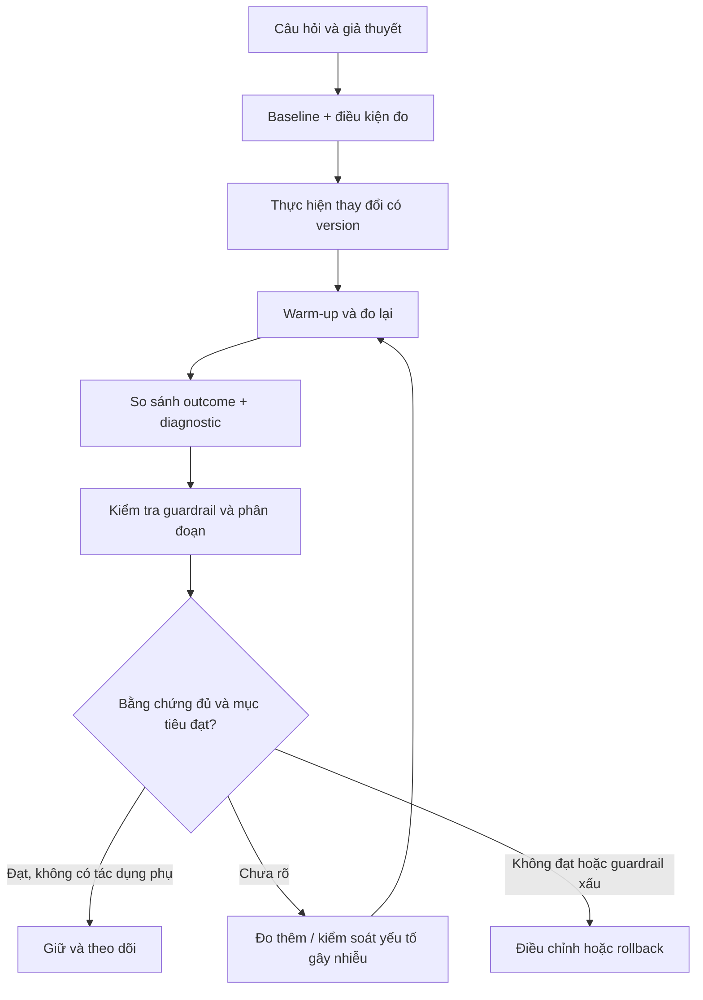

# Đo lại và giải thích kết quả theo bối cảnh

Một nhóm vừa tối ưu API tìm kiếm workshop. Sau thay đổi, dashboard cho thấy thời gian phản hồi trung bình giảm từ 180 ms xuống 120 ms. Nhóm muốn kết luận việc tối ưu đã thành công. Nhưng cùng thời gian đó, lưu lượng giảm gần một nửa, một khách hàng lớn tạm ngừng đồng bộ dữ liệu và tỷ lệ cache hit tăng. Nếu chỉ so sánh hai con số trung bình, nhóm có thể đang gán nhầm nguyên nhân cho thay đổi mã.

Một cải thiện kỹ thuật chỉ có ý nghĩa khi ta biết **đã đo điều gì, trong điều kiện nào, thay đổi nào diễn ra và kết quả ảnh hưởng đến mục tiêu nào**. Đo lại không phải thao tác chụp một con số sau khi merge. Đó là bước kiểm chứng giả thuyết: thay đổi đã tạo ra lợi ích mong muốn chưa, có tác dụng phụ nào xuất hiện không và bằng chứng đủ mạnh để quyết định bước tiếp theo hay chưa.

Trong chương **Cải thiện liên tục** của `CODE_QUALITY_FUNDAMENTALS`, bài học này hướng dẫn cách **đo lại và giải thích kết quả theo bối cảnh**. Mục tiêu của module là hiểu những thuộc tính làm mã nguồn **đáng tin cậy, dễ hiểu và dễ thay đổi**. Vì vậy, ta cần kết hợp số liệu về chất lượng code, tốc độ thay đổi, kiểm thử và vận hành với bối cảnh sản phẩm, người dùng, tải và môi trường.

Sau bài học, bạn có thể:

- Đặt mục tiêu và giả thuyết đo lường trước khi cải thiện.
- Chọn baseline, metric kết quả và guardrail phù hợp.
- So sánh dữ liệu trước/sau trong điều kiện tương đương.
- Đọc phân phối, percentile, mẫu dữ liệu và mức bất định.
- Nhận diện yếu tố gây nhiễu, thay đổi thành phần lưu lượng và nghịch lý Simpson.
- Diễn giải kết quả mà không khẳng định quá mức quan hệ nhân quả.
- Quyết định giữ, điều chỉnh, mở rộng hoặc hoàn tác cải thiện dựa trên bằng chứng.

## 1. Đo lường để trả lời một câu hỏi cụ thể

Một phép đo có ích bắt đầu từ câu hỏi. Nếu chỉ thu thập mọi metric có sẵn rồi tìm một con số tăng hoặc giảm, ta dễ tìm thấy kết quả đẹp nhưng không liên quan đến vấn đề cần giải quyết.

Ví dụ, thay vì đặt mục tiêu chung “làm API nhanh hơn”, hãy xác định:

- Endpoint nào đang chậm?
- Người dùng hoặc consumer nào chịu ảnh hưởng?
- Chậm ở phân vị nào: p50, p95 hay p99?
- Mục tiêu là giảm độ trễ, tăng throughput hay giảm lỗi timeout?
- Mức sử dụng CPU, bộ nhớ và database có được phép tăng không?
- Kết quả cần đạt trong workload và môi trường nào?

Một mục tiêu rõ có thể là:

> Với endpoint tìm kiếm workshop ở lưu lượng 300 request/giây và phân phối truy vấn đại diện, giảm p95 latency từ khoảng 450 ms xuống dưới 300 ms, đồng thời giữ error rate dưới 0,5% và không làm CPU trung bình tăng quá 10 điểm phần trăm.

Đây là mục tiêu minh họa. Giá trị thật phải đến từ SLA/SLO, trải nghiệm người dùng và giới hạn vận hành của hệ thống.

### 1.1. Giả thuyết phải nối thay đổi với kết quả mong đợi

Một giả thuyết tốt mô tả:

1. **Vấn đề hiện tại:** điều gì đang gây chi phí hoặc rủi ro?
2. **Thay đổi dự kiến:** ta sẽ sửa cấu trúc, thuật toán hay quy trình nào?
3. **Cơ chế tác động:** vì sao thay đổi đó có thể cải thiện kết quả?
4. **Metric chính:** số liệu nào phản ánh lợi ích?
5. **Guardrail:** chỉ số nào không được xấu đi vượt mức chấp nhận?
6. **Điều kiện đo:** workload, thời gian, môi trường và nhóm người dùng nào?

Ví dụ:

- Vấn đề: API tìm kiếm phát sinh nhiều truy vấn lặp để lấy tên địa điểm.
- Thay đổi: gom truy vấn thành một lần tải theo batch.
- Cơ chế: giảm round trip tới database.
- Metric chính: p95 latency và số query mỗi request.
- Guardrail: error rate, CPU, connection pool và kết quả tìm kiếm.
- Điều kiện: cùng dataset, cùng loại truy vấn, cùng tải và cùng cấu hình.

Nếu không nêu cơ chế, nhóm có thể thấy metric cải thiện nhưng không biết liệu nó đến từ thay đổi đã thực hiện hay từ một yếu tố khác.

### 1.2. Phân biệt metric kết quả và metric giải thích

| Nhóm metric | Trả lời câu hỏi | Ví dụ |
| --- | --- | --- |
| **Outcome metric** | Người dùng/hệ thống nhận được kết quả gì? | p95 latency, tỷ lệ giao dịch thành công, thời gian hoàn tất tác vụ |
| **Diagnostic metric** | Điều gì có thể giải thích kết quả? | Query count, cache hit ratio, allocation, lock wait |
| **Guardrail metric** | Điều gì không được xấu đi? | Error rate, CPU, memory, dữ liệu sai, security findings |
| **Adoption/usage metric** | Cải thiện có được sử dụng trong thực tế không? | Tỷ lệ request đi qua đường code mới, số nhóm dùng API |
| **Process metric** | Cách làm việc của nhóm có thay đổi không? | Lead time, thời gian review, thời gian CI |

Một thay đổi có thể giảm query count nhưng p95 không đổi vì bottleneck nằm ở serialization. Khi đó diagnostic metric xác nhận cơ chế đã xảy ra, còn outcome metric cho biết người dùng chưa nhận được lợi ích mong muốn.

## 2. Xác định baseline trước khi cải thiện

**Baseline** là tập dữ liệu và điều kiện tham chiếu trước khi thay đổi. Nó cho biết hệ thống xuất phát từ đâu và giúp so sánh sau này.

Một baseline hữu ích cần ghi:

- Thời điểm và khoảng thời gian đo.
- Phiên bản code/build/commit.
- Cấu hình ứng dụng và hạ tầng.
- Dataset, kích thước dữ liệu và cách tạo dữ liệu.
- Workload: request rate, tỷ lệ đọc/ghi, phân bố input.
- Môi trường và vị trí chạy benchmark.
- Phiên bản database, runtime, JVM và phụ thuộc quan trọng.
- Trạng thái cache, warm-up và connection pool.
- Các thay đổi đồng thời như rollout, migration hoặc campaign.
- Metric và cách tính chính xác.

Không ghi điều kiện baseline sẽ khiến số liệu trước/sau khó diễn giải. Ví dụ p95 latency đo khi cache lạnh không thể so trực tiếp với p95 đo khi cache đã nóng nếu mục tiêu là đánh giá thay đổi code.

### 2.1. Chọn khoảng thời gian đủ đại diện

Khoảng đo cần phản ánh chu kỳ hoạt động liên quan:

- API thương mại điện tử có thể có giờ cao điểm, cuối tuần và chiến dịch.
- Batch job chỉ chạy mỗi đêm cần đo qua nhiều lần chạy đại diện.
- Hệ thống thanh toán có thể có các đợt tải khác nhau theo thời gian.
- Pipeline CI có thể thay đổi theo kích thước PR và mức độ song song.
- Tác vụ hỗ trợ khách hàng có thể biến động theo ngày làm việc.

Đo trong 10 phút khi traffic thấp có thể phù hợp để smoke test, nhưng không đủ để kết luận cải thiện cho workload giờ cao điểm.

### 2.2. Baseline không nhất thiết là một con số

Có thể lưu phân phối, histogram, mẫu thô đã loại dữ liệu nhạy cảm, số lần quan sát và các phân đoạn quan trọng. Một giá trị trung bình duy nhất che khuất độ biến động và những nhóm chịu ảnh hưởng khác nhau.

Ví dụ, p95 có thể tăng dù median giảm nếu một nhóm truy vấn hiếm nhưng rất nặng bị chậm hơn. Khi đó cần xem histogram và phân đoạn theo loại truy vấn, tenant, kích thước kết quả hoặc cache state.

### 2.3. Khi không có baseline đáng tin cậy

Không nên tự tạo ra một baseline từ một lần chạy không đại diện rồi trình bày như số liệu chuẩn. Có thể:

1. Ghi rõ chưa có baseline.
2. Thu thập dữ liệu trong một khoảng thời gian phù hợp.
3. Tạo workload tái lập nếu production data không thể dùng trực tiếp.
4. Định nghĩa cách đo và lưu phiên bản công cụ.
5. Thực hiện thử nghiệm thăm dò, đánh dấu kết quả là sơ bộ.
6. Chỉ đưa ra kết luận mạnh hơn khi dữ liệu đủ tin cậy.

Nếu cần giảm rủi ro khẩn cấp, vẫn có thể triển khai biện pháp bảo vệ trước; thiếu baseline không có nghĩa phải trì hoãn mọi hành động.

## 3. Chọn metric đúng với mục tiêu

Không có metric duy nhất mô tả toàn bộ chất lượng mã nguồn. Hãy chọn một tập nhỏ gồm outcome, diagnostic và guardrail.

### 3.1. Độ trễ: đừng chỉ nhìn trung bình

Với API, những số liệu thường dùng:

- **Mean (trung bình):** tổng thời gian chia số request; hữu ích nhưng nhạy với giá trị cực lớn.
- **Median/p50:** một nửa request nhanh hơn hoặc bằng giá trị này.
- **p90/p95/p99:** mô tả phần đuôi phân phối; hữu ích khi người dùng chịu ảnh hưởng bởi request chậm.
- **Maximum:** một quan sát lớn nhất; nhạy với nhiễu và không đại diện một mình.
- **Histogram:** cho phép xem phân phối và tính percentile phù hợp.

Ví dụ giả định:

| Metric | Trước | Sau |
| --- | ---: | ---: |
| Mean | 180 ms | 145 ms |
| p50 | 95 ms | 90 ms |
| p95 | 450 ms | 310 ms |
| p99 | 1.200 ms | 980 ms |

Có thể thấy p95 giảm đáng kể trong mẫu này, trong khi p50 chỉ thay đổi nhẹ. Điều đó gợi ý cải thiện tập trung ở phần request chậm. Nhưng chưa thể kết luận nguyên nhân nếu workload, cache và cấu hình chưa được kiểm soát.

**Percentile cần được tính từ histogram hoặc dữ liệu đủ chi tiết.** Không nên lấy trung bình các p95 từ nhiều instance rồi gọi đó là p95 toàn hệ thống; cách tổng hợp đúng phụ thuộc loại dữ liệu và công cụ metrics.

### 3.2. Tỷ lệ lỗi và throughput

Độ trễ giảm có thể là kết quả của việc hệ thống từ chối request nhanh hơn. Vì vậy, luôn xem cùng:

- Request rate/throughput.
- Error rate theo loại lỗi.
- Timeout và retry.
- Tỷ lệ thành công theo nghiệp vụ.
- Số request bị hủy hoặc bị giới hạn.

Nếu API giảm p95 từ 450 ms xuống 200 ms nhưng tỷ lệ HTTP 500 tăng từ 0,1% lên 2%, đây không phải cải thiện tổng thể.

### 3.3. Tài nguyên và chi phí

Một thuật toán nhanh hơn có thể dùng nhiều bộ nhớ hơn. Một cache giảm latency có thể tăng memory footprint và làm dữ liệu cũ hơn.

Các guardrail có thể gồm:

- CPU utilization và CPU time/request.
- Heap usage, allocation rate, GC pause.
- Số thread, connection và file descriptor.
- Database query count, lock wait và pool saturation.
- Chi phí hạ tầng theo request hoặc theo tác vụ.
- Cache hit ratio cùng độ mới dữ liệu.

Không phải metric nào cũng cần đặt ngưỡng tuyệt đối. Điều quan trọng là xác định **đánh đổi nào có thể chấp nhận** và theo dõi metric có thể phát hiện tác dụng phụ.

### 3.4. Chất lượng phát triển và bảo trì

Không phải mọi cải thiện đều biểu hiện qua latency. Khi cải thiện quy trình hoặc cấu trúc code, có thể xem:

| Mục tiêu | Metric/bằng chứng |
| --- | --- |
| Giảm thời gian giao thay đổi | Lead time từ bắt đầu tới production, thời gian review |
| Tăng độ tin cậy của CI | Tỷ lệ flaky, tỷ lệ rerun, thời gian feedback |
| Giảm lỗi sau phát hành | Change failure rate, incident liên quan thay đổi |
| Phục hồi nhanh hơn | MTTR hoặc thời gian từ phát hiện tới khôi phục |
| Giảm chi phí bảo trì | Thời gian xử lý thay đổi tương tự, số nơi phải sửa cùng quy tắc |
| Tăng khả năng hiểu | Thời gian onboarding vào module, số câu hỏi/phụ thuộc cần tra cứu |
| Cải thiện testability | Thời gian setup test, độ ổn định và khả năng cô lập dependency |

Các chỉ số như lead time, change failure rate và MTTR thường chịu ảnh hưởng bởi quy mô thay đổi, quy trình release, độ phức tạp hệ thống và mức độ incident. Không nên quy toàn bộ thay đổi của chúng cho một refactor đơn lẻ.

## 4. Đo trước và sau trong điều kiện có thể so sánh

Một phép so sánh tốt cố gắng giữ các điều kiện quan trọng giống nhau:

- Cùng workload hoặc workload tương đương.
- Cùng dataset và kích thước dữ liệu.
- Cùng môi trường, tài nguyên và cấu hình.
- Cùng phiên bản runtime/database.
- Cùng cách warm-up và trạng thái cache.
- Cùng thời gian đo và cách tính.
- Cùng tỷ lệ loại request và nhóm người dùng.

Nếu không thể giữ tất cả điều kiện, hãy ghi khác biệt và đánh giá chúng ảnh hưởng theo hướng nào.

### 4.1. Một quy trình đo thực dụng

1. **Định nghĩa câu hỏi và giả thuyết.** Nêu mục tiêu, metric chính, guardrail và điều kiện.
2. **Thu thập baseline.** Lưu dữ liệu và metadata trước thay đổi.
3. **Thực hiện thay đổi.** Ghi commit/version và những thay đổi khác diễn ra cùng lúc.
4. **Chạy warm-up.** Đặc biệt với JVM, cache và connection pool.
5. **Đo lại nhiều lần hoặc trong khoảng đại diện.** Không chọn duy nhất lần chạy đẹp nhất.
6. **Phân tích phân phối và phân đoạn.** So p50/p95/p99, lỗi, throughput và nhóm request.
7. **Kiểm tra guardrail.** Tìm tác dụng phụ về tài nguyên, độ đúng và vận hành.
8. **Giải thích yếu tố gây nhiễu.** Nêu thay đổi traffic, dữ liệu, hạ tầng, cache và release khác.
9. **Kết luận đúng mức bằng chứng.** Phân biệt quan sát, giả thuyết và quan hệ nhân quả.
10. **Quyết định bước tiếp theo.** Giữ, mở rộng, điều chỉnh, đo thêm hoặc rollback.



### 4.2. Không thay nhiều thứ cùng lúc nếu muốn biết nguyên nhân

Nếu cùng một lần phát hành có:

- Refactor query.
- Nâng phiên bản database.
- Tăng số instance.
- Thay cache TTL.
- Thay cấu hình JVM.

thì kết quả sau release phản ánh tổng hợp nhiều thay đổi. Ta có thể biết hệ thống đang tốt hơn hoặc xấu hơn, nhưng khó quy tác động riêng cho refactor query.

Khi mục tiêu là đánh giá nguyên nhân, hãy cô lập thay đổi hoặc thiết kế thử nghiệm có nhóm so sánh. Khi mục tiêu là vận hành tổng thể, đo toàn bộ release vẫn có ích, nhưng kết luận phải nói rõ đây là **tác động của gói thay đổi**, không phải của một commit riêng.

## 5. Phân tích dữ liệu: mức thay đổi, phân phối và độ bất định

### 5.1. Tính thay đổi tuyệt đối và tương đối

Với metric mà giá trị thấp hơn là tốt hơn:

- Thay đổi tuyệt đối = Sau - Trước.
- Thay đổi tương đối = (Sau - Trước) / Trước × 100%.

Ví dụ p95 giảm từ 450 ms xuống 310 ms:

- Thay đổi tuyệt đối: 310 - 450 = -140 ms.
- Thay đổi tương đối: (310 - 450) / 450 × 100% ≈ -31,1%.

Có thể nói p95 trong mẫu sau thấp hơn khoảng 31,1% so với baseline. Cần nói rõ đây là mức thay đổi quan sát được, chưa tự chứng minh refactor là nguyên nhân.

Với metric mà giá trị cao hơn là tốt hơn, như tỷ lệ thành công, dấu của phần trăm thay đổi có ý nghĩa ngược lại. Luôn ghi đơn vị và chiều tốt/xấu để tránh đọc nhầm.

### 5.2. Phân biệt phần trăm tương đối và điểm phần trăm

Nếu error rate giảm từ 2% xuống 1%:

- Mức giảm tuyệt đối là **1 điểm phần trăm**.
- Mức giảm tương đối là **50%**.

Hai cách nói không tương đương. Báo cáo nên nêu đúng loại thay đổi, đặc biệt với tỷ lệ lỗi, tỷ lệ thành công và coverage.

### 5.3. Xem phân phối thay vì chỉ xem một giá trị

Hai hệ thống có cùng mean 100 ms nhưng phân phối khác:

- Hệ thống A: phần lớn request quanh 90–110 ms.
- Hệ thống B: nhiều request 50 ms nhưng một nhóm nhỏ lên tới vài giây.

Người dùng ở phần đuôi B có trải nghiệm kém hơn dù trung bình giống A. Vì vậy, nên chọn percentile theo SLO và nhóm người dùng chịu ảnh hưởng.

### 5.4. Số lượng quan sát và độ ổn định

Một p95 tính từ 20 request không đáng tin như p95 từ hàng trăm nghìn request đại diện. Nhưng nhiều request cũng không tự giải quyết được sai lệch nếu tất cả đến từ cùng một loại truy vấn hoặc một tenant.

Cần xem:

- Số mẫu tổng và số mẫu mỗi phân đoạn.
- Độ phân tán giữa các lần chạy.
- Khoảng thời gian và mức độc lập của quan sát.
- Có warm-up, cache state hay outlier nào đặc biệt không?
- Phân phối có thay đổi hình dạng hay chỉ dịch chuyển?
- Kết quả có lặp lại ở các lần đo khác không?

Nếu các lần benchmark cho kết quả dao động mạnh, hãy báo phạm vi quan sát hoặc khoảng tin cậy phù hợp. Đừng trình bày nhiều chữ số thập phân để tạo cảm giác chính xác khi dữ liệu không hỗ trợ.

### 5.5. Ví dụ về độ biến động giữa các lần chạy

Giả sử ba lần đo p95 trước thay đổi là 440, 455 và 448 ms; ba lần đo sau là 320, 308 và 315 ms. Kết quả sau nhất quán thấp hơn trong các lần đo này. Điều đó tăng độ tin cậy so với chỉ chọn một lần chạy.

Nhưng nếu các lần đo sau đều diễn ra vào lúc traffic thấp hơn hoặc dataset nhỏ hơn, sự nhất quán không loại bỏ yếu tố gây nhiễu. **Độ lặp lại và tính đại diện là hai câu hỏi khác nhau.**

## 6. Giải thích kết quả theo bối cảnh

Một metric chỉ có ý nghĩa trong bối cảnh tạo ra nó. Cùng mức p95 300 ms có thể rất tốt cho một báo cáo batch và rất tệ cho thao tác thanh toán cần phản hồi nhanh.

Khi diễn giải, cần đặt số liệu cạnh:

- Mục tiêu/SLO đã thống nhất.
- Loại người dùng và luồng nghiệp vụ.
- Lưu lượng, kích thước input và phân phối workload.
- Thời điểm, mùa vụ, campaign và giờ cao điểm.
- Cấu hình, môi trường, dependency và trạng thái cache.
- Các thay đổi khác trong cùng khoảng đo.
- Hành vi lỗi, retry, timeout và tỷ lệ thành công.

### 6.1. Bối cảnh sản phẩm có thể làm đổi cách đọc

Ví dụ, thời gian phản hồi của API tăng 15% trong ngày diễn ra chiến dịch đăng ký workshop. Nếu số người dùng đồng thời tăng gấp ba, việc latency tăng có thể vẫn là kết quả chấp nhận được nếu throughput và tỷ lệ thành công cải thiện, đồng thời SLO vẫn được đáp ứng.

Ngược lại, latency giảm vì hệ thống trả lỗi nhanh hơn là một kết quả xấu. Luôn đọc metric hiệu năng cùng metric thành công nghiệp vụ.

### 6.2. Phân đoạn dữ liệu để tránh trung bình che khuất vấn đề

Có thể chia theo:

- Loại endpoint hoặc loại truy vấn.
- Kích thước request/response.
- Tenant hoặc nhóm khách hàng (dùng phân nhóm phù hợp quyền riêng tư).
- Cache hit/miss.
- Khu vực triển khai.
- Phiên bản client.
- Thành phần backend hoặc database shard.

Không nên phân đoạn quá nhiều đến mức tìm thấy những khác biệt ngẫu nhiên rồi coi là phát hiện. Hãy chọn phân đoạn có lý do trước khi xem kết quả và ghi số mẫu của từng nhóm.

### 6.3. Nghịch lý Simpson: tổng thể và từng nhóm có thể kể chuyện khác nhau

Giả sử sau tối ưu, hệ thống nhận tỷ lệ request nhẹ nhiều hơn request nặng. Mean tổng thể có thể giảm ngay cả khi từng nhóm đều chậm hơn. Đây là một dạng nghịch lý Simpson: thay đổi thành phần của các nhóm làm xu hướng tổng hợp khác với xu hướng bên trong từng nhóm.

Ví dụ minh họa:

| Nhóm request | Trước: mean | Sau: mean |
| --- | ---: | ---: |
| Truy vấn nhẹ | 80 ms | 88 ms |
| Truy vấn nặng | 400 ms | 420 ms |

Trong từng nhóm, thời gian đều tăng. Nhưng nếu sau thay đổi có tỷ lệ truy vấn nhẹ lớn hơn nhiều, mean tổng thể vẫn có thể giảm.

Vì vậy, khi mix traffic thay đổi, cần so sánh **cùng phân đoạn hoặc chuẩn hóa theo cùng trọng số**. Đừng để một thay đổi thành phần lưu lượng tạo ra kết luận sai về hiệu quả của code.

## 7. Phân biệt tương quan và quan hệ nhân quả

Nếu metric cải thiện sau khi merge một PR, điều đó chứng minh **hai việc xảy ra gần nhau theo thời gian**, chưa đủ chứng minh PR gây ra cải thiện.

Các yếu tố gây nhiễu thường gặp:

- Traffic thay đổi.
- Cache nóng hơn.
- Một khách hàng lớn ngừng gửi request.
- Hạ tầng được scale.
- Database vừa được vacuum hoặc index được rebuild.
- Một dependency bên ngoài có độ trễ khác.
- Client thay đổi cách retry hoặc timeout.
- Phiên bản runtime/JVM thay đổi.
- Các PR khác được phát hành cùng lúc.

### 7.1. Dùng nhóm so sánh khi phù hợp

Nếu có thể, triển khai theo canary hoặc A/B:

- Nhóm A chạy phiên bản cũ.
- Nhóm B chạy phiên bản mới.
- Phân phối request tương đương.
- Cùng thời điểm và điều kiện môi trường.
- So sánh outcome và guardrail theo từng nhóm.

Cách này giúp giảm một số yếu tố gây nhiễu theo thời gian, nhưng vẫn cần kiểm tra việc phân nhóm, khác biệt người dùng và hiệu ứng lan truyền. Không phải hệ thống nào cũng phù hợp với A/B; với thay đổi database hoặc giao thức, canary theo instance/traffic có thể thích hợp hơn.

### 7.2. Khi không thể có nhóm so sánh

Có thể dùng:

- Benchmark lặp lại với workload cố định.
- Replay dữ liệu đã được làm sạch và bảo vệ.
- So sánh trước/sau nhiều chu kỳ tương đương.
- Canary theo tỷ lệ nhỏ và theo dõi guardrail.
- Phân tích chuỗi thời gian có điều chỉnh mùa vụ khi đủ dữ liệu.

Kết luận nên nêu giới hạn: “Sau triển khai, p95 giảm trong workload thử nghiệm cố định” là phát biểu có căn cứ hơn “PR đã giảm p95 production 31%” nếu production có nhiều thay đổi đồng thời.

### 7.3. Tránh lựa chọn metric sau khi đã thấy kết quả

Nếu ban đầu nhóm đặt mục tiêu p95, nhưng sau thử nghiệm p95 xấu đi rồi chuyển sang báo cáo mean vì mean đẹp hơn, kết luận dễ bị thiên lệch.

Hãy định nghĩa metric chính và guardrail **trước khi đo**. Có thể phân tích thêm metric mới khi phát hiện câu hỏi khác, nhưng phải đánh dấu đó là phân tích khám phá, không thay thế mục tiêu ban đầu một cách âm thầm.

## 8. Ví dụ Java 17: đo lại sau khi giảm truy vấn lặp

Xét endpoint trả về danh sách workshop cùng tên địa điểm. Phiên bản cũ tải danh sách workshop, sau đó gọi repository một lần cho mỗi workshop để lấy tên venue. Đây là mô hình dễ tạo nhiều round trip.

### 8.1. Phiên bản cũ

```java
import java.util.List;
import java.util.Optional;

record WorkshopRow(String id, String venueId, String title) {}
record WorkshopView(String id, String title, String venueName) {}

interface WorkshopRepository {
    List<WorkshopRow> findVisibleWorkshops();
}

interface VenueRepository {
    Optional<String> findNameById(String venueId);
}

final class WorkshopSearchService {
    private final WorkshopRepository workshops;
    private final VenueRepository venues;

    WorkshopSearchService(
            WorkshopRepository workshops,
            VenueRepository venues) {
        this.workshops = workshops;
        this.venues = venues;
    }

    List<WorkshopView> search() {
        return workshops.findVisibleWorkshops().stream()
                .map(row -> new WorkshopView(
                        row.id(),
                        row.title(),
                        venues.findNameById(row.venueId())
                                .orElse("Unknown")))
                .toList();
    }
}
```

Nếu kết quả có 100 workshop và mỗi workshop thuộc một venue khác nhau, cách này có thể tạo 101 truy vấn: một lần tải workshop và 100 lần lấy tên venue. Nếu nhiều workshop dùng chung venue, số truy vấn có thể ít hơn hoặc có thể được tối ưu bởi cache nội bộ của repository; phải đo thực tế thay vì chỉ suy từ code.

### 8.2. Phiên bản sau: tải venue theo batch

```java
import java.util.List;
import java.util.Map;
import java.util.Set;
import java.util.stream.Collectors;

interface BatchVenueRepository {
    Map<String, String> findNamesByIds(Set<String> venueIds);
}

final class BatchedWorkshopSearchService {
    private final WorkshopRepository workshops;
    private final BatchVenueRepository venues;

    BatchedWorkshopSearchService(
            WorkshopRepository workshops,
            BatchVenueRepository venues) {
        this.workshops = workshops;
        this.venues = venues;
    }

    List<WorkshopView> search() {
        List<WorkshopRow> rows = workshops.findVisibleWorkshops();

        Set<String> venueIds = rows.stream()
                .map(WorkshopRow::venueId)
                .collect(Collectors.toSet());

        Map<String, String> venueNames =
                venues.findNamesByIds(venueIds);

        return rows.stream()
                .map(row -> new WorkshopView(
                        row.id(),
                        row.title(),
                        venueNames.getOrDefault(
                                row.venueId(), "Unknown")))
                .toList();
    }
}
```

Đoạn code minh họa chiến lược batch. Implementation thực tế cần quyết định cách xử lý `venueId` null, tập ID rỗng, giới hạn số phần tử của `IN (...)`, thứ tự kết quả và trường hợp venue không tồn tại. Nếu danh sách lớn, có thể cần chia batch theo kích thước phù hợp.

### 8.3. Đặt giả thuyết và metric

Giả thuyết:

> Tải tên venue theo batch sẽ giảm số query theo số workshop trả về, nhờ đó giảm độ trễ ở phần đuôi khi database round trip là bottleneck.

Metric:

- Primary: p95 latency của endpoint.
- Diagnostic: query count/request và thời gian chờ database.
- Guardrail: response correctness, error rate, DB CPU, memory và connection pool.
- Điều kiện: cùng dataset, số workshop trả về, phân phối venue, request rate, cache state và cấu hình.

### 8.4. Bộ dữ liệu đo giả định

Giả sử chạy benchmark với workload cố định, 100.000 request mỗi phiên bản, cùng dataset và môi trường. Số liệu sau chỉ là **minh họa để luyện cách đọc**, không phải kết quả chạy từ repository thật.

| Metric | Trước | Sau | Thay đổi quan sát |
| --- | ---: | ---: | ---: |
| Mean latency | 180 ms | 145 ms | Giảm 19,4% |
| p50 latency | 95 ms | 90 ms | Giảm 5,3% |
| p95 latency | 450 ms | 310 ms | Giảm 31,1% |
| p99 latency | 1.200 ms | 980 ms | Giảm 18,3% |
| Query/request | 42 | 3 | Giảm 92,9% |
| Error rate | 0,10% | 0,11% | Tăng 0,01 điểm phần trăm |
| DB CPU | 68% | 51% | Giảm 17 điểm phần trăm |
| App heap peak | 420 MB | 455 MB | Tăng khoảng 8,3% |

### 8.5. Diễn giải có căn cứ

Từ dữ liệu giả định:

1. Query/request giảm mạnh, phù hợp với cơ chế batch đã dự đoán.
2. p95 giảm nhiều hơn p50, gợi ý phần đuôi request được cải thiện rõ hơn.
3. DB CPU giảm, phù hợp với việc giảm round trip/truy vấn.
4. Heap peak tăng, có thể do map venue được giữ trong bộ nhớ; cần kiểm tra giới hạn kết quả và allocation.
5. Error rate tăng nhẹ 0,01 điểm phần trăm. Với 100.000 request, điều đó tương ứng khoảng 100 lỗi trước và 110 lỗi sau; cần xem loại lỗi, phân phối và độ bất định trước khi kết luận mức tăng có ý nghĩa.
6. p99 vẫn cao 980 ms, nên còn một nhóm request chậm cần điều tra.

Kết luận hợp lý:

> Trong benchmark cố định này, thay đổi batch giảm query/request và cải thiện p95; DB CPU cũng giảm. Heap peak tăng và p99 vẫn còn cao, nên cần kiểm tra kích thước batch, allocation và nhóm request chậm trước khi mở rộng triển khai. Error rate gần như giữ nguyên trong phạm vi quan sát, nhưng cần xác minh thêm nếu số lỗi ít.

Không nên viết “tối ưu đã làm production nhanh hơn 31,1%” nếu dữ liệu chỉ đến từ benchmark. Cũng không nên tuyên bố hệ thống đã đáp ứng mọi SLO chỉ vì p95 đạt mục tiêu; còn phải kiểm tra các guardrail và hành vi đúng.

### 8.6. Những test cần giữ bên cạnh benchmark

Benchmark không thay thế test chức năng. Sau khi batch:

- Workshop không có venue phải giữ fallback đã cam kết.
- Hai workshop cùng venue vẫn có đúng tên.
- Không bỏ sót hoặc nhân đôi workshop.
- Kết quả vẫn theo thứ tự hợp đồng.
- Tập ID rỗng không gây truy vấn lỗi.
- Dataset lớn không vượt giới hạn batch hoặc query parameter.
- Venue bị xóa giữa các lần đọc có hành vi được định nghĩa.

Có thể dùng unit tests cho mapping và integration tests cho repository query. Benchmark chỉ đánh giá hiệu năng trên workload đã chọn.

## 9. Đo cải thiện chất lượng code và quy trình làm việc

Không phải mọi cải thiện đều biểu hiện qua latency. Khi refactor một module để dễ hiểu hơn, có thể cần theo dõi chi phí thay đổi và độ tin cậy của quá trình phát triển.

### 9.1. Ví dụ: giảm số nơi phải sửa cùng một quy tắc

Trước cải thiện, chính sách phí được lặp ở ba service. Sau khi đưa vào một policy dùng chung, nhóm muốn kiểm chứng rằng việc thay đổi chính sách ít tốn công hơn.

Có thể ghi lại các lần thay đổi tương tự:

| Bằng chứng | Trước | Sau |
| --- | --- | --- |
| Số nơi có điều kiện ngưỡng độc lập | 3 | 1 |
| Số file nghiệp vụ phải sửa cho một thay đổi | 3–4 | 1–2 |
| Thời gian hoàn tất thay đổi tương tự | Trung vị 4 giờ | Trung vị 2,5 giờ |
| Regression do lệch policy | 2 lần trong 6 tháng | Chưa quan sát trong 2 tháng |

Dữ liệu này cần được diễn giải thận trọng:

- Hai tháng chưa đủ để chứng minh regression đã bị loại bỏ.
- Các thay đổi sau có thể đơn giản hơn trước.
- Số file giảm không tự chứng minh coupling đã giảm.
- Thời gian hoàn tất có thể bị ảnh hưởng bởi kinh nghiệm người thực hiện và độ phức tạp yêu cầu.

Một kết luận hợp lý có thể là: “Cấu trúc hiện tại giảm số nguồn chính sách cần sửa; các thay đổi đầu tiên mất ít thời gian hơn trong mẫu quan sát, cần tiếp tục theo dõi qua nhiều lần thay đổi.”

### 9.2. Ví dụ: cải thiện độ tin cậy của CI

Nếu mục tiêu là giảm test flaky, hãy đo:

- Tỷ lệ test run thất bại không tái hiện được.
- Tỷ lệ phải rerun.
- Thời gian từ mở PR đến phản hồi đầu tiên.
- Tỷ lệ pipeline bị chặn bởi lỗi hạ tầng.
- Số lỗi sản phẩm bị bỏ sót sau khi giảm flaky.

Chỉ giảm số lần test fail bằng cách tăng retry có thể làm dashboard đẹp hơn nhưng che mất lỗi thật. Guardrail cần đảm bảo khả năng phát hiện regression không suy giảm.

### 9.3. Ví dụ: cải thiện khả năng phục hồi

Khi sửa cơ chế retry hoặc transaction, có thể xem:

- Tỷ lệ tác vụ được xử lý thành công sau retry.
- Số tác vụ bị xử lý trùng.
- Tuổi backlog lớn nhất.
- Thời gian phát hiện và khôi phục.
- Số lỗi cần can thiệp thủ công.
- Tỷ lệ tác vụ bị bỏ hoặc đưa vào dead-letter queue.

Một chỉ số retry success tăng có thể là dấu hiệu tốt, nhưng nếu số lần retry trung bình cũng tăng nhiều, hệ thống có thể đang che một dependency kém ổn định. Phải xem cả kết quả và chi phí phát sinh.

## 10. Những bẫy khi diễn giải kết quả

### 10.1. Chọn metric đẹp sau khi xem dữ liệu

Đây là dạng cherry-picking. Định nghĩa metric chính và guardrail trước thử nghiệm; nếu bổ sung metric sau khi thấy kết quả, ghi rõ đó là phân tích khám phá.

### 10.2. Chỉ báo cáo trung bình

Mean có thể che khuất tail latency, nhóm người dùng chậm hoặc outlier. Hãy xem percentile và phân phối phù hợp với mục tiêu.

### 10.3. So sánh workload khác nhau

Nếu trước có nhiều truy vấn nặng, sau có nhiều truy vấn nhẹ, kết quả tổng hợp không thể so trực tiếp. Cần phân đoạn hoặc chuẩn hóa.

### 10.4. Nhầm tương quan với nguyên nhân

Metric đổi sau release không tự chứng minh release gây ra đổi đó. Kiểm soát các thay đổi đồng thời hoặc dùng nhóm so sánh nếu phù hợp.

### 10.5. Bỏ qua guardrail

Latency giảm nhưng error rate, memory hoặc dữ liệu sai tăng có thể là trao đổi không chấp nhận được. Không kết luận thành công khi chỉ metric chính đẹp.

### 10.6. Dùng số liệu ít mẫu như bằng chứng chắc chắn

Một vài lần chạy hoặc vài incident không đủ tạo xu hướng ổn định. Nêu số lượng mẫu và mức bất định.

### 10.7. Coi metric proxy là mục tiêu cuối

Số dòng giảm, coverage tăng, query count giảm hoặc số warning giảm đều có thể hữu ích, nhưng không phải mục tiêu cuối trong mọi bối cảnh. Hãy nối proxy với outcome cần cải thiện.

### 10.8. Bỏ qua thay đổi thành phần dữ liệu

Một thay đổi trong tỷ lệ request nhẹ/nặng, tenant lớn/nhỏ hoặc cache hit/miss có thể làm metric tổng thể đổi hướng. Phân tích từng nhóm trước khi kết luận.

### 10.9. Tối ưu cục bộ nhưng làm hệ thống đắt hơn

Batch có thể giảm query nhưng tăng heap; cache giảm latency nhưng tăng stale data; async tăng throughput nhưng làm khó quan sát lỗi. Xem toàn bộ luồng và chi phí vận hành.

### 10.10. Coi metric tăng/giảm luôn là tốt/xấu

Tăng logging có thể làm observability tốt hơn nhưng tăng storage cost. Tăng test time có thể do thêm kiểm thử tích hợp cần thiết. Một số metric cần diễn giải theo mục tiêu và guardrail.

### 10.11. Không cập nhật baseline sau khi bối cảnh thay đổi

Khi traffic, hạ tầng hoặc sản phẩm thay đổi lớn, baseline cũ có thể không còn phù hợp. Giữ lịch sử cũ nhưng tạo baseline mới với điều kiện rõ ràng.

### 10.12. Đóng kết luận quá sớm

Một lần đo tốt chưa chứng minh cải thiện bền vững. Có thể cần theo dõi qua chu kỳ tải, nhiều lần release hoặc nhiều loại request trước khi mở rộng.

## 11. Quyết định sau khi đo lại

Kết quả đo nên dẫn đến một quyết định cụ thể.

| Kết quả | Cách phản ứng |
| --- | --- |
| **Metric chính đạt, guardrail ổn, kết quả lặp lại** | Giữ thay đổi, triển khai theo phạm vi dự kiến và tiếp tục theo dõi |
| **Metric chính đạt nhưng guardrail xấu** | Đánh giá đánh đổi; điều chỉnh, giới hạn rollout hoặc rollback |
| **Metric chính không đổi nhưng diagnostic cải thiện** | Kiểm tra bottleneck khác; có thể cơ chế đã đúng nhưng chưa tác động outcome |
| **Metric chính xấu đi** | Xác minh điều kiện đo, tìm regression, cân nhắc rollback |
| **Kết quả dao động mạnh** | Thu thập thêm mẫu, cải thiện cách đo và giảm yếu tố gây nhiễu |
| **Chỉ một phân đoạn xấu đi** | Điều tra nhóm đó, tránh để trung bình tổng thể che vấn đề |
| **Không đủ baseline hoặc dữ liệu** | Ghi rõ giới hạn, thiết kế phép đo tiếp theo |
| **Tác động tích cực nhưng chi phí tăng** | So sánh lợi ích với chi phí hạ tầng/vận hành và mục tiêu sản phẩm |

### 11.1. Giữ thay đổi và tiếp tục theo dõi

Nếu metric chính đạt mục tiêu, guardrail ổn và kết quả lặp lại, có thể giữ thay đổi. Nhưng vẫn cần:

- Theo dõi sau rollout ở production.
- Kiểm tra các nhóm traffic chưa có trong benchmark.
- Ghi baseline mới nếu thay đổi cấu trúc hệ thống đáng kể.
- Cập nhật dashboard/runbook nếu cần.
- Ghi lại giả định còn hiệu lực.

### 11.2. Điều chỉnh thay vì kết luận thất bại ngay

Nếu query count giảm nhưng p95 không đổi, có thể bottleneck tiếp theo là network, serialization hoặc dependency khác. Kết quả vẫn có giá trị: giả thuyết về query đã được kiểm chứng một phần, nhưng mục tiêu người dùng chưa đạt.

Đừng tiếp tục tối ưu một phần đã hết ảnh hưởng. Hãy profiling lại và chọn bottleneck tiếp theo theo bằng chứng.

### 11.3. Rollback khi guardrail vượt ngưỡng

Nếu error rate tăng mạnh, dữ liệu sai hoặc tài nguyên vượt giới hạn, cần có tiêu chí rollback đã xác định trước. Không chờ đủ mẫu thống kê nếu đang có rủi ro an toàn, dữ liệu hoặc người dùng rõ ràng.

Rollback cũng là một kết quả của vòng cải thiện: nó cho biết giả thuyết hoặc cách triển khai chưa phù hợp trong điều kiện hiện tại. Ghi lại nguyên nhân và bằng chứng để lần thử sau có cơ sở tốt hơn.

## 12. Ghi lại kết quả đo để người khác có thể kiểm tra

Một báo cáo đo ngắn nên chứa:

- **Câu hỏi:** Ta đang kiểm tra vấn đề nào?
- **Giả thuyết:** Vì sao thay đổi được kỳ vọng tạo ra kết quả?
- **Phạm vi thay đổi:** Commit, phiên bản, cấu hình và rollout.
- **Baseline:** Khoảng thời gian, dataset, workload và môi trường.
- **Metric chính:** Định nghĩa, đơn vị và kết quả trước/sau.
- **Guardrail:** Các chỉ số phụ và kết quả.
- **Phân đoạn:** Nhóm request hoặc người dùng có khác biệt đáng kể.
- **Số mẫu và độ bất định:** Số lần đo, phạm vi biến động, giới hạn dữ liệu.
- **Yếu tố gây nhiễu:** Các thay đổi đồng thời và cách xử lý.
- **Kết luận:** Điều gì được hỗ trợ, điều gì chưa được chứng minh?
- **Quyết định:** Giữ, điều chỉnh, mở rộng, rollback hoặc đo thêm.
- **Theo dõi:** Owner, metric và điều kiện xem lại.

### 12.1. Mẫu báo cáo minh họa

```markdown
## Kết quả đo: Batch load venue names

### Câu hỏi
Việc tải tên venue theo batch có giảm tail latency của workshop search không?

### Giả thuyết
Giảm số round trip database sẽ giảm p95 khi database wait là bottleneck.

### Phạm vi
- Phiên bản trước: build A
- Phiên bản sau: build B
- Dataset và request mix được giữ cố định
- Warm-up JVM và cache theo cùng quy trình

### Kết quả giả định
- p95: 450 ms -> 310 ms (-31,1%)
- Query/request: 42 -> 3 (-92,9%)
- DB CPU: 68% -> 51%
- Heap peak: 420 MB -> 455 MB
- Error rate: 0,10% -> 0,11%

### Giới hạn
Số liệu từ benchmark cố định, chưa đại diện mọi tenant và giờ cao điểm.
Heap tăng cần điều tra với dataset lớn hơn.

### Quyết định
Giữ thay đổi trong môi trường thử nghiệm; chạy canary theo traffic đại diện,
theo dõi p99, heap, error rate và database pool trước khi mở rộng.

### Follow-up
- Kiểm tra batch size tối đa.
- Kiểm tra venueId null/missing.
- Theo dõi oldest slow-query group.
```

Đây là mẫu sử dụng số liệu giả định từ ví dụ trước. Khi báo cáo thực, thay bằng dữ liệu đo được và ghi rõ nguồn dashboard hoặc công cụ benchmark.

## 13. Checklist trước khi kết luận một cải thiện thành công

1. **Câu hỏi đo có rõ không?** Metric chính gắn với mục tiêu người dùng/hệ thống?
2. **Giả thuyết có cơ chế giải thích không?** Thay đổi tác động tới bottleneck nào?
3. **Baseline có đáng tin cậy không?** Phiên bản, dataset, workload, môi trường và khoảng đo?
4. **Điều kiện trước/sau có tương đương không?** Nếu khác, đã ghi và điều chỉnh chưa?
5. **Metric có đúng định nghĩa không?** Mean, percentile, tỷ lệ và đơn vị được tính nhất quán?
6. **Có đủ mẫu không?** Kết quả có lặp lại và đủ đại diện?
7. **Đã xem phân phối và phân đoạn chưa?** Có nhóm nào xấu đi bị mean che khuất?
8. **Guardrail có ổn không?** Error, correctness, security, resource và chi phí?
9. **Có yếu tố gây nhiễu không?** Traffic, cache, hạ tầng, runtime, dependency, release khác?
10. **Có phân biệt tương quan và nhân quả không?** Có nhóm so sánh hoặc giới hạn kết luận?
11. **Có chọn metric sau khi thấy kết quả không?** Phân tích khám phá đã được đánh dấu?
12. **Kết luận có đúng mức bằng chứng không?** Không biến benchmark thành khẳng định production?
13. **Quyết định tiếp theo đã rõ chưa?** Giữ, điều chỉnh, rollback, đo thêm hay mở rộng?
14. **Có owner và điều kiện xem lại không?** Ai theo dõi, metric nào và trong bao lâu?

## 14. Bài tập tự kiểm tra

**Câu 1.** p95 giảm 30% sau khi merge một PR. Có thể kết luận PR là nguyên nhân không?

*Gợi ý:* Chưa đủ. Cần kiểm tra workload, cache, traffic, hạ tầng và các thay đổi đồng thời; dùng benchmark có kiểm soát hoặc nhóm so sánh khi phù hợp.

**Câu 2.** Mean latency giảm nhưng p99 tăng. Nên diễn giải thế nào?

*Gợi ý:* Phần lớn request có thể nhanh hơn trong khi nhóm request chậm nhất xấu đi. Cần xem histogram, phân đoạn và loại request ở tail.

**Câu 3.** Error rate tăng từ 0,10% lên 0,11%. Đây có phải regression nghiêm trọng không?

*Gợi ý:* Chưa thể kết luận chỉ từ hai tỷ lệ. Cần xem số mẫu, số lỗi tuyệt đối, loại lỗi, mức ảnh hưởng và độ biến động. Nếu lỗi liên quan an toàn/dữ liệu thì phải xử lý theo rủi ro, không chờ thống kê.

**Câu 4.** Vì sao phải đo query count cùng latency khi batch database?

*Gợi ý:* Query count kiểm tra cơ chế dự kiến; latency đo kết quả người dùng. Nếu query giảm nhưng latency không đổi, bottleneck có thể nằm nơi khác.

**Câu 5.** p95 trước và sau được đo với cache state khác nhau. Có thể so trực tiếp không?

*Gợi ý:* Không nên. Cần đo trong cùng điều kiện hoặc phân đoạn theo cache hit/miss và nêu giới hạn.

**Câu 6.** Một test chạy nhanh hơn sau khi bỏ database integration tests. Có thể kết luận CI đáng tin cậy hơn không?

*Gợi ý:* Không. Thời gian giảm nhưng có thể mất khả năng phát hiện lỗi ở database boundary. Cần xem flaky, feedback time và lỗi lọt qua.

**Câu 7.** Mean tổng thể giảm, nhưng mean của từng loại truy vấn đều tăng. Có thể xảy ra không?

*Gợi ý:* Có, khi tỷ lệ các nhóm request thay đổi; đây là dạng nghịch lý Simpson. Cần so sánh cùng nhóm hoặc chuẩn hóa trọng số.

**Câu 8.** Một benchmark trên máy cá nhân cho thấy cải thiện 40%. Có thể tuyên bố production cải thiện 40% không?

*Gợi ý:* Không. Benchmark chỉ chứng minh kết quả trong workload và môi trường đó. Cần canary/production measurement có guardrail để đánh giá tác động thực.

**Câu 9.** Heap tăng 8% sau khi query count giảm mạnh. Nên làm gì?

*Gợi ý:* Xem allocation, kích thước map/batch, peak load và GC. So sánh với giới hạn bộ nhớ/SLO, không tự kết luận tăng nhỏ là chấp nhận được.

**Câu 10.** Nhóm định nghĩa p95 là metric chính sau khi đã xem kết quả và thấy p95 đẹp hơn mean. Rủi ro là gì?

*Gợi ý:* Metric selection bias/cherry-picking. Metric chính và guardrail nên được xác định trước; phân tích bổ sung phải được đánh dấu là khám phá.

**Câu 11.** Query count giảm 90%, nhưng người dùng không thấy API nhanh hơn. Cải thiện có vô ích không?

*Gợi ý:* Chưa chắc. Diagnostic metric xác nhận giảm round trip, nhưng bottleneck khác có thể chi phối outcome. Cần profiling lại và đánh giá chi phí database nếu đó cũng là mục tiêu.

**Câu 12.** Khi nào nên rollback dù chưa có đủ mẫu để kết luận thống kê?

*Gợi ý:* Khi guardrail cho thấy rủi ro rõ như dữ liệu sai, lộ thông tin, error spike hoặc vượt giới hạn vận hành. An toàn và tác động thực tế có thể cần hành động ngay.

## Ghi nhớ

**Đo lại là để kiểm chứng một giả thuyết trong bối cảnh cụ thể, không phải để tìm một con số đẹp sau khi thay đổi.** Hãy xác định baseline, metric chính, diagnostic và guardrail trước khi cải thiện; giữ điều kiện đo tương đương; xem phân phối, phân đoạn, số mẫu và các yếu tố gây nhiễu.

Kết quả tốt cần được diễn giải đúng mức: phân biệt số liệu quan sát với nguyên nhân, benchmark với production, metric proxy với kết quả người dùng. Nếu metric chính đạt nhưng guardrail xấu, cần điều chỉnh hoặc rollback; nếu cơ chế cải thiện mà outcome chưa đổi, hãy tìm bottleneck tiếp theo; nếu dữ liệu chưa đủ, hãy đo thêm.

Một vòng cải thiện chỉ hoàn tất khi **kết quả được ghi lại, quyết định tiếp theo có căn cứ và hệ thống tiếp tục được theo dõi**. Thói quen này giúp đội ngũ cải thiện chất lượng mã nguồn một cách có trách nhiệm, duy trì phần mềm **đáng tin cậy, dễ hiểu và dễ thay đổi** theo thời gian.
