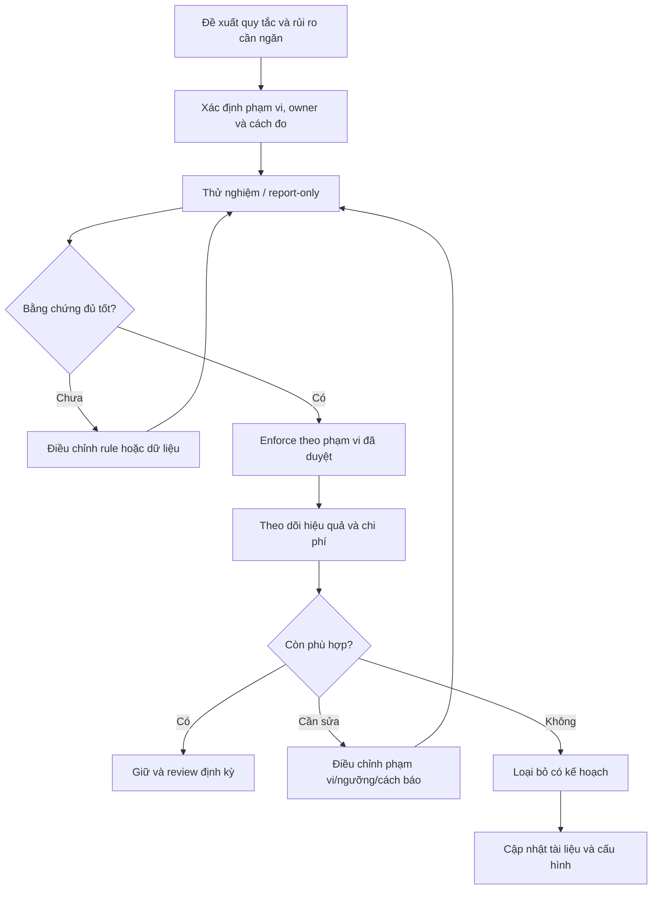

# Giữ, điều chỉnh hoặc loại bỏ quy tắc theo bằng chứng

## 1. Mục tiêu bài học

Trong chương **Cải thiện liên tục** của module **CODE_QUALITY_FUNDAMENTALS**, chúng ta tìm hiểu cách quản lý quy tắc chất lượng phần mềm theo vòng đời: **đề xuất, thử nghiệm, áp dụng, đánh giá lại, điều chỉnh hoặc loại bỏ**. Một quy tắc hữu ích ở thời điểm này có thể trở nên quá chặt, quá lỏng hoặc không còn phù hợp khi kiến trúc, công cụ và cách làm việc thay đổi.

Module hướng đến việc **hiểu những thuộc tính quyết định mã nguồn có đáng tin cậy, dễ hiểu và dễ thay đổi hay không**. Quy tắc coding convention, static analysis, kiểm thử kiến trúc và quality gate đều nhằm giảm rủi ro. Tuy nhiên, nếu nhóm chỉ thêm quy tắc mà không đo hiệu quả, hệ thống có thể tích lũy cảnh báo sai, ngoại lệ vĩnh viễn và thủ tục khó tuân thủ. Nếu loại bỏ quy tắc chỉ vì nó gây phiền, lỗi mà quy tắc từng ngăn có thể quay lại.

Sau bài học, bạn có thể:

- Xác định mục tiêu, phạm vi và rủi ro mà một quy tắc chất lượng cần kiểm soát.
- Thu thập bằng chứng về hiệu quả, chi phí tuân thủ, false positive và tác động đến luồng phát triển.
- Quyết định **giữ nguyên, điều chỉnh hoặc loại bỏ** quy tắc dựa trên dữ liệu và bối cảnh.
- Thiết kế vòng thử nghiệm có thời hạn trước khi enforce rộng rãi.
- Quản lý ngoại lệ có owner, lý do và ngày xem xét lại.
- Dùng ví dụ Java 17 về xử lý exception để minh họa cách thu hẹp một quy tắc quá rộng.
- Ghi lại quyết định và theo dõi kết quả sau thay đổi để quy tắc không trở thành di sản khó hiểu.

## 2. Vì sao quy tắc chất lượng cần được xem xét lại?

Một quy tắc được đưa vào nhóm thường nhằm ngăn một loại rủi ro:

- Không nuốt exception vì lỗi có thể bị che giấu.
- Không để application phụ thuộc trực tiếp vào adapter hạ tầng.
- Không thêm issue bảo mật nghiêm trọng mới.
- Bảo vệ ngưỡng coverage cho phần code mới.
- Không tạo chu kỳ phụ thuộc giữa các module.
- Dùng định dạng thống nhất để diff dễ đọc.

Những mục tiêu này có giá trị, nhưng **cách diễn đạt hoặc cách thực thi quy tắc có thể chưa hoàn hảo**.

Ví dụ, nhóm ban hành quy tắc “Không được bắt `Exception`”. Sau một thời gian, review ghi nhận:

- Một số đoạn code bắt exception rộng rồi bỏ qua lỗi thật sự nguy hiểm.
- Một số boundary handler cần bắt lỗi rộng để ghi log, chuyển thành response có kiểm soát và kết thúc request theo hợp đồng.
- Một số thư viện cũ chỉ ném exception tổng quát.
- Static analyzer báo cả những trường hợp đã giữ nguyên cause và không che giấu lỗi.

Nếu giữ nguyên quy tắc, nhóm có thể phải thêm suppression liên tục. Nếu xóa quy tắc hoàn toàn, hành vi nuốt lỗi có thể quay lại. Cần xem **mục tiêu ban đầu** và bằng chứng để quyết định thu hẹp quy tắc thành điều thực sự cần bảo vệ.

### Quy tắc là phương tiện để bảo vệ chất lượng

Một quy tắc nên giúp nhóm:

1. Ngăn một loại lỗi hoặc rủi ro có thể mô tả rõ.
2. Giữ hợp đồng, ranh giới kiến trúc hoặc thuộc tính mã nguồn đã thống nhất.
3. Phát hiện vấn đề đủ sớm để sửa với chi phí thấp.
4. Cung cấp phản hồi nhất quán và có thể hành động.
5. Không tạo chi phí lớn hơn lợi ích mà nó mang lại.

Khi bối cảnh thay đổi, nhóm cần kiểm tra lại **quy tắc còn bảo vệ đúng mục tiêu không**, **công cụ có đang đo đúng điều cần đo không** và **có cách thực thi tốt hơn không**.

## 3. Vòng đời của một quy tắc chất lượng

Không nên đưa mọi đề xuất thành quy định bắt buộc ngay lập tức. Một vòng đời có kiểm soát có thể gồm:



### Các trạng thái nên phân biệt

| Trạng thái | Ý nghĩa | Điều kiện chuyển tiếp |
| --- | --- | --- |
| **Proposed** | Đang được đề xuất, chưa áp dụng | Có mục tiêu, owner và giả thuyết về lợi ích |
| **Pilot** | Chạy thử, thường ở chế độ report-only hoặc phạm vi nhỏ | Có kết quả thử nghiệm và phản hồi người dùng |
| **Enforced** | Đã trở thành điều kiện bắt buộc trong phạm vi xác định | Có bằng chứng đủ tốt và hướng xử lý khi vi phạm |
| **Adjusted** | Phạm vi, ngưỡng hoặc cách phát hiện đã thay đổi | Có quyết định mới, cấu hình và tài liệu được cập nhật |
| **Exception** | Một trường hợp cụ thể được miễn có kiểm soát | Có lý do, owner, phạm vi và ngày review |
| **Retired** | Quy tắc không còn được áp dụng | Có lý do loại bỏ và đã cập nhật các nơi phụ thuộc |

Các trạng thái này là mô hình quản trị gợi ý, không phải tên trạng thái bắt buộc của một công cụ cụ thể. Nhóm có thể dùng nhãn khác, miễn mọi người hiểu rõ **quy tắc đang ở đâu và điều gì được phép**.

## 4. Bắt đầu bằng mục tiêu, không bắt đầu bằng cú pháp rule

Trước khi giữ hoặc thay đổi một quy tắc, hãy mô tả:

- **Rủi ro:** điều gì có thể xảy ra nếu không có quy tắc?
- **Tác động:** người dùng, dữ liệu, bảo mật, vận hành hoặc bảo trì bị ảnh hưởng thế nào?
- **Phạm vi:** áp dụng cho code production, test, generated code, adapter hay toàn repository?
- **Hành vi cần ngăn:** có thể viết thành điều kiện kiểm chứng được không?
- **Ngoại lệ hợp lệ:** trường hợp nào được phép và vì sao?
- **Bằng chứng:** dữ liệu nào cho thấy rule phát hiện đúng vấn đề?

Ví dụ, mục tiêu “code phải sạch” quá mơ hồ để thành rule. Mục tiêu cụ thể hơn:

> “Trong application service, không được bắt exception rồi trả kết quả thành công hoặc giá trị mặc định khi thao tác chưa hoàn tất; khi chuyển loại lỗi, phải giữ nguyên nguyên nhân để caller và hệ thống quan sát có thể chẩn đoán.”

Mục tiêu này mô tả **hành vi nguy hiểm** và có thể tạo test hoặc static-analysis rule phù hợp. Nó cũng để lại chỗ cho boundary handler xử lý exception rộng nếu việc đó có chủ đích và không che giấu lỗi.

## 5. Bằng chứng nào giúp quyết định?

Không nên giữ hoặc xóa quy tắc chỉ vì một vài người thích hay không thích nó. Cần xem nhiều loại bằng chứng:

| Nhóm bằng chứng | Câu hỏi cần trả lời | Ví dụ dữ liệu |
| --- | --- | --- |
| **Hiệu quả phát hiện** | Rule đã tìm ra vấn đề thật nào? | Bug, incident, security finding hoặc vi phạm kiến trúc được xác nhận |
| **Độ chính xác** | Bao nhiêu cảnh báo được xác nhận là đúng? | Findings đã review, false positives, false negatives được phát hiện sau đó |
| **Chi phí xử lý** | Rule làm nhóm tốn bao nhiêu thời gian? | Thời gian phân loại, sửa, giải thích và xử lý suppression |
| **Khả năng tuân thủ** | Nhóm có thể hiểu và làm theo không? | Tỷ lệ vi phạm lặp lại, câu hỏi thường gặp, bypass |
| **Tác động quy trình** | Rule có làm CI chậm hoặc cản trở công việc hợp lệ không? | Thời gian pipeline, số lần retry, PR bị chặn nhầm |
| **Tính phù hợp kiến trúc** | Rule còn đúng với cấu trúc hiện tại không? | Dependency graph, module mới, generated code, framework mới |
| **Kết quả dài hạn** | Rủi ro có giảm sau khi enforce không? | Lỗi tái diễn, escaped defects, xu hướng issue và thời gian sửa |

### Định nghĩa một số tỷ lệ cần cẩn trọng

Nếu nhóm muốn đo độ chính xác của cảnh báo, cần định nghĩa mẫu số:

- **Tỷ lệ false positive trong các finding đã review** = số finding được xác nhận là false positive / tổng số finding đã được phân loại.
- **Tỷ lệ finding được xác nhận** = số finding được xác nhận có vấn đề / tổng số finding đã được phân loại.

Hai tỷ lệ này chỉ mô tả **mẫu đã review**, không chứng minh toàn bộ cảnh báo hoặc toàn bộ code. Nếu nhóm chỉ review những cảnh báo nghiêm trọng, mẫu sẽ thiên lệch. Những vấn đề công cụ bỏ sót (false negatives) còn cần được tìm qua bug, incident, review hoặc kiểm thử khác.

Ví dụ giả định: nhóm review 40 finding của một rule, xác nhận 30 là vấn đề thật và 10 là false positive. Tỷ lệ false positive trong mẫu đã review là 25%. Đây là tín hiệu cần điều tra, nhưng chưa đủ để tự động xóa rule; cần xem **mức độ nghiêm trọng của 30 vấn đề thật**, chi phí xử lý và cách thu hẹp phạm vi.

## 6. Ba quyết định: giữ, điều chỉnh hoặc loại bỏ

### 6.1. Giữ nguyên khi quy tắc vẫn có giá trị

Nên giữ khi:

- Rule phát hiện được rủi ro có tác động đáng kể.
- Cảnh báo có độ chính xác đủ tốt trong phạm vi đã xác định.
- Chi phí tuân thủ hợp lý so với hậu quả nếu bỏ qua.
- Nhóm hiểu cách sửa và có thể xử lý vi phạm nhất quán.
- Không có thay đổi bối cảnh làm mục tiêu của rule mất ý nghĩa.

Ví dụ: rule cấm hard-code secret vẫn phát hiện credential mới trong source sản phẩm; các cảnh báo được xác nhận, và việc dùng secret manager đã có hướng dẫn rõ. Có thể tiếp tục enforce và theo dõi rule.

**Giữ nguyên không có nghĩa không xem xét lại.** Ghi lại thời điểm review, bằng chứng và owner để quyết định có thể được đánh giá lại khi bối cảnh thay đổi.

### 6.2. Điều chỉnh khi mục tiêu còn đúng nhưng cách áp dụng chưa phù hợp

Nên điều chỉnh khi:

- Rule quá rộng và báo cả trường hợp hợp lệ.
- Ngưỡng không phù hợp với loại module hoặc độ rủi ro.
- Cách phát hiện phụ thuộc cú pháp nên bỏ sót biến thể tương đương.
- Công cụ đã có khả năng mới giúp rule chính xác hơn.
- Tác động đến developer quá lớn so với lợi ích ở một phạm vi cụ thể.

Các kiểu điều chỉnh:

- Thu hẹp hoặc chia nhỏ phạm vi.
- Đổi severity hoặc điều kiện enforce theo mức rủi ro.
- Bổ sung ngoại lệ có cấu trúc và thời hạn.
- Chuyển từ rule cú pháp sang kiểm tra kiến trúc/hợp đồng.
- Chạy report-only ở phạm vi mới trước khi enforce.
- Thay ngưỡng sau khi có dữ liệu phù hợp, không chỉ vì một PR bị chặn.

Ví dụ: thay vì cấm mọi `catch (Exception)`, rule có thể tập trung vào **nuốt exception**, trả kết quả thành công khi thao tác thất bại hoặc chuyển lỗi mà không giữ cause. Boundary handler có thể được phép bắt rộng nếu nó log đầy đủ, chuyển thành lỗi có kiểm soát và không che giấu trạng thái thất bại.

### 6.3. Loại bỏ khi mục tiêu không còn phù hợp hoặc chi phí vượt lợi ích

Có thể loại bỏ khi:

- Rule đo một thuộc tính không còn liên quan đến kiến trúc hoặc ngôn ngữ hiện tại.
- Một kiểm tra khác đã bảo vệ cùng mục tiêu tốt hơn, tránh kiểm tra trùng lặp.
- Công cụ không thể phát hiện chính xác và không có cách cải thiện hợp lý.
- Rule tạo chi phí lớn nhưng không có bằng chứng cho thấy nó giảm rủi ro đáng kể.
- Quy tắc dựa trên giả định đã bị thay thế bởi một hợp đồng hoặc cơ chế mới.

Trước khi loại bỏ, cần hỏi:

- Rủi ro ban đầu còn tồn tại không?
- Có cơ chế thay thế nào đang bảo vệ rủi ro đó?
- Có finding hoặc exception nào phụ thuộc vào rule?
- Có tài liệu, pipeline, dashboard hoặc hướng dẫn nào cần cập nhật?
- Có cần giai đoạn chuyển tiếp để nhóm thích nghi?

**Loại bỏ một rule không có nghĩa bỏ mục tiêu chất lượng mà rule từng bảo vệ.** Nếu rủi ro còn tồn tại, phải xác định cách bảo vệ khác hoặc ghi rõ quyết định chấp nhận rủi ro.

## 7. Ví dụ Java 17: điều chỉnh quy tắc bắt exception

Giả sử nhóm có rule ban đầu:

> “Không được dùng `catch (Exception)` trong code Java.”

Mục tiêu ban đầu là tránh che giấu lỗi. Sau khi áp dụng, review ghi nhận:

1. Một service bắt exception rộng, ghi log rồi trả `true` như thể thao tác thành công.
2. Một HTTP boundary handler bắt lỗi để chuyển thành response chuẩn, ghi log có request ID và kết thúc request theo hợp đồng.

Rule hiện tại đánh dấu cả hai giống nhau. Cấm tuyệt đối không phân biệt được hành vi nguy hiểm và boundary có chủ đích.

### 7.1. Trường hợp thật sự cần ngăn

```java
// OrderSubmissionServiceBefore.java — nuốt lỗi và báo thành công.
public final class OrderSubmissionServiceBefore {
    private final OrderGateway gateway;

    public OrderSubmissionServiceBefore(OrderGateway gateway) {
        this.gateway = gateway;
    }

    public boolean submit(Order order) {
        try {
            gateway.submit(order);
            return true;
        } catch (Exception exception) {
            // Lỗi bị che giấu; caller không biết thao tác thất bại.
            return true;
        }
    }
}
```

Vấn đề không chỉ là kiểu `Exception` rộng. Service **biến thất bại thành thành công**, làm caller có thể ghi nhận đơn đã gửi dù gateway chưa xử lý. Rule nên tập trung vào hành vi này.

### 7.2. Trường hợp boundary có chủ đích

Một HTTP boundary có thể cần chuyển nhiều loại lỗi thành response thống nhất. Ví dụ rút gọn:

```java
// RequestBoundaryHandler.java — minh họa xử lý tại ranh giới.
public final class RequestBoundaryHandler {
    public ApiResponse handle(Request request) {
        try {
            return dispatch(request);
        } catch (Exception exception) {
            logFailure(request.requestId(), exception);
            return ApiResponse.internalError(request.requestId());
        }
    }

    private ApiResponse dispatch(Request request) {
        // Điều phối request theo hợp đồng của ứng dụng.
        throw new UnsupportedOperationException("example");
    }

    private void logFailure(String requestId, Exception exception) {
        // Ghi log có ngữ cảnh, không ghi dữ liệu bí mật.
    }
}
```

Đoạn này là minh họa cho một boundary handler, không phải một logging framework hoàn chỉnh. Việc bắt rộng chỉ hợp lý khi:

- Đây là ranh giới chịu trách nhiệm chuyển lỗi thành response.
- Trạng thái thất bại vẫn được thể hiện đúng, không trả response thành công.
- Lỗi được ghi nhận với ngữ cảnh phù hợp và không lộ dữ liệu nhạy cảm.
- Những lỗi cần retry, rollback hoặc chuyển tiếp không bị xử lý sai.
- Các lỗi nghiêm trọng của runtime không bị cố tình che giấu nếu nền tảng yêu cầu để chúng lan truyền.

### 7.3. Rule được điều chỉnh

Một phiên bản mục tiêu rõ hơn:

> “Không nuốt exception hoặc biến lỗi thành kết quả thành công. Khi chuyển đổi một exception dự kiến sang loại lỗi khác, phải giữ nguyên cause. Bắt exception rộng chỉ được dùng tại boundary có trách nhiệm xử lý lỗi cuối cùng, với log/response phù hợp và không che giấu trạng thái thất bại.”

Rule mới bảo vệ **ngữ nghĩa xử lý lỗi**, đồng thời cho phép trường hợp hợp lệ có kiểm soát. Nó cũng dễ review hơn vì reviewer có thể kiểm tra hành vi thay vì chỉ nhìn từ khóa.

### 7.4. Hiện thực giữ nguyên nguyên nhân lỗi

```java
import java.io.IOException;

interface OrderGateway {
    void submit(Order order) throws IOException;
}

record Order(String id) {}

final class OrderSubmissionException extends RuntimeException {
    OrderSubmissionException(String message, Throwable cause) {
        super(message, cause);
    }
}

public final class OrderSubmissionService {
    private final OrderGateway gateway;

    public OrderSubmissionService(OrderGateway gateway) {
        this.gateway = gateway;
    }

    public void submit(Order order) {
        try {
            gateway.submit(order);
        } catch (IOException exception) {
            throw new OrderSubmissionException(
                    "Unable to submit order " + order.id(), exception);
        }
    }
}
```

Ở đây service bắt loại lỗi mà hợp đồng gateway khai báo, rồi chuyển thành exception phù hợp với use case và giữ nguyên cause. Nếu lỗi cần được retry hoặc phân loại khác, hợp đồng phải bổ sung thông tin thay vì gộp mọi lỗi thành một loại chung.

### 7.5. Kiểm thử JUnit 5

```java
import static org.junit.jupiter.api.Assertions.assertEquals;
import static org.junit.jupiter.api.Assertions.assertSame;
import static org.junit.jupiter.api.Assertions.assertThrows;

import java.io.IOException;
import org.junit.jupiter.api.Test;

class OrderSubmissionServiceTest {
    @Test
    void translatesExpectedFailureAndPreservesCause() {
        IOException original = new IOException("connection reset");
        OrderGateway failingGateway = order -> {
            throw original;
        };
        var service = new OrderSubmissionService(failingGateway);

        OrderSubmissionException result = assertThrows(
                OrderSubmissionException.class,
                () -> service.submit(new Order("ORD-17")));

        assertEquals("Unable to submit order ORD-17", result.getMessage());
        assertSame(original, result.getCause());
    }

    @Test
    void completesWhenGatewaySucceeds() {
        OrderGateway successfulGateway = order -> {};
        var service = new OrderSubmissionService(successfulGateway);

        service.submit(new Order("ORD-18"));
    }
}
```

Test xác minh service không biến lỗi thành thành công và giữ cause để chẩn đoán. Trong dự án thực, cần thêm kiểm thử boundary handler để xác nhận response lỗi, log/trace và transaction theo hợp đồng của hệ thống.

## 8. Đo hiệu quả của một quy tắc sau khi áp dụng

Sau khi điều chỉnh rule, không nên chỉ kiểm tra pipeline có xanh hay không. Hãy theo dõi:

| Chỉ số/quan sát | Cách diễn giải |
| --- | --- |
| **Finding được xác nhận** | Rule có tiếp tục phát hiện hành vi cần ngăn không? |
| **False positive trong mẫu đã review** | Có bao nhiêu cảnh báo không phải vấn đề trong phạm vi được kiểm tra? |
| **Finding mới bị chặn trước merge** | Rule giúp phát hiện vấn đề sớm đến mức nào? |
| **Lỗi cùng loại lọt production** | Rule hoặc kiểm tra khác có bỏ sót tình huống quan trọng không? |
| **Thời gian xử lý finding** | Developer có hiểu và sửa được cảnh báo không? |
| **Số suppression/exception** | Rule có quá rộng, quá khó áp dụng hoặc có nhiều trường hợp hợp lệ chưa được mô tả? |
| **Tỷ lệ bypass** | Nhóm có thường xuyên vượt qua gate? Vì lý do khẩn cấp hay do rule thiếu phù hợp? |
| **Chi phí CI** | Rule có làm tăng đáng kể thời gian pipeline hoặc tài nguyên không? |

### Đặt câu hỏi về quan hệ nhân quả

Nếu sau khi bật rule, số incident giảm, chưa thể kết luận chỉ rule đó gây ra thay đổi. Có thể nhóm đồng thời thêm test, thay API hoặc cải thiện quy trình review. Nên ghi nhận **đóng góp có khả năng**, không tuyên bố quan hệ nhân quả nếu chưa có thiết kế đo lường phù hợp.

Tương tự, nếu số false positive tăng sau khi nâng analyzer, có thể do:

- Phiên bản mới thay đổi thuật toán phát hiện.
- Rule profile được mở rộng.
- Phạm vi code được quét tăng.
- Code mới sử dụng pattern mà rule chưa hỗ trợ tốt.

Hãy xem cấu hình và mẫu issue trước khi kết luận rule đã kém hiệu quả.

## 9. Thử nghiệm rule trước khi enforce rộng

Một cách giảm rủi ro là chạy **pilot**:

1. Chọn một hoặc vài module đại diện.
2. Chạy rule ở chế độ report-only trong khoảng thời gian hoặc số PR đã định trước.
3. Phân loại finding: đúng, false positive, cần làm rõ hoặc ngoài phạm vi.
4. Đo thời gian xử lý, mức độ lặp lại và chi phí CI.
5. Thu thập phản hồi từ tác giả, reviewer và owner kiến trúc.
6. Điều chỉnh rule, tài liệu và ví dụ sửa.
7. Quyết định enforce, tiếp tục pilot có mục tiêu rõ hoặc dừng.

### Tiêu chí chuyển từ pilot sang enforce

Trước pilot, hãy xác định tiêu chí kết thúc, ví dụ:

- Các finding thuộc phạm vi đã được phân loại.
- Không còn false positive nghiêm trọng chưa có cách xử lý.
- Hướng sửa và ngoại lệ hợp lệ đã được tài liệu hóa.
- CI hoàn tất ổn định trên các module mục tiêu.
- Owner và quy trình xử lý khi gate thất bại đã rõ.

Không nên để report-only kéo dài vô thời hạn. Một quy tắc cảnh báo mà không ai xem hoặc không có thời điểm quyết định sẽ tạo **alert fatigue** và làm giảm niềm tin vào hệ thống.

## 10. Quản lý ngoại lệ có trách nhiệm

Không phải mọi trường hợp vi phạm đều có thể sửa ngay. Có thể cần ngoại lệ khi:

- Framework hoặc generated code tạo ra pattern mà rule không hiểu.
- Một API cũ cần được giữ trong giai đoạn migration.
- Boundary handler có lý do kỹ thuật để xử lý lỗi rộng.
- Một module phụ thuộc ngoài chưa thể thay đổi trong chu kỳ hiện tại.

Ngoại lệ nên ghi:

- Rule và issue cụ thể.
- File, symbol hoặc phạm vi chính xác.
- Lý do kỹ thuật và bằng chứng.
- Owner chịu trách nhiệm.
- Ticket hoặc biện pháp giảm thiểu.
- Ngày hết hạn/ngày review lại.

Ví dụ metadata minh họa:

```yaml
exception:
  ruleId: ERR-004
  scope: "RequestBoundaryHandler.handle"
  reason: "Boundary chuyển lỗi thành response chuẩn; không trả kết quả thành công"
  owner: "team-api"
  trackingTicket: "QUALITY-218"
  reviewBy: "2027-02-01"
```

Đây là ví dụ về thông tin cần quản lý, không phải schema của một công cụ cụ thể. Ngoại lệ càng rộng thì càng khó xác minh; nên ưu tiên **một issue hoặc một symbol cụ thể** thay vì suppress cả package.

### Ngoại lệ không phải trạng thái vĩnh viễn

Đến ngày review, owner cần xác nhận:

- Trường hợp hợp lệ còn tồn tại không?
- Rule mới đã được điều chỉnh để không cần suppression chưa?
- Hành vi có thể được refactor về đúng boundary không?
- Ticket giảm nợ đã hoàn thành chưa?
- Có cần gia hạn với lý do mới và người phê duyệt không?

Nếu ngoại lệ không còn cần thiết, hãy xóa suppression và xác minh rule hoạt động lại. Không để comment “TODO remove later” mà không có owner hoặc mốc thời gian.

## 11. Khi nào nên thay đổi ngưỡng, phạm vi hoặc cách phát hiện?

### Ngưỡng

Ví dụ rule giới hạn complexity của một method ở mức 10. Nếu nhiều phương thức hợp lệ vượt ngưỡng do một thuật toán nghiệp vụ khó tránh, cần xem:

- Complexity được tính theo công cụ nào?
- Những phương thức đó có thực sự khó hiểu hoặc khó test không?
- Có thể tách theo trách nhiệm mà không làm logic phân tán?
- Một ngưỡng khác có phù hợp với loại module này không?

Không tăng ngưỡng lên 20 chỉ để làm pipeline xanh. Cũng không hạ xuống 5 chỉ vì muốn dashboard có số đẹp. Ngưỡng nên dựa trên **mẫu mã, rủi ro và khả năng xử lý thực tế**.

### Phạm vi

Một rule có thể áp dụng cho production code nhưng không phù hợp với generated code hoặc test fixture. Thay đổi phạm vi cần:

- Chỉ rõ đường dẫn/source set bị thêm hoặc loại.
- Xác nhận phần code sản phẩm vẫn được kiểm tra.
- Ghi lý do và người phê duyệt.
- Đánh giá tác động lên baseline và báo cáo xu hướng.

Không loại cả một thư mục lớn chỉ vì một số file được sinh tự động.

### Cách phát hiện

Một rule cú pháp có thể báo mọi `catch (Exception)`, nhưng mục tiêu thật là tránh nuốt lỗi. Có thể thay bằng:

- Rule kiểm tra exception bị bỏ qua hoặc không được ném lại.
- Rule phát hiện trả giá trị thành công trong nhánh catch.
- Rule kiểm tra cause khi chuyển exception.
- Review/architecture test tại boundary có trách nhiệm xử lý lỗi.

Không nhất thiết mọi mục tiêu đều có thể được static analysis kiểm tra hoàn toàn. Nếu công cụ chỉ phát hiện được một phần, hãy ghi rõ phần còn cần review hoặc test.

## 12. Ví dụ quyết định giữ, điều chỉnh hay loại bỏ

Giả sử nhóm xem xét ba quy tắc sau sau một quý:

| Quy tắc | Bằng chứng giả định | Quyết định phù hợp để thảo luận |
| --- | --- | --- |
| **SEC-001: Không hard-code secret** | Phát hiện một credential thật trong PR trước; rule hiện tại có finding chính xác và hướng sửa rõ | **Giữ** và tiếp tục enforce; kiểm tra thêm secret scanning ở lịch sử nếu cần |
| **ERR-004: Cấm mọi `catch (Exception)`** | Nhiều false positive ở boundary handler; mục tiêu thật là tránh nuốt lỗi; có test chứng minh boundary xử lý có kiểm soát | **Điều chỉnh** thành rule về nuốt lỗi, giữ cause và boundary exception có phạm vi |
| **STYLE-009: Bắt buộc một kiểu comment cho mọi private method** | Không thấy lợi ích rõ; comment thường lặp lại tên method, phát sinh nhiều cảnh báo lỗi thời; IDE và tên method đã diễn đạt tốt | Có thể **loại bỏ** hoặc chuyển thành hướng dẫn chỉ viết comment khi bổ sung ngữ cảnh cần thiết |

Đây là các tình huống minh họa. Quyết định thật cần dựa trên cấu trúc, ngôn ngữ, công cụ và yêu cầu của repository.

### Bảng quyết định ngắn

| Câu hỏi | Nếu câu trả lời là “có” | Hướng xem xét |
| --- | --- | --- |
| Mục tiêu rủi ro vẫn quan trọng và rule phát hiện tốt? | Có | Giữ |
| Mục tiêu còn đúng nhưng phạm vi/ngưỡng/cách báo chưa phù hợp? | Có | Điều chỉnh |
| Có cơ chế thay thế bảo vệ cùng mục tiêu tốt hơn? | Có | Có thể loại bỏ rule cũ sau khi xác minh |
| Không có bằng chứng về lợi ích và chi phí tuân thủ cao? | Có | Thử thu hẹp hoặc loại bỏ có kiểm soát |
| Rủi ro nghiêm trọng còn tồn tại nhưng rule gây false positive? | Có | Thiết kế kiểm tra thay thế; không xóa mục tiêu |

Không nên biến bảng thành một công thức tự động. Quyết định cần có người chịu trách nhiệm và lý do có thể đọc lại.

## 13. Ghi lại quyết định để quy tắc có thể tiến hóa

Một quyết định quản lý rule nên có tối thiểu:

```text
Rule ID / tên:
Mục tiêu rủi ro:
Phạm vi áp dụng:
Owner:
Trạng thái hiện tại:

Bằng chứng:
- Findings đã xác nhận:
- False positives trong mẫu đã review:
- Tác động đến CI/luồng làm việc:
- Sự cố hoặc lỗi liên quan:

Quyết định:
- Giữ / Điều chỉnh / Loại bỏ:
- Lý do:
- Thay đổi cấu hình hoặc cách phát hiện:
- Ngoại lệ và biện pháp giảm thiểu:

Theo dõi:
- Ngày áp dụng:
- Ngày review lại:
- Tiêu chí đánh giá thành công:
- Owner và ticket:
```

Ghi quyết định trong nơi nhóm đang quản lý chính sách kỹ thuật hoặc architecture decision record. Không để lý do chỉ tồn tại trong một cuộc trò chuyện hoặc trong comment suppression.

### Quản lý phiên bản quy tắc

Khi rule thay đổi, nên ghi:

- Rule ID có giữ nguyên không; nếu mục tiêu đã khác, có cần ID mới?
- Ngày bắt đầu enforce.
- Module/phạm vi bị ảnh hưởng.
- Thay đổi severity, threshold hoặc exception.
- Cách xử lý finding hiện hữu.
- Hướng dẫn sửa và ví dụ trước/sau.

Điều này giúp nhóm hiểu vì sao một finding xuất hiện hoặc biến mất sau khi nâng phiên bản cấu hình. Nếu rule profile được thay đổi mà không lưu lịch sử, xu hướng chất lượng có thể không còn so sánh được.

## 14. Tránh các cách cải thiện giả

**Tắt rule vì CI đỏ nhiều.** Điều này làm mất khả năng phát hiện cả lỗi mới. Hãy phân loại finding và thu hẹp điều kiện báo nếu cần.

**Nới ngưỡng không có bằng chứng.** Nếu một method vượt ngưỡng, hãy đọc logic và đánh giá trách nhiệm; không tự động tăng giới hạn chỉ để PR qua gate.

**Suppress cả package.** Ngoại lệ rộng có thể che vấn đề mới không liên quan; giới hạn theo issue/symbol và có ngày review.

**Thêm rule cho mọi sự cố.** Một incident có thể cần cải thiện test, kiến trúc hoặc vận hành chứ không nhất thiết cần một static-analysis rule mới. Quá nhiều rule làm tăng nhiễu.

**Giữ rule vì “từ trước đến nay vẫn thế”.** Lịch sử là thông tin, không phải bằng chứng đủ về lợi ích hiện tại.

**Xóa rule chỉ vì có false positive.** Một rule vẫn có thể ngăn rủi ro nghiêm trọng dù cần điều chỉnh. Hãy cân nhắc tỷ lệ phát hiện đúng, tác động và phương án thay thế.

**Đánh giá rule chỉ bằng số cảnh báo.** Finding tăng có thể do phạm vi quét tăng hoặc analyzer tốt hơn; finding giảm có thể do suppression hoặc exclusion.

**Để pilot kéo dài mãi.** Report-only không có owner và ngày kết thúc sẽ tạo cảnh báo bị bỏ qua.

**Không kiểm tra lại sau khi sửa rule.** Cấu hình mới có thể làm mất cả finding hợp lệ hoặc tạo lỗi pipeline; cần test trên tập mã đại diện.

## 15. Quy trình review định kỳ

Một nhóm có thể xem xét rule theo chu kỳ hoặc khi có tín hiệu bất thường:

1. **Chọn rule cần review:** dựa trên false positive, suppression tăng, thời gian CI, incident hoặc thay đổi kiến trúc.
2. **Đọc lại mục tiêu gốc:** rủi ro nào rule được tạo để ngăn?
3. **Thu thập dữ liệu có phạm vi:** finding, phân loại, thời gian xử lý, bypass và lỗi liên quan.
4. **Lấy mẫu code thật:** xem finding đúng, false positive và những trường hợp có thể bị bỏ sót.
5. **Thảo luận với owner và người dùng rule:** developer, reviewer, security/architecture owner khi phù hợp.
6. **Chọn giữ, điều chỉnh hoặc loại bỏ:** ghi lý do và phương án thay thế nếu mục tiêu vẫn quan trọng.
7. **Thử nghiệm thay đổi:** chạy report-only hoặc phạm vi nhỏ; kiểm tra cả code hợp lệ và code vi phạm.
8. **Enforce theo mốc đã công bố:** cập nhật tài liệu, cấu hình và hướng xử lý.
9. **Theo dõi sau áp dụng:** xác nhận hiệu quả và chi phí theo tiêu chí đã đặt.
10. **Lưu quyết định:** owner, ngày review tiếp theo và bằng chứng.

Không cần chờ đến kỳ review nếu rule đang gây false negative nghiêm trọng hoặc cản trở sửa một lỗ hổng khẩn cấp. Có thể xử lý sớm theo quy trình thay đổi khẩn cấp, nhưng vẫn cần ghi lại quyết định và kiểm tra sau đó.

## 16. Bài tập tự kiểm tra

### Bài tập 1 — giữ hay điều chỉnh?

Một rule giới hạn method complexity ở 10. Trong ba tháng, 80% finding đã review là phương thức điều phối hợp lệ; tuy nhiên, 5 method phức tạp thật sự được xác nhận có bug nhánh và khó test.

**Câu hỏi:** Có nên xóa rule vì nhiều false positive không? Cần xem bằng chứng nào tiếp theo?

**Gợi ý:** Chưa nên xóa ngay. Xem cách analyzer tính complexity, loại method và khả năng thu hẹp phạm vi; xác định liệu finding đúng có mang lại giá trị đủ lớn. Có thể điều chỉnh threshold hoặc áp dụng khác nhau cho orchestration và domain logic, rồi pilot.

### Bài tập 2 — loại bỏ rule trùng lặp

Một rule nội bộ kiểm tra dependency vulnerability trùng với scanner dependency đã được chuẩn hóa, nhưng hai công cụ cho kết quả khác nhau và một pipeline chạy chậm.

**Câu hỏi:** Có thể xóa rule nội bộ ngay không?

**Gợi ý:** Cần so sánh database lỗ hổng, phiên bản, phạm vi dependency, cách xử lý transitive dependency và mức độ nghiêm trọng. Nếu scanner chuẩn hóa bảo vệ đầy đủ mục tiêu, có thể retire rule cũ sau khi xác minh pipeline và báo cáo.

### Bài tập 3 — ngoại lệ không có ngày hết hạn

Một package có suppression cho rule kiến trúc từ hai năm trước, owner đã rời nhóm và ticket không còn tồn tại.

**Câu hỏi:** Nhóm nên làm gì trước khi xóa hoặc gia hạn suppression?

**Gợi ý:** Tìm hiểu ranh giới và phụ thuộc hiện tại, xác định lý do ban đầu nếu có bằng chứng, gán owner mới và đánh giá rủi ro. Không tự động xóa nếu việc đó làm build hỏng, cũng không gia hạn vô thời hạn mà không có quyết định.

### Bài tập 4 — rule bắt exception

Rule cấm mọi `catch (Exception)` tạo false positive ở boundary handler nhưng từng phát hiện một service nuốt lỗi rồi trả thành công.

**Câu hỏi:** Mục tiêu nào cần giữ? Phần nào cần điều chỉnh?

**Gợi ý:** Giữ mục tiêu không che giấu thất bại và bảo toàn nguyên nhân lỗi; điều chỉnh để cho phép boundary bắt rộng trong phạm vi có trách nhiệm, với response lỗi/log phù hợp. Test service và boundary riêng.

### Bài tập 5 — pilot không có tiêu chí kết thúc

Rule mới chạy report-only sáu tháng. Không ai phân loại cảnh báo và không có ngày quyết định enforce.

**Câu hỏi:** Vì sao trạng thái này không phải thử nghiệm hiệu quả? Cần bổ sung gì?

**Gợi ý:** Không có dữ liệu phân loại, owner và tiêu chí quyết định; cảnh báo trở thành nhiễu. Chọn mẫu review, người chịu trách nhiệm, thời gian pilot, tiêu chí pass/fail và ngày kết thúc.

### Bài tập 6 — quyết định dựa trên số liệu

Một rule có 50 finding đã review: 40 finding đúng, 10 false positive. Trong các finding đúng, 8 finding là lỗi nghiêm trọng đã được sửa trước merge. Chi phí xử lý false positive trung bình là 3 phút mỗi finding.

**Câu hỏi:**

1. Tỷ lệ false positive trong mẫu đã review là bao nhiêu?
2. Chỉ số này có đủ để loại rule không?
3. Cần ghi nhận lợi ích và chi phí nào khác?

**Gợi ý:** Tỷ lệ false positive là 10/50 = 20%. Chưa đủ để loại rule vì 8 finding nghiêm trọng đã được ngăn trước merge. Cần xem mức độ rủi ro, false negatives, thời gian xử lý finding đúng, chi phí CI, khả năng thu hẹp rule và phương án thay thế.

## 17. Checklist trước khi thay đổi một quy tắc

- **Mục tiêu gốc còn quan trọng không?** Rủi ro cần ngăn có còn xuất hiện trong kiến trúc hiện tại?
- **Bằng chứng có đủ đại diện không?** Đã review cả finding đúng, false positive và các trường hợp có thể bị bỏ sót?
- **Phạm vi và cách đo rõ không?** Rule đang áp dụng ở đâu, dùng phiên bản/cấu hình nào?
- **Chi phí tuân thủ được ghi nhận chưa?** Thời gian phân loại, sửa, CI và số ngoại lệ?
- **Quyết định có đúng loại không?** Giữ, điều chỉnh hay retire; có phương án bảo vệ thay thế không?
- **Ngoại lệ có giới hạn không?** Issue/scope, owner, lý do, ticket và ngày review?
- **Pilot có tiêu chí kết thúc không?** Ai phân loại, bao lâu và điều gì cho phép enforce?
- **Cấu hình mới đã được kiểm tra không?** Có phát hiện vi phạm thật và tránh báo sai trường hợp hợp lệ?
- **Tài liệu và lịch sử đã cập nhật chưa?** Rule ID, phạm vi, severity, ví dụ sửa và quyết định?
- **Có kế hoạch đo lại không?** Khi nào xác nhận quy tắc mới thực sự cải thiện chất lượng?

## 18. Ghi nhớ

**Giữ, điều chỉnh hoặc loại bỏ quy tắc theo bằng chứng** là một phần của cải thiện liên tục. Quy tắc cần có mục tiêu rủi ro rõ, phạm vi đo được và người chịu trách nhiệm. Hãy xem cả finding được xác nhận, false positive, chi phí tuân thủ, lỗi lọt qua và sự thay đổi của kiến trúc. Giữ quy tắc còn giá trị; điều chỉnh phạm vi, ngưỡng hoặc cách phát hiện khi mục tiêu đúng nhưng cách áp dụng chưa phù hợp; chỉ loại bỏ khi đã xác minh mục tiêu không còn cần thiết hoặc có cơ chế thay thế. Pilot có tiêu chí, ngoại lệ có thời hạn và quyết định được ghi lại giúp **hệ thống kiểm soát chất lượng tiến hóa cùng codebase mà vẫn giữ được những bảo đảm quan trọng**.
