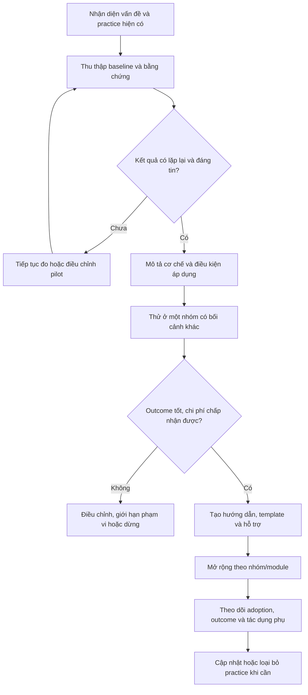

# Mở rộng cách làm đã có hiệu quả

Một nhóm phát hiện rằng mỗi lần thêm quy tắc nghiệp vụ mới, họ thường quên cập nhật một trong các luồng xử lý. Sau vài lần phát sinh lỗi, nhóm thống nhất một cách làm: xác định nơi sở hữu quy tắc, viết test cho các trường hợp biên và kiểm tra những điểm gọi cùng sử dụng quy tắc đó trong code review. Trong vài sprint, số lỗi do các luồng áp dụng chính sách không nhất quán giảm rõ rệt.

Nhóm khác nghe thấy kết quả này và muốn áp dụng ngay. Họ sao chép nguyên checklist, yêu cầu mọi pull request phải có cùng số lượng test và cùng mẫu tài liệu. Nhưng nhóm thứ hai làm một dịch vụ xử lý batch, không có luồng HTTP hay nhiều use case tương tự. Checklist mới khiến review dài hơn mà không phát hiện thêm rủi ro đáng kể.

Đây là khác biệt giữa **mở rộng một cách làm có hiệu quả** và **sao chép hình thức của nó**. Trong chương **Cải thiện liên tục** của module **CODE_QUALITY_FUNDAMENTALS**, bài học này tập trung vào cách nhân rộng một thực hành đã chứng minh giá trị mà vẫn giữ được nguyên nhân tạo ra kết quả, điều chỉnh theo bối cảnh và theo dõi tác động sau khi mở rộng.

Mục tiêu của cải thiện liên tục là giúp mã nguồn **đáng tin cậy, dễ hiểu và dễ thay đổi**. Khi một cách làm có ích ở một nhóm, việc mở rộng cần dựa trên bằng chứng, khả năng áp dụng và trách nhiệm duy trì, không chỉ dựa trên sự hào hứng ban đầu.

## 1. Mở rộng cách làm có hiệu quả nghĩa là gì?

Một cách làm (practice) là tập hợp hành động, quyết định và công cụ giúp nhóm đạt một kết quả nhất định. Ví dụ:

- Viết kiểm thử cho bất biến dữ liệu trước khi thay đổi luồng ghi.
- Dùng cùng một nguồn chính sách thay vì sao chép điều kiện nghiệp vụ.
- Phân loại lỗi quality gate thành lỗi kiểm tra và lỗi công cụ không chạy được.
- Thực hiện refactor theo bước nhỏ, có kiểm chứng hành vi.
- Dùng checklist review theo rủi ro đối với dữ liệu, trạng thái, đồng thời và tài nguyên.
- Ghi lại quyết định kiến trúc và điều kiện xem xét lại.

**Mở rộng** có nghĩa là đưa cách làm đã chứng minh hiệu quả tới phạm vi lớn hơn: nhiều người hơn, nhiều nhóm hơn, nhiều module hơn, khối lượng thay đổi lớn hơn hoặc mức độ rủi ro cao hơn.

Mở rộng không nhất thiết là yêu cầu mọi nhóm làm giống hệt nhau. Cần xác định phần nào tạo ra kết quả và phần nào phải thay đổi theo kiến trúc, quy mô, kỹ năng và ràng buộc của từng nhóm.

### 1.1. Bốn kiểu mở rộng thường gặp

| Kiểu mở rộng | Thay đổi về phạm vi | Ví dụ |
| --- | --- | --- |
| **Theo chiều rộng** | Thêm nhóm hoặc module áp dụng | Một nhóm áp dụng kiểm thử bất biến, sau đó hai nhóm khác thử |
| **Theo chiều sâu** | Bảo vệ thêm nhiều đường đi hoặc loại rủi ro | Từ unit test cho domain sang integration test cho DB transaction |
| **Theo quy mô** | Xử lý tải, dữ liệu hoặc tần suất lớn hơn | Chạy kiểm tra trên nhiều module hoặc nhiều dependency hơn |
| **Theo mức độ tự động hóa** | Chuyển thao tác thủ công lặp lại thành công cụ hỗ trợ | Từ checklist review sang template PR và CI checks phù hợp |

Một cách làm có thể mở rộng theo một chiều nhưng chưa phù hợp theo chiều khác. Ví dụ, checklist review dễ chia sẻ cho nhiều nhóm, nhưng không có nghĩa một test concurrency chạy trong mọi pull request đều hợp lý về thời gian và tài nguyên.

### 1.2. Mở rộng kết quả, không nhân bản nghi thức

Hãy phân biệt ba thứ:

- **Nguyên tắc:** điều cần bảo vệ, ví dụ mọi thao tác ghi phải giữ bất biến sức chứa.
- **Cơ chế:** cách nguyên tắc được bảo vệ, ví dụ transaction, unique constraint và kiểm thử cạnh tranh.
- **Nghi thức:** hình thức thực hiện, ví dụ một biểu mẫu có 12 ô hoặc một buổi họp review.

Nguyên tắc và cơ chế thường có khả năng tái sử dụng cao. Nghi thức cần được xem xét theo bối cảnh. Nếu chỉ sao chép biểu mẫu mà không mang theo cơ chế bảo vệ, nhóm có thể hoàn thành đủ ô nhưng vẫn không giữ được chất lượng.

## 2. Chứng minh cách làm thực sự hiệu quả trước khi nhân rộng

Một kết quả tốt trong một sprint chưa đủ để kết luận cách làm phù hợp với toàn tổ chức. Có thể kết quả đến từ thay đổi nhỏ, nhóm có kinh nghiệm đặc biệt, tải thấp hoặc một sự kiện ngẫu nhiên.

Trước khi mở rộng, cần trả lời:

1. Vấn đề ban đầu là gì và ảnh hưởng tới ai?
2. Cách làm đã thay đổi điều gì trong quy trình hoặc hệ thống?
3. Kết quả nào đã cải thiện?
4. So sánh với mốc nào và trong khoảng thời gian nào?
5. Có thay đổi nào khác cùng lúc ảnh hưởng kết quả không?
6. Chi phí, tác dụng phụ hoặc rủi ro mới là gì?
7. Nhóm khác có điều kiện tương tự không?

### 2.1. Đo kết quả, không chỉ đếm hoạt động

Ví dụ nhóm triển khai checklist review mới. Những số liệu sau có ý nghĩa khác nhau:

| Chỉ số | Đo điều gì? | Có chứng minh hiệu quả không? |
| --- | --- | --- |
| Số PR dùng checklist | Mức độ áp dụng | Chưa; chỉ cho biết có sử dụng |
| Số comment review | Hoạt động review | Chưa; nhiều comment có thể là nhiễu |
| Số lỗi lọt tới production thuộc phạm vi checklist | Kết quả chất lượng | Có ích nếu phân loại và so sánh nhất quán |
| Thời gian từ mở PR đến merge | Chi phí vòng phản hồi | Cần xem cùng độ phức tạp và thời gian chờ |
| Số lỗi hồi quy sau thay đổi | Độ tin cậy của thay đổi | Có ích nếu định nghĩa phạm vi và mức độ |
| Mức độ hài lòng của người review | Trải nghiệm áp dụng | Bổ sung góc nhìn, không thay thế kết quả kỹ thuật |

Không nên kết luận checklist tốt chỉ vì 95% PR đã dùng nó. Tỷ lệ áp dụng cao chứng minh mức độ phổ biến, không chứng minh chất lượng tăng.

### 2.2. Thiết lập baseline có ý nghĩa

Baseline là dữ liệu trước khi áp dụng cách làm, dùng để so sánh với giai đoạn sau.

Một baseline tốt cần:

- Có cùng định nghĩa chỉ số trước và sau.
- Bao phủ thời gian đủ đại diện cho nhịp làm việc.
- Ghi nhận quy mô thay đổi và mức độ phức tạp nếu có thể.
- Phân biệt lỗi phát hiện trong CI với lỗi phát hiện sau phát hành.
- Nêu rõ nguồn dữ liệu và phần dữ liệu thiếu.
- Tránh chọn riêng giai đoạn tệ nhất làm mốc để tạo ra mức cải thiện có vẻ lớn.

Ví dụ, số lỗi sau phát hành có thể giảm vì số lần triển khai cũng giảm. Khi đó nên xem tỷ lệ lỗi trên mỗi lần triển khai hoặc trên nhóm thay đổi tương đương, đồng thời xem thời gian phát hành có bị kéo dài quá mức không.

### 2.3. Dùng nhiều loại bằng chứng

Không phải mọi lợi ích đều có thể đo bằng một con số. Có thể kết hợp:

- **Định lượng:** tỷ lệ lỗi, thời gian xử lý, số lần rollback, chi phí CI.
- **Định tính:** phản hồi của developer, reviewer, QA và vận hành.
- **Kỹ thuật:** test report, trace, log, diff, kết quả phân tích và kiến trúc.
- **Vận hành:** incident, cảnh báo, thời gian phục hồi, tải và tài nguyên.
- **So sánh:** nhóm thử nghiệm với baseline hoặc nhóm có bối cảnh gần tương đương.

Khi bằng chứng chưa đủ, ghi rõ mức độ tin cậy và điều cần đo tiếp. Không cần biến một quan sát sơ bộ thành kết luận chắc chắn.

## 3. Tìm cơ chế tạo ra kết quả

Một cách làm có hiệu quả thường có một hoặc nhiều cơ chế cụ thể. Nếu không hiểu cơ chế, nhóm dễ sao chép bước bề mặt nhưng bỏ mất yếu tố quan trọng.

Ví dụ: nhóm giảm lỗi cập nhật sức chứa nhờ thêm test cho hai request tranh chỗ cuối. Cơ chế tạo ra kết quả không phải “thêm một test có CountDownLatch”. Đó là:

1. Nhóm nhận diện bất biến sức chứa.
2. Nhóm xác định điểm check-then-act có thể xảy ra đồng thời.
3. Cơ chế cập nhật nguyên tử được đặt ở nơi sở hữu dữ liệu.
4. Test tích hợp kiểm tra hành vi tại ranh giới DB.
5. Review yêu cầu bằng chứng cho đường cạnh tranh và rollback.

Nhóm khác có thể dùng một kỹ thuật đồng bộ khác, miễn là bảo vệ được cùng bất biến ở đúng ranh giới.

### 3.1. Tách phần cốt lõi và phần có thể tùy biến

| Thành phần của practice | Mức độ cần giữ | Ví dụ |
| --- | --- | --- |
| Mục tiêu chất lượng | Giữ nguyên | Không vượt sức chứa |
| Bất biến hoặc hợp đồng cần bảo vệ | Giữ nguyên nếu cùng nghiệp vụ | Một suất chỉ được cấp cho một đăng ký hợp lệ |
| Bằng chứng tối thiểu | Giữ nguyên ý nghĩa | Kiểm tra hành vi khi hai yêu cầu cạnh tranh |
| Công cụ cụ thể | Có thể thay | JUnit, test framework khác hoặc test harness |
| Cách tổ chức review | Có thể thay | Checklist, pairing hoặc review theo rủi ro |
| Ngưỡng thời gian/chi phí | Cần hiệu chỉnh | Thời gian CI tùy kích thước dự án |
| Người chịu trách nhiệm | Cần xác định tại từng nhóm | Owner của domain hoặc service |
| Ngoại lệ | Có thể khác theo policy | Module batch không có luồng request đồng thời |

Một nguyên tắc tốt để nhân rộng là **giữ kết quả và cơ chế bảo vệ, cho phép thay đổi cách triển khai khi bối cảnh khác**.

### 3.2. Kiểm tra điều kiện áp dụng

Trước khi chuyển practice sang nhóm khác, hãy xem:

- Nhóm đó có cùng loại rủi ro không?
- Dữ liệu và trạng thái có cùng ranh giới sở hữu không?
- Hệ thống có nhiều writer hoặc nhiều instance không?
- Toolchain và môi trường test có hỗ trợ cách làm không?
- Chi phí áp dụng có tương xứng với hậu quả nếu xảy ra lỗi?
- Nhóm có người hiểu và duy trì practice không?
- Có cách thử nghiệm nhỏ và quay lại nếu không hiệu quả không?

Nếu câu trả lời khác nhau, có thể cần một biến thể thay vì áp dụng nguyên bản.

## 4. Chọn practice phù hợp để mở rộng

Không phải mọi thành công cục bộ đều đáng nhân rộng. Một thực hành có thể hữu ích nhưng chi phí duy trì cao, phụ thuộc một cá nhân hoặc chỉ giải quyết một tình huống hiếm.

Có thể đánh giá qua ma trận:

| Tiêu chí | Câu hỏi |
| --- | --- |
| **Tác động** | Nó giảm rủi ro hoặc chi phí nào? |
| **Tính lặp lại** | Kết quả có xuất hiện qua nhiều lần áp dụng không? |
| **Khả năng chuyển giao** | Nhóm khác có thể hiểu và thực hiện không? |
| **Tính phù hợp** | Có nhóm nào thực sự gặp vấn đề tương tự không? |
| **Chi phí** | Cần thêm bao nhiêu thời gian, tool và năng lực? |
| **Khả năng duy trì** | Ai cập nhật tài liệu, template, rule và công cụ? |
| **Khả năng kiểm chứng** | Có thể theo dõi adoption và outcome không? |
| **Khả năng đảo ngược** | Có thể thu hẹp hoặc dừng nếu tác dụng phụ lớn không? |

### 4.1. Khi nào chưa nên mở rộng?

Nên tiếp tục thử nghiệm hoặc tìm hiểu thêm nếu:

- Kết quả mới xuất hiện một lần và chưa lặp lại.
- Không có baseline hoặc không biết nguyên nhân cải thiện.
- Practice phụ thuộc một chuyên gia duy nhất.
- Chi phí áp dụng ở nhóm đầu đã vượt lợi ích.
- Nhóm khác không gặp vấn đề mà practice giải quyết.
- Chưa có cách xử lý khi practice làm chậm quy trình.
- Chưa xác định người duy trì sau khi người khởi xướng rời nhóm.

Không mở rộng ngay không có nghĩa practice thất bại. Có thể nó chỉ phù hợp với một loại hệ thống hoặc cần được đơn giản hóa trước.

## 5. Mở rộng theo từng giai đoạn

Một lộ trình phổ biến là đi từ thử nghiệm nhỏ đến áp dụng có hỗ trợ, rồi mới đưa vào chuẩn chung.



### 5.1. Giai đoạn 1 — Thử nghiệm trong phạm vi nhỏ

Chọn một vấn đề cụ thể, một nhóm có quyền sở hữu rõ và thời gian thử nghiệm xác định.

Cần ghi:

- Vấn đề và tác động hiện tại.
- Practice sẽ được thử.
- Giả thuyết về cơ chế tạo ra cải thiện.
- Baseline và chỉ số theo dõi.
- Rủi ro có thể phát sinh.
- Điều kiện dừng hoặc quay lại cách cũ.
- Người quyết định kết quả pilot.

Pilot không phải dự án triển khai đầy đủ. Mục tiêu là học nhanh với chi phí và phạm vi có giới hạn.

### 5.2. Giai đoạn 2 — Thử ở bối cảnh khác

Một practice chỉ được kiểm chứng ở nhóm đầu có thể phù hợp với đặc điểm riêng của nhóm đó. Hãy chọn nhóm thứ hai có một số điểm khác biệt quan trọng: ngôn ngữ, kiến trúc, quy mô, mức tự động hóa hoặc loại dữ liệu.

Quan sát:

- Thành phần nào dễ hiểu và tái sử dụng?
- Bước nào gây khó khăn?
- Có giả định nào chỉ đúng với nhóm đầu?
- Kết quả có giữ được không?
- Có chi phí mới xuất hiện không?

Nếu phải thay đổi practice, ghi rõ **điều chỉnh nào là cần thiết và vì sao**. Đây là dữ liệu để tạo phiên bản phù hợp hơn.

### 5.3. Giai đoạn 3 — Chuẩn hóa phần tối thiểu

Khi có bằng chứng ở nhiều bối cảnh, hãy tạo tài liệu đủ để người khác tự áp dụng:

- Mục tiêu và vấn đề practice giải quyết.
- Phạm vi và điều kiện áp dụng.
- Các bước tối thiểu.
- Bằng chứng cần tạo.
- Vai trò và người hỗ trợ.
- Ví dụ thành công và ví dụ không phù hợp.
- Cách xử lý ngoại lệ.
- Cách phản hồi và đề xuất thay đổi.

Chuẩn hóa không có nghĩa mọi nhóm phải sử dụng cùng một công cụ. Chuẩn hóa **điều cần đạt và bằng chứng**, còn cách thực hiện có thể thay đổi khi hợp lý.

### 5.4. Giai đoạn 4 — Mở rộng theo mức độ sẵn sàng

Có thể ưu tiên nhóm có rủi ro tương tự và đủ năng lực tiếp nhận. Không cần bật bắt buộc cho toàn bộ repository trong một lần.

Một rollout có thể chia thành:

1. Nhóm tiên phong tự nguyện.
2. Nhóm có hệ thống tương tự.
3. Module có rủi ro cao hoặc nhiều writer.
4. Phạm vi còn lại khi công cụ và hướng dẫn đã ổn định.

Trong mỗi giai đoạn, kiểm tra outcome và chi phí trước khi chuyển tiếp.

### 5.5. Giai đoạn 5 — Theo dõi và cải tiến sau mở rộng

Sau khi practice trở thành một phần của quy trình, tiếp tục theo dõi:

- Tỷ lệ áp dụng thực chất.
- Kết quả chất lượng.
- Thời gian và chi phí.
- Số ngoại lệ.
- Tác dụng phụ hoặc hành vi lách quy tắc.
- Mức độ cập nhật của tài liệu và tool.
- Phản hồi từ nhóm mới.

Một practice từng hiệu quả có thể mất hiệu quả khi hệ thống hoặc tổ chức thay đổi. Cần có cơ chế xem xét lại, không coi việc chuẩn hóa là kết thúc cải thiện.

## 6. Ví dụ xuyên suốt: nhân rộng kiểm tra bất biến đăng ký khóa học

Một nhóm quản lý khóa học gặp lỗi vượt sức chứa. Ban đầu, nhóm chỉ kiểm tra số chỗ còn lại trong bộ nhớ trước khi ghi đăng ký. Khi hai request đến đồng thời, cả hai cùng đọc thấy một chỗ và đều ghi thành công.

Nhóm thay đổi cách làm:

- Xác định bất biến: số enrollment đang hoạt động không vượt sức chứa.
- Xác định owner của sức chứa và vòng đời enrollment.
- Bảo vệ thao tác giữ chỗ và tạo enrollment tại database trong cùng transaction.
- Dùng unique constraint để ngăn đăng ký hoạt động trùng theo cặp lớp-học viên.
- Thêm integration test cho hai request tranh suất cuối.
- Theo dõi lỗi vượt sức chứa và lỗi constraint sau phát hành.

Sau một giai đoạn, nhóm ghi nhận số lỗi vượt sức chứa giảm. Nhóm muốn mở rộng practice này sang các dịch vụ khác có dữ liệu cạnh tranh.

### 6.1. Gói practice được chia sẻ

```yaml
practice:
  name: Protect shared-state invariants
  purpose: Keep shared data valid under concurrent updates
  applies_when:
    - Multiple requests can update the same business state
    - A business rule spans more than one write
    - Duplicate commands can create repeated effects
  core_steps:
    - Name the invariant and its owner
    - Identify the authoritative state boundary
    - Protect the transition atomically
    - Add a test at the real persistence boundary
    - Define retry and duplicate-command behavior
    - Monitor violations and rejected transitions
  evidence:
    - Unit tests for domain rules
    - Integration tests for transaction and constraints
    - Concurrency test for competing updates
    - Operational metric for invariant violations
```

Đây là **mẫu mô tả practice**, không phải cấu hình tự động của một công cụ. Nhóm có thể đổi tên file, test framework hoặc database, nhưng cần giữ các ý nghĩa: bất biến, owner, ranh giới trạng thái chuẩn, cập nhật nguyên tử, bằng chứng và quan sát sau triển khai.

### 6.2. Một ví dụ về kiểm tra cập nhật nguyên tử

Đoạn SQL khái niệm, giả định bảng course có bộ đếm enrolled_count và bảng enrollment có các cột tương ứng:

```sql
BEGIN;

UPDATE course
SET enrolled_count = enrolled_count + 1
WHERE course_id = :courseId
  AND enrolled_count < capacity;

-- Chỉ tiếp tục khi đúng một hàng được cập nhật.
INSERT INTO enrollment (
    enrollment_id, course_id, student_id, status
) VALUES (
    :enrollmentId, :courseId, :studentId, 'ACTIVE'
);

COMMIT;
```

Trong triển khai thật, cần kiểm tra số hàng cập nhật, rollback nếu insert thất bại và bảo vệ cặp lớp-học viên bằng constraint phù hợp. Cú pháp và isolation phụ thuộc DBMS. Practice không quy định mọi nhóm phải dùng đúng đoạn SQL này; nó yêu cầu **bằng chứng rằng cập nhật sức chứa và tạo enrollment được bảo vệ như một chuyển đổi nhất quán**.

### 6.3. Áp dụng cho dịch vụ khác

Một dịch vụ xử lý đặt lịch có thể có bất biến “một phòng không có hai lịch đặt trùng thời gian”. Cơ chế cụ thể có thể là exclusion constraint, khóa theo tài nguyên hoặc transaction phù hợp. Một hệ thống xử lý thanh toán có bất biến “một yêu cầu logic không thu tiền hai lần”, cần idempotency và đối soát.

Các nhóm không nên sao chép nguyên bảng course hay tên enrolled_count. Họ cần thực hiện cùng phương pháp:

1. Xác định bất biến nghiệp vụ của mình.
2. Xác định owner và nguồn chuẩn.
3. Tìm mọi đường cập nhật cạnh tranh.
4. Bảo vệ chuyển đổi ở ranh giới dữ liệu.
5. Kiểm thử bằng adapter hoặc database thật khi cần.
6. Theo dõi vi phạm và retry sau triển khai.

### 6.4. Đo kết quả khi mở rộng

Một bộ chỉ số minh họa:

| Chỉ số | Trước pilot | Sau pilot | Cách diễn giải |
| --- | ---: | ---: | --- |
| Sự cố vượt sức chứa trong 30 ngày | 4 | 0 | Tín hiệu outcome tích cực, cần theo dõi thêm |
| Integration test cho tranh chấp | 0 | 3 | Bằng chứng được bổ sung |
| Thời gian CI trung vị của module | 6 phút | 7 phút | Chi phí tăng 1 phút cần cân nhắc |
| Lỗi constraint khi đăng ký | Không đo riêng | 12 lần bị từ chối | Có thể là duplicate/race được ngăn; cần phân loại |
| PR có review bất biến | 20% | 90% | Adoption tăng, chưa tự chứng minh outcome |

Số liệu là **giả định minh họa**. Đặc biệt, số lỗi constraint tăng không nhất thiết là chất lượng xấu đi: trước đây hệ thống có thể chấp nhận dữ liệu trùng, nay constraint từ chối. Cần phân biệt thao tác hợp lệ bị từ chối nhầm với request trùng được ngăn đúng.

## 7. Tạo gói chuyển giao để nhóm khác có thể tự áp dụng

Một practice chỉ nằm trong đầu người khởi xướng sẽ khó mở rộng. Cần biến tri thức thành tài liệu và ví dụ có thể chuyển giao.

Một practice card ngắn có thể gồm:

| Trường | Nội dung |
| --- | --- |
| Tên | Tên ngắn, dễ tìm |
| Vấn đề | Tình huống practice giải quyết |
| Kết quả mong đợi | Thay đổi chất lượng cần đạt |
| Khi áp dụng | Điều kiện và dấu hiệu nhận biết |
| Khi không áp dụng | Phạm vi loại trừ và lý do |
| Các bước cốt lõi | Hành động tối thiểu theo thứ tự |
| Bằng chứng | Test, report, metric hoặc review |
| Chi phí | Thời gian, tài nguyên, kỹ năng cần có |
| Owner | Người duy trì nội dung và công cụ |
| Hỗ trợ | Kênh hỏi đáp, ví dụ và người hướng dẫn |
| Phiên bản | Ngày cập nhật và thay đổi chính |
| Xem xét lại | Ngày hoặc tín hiệu cần đánh giá practice |

### 7.1. Tài liệu nên trả lời câu hỏi thực tế

Người áp dụng mới thường cần biết:

- Tôi có đang gặp đúng vấn đề không?
- Tôi bắt đầu từ file, test hoặc công cụ nào?
- Ví dụ tối thiểu trông ra sao?
- Làm thế nào để biết mình đã làm đúng?
- Nếu hệ thống của tôi khác ví dụ thì điều gì cần giữ?
- Khi nào nên xin tư vấn hoặc không áp dụng?
- Tôi báo lỗi hoặc đề xuất thay đổi practice ở đâu?

Một trang chỉ liệt kê các bước mà không có ví dụ, điều kiện và cách kiểm chứng sẽ khiến người mới phải hỏi lại người khởi xướng.

### 7.2. Duy trì một nguồn chuẩn

Nếu checklist, template và hướng dẫn được sao chép vào nhiều repository, chúng dễ lệch phiên bản. Nên có một nguồn chuẩn và cơ chế liên kết hoặc phát hành phiên bản.

Khi thay đổi practice:

- Ghi lý do và tác động.
- Cho biết phiên bản cũ còn được hỗ trợ không.
- Nêu thay đổi bắt buộc và thay đổi tùy chọn.
- Cập nhật ví dụ, test hoặc automation liên quan.
- Thông báo tới các nhóm đang áp dụng.
- Định thời điểm ngừng hỗ trợ phiên bản cũ nếu cần.

Không cần tạo một nền tảng quản trị phức tạp cho một practice đơn giản. Chọn mức quản lý phù hợp với số nhóm và mức rủi ro.

## 8. Hỗ trợ nhóm áp dụng: đào tạo, đồng hành và phản hồi

Gửi tài liệu rồi yêu cầu mọi người làm theo thường không đủ. Nhóm mới có thể không hiểu tại sao practice tồn tại hoặc không biết điều chỉnh cho hệ thống của họ.

Các hình thức hỗ trợ:

- **Buổi walkthrough:** giải thích vấn đề, cơ chế và ví dụ thực tế.
- **Pairing:** người có kinh nghiệm cùng nhóm mới áp dụng lần đầu.
- **Office hours:** thời gian cố định để hỏi về trường hợp khó.
- **Community of practice:** nơi các nhóm chia sẻ biến thể và bài học.
- **Champion tại nhóm:** người hiểu practice và giúp phản hồi sớm.
- **Mẫu PR hoặc template:** giảm thao tác lặp lại.
- **Tài liệu tự học:** hướng dẫn, ví dụ và câu hỏi thường gặp.

### 8.1. Đừng để practice phụ thuộc một chuyên gia

Nếu chỉ một người có thể giải thích hoặc sửa công cụ, practice chưa sẵn sàng mở rộng rộng rãi. Cần:

- Có ít nhất một người dự phòng hiểu cách vận hành.
- Có hướng dẫn khắc phục lỗi phổ biến.
- Có owner cho template và automation.
- Có quy trình chuyển giao khi người phụ trách thay đổi vai trò.
- Có kênh phản hồi không phụ thuộc vào một cá nhân.

### 8.2. Tạo phản hồi hai chiều

Nhóm áp dụng phải có thể phản hồi rằng practice không phù hợp hoặc tạo ra chi phí ngoài dự kiến. Cần phân biệt:

- **Không hiểu cách làm:** cần tài liệu hoặc đào tạo tốt hơn.
- **Tool không hoạt động:** cần sửa automation/hạ tầng.
- **Practice không phù hợp:** cần biến thể hoặc ngoại lệ.
- **Practice không tạo outcome:** cần xem lại giả thuyết hoặc dừng.
- **Practice tạo rủi ro mới:** cần tạm dừng mở rộng và điều tra.

Phản hồi không nên bị coi là chống đối. Nó là một phần của cải thiện liên tục.

## 9. Tự động hóa đúng phần việc lặp lại

Khi một practice được lặp lại nhiều lần và có quy tắc ổn định, có thể tự động hóa một phần để giảm sai sót và chi phí.

| Thao tác | Có thể tự động hóa? | Điều kiện |
| --- | --- | --- |
| Tạo template PR có mục bất biến và test | Có | Các mục đủ ổn định và không gây nhiễu |
| Chạy unit/integration test | Có | Test đáng tin, môi trường và thời gian phù hợp |
| Kiểm tra migration có constraint | Có một phần | Rule rõ và công cụ hiểu schema |
| Phân loại lỗi CI | Có một phần | Giữ trạng thái execution/result riêng, không suy đoán từ màu job |
| Đánh giá một trade-off kiến trúc | Không nên tự động hoàn toàn | Cần ngữ cảnh, người chịu trách nhiệm và lập luận |
| Quyết định ngoại lệ rủi ro cao | Không tự động chỉ dựa trên nhãn | Cần người có thẩm quyền theo policy |

### 9.1. Tự động hóa sau khi hiểu quy trình

Nếu tự động hóa một quy trình chưa ổn định, nhóm chỉ làm cho lỗi xảy ra nhanh và rộng hơn.

Trước khi tự động hóa, hãy xác nhận:

1. Practice đã được thử lặp lại.
2. Đầu vào và đầu ra có thể nhận diện.
3. Điều kiện lỗi và retry rõ.
4. Có cách quan sát kết quả.
5. Có owner cho công cụ.
6. Có cách tắt hoặc quay lại khi automation gây vấn đề.

Automation nên giúp người dùng thực hiện đúng bước và tạo bằng chứng. Nó không nên biến một quyết định cần suy nghĩ thành một ô xanh không có ý nghĩa.

## 10. Đo mức độ áp dụng và kết quả sau khi nhân rộng

Cần theo dõi ít nhất hai nhóm chỉ số riêng biệt.

### 10.1. Adoption — mức độ áp dụng

Ví dụ:

- Bao nhiêu nhóm đã thử?
- Bao nhiêu module thuộc phạm vi đã áp dụng?
- Tỷ lệ PR liên quan có bằng chứng cần thiết?
- Bao nhiêu người đã được hướng dẫn?
- Có bao nhiêu ngoại lệ và lý do?
- Có nhóm nào chỉ đánh dấu checklist mà không thực hiện cơ chế?

Adoption giúp biết practice đã lan tới đâu. Nó **không phải outcome**.

### 10.2. Outcome — kết quả chất lượng

Ví dụ:

- Tỷ lệ lỗi thuộc vấn đề practice nhắm tới.
- Số lần vi phạm bất biến.
- Số incident do thay đổi.
- Thời gian phát hiện và phục hồi.
- Chi phí CI hoặc thời gian review.
- Số lần sửa lại do hiểu sai quy tắc.
- Khả năng thay đổi chính sách mà không sửa nhiều nơi.

Cần chọn outcome liên quan trực tiếp tới giả thuyết của practice. Nếu practice nhằm giảm lỗi duplicate enrollment, số lượt hoàn thành template không phải chỉ số kết quả chính.

### 10.3. Guardrail — chỉ số cân bằng

Một practice có thể cải thiện một phía nhưng làm xấu phía khác. Theo dõi thêm:

- Thời gian chờ merge.
- Tỷ lệ test flaky.
- Chi phí runner.
- Tỷ lệ false positive.
- Tỷ lệ request hợp lệ bị từ chối.
- Tải vận hành và số cảnh báo.
- Mức độ phức tạp của code hoặc quy trình.

Ví dụ, thêm integration test có thể giảm lỗi dữ liệu nhưng làm CI tăng từ 6 lên 25 phút. Khi đó nhóm có thể tối ưu fixture, chạy test theo tầng hoặc chọn suite theo rủi ro. Không nên bỏ toàn bộ test chỉ vì chi phí tăng; cũng không nên xem chi phí là không quan trọng.

### 10.4. Bảng chỉ số mẫu

| Nhóm | Chỉ số | Câu hỏi |
| --- | --- | --- |
| Adoption | Tỷ lệ module áp dụng | Practice đã lan đến phạm vi dự kiến chưa? |
| Adoption | Tỷ lệ thực hiện đầy đủ bước cốt lõi | Có áp dụng cơ chế hay chỉ dùng biểu mẫu? |
| Outcome | Sự cố thuộc rủi ro mục tiêu | Rủi ro có giảm không? |
| Outcome | Tỷ lệ hồi quy | Thay đổi có đáng tin cậy hơn không? |
| Outcome | Thời gian xử lý thay đổi | Mã có dễ thay đổi hơn không? |
| Guardrail | Thời gian CI | Vòng phản hồi có quá chậm không? |
| Guardrail | False positive/waiver | Rule có gây nhiễu hoặc không phù hợp? |
| Sustainability | Số owner được đào tạo | Practice có phụ thuộc một người không? |
| Sustainability | Tuổi của tài liệu/tool | Hướng dẫn có còn đúng không? |

## 11. Tránh các cách mở rộng gây phản tác dụng

Một practice tốt có thể trở thành gánh nặng khi được triển khai thiếu điều kiện.

### 11.1. Áp dụng bắt buộc trước khi có bằng chứng

Nếu nhóm chưa biết practice giải quyết vấn đề nào nhưng đã đưa vào quality gate, mọi người có thể tìm cách vượt qua. Hãy thử nghiệm, đo kết quả và xác định mức bắt buộc theo rủi ro.

### 11.2. Dùng cùng một ngưỡng cho mọi hệ thống

Một dịch vụ đồng bộ có mục tiêu độ trễ khác một batch xử lý hàng triệu bản ghi. Dùng cùng một timeout, coverage hoặc giới hạn complexity có thể tạo ra kết quả sai.

Nên chuẩn hóa **cách định nghĩa và đo**, rồi hiệu chỉnh ngưỡng theo workload, kiến trúc và mục tiêu đã thống nhất.

### 11.3. Đo hoạt động rồi thưởng cho số lượng

Nếu thưởng theo số test hoặc số comment, nhóm có thể tạo test ít giá trị hoặc comment về phong cách. Đo kết quả, chi phí và chất lượng bằng nhiều bằng chứng.

### 11.4. Tự động hóa một practice chưa ổn định

Một script sai được chạy ở một nhóm gây một vấn đề. Một plugin sai được bật cho 50 repository có thể gây gián đoạn diện rộng. Mở rộng automation cần có pilot, rollout theo giai đoạn và khả năng rollback.

### 11.5. Không có người duy trì

Template, rule và hướng dẫn có thể lỗi thời khi framework hoặc chính sách thay đổi. Mọi practice được chuẩn hóa cần có owner, thời điểm xem xét và kênh báo lỗi.

### 11.6. Không cho phép phản hồi hoặc biến thể

Nếu nhóm mới không được điều chỉnh, họ có thể làm hình thức để đáp ứng kiểm tra. Hãy phân biệt phần cốt lõi cần giữ với phần được phép thay đổi, và yêu cầu giải thích khi có ngoại lệ.

### 11.7. Mở rộng quá nhanh và không theo dõi tác dụng phụ

Rollout toàn tổ chức trước khi có dữ liệu có thể làm tăng chi phí CI, thời gian review hoặc lỗi pipeline. Tăng phạm vi theo giai đoạn và dừng để sửa khi guardrail vượt ngưỡng.

## 12. Quản lý ngoại lệ và khác biệt giữa các nhóm

Một practice có thể không áp dụng cho một module hoặc cần cách thực hiện khác. Ngoại lệ nên là một quyết định có thông tin, không phải một cách bỏ qua tùy tiện.

Một bản ghi ngoại lệ nên nêu:

- Practice hoặc bước nào không áp dụng.
- Lý do dựa trên kiến trúc, rủi ro hoặc môi trường.
- Bất biến/kết quả nào vẫn phải được bảo vệ.
- Cách thay thế để cung cấp bằng chứng tương đương.
- Người chấp thuận theo policy.
- Phạm vi và thời hạn.
- Điều kiện xem xét lại.

Ví dụ, một thư viện tính toán thuần không có database hoặc trạng thái chia sẻ có thể không cần integration test transaction. Nhưng nó vẫn cần test các bất biến đầu vào/đầu ra phù hợp. Ngoại lệ phải giữ được mục tiêu chất lượng của practice.

### 12.1. Phân biệt ngoại lệ hợp lệ và việc bỏ qua do không hiểu

Nếu một nhóm đánh dấu “không áp dụng” vì không biết cách thiết lập test, đó có thể là nhu cầu hỗ trợ chứ chưa phải lý do miễn. Hãy hỏi:

1. Rủi ro mà practice bảo vệ có tồn tại không?
2. Nếu có, cơ chế nào đang bảo vệ rủi ro đó?
3. Nếu không có, có bằng chứng về phạm vi không áp dụng không?
4. Ai xác nhận quyết định?
5. Khi kiến trúc thay đổi, ngoại lệ có cần xem lại không?

## 13. Duy trì practice và tránh sự suy giảm theo thời gian

Sau khi được áp dụng rộng, practice có thể bị suy giảm:

- Checklist dài dần nhưng ít ai đọc.
- Template không còn khớp codebase.
- Rule CI có quá nhiều waiver.
- Test bị flaky và bị retry để che lỗi.
- Owner rời nhóm nhưng tài liệu không được chuyển giao.
- Metric không còn phản ánh rủi ro thực tế.
- Một thay đổi kiến trúc làm giả định ban đầu không còn đúng.

Một chu kỳ xem xét định kỳ nên kiểm tra:

| Câu hỏi | Quyết định có thể cần |
| --- | --- |
| Practice còn giải quyết vấn đề quan trọng không? | Giữ, thay đổi hoặc dừng |
| Cơ chế bảo vệ còn đúng ranh giới không? | Cập nhật thiết kế |
| Bằng chứng còn đáng tin không? | Sửa test, report hoặc metric |
| Chi phí có tăng quá mức không? | Tối ưu, chia tầng hoặc thu hẹp |
| Có quá nhiều ngoại lệ không? | Xem lại rule hoặc phạm vi |
| Có owner và người dự phòng không? | Chuyển giao trách nhiệm |
| Nhóm mới có áp dụng được không? | Cải thiện hướng dẫn và enablement |

### 13.1. Khi nào nên loại bỏ một practice?

Nên xem xét dừng hoặc thay thế nếu:

- Vấn đề mục tiêu không còn tồn tại.
- Một cơ chế khác bảo vệ cùng rủi ro với chi phí thấp hơn.
- Practice tạo nhiều false positive hoặc làm chậm quy trình mà không cải thiện outcome.
- Công cụ không còn được hỗ trợ.
- Bối cảnh kiến trúc đã thay đổi.
- Không thể duy trì bằng chứng hoặc owner.

Dừng một practice không phải thất bại. Cải thiện liên tục bao gồm cả việc **loại bỏ cách làm đã hết giá trị**.

## 14. Quy trình ra quyết định: mở rộng, điều chỉnh hay dừng?

Có thể dùng bảng quyết định:

| Bằng chứng hiện có | Hành động phù hợp |
| --- | --- |
| Kết quả lặp lại, cơ chế rõ, chi phí thấp, nhóm khác có cùng rủi ro | Mở rộng pilot sang nhóm tương tự |
| Kết quả tốt nhưng chỉ trong một kiến trúc | Xác định điều kiện áp dụng và thử biến thể |
| Adoption cao nhưng outcome không đổi | Xem lại cơ chế, cách thực hiện và chỉ số |
| Outcome tốt nhưng chi phí CI tăng mạnh | Tối ưu hoặc chia test theo tầng/rủi ro |
| Nhiều ngoại lệ vì cùng một nguyên nhân | Sửa practice hoặc thu hẹp phạm vi |
| Kết quả chưa rõ, baseline yếu | Tiếp tục đo, chưa chuẩn hóa |
| Rủi ro mới lớn hơn lợi ích | Dừng rollout và điều tra |
| Practice không còn giải quyết vấn đề | Loại bỏ có kế hoạch và chuyển sang cơ chế phù hợp |

Một quyết định mở rộng nên trả lời được **vì sao mở rộng, mở rộng tới đâu, điều gì phải giữ, điều gì được tùy biến và khi nào đánh giá lại**.

## 15. Những ngộ nhận thường gặp

| Ngộ nhận | Vì sao chưa đúng | Cách suy nghĩ phù hợp |
| --- | --- | --- |
| “Một nhóm làm tốt thì nhóm nào cũng nên làm y hệt.” | Bối cảnh, rủi ro và kiến trúc khác nhau | Chuyển giao cơ chế, điều chỉnh cách thực hiện |
| “Tỷ lệ áp dụng cao chứng minh hiệu quả.” | Adoption chỉ cho biết practice được dùng | Theo dõi outcome và guardrail |
| “Càng nhiều bước thì càng chất lượng.” | Bước thừa làm tăng chi phí và dễ bị làm hình thức | Giữ bước có cơ chế và bằng chứng rõ |
| “Chỉ cần gửi tài liệu là đủ.” | Người mới cần ví dụ, hỗ trợ và phản hồi | Pairing, office hours và owner |
| “Tự động hóa là bước đầu tiên.” | Quy trình chưa ổn định có thể được nhân rộng lỗi | Hiểu và thử practice trước |
| “Chuẩn hóa nghĩa là mọi nhóm dùng cùng công cụ.” | Công cụ có thể khác mà hợp đồng chất lượng vẫn giống | Chuẩn hóa mục tiêu và bằng chứng |
| “Ngoại lệ làm mất tính nhất quán.” | Một số bối cảnh không có rủi ro mà practice nhắm tới | Ghi ngoại lệ có căn cứ và phương án thay thế |
| “Một practice thành công phải được giữ mãi.” | Công nghệ và rủi ro thay đổi | Xem xét và loại bỏ khi hết giá trị |
| “Chỉ số giảm là đủ.” | Có thể do khối lượng công việc giảm hoặc cách đo đổi | So sánh baseline, mẫu số và guardrail |
| “Nhóm mới không áp dụng được là do thiếu kỷ luật.” | Tài liệu, tool hoặc giả định có thể không phù hợp | Tìm nguyên nhân và cải thiện chuyển giao |
| “Có checklist là đã bảo vệ bất biến.” | Checklist không thay thế cơ chế lưu trữ và kiểm thử | Xác minh hành vi tại đúng ranh giới |
| “Mở rộng càng nhanh càng tốt.” | Rollout lớn làm tăng phạm vi tác động khi có lỗi | Mở rộng theo giai đoạn, có rollback |

## 16. Bài tập vận dụng: nhân rộng một cải tiến chất lượng

Một nhóm Java duy trì dịch vụ quản lý đơn hàng. Nhóm nhận thấy các lỗi do thay đổi trạng thái đơn xuất hiện lặp lại: có luồng cho phép chuyển từ CANCELLED sang PAID, có luồng khác phát sự kiện trước khi transaction commit.

Nhóm thử một practice mới:

1. Viết bảng chuyển trạng thái hợp lệ.
2. Đặt thao tác chuyển trạng thái trong phương thức domain có tên rõ.
3. Bổ sung unit test cho chuyển đổi hợp lệ và không hợp lệ.
4. Ghi outbox trong cùng transaction với thay đổi trạng thái.
5. Thêm integration test cho rollback và retry.
6. Review các đường phát sự kiện để bảo đảm consumer nhận sự kiện đã commit.

Sau hai tháng, số incident thuộc nhóm lỗi này giảm. Hai nhóm khác muốn áp dụng practice.

**Bài tập:**

1. **Xác định baseline:** cần thu thập những số liệu nào trước khi kết luận practice hiệu quả? Định nghĩa mẫu số và khoảng thời gian.
2. **Tìm cơ chế:** yếu tố nào thực sự tạo ra kết quả? Phân biệt bảng chuyển trạng thái, domain method, outbox và integration test với hình thức tài liệu.
3. **Đánh giá khả năng chuyển giao:** một nhóm xử lý batch và một nhóm dùng event-driven architecture có cùng rủi ro nào, khác biệt nào?
4. **Thiết kế pilot thứ hai:** chọn nhóm, phạm vi, thời gian, giả thuyết, outcome và guardrail.
5. **Tạo practice card:** ghi mục tiêu, điều kiện áp dụng, bước cốt lõi, bằng chứng, owner và ngoại lệ.
6. **Xây chỉ số:** đề xuất ít nhất hai chỉ số adoption, hai outcome và hai guardrail.
7. **Lập kế hoạch rollout:** chia giai đoạn từ pilot đến áp dụng rộng, nêu điều kiện chuyển giai đoạn và điều kiện dừng.
8. **Xử lý ngoại lệ:** nhóm batch không phát event ra ngoài có cần outbox không? Nếu không, cơ chế nào vẫn bảo vệ trạng thái và tác dụng phụ của nó?
9. **Duy trì:** ai cập nhật hướng dẫn, hỗ trợ nhóm mới và xem xét practice sau sáu tháng?
10. **Quyết định cuối:** trong tình huống nào nên mở rộng, điều chỉnh hoặc dừng practice?

### Gợi ý tự đối chiếu

- Outcome cần đo lỗi chuyển trạng thái sai và sự kiện được phát trước commit; số trang tài liệu hoặc số test mới chỉ là hoạt động/bằng chứng.
- Cơ chế cốt lõi là bảo vệ chuyển trạng thái tại nơi sở hữu domain và chỉ công bố sự kiện theo hợp đồng sau commit. Outbox phù hợp khi cần bảo đảm ý định phát sự kiện được lưu cùng thay đổi dữ liệu; batch thuần không phát sự kiện có thể không cần cơ chế này.
- Nhóm khác có thể dùng framework hoặc cách triển khai khác nhưng phải bảo vệ cùng bất biến và cung cấp bằng chứng tương đương.
- Pilot thứ hai nên chọn bối cảnh có khác biệt có chủ đích để kiểm tra khả năng chuyển giao.
- Adoption cần được đo riêng với outcome; guardrail nên gồm thời gian CI, độ ổn định test và chi phí vận hành.
- Ngoại lệ phải nêu rủi ro nào không tồn tại hoặc cơ chế thay thế nào đang bảo vệ, người phê duyệt và thời hạn xem lại.

## 17. Ghi nhớ

- **Mở rộng một practice là nhân rộng kết quả và cơ chế tạo ra kết quả**, không sao chép nghi thức hoặc biểu mẫu.
- **Chứng minh hiệu quả trước khi nhân rộng:** có baseline, kết quả lặp lại, nguyên nhân hợp lý và chi phí được hiểu.
- **Phân biệt nguyên tắc, cơ chế và công cụ:** giữ điều cần bảo vệ, cho phép cách thực hiện thay đổi theo bối cảnh.
- **Thử ở nhóm có bối cảnh khác** để phát hiện giả định chỉ đúng với nhóm đầu.
- **Chuẩn hóa phần tối thiểu:** mục tiêu, điều kiện áp dụng, bằng chứng, owner, ngoại lệ và cách phản hồi.
- **Mở rộng theo giai đoạn**, có điều kiện chuyển tiếp và khả năng dừng hoặc quay lại.
- **Đo adoption, outcome và guardrail riêng biệt** để tránh tối ưu hình thức hoặc một phía.
- **Đầu tư vào chuyển giao và hỗ trợ**, tránh để practice phụ thuộc một chuyên gia.
- **Xem xét lại và loại bỏ practice khi hết giá trị**, vì cải thiện liên tục bao gồm cả việc dừng cách làm không còn phù hợp.

Một cách làm chỉ thực sự có thể nhân rộng khi nhóm khác hiểu **vấn đề nó giải quyết, cơ chế nào tạo ra hiệu quả, điều kiện nào cần giữ và bằng chứng nào xác nhận kết quả**. Mở rộng có kiểm soát giúp tổ chức học từ thành công cục bộ, giảm lặp lại sai lầm và cải thiện chất lượng mã nguồn một cách bền vững.
