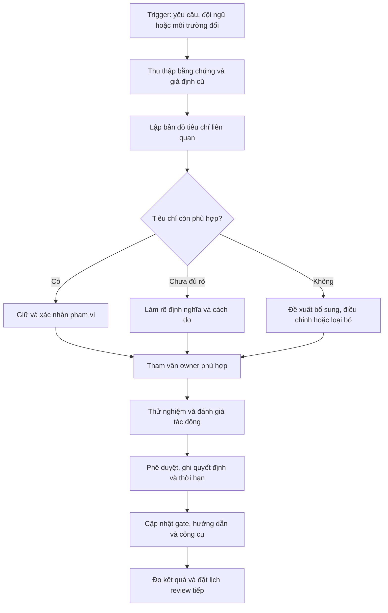

# Rà soát tiêu chí khi yêu cầu, đội ngũ hoặc môi trường thay đổi

## 1. Tiêu chí chất lượng phải theo kịp bối cảnh của phần mềm

Một tiêu chí chất lượng có thể rất phù hợp khi hệ thống chỉ phục vụ một nhóm khách hàng, được triển khai trong một trung tâm dữ liệu và do một đội ngũ nhỏ sở hữu. Sau vài năm, sản phẩm có thể mở rộng sang nhiều thị trường, xử lý dữ liệu nhạy cảm hơn, chạy trên nền tảng mới và được nhiều đội cùng phát triển. Khi đó, một số tiêu chí cũ vẫn cần giữ, một số cần chặt hơn, một số phải đo theo cách khác, và một số không còn phù hợp.

Nếu không rà soát, nhóm có thể tiếp tục dùng ngưỡng và quy trình được đặt ra cho bối cảnh đã biến mất. Cổng chất lượng có thể chặn thay đổi an toàn vì tiêu chí lỗi thời, hoặc cho qua thay đổi có rủi ro vì tiêu chí chưa bao phủ yêu cầu mới.

Trong module `CODE_QUALITY_FUNDAMENTALS`, mục tiêu là **hiểu những thuộc tính quyết định mã nguồn có đáng tin cậy, dễ hiểu và dễ thay đổi hay không**. Thuộc chương **Cải thiện liên tục**, bài này tập trung vào cách **rà soát tiêu chí khi yêu cầu, đội ngũ hoặc môi trường thay đổi**.

Tiêu chí chất lượng là điều kiện hoặc kỳ vọng dùng để đánh giá sản phẩm và cách phát triển sản phẩm. Chúng có thể mô tả tính đúng đắn, bảo mật, độ tin cậy, hiệu năng, khả năng kiểm thử, khả năng bảo trì, khả năng tương thích, tài liệu, quy trình review hoặc điều kiện phát hành.

Rà soát tiêu chí không đơn giản là tăng mọi ngưỡng, thêm nhiều check hoặc thay công cụ mới. Đó là quá trình xác định:

1. Bối cảnh nào đã thay đổi và bằng chứng nào cho thấy thay đổi ấy quan trọng?
2. Tiêu chí hiện tại còn bảo vệ đúng rủi ro và mục tiêu không?
3. Có tiêu chí nào cần bổ sung, sửa cách đo, điều chỉnh ngưỡng hoặc loại bỏ không?
4. Ai chịu trách nhiệm và ai cần tham gia quyết định?
5. Thay đổi tiêu chí được áp dụng từ khi nào, cho phạm vi nào và được kiểm chứng ra sao?

Sau bài học, bạn có thể nhận diện các tín hiệu cần review, phân tích tác động của thay đổi về yêu cầu, đội ngũ và môi trường, phân biệt nguyên tắc lâu dài với ngưỡng phụ thuộc bối cảnh, cập nhật quality gates có kiểm soát và theo dõi xem tiêu chí mới có cải thiện kết quả thực tế hay không.

## 2. Vì sao tiêu chí có thể trở nên lỗi thời?

Tiêu chí được đặt ra dựa trên một tập giả định. Ví dụ:

- Người dùng chủ yếu ở một khu vực và dùng một loại tiền tệ.
- Dữ liệu được xử lý trong một môi trường mạng nội bộ.
- Một đội ngũ duy nhất sở hữu toàn bộ service.
- Mỗi ngày có vài nghìn request, không phải hàng triệu.
- Một bản phát hành có thể triển khai trong cửa sổ bảo trì.
- Một API chỉ có một ứng dụng client được cập nhật cùng lúc.
- Quy định dữ liệu và nghĩa vụ pháp lý chưa thay đổi.

Khi giả định thay đổi, tiêu chí dựa trên chúng có thể mất hiệu lực. Ví dụ, kiểm tra latency trung bình có thể từng đủ để phát hiện suy giảm trong tải thấp, nhưng khi lưu lượng tăng và người dùng phân bố nhiều khu vực, p95/p99 theo vùng và error rate mới phản ánh trải nghiệm tốt hơn.

### 2.1. Tiêu chí sai có thể gây hai loại hậu quả

| Vấn đề | Biểu hiện | Hậu quả |
| --- | --- | --- |
| **Thiếu tiêu chí** | Chưa kiểm tra rủi ro mới, chẳng hạn dữ liệu đa khu vực hoặc API consumer mới | Thay đổi có thể qua gate dù không đáp ứng nhu cầu hiện tại |
| **Tiêu chí lỗi thời hoặc quá chặt** | Ngưỡng dựa trên tải cũ, check không còn đo đúng hoặc rule chặn nhiều false positive | Feedback chậm, bypass, lãng phí và giảm niềm tin vào gate |
| **Tiêu chí mơ hồ** | Không rõ cách đo, phạm vi, mẫu số hoặc ai phê duyệt | Mỗi đội diễn giải khác nhau, kết quả khó so sánh |
| **Tiêu chí không có owner** | Không ai cập nhật khi sản phẩm hoặc công nghệ đổi | Ngoại lệ tồn tại lâu, nợ chất lượng tăng |
| **Tiêu chí không gắn kết quả** | Chỉ theo dõi điểm số mà không xem lỗi thực tế | Nhóm tối ưu metric nhưng chất lượng không cải thiện |

### 2.2. Tiêu chí không phải chân lý bất biến

Một số nguyên tắc cần giữ ổn định, như bảo vệ dữ liệu, không làm sai giao dịch hoặc duy trì tính nhất quán của hợp đồng đã cam kết. Nhưng cách đo, ngưỡng, công cụ và quy trình thực hiện có thể cần thay đổi.

Ví dụ, nguyên tắc “không để thay đổi làm lộ secret” vẫn cần thiết. Công cụ scan, vị trí scan, cách phân loại false positive và quy trình xử lý có thể thay đổi khi hệ thống thêm loại artifact mới.

### 2.3. Không thay tiêu chí chỉ vì có công cụ mới

Một scanner mới có thể phát hiện nhiều finding hơn, nhưng không có nghĩa tiêu chí phải tự động chặn mọi finding mới. Cần hiểu khác biệt về phạm vi, severity, độ chính xác, false positives và tác động vận hành trước khi thay đổi policy.

## 3. Ba nhóm thay đổi cần kích hoạt rà soát

Ba nhóm tác nhân chính là **yêu cầu, đội ngũ và môi trường**; chúng thường tác động lẫn nhau. Ngoài ra, thay đổi về quy định, hợp đồng và chính sách bên ngoài cũng có thể kích hoạt rà soát.

| Tác nhân | Ví dụ thay đổi | Tiêu chí có thể bị ảnh hưởng |
| --- | --- | --- |
| **Yêu cầu sản phẩm/nghiệp vụ** | Thêm thị trường, loại dữ liệu, vai trò người dùng, API consumer hoặc SLA | Correctness, privacy, security, compatibility, availability |
| **Đội ngũ và cách tổ chức** | Chia service cho nhiều đội, thay ownership, tăng tốc onboarding, thay quy trình on-call | Code ownership, review, testability, documentation, CI feedback |
| **Môi trường kỹ thuật/vận hành** | Chuyển cloud, thay database, tăng tải, chạy đa vùng, thay JDK hoặc nhà cung cấp | Performance, resilience, observability, migration, deployment, resource limits |
| **Ràng buộc bên ngoài** | Quy định pháp lý, hợp đồng đối tác, chính sách bảo mật hoặc tiêu chuẩn ngành đổi | Audit, retention, access control, evidence, release approval |

Không phải mọi thay đổi nhỏ đều cần mở một cuộc rà soát toàn bộ. Hãy tập trung vào tiêu chí có quan hệ nhân quả với thay đổi và những giả định mà nó làm mất hiệu lực.

## 4. Khi yêu cầu thay đổi, hãy rà soát tiêu chí gắn với giá trị và hợp đồng

Yêu cầu mới có thể làm thay đổi điều gì được xem là “đúng”. Một API từng chỉ cần trả tổng tiền bằng nội tệ có thể phải hỗ trợ đa tiền tệ. Một màn hình chỉ có một vai trò người dùng có thể cần phân quyền theo tenant. Một dịch vụ nội bộ có thể trở thành sản phẩm tích hợp với đối tác bên ngoài.

### 4.1. Các câu hỏi cần đặt ra

- Người dùng hoặc hệ thống mới nào sẽ sử dụng tính năng?
- Có loại dữ liệu, đơn vị, định dạng hoặc trạng thái mới không?
- Hợp đồng API, event, file hoặc database schema có thay đổi không?
- Có yêu cầu mới về thời gian phản hồi, khả dụng hoặc lưu trữ không?
- Có dữ liệu nhạy cảm, dữ liệu trẻ em, dữ liệu định vị hoặc dữ liệu thuộc khu vực pháp lý mới không?
- Hành vi cũ nào phải tiếp tục hỗ trợ?
- Có yêu cầu audit, truy vết hoặc giải thích quyết định không?
- Điều gì xảy ra khi yêu cầu mới xung đột với giới hạn kỹ thuật hiện tại?

### 4.2. Ví dụ: từ một loại tiền tệ sang đa tiền tệ

Ban đầu, hệ thống chỉ tính đơn hàng bằng VND. Tiêu chí có thể yêu cầu:

- Tổng tiền được lưu theo đơn vị nhỏ nhất đã thống nhất.
- Phép tính không bị tràn số.
- Phí và giảm giá tuân theo quy tắc làm tròn đã định.
- Test có trường hợp dưới, bằng và trên ngưỡng.

Khi hỗ trợ USD, EUR và VND, tiêu chí cũ chưa đủ. Cần rà soát thêm:

- Currency code được lưu cùng số tiền.
- Không cộng hai số tiền khác currency nếu chưa quy đổi.
- Tỷ giá có nguồn, thời điểm hiệu lực và độ chính xác được xác định.
- Quy tắc rounding phụ thuộc currency và nghiệp vụ.
- API không bỏ mất currency khi serialize.
- Báo cáo và dữ liệu lịch sử giữ được ngữ nghĩa cũ.

Nguyên tắc “tính toán chính xác” vẫn còn, nhưng tiêu chí kiểm tra phải mở rộng theo miền dữ liệu mới.

### 4.3. Phân biệt yêu cầu mới với việc hạ chuẩn

Nếu sản phẩm cần ra mắt nhanh, nhóm có thể đề xuất rollout theo giai đoạn hoặc giảm phạm vi tính năng. Điều đó không tự cho phép bỏ các tiêu chí bảo vệ dữ liệu, quyền truy cập hoặc tính đúng đắn tài chính. Cần ghi rõ rủi ro nào được chấp nhận và ai có thẩm quyền chấp nhận.

## 5. Khi đội ngũ thay đổi, tiêu chí phải phản ánh cách làm việc mới

Đội ngũ là một phần của hệ thống phát triển phần mềm. Khi số lượng đội tăng, ownership phân tán hoặc nhân sự luân chuyển, cách một thay đổi được hiểu, review, kiểm thử và vận hành cũng thay đổi.

### 5.1. Từ một đội sang nhiều đội sở hữu các thành phần

Một đội duy nhất có thể hiểu ngầm các quy ước và phối hợp trực tiếp. Khi nhiều đội cùng thay đổi API hoặc event, các giả định truyền miệng không còn đủ.

Tiêu chí có thể cần bổ sung:

- API và event có contract/versioning rõ.
- Thay đổi breaking cần owner của consumer xem xét.
- Schema migration có kế hoạch tương thích nhiều phiên bản.
- Ownership của module và on-call được công bố.
- Runbook và hướng dẫn debug đủ để đội khác xử lý.
- CI cung cấp kết quả nhất quán, tái hiện được.
- Những quyết định kiến trúc ảnh hưởng liên đội được ghi lại.

### 5.2. Khi đội ngũ tăng trưởng hoặc có nhiều người mới

Không thể kỳ vọng người mới biết các quy ước chưa được viết. Rà soát tiêu chí onboarding có thể cho thấy cần:

- Hướng dẫn chạy build/test local.
- Quy ước code và cách xử lý lỗi.
- Ví dụ về test tốt và review checklist.
- Mô tả kiến trúc ở mức đủ để tìm đúng owner.
- Quy trình xử lý incident và rollback.
- Tài liệu giải thích các quyết định có vẻ bất thường.

Tiêu chí không nên biến thành yêu cầu tài liệu dài cho mọi class. Hãy yêu cầu tài liệu ở nơi người mới cần hiểu hợp đồng, ranh giới hoặc quy trình vận hành.

### 5.3. Khi chuyên môn hoặc trách nhiệm thay đổi

Nếu đội chuyển từ sở hữu code sang sở hữu cả production, tiêu chí cần xét observability, alert, SLO và runbook. Nếu đội bắt đầu xử lý dữ liệu nhạy cảm, review security và privacy cần có người đủ chuyên môn.

Một người duyệt PR không thể thay thế mọi chuyên môn. Hãy xác định thay đổi nào cần domain owner, security reviewer, database owner hoặc người chịu trách nhiệm vận hành.

### 5.4. Không dùng tiêu chí để đổ lỗi cho cá nhân

Nếu test flaky vì môi trường CI thiếu ổn định, không nên chỉ yêu cầu developer “cẩn thận hơn”. Nếu review quá chậm do ownership không rõ, thêm một bước approval nữa có thể làm vấn đề nặng hơn. Rà soát tiêu chí cần tìm nguyên nhân ở **hệ thống làm việc**, không chỉ ở hành vi cá nhân.

## 6. Khi môi trường kỹ thuật thay đổi, hãy xác minh giả định vận hành

Môi trường gồm runtime, hạ tầng, mạng, database, công cụ build, nhà cung cấp, tải, dữ liệu và cách triển khai. Chuyển môi trường có thể làm thay đổi giới hạn và failure modes ngay cả khi business logic không đổi.

### 6.1. Các thay đổi môi trường thường gặp

| Thay đổi | Giả định có thể không còn đúng | Tiêu chí cần xem lại |
| --- | --- | --- |
| Chuyển từ VM sang container | Filesystem, process lifetime, resource limit | Shutdown, health check, memory/CPU, graceful termination |
| Chuyển database | Transaction, isolation, query plan, type semantics | Integration tests, consistency, migration, performance |
| Chạy đa vùng | Network latency, replication delay, data residency | Availability, consistency, routing, privacy |
| Tăng tải | Queue, connection pool, cache và storage chịu áp lực khác | Load test, p95/p99, throughput, backpressure |
| Nâng JDK/runtime | Behavior, dependency compatibility và security defaults | Build matrix, regression tests, static/security analysis |
| Đổi cloud/provider | Identity, network policy, failure modes và observability | Access control, resilience, backup/restore, audit |
| Thêm mobile client cũ | Consumer không được cập nhật đồng thời | API compatibility, schema evolution, deprecation |
| Thay CI runner | Cache, toolchain, concurrency và filesystem khác | Reproducible build, test isolation, artifact provenance |

### 6.2. Ví dụ: từ một instance sang nhiều instance

Một ứng dụng cũ lưu trạng thái đăng nhập trong bộ nhớ process. Khi chỉ có một instance, test thủ công có thể không thấy vấn đề. Khi chạy nhiều instance sau load balancer, request tiếp theo có thể tới process khác và không tìm thấy session.

Tiêu chí cần xem lại:

- Trạng thái nào được phép ở local memory?
- Session cần được chia sẻ hoặc dùng token stateless không?
- Retry và sticky session có tạo giới hạn không?
- Test có chạy qua nhiều instance không?
- Rolling deployment có tương thích session giữa phiên bản không?
- Hệ thống xử lý ra sao khi một instance bị restart?

Đây là ví dụ cho thấy một thay đổi hạ tầng có thể làm lộ giả định trong code và làm tiêu chí cũ không đủ.

### 6.3. Đo lại baseline trong môi trường mới

Không nên lấy trực tiếp một ngưỡng latency từ môi trường cũ rồi áp vào môi trường mới nếu cách đo, tải hoặc topology khác nhau. Cần:

1. Chốt workload và kịch bản đại diện.
2. Xác định metric, điểm đo và cửa sổ quan sát.
3. Chạy baseline ở môi trường mới.
4. So sánh theo mục tiêu người dùng và SLO.
5. Đặt ngưỡng có biên an toàn.
6. Kiểm tra lại khi lưu lượng và kiến trúc thay đổi.

Baseline mới không có nghĩa được tự động chấp nhận hiệu năng kém hơn. Cần so sánh với cam kết sản phẩm và tác động tới người dùng.

## 7. Phân biệt nguyên tắc lâu dài với ngưỡng phụ thuộc bối cảnh

Đây là bước quan trọng để tránh thay đổi tiêu chí theo cảm tính.

| Loại tiêu chí | Ví dụ | Cách xử lý khi bối cảnh đổi |
| --- | --- | --- |
| **Nguyên tắc / invariant** | Không tiết lộ secret; không ghi nhận thanh toán hai lần; bảo vệ dữ liệu được phép truy cập | Giữ mục tiêu, cập nhật cách thực thi và bằng chứng |
| **Hợp đồng đã cam kết** | API field, định dạng event, hành vi của client được hỗ trợ | Chỉ đổi qua quy trình versioning/migration |
| **Ngưỡng đo lường** | p95 latency, error budget, coverage trong vùng thay đổi | Đo lại và điều chỉnh có căn cứ |
| **Cách kiểm tra** | Tool scan, test framework, static analysis rule | Đánh giá độ chính xác, phạm vi và khả năng thay thế |
| **Quy trình tổ chức** | Số approvals, owner, lịch release | Cập nhật theo ownership và rủi ro |
| **Mục tiêu cải tiến** | Giảm flaky tests, rút ngắn feedback time | Theo dõi xu hướng và điều chỉnh lộ trình |

Ví dụ, “không chấp nhận thanh toán trùng” là invariant. Ngưỡng thời gian xử lý thanh toán có thể thay đổi theo SLA, nhưng không được dùng để hợp thức hóa việc bỏ idempotency.

### 7.1. Đừng nhầm tiêu chí với phương tiện

“Dùng công cụ X” thường là phương tiện, còn “phát hiện dependency có lỗ hổng vượt ngưỡng rủi ro trước khi phát hành” mới là tiêu chí. Nếu công cụ X không còn phù hợp, có thể thay công cụ nhưng phải giữ mục tiêu và chứng minh công cụ mới bao phủ đúng phạm vi.

### 7.2. Ghi rõ điều kiện áp dụng

Một tiêu chí chỉ áp dụng cho public API, module xử lý dữ liệu nhạy cảm hoặc đường xử lý latency-critical cần nêu rõ phạm vi. Nếu không, nhóm có thể áp dụng quá rộng hoặc bỏ sót nơi cần bảo vệ.

## 8. Quy trình rà soát tiêu chí có hệ thống

Có thể dùng quy trình dưới đây cho một thay đổi đáng kể về sản phẩm, đội ngũ hoặc môi trường.

### Bước 1 — Ghi nhận trigger và thay đổi bối cảnh

Mô tả điều gì đã đổi, từ khi nào và bằng chứng nào xác nhận. Ví dụ: sản phẩm thêm khách hàng ở khu vực mới; service chuyển sang multi-region; một API có ba đội consumer.

### Bước 2 — Xác định giả định cũ bị ảnh hưởng

Liệt kê các giả định về người dùng, dữ liệu, tải, caller, ownership, môi trường và quy trình. Đánh dấu giả định nào còn đúng, đã sai hoặc chưa biết.

### Bước 3 — Lập bản đồ tiêu chí liên quan

Tìm tiêu chí hiện tại có liên hệ với thay đổi. Phân loại chúng thành:

- Vẫn phù hợp.
- Cần làm rõ phạm vi/định nghĩa.
- Cần điều chỉnh cách đo hoặc ngưỡng.
- Cần bổ sung.
- Có thể loại bỏ vì không còn mục tiêu bảo vệ.
- Chưa đủ bằng chứng để quyết định.

### Bước 4 — Đánh giá rủi ro và hậu quả

Xem xác suất, tác động, khả năng phát hiện và khả năng phục hồi. Không cần ép mọi thứ thành một con số chính xác nếu dữ liệu không đủ; ghi rõ giả định và mức bất định.

### Bước 5 — Đề xuất thay đổi có thể kiểm chứng

Mỗi đề xuất cần có mục tiêu, phạm vi, phép đo, ngưỡng, nguồn bằng chứng, owner và thời điểm áp dụng. Nếu thay ngưỡng, hãy nêu dữ liệu nào hỗ trợ ngưỡng mới.

### Bước 6 — Tham vấn đúng người

Mời domain owner, developer, tester, security/privacy, platform/operations hoặc consumer team tùy rủi ro. Không cần mọi vai trò tham gia mọi review.

### Bước 7 — Thử nghiệm ở chế độ quan sát khi phù hợp

Trước khi biến một check mới thành blocking, có thể chạy advisory để đo false positives, thời gian và tác động. Với rủi ro nghiêm trọng có nghĩa vụ bắt buộc, không trì hoãn bảo vệ chỉ để quan sát; cần áp dụng biện pháp kiểm soát tạm thời ngay.

### Bước 8 — Phê duyệt và ghi lại quyết định

Ghi điều gì được giữ, sửa, thêm hoặc loại bỏ; vì sao; ai chấp nhận rủi ro; ngày hiệu lực; phạm vi chuyển tiếp và điều kiện xem lại.

### Bước 9 — Cập nhật công cụ và hướng dẫn

Sửa quality gate, CI, checklist, runbook và tài liệu cần thiết. Đảm bảo trạng thái pending/unknown không bị hiểu thành pass.

### Bước 10 — Đo lại sau khi áp dụng

Theo dõi false positives, thời gian feedback, lỗi lọt, incident, chi phí chạy và trải nghiệm developer. Nếu kết quả không như dự kiến, điều chỉnh policy.

## 9. Một tiêu chí tốt cần được mô tả đủ để người khác áp dụng giống nhau

Câu “hệ thống phải nhanh” không thể dùng làm quality gate. “p95 latency của endpoint tạo đơn dưới 400 ms trong workload X, đo tại gateway trong cửa sổ 15 phút, không tính thời gian client render” rõ hơn nhiều, nhưng vẫn cần xác định môi trường, số mẫu và điều kiện tải.

Một bản ghi tiêu chí nên có:

| Trường | Câu hỏi cần trả lời |
| --- | --- |
| **ID / tên** | Có thể tham chiếu tiêu chí một cách nhất quán không? |
| **Mục tiêu** | Rủi ro hoặc giá trị nào cần bảo vệ? |
| **Phạm vi** | Module, API, dữ liệu, môi trường hay loại thay đổi nào? |
| **Định nghĩa** | Thuật ngữ và metric được hiểu chính xác thế nào? |
| **Cách đo / bằng chứng** | Tool, test, query, log hoặc review nào cung cấp kết quả? |
| **Ngưỡng / quyết định** | Điều kiện pass, fail, warning và unknown? |
| **Owner** | Ai chịu trách nhiệm duy trì tiêu chí? |
| **Ngoại lệ** | Ai có thể phê duyệt, trong phạm vi và thời hạn nào? |
| **Ngày hiệu lực / phiên bản** | Áp dụng từ khi nào và cho phiên bản nào? |
| **Ngày xem lại** | Sự kiện hoặc mốc nào kích hoạt lần review tiếp theo? |

### 9.1. Ví dụ một tiêu chí được viết rõ

**ID:** API-COMPAT-01  
**Mục tiêu:** Giữ client đang được hỗ trợ hoạt động trong quá trình nâng cấp service.  
**Phạm vi:** Public REST API và event schema của checkout.  
**Điều kiện:** Thay đổi không được xóa/đổi nghĩa field đang được consumer hỗ trợ mà chưa có kế hoạch versioning và migration được phê duyệt.  
**Bằng chứng:** Contract tests, schema diff và inventory consumer.  
**Quyết định:** Blocking khi có breaking change không được phê duyệt; advisory khi có field mới tương thích nhưng cần cập nhật tài liệu.  
**Owner:** API owner cùng consumer owners.  
**Ngoại lệ:** Có lý do, danh sách consumer, thời hạn chuyển đổi và người chấp nhận rủi ro.  
**Review trigger:** Thêm consumer mới, kết thúc thời gian hỗ trợ phiên bản hoặc thay đổi giao thức.

Đây là ví dụ cấu trúc, không phải policy mặc định cho mọi hệ thống. Phạm vi phiên bản được hỗ trợ phải được tổ chức xác định.

## 10. Quản lý phiên bản và thời điểm hiệu lực của tiêu chí

Khi tiêu chí thay đổi, cần biết thay đổi nào áp dụng cho PR, release hoặc hệ thống đang chạy. Nếu không có mốc hiệu lực, hai nhóm có thể đánh giá cùng một thay đổi theo hai bộ rule khác nhau.

### 10.1. Phân biệt ngày quyết định, ngày hiệu lực và thời gian chuyển tiếp

- **Ngày quyết định:** thời điểm owner phê duyệt thay đổi tiêu chí.
- **Ngày hiệu lực:** từ thời điểm nào tiêu chí trở thành điều kiện chính thức.
- **Thời gian chuyển tiếp:** giai đoạn nhóm cần cập nhật công cụ, test, tài liệu hoặc dữ liệu.
- **Ngày hết hiệu lực:** thời điểm tiêu chí cũ hoặc ngoại lệ không còn được áp dụng.

Một tiêu chí bảo vệ dữ liệu nghiêm trọng có thể cần hiệu lực ngay. Một thay đổi ngưỡng coverage hoặc cách đo hiệu năng có thể cần thời gian chuyển tiếp để cập nhật pipeline và baseline.

### 10.2. Giữ lịch sử quyết định

Không ghi đè mất lý do của tiêu chí cũ. Lịch sử giúp trả lời:

- Vì sao ngưỡng được chọn?
- Bối cảnh khi đó là gì?
- Dữ liệu nào làm thay đổi quyết định?
- Tiêu chí cũ có tạo ra lỗi hoặc false positives không?
- Ai chấp nhận rủi ro trong thời gian chuyển tiếp?

Có thể dùng decision record hoặc lịch sử thay đổi trong repository. Điều quan trọng là reviewer có thể tìm thấy phiên bản policy đã áp dụng tại thời điểm một release được chấp nhận.

### 10.3. Tránh hai bộ tiêu chí xung đột

Trong giai đoạn chuyển tiếp, cần nói rõ nhóm nào dùng policy cũ, nhóm nào dùng policy mới và cách tổng hợp kết quả. Nếu một gate chặn theo rule mới nhưng checklist review vẫn hướng dẫn rule cũ, developer không biết phải tuân theo điều gì.

## 11. Điều chỉnh ngưỡng bằng dữ liệu, không theo cảm giác

Ngưỡng là phần dễ bị thay đổi tùy tiện nhất. Ví dụ: coverage 80%, p95 dưới 300 ms, không có finding high severity hoặc build dưới 10 phút. Những con số này chỉ có nghĩa khi biết chúng bảo vệ điều gì và được đo thế nào.

### 11.1. Dữ liệu cần xem trước khi thay ngưỡng

- Baseline theo thời gian và theo module.
- Workload, traffic, môi trường và số lượng mẫu.
- Phân bố p50/p95/p99 thay vì chỉ trung bình.
- Tỷ lệ false positive/false negative đã xác minh.
- Số lần gate chặn thay đổi hợp lệ.
- Số lỗi lọt sau merge/release.
- Chi phí thời gian, runner và công sức xử lý.
- Mức độ hậu quả nếu tiêu chí không đạt.

### 11.2. Không nới ngưỡng chỉ để giảm số lần bị chặn

Nếu gate liên tục fail, nguyên nhân có thể là:

- Ngưỡng không còn phù hợp.
- Môi trường đo không ổn định.
- Test flaky.
- Tool có false positives.
- Code thật sự suy giảm.
- Workload đã thay đổi.

Mỗi nguyên nhân cần cách xử lý khác nhau. Nới ngưỡng mà không xác định nguyên nhân có thể làm mất tín hiệu cảnh báo.

### 11.3. Không siết ngưỡng chỉ để tạo cảm giác nghiêm ngặt

Ngưỡng quá chặt có thể khuyến khích test yếu, suppress finding hoặc chia nhỏ thay đổi không tự nhiên. Chỉ tăng độ nghiêm ngặt khi có mục tiêu và bằng chứng cho thấy mức mới khả thi, đo đúng và giảm rủi ro.

### 11.4. Đặt ngưỡng theo phân vùng khi rủi ro khác nhau

Một endpoint xử lý thanh toán và một trang hiển thị nội dung tĩnh không nhất thiết cần cùng một latency threshold hoặc review requirement. Có thể đặt tiêu chí theo criticality, data sensitivity và loại workload, miễn là phạm vi được định nghĩa rõ và không tạo kẽ hở cho thay đổi nhạy cảm.

## 12. Thử nghiệm tiêu chí mới trước khi áp dụng rộng

Khi chưa chắc tiêu chí mới có tín hiệu tốt, có thể chạy ở chế độ advisory hoặc trên một phạm vi giới hạn. Mục tiêu là thu thập dữ liệu về độ chính xác và chi phí.

### 12.1. Chế độ quan sát

Trong một khoảng thời gian đã xác định:

- Chạy check nhưng chưa chặn thay đổi.
- Ghi lại finding, false positives và thời gian chạy.
- Đối chiếu finding với review hoặc incident thực tế.
- Xác định nhóm module bị ảnh hưởng.
- Hỏi developer xem diagnostic có thể hành động được không.

Chế độ quan sát phù hợp với các tiêu chí có thể thử nghiệm an toàn. Không nên dùng nó để trì hoãn một yêu cầu bắt buộc về bảo mật, privacy hoặc nghĩa vụ pháp lý.

### 12.2. Pilot theo module hoặc đội

Chọn một vùng có owner rõ và đủ đại diện. Đặt thời gian thử, tiêu chí thành công và điều kiện dừng. Nếu kết quả tốt, mở rộng từng bước; nếu không, điều chỉnh rule hoặc cách đo.

### 12.3. Kiểm tra cả đường pass, fail và unknown

Một check mới cần được thử trong ít nhất ba tình huống:

- **Pass:** thay đổi đáp ứng tiêu chí.
- **Fail:** thay đổi vi phạm tiêu chí và gate đưa ra diagnostic đúng.
- **Unknown/unavailable:** tool hoặc dữ liệu không sẵn sàng; hệ thống không giả vờ rằng đã pass.

Nếu một scanner timeout mà pipeline vẫn xanh, vấn đề nằm ở cách tổng hợp trạng thái gate chứ không chỉ ở scanner.

## 13. Các anti-pattern khi rà soát tiêu chí

| Anti-pattern | Biểu hiện | Cách điều chỉnh |
| --- | --- | --- |
| **Rà soát theo lịch nhưng không có trigger thực tế** | Họp định kỳ chỉ để cập nhật tài liệu | Kết hợp lịch review với thay đổi sản phẩm, incident và môi trường |
| **Tăng mọi ngưỡng cùng lúc** | Coverage, lint, performance và approval đều bị siết không có bằng chứng | Thay từng tiêu chí, đo tác động |
| **Nới gate để pipeline xanh** | Xóa rule khi có nhiều failure | Triage nguyên nhân và giữ lại rủi ro nghiêm trọng |
| **Thêm check nhưng không có owner** | Finding tồn đọng, không ai xử lý | Chỉ định owner, SLA xử lý và cách escalation |
| **Chỉ hỏi developer** | Bỏ qua người dùng, vận hành, bảo mật hoặc consumer | Mời đúng stakeholder theo phạm vi |
| **Dựa vào một metric tổng** | Điểm chất lượng cao che lấp lỗ hổng nghiêm trọng | Giữ các guardrail không thể đánh đổi độc lập |
| **Không ghi phiên bản** | Không biết release dùng bộ tiêu chí nào | Version và effective date |
| **Ngoại lệ vô thời hạn** | Waiver trở thành đường đi mặc định | Có expiry, owner và review |
| **Dùng tool mới như tiêu chí** | “Phải chạy tool X” nhưng không rõ rủi ro được bảo vệ | Định nghĩa outcome, tool là phương tiện |
| **Đổ lỗi cá nhân** | Ép developer tuân thủ rule nhưng không sửa CI flaky | Cải thiện hệ thống và feedback |
| **Bỏ qua consumer cũ** | API/schema đổi mà không kiểm tra phiên bản đang dùng | Consumer inventory và compatibility tests |
| **Không đo sau thay đổi** | Policy được áp dụng rồi quên | Theo dõi outcome và review lại |

## 14. Đánh giá hiệu quả sau khi cập nhật tiêu chí

Một lần review chỉ hoàn tất khi biết thay đổi đã tạo ra kết quả gì. Đừng chỉ kiểm tra rằng tài liệu và pipeline đã được cập nhật.

### 14.1. Các tín hiệu nên theo dõi

| Tín hiệu | Câu hỏi |
| --- | --- |
| Lỗi lọt sau gate | Tiêu chí mới có giúp phát hiện rủi ro trước phát hành không? |
| False positives | Có chặn thay đổi hợp lệ quá thường xuyên không? |
| Thời gian feedback | Developer nhận kết quả nhanh hay chậm hơn? |
| Số waiver/bypass | Có tiêu chí nào không thực tế hoặc khó hiểu? |
| Tỷ lệ finding được xử lý | Có owner và đường khắc phục không? |
| Incident và rollback | Rủi ro mới có giảm sau khi cập nhật không? |
| Chi phí CI/vận hành | Check mới có tốn tài nguyên tương xứng lợi ích không? |
| Phản hồi từ consumer/team | Hợp đồng và cách phối hợp có rõ hơn không? |

### 14.2. Đừng quy mọi incident cho quality gate

Incident có thể xảy ra vì thiết kế, cấu hình, vận hành, dữ liệu hoặc yếu tố bên ngoài. Hãy phân tích liệu tiêu chí có thể phát hiện hoặc giảm tác động hay không, thay vì mặc định thêm một check cho mọi sự cố.

### 14.3. Xem cả tác động ngoài dự kiến

Một gate mới có thể làm release chậm, khiến nhóm gom nhiều thay đổi vào một PR lớn hoặc trì hoãn sửa lỗi bảo mật. Theo dõi cả kết quả tích cực và chi phí phụ để tránh tối ưu một chiều.

## 15. Ví dụ tổng hợp: rà soát tiêu chí cho service checkout

### Bối cảnh ban đầu

Một service checkout phục vụ một thị trường, một đội sở hữu, chạy trên một cụm đơn vùng. Các tiêu chí đang có:

- Unit tests cho tính tiền và phí giao.
- Build và static analysis trong pull request.
- Contract test cho một ứng dụng web.
- p95 latency dưới 500 ms trong workload đã xác định.
- Một owner review thay đổi nghiệp vụ.
- Triển khai trong cửa sổ bảo trì.

### Bối cảnh mới

Sau một thời gian, sản phẩm hỗ trợ thêm thị trường, mobile client và đối tác; đội platform chuyển service sang multi-region; một đội thứ hai sở hữu API và event integration.

### Rà soát theo từng nhóm

| Thay đổi | Tiêu chí cũ | Cập nhật cần xem xét |
| --- | --- | --- |
| Đa tiền tệ | Unit tests với VND | Currency-aware tests, rounding, exchange-rate provenance |
| Mobile/partner clients | Một contract test | Consumer inventory, API versioning và contract tests |
| Multi-region | p95 từ một vùng | Latency theo vùng, replication lag, failover và data residency |
| Nhiều đội | Một owner review | Code ownership, consumer approval cho breaking changes |
| Deploy liên tục | Cửa sổ bảo trì | Rolling compatibility, migration và rollback/forward-fix |
| Dữ liệu đa thị trường | Một retention rule | Data classification, retention và access theo jurisdiction |

### Quyết định không tự động thay mọi ngưỡng

p95 500 ms không nên tự động thành 300 ms chỉ vì service chạy đa vùng. Cần đo workload mới, xem cam kết người dùng và phân biệt latency nội vùng với latency xuyên vùng. Một số endpoint có thể cần ngưỡng khác nhau.

### Bằng chứng trước khi áp dụng

- Chạy baseline theo vùng với workload đại diện.
- Xác minh consumer contract của web, mobile và partner.
- Kiểm tra migration với phiên bản cũ và mới cùng chạy.
- Thử failover và kiểm tra replication lag.
- Review quyền truy cập và retention theo khu vực.
- Chạy advisory cho các check mới có thể thử nghiệm, rồi chuyển thành blocking khi đã xác nhận tín hiệu.
- Ghi owner, ngày hiệu lực và thời hạn hỗ trợ client cũ.

Ví dụ này cho thấy việc rà soát bắt đầu từ **thay đổi bối cảnh**, sau đó cập nhật tiêu chí liên quan với bằng chứng cụ thể. Không phải mọi tiêu chí cũ đều bị loại bỏ; nhiều tiêu chí được giữ nguyên mục tiêu nhưng mở rộng phạm vi hoặc cách kiểm chứng.

## 16. Checklist rà soát tiêu chí

1. **Trigger đã rõ chưa?** Yêu cầu, đội ngũ, môi trường hoặc ràng buộc nào vừa thay đổi?
2. **Bằng chứng thay đổi là gì?** Roadmap, traffic, incident, consumer mới, migration hoặc quy định?
3. **Giả định cũ nào bị ảnh hưởng?** Người dùng, dữ liệu, tải, ownership, runtime và quy trình?
4. **Tiêu chí nào còn phù hợp?** Có nên giữ nguyên mục tiêu và cách đo?
5. **Tiêu chí nào thiếu hoặc lỗi thời?** Có rủi ro mới chưa được kiểm tra?
6. **Nguyên tắc và ngưỡng đã được phân biệt chưa?** Điều gì là invariant, điều gì phụ thuộc baseline?
7. **Phạm vi áp dụng có rõ không?** Module, API, môi trường, loại dữ liệu và phiên bản?
8. **Metric có định nghĩa không?** Mẫu số, cửa sổ đo, workload và nguồn dữ liệu?
9. **Ngưỡng có bằng chứng không?** Baseline và hậu quả khi vượt ngưỡng?
10. **Stakeholder phù hợp đã tham gia chưa?** Domain, security, platform, operations và consumer owners?
11. **Ngoại lệ có giới hạn không?** Lý do, người duyệt, thời hạn và biện pháp giảm thiểu?
12. **Thay đổi có version/effective date không?** Có giai đoạn chuyển tiếp?
13. **Gate xử lý unknown đúng không?** Check không chạy không được coi là pass?
14. **Có pilot hoặc chế độ quan sát phù hợp không?** Có tiêu chí thành công và điều kiện dừng?
15. **Hướng dẫn và công cụ đã đồng bộ chưa?** CI, checklist, runbook và tài liệu cùng một policy?
16. **Kết quả sau áp dụng sẽ được đo thế nào?** False positives, feedback time, incident, cost và waiver?
17. **Ai sở hữu lần review tiếp theo?** Có trigger hoặc ngày xem lại rõ?

## 17. Bài tập tình huống

### Bài 1 — Thêm thị trường mới

Một ứng dụng chỉ phục vụ một quốc gia bắt đầu bán hàng ở ba quốc gia khác. Hãy liệt kê giả định về currency, timezone, privacy, retention, API và vận hành có thể bị phá vỡ. Chọn tiêu chí cần giữ, bổ sung hoặc điều chỉnh; nêu bằng chứng cần có trước khi phát hành.

### Bài 2 — Từ một đội sang ba đội

Một service trước đây do một đội sở hữu nay được chia cho ba đội: checkout, payment và fulfillment. Hãy rà soát tiêu chí về ownership, API/event contract, review, test, on-call và runbook. Phân biệt tiêu chí kỹ thuật với quy trình phối hợp.

### Bài 3 — Chuyển từ một vùng sang đa vùng

Một service chuyển sang multi-region để tăng khả dụng. Hãy xác định những giả định về latency, consistency, failover, data residency và observability cần đo lại. Đề xuất pilot và tiêu chí rollout.

### Bài 4 — Ngưỡng coverage không còn phù hợp

Một repository có baseline coverage thấp vì nhiều module legacy. Nhóm muốn tăng gate từ 60% lên 85% ngay lập tức. Hãy phân tích rủi ro, thiết kế tiêu chí theo phần code thay đổi, xác định vùng cần bảo vệ tuyệt đối và lộ trình giảm baseline.

### Bài 5 — Scanner mới tạo nhiều finding

Một scanner mới phát hiện gấp ba số finding so với công cụ cũ. Hãy xác định cách so sánh phạm vi, severity, false positives và khả năng khai thác. Đề xuất thời gian advisory, điều kiện blocking và cách giữ lịch sử.

### Bài 6 — Thay đổi SLA

Khách hàng ký SLA mới về availability và latency. Hãy chuyển cam kết thành SLI/SLO, xác định cửa sổ đo, phân vị, error budget và guardrails release. Nêu những chỉ số nào không thể dùng thay cho nhau.

### Bài 7 — Đội mới thiếu tri thức vận hành

Một đội nhận ownership của service nhưng chưa biết rollback, migration và xử lý incident. Hãy rà soát tiêu chí onboarding, documentation, deployment readiness và on-call. Xác định bằng chứng thực hành nào chứng minh đội đã sẵn sàng.

### Bài 8 — Tiêu chí mới làm chậm release

Sau khi thêm ba check blocking, thời gian PR tăng từ 15 lên 70 phút và developer bắt đầu gộp nhiều thay đổi. Hãy phân tích false positives, thứ tự chạy, check có thể chuyển sang tầng khác và rủi ro khi nới gate.

### Bài 9 — API có consumer cũ

Một đối tác chưa thể nâng cấp client trong sáu tháng. Nhóm muốn đổi schema để đơn giản hóa code. Hãy xác định tiêu chí compatibility, migration window, telemetry theo phiên bản consumer và điều kiện kết thúc hỗ trợ.

### Bài 10 — Rà soát sau incident

Một incident làm lộ dữ liệu vì quyền truy cập của một service account quá rộng. Hãy xây quy trình post-incident để cập nhật tiêu chí access review, least privilege, secret rotation, audit và kiểm thử. Phân biệt hành động sửa nguyên nhân với việc thêm check có thể phát hiện vi phạm.

Với mỗi bài, hãy trình bày **thay đổi bối cảnh → giả định bị ảnh hưởng → tiêu chí giữ/sửa/thêm/bỏ → bằng chứng và ngưỡng → owner và thời điểm hiệu lực → cách đo kết quả**.

## 18. Ghi nhớ

- **Tiêu chí chất lượng cần theo kịp bối cảnh.** Yêu cầu, đội ngũ, môi trường và ràng buộc bên ngoài có thể làm giả định cũ không còn đúng.
- **Rà soát bắt đầu từ trigger và bằng chứng**, không phải từ mong muốn tăng số lượng check hoặc làm dashboard đẹp hơn.
- **Phân biệt nguyên tắc với ngưỡng và phương tiện.** Invariant như bảo vệ dữ liệu cần được giữ; cách đo, công cụ và ngưỡng có thể thay đổi có kiểm soát.
- **Yêu cầu mới làm thay đổi hợp đồng và rủi ro.** Đa tiền tệ, consumer mới và dữ liệu nhạy cảm cần tiêu chí kiểm chứng tương ứng.
- **Đội ngũ thay đổi kéo theo ownership và nhu cầu chia sẻ tri thức.** Review, API contract, runbook và on-call cần phản ánh cách phối hợp mới.
- **Môi trường mới cần baseline và failure-mode mới.** Multi-region, container, database hoặc runtime mới có thể làm lộ giả định trước đây.
- **Mỗi tiêu chí phải rõ phạm vi, cách đo, ngưỡng, bằng chứng và owner.** Nếu không, các nhóm sẽ diễn giải khác nhau.
- **Thay đổi tiêu chí cần version và ngày hiệu lực.** Giữ lịch sử, thời gian chuyển tiếp và ngoại lệ có thời hạn.
- **Thử nghiệm trước khi áp dụng rộng khi phù hợp.** Advisory và pilot giúp phát hiện false positives, nhưng không trì hoãn guardrail bắt buộc trước rủi ro nghiêm trọng.
- **Đánh giá kết quả sau khi cập nhật.** Theo dõi lỗi lọt, false positives, feedback time, waiver, incident và chi phí vận hành.
- **Không dùng tiêu chí để đổ lỗi hoặc tối ưu sai metric.** Cải thiện cả hệ thống phát triển, công cụ và trách nhiệm sở hữu.

Rà soát tiêu chí là một phần của cải thiện liên tục: **khi bối cảnh đổi, nhóm kiểm tra lại giả định, cập nhật điều kiện chấp nhận bằng bằng chứng và đo xem quyết định mới có bảo vệ đúng mục tiêu hay không**. Nhờ vậy, mã nguồn và quy trình phát triển tiếp tục đáng tin cậy, dễ hiểu và dễ thay đổi trong điều kiện thực tế mới.
