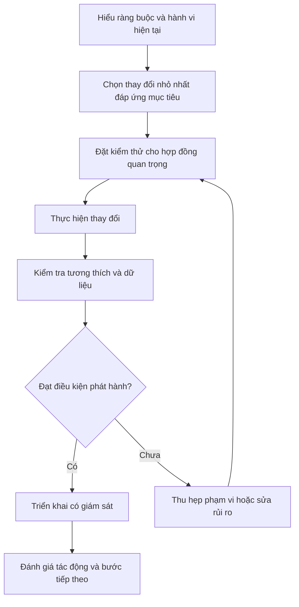

# Ràng buộc tương thích, thời gian và nguồn lực

## 1. Chất lượng mã nguồn luôn được quyết định trong một bối cảnh

Một đoạn mã có cấu trúc rõ ràng, ít lặp, dễ kiểm thử thường thuận lợi cho việc bảo trì. Tuy nhiên, khi phần mềm đang phục vụ người dùng thật, quyết định cải thiện mã nguồn còn chịu tác động từ **hợp đồng với hệ thống đang sử dụng nó**, **thời điểm cần giao tính năng** và **nguồn lực có thể huy động**. Một thay đổi có thể làm mã nội bộ gọn hơn nhưng khiến client cũ ngừng hoạt động; một đợt tái cấu trúc có thể giúp bảo trì lâu dài nhưng chiếm hết thời gian cần để xử lý lỗi dữ liệu nghiêm trọng.

Trong module `CODE_QUALITY_FUNDAMENTALS`, người học tìm hiểu **những thuộc tính quyết định mã nguồn có đáng tin cậy, dễ hiểu và dễ thay đổi hay không**. Bài thuộc chương **Bối cảnh và đánh đổi** này tập trung vào ba ràng buộc thường ảnh hưởng trực tiếp đến các thuộc tính đó:

- **Tương thích:** thay đổi có giữ được những cam kết mà người dùng và hệ thống khác đang dựa vào không?
- **Thời gian:** với hạn giao hàng và thời điểm vận hành cụ thể, công việc nào phải hoàn thành trước?
- **Nguồn lực:** với số người, chuyên môn, công cụ, hạ tầng và ngân sách hiện có, giải pháp nào khả thi và duy trì được?

Mục đích không phải chọn giữa “mã đẹp” và “mã chạy được”. Mục đích là **cải thiện chất lượng trong giới hạn thực tế**, biết chính xác điều gì được giữ nguyên, điều gì có thể thay đổi, rủi ro nào được chấp nhận và cách kiểm chứng các lựa chọn.

Sau bài học, bạn có thể nhận diện nhiều dạng tương thích, phân tích một đánh đổi dưới áp lực thời gian, lựa chọn phạm vi cải tiến theo rủi ro và lập kế hoạch thay đổi có thể triển khai an toàn.

## 2. Ràng buộc tương thích: mã nguồn có người phụ thuộc

**Tương thích (compatibility)** là khả năng phiên bản mới tiếp tục hoạt động với những thành phần, dữ liệu hoặc hành vi mà hệ thống đã cam kết hỗ trợ. Vì thế, tác động của một thay đổi không chỉ nằm trong tệp vừa sửa: nó có thể lan đến ứng dụng di động, batch job, thư viện bên thứ ba, cơ sở dữ liệu, cấu hình triển khai hoặc quy trình của người vận hành.

### 2.1. Những loại tương thích cần phân biệt

| Loại tương thích | Câu hỏi cần trả lời | Ví dụ có rủi ro |
| --- | --- | --- |
| **API / giao thức** | Client cũ còn gửi yêu cầu và đọc phản hồi được không? | Đổi tên trường JSON từ `userId` thành `id`, bắt buộc thêm trường mới |
| **Hành vi / ngữ nghĩa** | Đầu vào cũ có còn tạo ra kết quả như đã cam kết không? | Hàm từng trả `null` khi không tìm thấy nay ném ngoại lệ |
| **Mã nguồn** (*source compatibility*) | Mã của bên gọi có còn biên dịch khi dùng phiên bản mới không? | Đổi tên public method, đổi kiểu tham số |
| **Nhị phân** (*binary compatibility*) | Chương trình đã biên dịch có còn liên kết/chạy được với thư viện mới không? | Xóa một public method mà bytecode cũ vẫn gọi |
| **Dữ liệu** | Dữ liệu và schema hiện có có còn đọc, ghi, di chuyển được không? | Đổi kiểu cột làm mất độ chính xác; xóa cột khi phiên bản cũ còn dùng |
| **Triển khai và cấu hình** | Phiên bản cũ và mới có thể cùng tồn tại khi triển khai không? | Phiên bản mới ghi dạng dữ liệu phiên bản cũ không đọc được |
| **Môi trường chạy** | Hạ tầng hiện có có đáp ứng yêu cầu mới không? | Nâng mức Java yêu cầu từ 11 lên 21 khi máy chủ vẫn dùng Java 11 |
| **Vận hành** | Cảnh báo, dashboard, runbook và quy trình hỗ trợ còn áp dụng được không? | Đổi ý nghĩa mã lỗi nhưng không cập nhật các cảnh báo hiện tại |

Hai khái niệm thường gặp:

- **Tương thích ngược (backward compatibility):** thành phần mới tiếp tục phục vụ các bên gọi hoặc dữ liệu cũ theo cam kết. Ví dụ, API mới vẫn nhận trường JSON của ứng dụng di động bản cũ.
- **Tương thích xuôi (forward compatibility):** thành phần cũ có thể xử lý an toàn dữ liệu hoặc thông điệp được tạo theo quy ước của phiên bản mới, trong giới hạn đã định. Ví dụ, bộ đọc cũ bỏ qua trường JSON mới mà nó không cần đến, nếu hợp đồng cho phép.

Tương thích xuôi không tự xuất hiện chỉ vì dùng JSON; client có thể từ chối trường lạ, enum chưa biết hoặc giá trị mới. Cần xác định hành vi thực tế của các bên trao đổi dữ liệu.

### 2.2. “Không đổi chữ ký hàm” chưa chắc là giữ tương thích

Giả sử có lời gọi:

```java
int seconds = config.getTimeoutSeconds();
```

Nếu `getTimeoutSeconds()` vẫn trả `int` nhưng từ phiên bản mới lại trả **mili giây**, chữ ký Java không thay đổi mà **hợp đồng ngữ nghĩa đã bị phá vỡ**. Caller vẫn biên dịch, nhưng có thể chờ lâu gấp 1.000 lần. Tương tự, đổi thứ tự sắp xếp mặc định, chuẩn hóa chuỗi theo cách khác, trả danh sách rỗng thay cho lỗi, hoặc coi `null` là dữ liệu hợp lệ đều có thể làm hệ thống khác sai mà không có lỗi biên dịch.

Mặt khác, giữ mọi hành vi cũ vô thời hạn cũng có chi phí: API phình to, luồng logic phải xử lý nhiều nhánh, việc kiểm thử trở nên khó khăn. Khi hành vi cũ **gây mất dữ liệu hoặc lỗ hổng bảo mật**, việc thay đổi có thể là bắt buộc; cần công bố tác động, cung cấp đường chuyển đổi và kiểm soát rủi ro thay vì duy trì hành vi nguy hiểm chỉ để giữ tương thích.

### 2.3. Lập danh sách những bên bị tác động

Trước khi đổi public API, schema hoặc định dạng dữ liệu, hãy trả lời:

1. **Ai đang sử dụng?** Giao diện web, mobile, ứng dụng đối tác, các dịch vụ, job theo lịch, công cụ nội bộ, báo cáo hoặc script vận hành?
2. **Họ phụ thuộc vào điều gì?** Tên field, kiểu dữ liệu, quy tắc lỗi, ý nghĩa kết quả, thứ tự thông điệp, cách cấu hình, mức Java, phiên bản schema?
3. **Có bao nhiêu phiên bản cùng chạy?** Mobile có thể mất nhiều tuần để người dùng cập nhật; rollout server thường có một giai đoạn chạy song song phiên bản cũ và mới.
4. **Cách phát hiện hỏng tương thích là gì?** Contract test, integration test, thống kê lưu lượng API cũ, kiểm thử nâng cấp hoặc thử dữ liệu của phiên bản trước?
5. **Đường quay lui là gì?** Nếu cần rollback, phiên bản cũ có còn đọc được dữ liệu mới ghi hay không?

Không biết hết consumer là một **rủi ro cần điều tra**, không phải bằng chứng rằng không có consumer.

## 3. Ràng buộc thời gian: không phải mọi cải tiến đều có cùng độ khẩn cấp

Thời hạn có thể đến từ ngày phát hành, cam kết với khách hàng, mốc tuân thủ, lịch bảo trì hoặc sự cố đang xảy ra. Khi quỹ thời gian cố định, mỗi công việc bổ sung tạo ra **chi phí cơ hội**: làm việc này đồng nghĩa chưa thể làm việc khác trong cùng khoảng thời gian.

Một dự án muốn nâng độ dễ đọc của lớp tính phí có thể cân nhắc ba hướng:

| Hướng giải quyết | Lợi ích trước mắt | Chi phí và nguy cơ |
| --- | --- | --- |
| Vá đúng lỗi và thêm regression test | Khắc phục sự cố nhanh, chứng minh lỗi không tái xuất | Thiết kế cũ còn khó hiểu; cần quay lại xử lý sau |
| Tách nhỏ một phần logic gây lỗi, thêm test | Giảm nguy cơ lặp lỗi và làm code dễ thay đổi hơn | Cần thời gian kiểm tra các đường đi liên quan |
| Viết lại toàn bộ bộ tính phí | Có cơ hội thiết kế nhất quán từ đầu | Phạm vi lớn, nhiều quy tắc ngầm, thời gian kiểm chứng lâu |

Nếu người dùng đang bị tính sai tiền, tính đúng đắn và khôi phục dịch vụ thường quan trọng hơn việc hoàn thành một đợt viết lại quy mô lớn. Nếu thay đổi nhỏ tiếp tục tạo lỗi trong nhiều đợt phát hành, dành thời gian tái cấu trúc có kiểm soát có thể đem lại hiệu quả tốt hơn về lâu dài. Quyết định phụ thuộc vào **mức độ nghiêm trọng, tần suất thay đổi, mức hiểu biết hiện tại và thời gian kiểm chứng còn lại**.

### 3.1. Phạm vi, thời gian và rủi ro liên hệ với nhau

Với thời hạn cố định, có thể điều chỉnh phạm vi theo mức quan trọng; nhưng không thể loại bỏ tùy tiện những kiểm tra bảo vệ dữ liệu và tính đúng đắn. Ví dụ, rút ngắn thời gian bằng cách hoãn cải tiến log giao diện có thể phù hợp hơn việc bỏ kiểm thử thanh toán trùng hoặc bỏ bước kiểm tra rollback của migration.

Cần tính cả **thời gian làm rõ yêu cầu**, viết mã, review, kiểm thử, triển khai, quan sát sau triển khai và xử lý sự cố. Một ước lượng “một ngày code” không có nghĩa là “một ngày có thể phát hành an toàn”.

### 3.2. Chia thay đổi thành các bước có thể kiểm chứng

Khi còn ít thời gian, thay đổi nhỏ và triển khai tuần tự giúp giảm số biến số phải kiểm tra trong một lần:



Sơ đồ này không đòi hỏi quy trình cồng kềnh cho từng thay đổi nhỏ. Giá trị của nó là **mỗi bước có mục tiêu và bằng chứng kiểm chứng**, đặc biệt khi sửa một phần hệ thống đang được sử dụng rộng rãi.

## 4. Ràng buộc nguồn lực: chi phí không chỉ là số giờ lập trình

Nguồn lực gồm con người, kiến thức, thiết bị và khả năng vận hành. Hai nhóm cùng có ba lập trình viên chưa chắc có năng lực thực hiện một migration giống nhau nếu một nhóm không có quyền kiểm tra cơ sở dữ liệu production hoặc thiếu người hiểu hệ thống cũ.

| Nguồn lực | Câu hỏi thực tế | Tác động tới lựa chọn kỹ thuật |
| --- | --- | --- |
| **Nhân sự / chuyên môn** | Ai hiểu module cũ, ai review được nghiệp vụ và concurrency? | Thiếu người nắm ngữ cảnh làm tăng thời gian tìm hiểu và rủi ro sửa sai |
| **Kiểm thử** | Có môi trường tích hợp, dữ liệu mẫu, khả năng kiểm thử hiệu năng không? | Thay đổi lớn khó được chứng minh an toàn nếu chỉ có unit test |
| **Hạ tầng** | CPU, bộ nhớ, dung lượng, giới hạn kết nối, ngân sách đám mây đủ không? | Thiết kế chịu tải cao có thể đòi hỏi dịch vụ hoặc tài nguyên chưa có |
| **Công cụ và quyền vận hành** | Có quan sát hệ thống, backup, khôi phục, rollback không? | Cần bổ sung khả năng phục hồi trước khi migration rủi ro cao |
| **Khả năng phối hợp** | Client, backend, QA, vận hành có thể thay đổi cùng lịch không? | Ưu tiên lộ trình tương thích nhiều phiên bản, tách rollout theo giai đoạn |
| **Ngân sách bảo trì** | Ai duy trì giải pháp sau khi phát hành? | Hạn chế chọn cơ chế phức tạp nếu không có người theo dõi và vận hành |

Đôi khi giải pháp tối ưu về mặt thuật toán lại không tối ưu ở điều kiện thực tế. Thêm một hệ thống message broker chỉ để xử lý một job nhỏ có thể tạo chi phí quản trị lớn hơn lợi ích; ngược lại, tự xây cơ chế queue trong database khi cần xử lý lưu lượng lớn và nhiều người tiêu thụ có thể làm mã khó tin cậy hơn. Quyết định phải dựa trên tải thực, yêu cầu giao hàng và năng lực vận hành.

**Giới hạn con người** cũng ảnh hưởng đến chất lượng: một module chỉ có một người hiểu toàn bộ luồng xử lý có thể rủi ro hơn một module hơi dài nhưng được tách rõ trách nhiệm, có tài liệu và kiểm thử đủ để người khác tiếp quản.

## 5. Ví dụ Java: cải thiện cách diễn đạt lỗi mà vẫn hỗ trợ caller cũ

Giả sử một thư viện Java có hợp đồng lâu đời: `find(String id)` trả về đối tượng `User`, hoặc `null` khi không tìm thấy. Nhóm muốn caller mới xử lý tình huống vắng dữ liệu rõ hơn bằng `Optional<User>`. **Đổi kiểu trả về của chính phương thức `find`** thành `Optional<User>` sẽ làm hỏng các caller đang biên dịch theo kiểu `User` và những chương trình phụ thuộc vào chữ ký nhị phân cũ.

Một hướng chuyển đổi dần là giữ phương thức cũ và thêm một phương thức mới:

```java
import java.util.Objects;
import java.util.Optional;

public final class UserDirectory {
    public record User(String id, String displayName) {}

    public interface UserRepository {
        Optional<User> findById(String id);
    }

    private final UserRepository repository;

    public UserDirectory(UserRepository repository) {
        this.repository = Objects.requireNonNull(repository);
    }

    // Hợp đồng cũ: khi không tìm thấy thì trả null.
    @Deprecated(since = "2.0")
    public User find(String id) {
        return repository.findById(id).orElse(null);
    }

    // Hợp đồng mới: caller phải xử lý trường hợp không có dữ liệu.
    public Optional<User> findOptional(String id) {
        return repository.findById(id);
    }
}
```

Với Java 17 trở lên, ví dụ này có thể được biên dịch nếu nằm trong tệp `UserDirectory.java`. Phương thức cũ vẫn tồn tại với cùng tên, tham số và kiểu trả về; **với giả định hành vi và các điều kiện khác của repository không đổi**, caller cũ không phải sửa ngay. Caller mới có thể viết:

```java
UserDirectory.User user = directory.findOptional("u-123")
        .orElseThrow(() -> new IllegalArgumentException("Không tìm thấy người dùng"));
```

Trong hệ thống thật, cần quyết định và kiểm thử thêm: đầu vào `null` được xử lý ra sao, lỗi truy cập database có thay đổi không, tính năng nào đang coi `null` là hợp lệ và khi nào được bỏ API cũ. `@Deprecated` là tín hiệu hướng dẫn chuyển đổi; nó **không tự chặn** caller cũ và không bảo đảm có thể xóa phương thức ở bản phát hành kế tiếp.

### 5.1. Kiểm thử hợp đồng cho cả hai nhóm người dùng

```java
import static org.junit.jupiter.api.Assertions.*;
import java.util.Optional;
import org.junit.jupiter.api.Test;

class UserDirectoryTest {
    @Test
    void oldContractReturnsNullForMissingUser() {
        UserDirectory directory = new UserDirectory(id -> Optional.empty());
        assertNull(directory.find("missing"));
    }

    @Test
    void newContractReturnsEmptyOptionalForMissingUser() {
        UserDirectory directory = new UserDirectory(id -> Optional.empty());
        assertTrue(directory.findOptional("missing").isEmpty());
    }
}
```

Đây là ví dụ kiểm thử hành vi tại mức unit. Nếu thư viện được phát hành cho dự án khác, còn phải kiểm tra cách caller hiện có biên dịch hoặc liên kết với bản mới, và xác nhận public API vẫn giữ hợp đồng thực tế. Nếu là API HTTP, cần contract test với request/response JSON và mã trạng thái; kiểm thử Java trên không đủ để thay thế.

### 5.2. Khi nào dùng lớp chuyển tiếp?

**Adapter** hoặc **facade** có thể giữ một giao diện cũ ở ranh giới trong khi logic bên trong được cải tiến. Phương án này thích hợp khi cần chuyển đổi nhiều caller theo từng giai đoạn. Nó cũng có giá: thêm một lớp cần bảo trì và nguy cơ giữ hai cách biểu diễn nghiệp vụ quá lâu. Vì vậy, mỗi lớp chuyển tiếp nên đi kèm người phụ trách, cách đo mức sử dụng và tiêu chí để ngừng hỗ trợ.

## 6. Ví dụ thay đổi dữ liệu: triển khai cuốn chiếu không cho phép đổi schema tùy ý

Giả sử hệ thống lưu tên khách hàng trong cột `full_name`, và muốn tách thành `given_name` và `family_name` để hỗ trợ tìm kiếm. API server được triển khai từng nhóm máy chủ. Trong một khoảng thời gian, phiên bản cũ và mới **cùng ghi và đọc một database**.

Thao tác trực tiếp “xóa `full_name`, thêm hai cột mới rồi deploy” sẽ làm bản server cũ lỗi ngay; nếu phải rollback ứng dụng, bản cũ cũng có thể không đọc được dữ liệu sau migration.

Một lộ trình **expand → migrate → contract** thường dễ kiểm soát hơn:

| Giai đoạn | Việc thực hiện | Điều cần xác minh |
| --- | --- | --- |
| **Expand** | Thêm cột mới mà chưa xóa cột cũ; cập nhật code để chịu được cả hai dạng | Bản cũ vẫn chạy; bản mới đọc dữ liệu chưa backfill được |
| **Migrate** | Backfill theo đợt, chuẩn bị chính sách đồng bộ dữ liệu trong giai đoạn có hai phiên bản | Không mất giá trị; job có thể chạy lại an toàn; dữ liệu mới vẫn được cập nhật đúng |
| **Switch** | Chuyển dần logic đọc/ghi, theo dõi số lượng caller và lỗi sau triển khai | Không còn đường đọc cũ quan trọng; rollback còn khả thi |
| **Contract** | Chỉ bỏ cột/hành vi cũ khi điều kiện chuyển đổi đã đạt | Không còn phiên bản cũ phụ thuộc; có backup/đường phục hồi được kiểm chứng |

Đối với tên người, tách `full_name` thành họ và tên **không phải phép biến đổi luôn xác định**: cấu trúc tên khác nhau giữa các nền văn hóa và không thể suy ra tin cậy chỉ từ một chuỗi. Vì vậy, trước khi viết script backfill phải xác định quy tắc nghiệp vụ và trường hợp cần nhập lại dữ liệu; nếu chưa có quy tắc đáng tin cậy, có thể giữ nguyên `full_name` và thêm cấu trúc mới cho những bản ghi được xác nhận.

Một triển khai thực tế có thể cần dual-write, trigger, job đồng bộ hoặc cơ chế ưu tiên nguồn dữ liệu trong thời gian chuyển tiếp. **Dual-write không tự động nguyên tử** nếu hai nơi ghi khác nhau; khi thao tác ghi một phía thành công còn phía kia thất bại, phải có cách nhận diện và sửa sai lệch. Tùy hệ quản trị cơ sở dữ liệu, việc thêm cột hoặc tạo chỉ mục trên bảng lớn cũng có thể gây khóa hoặc tăng tải. Cần thử trên dữ liệu và quy mô đại diện trước khi lên lịch production.

### Quy tắc rollback cần được nghĩ trước

Rollback mã ứng dụng chỉ an toàn khi phiên bản cũ còn hiểu dữ liệu và cấu hình sau khi triển khai bản mới. Những migration phá hủy dữ liệu như xóa cột, chuyển kiểu mất mát hoặc ghi đè một chiều thường **không thể hoàn tác** chỉ bằng cách đổi lại bản build. Hãy xác định trước phương án backup, phục hồi hoặc chuyển đổi ngược, cùng giới hạn thời gian chấp nhận được.

## 7. Ưu tiên công việc khi thời gian và nguồn lực cố định

Hãy xem một tình huống **giả định**: nhóm có một tuần trước ngày phát hành, một lập trình viên phụ trách phần thanh toán và một người hỗ trợ QA trong thời gian giới hạn. Nhóm phát hiện ba vấn đề:

1. Có khả năng thanh toán trùng khi timeout, ảnh hưởng trực tiếp đến tiền của khách hàng.
2. Lớp xử lý giao dịch dài, khó đọc và có nhiều nhánh lặp.
3. Tên biến và format log chưa thống nhất trong một màn hình báo cáo ít được dùng.

Không nên xếp thứ tự chỉ theo việc nào “dễ làm trước”. Nhóm cần so **hậu quả khi sai**, khả năng xảy ra, số người bị ảnh hưởng, mức độ chưa rõ của giải pháp, công sức triển khai và khả năng kiểm chứng. Với giả định trên, ưu tiên xử lý nguy cơ thu tiền trùng, bổ sung test và giám sát liên quan; sau đó dành phần thời gian còn lại để cải thiện những đoạn code cần thay đổi thường xuyên. Chuẩn hóa tên log ít rủi ro có thể chuyển sang đợt sau.

Một bảng quyết định minh bạch có thể như sau:

| Công việc | Tác động nếu không làm | Tính khẩn cấp | Chi phí kiểm chứng | Lựa chọn trong ví dụ |
| --- | --- | --- | --- | --- |
| Tránh thu tiền trùng sau timeout | Rất cao, có ảnh hưởng tài chính | Cao | Cần integration test và đối soát | **Làm trước**, giới hạn phạm vi thay đổi |
| Tách lớp giao dịch lớn | Tăng rủi ro bảo trì và hồi quy lâu dài | Trung bình | Có thể cao nếu thiếu test | Tách phần sát lỗi, lập kế hoạch phần còn lại |
| Đồng bộ tên log ở màn hình báo cáo | Chủ yếu ảnh hưởng khả năng đọc | Thấp | Thấp | Làm sau nếu còn quỹ thời gian |

Có thể dùng điểm rủi ro sơ bộ như `mức ảnh hưởng × xác suất`, nhưng đây chỉ là công cụ thảo luận. Các điểm số chủ quan **không thay thế** bằng chứng từ sự cố, dữ liệu lưu lượng, độ nghiêm trọng và kiểm thử. Một sự cố hiếm nhưng gây mất dữ liệu không nên bị xếp thấp chỉ vì xác suất ước lượng nhỏ.

### 7.1. Đặt mức tối thiểu không được cắt giảm

Khi kế hoạch bị ép thời gian, phân biệt:

- **Điều kiện bắt buộc:** tính đúng đắn của tiền và dữ liệu, bảo mật, hợp đồng trọng yếu, khả năng khôi phục, kiểm thử cho đường đi nguy hiểm.
- **Phần có thể chia nhỏ:** phạm vi refactor, cải thiện tài liệu cho khu vực chưa thay đổi, tối ưu hóa chưa có bằng chứng cần thiết.
- **Phần có thể hoãn có quản lý:** những cải tiến chất lượng ít ảnh hưởng hiện tại, với người chịu trách nhiệm và thời điểm xem xét lại.

“Hoãn” phải có bằng chứng và chủ sở hữu; nếu không, ràng buộc thời gian hôm nay có thể trở thành nguồn lỗi liên tục của những tháng sau.

## 8. Nợ kỹ thuật: quyết định đánh đổi cần có ngày xem lại

**Nợ kỹ thuật (technical debt)** là cách diễn đạt chi phí tương lai phát sinh từ một lựa chọn kỹ thuật chưa tối ưu hoặc một thiếu sót trong thiết kế, kiểm thử, tài liệu, kiến trúc. Không phải mọi đoạn mã chưa đẹp đều là nợ đáng ưu tiên; cũng không phải mọi giải pháp tạm thời đều sai. Một adapter ngắn hạn để bảo toàn tương thích có thể là lựa chọn hợp lý nếu được theo dõi và gỡ bỏ đúng lúc.

Nợ kỹ thuật có thể tạo “lãi” dưới dạng: mỗi tính năng mới cần sửa nhiều nơi, mỗi lần triển khai phải hồi quy thủ công, số lỗi tăng hoặc thời gian onboarding kéo dài. Nhưng không nên gán một con số chi phí cụ thể nếu chưa có dữ liệu để hỗ trợ.

Khi chấp nhận một giải pháp tạm, ghi lại ít nhất:

| Trường | Nội dung nên ghi |
| --- | --- |
| Quyết định | Điều gì được làm trong đợt này và điều gì được hoãn |
| Nguyên nhân | Ràng buộc thời gian, tương thích hoặc nhân lực nào khiến phải chọn như vậy |
| Hậu quả dự kiến | Rủi ro kỹ thuật, độ phức tạp và hoạt động bảo trì tăng thêm |
| Điều kiện an toàn | Test, monitor, rollback hoặc ràng buộc dữ liệu vẫn phải duy trì |
| Người phụ trách | Ai hiểu quyết định và có quyền điều phối việc cải thiện |
| Mốc xem lại | Sau mốc phát hành, khi tỷ lệ caller cũ xuống dưới ngưỡng, hoặc khi thay đổi vùng code đó lần kế tiếp |

Một ghi chú ngắn trong issue, ADR (*Architecture Decision Record*) hoặc tài liệu nhóm thường đủ nếu nó giúp các thành viên khác hiểu vì sao hiện tại có hai API cùng tồn tại. Không cần tạo quy trình phức tạp hơn tác động của quyết định.

### Dấu hiệu cần trả nợ sớm

- Cùng một khu vực gây sự cố lặp lại và mỗi lần sửa đều làm hỏng hành vi khác.
- Việc cập nhật API phải chỉnh nhiều nhánh tương thích không còn người dùng thực tế.
- Thời gian kiểm thử và triển khai tăng lên rõ rệt vì thiếu cách cô lập hành vi.
- Một yêu cầu nghiệp vụ quan trọng bị chặn vì cấu trúc dữ liệu hoặc ràng buộc cũ.

Nếu chưa xuất hiện tác động đáng kể, tiếp tục theo dõi cũng có thể là một lựa chọn hợp lý. Việc trả nợ nên dựa trên tác động quan sát được và chi phí cơ hội.

## 9. Phương pháp ra quyết định có thể giải thích và kiểm chứng

Khi đứng trước một yêu cầu thay đổi, thực hiện tuần tự các bước sau:

1. **Viết rõ mục tiêu:** cải thiện điều gì — giảm lỗi, tăng khả năng đọc, mở rộng khả năng thay đổi hay đáp ứng nhu cầu kinh doanh? Thành công được đo bằng dấu hiệu nào?
2. **Xác định điều không thể phá vỡ:** hợp đồng API, bất biến dữ liệu, phiên bản runtime, hành vi người dùng, yêu cầu bảo mật và khôi phục.
3. **Làm rõ giới hạn:** thời gian tới release, người hiểu hệ thống, mức hỗ trợ QA, hạ tầng, ngân sách và lịch của các nhóm liên quan.
4. **Đề xuất ít nhất hai phương án khả thi:** ví dụ thay đổi nhỏ kèm kiểm thử so với tái cấu trúc từng phần. Đừng chỉ so với một giải pháp lý tưởng khó thực hiện.
5. **So sánh tác động và chi phí kiểm chứng:** phương án nào giảm rủi ro nhiều nhất trong thời gian cho phép; phương án nào tạo thêm phụ thuộc hay nợ kỹ thuật?
6. **Chọn chiến lược chuyển tiếp:** adapter, versioning, feature flag, rollout tuần tự, expand–contract, đo lượng sử dụng API cũ; ghi rõ điều kiện dừng hỗ trợ.
7. **Kiểm chứng và quan sát:** dùng contract test, regression test, thử migration/rollback, metrics và tín hiệu thực tế để xác nhận giả định.
8. **Đánh giá lại sau thay đổi:** giải pháp có đạt mục tiêu không, ràng buộc nào đã thay đổi, công việc nào cần hoàn tất ở đợt tiếp theo?

Có thể dùng một mẫu quyết định ngắn để cả người phát triển lẫn người review cùng đánh giá:

```text
Mục tiêu: Giảm lỗi khi tìm kiếm người dùng không tồn tại.
Tương thích cần giữ: find(String) vẫn trả null khi không có kết quả.
Giới hạn: 5 ngày trước release; app đối tác chưa thể nâng cấp đồng loạt.
Phương án: Thêm findOptional(String), giữ find(String) và đánh dấu deprecated.
Kiểm chứng: Test cho cả API cũ và mới; thử với caller đang dùng.
Rủi ro còn lại: Hai đường gọi tồn tại song song, cần bảo trì tạm thời.
Mốc xem lại: Sau khi thống kê được consumer còn dùng API cũ.
```

Mẫu này hữu ích vì đưa những giả định thường bị bỏ qua — nhất là hợp đồng tương thích và thời điểm loại bỏ đường cũ — thành thông tin có thể thảo luận.

## 10. Bài tập tình huống tự đánh giá

**Tình huống A — Thư viện dùng chung.** Bạn muốn đổi phương thức Java trả `null` sang ném ngoại lệ để caller dễ phát hiện lỗi hơn. Thư viện có năm dự án đang sử dụng; hai dự án không thể nâng cấp trong tháng này.

Hãy xác định hợp đồng cũ, khác biệt ngữ nghĩa của hành vi mới, phương án giữ tương thích và loại test cần chạy. Gợi ý: cân nhắc API mới có tên rõ ràng, giữ API cũ có cảnh báo sử dụng, hoặc chỉ phát hành thay đổi phá vỡ trong phiên bản lớn với kế hoạch chuyển đổi.

**Tình huống B — Đổi kiểu cột.** Bảng giao dịch lưu số tiền ở kiểu có độ chính xác không đủ. Việc đổi kiểu cột cần thời gian thử migration; lịch triển khai còn ba ngày.

Hãy phân biệt việc **chặn tạo dữ liệu sai mới**, **sửa dữ liệu đã tồn tại** và **đổi schema**. Những bước nào cần giao dịch, backup, so sánh kết quả và kiểm thử rollback? Nếu chưa đủ bằng chứng an toàn, có thể giới hạn phạm vi phát hành thế nào mà vẫn bảo vệ được dữ liệu?

**Tình huống C — Thiếu người vận hành.** Nhóm muốn thêm công nghệ hàng đợi mới để giải quyết một tác vụ định kỳ. Hiện chỉ có một người biết cấu hình và khôi phục công nghệ này.

Hãy đánh giá tải hiện tại, yêu cầu tin cậy, phương án đơn giản hơn, năng lực quan sát và chi phí trực ca. Khi nào lợi ích của hàng đợi mới vượt chi phí bảo trì và điểm phụ thuộc vào một cá nhân?

Với mỗi tình huống, hãy viết quyết định kèm **ràng buộc, phương án, rủi ro còn lại và cách kiểm chứng**. Một câu trả lời tốt không nhất thiết chọn phương án hiện đại nhất; nó cần giải thích được tại sao phương án đáp ứng mục tiêu và giới hạn của tình huống.

## 11. Những điều cần ghi nhớ

- Chất lượng mã nguồn phải được đánh giá trong quan hệ với những cam kết đã có. Một thay đổi làm code dễ đọc hơn nhưng phá hành vi hoặc dữ liệu đang được sử dụng có thể làm chất lượng toàn hệ thống giảm.
- Tương thích bao gồm **API, hành vi, dữ liệu, nhị phân, runtime và vận hành**; chỉ biên dịch thành công không chứng minh đủ tương thích.
- Thời hạn buộc nhóm lựa chọn **phạm vi và thứ tự ưu tiên**. Tính đúng đắn, an toàn dữ liệu và khả năng khôi phục không nên bị cắt bỏ để đạt mốc giao hàng một cách hình thức.
- Nguồn lực gồm cả hiểu biết nghiệp vụ, khả năng kiểm thử, quyền vận hành và năng lực bảo trì lâu dài, ngoài số lượng lập trình viên.
- Những giải pháp chuyển tiếp như adapter, versioning hoặc expand–contract giúp chia thay đổi lớn thành những bước có thể kiểm chứng; cần đo việc sử dụng và ghi rõ điều kiện gỡ bỏ.
- Đánh đổi có chủ đích cần được **ghi lại, theo dõi và xem xét lại**. Đây là cách giữ cho mã nguồn vừa đáng tin cậy, vừa đủ dễ hiểu và dễ thay đổi dưới ràng buộc thực tế.
