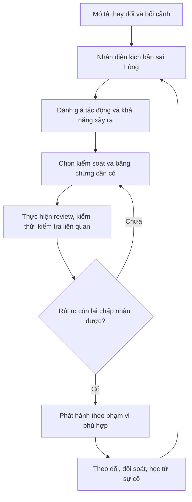

# Lựa chọn mức bảo đảm phù hợp với rủi ro

> **Chương:** Bối cảnh và đánh đổi  
> **Học phần:** CODE_QUALITY_FUNDAMENTALS — Hiểu những thuộc tính quyết định mã nguồn có đáng tin cậy, dễ hiểu và dễ thay đổi hay không.

Không phải mọi thay đổi mã nguồn đều cần cùng một mức kiểm tra trước khi đưa vào sử dụng. Sửa một câu mô tả trên trang trợ giúp và sửa công thức tính tiền thanh toán có thể chỉ chênh nhau vài dòng mã, nhưng **hậu quả khi xảy ra lỗi** rất khác nhau. Vì thế, quyết định về review, kiểm thử, phân tích bảo mật, thử tải và cách phát hành phải dựa trên rủi ro của thay đổi trong **bối cảnh hệ thống**, thay vì chỉ dựa vào số dòng code hoặc cảm giác rằng mã “đơn giản”.

Trong học phần này, **mức bảo đảm** là mức độ tin cậy có căn cứ mà nhóm có thể đạt được từ những bằng chứng như kết quả kiểm thử, review, phân tích, giám sát và khả năng phục hồi. Nó **không phải lời cam kết chắc chắn 100% không có lỗi**. Mục tiêu là chọn các biện pháp đủ sức phát hiện hoặc hạn chế những sai hỏng quan trọng nhất, với chi phí và thời gian hợp lý.

Sau bài học, người học có thể:

- Phân biệt **rủi ro**, **biện pháp kiểm soát** và **bằng chứng bảo đảm**.
- Ước lượng rủi ro của một thay đổi dựa trên xác suất sai hỏng, mức độ tác động, phạm vi ảnh hưởng và khả năng khôi phục.
- Chọn kỹ thuật xác minh phù hợp với loại sai hỏng cần ngăn ngừa.
- Đặt điều kiện chấp nhận trước phát hành và biết khi nào cần nâng hoặc hạ mức bảo đảm.

## 1. Vì sao không thể áp dụng một mức kiểm tra cho mọi thay đổi?

Xét bốn tình huống trong một hệ thống bán hàng:

| Thay đổi | Sai hỏng đáng lo | Hậu quả có thể xảy ra | Nhu cầu bảo đảm |
| --- | --- | --- | --- |
| Chỉnh lỗi chính tả trong phần mô tả sản phẩm | Hiển thị sai hoặc mất định dạng | Chủ yếu ảnh hưởng trải nghiệm đọc | Kiểm tra hiển thị, review phù hợp phạm vi |
| Thay đổi bộ lọc tìm kiếm | Bỏ sót sản phẩm hợp lệ, phân trang sai | Khách không tìm được hàng; giảm khả năng mua | Kiểm thử điều kiện lọc, dữ liệu biên và tích hợp tìm kiếm |
| Thay đổi công thức tính tổng tiền | Tính thiếu hoặc thừa tiền | Sai giao dịch, khiếu nại, đối soát khó | Kiểm thử chặt ở ranh giới, đối chiếu nghiệp vụ và đường đi thanh toán |
| Thay đổi kiểm tra quyền truy cập đơn hàng | Người dùng xem được đơn của người khác | Lộ dữ liệu, vi phạm kỳ vọng bảo mật | Kiểm thử phân quyền âm tính, review bảo mật và giám sát |

Bảng trên chỉ là minh họa, **không phải thang phân loại mặc định**. Ví dụ, thay đổi một dòng chữ pháp lý bắt buộc có thể có tác động lớn; sửa bộ lọc trên trang quản trị nội bộ cũng có thể ít rủi ro hơn bộ lọc dùng trong dịch vụ khẩn cấp. Bối cảnh quyết định mức độ nghiêm trọng.

Nếu mọi thay đổi đều phải trải qua quy trình nặng nhất, nhóm mất thời gian mà không chắc tăng chất lượng tương ứng. Nếu mọi thay đổi đều chỉ được kiểm tra sơ sài, những lỗi ít gặp nhưng gây tổn thất lớn có thể lọt ra môi trường thật.

**Nguyên tắc thực hành:** giữ một nền tảng chất lượng nhất quán, sau đó bổ sung độ sâu kiểm tra theo rủi ro riêng của thay đổi.

## 2. Ba khái niệm cần tách bạch

### 2.1. Rủi ro là khả năng gặp sai hỏng và hậu quả của nó

Một cách suy nghĩ đơn giản:

```text
Rủi ro ≈ Khả năng xảy ra sai hỏng × Mức độ tác động khi xảy ra
```

Đây là mô hình tư duy, **không phải công thức đủ để tính chính xác rủi ro**. Khi chưa có dữ liệu xác suất đáng tin cậy, nên dùng mức định tính và ghi rõ giả định thay vì gán những con số có vẻ chính xác.

Khi đánh giá một thay đổi, cần xét:

- **Khả năng sai hỏng:** điều kiện phức tạp, mã mới, vùng mã ít hiểu, phụ thuộc ngoài, mức độ thay đổi dữ liệu hoặc giao thức.
- **Tác động:** sai tiền, mất dữ liệu, lộ thông tin, gián đoạn dịch vụ, ảnh hưởng an toàn, nghĩa vụ pháp lý hoặc uy tín.
- **Mức độ phơi nhiễm:** bao nhiêu người, yêu cầu, giao dịch hay hệ thống sẽ đi qua phần mã đó.
- **Khả năng phát hiện:** lỗi có bị phát hiện sớm bằng kiểm thử, cảnh báo, đối soát, hay chỉ xuất hiện khi khách hàng khiếu nại?
- **Khả năng phục hồi:** có thể tắt tính năng hoặc hoàn tác không; dữ liệu, giao dịch hay thông tin đã lộ có thể khôi phục được đến đâu?

Các yếu tố sau không nhất thiết là những số hạng trong cùng một phép nhân. Chúng giúp **điều chỉnh mức ưu tiên** và xác định loại biện pháp kiểm soát cần thiết.

### 2.2. Biện pháp kiểm soát là điều nhóm làm để giảm rủi ro

Ví dụ: thêm kiểm thử biên để giảm khả năng lỗi so sánh; kiểm soát phân quyền để ngăn truy cập sai; triển khai theo nhóm nhỏ để giới hạn phạm vi ảnh hưởng; giám sát đối soát để phát hiện sai giao dịch.

Một số biện pháp **ngăn lỗi**, một số **phát hiện lỗi**, một số **giảm hậu quả sau khi lỗi xảy ra**. Không nên coi chúng là thay thế hoàn toàn cho nhau.

### 2.3. Bằng chứng bảo đảm là kết quả kiểm tra được

Ví dụ:

- Bộ kiểm thử chứa ca `discount == subtotal` và kết quả chạy trên phiên bản đang xét.
- Biên bản review chứng minh đã đối chiếu thuật toán với quy tắc tính tiền.
- Kết quả thử tải trên tải và cấu hình được mô tả cụ thể.
- Kiểm thử phân quyền xác nhận người dùng A không thể đọc đơn hàng của B.
- Thông số giám sát, cảnh báo và quy trình phản ứng đã được thực hành.

Các câu như “đã test rồi”, “code nhỏ thôi” hay “người viết rất có kinh nghiệm” **chưa đủ là bằng chứng** nếu không nói rõ đã kiểm tra điều gì, với phiên bản và điều kiện nào.

## 3. Đánh giá rủi ro trước khi chọn kỹ thuật

Một quy trình gọn có thể bắt đầu từ **đường đi của lỗi**: điều gì có thể sai, vì sao có thể sai, ai chịu ảnh hưởng và có thể phát hiện/khắc phục bằng cách nào?

### Bước 1: Xác định phạm vi và hành vi mong đợi

Ghi lại phần mã thay đổi, nơi gọi đến nó, dữ liệu đầu vào/đầu ra, tác dụng phụ và những hợp đồng phải giữ. Xác định yêu cầu về tính đúng đắn, bảo mật, hiệu năng, độ tin cậy, khả năng bảo trì và khả năng vận hành có liên quan.

Ví dụ, sửa hàm `calculatePayableVnd()` không chỉ là sửa phép trừ: kết quả có thể được dùng để tạo giao dịch thanh toán, ghi hóa đơn, cấp điểm tích lũy và hoàn tiền.

### Bước 2: Liệt kê các tình huống sai hỏng có ý nghĩa

Đừng chỉ hỏi “hàm có chạy không?”. Hãy thử hỏi:

1. Điều kiện biên hoặc đầu vào bất thường nào làm kết quả sai?
2. Hai yêu cầu đồng thời, thông điệp gửi lại hoặc đối tác bị gián đoạn có tạo hành vi bất ngờ không?
3. Người dùng sai quyền có thể kích hoạt luồng xử lý này không?
4. Thất bại có làm thay đổi dữ liệu hoặc phát sinh tác dụng không thể thu hồi không?
5. Người vận hành biết lỗi xảy ra bằng tín hiệu nào?

### Bước 3: Xếp mức rủi ro có giải thích

Có thể dùng ma trận định tính để hỗ trợ thảo luận:

| Khả năng xảy ra \ Tác động | Thấp | Trung bình | Cao |
| --- | --- | --- | --- |
| **Thấp** | Thấp | Thấp hoặc trung bình | Cao cần xem xét kỹ |
| **Trung bình** | Thấp hoặc trung bình | Trung bình | Cao |
| **Cao** | Trung bình | Cao | Cao |

Những ô “cần xem xét” nhắc nhóm rằng một lỗi **hiếm nhưng gây tổn thất nghiêm trọng** vẫn xứng đáng được kiểm tra kỹ. Ma trận là công cụ trao đổi, không tự động quyết định có được phát hành hay không.

Mỗi đánh giá nên kèm một câu ngắn:

> “Thay đổi quy tắc miễn phí giao hàng có tác động tài chính trung bình, nhiều giao dịch sử dụng, điều kiện dễ sai tại ngưỡng và có thể phát hiện chậm nếu thiếu đối soát; vì vậy ưu tiên kiểm thử biên, tích hợp và theo dõi doanh thu/phí.”

### Bước 4: Xác định rủi ro còn lại

Sau khi áp dụng kiểm soát, vẫn có thể tồn tại rủi ro chưa được loại bỏ. Hãy ghi rõ điều chưa kiểm chứng, người có quyền chấp nhận rủi ro đó theo quy trình của nhóm, và kế hoạch theo dõi. Không nên diễn đạt “100% test pass” thành “100% an toàn”.

## 4. Chọn mức bảo đảm theo rủi ro

Có thể chia thành ba **mức tham khảo** để thảo luận. Một tổ chức có thể dùng cách đặt tên hoặc tiêu chí khác; không nên coi bảng dưới là tiêu chuẩn bắt buộc cho mọi dự án.

| Mức | Thay đổi điển hình | Bằng chứng nên ưu tiên | Điều kiện trước phát hành |
| --- | --- | --- | --- |
| **Cơ bản** | Thay đổi trình bày ít tác động, dễ hoàn tác | Review phù hợp, kiểm tra hiển thị hoặc kiểm thử nhỏ, các kiểm tra nền tảng của dự án | Hành vi được mong đợi và không có lỗi thấy được trong phạm vi tác động |
| **Tăng cường** | Logic nghiệp vụ thường xuyên sử dụng, nhiều nhánh hoặc tích hợp | Kiểm thử đơn vị và biên, kiểm thử tích hợp, review quy tắc, kiểm tra hồi quy vùng bị ảnh hưởng | Các kịch bản quan trọng và tích hợp liên quan đạt yêu cầu; lỗi nghiêm trọng đã được xử lý |
| **Nghiêm ngặt** | Thanh toán, phân quyền, dữ liệu nhạy cảm, dịch vụ quan trọng hoặc khó phục hồi | Chứng minh quy tắc qua ca kiểm thử/đối soát, kiểm thử thất bại và cạnh tranh, review chuyên môn phù hợp, thử tải hoặc phân tích bảo mật khi liên quan, kế hoạch giám sát và ứng phó | Bằng chứng cho các tình huống gây thiệt hại lớn đã được kiểm tra; rủi ro còn lại được đánh giá và chấp nhận có căn cứ |

Mức cao **không có nghĩa phải chạy mọi loại công cụ**. Thử tải ít giá trị nếu thay đổi chỉ liên quan đến một kiểm tra quyền truy cập tần suất thấp; kiểm thử phân quyền lại là trọng tâm của trường hợp đó. Mức bảo đảm đúng là **độ sâu và loại bằng chứng khớp với cách hệ thống có thể hỏng**.

Ngược lại, những kiểm tra nền tảng có giá trị cho toàn dự án (ví dụ biên dịch, kiểm tra định dạng, bộ kiểm thử cốt lõi) thường vẫn chạy cho mọi thay đổi. Phân cấp rủi ro giúp bổ sung kiểm tra thích hợp, không phải lý do để bỏ những bảo vệ cơ bản sẵn có.

## 5. Ghép từng rủi ro với kỹ thuật kiểm chứng

| Rủi ro cần kiểm soát | Kỹ thuật phù hợp | Giới hạn cần hiểu |
| --- | --- | --- |
| Sai công thức, sai điều kiện ngưỡng | Unit test, thử nghiệm giá trị biên, so sánh với ví dụ nghiệp vụ độc lập | Chỉ xác minh những trường hợp hoặc thuộc tính đã được mô tả |
| Thay đổi làm hỏng hành vi cũ | Regression test, kiểm tra luồng người dùng có ảnh hưởng | Bộ kiểm thử cũ có thể thiếu tình huống mới |
| Sai hợp đồng API, sai kiểu dữ liệu, sai tương tác dịch vụ | Contract test, integration test với cấu hình sát thực tế | Môi trường thử có thể khác thực tế |
| Thao tác lặp, tranh chấp dữ liệu, lỗi do đồng thời | Kiểm thử gửi lại yêu cầu, concurrency test, kiểm tra tính idempotent và tính toàn vẹn dữ liệu | Thử nghiệm khó bao phủ mọi lịch xen kẽ |
| Truy cập sai quyền, lộ dữ liệu | Threat modeling gọn, review luồng phân quyền, kiểm thử âm tính, công cụ phân tích thích hợp | Quét tự động không thay thế hiểu mô hình quyền |
| Chậm, quá tải hoặc dùng tài nguyên quá mức | Benchmark có điều kiện rõ ràng, load/stress test, đo chỉ số latency và tài nguyên | Kết quả phụ thuộc dữ liệu, tải và môi trường |
| Lỗi chỉ xuất hiện sau phát hành | Rollout từng phần, log/metric có chủ đích, cảnh báo, quy trình khôi phục | Giám sát chủ yếu giúp phát hiện/giảm tác động sau khi lỗi đã xuất hiện |

**Kiểm thử, review và giám sát trả lời những câu hỏi khác nhau.** Một bộ unit test xanh không chứng minh hệ thống bảo toàn dữ liệu khi kết nối bị ngắt; một dashboard tốt không chứng minh thuật toán đúng cho giá trị biên.

## 6. Ví dụ thực hành Java: điều chỉnh độ sâu bảo đảm cho phép tính tiền

Giả sử một ứng dụng bán hàng tính số tiền khách phải trả theo quy tắc:

- `subtotalVnd` là tổng tiền hàng hợp lệ trước khi áp dụng khoản giảm đang xét.
- `discountVnd` không âm và không lớn hơn `subtotalVnd`.
- Kết quả phải bằng `subtotalVnd - discountVnd`, không âm.
- Các giá trị dùng đơn vị đồng Việt Nam kiểu `long`.

Đây là ví dụ minh họa; hệ thống thực tế có thể có thuế, làm tròn, phí vận chuyển, nhiều chương trình khuyến mãi và các quy tắc khác.

### 6.1. Mã rõ ràng là điểm khởi đầu, chưa phải bằng chứng đủ

```java
public final class CheckoutPricing {
    private CheckoutPricing() {
    }

    public static long calculatePayableVnd(long subtotalVnd, long discountVnd) {
        if (subtotalVnd < 0 || discountVnd < 0 || discountVnd > subtotalVnd) {
            throw new IllegalArgumentException("Invalid subtotal or discount");
        }
        return subtotalVnd - discountVnd;
    }
}
```

Hàm ngắn, dễ đọc và thể hiện một phần hợp đồng dữ liệu. Tuy nhiên, vì kết quả có thể quyết định **số tiền thực sự thu từ khách**, đánh giá rủi ro phải xét cả việc hàm này được gọi ở đâu và kết quả được ghi, gửi, hoặc sử dụng lại như thế nào.

### 6.2. Chọn bằng chứng sát với quy tắc

Với JUnit 5, những ca kiểm thử cơ bản có thể là:

```java
import static org.junit.jupiter.api.Assertions.assertEquals;
import static org.junit.jupiter.api.Assertions.assertThrows;

import org.junit.jupiter.api.Test;

class CheckoutPricingTest {
    @Test
    void keepsFullSubtotalWhenDiscountIsZero() {
        assertEquals(100_000L, CheckoutPricing.calculatePayableVnd(100_000L, 0L));
    }

    @Test
    void returnsZeroWhenDiscountEqualsSubtotal() {
        assertEquals(0L, CheckoutPricing.calculatePayableVnd(100_000L, 100_000L));
    }

    @Test
    void rejectsDiscountGreaterThanSubtotal() {
        assertThrows(IllegalArgumentException.class,
                () -> CheckoutPricing.calculatePayableVnd(100_000L, 100_001L));
    }

    @Test
    void rejectsNegativeInputs() {
        assertThrows(IllegalArgumentException.class,
                () -> CheckoutPricing.calculatePayableVnd(-1L, 0L));
        assertThrows(IllegalArgumentException.class,
                () -> CheckoutPricing.calculatePayableVnd(100L, -1L));
    }
}
```

Các phép thử này bảo vệ một số ranh giới quan trọng, nhưng chưa đủ để đưa ra kết luận “thanh toán an toàn”. Với mọi đầu vào hợp lệ, ta còn có thể kiểm tra các **thuộc tính**:

```text
0 <= payableVnd <= subtotalVnd
payableVnd + discountVnd == subtotalVnd
```

Vì `0 <= discountVnd <= subtotalVnd <= Long.MAX_VALUE`, phép cộng trong thuộc tính thứ hai không vượt giới hạn `long` nếu các giá trị đúng như hợp đồng ví dụ. Kiểm thử dựa trên thuộc tính có thể bổ sung độ bao phủ cho nhiều giá trị thay vì chỉ một vài ví dụ thủ công.

### 6.3. Mở rộng bảo đảm theo đường đi giao dịch

Giả sử giá trị trả về được gửi đến cổng thanh toán và lưu vào bảng đơn hàng. Những lỗi quan trọng có thể nằm **ngoài hàm tính tiền**:

| Tình huống | Bằng chứng cần thêm |
| --- | --- |
| Đơn hàng lưu một số tiền, yêu cầu thu tiền dùng số khác | Kiểm thử tích hợp đối chiếu tổng tiền đơn hàng với yêu cầu thanh toán |
| Gọi lại yêu cầu sau timeout tạo hai lần thu tiền | Kiểm thử gửi lại yêu cầu và tính idempotent tại luồng thanh toán |
| Khách sửa `orderId` trong yêu cầu | Kiểm thử phân quyền sở hữu đơn hàng ở điểm truy cập |
| Dịch vụ khuyến mãi trả kết quả cũ | Kiểm tra hợp đồng dữ liệu, hành vi khi dữ liệu không đồng bộ hoặc dịch vụ lỗi |
| Lỗi phát hiện sau khi có giao dịch thật | Theo dõi chênh lệch đối soát và quy trình xử lý giao dịch bị ảnh hưởng |

Việc “rollback phiên bản” **không tự hoàn tác** tiền đã thu hoặc dữ liệu đã ghi. Với giao dịch khó đảo ngược, nhóm cần xác định cách ngăn tác động tiếp diễn, đối soát và sửa sai cho người dùng.

### 6.4. Cùng một hàm, yêu cầu bảo đảm có thể khác

Nếu hàm được dùng để **hiển thị giá tham khảo trong bản demo không kết nối giao dịch**, tác động của lỗi có thể thấp hơn. Nếu được dùng làm nguồn sự thật để **thu tiền thật ở quy mô lớn**, mức bảo đảm phải cao hơn rõ rệt. Độ phức tạp của đoạn Java không thay đổi, nhưng **bối cảnh sử dụng và hậu quả của lỗi** thay đổi.

## 7. Xác lập điều kiện chấp nhận trước khi phát hành

Đừng đợi sát ngày phát hành mới quyết định “thế này đã đủ test chưa?”. Từ những rủi ro ưu tiên, nên định nghĩa trước **tiêu chí chấp nhận có thể kiểm tra**.

Ví dụ với thay đổi phép tính tiền:

1. Có đặc tả nhất quán cho tổng tiền, khoản giảm, đơn vị và điều kiện không hợp lệ.
2. Kiểm thử các giá trị biên và trường hợp sai dữ liệu đạt kết quả mong đợi trên mã chuẩn bị phát hành.
3. Luồng từ đơn hàng đến yêu cầu thanh toán qua kiểm thử tích hợp không làm lệch số tiền.
4. Với đường đi có thể gửi yêu cầu lại, hành vi chống thu trùng được kiểm chứng.
5. Những người có trách nhiệm đã xem xét các rủi ro còn lại theo cách làm của nhóm.
6. Có cách nhận biết sai lệch sau phát hành và có người phụ trách phản ứng.

Tiêu chí cần **đo được và gắn với hành vi**, thay vì chỉ ghi “coverage trên X%” hoặc “chạy đủ X phút”. Độ phủ mã là một tín hiệu hữu ích, nhưng không chứng minh đã kiểm tra đúng trường hợp có rủi ro cao.

Tương tự, **không có lỗi trong thử tải** chỉ có ý nghĩa trong phạm vi tải, dữ liệu, cấu hình và thời gian đã thử. Luôn ghi điều kiện của bằng chứng để người khác hiểu giới hạn của nó.

## 8. Điều chỉnh mức bảo đảm theo tiến trình phát triển

Rủi ro không đứng yên. Một thay đổi có thể trở nên đáng lo hơn khi:

- Tính năng được mở cho nhiều khách hàng hoặc xử lý lượng dữ liệu lớn hơn.
- Luồng xử lý bắt đầu tiếp xúc với dữ liệu nhạy cảm, tiền thật hoặc hệ thống bên ngoài.
- Một lỗi trước đó bộc lộ trường hợp mà mô hình kiểm thử chưa tính đến.
- Nhóm mất khả năng quan sát, giảm khả năng khôi phục hoặc thay đổi kiến trúc phụ thuộc.

Ngược lại, rủi ro có thể giảm khi nhóm hiểu rõ miền nghiệp vụ hơn, đã xây dựng được kiểm thử hồi quy đáng tin cậy, giới hạn được tác động hoặc bổ sung cơ chế phục hồi. Việc hạ mức kiểm tra riêng cho một thay đổi vẫn phải dựa trên bằng chứng và phạm vi rủi ro thực tế.

Một chu trình thực dụng:



Khi phát hành theo từng phần, cần nắm rõ điều gì được giới hạn. Chỉ bật tính năng cho 1% người dùng có thể giới hạn phơi nhiễm của lỗi hiển thị, nhưng nếu 1% đó vẫn có giao dịch tiền không thể hoàn tác thì mức bảo đảm trước phát hành vẫn phải đủ nghiêm ngặt.

## 9. Những đánh đổi và ngộ nhận thường gặp

### “Tất cả đều phải có 100% code coverage”

Độ phủ cao có thể giúp phát hiện vùng mã chưa được thực thi trong kiểm thử, nhưng không nói lên chất lượng của các khẳng định (*assertion*) hay việc đã kiểm tra đúng luật nghiệp vụ. Nên ưu tiên trường hợp tác động lớn, giá trị biên, tương tác quan trọng và lỗi đã từng xảy ra.

### “Chức năng ít dòng là ít rủi ro”

Một dòng đổi dấu `>=` thành `>` ở ngưỡng miễn phí giao hàng có thể ảnh hưởng hàng nghìn đơn. Một thay đổi cấu hình nhỏ có thể mở quyền truy cập trái phép. Độ lớn thay đổi là thông tin tham khảo, không phải đại diện của hậu quả.

### “Đã có kiểm thử tự động thì không cần review”

Kiểm thử tự động giỏi phát hiện hành vi lệch khỏi các trường hợp được mô tả. Review giúp tìm sai sót ngay trong mô tả, nhận diện tác dụng phụ hoặc nguy cơ bảo mật mà người viết test chưa dự liệu. Hai hoạt động bổ trợ nhau.

### “Hệ thống có thể rollback thì không cần kiểm tra kỹ”

Rollback có thể giảm thời gian gián đoạn, nhưng không xóa dữ liệu rò rỉ, không thu hồi mọi thông báo đã gửi và không tự sửa giao dịch sai. Khả năng phục hồi phải được đánh giá theo **loại tác động**, không chỉ theo thao tác triển khai.

### “Rủi ro cao thì phải dùng càng nhiều công cụ càng tốt”

Thêm công cụ không tự tạo ra bằng chứng hữu ích. Nếu lo ngại phân quyền thì phải kiểm tra khả năng truy cập sai; nếu lo ngại số tiền thì phải kiểm tra phép tính, đối soát và luồng thu tiền. Hãy đầu tư vào kiểm soát phù hợp với kịch bản sai hỏng.

### “Một lần đánh giá rủi ro là đủ”

Khi bối cảnh, tần suất sử dụng hoặc phụ thuộc thay đổi, bằng chứng cũ có thể không còn đại diện. Cần xem xét lại rủi ro khi có thay đổi đáng kể hoặc khi kết quả vận hành cho thấy giả định ban đầu không còn đúng.

## 10. Bảng câu hỏi dành cho người review

| Câu hỏi | Nếu chưa trả lời được |
| --- | --- |
| Hành vi nào thay đổi và ở đâu được sử dụng? | Lần theo nơi gọi và dữ liệu liên quan trước khi đánh giá |
| Sai hỏng nào gây tổn thất lớn nhất? | Viết kịch bản lỗi cụ thể, không chỉ ghi “có bug” |
| Có trường hợp biên, đầu vào sai hoặc đồng thời nào quan trọng? | Thêm kiểm thử hoặc phân tích đúng trường hợp đó |
| Cần kiểm tra tính đúng đắn, bảo mật, hiệu năng hay độ tin cậy nào? | Chọn kỹ thuật theo thuộc tính chất lượng bị đe dọa |
| Bằng chứng hiện có xác minh được điều gì, trên phiên bản nào? | Bổ sung kết quả có thể truy vết; ghi rõ giới hạn |
| Lỗi lọt ra sẽ được phát hiện và khôi phục thế nào? | Xây dựng tín hiệu giám sát và phương án xử lý phù hợp |
| Ai có thẩm quyền chấp nhận rủi ro còn lại? | Áp dụng quy trình quyết định của nhóm trước phát hành |

## 11. Bài tập áp dụng

Một nhóm định đổi điều kiện miễn phí giao hàng từ **tổng tiền sau giảm giá ≥ 500.000 đồng** thành **≥ 600.000 đồng**. Thay đổi chỉ nằm ở một hằng số Java.

Hãy tự xây dựng kế hoạch bảo đảm cho hai bối cảnh:

**Bối cảnh A:** chức năng mô phỏng để học viên thực hành, không giao dịch thật.

**Bối cảnh B:** hệ thống đang xử lý đơn hàng thật, nhiều khách sử dụng mỗi ngày, số tiền giao hàng được gửi đến dịch vụ thanh toán và lưu để đối soát.

Với mỗi bối cảnh, trả lời:

1. Hai kịch bản sai hỏng đáng quan tâm nhất là gì?
2. Tác động, phạm vi ảnh hưởng và khả năng hoàn tác khác nhau ra sao?
3. Những ca kiểm thử biên nào cần có? Ít nhất xét **599.999 đồng** và **600.000 đồng**.
4. Có cần kiểm thử tích hợp, kiểm tra đối soát hoặc theo dõi sau phát hành không? Vì sao?
5. Điều kiện nào cho phép nhóm kết luận rủi ro còn lại có thể chấp nhận?

Gợi ý: việc đổi một hằng số không nhất thiết làm tăng độ khó của code, nhưng trong bối cảnh B, một sai lệch giữa số tiền hiển thị, số tiền thu và dữ liệu đã lưu sẽ có hậu quả đáng kể. Bằng chứng cần bao phủ **đường đi thực tế của dữ liệu**, không chỉ một phép so sánh.

## Ghi nhớ

Mức bảo đảm phù hợp là **mức độ tin cậy có bằng chứng**, được chọn từ kịch bản sai hỏng và hậu quả trong bối cảnh sử dụng. Hãy xác định rủi ro trước, ghép rủi ro với kiểm soát phù hợp, kiểm tra bằng chứng trên phạm vi liên quan và đánh giá lại khi điều kiện thay đổi. Chất lượng mã không chỉ nằm ở việc mã dễ đọc hay chạy đúng trong vài trường hợp; chất lượng còn phụ thuộc vào khả năng nhận diện và kiểm soát những thất bại đáng lo nhất đối với người dùng và sản phẩm.
