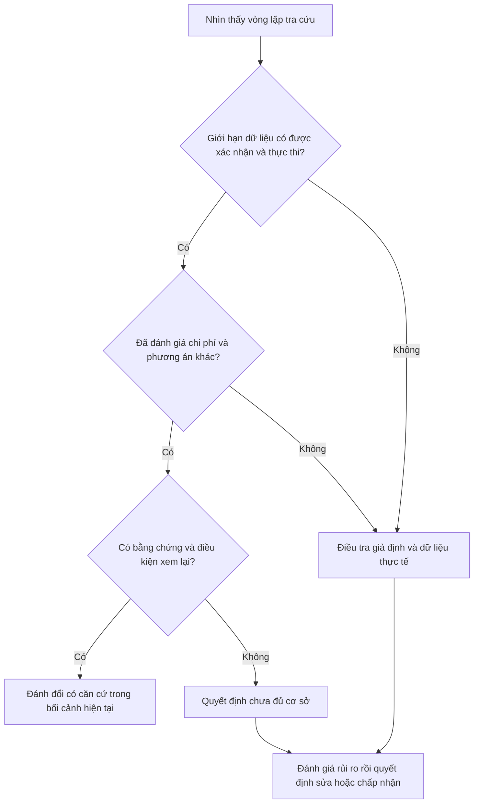

# Phân biệt quyết định có chủ đích với vấn đề chưa được nhận diện

Hai đoạn mã có thể trông giống nhau nhưng mang ý nghĩa chất lượng rất khác nhau. Một vòng lặp tìm kiếm tuần tự có thể là lựa chọn hợp lý khi dữ liệu nhỏ và đã được giới hạn; cũng vòng lặp ấy có thể là nguyên nhân gây chậm nghiêm trọng khi dữ liệu tăng mà người viết chưa từng cân nhắc độ phức tạp. **Điểm khác biệt không chỉ nằm ở hình dạng mã, mà còn ở bối cảnh, nhận thức về hệ quả và cách kiểm soát rủi ro.**

Trong chương **Bối cảnh và đánh đổi** của `CODE_QUALITY_FUNDAMENTALS`, chúng ta học cách xác định khi nào một điểm chưa tối ưu là **quyết định kỹ thuật có chủ đích (intentional trade-off)** và khi nào đó là **vấn đề chưa được nhận diện (unrecognized issue)**. Kỹ năng này giúp đánh giá mã có đáng tin cậy, dễ hiểu và dễ thay đổi hay không, đồng thời tránh hai thái cực: luôn đòi mọi thứ phải hoàn hảo hoặc viện cớ “đánh đổi” để bỏ qua rủi ro.

Sau bài này, bạn có thể mô tả điều kiện để một đánh đổi được xem là có căn cứ; tìm dấu hiệu của vấn đề ẩn; đọc code review theo bối cảnh; và ghi lại quyết định đủ rõ để người khác biết **vì sao lựa chọn vẫn phù hợp hoặc khi nào phải xem xét lại**.

## 1. Không phải mọi điểm yếu đều là một đánh đổi có chủ đích

Trong kỹ thuật phần mềm, nguồn lực, thời gian và yêu cầu có giới hạn. Ta thường phải ưu tiên một thuộc tính chất lượng hơn một thuộc tính khác: dùng giải pháp đơn giản để giảm chi phí bảo trì, chấp nhận tốn thêm bộ nhớ để tăng tốc truy vấn, hoặc giới hạn mức tổng quát để phục vụ đúng nhu cầu hiện tại.

**Quyết định có chủ đích** là lựa chọn mà người chịu trách nhiệm:

1. Hiểu mục tiêu và các ràng buộc hiện tại.
2. Biết có những phương án khác và các hệ quả đáng kể của từng phương án.
3. Chọn một phương án vì lợi ích cụ thể, đồng thời nhận diện bất lợi hoặc rủi ro còn lại.
4. Có cơ sở kiểm chứng rằng bất lợi ấy nằm trong mức chấp nhận được.
5. Biết điều kiện nào sẽ khiến quyết định cần được xem xét lại.

Ví dụ: *“Mỗi giỏ hàng có tối đa 10 dòng, danh mục giá truyền vào có tối đa 40 sản phẩm. Tra cứu tuần tự dễ đọc, tối đa khoảng 400 phép so sánh SKU mỗi lần tính tiền. Chúng ta chấp nhận cách này ở phiên bản hiện tại, theo dõi thời gian xử lý và chuyển sang tra cứu bằng `Map` nếu giới hạn dữ liệu thay đổi.”* Đây là một lập luận có thể kiểm tra được.

Ngược lại, **vấn đề chưa được nhận diện** là điểm yếu mà người thực hiện hoặc nhóm chưa thấy, chưa hiểu đúng hoặc chưa đánh giá tác động. Ví dụ: viết vòng lặp tra cứu tuần tự chỉ vì nó hoạt động với 3 sản phẩm thử nghiệm, trong khi yêu cầu thực tế cho phép hàng chục nghìn sản phẩm; không ai đánh giá chi phí khi số dòng giỏ hàng tăng. Kết quả có thể đúng nhưng hiệu năng suy giảm mạnh ở dữ liệu thực.

Một số trạng thái khác cũng cần phân biệt:

| Trạng thái | Đặc điểm nhận diện | Việc cần làm |
| --- | --- | --- |
| **Đánh đổi có chủ đích** | Có mục tiêu, phương án đã cân nhắc, hệ quả, bằng chứng và điều kiện xem lại | Giữ quyết định khi các giả định còn đúng; theo dõi tác động |
| **Vấn đề chưa được nhận diện** | Rủi ro hoặc giả định sai chưa được thấy hoặc kiểm tra | Điều tra, xác định tác động và ưu tiên xử lý |
| **Vấn đề đã biết nhưng chưa có quyết định** | Nhóm nhận ra điểm yếu nhưng chưa xác định người chịu trách nhiệm, mức rủi ro hoặc thời hạn | Làm rõ quyết định; không gọi mặc định là “đã chấp nhận” |
| **Lỗi cần sửa** | Hành vi vi phạm yêu cầu hoặc một nghĩa vụ bắt buộc về an toàn, dữ liệu, bảo mật | Xử lý theo mức độ nghiêm trọng; không dùng nhãn “đánh đổi” để hợp thức hóa lỗi |
| **Nợ kỹ thuật được chấp nhận có kiểm soát** | Tạm hoãn cải thiện cấu trúc để đạt mục tiêu cụ thể, có phạm vi và cách trả nợ hoặc điều kiện xem lại | Quản lý tác động, chi phí tích lũy và thời điểm xử lý |

**Biết một vấn đề tồn tại chưa đủ để biến nó thành quyết định có chủ đích.** Một ghi chú “TODO: optimize later” chỉ cho thấy tác giả có nghi ngờ; nó chưa nói vì sao rủi ro chấp nhận được, ai theo dõi, khi nào cần cải thiện và điều gì xảy ra nếu không cải thiện.

## 2. Ví dụ Java: cùng cách tra cứu, hai cách đánh giá

Giả sử hệ thống bán hàng tính tổng tiền giỏ hàng bằng cách tìm giá theo SKU trong danh mục được truyền vào. Để bài toán tập trung vào lựa chọn cấu trúc dữ liệu, ta giả định dữ liệu đầu vào đã được xác thực ở lớp tiếp nhận: SKU khác `null`, giá không âm, SKU trong danh mục là duy nhất và danh sách không chứa phần tử `null`.

```java
import java.util.List;

record Product(String sku, long priceVnd) {}
record CartLine(String sku, int quantity) {}

final class CartTotalCalculator {
    static long calculate(List<Product> catalog, List<CartLine> cart) {
        long total = 0L;

        for (CartLine line : cart) {
            if (line.quantity() <= 0) {
                throw new IllegalArgumentException("Quantity must be positive");
            }

            Product matched = null;
            for (Product product : catalog) {
                if (product.sku().equals(line.sku())) {
                    matched = product;
                    break;
                }
            }

            if (matched == null) {
                throw new IllegalArgumentException("Unknown SKU: " + line.sku());
            }

            long lineTotal = Math.multiplyExact(
                    matched.priceVnd(), (long) line.quantity());
            total = Math.addExact(total, lineTotal);
        }

        return total;
    }
}
```

Trong ví dụ này, `record` cần Java 16 trở lên. `Math.multiplyExact` và `Math.addExact` phát hiện tràn số nguyên bằng cách ném `ArithmeticException`, thay vì âm thầm cho một kết quả sai. Đoạn mã tập trung vào phép tra cứu; việc xác thực và lấy danh mục từ nguồn đáng tin cậy là trách nhiệm của phần khác trong hệ thống.

### Bối cảnh A: một quyết định có thể chấp nhận được

Ứng dụng dùng danh mục giá đã được giới hạn **không quá 40 sản phẩm** cho mỗi phép tính, và giỏ hàng **không quá 10 dòng**. Các giới hạn này được kiểm tra trước khi gọi phương thức. Việc quét danh mục theo từng dòng giỏ hàng đòi nhiều nhất khoảng `10 × 40 = 400` lần so sánh SKU; việc này được đánh giá trong mục tiêu hiệu năng của hệ thống.

Nhóm xem xét hai phương án:

- **Tra cứu tuần tự như trên:** Dễ đọc, ít cấu trúc phụ trợ, không phải tạo chỉ mục trong bộ nhớ.
- **Tạo `Map<String, Product>` trước khi tính:** Tra cứu trung bình gần hằng số cho mỗi SKU, đổi lại cần tạo chỉ mục, dùng thêm bộ nhớ và xử lý trường hợp SKU bị trùng theo một quy tắc rõ ràng.

Với giới hạn nhỏ và được thực thi, nhóm chọn tra cứu tuần tự để giữ mã đơn giản. Đây có thể là **đánh đổi có chủ đích** nếu kết luận dựa trên bằng chứng phù hợp, được ghi lại ngắn gọn và có tiêu chí xem lại. Con số 400 phép so sánh chỉ giúp ước lượng khối lượng công việc; **nó không tự chứng minh đạt mục tiêu độ trễ**. Việc đo trên môi trường và cấu hình đại diện vẫn cần thiết nếu hiệu năng là yêu cầu quan trọng.

### Bối cảnh B: một vấn đề chưa được nhận diện

Cũng đoạn mã đó được tái sử dụng trong một endpoint xử lý giỏ hàng lớn, với danh mục có thể chứa **50.000 sản phẩm** và giỏ hàng có thể chứa **2.000 dòng**. Không có giới hạn hoặc đo đạc phù hợp; tác giả chỉ thử vài sản phẩm nên thấy chương trình phản hồi nhanh.

Trong trường hợp xấu, số lần so sánh SKU có thể lên đến `2.000 × 50.000 = 100.000.000`. Vấn đề không nằm ở việc vòng lặp `for` luôn xấu; nó nằm ở **giả định về quy mô không được kiểm chứng**. Mã có thể trả tổng tiền chính xác nhưng tiêu tốn thời gian CPU không phù hợp với yêu cầu vận hành.

Độ phức tạp của cách tra cứu hiện tại xấp xỉ **O(C × P)**, trong đó `C` là số dòng giỏ hàng, `P` là số sản phẩm trong danh mục. Tạo chỉ mục `HashMap` một lần có thể đưa thời gian xử lý trung bình về khoảng **O(P + C)**, với chi phí thêm khoảng **O(P)** bộ nhớ và giả định hợp lý về hành vi băm. Đây là phân tích độ phức tạp, không phải cam kết về thời gian chạy tuyệt đối.



**Điểm mấu chốt:** Không thể kết luận một đoạn mã “tốt” hay “xấu” chỉ vì nó dùng vòng lặp lồng nhau. Phải đối chiếu với giới hạn dữ liệu, tần suất sử dụng, mục tiêu độ trễ, các lựa chọn khác và mức độ dễ thay đổi. Khi dữ liệu tăng vượt giới hạn ban đầu, một lựa chọn từng hợp lý **có thể hết phù hợp** mà không có nghĩa quyết định lúc đầu thiếu trách nhiệm.

## 3. Dấu hiệu cho thấy một quyết định thực sự có chủ đích

Một quyết định kỹ thuật không cần bản thiết kế dài hàng chục trang. Nhưng những người liên quan cần có thể trả lời các câu hỏi cốt lõi sau:

| Câu hỏi | Minh chứng hữu ích | Dấu hiệu cần làm rõ |
| --- | --- | --- |
| **Tối ưu điều gì?** | Mục tiêu rõ: thời gian phản hồi, thời gian phát triển, khả năng đọc, chi phí vận hành | Chỉ nói “cách này tốt hơn” mà không nêu tiêu chí |
| **Ràng buộc nào có thật?** | Giới hạn dữ liệu được kiểm tra, yêu cầu SLA/SLO, ngân sách, thời hạn | Phỏng đoán về số lượng người dùng hoặc hiệu năng |
| **Đã cân nhắc lựa chọn nào?** | So sánh phương án A/B và lý do chọn | Chưa từng xem phương án khác nhưng gọi là “đánh đổi” |
| **Mất gì khi chọn?** | Nêu tác động tới hiệu năng, độ phức tạp, tính linh hoạt hoặc chi phí | Chỉ liệt kê lợi ích, bỏ qua hệ quả bất lợi |
| **Có bằng chứng gì?** | Bài kiểm thử, số đo, giới hạn kinh doanh, dữ liệu tải thật hoặc thử nghiệm phù hợp | Kết luận dựa trên “máy tôi chạy nhanh” |
| **Ai quản lý rủi ro?** | Đầu mối hoặc nhóm chịu trách nhiệm và quy trình phản hồi | Không ai biết phải làm gì khi giả định thay đổi |
| **Khi nào xem lại?** | Điều kiện kích hoạt: tải tăng, lỗi tăng, yêu cầu mới, mốc thời gian cụ thể nếu cần | “Để sau tối ưu” nhưng không có điểm kiểm tra |

**Chủ đích không đồng nghĩa với đúng trong mọi hoàn cảnh.** Một quyết định có đủ thông tin vào lúc đưa ra vẫn có thể dẫn đến kết quả không như mong muốn. Khi bằng chứng mới xuất hiện, nhóm cần cập nhật quyết định, không cố bảo vệ phương án cũ bằng mọi giá.

### Một bản ghi quyết định ngắn gọn

Với quyết định có ảnh hưởng đáng kể, có thể lưu một **Architecture Decision Record (ADR)** ngắn trong tài liệu kỹ thuật, hoặc ghi nội dung tương đương vào mô tả pull request:

```text
Quyết định: Giữ tra cứu SKU tuần tự ở bộ tính tiền.
Bối cảnh: Tối đa 40 sản phẩm/danh mục và 10 dòng/giỏ;
           giới hạn được xác thực trước khi tính.
Phương án đã cân nhắc: Quét List; dựng Map theo SKU.
Lựa chọn: Quét List vì luồng xử lý ngắn và dễ đọc.
Đánh đổi: Mất O(C × P) phép so sánh thay vì O(P + C)
          trung bình nếu tạo Map; chấp nhận dưới giới hạn hiện tại.
Kiểm chứng: Test các trường hợp biên, đo thời gian tính
            ở kích thước tối đa trên cấu hình đại diện.
Điều kiện xem lại: Giới hạn sản phẩm/giỏ tăng, hoặc thời gian
                 xử lý vượt mục tiêu đã thống nhất.
Chủ sở hữu: Nhóm phụ trách giỏ hàng.
```

Đây là **minh họa về nội dung cần ghi**, không phải xác nhận rằng phép đo đã diễn ra trong một dự án cụ thể. Bản ghi tốt thể hiện kết quả đo hoặc liên kết tới bằng chứng thực tế sau khi kiểm chứng xong. Với lựa chọn nhỏ, một vài dòng giải thích trong pull request có thể đủ. Không cần tạo ADR cho từng biến hay từng câu lệnh `if`.

## 4. Làm sao phát hiện vấn đề chưa được nhận diện?

Vấn đề ẩn thường xuất hiện qua **giả định không được phát biểu**, sự lệch nhau giữa mã và môi trường sử dụng, hoặc sự thiếu vắng kiểm chứng ở những điểm có rủi ro.

### 4.1. Truy ngược các giả định

Khi đọc một triển khai, hãy tìm những giả định dù mã không ghi ra:

- **Quy mô:** Dữ liệu có luôn nhỏ không? Giới hạn được thực thi hay chỉ là thói quen sử dụng hiện tại?
- **Đầu vào:** Có thể có giá trị `null`, trùng lặp, âm, quá lớn hoặc chuỗi không hợp lệ không?
- **Thứ tự và đồng thời:** Có hai luồng cùng sửa dữ liệu không? Có yêu cầu phải xử lý theo thứ tự không?
- **Hệ thống bên ngoài:** Mạng, cơ sở dữ liệu và dịch vụ đối tác có thể lỗi, timeout hoặc trả phản hồi trễ không?
- **Thay đổi theo thời gian:** Quy tắc kinh doanh, loại dữ liệu, thị trường và số lượng người dùng có thể thay đổi thế nào?

Nếu một giả định quyết định tính đúng hoặc tính ổn định của mã, nó cần được xác nhận bằng hợp đồng đầu vào, kiểm thử, số đo hoặc tài liệu sản phẩm phù hợp. **Thiếu chứng cứ không tự động chứng minh có lỗi**, nhưng là lý do chính đáng để hỏi tiếp.

### 4.2. Tìm “khoảng trống kiểm thử”

Ví dụ một hàm chuyển tiền chỉ được thử ở số dư đủ lớn. Nhóm có thể đã bỏ sót giao dịch đồng thời, lỗi kết nối hoặc việc gửi yêu cầu hai lần. Các khoảng trống này đáng điều tra vì tác động cao, dù bản thân chúng chưa đủ để khẳng định hệ thống đang sai.

Đối với mã có rủi ro, hãy nghĩ tới **trường hợp biên, lỗi hệ thống phụ thuộc, đồng thời, dữ liệu lớn và quyền truy cập**. Tuy nhiên, không thể chỉ kiểm thử toàn bộ các nhánh mà bỏ qua tính hợp lý của yêu cầu: kiểm thử giúp kiểm chứng những giả định đã được nêu, trong khi review tốt còn cố gắng **phát hiện giả định chưa từng được đặt câu hỏi**.

### 4.3. Quan sát mã thay đổi lan rộng

Một sửa đổi rất nhỏ nhưng phải chạm đến nhiều lớp không liên quan có thể cho thấy mô-đun phụ thuộc quá chặt hoặc logic bị sao chép. Nếu nhóm chưa nhận thấy điều này, đó là vấn đề cấu trúc cần khảo sát.

Ngược lại, việc chạm nhiều file cũng có thể là hệ quả hợp lý của một yêu cầu thật sự ảnh hưởng nhiều thành phần. Cần xem **vì sao các file cùng thay đổi**, thay vì dùng số file sửa làm thước đo chất lượng duy nhất.

### 4.4. Tìm bằng chứng mâu thuẫn với lời giải thích

Các câu như “đủ nhanh”, “dữ liệu sẽ không lớn”, “không cần test vì đơn giản” hoặc “API này không bao giờ đổi” là **giả thuyết cần kiểm chứng**. Đặt câu hỏi ngắn, cụ thể:

> “Giới hạn dữ liệu này được kiểm tra ở đâu? Nếu đối tác gửi lượng dữ liệu gấp 100 lần thì điều gì xảy ra?”

Mục tiêu của review là phát hiện thông tin còn thiếu và rủi ro thực tế, không phải quy kết tác giả cẩu thả khi chưa có đủ dữ kiện.

## 5. Đánh đổi có chủ đích không phải giấy phép bỏ qua yêu cầu bắt buộc

Có những lựa chọn chỉ hợp lý **bên trong phạm vi yêu cầu và mức rủi ro được phép chấp nhận**. Không thể gọi việc bỏ kiểm tra quyền truy cập là “đánh đổi hiệu năng” khi hệ thống bắt buộc phải bảo vệ dữ liệu. Tương tự, không nên mô tả việc âm thầm tính sai tiền là “ưu tiên tốc độ” nếu tính đúng là yêu cầu cốt lõi.

Để tránh nhầm lẫn, hãy tách ba loại chi phí:

1. **Chi phí tối ưu hóa thêm:** Chẳng hạn dùng nhiều bộ nhớ hơn để giảm số lần tra cứu, hoặc viết thêm cơ chế caching để giảm độ trễ. Đây thường là nơi có thể cân nhắc lựa chọn.
2. **Chi phí bảo trì tương lai:** Chẳng hạn giữ một cấu trúc đơn giản dù biết sẽ cần tái cấu trúc khi quy mô tăng. Cần dự kiến điểm thay đổi và cách phát hiện.
3. **Hậu quả của việc vi phạm yêu cầu:** Chẳng hạn rò rỉ dữ liệu nhạy cảm, sai số tiền, bỏ qua xác thực bắt buộc hoặc mất dữ liệu. Những rủi ro này phải được xử lý theo nghĩa vụ và mức nghiêm trọng, không thể tự ý đánh đổi chỉ vì tiến độ.

Trong dự án thật, có thể tồn tại cơ chế chấp nhận rủi ro chính thức ở cấp tổ chức. Việc một cá nhân biết vấn đề hoặc nói “sếp đồng ý” không thay thế cho thẩm quyền phê duyệt và bằng chứng cần thiết, đặc biệt khi liên quan đến bảo mật, tiền hoặc dữ liệu cá nhân.

## 6. Phân biệt ba tình huống dễ bị đánh đồng

### Tình huống A: Chấp nhận trùng lặp nhỏ để tránh phụ thuộc sai

Hai màn hình độc lập có hai chuỗi giao diện giống nhau. Nhóm biết về sự lặp lại nhưng chưa trừu tượng thành một thư viện chia sẻ vì nội dung có khả năng thay đổi theo hai hướng khác nhau. Lựa chọn có thể có căn cứ nếu tác động nhỏ, ranh giới rõ và việc tách sau này dễ thực hiện.

Điều cần xem lại: Nếu hai nơi thực sự phải giữ **cùng một quy tắc nghiệp vụ**, việc sao chép có thể gây sai lệch kết quả. Khi đó, lý do “tránh phụ thuộc” không đủ để phủ nhận nhu cầu có nguồn quy tắc thống nhất.

### Tình huống B: Thiếu xử lý timeout của dịch vụ ngoài

Một ứng dụng gọi API đối tác mà không đặt timeout. Tác giả chỉ thử khi đối tác phản hồi ngay. Nếu không ai đánh giá trường hợp đối tác bị treo, đây là **vấn đề chưa được nhận diện**. Sau khi phát hiện, nhóm cần xác định yêu cầu thời gian chờ, hành vi khi lỗi, cơ chế retry phù hợp và các tác động liên quan. Chỉ thêm `TODO` không giải quyết được nguy cơ tài nguyên bị giữ quá lâu.

### Tình huống C: Biết hệ thống cũ khó thay đổi nhưng hoãn nâng cấp

Một module có cấu trúc khó kiểm thử nhưng không được sửa trong đợt triển khai gấp. Nếu nhóm đã phân tích tác động, giới hạn phần mã được thay, có kiểm thử bảo vệ hành vi hiện tại và lên kế hoạch tái cấu trúc khi có công việc liên quan, đó có thể là **nợ kỹ thuật được chấp nhận có kiểm soát**.

Nếu nhóm chỉ nói “sẽ làm sau” mà không ghi rõ ảnh hưởng hoặc điều kiện xử lý, vấn đề **đã được phát hiện** nhưng chưa có quyết định đủ căn cứ. Đừng nhầm lẫn việc trì hoãn thụ động với đánh đổi có quản lý.

## 7. Quy trình 6 bước dùng trong code review và thiết kế

Khi gặp một đoạn mã có vẻ chưa tối ưu, hãy đi theo quy trình ngắn sau:

1. **Xác định hiện tượng cụ thể.** Ví dụ: “Mỗi dòng giỏ hàng quét lại toàn bộ danh mục giá”, thay vì kết luận “mã kém”.
2. **Hỏi bối cảnh và giới hạn.** Đầu vào tối đa bao nhiêu? Tần suất gọi thế nào? Có ràng buộc về chi phí, độ trễ, độ tin cậy hoặc thời hạn không?
3. **Phác thảo phương án thay thế.** Đổi cấu trúc dữ liệu, tách trách nhiệm, thêm kiểm thử hay giữ nguyên? Mỗi phương án được gì và mất gì?
4. **Đánh giá tác động bằng chứng cứ.** Xem hợp đồng, kiểm thử, số đo, kết quả tái hiện lỗi hoặc phân tích độ phức tạp phù hợp. Ghi rõ phần còn chưa chắc chắn.
5. **Ra quyết định và thể hiện lý do.** Sửa ngay nếu có lỗi hoặc rủi ro không thể chấp nhận; nếu giữ, nêu phạm vi áp dụng, lý do, người quản lý rủi ro và điều kiện xem xét lại.
6. **Theo dõi các giả định quan trọng.** Khi dữ liệu, tải, quy tắc hoặc mục tiêu thay đổi, đánh giá lại thay vì lặp lại một quyết định cũ như chân lý bất biến.

### Cách trao đổi mang tính xây dựng

Thay vì nhận xét “Sao không dùng `HashMap`? Viết thế này sai nguyên tắc”, hãy hỏi:

> “Đoạn này quét danh mục cho từng dòng giỏ hàng. Danh mục và giỏ được giới hạn ở mức nào? Nếu kích thước tăng, chúng ta có cần tạo chỉ mục SKU không?”

Người viết có thể trả lời bằng giới hạn và dữ liệu đo được; hoặc câu hỏi sẽ giúp phát hiện một giả định chưa được kiểm chứng. Cả hai đều là kết quả có ích của code review.

## 8. Những ngộ nhận cần tránh

| Ngộ nhận | Cách hiểu đúng hơn |
| --- | --- |
| “Đã có comment giải thích thì là đánh đổi có chủ đích.” | Comment có thể mô tả ý định, nhưng vẫn cần cơ sở, hệ quả và ranh giới chấp nhận. |
| “Lập trình viên giàu kinh nghiệm chọn nên chắc chắn đúng.” | Kinh nghiệm giúp đánh giá nhưng không thay thế dữ liệu và yêu cầu của hệ thống. |
| “Không phải best practice tức là mã kém.” | Quy ước và mẫu thiết kế phải được áp dụng phù hợp với mục tiêu, quy mô, chi phí. |
| “Không có bug trong test tức là không có vấn đề.” | Kiểm thử hiện có có thể chưa bao phủ các giả định sai, dữ liệu lớn hoặc lỗi của dịch vụ ngoài. |
| “Biết có nợ kỹ thuật là đủ; cứ để sau.” | Cần cân nhắc tác động, ưu tiên, trách nhiệm và điều kiện thanh toán khoản nợ. |
| “Đã chọn có chủ đích thì không cần đổi nữa.” | Lựa chọn cần được đánh giá lại khi bối cảnh hoặc bằng chứng thay đổi. |
| “Cứ thêm nhiều lớp trừu tượng là an toàn hơn.” | Trừu tượng quá sớm cũng tạo chi phí, phụ thuộc và đường đi khó theo dõi. |

## 9. Bài tập tự kiểm tra

**Câu 1.** Một lập trình viên viết vòng lặp lồng nhau trên tập dữ liệu lớn, khi review nói: “Em biết cách này chậm nhưng chưa có thời gian sửa.” Đã đủ cơ sở gọi đó là đánh đổi có chủ đích chưa?

*Gợi ý:* Chưa. Cần biết độ chậm có vượt mục tiêu không, tác động tới người dùng, phương án thay thế, cơ sở chấp nhận rủi ro và điều kiện xử lý. Đây là vấn đề đã được biết tới, nhưng quyết định chưa được trình bày đầy đủ.

**Câu 2.** Nhóm đã giới hạn dữ liệu, đo được thời gian xử lý phù hợp và ghi rõ ngưỡng phải tối ưu lại. Sau sáu tháng, sản phẩm nâng giới hạn dữ liệu lên gấp 100 lần. Việc giữ thuật toán cũ có còn hợp lý không?

*Gợi ý:* Cần đánh giá lại. Quyết định trước đó có thể từng đúng; giả định thay đổi khiến bằng chứng cũ không còn đủ để kết luận.

**Câu 3.** Một hàm xử lý thanh toán không kiểm tra quyền truy cập để giảm vài mili giây. Tác giả ghi ADR với lý do và số đo đầy đủ. Có nên coi đây là đánh đổi chất lượng thông thường không?

*Gợi ý:* Không. Ghi tài liệu không hợp thức hóa việc vi phạm yêu cầu bảo mật bắt buộc. Cần giải quyết việc kiểm soát quyền truy cập theo yêu cầu và đánh giá phương án tối ưu khác.

**Câu 4.** Một reviewer phát hiện mã có thể lỗi khi dịch vụ đối tác không phản hồi; tác giả chưa từng nghĩ đến trường hợp này. Trước khi kết luận cách xử lý, nên làm gì?

*Gợi ý:* Xác minh hành vi thực tế, tìm yêu cầu timeout và mức độ ảnh hưởng, kiểm tra khả năng giữ tài nguyên hoặc gây lỗi dây chuyền, rồi lựa chọn xử lý phù hợp và bổ sung kiểm chứng.

**Câu 5.** Hai module có vài dòng mã định dạng giống nhau. Có nhất thiết phải tạo thư viện chung ngay không?

*Gợi ý:* Không. Xác định đây là chi tiết giao diện độc lập hay một quy tắc bắt buộc đồng nhất; cân nhắc mức độ trùng lặp, lý do thay đổi, chi phí phụ thuộc và khả năng sửa sau này.

## Ghi nhớ

**Một đánh đổi có chủ đích là quyết định có mục tiêu, bằng chứng, hệ quả được nhận diện và điều kiện xem lại.** Một vấn đề chưa được nhận diện thường nằm trong giả định chưa được kiểm chứng hoặc tác động chưa được dự liệu. Còn một vấn đề đã biết nhưng bị trì hoãn không mặc nhiên là đánh đổi được quản lý.

Đánh giá chất lượng mã nguồn cần xem cả **mã, yêu cầu và bối cảnh vận hành**. Khi gặp một giải pháp có vẻ chưa tối ưu, hãy làm rõ tác động và giả định trước khi phán xét; khi phát hiện rủi ro, hãy biến nó thành một quyết định minh bạch và có trách nhiệm. Cách làm đó giúp phần mềm tiếp tục **đáng tin cậy, dễ hiểu và dễ thay đổi** khi hệ thống phát triển.
