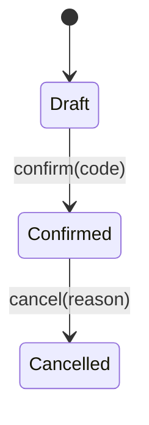

# Mô hình miền dữ liệu và trạng thái hợp lệ

Một chương trình có thể vượt qua kiểm tra kiểu của Java nhưng vẫn giữ những đối tượng vô nghĩa đối với nghiệp vụ: đơn hàng đã giao nhưng chưa thanh toán, khoảng ngày có ngày kết thúc trước ngày bắt đầu, số lượng sản phẩm âm, hay yêu cầu đặt phòng được xác nhận mà không có mã xác nhận. Những đối tượng như vậy thường là nguồn gốc của lỗi xuất hiện muộn, ở một thành phần cách xa nơi dữ liệu được tạo.

Trong chương **Tính đúng đắn** của **CODE_QUALITY_FUNDAMENTALS**, việc mô hình hóa miền dữ liệu giúp biến yêu cầu nghiệp vụ thành những điều kiện có thể kiểm tra và duy trì. Đây là một phần của mục tiêu chung: hiểu các thuộc tính quyết định mã nguồn **đáng tin cậy, dễ hiểu và dễ thay đổi** đến mức nào. Khi kiểu dữ liệu và các phép chuyển trạng thái phản ánh đúng nghiệp vụ, mã đọc dễ hơn, lỗi bị phát hiện sớm hơn và thay đổi có chỗ để kiểm soát.

## Mục tiêu học tập

Sau bài này, bạn có thể:

1. Phân biệt một giá trị **hợp lệ về kiểu Java** với một giá trị **hợp lệ trong miền nghiệp vụ**.
2. Nêu được các **bất biến** (*invariants*) và quy tắc **chuyển trạng thái** của một đối tượng.
3. Sử dụng kiểu giá trị, constructor kiểm tra điều kiện và kiểu biểu diễn trạng thái để hạn chế trạng thái không hợp lệ.
4. Phân biệt các ràng buộc kiểm tra được trong một đối tượng với các ràng buộc cần cơ sở dữ liệu hoặc giao dịch.
5. Thiết kế các kiểm thử có khả năng chứng minh hành vi nghiệp vụ, nhất là tại ranh giới.

## 1. Miền dữ liệu là gì?

**Miền dữ liệu** (*domain*) là tập hợp các khái niệm, quy tắc và mối quan hệ mà phần mềm phải xử lý trong một lĩnh vực cụ thể: đặt phòng, bán hàng, kho vận, kế toán hoặc quản lý lớp học.

Ví dụ, trong hệ thống đặt phòng, miền nghiệp vụ có các khái niệm như:

- **Kỳ lưu trú:** ngày nhận phòng và ngày trả phòng.
- **Số khách:** số người sử dụng phòng, chịu giới hạn theo chính sách.
- **Đặt phòng:** một yêu cầu gắn với kỳ lưu trú và số khách.
- **Trạng thái đặt phòng:** bản nháp, đã xác nhận, đã hủy.
- **Chuyển trạng thái:** xác nhận bản nháp hoặc hủy đặt phòng đã xác nhận, theo chính sách của ví dụ.

Mô hình miền dữ liệu (*domain model*) là cách chương trình biểu diễn những khái niệm và quy tắc đó bằng dữ liệu, kiểu, thao tác và ràng buộc. Mô hình có thể nằm trong các lớp Java, kiểu giá trị, dịch vụ miền và ràng buộc lưu trữ; không nhất thiết phải sử dụng một framework hay một kiến trúc phức tạp.

### Đúng kiểu chưa chắc đúng nghiệp vụ

Xét một lớp dữ liệu đơn giản:

```java
record Booking(
        String id,
        LocalDate checkIn,
        LocalDate checkOut,
        int guests,
        boolean confirmed,
        String confirmationCode
) {}
```

Giả sử đã import `java.time.LocalDate`. Các đối tượng sau đều có thể được tạo với constructor mặc định của record, dù trái với quy tắc nghiệp vụ thường gặp:

```java
new Booking("B-01", LocalDate.of(2026, 12, 10),
        LocalDate.of(2026, 12, 9), -2, true, null);

new Booking("B-02", LocalDate.of(2026, 12, 10),
        LocalDate.of(2026, 12, 12), 2, false, "CONF-999");
```

Ở đối tượng thứ nhất, ngày trả phòng đứng trước ngày nhận phòng, số khách âm và đặt phòng được đánh dấu xác nhận nhưng không có mã xác nhận. Ở đối tượng thứ hai, cờ `confirmed` là `false` nhưng lại có mã xác nhận. Java vẫn chấp nhận vì `int`, `boolean`, `String` và `LocalDate` chỉ mô tả **kiểu kỹ thuật**, chưa chứa đầy đủ **ý nghĩa nghiệp vụ**.

Một mô hình tốt cần trả lời thêm: **Có những trạng thái hợp lệ nào, điều kiện gì tạo ra chúng và thao tác nào được phép chuyển giữa các trạng thái đó?**

## 2. Xác định trạng thái hợp lệ bằng bất biến

**Bất biến** (*invariant*) là một điều kiện phải đúng tại những thời điểm đối tượng hoặc hệ thống được coi là ở trạng thái hợp lệ. Với đối tượng bất biến (*immutable object*), điều kiện thường được bảo đảm lúc khởi tạo và duy trì vì các trường không thể bị thay đổi sau đó.

Trong ví dụ đặt phòng, ta thống nhất một số quy tắc **minh họa**:

| Mã quy tắc | Bất biến hoặc điều kiện | Phạm vi kiểm chứng |
| --- | --- | --- |
| I1 | Ngày trả phòng phải **sau** ngày nhận phòng. | Một kỳ lưu trú. |
| I2 | Số khách phải trong khoảng **1 đến 8**, kể cả hai đầu. | Một giá trị số khách. |
| I3 | Mã định danh đặt phòng phải có nội dung. | Một đặt phòng. |
| I4 | Đặt phòng **đã xác nhận** phải có mã xác nhận khác rỗng. | Một trạng thái đã xác nhận. |
| I5 | Đặt phòng **đã hủy** phải có lý do hủy khác rỗng. | Một trạng thái đã hủy. |
| I6 | Hai đặt phòng đã xác nhận không được giữ cùng một phòng trong những khoảng thời gian chồng lấn. | Tập hợp đặt phòng, phòng và dữ liệu lưu trữ. |

I1–I5 có thể được bảo vệ khi tạo các đối tượng liên quan. I6 cần quan sát **nhiều đối tượng và trạng thái hệ thống**, nên không thể bảo đảm chỉ bằng constructor của một record.

> Các giới hạn `1..8`, yêu cầu mã xác nhận và quy tắc hủy ở đây là hợp đồng được **giả định để học**. Hệ thống thực tế phải xác nhận chúng với người phụ trách nghiệp vụ, thay vì coi đó là quy tắc phổ quát của mọi khách sạn.

### Các nhóm ràng buộc thường gặp

| Nhóm | Ví dụ | Cách biểu diễn thường dùng |
| --- | --- | --- |
| Giá trị đơn lẻ | Số lượng dương, email không rỗng. | Kiểu giá trị (*value object*), kiểm tra trong constructor. |
| Quan hệ giữa các trường | Ngày kết thúc sau ngày bắt đầu. | Constructor/factory kiểm tra đồng thời nhiều trường. |
| Tổ hợp trường theo trạng thái | Đã xác nhận thì có mã xác nhận. | Các kiểu trạng thái riêng, hoặc ràng buộc có điều kiện. |
| Vòng đời | Chỉ xác nhận bản nháp; không xác nhận lại bản đã hủy. | Phép chuyển trạng thái rõ ràng. |
| Toàn hệ thống | Không bán vượt tồn kho, không đặt trùng phòng. | Giao dịch, kiểm soát đồng thời, ràng buộc lưu trữ. |

Việc chia nhóm giúp đặt quy tắc vào đúng nơi. Kiểm tra ngày trong một kiểu `Stay` sẽ hữu ích cho mọi nơi tái sử dụng kỳ lưu trú. Kiểm tra một phòng còn trống lại cần thông tin từ kho dữ liệu và có thể thay đổi theo thời gian.

## 3. Làm cho dữ liệu sai khó được tạo ra

Mỗi khi nhận một cặp `LocalDate` độc lập, lập trình viên có thể quên kiểm tra thứ tự ngày. Thay vì lặp điều kiện ở mọi hàm, ta tạo một kiểu đại diện cho **kỳ lưu trú hợp lệ**.

```java
import java.time.LocalDate;
import java.util.Objects;

record Stay(LocalDate checkIn, LocalDate checkOut) {
    public Stay {
        Objects.requireNonNull(checkIn, "checkIn");
        Objects.requireNonNull(checkOut, "checkOut");
        if (!checkOut.isAfter(checkIn)) {
            throw new IllegalArgumentException(
                    "Check-out must be after check-in");
        }
    }
}
```

Khi code bên ngoài nhận một `Stay` đã được khởi tạo thông qua constructor này, nó có thể dựa vào điều kiện `checkOut.isAfter(checkIn)` mà không cần kiểm tra lại trong từng phương thức.

Tương tự, biểu diễn số khách bằng kiểu có ý nghĩa:

```java
record GuestCount(int value) {
    public GuestCount {
        if (value < 1 || value > 8) {
            throw new IllegalArgumentException(
                    "Guest count must be between 1 and 8");
        }
    }
}
```

Điều này mạnh hơn một tham số `int` tên `guests`: trình biên dịch giúp phân biệt `GuestCount` với số tiền, số đêm hay số phòng, còn constructor kiểm tra **miền giá trị hợp lệ**. Tuy nhiên, kiểu dữ liệu không tự xác nhận chính sách 8 khách có còn đúng hay không; đó vẫn là trách nhiệm của yêu cầu nghiệp vụ.

### Value object và entity

Đừng nhầm hai vai trò thường xuất hiện trong mô hình:

- **Value object (đối tượng giá trị):** được hiểu qua giá trị, ví dụ `Stay(10/12, 12/12)` hoặc `GuestCount(2)`. Java `record` phù hợp cho nhiều kiểu giá trị bất biến.
- **Entity (thực thể):** có danh tính tiếp diễn qua thời gian, ví dụ đặt phòng `B-123` vẫn là cùng một đặt phòng khi từ bản nháp chuyển sang đã xác nhận. Hai phiên bản dữ liệu của cùng định danh không nhất thiết là hai thực thể khác nhau.

Khi chọn `record` cho trạng thái của một entity, hãy nhớ **`equals` của record so sánh các thành phần**, chứ không mặc nhiên thể hiện quy tắc nhận diện entity theo ID. Mô hình cần phân biệt danh tính nghiệp vụ và tính bằng nhau của bản ghi dữ liệu.

## 4. Biểu diễn trạng thái bằng các kiểu riêng

Mô hình ban đầu dùng `boolean confirmed` và `String confirmationCode`. Điều đó tạo ra nhiều tổ hợp có thể biểu diễn nhưng vô nghĩa. Chẳng hạn:

| `confirmed` | `confirmationCode` | Ý nghĩa |
| --- | --- | --- |
| `false` | `null` | Bản nháp hợp lệ theo ví dụ. |
| `true` | `"CONF-123"` | Đã xác nhận hợp lệ. |
| `true` | `null` | Không hợp lệ: thiếu mã xác nhận. |
| `false` | `"CONF-123"` | Không hợp lệ: trạng thái và dữ liệu mâu thuẫn. |

Nếu thêm `cancelled` và `cancelReason`, số tổ hợp cờ/trường tiếp tục tăng. Có hai hướng phổ biến:

1. Giữ một đối tượng với `enum Status` và kiểm tra **tất cả tổ hợp trường** theo status trong constructor và mỗi thao tác cập nhật.
2. Dùng **kiểu dữ liệu riêng cho mỗi trạng thái** để mỗi biến thể chỉ chứa những trường có nghĩa đối với trạng thái đó.

Hướng thứ nhất vẫn hợp lý cho miền nhỏ, ít trường điều kiện. Khi trạng thái có bộ dữ liệu khác nhau, hướng thứ hai giúp người đọc thấy rõ quy tắc và hạn chế nhiều trạng thái vô nghĩa ngay ở cấu trúc chương trình.

### Một mô hình Java 17 có kiểm soát dữ liệu

Ví dụ dưới đây dùng `record` và `sealed interface` của Java 17. Chính sách minh họa là: chỉ **bản nháp** được xác nhận và chỉ **đặt phòng đã xác nhận** được hủy. Mỗi biến thể chỉ lưu phần dữ liệu thực sự có ý nghĩa đối với nó.

```java
import java.time.LocalDate;
import java.util.Objects;

record Stay(LocalDate checkIn, LocalDate checkOut) {
    public Stay {
        Objects.requireNonNull(checkIn, "checkIn");
        Objects.requireNonNull(checkOut, "checkOut");
        if (!checkOut.isAfter(checkIn)) {
            throw new IllegalArgumentException(
                    "Check-out must be after check-in");
        }
    }
}

record GuestCount(int value) {
    public GuestCount {
        if (value < 1 || value > 8) {
            throw new IllegalArgumentException(
                    "Guest count must be between 1 and 8");
        }
    }
}

record BookingDetails(String id, Stay stay, GuestCount guests) {
    public BookingDetails {
        if (id == null || id.isBlank()) {
            throw new IllegalArgumentException("Booking ID is required");
        }
        Objects.requireNonNull(stay, "stay");
        Objects.requireNonNull(guests, "guests");
    }
}

sealed interface BookingState permits Draft, Confirmed, Cancelled {}

record Draft(BookingDetails details) implements BookingState {
    public Draft {
        Objects.requireNonNull(details, "details");
    }

    public Confirmed confirm(String confirmationCode) {
        return new Confirmed(details, confirmationCode);
    }
}

record Confirmed(
        BookingDetails details,
        String confirmationCode) implements BookingState {
    public Confirmed {
        Objects.requireNonNull(details, "details");
        if (confirmationCode == null || confirmationCode.isBlank()) {
            throw new IllegalArgumentException(
                    "Confirmation code is required");
        }
    }

    public Cancelled cancel(String reason) {
        return new Cancelled(details, reason);
    }
}

record Cancelled(
        BookingDetails details,
        String reason) implements BookingState {
    public Cancelled {
        Objects.requireNonNull(details, "details");
        if (reason == null || reason.isBlank()) {
            throw new IllegalArgumentException(
                    "Cancellation reason is required");
        }
    }
}
```

Ví dụ sử dụng:

```java
BookingDetails details = new BookingDetails(
        "B-123",
        new Stay(LocalDate.of(2026, 12, 10),
                 LocalDate.of(2026, 12, 12)),
        new GuestCount(2));

Draft draft = new Draft(details);
Confirmed confirmed = draft.confirm("CONF-123");
Cancelled cancelled = confirmed.cancel("Khách đổi kế hoạch");
```

Các record trong ví dụ là **bất biến theo các thành phần được khai báo**; `Stay`, `GuestCount`, `BookingDetails` cũng là các kiểu bất biến, nên dữ liệu cấu thành không thể bị đổi qua phương thức setter. Nếu thành phần là một collection hoặc đối tượng có thể thay đổi, cần sao chép phòng vệ như `List.copyOf(...)` và kiểm tra phần tử để bảo vệ tính bất biến thực sự.

Với cách mô hình này:

- `Draft` không mang một `confirmationCode` có thể gây mâu thuẫn.
- `Confirmed` luôn có mã xác nhận khác rỗng khi được tạo qua constructor thông thường.
- `Cancelled` luôn mang lý do hủy khác rỗng.
- Phương thức `confirm` được công bố trên `Draft`, còn `cancel` được công bố trên `Confirmed`. Người dùng API nhìn thấy các phép chuyển trạng thái có chủ đích.
- `sealed interface` giới hạn tập kiểu triển khai được phép, giúp người đọc và trình biên dịch biết những biến thể trạng thái có thể xuất hiện.

**Giới hạn cần hiểu đúng:** các constructor của `Confirmed` và `Cancelled` trong ví dụ vẫn có thể được gọi trực tiếp từ mã có quyền truy cập. Vì vậy, mô hình trên **bảo vệ cấu trúc dữ liệu của từng trạng thái**, nhưng **chưa bảo đảm mọi đối tượng đã đi qua đúng lịch sử chuyển trạng thái**. Nếu lịch sử và quyền chuyển trạng thái là quy tắc bắt buộc, hãy đóng gói cách tạo trạng thái trong một **aggregate** hoặc domain service, giới hạn quyền truy cập constructor/factory và kiểm tra quyền, phiên bản dữ liệu cùng lịch sử trong giao dịch lưu trữ.

### Sơ đồ chuyển trạng thái minh họa



Sơ đồ là **hợp đồng vòng đời**, không phải danh sách mọi chuyển trạng thái mà hệ thống thật chắc chắn phải có. Nếu nghiệp vụ cho phép hủy bản nháp, xác nhận lại hay hoàn tiền sau hủy, phải sửa sơ đồ, các kiểu/hành vi liên quan và kiểm thử cùng lúc.

## 5. Ranh giới tạo đối tượng: kiểm tra ở đâu?

Đầu vào từ JSON, form, message queue hoặc cơ sở dữ liệu là **dữ liệu thô**. Một quy trình xử lý có thể có các bước:

```text
JSON / Request DTO / Message
            |
            v
Kiểm tra định dạng và chuyển kiểu
            |
            v
Tạo Stay, GuestCount, BookingDetails
   (xác lập bất biến cục bộ)
            |
            v
Thực hiện thao tác miền: confirm, cancel
   (kiểm tra quy tắc vòng đời)
            |
            v
Giao dịch với kho dữ liệu và hệ thống ngoài
   (kiểm tra ràng buộc liên đối tượng)
```

Các lớp trách nhiệm có thể phối hợp:

| Lớp / ranh giới | Nên chịu trách nhiệm |
| --- | --- |
| Adapter/DTO đầu vào | Đọc dữ liệu, kiểm tra định dạng, chuyển ngày/giờ, cung cấp thông báo lỗi phù hợp cho API. |
| Constructor/factory miền | Ngăn tạo giá trị vô nghĩa: khoảng ngày đảo, số khách ngoài miền, trạng thái thiếu dữ liệu bắt buộc. |
| Phương thức miền / application service | Quyết định thao tác nào được thực hiện với trạng thái hiện tại và quyền của người gọi. |
| Repository/giao dịch/DB | Bảo vệ điều kiện cần dữ liệu hiện tại của nhiều đối tượng và cập nhật nguyên tử. |

Những lớp bảo vệ này có thể cố ý kiểm tra lặp một số điều, nhưng **nguồn định nghĩa quy tắc** nên rõ ràng. Chẳng hạn, một adapter kiểm tra lỗi ngày để trả thông điệp dễ hiểu, còn constructor `Stay` vẫn bảo vệ bất biến cho mọi nơi tạo `Stay`, kể cả khi dữ liệu không đi qua HTTP.

Với `Objects.requireNonNull`, Java ném `NullPointerException`; với các điều kiện miền trong ví dụ, chương trình ném `IllegalArgumentException`. Hợp đồng API có thể ánh xạ cả hai thành lỗi đầu vào với mã và nội dung ổn định. Không nên để loại ngoại lệ nội bộ tự động trở thành định dạng giao tiếp công khai ngoài ý muốn.

## 6. Trạng thái hợp lệ toàn hệ thống: bài toán đặt trùng phòng

Giả sử hai yêu cầu cùng muốn đặt phòng **P-101** cho khoảng `[10/12, 12/12)`. Dấu ngoặc `[` và `)` biểu diễn khoảng **gồm ngày nhận phòng và không gồm ngày trả phòng**. Cách biểu diễn này cho phép một khách trả phòng ngày 12/12 và khách khác nhận phòng cùng ngày, nếu nghiệp vụ cho phép.

Hai yêu cầu có thể cùng đọc “P-101 còn trống”, sau đó cùng xác nhận. Mỗi đối tượng `Confirmed` đều thỏa I1–I5, nhưng tổng thể vi phạm I6: **một phòng bị giữ bởi hai lượt lưu trú chồng lấn**.

Hai khoảng `[aStart, aEnd)` và `[bStart, bEnd)` chồng lấn khi:

```text
aStart < bEnd  AND  bStart < aEnd
```

Điều kiện này cần được đánh giá với các khoảng và phòng liên quan trong **cùng một cơ chế bảo vệ tính nhất quán**. Những lựa chọn triển khai có thể gồm khóa trong giao dịch, mức cô lập phù hợp, cơ chế phiên bản/đồng thời lạc quan với retry an toàn, hoặc ràng buộc không chồng lấn do cơ sở dữ liệu hỗ trợ. Chọn giải pháp theo loại cơ sở dữ liệu, mô hình lưu trữ và mức bảo đảm cần thiết.

Điểm cần nhớ: quy trình **đọc xem còn trống rồi ghi đặt phòng** nếu thiếu cơ chế bảo vệ đồng thời sẽ tạo điều kiện tranh chấp (*race condition*), dù các hàm kiểm tra thời gian đều đúng. Ngoài ra, nếu lệnh xác nhận cần gọi dịch vụ thanh toán hoặc gửi thông báo, cần hợp đồng riêng cho retry và chống xử lý trùng lặp.

## 7. Kiểm thử theo bất biến và chuyển trạng thái

Kiểm thử nên lấy kỳ vọng từ những điều kiện đã được xác nhận trong mô hình. Ví dụ JUnit 5 dưới đây tập trung vào các tình huống **đúng ranh giới**, **sai ràng buộc** và **chuyển trạng thái**.

```java
import static org.junit.jupiter.api.Assertions.*;

import java.time.LocalDate;
import org.junit.jupiter.api.Test;

class BookingModelTest {
    private static Stay stay(int startDay, int endDay) {
        return new Stay(
                LocalDate.of(2026, 12, startDay),
                LocalDate.of(2026, 12, endDay));
    }

    @Test
    void stayRequiresCheckoutAfterCheckin() {
        assertThrows(IllegalArgumentException.class,
                () -> stay(10, 10));
        assertThrows(IllegalArgumentException.class,
                () -> stay(12, 10));
        assertEquals(stay(10, 11),
                new Stay(LocalDate.of(2026, 12, 10),
                         LocalDate.of(2026, 12, 11)));
    }

    @Test
    void guestCountAcceptsBothBoundaries() {
        assertEquals(1, new GuestCount(1).value());
        assertEquals(8, new GuestCount(8).value());
        assertThrows(IllegalArgumentException.class,
                () -> new GuestCount(0));
        assertThrows(IllegalArgumentException.class,
                () -> new GuestCount(9));
    }

    @Test
    void confirmationRequiresCodeAndPreservesDetails() {
        BookingDetails details = new BookingDetails(
                "B-123", stay(10, 12), new GuestCount(2));
        Draft draft = new Draft(details);

        assertThrows(IllegalArgumentException.class,
                () -> draft.confirm(" "));

        Confirmed confirmed = draft.confirm("CONF-123");
        assertEquals(details, confirmed.details());
        assertEquals("CONF-123", confirmed.confirmationCode());
    }

    @Test
    void cancellationRequiresReason() {
        BookingDetails details = new BookingDetails(
                "B-123", stay(10, 12), new GuestCount(2));
        Confirmed confirmed = new Draft(details).confirm("CONF-123");

        assertThrows(IllegalArgumentException.class,
                () -> confirmed.cancel(""));

        Cancelled cancelled = confirmed.cancel("Khách đổi kế hoạch");
        assertEquals(details, cancelled.details());
    }
}
```

Các bài kiểm thử trên giúp kiểm tra I1–I5 và đường chuyển trạng thái thông thường. Riêng I6 **không thể được chứng minh chỉ bằng unit test các record**; cần kiểm thử tích hợp với lưu trữ, bao gồm hai yêu cầu đặt cùng phòng đồng thời.

### Ma trận giá trị biên

| Quy tắc | Hợp lệ | Không hợp lệ |
| --- | --- | --- |
| Kỳ lưu trú | 10/12 → 11/12 | 10/12 → 10/12; 12/12 → 10/12 |
| Số khách `1..8` | 1 và 8 | 0 và 9 |
| Mã đặt phòng | `"B-123"` | `null`, `""`, `"  "` |
| Xác nhận | `Draft.confirm("C-123")` | `Draft.confirm("  ")` |
| Hủy | `Confirmed.cancel("Đổi kế hoạch")` | `Confirmed.cancel("")` |
| Giữ phòng | Hai kỳ liền kề, không giao nhau | Hai kỳ chồng lấn trên cùng phòng |

Với bất biến áp dụng cho nhiều giá trị, có thể bổ sung **property-based testing**. Ví dụ, với mọi cặp ngày `start`, `end` mà `end.isAfter(start)`, tạo `Stay(start, end)` phải thành công; với mọi cặp còn lại, constructor phải từ chối. Kiểm thử dựa trên tính chất tăng độ rộng dữ liệu thử nhưng vẫn phụ thuộc vào việc đặc tả đúng bất biến.

## 8. Các sai lầm thiết kế thường gặp

### Chỉ dùng kiểu nguyên thủy cho mọi ý nghĩa

Các tham số `int count`, `int guests`, `int days` có thể bị truyền nhầm lẫn mà trình biên dịch vẫn chấp nhận. Một kiểu như `GuestCount` làm rõ ý nghĩa và gom quy tắc kiểm tra. Không cần tạo kiểu riêng cho mọi biến; chỉ làm khi miền dữ liệu có ý nghĩa và bất biến đáng bảo vệ.

### Dùng nhiều cờ boolean phụ thuộc nhau

Cờ `paid`, `shipped`, `cancelled` dễ tạo tổ hợp như “đã giao và đã hủy nhưng chưa trả tiền” mà nghiệp vụ không cho phép. Cân nhắc `enum`, các kiểu trạng thái riêng và phương thức chuyển trạng thái rõ ràng theo độ phức tạp của miền.

### Chỉ kiểm tra ở giao diện hoặc controller

Dữ liệu có thể đến từ job, batch import, queue, test hoặc thành phần khác. Nếu bất biến chỉ được kiểm tra ở một tuyến HTTP, các đường đi khác vẫn có thể tạo đối tượng sai. Đặt bất biến cục bộ tại điểm tạo đối tượng và dùng các lớp biên để cung cấp trải nghiệm lỗi phù hợp.

### Biến đối tượng có thể thay đổi mà không giữ bất biến

Một lớp cho phép `setCheckOut(...)` riêng lẻ có thể làm kỳ lưu trú sai khi ngày kết thúc được chỉnh về trước ngày bắt đầu. Hãy ưu tiên thao tác thay đổi **nguyên tử theo ý nghĩa miền** như `reschedule(newStay)` và chỉ công bố kết quả khi mọi điều kiện đã đạt.

### Coi mọi ràng buộc là kiểm tra constructor

Một constructor không biết người khác đang giữ cùng phòng trong cùng thời điểm, hoặc dữ liệu đã bị cập nhật sau lần đọc trước. Các quy tắc liên đối tượng, liên giao dịch cần cơ chế nhất quán thích hợp ở cấp hệ thống.

### Tin rằng cấu trúc kiểu bảo đảm toàn bộ quy trình nghiệp vụ

`sealed interface` giúp giới hạn tập biến thể; constructor giúp chặn dữ liệu thiếu hoặc mâu thuẫn trong biến thể. Quyền chuyển trạng thái, lịch sử, xác thực, giới hạn số phòng và sự kiện bên ngoài vẫn cần được bảo vệ ở những lớp phù hợp.

## 9. Quy trình thiết kế mô hình cho một yêu cầu mới

1. **Đọc yêu cầu theo ngôn ngữ nghiệp vụ.** Liệt kê thực thể, giá trị, trạng thái, thao tác và từ ngữ dễ gây hiểu lầm. Ví dụ: “đã xác nhận” nghĩa là đã giữ phòng, đã thanh toán hay cả hai?
2. **Viết các bất biến có thể kiểm tra.** Nêu rõ phạm vi, đơn vị, giới hạn bao gồm hay loại trừ và hành vi đối với đầu vào sai.
3. **Tách điều kiện cục bộ và điều kiện hệ thống.** Những giá trị bất biến độc lập nên được bảo vệ trong kiểu dữ liệu; những điều kiện cần trạng thái chung phải có cơ chế giao dịch.
4. **Chọn dạng biểu diễn.** Dùng `record`, lớp, `enum`, `sealed interface` và factory theo nhu cầu; mục tiêu là làm quy tắc dễ thấy và khó bị bỏ qua.
5. **Thiết kế thao tác theo trạng thái.** Mỗi thao tác cần chỉ rõ trạng thái đầu vào, trạng thái đích, lỗi có thể xảy ra và tác dụng phụ.
6. **Viết kiểm thử từ hợp đồng.** Có ca thành công, ca sai, đúng ranh giới và ca đồng thời đối với ràng buộc liên đối tượng.
7. **Khi nghiệp vụ thay đổi, đổi mô hình cùng kiểm thử.** Một quy tắc mới như “tối đa 6 khách” ảnh hưởng constructor `GuestCount`, ca biên và tài liệu API. Một trạng thái mới như “đã hoàn tiền” ảnh hưởng sơ đồ chuyển trạng thái và nhiều nhánh xử lý.

## 10. Câu hỏi tự kiểm tra

**Câu 1.** Vì sao `record Booking(int guests)` vẫn có thể chứa trạng thái không hợp lệ dù `guests` có kiểu `int`?

*Gợi ý:* `int` chỉ ràng buộc giá trị trong miền số nguyên 32 bit; nó không thể tự biểu diễn quy tắc nghiệp vụ “1 đến 8 khách”. Cần kiểm tra miền giá trị trong constructor hoặc factory.

**Câu 2.** `sealed interface BookingState` có ngăn việc tạo `Confirmed` trực tiếp mà không qua `Draft.confirm` không?

*Gợi ý:* Không. `sealed` chỉ hạn chế những kiểu được phép triển khai interface. Muốn bắt buộc luồng chuyển trạng thái, phải kiểm soát điểm tạo trạng thái và lịch sử/phiên bản trong miền hoặc giao dịch.

**Câu 3.** Hai lượt đặt cùng phòng có từng đối tượng hợp lệ, nhưng ngày lưu trú chồng lấn. Bất biến nào đã bị vi phạm và nên bảo vệ ở đâu?

*Gợi ý:* Vi phạm điều kiện liên đối tượng I6. Cần bảo vệ ở cấp lưu trữ/giao dịch với cơ chế kiểm soát đồng thời, bên cạnh kiểm tra các giá trị kỳ lưu trú.

**Câu 4.** Khi đổi giới hạn khách từ 8 thành 6, tại sao chỉ sửa thông báo lỗi ở controller là chưa đủ?

*Gợi ý:* Quy tắc là bất biến của `GuestCount`, áp dụng cho mọi đường vào và mọi trường hợp khởi tạo. Phải cập nhật nguồn kiểm tra miền dữ liệu, kiểm thử ranh giới, hợp đồng API và các quy tắc liên quan.

## Ghi nhớ

- **Hợp lệ về kiểu Java** chưa đồng nghĩa **hợp lệ về nghiệp vụ**. Một mô hình đúng phải phản ánh các điều kiện và mối quan hệ của miền dữ liệu.
- **Bất biến cục bộ** nên được kiểm tra khi tạo hoặc thay đổi giá trị; **bất biến toàn hệ thống** cần cơ chế giao dịch và bảo vệ đồng thời phù hợp.
- **Value object**, constructor có kiểm tra điều kiện, `record`, `enum` và `sealed interface` là công cụ để biểu diễn ý nghĩa và giới hạn trạng thái. Chúng hỗ trợ tính đúng đắn nhưng không tự thay thế việc xác nhận yêu cầu.
- Mô hình tốt chỉ công bố những thao tác có ý nghĩa với trạng thái hiện tại, có quy tắc lỗi rõ ràng và có kiểm thử đối chiếu với yêu cầu.

**Câu hỏi thiết kế quan trọng:** “Có thể tạo một đối tượng mà chương trình chấp nhận nhưng nghiệp vụ coi là vô nghĩa không?” Nếu câu trả lời là có, hãy xem có nên đưa điều kiện còn thiếu vào kiểu dữ liệu, constructor, phép chuyển trạng thái hoặc giao dịch hay không.
