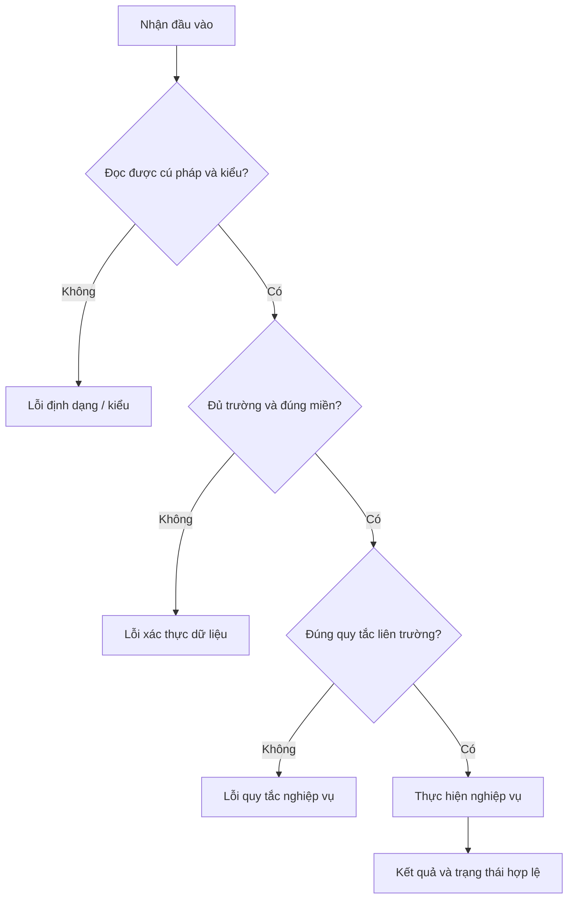

# Giá trị biên, dữ liệu thiếu và đầu vào không hợp lệ

Trong module `CODE_QUALITY_FUNDAMENTALS`, mục tiêu là hiểu những thuộc tính quyết định mã nguồn có **đáng tin cậy, dễ hiểu và dễ thay đổi** hay không. Ở chương **Tính đúng đắn**, một trong những câu hỏi quan trọng nhất là: *Chương trình hành xử thế nào khi dữ liệu nằm đúng ranh giới được phép, thiếu thông tin hoặc vi phạm hợp đồng đầu vào?*

Phần mềm thường được thử bằng ví dụ “đẹp”: số lượng 5, giá tiền 100.000 đồng, tên khách hàng có đủ ký tự. Nhưng nhiều lỗi chỉ xuất hiện ở **0, giá trị tối đa, chuỗi rỗng, trường bị thiếu, ngày cuối tháng hoặc một giá trị chỉ lệch giới hạn một đơn vị**. Tính đúng đắn đòi hỏi hành vi được xác định rõ cho cả các trường hợp ấy, bao gồm việc từ chối đầu vào không hợp lệ theo cách có thể dự đoán.

Sau bài học, bạn có thể:

- Xác định tập đầu vào hợp lệ, các ranh giới và bất biến của một chức năng.
- Phân biệt trường không xuất hiện, `null`, chuỗi rỗng, khoảng trắng, giá trị mặc định và dữ liệu sai kiểu.
- Chọn ca kiểm thử giá trị biên và phân hoạch tương đương thay vì chỉ thử dữ liệu thông thường.
- Viết mã Java kiểm tra đầu vào mà không che giấu lỗi nghiệp vụ.
- Đánh giá lỗi liên quan đến số học, chuỗi Unicode, thời gian, tập hợp và quan hệ giữa nhiều trường.
- Xây dựng hợp đồng phản hồi lỗi rõ ràng giữa các tầng hệ thống.

## 1. Tính đúng đắn bắt đầu từ hợp đồng đầu vào

Một phép tính cho kết quả đúng trên dữ liệu “bình thường” vẫn có thể sai trên dữ liệu khác. Chẳng hạn, hàm giảm giá viết `if (quantity > 10)` sẽ cho kết quả khác `if (quantity >= 10)` khi số lượng chính xác bằng 10. Không thể quyết định điều kiện nào đúng bằng sở thích viết mã: phải dựa vào **quy tắc nghiệp vụ**.

Hợp đồng của một thao tác nên trả lời tối thiểu năm câu hỏi:

1. **Đầu vào nào được chấp nhận?** Kiểu dữ liệu, đơn vị, miền giá trị, độ dài, định dạng và quan hệ giữa các trường.
2. **Giá trị nào là bắt buộc?** Nếu không có trường hoặc trường mang `null`, hệ thống phải xử lý ra sao?
3. **Đầu vào không hợp lệ được phản hồi thế nào?** Từ chối toàn bộ thao tác, trả mã lỗi có cấu trúc hay dùng giá trị thay thế được thỏa thuận?
4. **Khi nào thao tác có tác dụng phụ?** Ghi đơn hàng, gửi sự kiện hoặc trừ tiền chỉ được thực hiện sau khi điều kiện bắt buộc đã thỏa mãn?
5. **Đầu ra nào phải đúng?** Kết quả, trạng thái lưu trữ và bất biến cần giữ kể cả tại các ranh giới.

Ví dụ, với yêu cầu tính tạm tính đơn hàng:

| Trường | Hợp đồng minh họa |
| --- | --- |
| `quantity` | Bắt buộc; số nguyên từ **1 đến 100**, gồm cả hai đầu. |
| `unitPrice` | Bắt buộc; số tiền VND **lớn hơn 0**, **không vượt 100.000.000** và có giá trị nguyên đồng. |
| `note` | Không bắt buộc; thiếu hoặc `null` được hiểu là không ghi chú; chỉ có khoảng trắng cũng được xem là không có ghi chú; ghi chú có nội dung tối đa 200 Unicode code point. |
| Kết quả | `amount = quantity × unitPrice`; nếu đầu vào không hợp lệ, không tạo kết quả thành công. |

Đây là một **hợp đồng ví dụ** để học cách kiểm chứng; hệ thống thực tế có thể chọn giới hạn, chính sách làm tròn, tiền tệ và quy tắc về `null` khác. Mọi quyết định phải được thống nhất trước khi cài đặt.

Có thể mô tả đường đi tổng quát như sau:



Việc kiểm tra ở ranh giới không thay thế kiểm soát bất biến ở tầng nghiệp vụ. Ví dụ, một request đã được frontend kiểm tra vẫn phải được backend đánh giá; request có thể đến từ ứng dụng cũ, script hoặc một dịch vụ khác.

## 2. Giá trị biên là gì và vì sao dễ sai?

**Giá trị biên** là dữ liệu nằm ngay tại hoặc sát một giới hạn làm thay đổi hành vi: tối thiểu, tối đa, bằng ngưỡng, trước/sau thời hạn, đầu/cuối vùng hay khi tập hợp chuyển từ rỗng sang có phần tử.

Với một khoảng số nguyên hợp lệ từ **1 đến 100**, hãy bắt đầu từ các điểm:

| Giá trị | Vai trò | Kết quả theo hợp đồng |
| ---: | --- | --- |
| `0` | Ngay dưới cận dưới | Từ chối |
| `1` | Đúng cận dưới | Chấp nhận |
| `2` | Ngay trên cận dưới | Chấp nhận |
| `50` | Giá trị điển hình giữa miền | Chấp nhận |
| `99` | Ngay dưới cận trên | Chấp nhận |
| `100` | Đúng cận trên | Chấp nhận |
| `101` | Ngay trên cận trên | Từ chối |

Đây là **phân tích giá trị biên** (*boundary value analysis*). Chỉ thử 1 và 100 chưa đủ, vì lỗi thường nằm ở toán tử so sánh `<` so với `<=` hoặc `>` so với `>=`. Ngược lại, không cần thử mọi số từ 1 đến 100 chỉ để xác nhận quy tắc khoảng đơn giản.

### 2.1. Phân hoạch tương đương

**Phân hoạch tương đương** (*equivalence partitioning*) chia đầu vào thành các nhóm được kỳ vọng có cách xử lý tương tự; chọn đại diện mỗi nhóm để tránh thử vô hạn.

Với `quantity`:

- Nhóm hợp lệ: số nguyên trong `[1, 100]`.
- Nhóm quá nhỏ: `quantity < 1`.
- Nhóm quá lớn: `quantity > 100`.
- Nhóm không có giá trị: trường thiếu hoặc `null`.
- Nhóm sai kiểu ở mức nhận dữ liệu: chuỗi `"năm"`, object hoặc số có phần thập phân nếu API yêu cầu số nguyên.

Phân hoạch và kiểm thử biên bổ trợ nhau: phân hoạch chỉ ra **những kiểu tình huống cần kiểm**, còn giá trị biên chỉ ra **những điểm dễ nhầm trong mỗi kiểu tình huống**.

### 2.2. Khoảng đóng, khoảng mở và ngưỡng

Đọc kỹ ngôn ngữ hợp đồng:

| Mô tả nghiệp vụ | Biểu thức toán | Điều kiện Java |
| --- | --- | --- |
| Ít nhất 10 | `x ≥ 10` | `x >= 10` |
| Lớn hơn 10 | `x > 10` | `x > 10` |
| Tối đa 10 | `x ≤ 10` | `x <= 10` |
| Nhỏ hơn 10 | `x < 10` | `x < 10` |
| Từ 1 đến 100, kể cả hai đầu | `1 ≤ x ≤ 100` | `x >= 1 && x <= 100` |
| Sau thời hạn | `time > deadline` | `time.isAfter(deadline)` |

Hãy ghi rõ một ngưỡng được **bao gồm** hay **loại trừ**. Ví dụ, “miễn phí khi đơn hàng từ 500.000 đồng” thường nghĩa là `subtotal >= 500000`; “miễn phí khi đơn hàng trên 500.000 đồng” nghĩa là `subtotal > 500000`. Hai phát biểu tạo ra kết quả khác nhau đúng tại 500.000 đồng.

### 2.3. Biên không chỉ xuất hiện ở số nguyên

- **Số thập phân và tiền:** giá trị 0, phần lẻ nhỏ nhất được phép, giới hạn làm tròn và giới hạn quy mô.
- **Chuỗi:** 0, 1, tối đa và tối đa + 1 ký tự theo đơn vị đo đã định; khoảng trắng, emoji và dấu tổ hợp.
- **Danh sách:** 0, 1, đúng giới hạn, quá giới hạn phần tử; có phần tử trùng hoặc phần tử `null`.
- **Ngày giờ:** thời điểm đúng hạn, trước một đơn vị, sau một đơn vị, cuối tháng và thời điểm chuyển múi giờ.
- **Phân trang:** trang đầu, trang cuối, trang không tồn tại, kích thước trang bằng 0 hoặc vượt giới hạn.
- **Dung lượng:** gói tin rỗng, kích thước tối đa cho phép, vượt một byte và số lượng phần tử lồng nhau quá sâu.

Không có một “bộ giá trị biên” dùng chung cho mọi chức năng: giới hạn phải được suy ra từ **hợp đồng thật**, không tự đặt dựa trên kiểu dữ liệu.

## 3. Dữ liệu thiếu: phân biệt những tình huống trông giống nhau

“Không có dữ liệu” có nhiều biểu hiện, và mỗi biểu hiện có thể mang ý nghĩa nghiệp vụ khác nhau:

| Tình huống | Ví dụ JSON | Ý nghĩa có thể có |
| --- | --- | --- |
| **Trường vắng mặt** | `{}` | Người gửi chưa cung cấp, hoặc yêu cầu giữ nguyên giá trị hiện tại trong thao tác cập nhật một phần. |
| **Giá trị null** | `{"note": null}` | Người gửi chỉ rõ không có giá trị; trong PATCH đôi khi có nghĩa xóa giá trị. |
| **Chuỗi rỗng** | `{"note": ""}` | Có trường nhưng độ dài bằng 0. |
| **Chỉ khoảng trắng** | `{"note": "   "}` | Có ký tự nhưng có thể bị xem là rỗng sau chuẩn hóa. |
| **Số 0** | `{"quantity": 0}` | Là một giá trị số cụ thể; không nên mặc nhiên xem là “thiếu”. |
| **Danh sách rỗng** | `{"items": []}` | Có danh sách nhưng không có phần tử; có thể hợp lệ hoặc không. |
| **Sai kiểu** | `{"quantity": "five"}` | Có dữ liệu nhưng không đáp ứng kiểu số nguyên. |

Các trường hợp trên **không mặc nhiên tương đương**. Trong ví dụ tính tạm tính, `note` có thể gộp thiếu/`null`/chuỗi trắng về “không ghi chú”. Nhưng với cập nhật hồ sơ, yêu cầu thiếu `phone` có thể có nghĩa “giữ nguyên số hiện tại”, còn `"phone": null` có nghĩa “xóa số”. Gộp hai trường hợp sẽ gây mất dữ liệu.

### 3.1. Kiểu nguyên thủy và giá trị không tồn tại trong Java

Khi nhận dữ liệu từ JSON, cần xác định framework chuyển trường thiếu hoặc `null` sang kiểu Java như thế nào. Với một số cấu hình binding, sử dụng kiểu nguyên thủy `int` có thể làm mất phân biệt giữa **chưa cung cấp** và **giá trị 0**. Dùng `Integer` giúp biểu diễn trạng thái thiếu ở đối tượng Java:

```java
record QuoteRequest(Integer quantity, BigDecimal unitPrice, String note) {}
```

Đoạn khai báo này cần `import java.math.BigDecimal;`. Khi dữ liệu đã được ánh xạ vào `QuoteRequest`, cả trường `quantity` vắng mặt và trường `quantity` bằng `null` *có thể* cùng cho `quantity() == null`, tùy cấu hình thư viện. Nếu hợp đồng cần phân biệt **vắng mặt** và **null tường minh**, phải kiểm tra cấu trúc JSON gốc hoặc dùng kiểu mô hình hóa trạng thái hiện diện riêng.

Ví dụ với Jackson `JsonNode`:

```java
JsonNode root = objectMapper.readTree(json);
boolean supplied = root.has("phone");
boolean explicitNull = supplied && root.get("phone").isNull();
```

Với JSON object thông thường, `has("phone")` cho biết có thuộc tính; `get("phone").isNull()` phân biệt thuộc tính có giá trị `null`. Đây là minh họa cách kiểm tra mức JSON, giả định đã có biến `objectMapper` và `json`. Cách ánh xạ mặc định, xử lý khóa trùng hoặc trường lạ còn phụ thuộc cấu hình parser.

### 3.2. Khi nào được dùng giá trị mặc định?

Giá trị mặc định chỉ an toàn nếu **được hợp đồng công bố** và không làm thay đổi ý định người dùng. Ví dụ, `pageSize` thiếu có thể mặc định là 20 nếu API quy định như vậy. Nhưng mặc định `quantity = 1` khi trường thiếu trong yêu cầu đặt hàng có thể khiến khách mua món không có ý định mua.

Không dùng chuỗi rỗng, `0`, `false` hay ngày hiện tại như giá trị thay cho dữ liệu thiếu chỉ vì chúng dễ tạo bằng ngôn ngữ lập trình. Mặc định không đúng có thể khiến hệ thống tạo **kết quả có vẻ hợp lệ nhưng sai nghiệp vụ**, khó phát hiện hơn một lỗi được trả rõ ràng.

## 4. Đầu vào không hợp lệ: phân lớp để phản hồi đúng

Không phải mọi lỗi đầu vào đều có chung nguyên nhân:

| Nhóm lỗi | Ví dụ | Cách xử lý hợp lý |
| --- | --- | --- |
| Cú pháp hoặc định dạng | JSON thiếu dấu ngoặc, ngày sai định dạng | Từ chối tại tầng giải mã; trả thông tin lỗi định dạng rõ ràng. |
| Sai kiểu hoặc không biểu diễn được | `quantity = "abc"`, số nguyên vượt kiểu đích | Từ chối chuyển kiểu; tránh tràn số hoặc chuyển đổi ngầm gây mất dữ liệu. |
| Thiếu trường bắt buộc | Không có `unitPrice` | Từ chối với tên trường và quy tắc bắt buộc. |
| Ngoài miền hợp lệ | `quantity = -2` hoặc `101` | Từ chối với giới hạn hợp lệ. |
| Sai ràng buộc liên trường | `endDate < startDate` | Đối chiếu nhiều trường rồi từ chối. |
| Không thỏa trạng thái nghiệp vụ | Đặt hàng với mã giảm giá đã hết hiệu lực | Trả lỗi nghiệp vụ có thể xử lý, không giả vờ là lỗi lập trình. |
| Lỗi hệ thống hoặc phụ thuộc | Cơ sở dữ liệu không phản hồi | Xử lý như lỗi vận hành, không quy lỗi cho dữ liệu người gửi nếu đầu vào hợp lệ. |

“Không hợp lệ” là thuộc tính **so với hợp đồng**. Ví dụ chuỗi `"0012"` có thể là mã bưu chính hợp lệ nhưng không phải số lượng hợp lệ; tài khoản người dùng có thể cho phép chuỗi chứa khoảng trắng, còn mã định danh có thể không.

### 4.1. Xác thực dữ liệu trước tác dụng phụ

Nếu một API vừa ghi đơn hàng vừa phát sự kiện, hãy xác minh các điều kiện có thể kiểm tra trước khi thực hiện tác dụng phụ. Với dữ liệu đã lưu hoặc có thể thay đổi đồng thời, những ràng buộc như “hàng vẫn còn tồn” còn cần được bảo vệ tại giao dịch hoặc cơ chế điều phối phù hợp.

Sai lầm phổ biến là ghi một phần dữ liệu, sau đó mới phát hiện đầu vào không hợp lệ. Kết quả có thể là bản ghi dở dang, sự kiện không khớp hoặc chi phí khôi phục khó dự đoán.

### 4.2. Chuẩn hóa không đồng nghĩa sửa lỗi đầu vào

Một số thao tác chuẩn hóa được cho phép khi hợp đồng quy định rõ: bỏ khoảng trắng ở hai đầu **ghi chú**, đổi chuỗi trắng thành “không có ghi chú”, chuẩn hóa cách biểu diễn ngày hoặc mã vùng.

Không tùy tiện loại bỏ ký tự, tự cắt chuỗi vượt giới hạn, tự sửa mã định danh, ép ngày sai sang ngày khác hoặc làm tròn giá tiền để đầu vào “vừa” miền hợp lệ. Hành động đó có thể che đi lỗi của bên gửi và tạo ra yêu cầu có nghĩa khác.

Ví dụ:

- `"  Giao buổi chiều  "` → `"Giao buổi chiều"` có thể đúng theo hợp đồng ghi chú.
- `"00001234"` → `"1234"` có thể **sai** nếu đây là mã khách hàng hoặc mã bưu chính.
- `quantity = 101` → tự đổi thành `100` có thể làm giảm số lượng khách muốn mua mà họ không biết.

Với dữ liệu nhập để xác thực danh tính hoặc phân quyền, cần đặc biệt thận trọng: các phép chuẩn hóa phải thống nhất giữa nơi tạo, nơi lưu và nơi so sánh giá trị.

## 5. Ví dụ Java: kiểm tra ranh giới và dữ liệu thiếu

Chúng ta hiện thực hợp đồng tính tạm tính ở mục 1 bằng Java 17+. Sử dụng kiểu `Integer` để có thể nhận biết trạng thái thiếu sau ánh xạ, `BigDecimal` để tính số tiền chính xác theo thập phân và một lớp dịch vụ có thể thử nghiệm mà không cần cơ sở dữ liệu.

```java
import java.math.BigDecimal;

record QuoteRequest(Integer quantity, BigDecimal unitPrice, String note) {}
record QuoteResult(BigDecimal amount, String normalizedNote) {}

final class QuoteService {
    private static final BigDecimal MAX_UNIT_PRICE =
            new BigDecimal("100000000");

    static QuoteResult calculate(QuoteRequest request) {
        if (request == null) {
            throw new IllegalArgumentException("request is required");
        }

        Integer quantity = request.quantity();
        if (quantity == null) {
            throw new IllegalArgumentException("quantity is required");
        }
        if (quantity < 1 || quantity > 100) {
            throw new IllegalArgumentException("quantity must be 1..100");
        }

        BigDecimal unitPrice = request.unitPrice();
        if (unitPrice == null) {
            throw new IllegalArgumentException("unitPrice is required");
        }
        if (unitPrice.signum() <= 0
                || unitPrice.compareTo(MAX_UNIT_PRICE) > 0
                || unitPrice.stripTrailingZeros().scale() > 0) {
            throw new IllegalArgumentException(
                    "unitPrice must be a positive whole VND amount <= 100000000");
        }

        String note = request.note();
        if (note != null) {
            note = note.strip();
            if (note.isEmpty()) {
                note = null;
            } else if (note.codePointCount(0, note.length()) > 200) {
                throw new IllegalArgumentException(
                        "note must not exceed 200 Unicode code points");
            }
        }

        BigDecimal amount =
                unitPrice.multiply(BigDecimal.valueOf(quantity));
        return new QuoteResult(amount, note);
    }
}
```

Điểm cần hiểu trong ví dụ:

1. **Không dereference trước khi kiểm tra:** `request == null` và `quantity == null` được xử lý tường minh, tránh vô tình tạo `NullPointerException` ở logic nghiệp vụ.
2. **Kiểm tra đúng ranh giới:** `quantity < 1 || quantity > 100` từ chối 0 và 101 nhưng chấp nhận 1 và 100.
3. **So sánh tiền theo giá trị:** `BigDecimal.compareTo` không phụ thuộc vào khác biệt biểu diễn như `10` và `10.00`. Dùng `stripTrailingZeros().scale() > 0` để từ chối giá trị có phần lẻ thực sự, trong khi vẫn chấp nhận `10.00` vì bằng đúng 10 VND. Chính sách này là lựa chọn của hợp đồng ví dụ.
4. **Tính chính xác:** `BigDecimal.multiply` tránh sai số biểu diễn số thực nhị phân thường gặp khi dùng `double` cho tiền. Giới hạn đơn giá và số lượng cũng giúp giới hạn miền kết quả.
5. **Chuẩn hóa ghi chú theo quy định:** `String.strip` loại khoảng trắng đầu/cuối theo cách Java định nghĩa; chuỗi trắng trở thành `null`, trong khi chuỗi có nội dung được giới hạn theo số Unicode code point.
6. **Từ chối có chủ đích:** ở lớp ví dụ, `IllegalArgumentException` làm rõ lỗi đầu vào. Trong ứng dụng API thật, nên ánh xạ lỗi này sang một phản hồi có cấu trúc được kiểm soát, tránh trả stack trace nội bộ.

**Lưu ý về Unicode:** Unicode code point không đồng nhất với “ký tự người dùng nhìn thấy” (grapheme cluster). Một chữ kèm dấu tổ hợp hoặc một emoji ghép có thể dùng nhiều code point. Nếu giới hạn ghi chú được thiết kế theo số ký tự hiển thị, cần thống nhất phép đếm phù hợp và kiểm thử các tổ hợp Unicode; không chỉ dựa vào `String.length()`.

Trong dự án lớn, có thể tách kiểm tra thành một giá trị đã được xác thực (validated value object), dùng Bean Validation ở biên API hoặc trả một cấu trúc tập hợp lỗi. Mục đích ở đây là cho thấy **từng quyết định hợp đồng**, không buộc mọi chương trình phải dùng cùng một loại exception.

## 6. Kiểm thử: chấp nhận đúng và từ chối đúng

Kiểm thử đúng đắn phải xác minh **hai chiều**: trường hợp hợp lệ cho kết quả chính xác; trường hợp không hợp lệ bị từ chối **đúng nguyên nhân và trước khi có tác dụng phụ**. Chỉ kiểm tra rằng “chương trình không crash” là chưa đủ.

### 6.1. Ma trận kiểm thử từ hợp đồng

| Đầu vào hoặc tình huống | Kỳ vọng |
| --- | --- |
| Số lượng 1, đơn giá 10.000 | Chấp nhận, tổng 10.000 |
| Số lượng 100, đơn giá 10.000 | Chấp nhận, tổng 1.000.000 |
| Số lượng 0, -1 hoặc 101 | Từ chối `quantity` |
| Số lượng thiếu hoặc `null` | Từ chối vì bắt buộc |
| Đơn giá 0 hoặc âm | Từ chối `unitPrice` |
| Đơn giá 100.000.000 | Chấp nhận ở cận trên |
| Đơn giá 100.000.001 | Từ chối do vượt cận |
| Đơn giá 10.00 | Chấp nhận nếu biểu diễn thành `BigDecimal("10.00")` |
| Đơn giá 10.25 | Từ chối vì có phần lẻ đồng |
| Đơn giá thiếu hoặc `null` | Từ chối vì bắt buộc |
| Ghi chú thiếu, `null`, `""` hoặc toàn khoảng trắng | Chấp nhận, `normalizedNote == null` |
| Ghi chú đúng 200 code point | Chấp nhận |
| Ghi chú 201 code point | Từ chối |
| JSON sai cú pháp, sai kiểu hoặc số không parse được | Từ chối tại tầng giải mã/binding trước khi gọi dịch vụ |

Trong bảng, ca “JSON sai cú pháp” cần được thử ở tầng HTTP hoặc parser vì `QuoteService` nhận đối tượng Java đã được tạo. Đừng tưởng kiểm thử đơn vị cho dịch vụ có thể chứng minh cấu hình thư viện JSON đang xử lý lỗi kiểu dữ liệu đúng.

### 6.2. Ví dụ kiểm thử JUnit 5

```java
import static org.junit.jupiter.api.Assertions.*;
import java.math.BigDecimal;
import org.junit.jupiter.api.Test;
import org.junit.jupiter.params.ParameterizedTest;
import org.junit.jupiter.params.provider.ValueSource;

class QuoteServiceTest {
    private static QuoteRequest request(Integer quantity, String price,
                                        String note) {
        return new QuoteRequest(
                quantity, new BigDecimal(price), note);
    }

    @Test
    void acceptsBothQuantityBoundaries() {
        assertEquals(new BigDecimal("10000"),
                QuoteService.calculate(request(1, "10000", null)).amount());
        assertEquals(new BigDecimal("1000000"),
                QuoteService.calculate(request(100, "10000", null)).amount());
    }

    @ParameterizedTest
    @ValueSource(ints = {-1, 0, 101})
    void rejectsQuantitiesOutsideTheAllowedRange(int quantity) {
        assertThrows(IllegalArgumentException.class,
                () -> QuoteService.calculate(request(quantity, "10000", null)));
    }

    @Test
    void rejectsMissingRequiredValues() {
        assertThrows(IllegalArgumentException.class,
                () -> QuoteService.calculate(request(null, "10000", null)));
        assertThrows(IllegalArgumentException.class,
                () -> QuoteService.calculate(new QuoteRequest(1, null, null)));
        assertThrows(IllegalArgumentException.class,
                () -> QuoteService.calculate(null));
    }

    @Test
    void verifiesPriceRangeAndFractionalValues() {
        assertEquals(new BigDecimal("100000000"),
                QuoteService.calculate(request(1, "100000000", null)).amount());
        assertEquals(new BigDecimal("10.00"),
                QuoteService.calculate(request(1, "10.00", null)).amount());
        for (String invalid : new String[]{"0", "-1", "10.25", "100000001"}) {
            assertThrows(IllegalArgumentException.class,
                    () -> QuoteService.calculate(request(1, invalid, null)));
        }
    }

    @Test
    void normalizesOptionalNoteAndChecksItsLength() {
        assertNull(QuoteService.calculate(request(1, "10", "   ")).normalizedNote());
        assertEquals("Giao buổi chiều",
                QuoteService.calculate(request(1, "10", "  Giao buổi chiều  "))
                        .normalizedNote());
        assertEquals("x".repeat(200),
                QuoteService.calculate(request(1, "10", "x".repeat(200)))
                        .normalizedNote());
        assertThrows(IllegalArgumentException.class,
                () -> QuoteService.calculate(request(1, "10", "x".repeat(201))));
    }
}
```

Chú ý: kết quả `BigDecimal("10.00")` có thang số 2 và được so sánh bằng `equals` với đúng biểu diễn đó trong ví dụ. Khi chỉ cần so sánh **giá trị số**, dùng `compareTo(...) == 0`, hoặc thống nhất biểu diễn tiền trước khi khẳng định; `BigDecimal.equals` còn xét cả `scale`.

Các ca trên kiểm tra những điểm quan trọng của hợp đồng mẫu. Chúng **không chứng minh** bộ giải mã JSON, HTTP status, schema hoặc giao dịch cơ sở dữ liệu được xử lý đúng; các phần đó cần kiểm thử ở tầng tương ứng.

## 7. Những giá trị biên dễ bị bỏ sót

Các trường hợp sau thường gây lỗi ngay cả khi chương trình đã có câu lệnh kiểm tra đầu vào.

### 7.1. Tràn số nguyên và ép kiểu

`int` trong Java có miền từ `-2_147_483_648` đến `2_147_483_647`. Nếu phép tính vượt giới hạn, phép cộng hoặc nhân `int` thông thường có thể **tràn số mà không tự ném exception**.

```java
int quantity = 100_000;
int unitPrice = 100_000;

int wrongTotal = quantity * unitPrice; // Tràn miền int
long safeTotal = (long) quantity * unitPrice; // 10_000_000_000
```

Tại đây, ép `quantity` thành `long` **trước khi nhân** giúp phép tính diễn ra trên `long`. Ép kiểu sau khi đã nhân bằng `int` không khôi phục được phần đã tràn. Nếu phép tính vẫn có thể vượt `long`, dùng `Math.multiplyExact` để phát hiện tràn số hoặc kiểu số có miền lớn như `BigInteger`/`BigDecimal` theo bài toán.

Kiểm thử nên bao gồm:

- Giá trị lớn nhất hợp lệ theo nghiệp vụ.
- Tích hoặc tổng đạt mức lớn nhất cần lưu/truyền qua API.
- Giá trị không thể biểu diễn bằng kiểu đích.
- Số âm bất thường nếu hợp đồng chỉ cho phép số dương.

Ví dụ `Integer.parseInt("2147483648")` ném `NumberFormatException` vì vượt miền `int`; đây là lỗi chuyển đổi dữ liệu đầu vào, không phải lý do để mặc định về 0 rồi tiếp tục nghiệp vụ.

### 7.2. Số thực và phép so sánh

Trong nhiều trường hợp, `double` không biểu diễn chính xác một số thập phân như 0,1. Khi cần số tiền, cân nhắc tạo `BigDecimal` từ **chuỗi thập phân** hoặc từ biểu diễn được kiểm soát:

```java
BigDecimal exact = new BigDecimal("0.1");
BigDecimal fromDouble = new BigDecimal(0.1);
// Hai giá trị không tương đương tuyệt đối.
```

Đừng dùng so sánh bằng nhau trực tiếp với số thực dấu phẩy động để quyết định một ngưỡng nghiệp vụ chính xác tuyệt đối. Nếu hợp đồng chấp nhận sai số, phải định nghĩa rõ ngưỡng dung sai và cách áp dụng; không dùng một epsilon tùy ý cho mọi đại lượng.

Khi thiết kế định dạng JSON, hãy xác định cách xử lý `NaN`, vô cực, số cực lớn, chuỗi biểu diễn số và số có phần mũ. JSON chuẩn không biểu diễn `NaN` hoặc vô cực như giá trị số; cách parser xử lý giá trị không chuẩn phụ thuộc cấu hình.

### 7.3. Chuỗi, Unicode và khoảng trắng

`String.length()` trả về số **đơn vị mã UTF-16**, không nhất thiết là số Unicode code point hoặc số ký tự hiển thị. Vì vậy giới hạn “tên tối đa 50 ký tự” phải nói rõ “ký tự” tính theo cách nào.

Những đầu vào cần cân nhắc:

- Chuỗi rỗng, chỉ có dấu cách, tab hoặc xuống dòng.
- Ký tự ngoài ASCII, emoji, chữ có dấu tổ hợp.
- Chuỗi có ký tự điều khiển hoặc ký tự vô hình.
- Văn bản đúng giới hạn và vượt giới hạn sau khi chuẩn hóa.
- Chuỗi rất dài có thể gây tiêu tốn bộ nhớ hoặc thời gian xử lý.

Ví dụ `"é"` có thể được biểu diễn bằng một code point dựng sẵn hoặc bằng chữ `e` cộng dấu tổ hợp; hai cách có thể hiển thị giống nhau nhưng khác chuỗi byte và số code point. Nếu nghiệp vụ cần so khớp theo Unicode normalization, chọn chính sách nhất quán và kiểm chứng ở cả nơi tạo lẫn nơi tra cứu; không tự ý áp dụng chuẩn hóa với mật khẩu, khóa kỹ thuật hoặc chữ ký số.

### 7.4. Ngày, giờ và múi giờ

Ngày không chỉ là chuỗi đúng định dạng. Cần kiểm tra ngày có tồn tại hay không, thời điểm đúng hạn có được tính hợp lệ, và dữ liệu có gắn múi giờ hay không.

Ví dụ:

- Ngày 29/02 chỉ tồn tại ở năm nhuận.
- `endDate` sớm hơn `startDate` là sai nếu hợp đồng yêu cầu khoảng thời gian có thứ tự.
- Sự kiện hết hạn lúc 10:00 có bao gồm chính thời điểm 10:00 hay không?
- Giờ địa phương khi đổi sang giờ mùa hè có thể bị lặp hoặc không tồn tại ở một số múi giờ.

Dùng kiểu phù hợp với ý nghĩa: `LocalDate` cho ngày lịch, `Instant` cho một thời điểm toàn cục, `ZonedDateTime` khi cần biểu diễn thời điểm gắn với múi giờ. Đối với các quy tắc dựa trên thời gian hiện tại, đưa `Clock` vào thành phần nghiệp vụ giúp kiểm thử chính xác thời điểm trước, đúng và sau hạn mà không phụ thuộc đồng hồ hệ thống.

### 7.5. Tập hợp và quan hệ giữa các phần tử

Một danh sách hợp lệ có thể có giới hạn số lượng, giới hạn độ sâu, yêu cầu thứ tự hoặc cấm phần tử trùng. Những trường hợp cần xem xét gồm:

- Không có thuộc tính danh sách; danh sách `null`; danh sách rỗng `[]`.
- Một phần tử hợp lệ; số phần tử đúng giới hạn; nhiều hơn một phần tử.
- Phần tử `null` hoặc sai kiểu; phần tử trùng nhau.
- Hai dòng hàng cùng mã sản phẩm nhưng giá khác nhau.
- Tổng cộng các phần tử vượt giới hạn dù mỗi phần tử đều hợp lệ.

Kiểm tra từng phần tử là cần thiết nhưng chưa đủ nếu hợp đồng còn có bất biến ở **cấp tập hợp**, chẳng hạn tổng số lượng mỗi mã hàng không được vượt tồn kho.

## 8. Kiểm tra ràng buộc liên trường và bất biến

Một input có thể vượt qua kiểm tra từng trường nhưng vẫn sai khi kết hợp chúng. Ví dụ, cả `startDate` và `endDate` đều là ngày hợp lệ nhưng `endDate` lại đứng trước `startDate`.

```java
import java.time.LocalDate;

final class DateRangeRules {
    static void check(LocalDate startDate, LocalDate endDate) {
        if (startDate == null || endDate == null) {
            throw new IllegalArgumentException("startDate and endDate are required");
        }
        if (endDate.isBefore(startDate)) {
            throw new IllegalArgumentException("endDate must be on or after startDate");
        }
    }
}
```

Ở đây, khoảng ngày cho phép hai đầu bằng nhau. Nếu hợp đồng cần ít nhất một ngày trọn vẹn, điều kiện đúng sẽ khác. Cần làm rõ “ngày cuối cùng có được bao gồm không?” khi chuyển khoảng ngày sang truy vấn dữ liệu; nhiều API chọn khoảng nửa mở `[start, end)` để tránh đếm trùng dữ liệu giữa hai khoảng liền kề.

Các bất biến liên trường phổ biến khác:

- Nếu `paymentMethod = "CARD"` thì phải có mã tham chiếu xác nhận hợp lệ.
- Nếu `discountPercent` khác `null` thì phải nằm trong miền quy định và không đồng thời với kiểu giảm giá không tương thích.
- `minPrice <= maxPrice` nếu cả hai giới hạn được cung cấp.
- Thời gian giao hàng phải sau thời gian tạo đơn nếu nghiệp vụ yêu cầu.
- Số lượng đặt không vượt tồn kho tại thời điểm thực hiện giao dịch.

Quy tắc gắn với **trạng thái có thể thay đổi đồng thời**, như số lượng hàng còn trong kho, phải được bảo vệ bằng cơ chế giao dịch hoặc kiểm soát tranh chấp phù hợp. Một kiểm tra “còn đủ hàng” thực hiện trước đó ở frontend hoặc ở một truy vấn không khóa không bảo đảm điều kiện vẫn đúng khi ghi đơn.

## 9. Thiết kế phản hồi lỗi để hệ thống có thể sửa sai

Khi đầu vào không hợp lệ, hành vi đúng đắn bao gồm **không thực hiện hành động bị cấm** và **cho bên gửi biết cách khắc phục**. Với một API, có thể quy định cấu trúc lỗi như:

```json
{
  "code": "INVALID_FIELD",
  "field": "quantity",
  "message": "quantity must be between 1 and 100",
  "details": {
    "minimum": 1,
    "maximum": 100
  }
}
```

Đây là ví dụ thiết kế, không phải chuẩn bắt buộc. Lựa chọn HTTP status tùy hợp đồng: `400 Bad Request` thường dùng cho dữ liệu yêu cầu không hợp lệ, `422 Unprocessable Content` có thể dùng để phân biệt lỗi ngữ nghĩa trong một số API, `409 Conflict` có thể phù hợp với xung đột trạng thái. Không nên thay đổi cách phân loại tùy tiện giữa các endpoint; bên gọi cần một hợp đồng nhất quán. Lỗi phụ thuộc hệ thống hoặc lỗi triển khai không được ngụy trang thành lỗi đầu vào của người dùng.

Một phản hồi lỗi hữu ích nên:

- Có **mã lỗi ổn định** cho máy xử lý; thông điệp diễn giải cho người đọc.
- Chỉ ra trường hoặc quy tắc bị vi phạm khi có thể.
- Không tiết lộ stack trace, truy vấn SQL, bí mật, dữ liệu định danh nhạy cảm hoặc chi tiết hạ tầng.
- Có hành vi nhất quán nếu nhiều trường sai cùng lúc: trả lỗi đầu tiên hay tập hợp lỗi đều được nếu hợp đồng đã xác định.
- Giúp truy vết trong log/telemetry bằng mã tương quan mà không ghi lại dữ liệu nhạy cảm không cần thiết.

Nếu API cần trả nhiều lỗi trong một lần, có thể dùng cấu trúc `errors[]` gồm mã lỗi và đường dẫn trường tương ứng. Nhưng ngay cả khi API chỉ trả lỗi đầu tiên, thứ tự kiểm tra cũng nên nhất quán để kiểm thử và phía gọi có thể dự đoán.

### Trách nhiệm ở từng tầng

| Tầng | Loại kiểm tra nên đảm nhiệm | Ví dụ |
| --- | --- | --- |
| Bộ giải mã và binding | Cú pháp, kiểu, kích thước payload, giá trị không thể parse | JSON sai định dạng, số nằm ngoài miền `int`. |
| Tầng HTTP/API | Các trường bắt buộc, định dạng và quy tắc tiếp nhận request | Mã trạng thái và cấu trúc lỗi thống nhất. |
| Tầng nghiệp vụ | Miền giá trị, quan hệ giữa trường, bất biến và quyền thực hiện thao tác | Số lượng được phép, khoảng ngày hợp lệ, chính sách đơn hàng. |
| Tầng lưu trữ/giao dịch | Các ràng buộc cần giữ khi ghi, kể cả cập nhật đồng thời | Khóa duy nhất, kiểm soát tồn kho, ràng buộc tham chiếu. |

Không phải kiểm tra nào cũng cần lặp ở mọi tầng. Nhưng một điều kiện quan trọng không nên chỉ được bảo vệ bằng giao diện, bởi backend còn nhận yêu cầu từ các nguồn khác.

## 10. Xây dựng bộ kiểm thử có ý nghĩa

Một cách hệ thống để chọn kiểm thử cho chức năng mới:

1. **Viết hợp đồng.** Liệt kê trường, kiểu, miền hợp lệ, giá trị mặc định, quy tắc liên trường và kết quả/lỗi mong đợi.
2. **Phân hoạch đầu vào.** Có dữ liệu hợp lệ, thiếu dữ liệu, sai kiểu, ngoài miền, trạng thái không phù hợp và dữ liệu quá lớn.
3. **Tìm các ranh giới.** Với số nguyên chọn `min-1, min, min+1, max-1, max, max+1` khi biểu diễn được; với thời gian chọn trước/đúng/sau hạn.
4. **Chọn kết hợp có rủi ro.** Không cần thử mọi tích Descartes của tất cả các trường; ưu tiên các cặp hoặc tổ hợp có tương tác nghiệp vụ, chẳng hạn “đúng giới hạn số lượng” cùng “đúng giới hạn đơn giá”.
5. **Xác minh cả đầu ra và tác dụng phụ.** Khi dữ liệu sai, kiểm tra không có đơn hàng mới hoặc giao dịch bất thường nếu chức năng có ghi trạng thái.
6. **Bổ sung kiểm thử tích hợp.** Xác nhận parser, binding, validation, phản hồi HTTP và ràng buộc cơ sở dữ liệu trong cấu hình thực tế.
7. **Học từ lỗi đã xảy ra.** Mỗi lỗi biên được sửa nên có ca hồi quy xác nhận hành vi mong đợi và ngăn lỗi tái diễn.

**Kiểm thử thuộc tính (property-based testing)** có thể bổ sung cho các ví dụ cố định. Thay vì chỉ chọn 5 giá trị, có thể sinh nhiều giá trị hợp lệ và kiểm tra các bất biến, chẳng hạn “với `1 <= quantity <= 100`, kết quả bằng `unitPrice × quantity`”, hoặc “mọi `quantity` ngoài khoảng phải bị từ chối”. Cần giới hạn dữ liệu sinh để giả định của thuộc tính luôn đúng, và vẫn giữ ca sát biên rõ ràng vì những ca này giải thích hợp đồng tốt hơn.

**Fuzz testing** với dữ liệu ngẫu nhiên hoặc định dạng bất thường có thể phát hiện crash, parser xử lý sai và tiêu thụ tài nguyên quá mức. Tuy nhiên, không nên xem việc “không crash” là bằng chứng đủ cho tính đúng đắn: một kết quả thành công nhưng tính sai tiền vẫn là lỗi.

Khi viết phép thử tự động, hãy phân biệt:

- **Oracle:** kết quả hoặc hành vi đúng được định nghĩa từ yêu cầu, không lấy lại nguyên công thức đang kiểm thử một cách máy móc.
- **Determinism:** kiểm thử không phụ thuộc thời điểm hiện tại, dữ liệu dùng chung hoặc thứ tự chạy nếu không cần thiết.
- **Thông báo khi thất bại:** nêu rõ đầu vào, quy tắc vi phạm và kết quả quan sát để người phát triển khoanh vùng lỗi.

## 11. Những sai lầm phổ biến cần tránh

| Sai lầm | Vì sao nguy hiểm | Cách khắc phục |
| --- | --- | --- |
| Chỉ thử giá trị ở giữa miền | Bỏ sót lỗi điều kiện `<`/`<=` ở ranh giới | Kiểm tra đúng và sát mỗi ngưỡng. |
| Xem `null`, thiếu trường, `0`, `""` là như nhau | Có thể tạo giá trị giả hoặc xóa dữ liệu khi cập nhật | Quy định ý nghĩa từng trường hợp trong hợp đồng. |
| Ép kiểu tự động để “cứu” dữ liệu | Có thể mất phần lẻ, mất số 0 đầu, hoặc tràn số | Chuyển đổi rõ ràng và từ chối nếu dữ liệu không biểu diễn được. |
| Thử chỉ đường thành công | Không biết ứng dụng phản hồi lỗi thế nào | Thử cả dữ liệu sai và sự vắng mặt của tác dụng phụ. |
| Chỉ dựa vào kiểm tra frontend | Backend vẫn có thể nhận request từ nguồn khác | Duy trì các bất biến quan trọng tại backend/giao dịch. |
| Làm tròn hoặc cắt dữ liệu mà không thông báo | Lặng lẽ thay đổi ý định người gửi | Chuẩn hóa theo hợp đồng; nếu không, từ chối có giải thích. |
| Giới hạn độ dài theo `String.length()` khi hợp đồng nói ký tự hiển thị | Unicode có thể bị tính không như mong muốn | Thống nhất đơn vị đo và kiểm thử Unicode. |
| Kiểm tra tồn kho một lần rồi tin rằng luôn đúng | Có thể phát sinh tranh chấp giữa nhiều yêu cầu | Bảo vệ ràng buộc ở thời điểm ghi giao dịch. |

## 12. Tình huống thực hành

Một API tạo yêu cầu đặt hàng có các trường:

- `productId`: bắt buộc, mã chuỗi có độ dài từ 1 đến 30 theo quy tắc ký tự đã được hệ thống công bố.
- `quantity`: bắt buộc, số nguyên từ 1 đến 20.
- `couponCode`: tùy chọn; vắng mặt nghĩa là không dùng mã ưu đãi, `null` cũng được chấp nhận theo hợp đồng này.
- `deliveryDate`: bắt buộc, ngày giao không sớm hơn ngày hiện tại theo múi giờ kinh doanh được cấu hình.

Hãy thực hiện:

1. **Phân hoạch dữ liệu:** với `quantity` và `productId`, liệt kê ít nhất ba lớp hợp lệ/không hợp lệ. Chỉ ra giới hạn nào phải được bổ sung đặc tả trước khi triển khai (chẳng hạn bộ ký tự mã sản phẩm).
2. **Chọn ca biên:** đề xuất dữ liệu cho số lượng `0, 1, 2, 19, 20, 21`; dự đoán trạng thái chấp nhận hoặc từ chối của từng ca.
3. **Xác định dữ liệu thiếu:** so sánh `couponCode` vắng mặt, bằng `null`, `""` và `"   "`; trường hợp nào tương đương chỉ khi hợp đồng nói rõ?
4. **Kiểm thử ngày giao:** thiết kế ca trước hôm nay, đúng hôm nay, ngày mai và một ca ranh giới múi giờ. Giải thích vì sao nên đưa `Clock` hoặc ngày hiện tại được kiểm soát vào bài kiểm thử.
5. **Kiểm thử an toàn:** giả sử `quantity = 21`, mô tả cách xác minh không tạo đơn hàng và không phát sự kiện xác nhận đơn; phản hồi lỗi nên chứa thông tin gì?

**Gợi ý tự kiểm tra:** `quantity = 1` và `20` hợp lệ theo khoảng đóng; `0` và `21` bị từ chối. Với `couponCode`, chỉ có *vắng mặt* và `null` đã được hợp đồng cho phép tương đương; chính sách dành cho chuỗi rỗng và chuỗi trắng vẫn cần quyết định. Nếu ngày giao dựa trên ngày địa phương, hai máy ở hai múi giờ có thể có “hôm nay” khác nhau tại cùng một thời điểm, nên miền ngày phải dựa vào múi giờ kinh doanh đã định.

## Ghi nhớ

Tính đúng đắn không chỉ là trả kết quả đúng cho đầu vào hợp lệ quen thuộc. Chương trình còn phải **chấp nhận đúng giá trị ở ranh giới, phân biệt đúng những dạng dữ liệu thiếu và từ chối có kiểm soát các đầu vào không phù hợp**. Cách làm đáng tin cậy là viết hợp đồng trước, phân hoạch miền dữ liệu, kiểm tra giá trị sát biên, bảo vệ bất biến ở tầng phù hợp và kiểm thử cả đường thành công lẫn đường lỗi. Khi hợp đồng rõ ràng, người đọc dễ hiểu ý định, người sửa dễ dự đoán tác động và hệ thống đáng tin cậy hơn trước những dữ liệu không như mong đợi.
