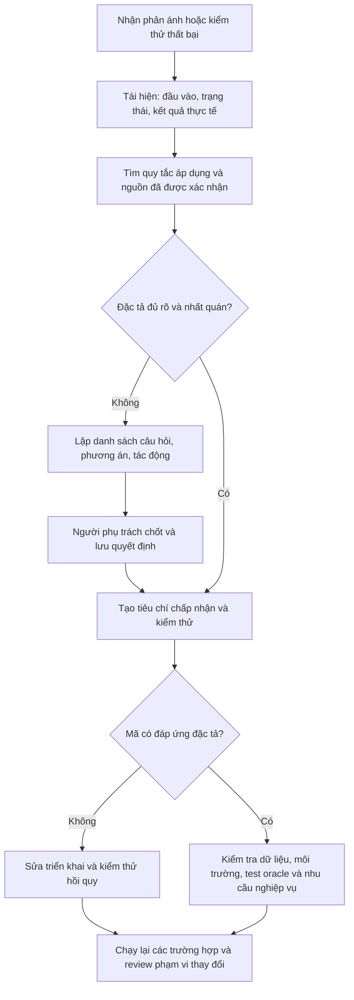

# Phân biệt đặc tả thiếu với mã triển khai sai

Một chức năng cho kết quả khiến người dùng không hài lòng. Nhóm phát triển lập tức sửa mã và bổ sung kiểm thử. Nhưng sau khi triển khai, người phụ trách sản phẩm lại nói: “Đó không phải quy tắc chúng ta muốn”. Vấn đề có thể nằm ở **mã triển khai không tuân theo quy tắc đã xác định**, ở **đặc tả chưa xác định quy tắc cần thiết**, hoặc ở **cả hai**.

Trong chương **Tính đúng đắn** của module **CODE_QUALITY_FUNDAMENTALS**, khả năng phân biệt các nguyên nhân này giúp ta viết mã đáng tin cậy, giải thích được hành vi và thay đổi hệ thống có kiểm soát. Một kiểm thử thất bại chỉ cho biết kết quả thực tế khác với điều kiện mà kiểm thử kỳ vọng; để kết luận mã sai, trước hết phải biết **kỳ vọng đó đến từ đâu và có hợp lệ không**.

## 1. Đặc tả, triển khai và tính đúng đắn liên quan với nhau thế nào?

**Đặc tả (specification)** mô tả hệ thống *phải làm gì*, ví dụ: quy tắc nghiệp vụ, điều kiện đầu vào, kết quả mong đợi, hành vi khi lỗi và những ràng buộc không được phá vỡ. Đặc tả có thể ở dạng tài liệu, hợp đồng API, tiêu chí chấp nhận, ví dụ đầu vào/đầu ra hoặc quy định được xác nhận với người có thẩm quyền quyết định.

**Triển khai (implementation)** là mã và cấu hình thực hiện các quy tắc ấy. **Tính đúng đắn so với đặc tả** nghĩa là hành vi của triển khai đáp ứng những điều đã được đặc tả trong phạm vi cần xét.

Hai loại vấn đề thường gặp:

| Khía cạnh | Đặc tả thiếu hoặc chưa rõ | Mã triển khai sai |
| --- | --- | --- |
| Bản chất | Chưa có quy tắc đủ rõ để quyết định kết quả đúng cho một trường hợp | Có quy tắc áp dụng, nhưng mã tạo ra kết quả không phù hợp |
| Câu hỏi chính | “Trường hợp này *phải* xử lý thế nào?” | “Vì sao chương trình *không làm* điều đã thống nhất?” |
| Bằng chứng điển hình | Hai cách hiểu đều hợp lý theo tài liệu hiện có; thiếu quyết định về biên hoặc ngoại lệ | Có yêu cầu được xác nhận cùng dữ liệu tái hiện và kết quả thực tế trái yêu cầu |
| Việc cần làm trước tiên | Làm rõ và ghi nhận quy tắc với người quyết định | Tái hiện sai lệch, khoanh vùng nguyên nhân và sửa mã |
| Rủi ro khi xử lý nhầm | Đoán chính sách, tạo kiểm thử xác nhận một quyết định chưa được thông qua | Chỉ bổ sung tài liệu trong khi lỗi thực tế vẫn tồn tại |

**Ví dụ đối chiếu ngắn:**

- Yêu cầu ghi rõ “mỗi tài khoản chỉ được tạo tối đa 5 đơn chưa hoàn tất”, nhưng mã cho phép tạo đơn thứ 6: **sai triển khai**.
- Yêu cầu chỉ nói “giới hạn số đơn chưa hoàn tất”, không nêu giới hạn là bao nhiêu: **thiếu đặc tả**.
- Yêu cầu nêu giới hạn 5 nhưng không nói đơn bị hủy có tính vào giới hạn hay không; mã vừa cho phép tạo đơn thứ 6 trong trường hợp chắc chắn có 5 đơn chưa hoàn tất, vừa tự quyết định quy tắc cho đơn bị hủy: **vừa có lỗi xác định được, vừa có khoảng trống đặc tả**.

Đặc tả có thể **đầy đủ nhưng không phản ánh đúng nhu cầu nghiệp vụ**. Khi đó mã có thể tuân thủ tài liệu mà sản phẩm vẫn không đáp ứng nhu cầu. Cần thay đổi đặc tả đã được chấp thuận rồi cập nhật triển khai tương ứng; không nên gọi mọi thay đổi yêu cầu là “bug của lập trình viên”.

## 2. Ba cách một đặc tả không đủ làm cơ sở kết luận

Không phải khoảng trống nào cũng giống nhau. Phân biệt rõ giúp đặt câu hỏi đúng người:

| Loại vấn đề | Dấu hiệu | Ví dụ |
| --- | --- | --- |
| **Thiếu trường hợp** (*omission*) | Không có quy tắc cho một trạng thái hoặc đầu vào | Không nêu cách tính phí khi khách dùng mã giảm giá |
| **Mơ hồ** (*ambiguity*) | Có nhiều cách hiểu hợp lý | “Giao nhanh” không rõ là cam kết trong 24 giờ hay ngày làm việc kế tiếp |
| **Mâu thuẫn** (*inconsistency*) | Hai phần của tài liệu yêu cầu hai kết quả khác nhau cho cùng điều kiện | Trang chính sách ghi “từ 500.000 đồng”, ví dụ nghiệm thu lại ghi đơn đúng 500.000 đồng không được miễn phí |

Các trường hợp này đều làm **nguồn kỳ vọng không đáng tin cậy hoặc chưa đầy đủ**. Dấu hiệu thường xuất hiện khi nhóm không thể chỉ ra một điều kiện chấp nhận duy nhất, hợp lệ cho một dữ liệu đầu vào.

Sự phân biệt còn phụ thuộc **phạm vi hợp đồng**: một hàm tiện ích tính phí có thể được đặc tả đầy đủ cho đầu vào hợp lệ, trong khi luồng đặt hàng toàn hệ thống vẫn thiếu quy tắc hoàn tiền khi hủy đơn. Đừng đồng nhất “chức năng cụ thể được viết đúng” với “mọi yêu cầu của sản phẩm đều đầy đủ”.

## 3. Tình huống xuyên suốt: miễn phí vận chuyển

Giả sử một ứng dụng bán hàng có yêu cầu ban đầu:

> “Đơn hàng từ 500.000 đồng được miễn phí vận chuyển.”

Nhóm có mã Java sau (ví dụ giả định):

```java
public static boolean freeShipping(long merchandiseTotalVnd,
                                   long voucherDiscountVnd) {
    return merchandiseTotalVnd - voucherDiscountVnd > 500_000;
}
```

Mã có vẻ ngắn gọn, nhưng nó đồng thời quyết định hai điều khác nhau:

1. So sánh bằng `>`, khiến đơn có giá trị **đúng 500.000 đồng** không được miễn phí.
2. Dùng số tiền **sau khi trừ mã giảm giá** làm căn cứ, dù yêu cầu ban đầu không nói rõ tính theo giá hàng trước hay sau giảm.

### 3.1. Trường hợp có thể kết luận mã sai

Với đơn có tiền hàng 500.000 đồng, không dùng voucher:

```text
merchandiseTotalVnd = 500_000
voucherDiscountVnd  = 0
Giá trị mã dùng      = 500_000
freeShipping(...)    = false
```

Theo nghĩa thông thường của cụm **“từ 500.000 đồng”**, mốc 500.000 đồng **được tính vào**. Nếu người sở hữu yêu cầu cũng xác nhận điều này, kết quả `false` là **lỗi triển khai ở điều kiện biên**. Bằng chứng là dữ liệu đầu vào cụ thể, kết quả hiện tại và quy tắc `>= 500_000` đã được xác nhận.

Nếu tài liệu phụ lại viết “trên 500.000 đồng”, hai nguồn mâu thuẫn; cần giải quyết mâu thuẫn trước khi dùng một trong hai làm căn cứ kết luận.

### 3.2. Trường hợp chưa thể kết luận mã sai

Với đơn 600.000 đồng có voucher 150.000 đồng:

```text
Trước voucher: 600_000 VND
Sau voucher:   450_000 VND
Mã hiện tại:   không miễn phí vận chuyển
```

Hai chính sách đều có thể hợp lý về mặt nghiệp vụ:

- **Chính sách A:** dựa trên tiền hàng trước voucher → đơn này được miễn phí.
- **Chính sách B:** dựa trên tiền hàng sau voucher → đơn này không được miễn phí.

Tài liệu ban đầu **không chọn A hay B**. Việc mã dùng chính sách B chưa đủ chứng minh B sai; đó là một **quyết định triển khai chưa có căn cứ đặc tả**. Không nên viết kiểm thử khẳng định A hoặc B là đáp án đúng cho đến khi có quyết định nghiệp vụ.

Tương tự, nếu khách ở vùng xa hoặc chọn giao hỏa tốc, yêu cầu gốc chưa nói miễn phí vận chuyển có áp dụng hay không. Đây là những **nhánh nghiệp vụ bị bỏ trống**.

### 3.3. Tập hợp các câu hỏi cần được quyết định

| Câu hỏi | Vì sao quan trọng? | Ví dụ quyết định cần được ghi rõ |
| --- | --- | --- |
| “Từ” có bao gồm chính xác 500.000 đồng? | Quy định phép so sánh `>=` hay `>` | Bao gồm 500.000 đồng |
| Giá trị nào là căn cứ? | Quyết định hành vi khi có khuyến mãi | Tiền hàng **sau** voucher, trước phí giao hàng |
| Áp dụng hình thức giao hàng nào? | Tránh miễn nhầm phí dịch vụ khác | Chỉ giao thường |
| Có ngoại lệ vùng địa lý? | Có thể ảnh hưởng chi phí giao hàng | Vùng xa không được miễn |
| Dữ liệu tiền là số nguyên hay thập phân? | Tránh lỗi làm tròn và so sánh | Số nguyên đơn vị VND |
| Đầu vào không hợp lệ được xử lý thế nào? | Hình thành hợp đồng API rõ ràng | Từ chối giá trị âm hoặc voucher lớn hơn tiền hàng |

Những quyết định này phải được xác nhận theo quy trình của sản phẩm; bảng chỉ là **ví dụ về nội dung cần hỏi**, không phải quy tắc đúng cho mọi doanh nghiệp.

## 4. Chuyển yêu cầu mơ hồ thành hợp đồng có thể kiểm chứng

Giả sử người phụ trách nghiệp vụ **xác nhận** đặc tả mới cho phạm vi ví dụ:

> R1. Áp dụng cho **dịch vụ giao thường**.
>
> R2. Đơn được miễn phí khi **tiền hàng sau voucher** đạt **từ 500.000 VND trở lên**, bao gồm chính xác mức 500.000 VND.
>
> R3. Đơn thuộc **vùng xa** không được miễn phí theo chương trình này.
>
> R4. Tiền hàng và voucher không âm; voucher không vượt tiền hàng. Đầu vào vi phạm bị từ chối.
>
> R5. Phương thức xác định điều kiện miễn phí không được tự thay đổi dữ liệu đơn hàng.

Từ đây ta có thể viết hợp đồng:

**Tiền điều kiện để tính bình thường:** `merchandiseTotalVnd >= 0`, `0 <= voucherDiscountVnd <= merchandiseTotalVnd`, khu vực giao hàng không `null`. Dữ liệu không hợp lệ bị từ chối bằng ngoại lệ.

**Hậu điều kiện cho đầu vào hợp lệ:**

```text
payableVnd = merchandiseTotalVnd - voucherDiscountVnd
free = (zone == STANDARD) && (payableVnd >= 500_000)
```

**Bất biến/hạn chế tác động:** hàm không sửa đơn hàng; chỉ tính ra một giá trị Boolean từ dữ liệu đầu vào. Giá trị tính tiền phải nằm trong miền biểu diễn của kiểu dữ liệu đã chọn.

Các quy tắc này biến một nhận xét mơ hồ thành các tiêu chí có thể kiểm tra bằng dữ liệu cụ thể. Đặc tả nên ghi người phê duyệt và thời điểm hiệu lực nếu quy tắc có khả năng thay đổi theo chương trình khuyến mãi.

### 4.1. Triển khai Java sau khi đã làm rõ đặc tả

```java
package com.example.shipping;

import java.util.Objects;

public final class FreeShippingPolicy {
    private static final long MIN_PAYABLE_VND = 500_000L;

    public enum DeliveryZone {
        STANDARD,
        REMOTE
    }

    private FreeShippingPolicy() {
        // Utility class: không tạo instance.
    }

    public static boolean qualifiesForStandardDelivery(
            long merchandiseTotalVnd,
            long voucherDiscountVnd,
            DeliveryZone zone) {

        Objects.requireNonNull(zone, "zone");
        if (merchandiseTotalVnd < 0
                || voucherDiscountVnd < 0
                || voucherDiscountVnd > merchandiseTotalVnd) {
            throw new IllegalArgumentException("invalid merchandise total or discount");
        }

        long payableVnd = merchandiseTotalVnd - voucherDiscountVnd;
        return zone == DeliveryZone.STANDARD
                && payableVnd >= MIN_PAYABLE_VND;
    }
}
```

Mã này làm rõ loại tiền dùng so sánh, dấu so sánh và ngoại lệ vùng xa. Trong miền đầu vào đã kiểm tra, `0 <= payableVnd <= merchandiseTotalVnd`, nên phép trừ hai số nguyên `long` không tràn số. Hàm không thay đổi trạng thái bên ngoài; dữ liệu không hợp lệ bị báo lỗi rõ ràng.

Tuy nhiên, đây vẫn là **triển khai của một mô hình đơn giản**: chưa xét nhiều đơn vị tiền tệ, thuế, vận chuyển nhiều kiện, khuyến mãi kết hợp hay quy trình phân tán. Nếu sản phẩm có các trường hợp đó, đặc tả cần mở rộng trước khi kết luận phiên bản này đủ dùng trong sản xuất.

### 4.2. Kiểm thử JUnit 5 dựa trên yêu cầu đã xác nhận

```java
package com.example.shipping;

import static org.junit.jupiter.api.Assertions.assertFalse;
import static org.junit.jupiter.api.Assertions.assertThrows;
import static org.junit.jupiter.api.Assertions.assertTrue;

import org.junit.jupiter.api.Test;

import static com.example.shipping.FreeShippingPolicy.DeliveryZone.REMOTE;
import static com.example.shipping.FreeShippingPolicy.DeliveryZone.STANDARD;

class FreeShippingPolicyTest {
    @Test
    void thresholdIsInclusive() {
        assertFalse(FreeShippingPolicy.qualifiesForStandardDelivery(
                499_999, 0, STANDARD));
        assertTrue(FreeShippingPolicy.qualifiesForStandardDelivery(
                500_000, 0, STANDARD));
        assertTrue(FreeShippingPolicy.qualifiesForStandardDelivery(
                500_001, 0, STANDARD));
    }

    @Test
    void thresholdUsesAmountAfterVoucher() {
        assertFalse(FreeShippingPolicy.qualifiesForStandardDelivery(
                600_000, 150_000, STANDARD)); // Sau voucher còn 450.000.
        assertTrue(FreeShippingPolicy.qualifiesForStandardDelivery(
                600_000, 100_000, STANDARD)); // Sau voucher đúng 500.000.
    }

    @Test
    void remoteAreaDoesNotQualify() {
        assertFalse(FreeShippingPolicy.qualifiesForStandardDelivery(
                900_000, 0, REMOTE));
    }

    @Test
    void invalidMoneyInputIsRejected() {
        assertThrows(IllegalArgumentException.class,
                () -> FreeShippingPolicy.qualifiesForStandardDelivery(
                        -1, 0, STANDARD));
        assertThrows(IllegalArgumentException.class,
                () -> FreeShippingPolicy.qualifiesForStandardDelivery(
                        100_000, 100_001, STANDARD));
    }

    @Test
    void missingZoneIsRejected() {
        assertThrows(NullPointerException.class,
                () -> FreeShippingPolicy.qualifiesForStandardDelivery(
                        600_000, 0, null));
    }
}
```

**Lưu ý Java:** hai đoạn mã tương ứng hai tệp `FreeShippingPolicy.java` và `FreeShippingPolicyTest.java`, cùng thuộc package `com.example.shipping`. Các dòng `import static` trong kiểm thử tham chiếu đến enum lồng trong `FreeShippingPolicy`; dự án cần có JUnit 5 để biên dịch và chạy các kiểm thử này.

Khi đặc tả còn thiếu, kiểm thử `thresholdUsesAmountAfterVoucher` sẽ chỉ là **giả định của tác giả kiểm thử**, chưa phải bằng chứng mã sai. Sau khi R2 được xác nhận, kiểm thử đó mới là một kiểm tra hợp lệ của yêu cầu.

### 4.3. Truy vết từ yêu cầu đến kiểm thử

| Quy tắc | Ví dụ kiểm tra | Nếu kiểm thử thất bại |
| --- | --- | --- |
| R1 – giao thường | Phương thức chỉ phục vụ loại giao thường | Xem lại giao diện và nơi gọi; yêu cầu chưa bao phủ các loại khác |
| R2 – sau voucher, `>= 500_000` | 499.999; 500.000; 500.001; 600.000 trừ 150.000 | Có bằng chứng sai triển khai so với R2 nếu dữ liệu thử và R2 đúng |
| R3 – vùng xa không miễn | Đơn vùng xa giá trị cao | Kiểm tra xử lý phân loại khu vực |
| R4 – đầu vào hợp lệ | Tổng âm, voucher lớn hơn tổng, zone `null` | Kiểm tra kiểm soát đầu vào và ngoại lệ |
| R5 – không đổi dữ liệu | Gọi hàm nhiều lần trên cùng dữ liệu cho kết quả như nhau | Xem xét tác dụng phụ hoặc phụ thuộc trạng thái ngoài ý muốn |

Đây là bảng **kế hoạch kiểm chứng**, không phải kết quả thực chạy. Các đoạn mã minh họa chưa được báo cáo là đã biên dịch hay đã chạy trong môi trường dự án cụ thể.

## 5. Quy trình điều tra khi có kết quả “sai”

Một cách xử lý thực tế là đi từ **quan sát** đến **căn cứ** rồi mới chọn hành động:



### Bước 1 — Tái hiện sự cố dưới dạng quan sát trung lập

Ghi lại **đầu vào**, **trạng thái hệ thống**, **phiên bản**, **môi trường**, **kết quả thực tế** và, nếu có, **kết quả mà người báo lỗi mong đợi**. Chưa vội ghi “lỗi code” vào phần mô tả nguyên nhân.

Ví dụ ghi nhận trung lập:

```text
Tình huống: đơn giao thường, tiền hàng 600.000 VND,
voucher 150.000 VND, không thuộc vùng xa.
Kết quả hiện tại: tính phí vận chuyển.
Kỳ vọng người báo: miễn phí.
Nguồn quy tắc hiện có: "đơn từ 500.000 được miễn phí".
Điểm chưa rõ: tiền hàng trước hay sau voucher?
```

Nhờ vậy người ra quyết định có thể xử lý trực tiếp khoảng trống, và người sửa mã tránh phán đoán thay cho nghiệp vụ.

### Bước 2 — Tìm nguồn kỳ vọng và kiểm tra thẩm quyền

Đối chiếu tài liệu hiện hành, hợp đồng API, tiêu chí nghiệm thu và thay đổi đã được phê duyệt. Cần hỏi:

1. Quy tắc có áp dụng đúng **phiên bản**, **khu vực**, **loại khách hàng** và **thời điểm** này không?
2. Tài liệu có quyết định trường hợp biên và đường lỗi không?
3. Các nguồn có mâu thuẫn nhau không? Nguồn nào được chốt và có hiệu lực?
4. Kết quả mong đợi trong kiểm thử có suy ra từ yêu cầu hay chỉ sao chép từ triển khai cũ?

Không nên coi **tên hàm**, **một test hiện có**, **một ví dụ duy nhất** hay **hành vi sản xuất từ trước** là bằng chứng đủ để chứng minh quy tắc nghiệp vụ đúng. Chúng là manh mối cần đối chiếu.

### Bước 3 — Phân loại kết luận với mức chắc chắn phù hợp

| Phát hiện | Phân loại hợp lý | Việc tiếp theo |
| --- | --- | --- |
| Quy tắc được xác nhận, thực tế trái quy tắc | **Sai triển khai** | Tạo kiểm thử hồi quy, sửa nguyên nhân, kiểm tra ảnh hưởng |
| Không có quy tắc cho trường hợp cụ thể | **Thiếu đặc tả** | Yêu cầu quyết định, cập nhật hợp đồng và tiêu chí nghiệm thu |
| Hai nguồn hợp lệ yêu cầu hai kết quả khác nhau | **Đặc tả mâu thuẫn** | Chốt nguồn có thẩm quyền/phiên bản hiệu lực |
| Quy tắc rõ cho biên A, mơ hồ cho biên B; mã sai tại A | **Cả hai** | Sửa lỗi xác định được tại A, chốt quy tắc cho B |
| Mã đúng theo quy tắc, nhưng người dùng cần hành vi mới | **Đổi yêu cầu hoặc đặc tả không phù hợp nhu cầu** | Đề xuất và duyệt thay đổi sản phẩm |
| Mã và yêu cầu khớp, nhưng kiểm thử viết kỳ vọng khác | **Sai test oracle** | Sửa nguồn kỳ vọng trong kiểm thử, tránh sửa mã theo test sai |
| Chưa tái hiện được và dữ liệu/phiên bản chưa rõ | **Chưa đủ bằng chứng** | Thu thập thêm dấu vết, dữ liệu và môi trường |

**Test oracle** là căn cứ quyết định kết quả kiểm thử nào được xem là đúng. Oracle có thể xuất phát từ đặc tả, ví dụ chuẩn được xác nhận, bất biến, một mô hình tham chiếu độc lập hoặc quy tắc đã thống nhất. Nếu oracle lặp lại đúng giả định sai của mã, kiểm thử có thể xanh nhưng sản phẩm vẫn sai.

### Bước 4 — Chốt quyết định trước khi áp mã

Khi thiếu hoặc mâu thuẫn đặc tả, ghi rõ **các lựa chọn**, **tác động của từng lựa chọn** và **quyết định cuối cùng**. Với ví dụ miễn phí vận chuyển, nên có một ghi chú tương tự:

```text
Vấn đề: chọn giá trị để so mốc miễn phí vận chuyển.
Phương án A: tiền hàng trước voucher.
Phương án B: tiền hàng sau voucher.
Quyết định: phương án B; áp dụng cho giao thường,
không áp dụng vùng xa; mốc 500.000 VND là bao gồm.
Ngày hiệu lực, người duyệt, phạm vi áp dụng: ghi theo dự án.
```

Sau đó mới cập nhật acceptance criteria, kiểm thử và mã. Với thay đổi có tác động khách hàng hoặc thanh toán, cần rà soát khả năng tương thích và cách xử lý dữ liệu phát sinh trước ngày hiệu lực.

### Bước 5 — Kiểm chứng cả tính đúng đắn và phạm vi sửa

Kiểm thử các giá trị ngay **dưới / đúng / trên ngưỡng**, các tình huống ngoại lệ, kết hợp điều kiện và đường lỗi. Đồng thời kiểm tra rủi ro thay đổi ngoài phạm vi: tên API, tích hợp, giao dịch, các cấu hình khác có vô tình đổi theo không?

Đừng dùng việc “toàn bộ test đều xanh” làm kết luận cuối cùng nếu test chưa bao phủ quyết định mới. Tập kiểm thử chỉ có giá trị khi giả định đầu vào, kết quả mong đợi và phạm vi được xem xét.

## 6. Vì sao hai loại vấn đề dễ bị nhầm?

### 6.1. “Chưa có test” không đồng nghĩa “đặc tả thiếu”

Nếu hợp đồng đã ghi chính xác hành vi cho giá trị biên nhưng nhóm quên kiểm thử, đây là **thiếu bao phủ kiểm thử**. Nếu hợp đồng không nói phải làm gì với giá trị biên, đây là **thiếu đặc tả**. Có thể thiếu cả hai, nhưng một việc phải giải quyết bằng bổ sung **quy tắc**, việc kia bằng bổ sung **bằng chứng kiểm tra**.

### 6.2. “Đã chạy đúng theo ticket” không bảo đảm đúng nhu cầu

Một ticket có thể bỏ sót yêu cầu về phân quyền hoặc quy định thuế. Người viết mã thực hiện y như ticket vẫn có thể tạo hành vi không phù hợp với mục tiêu sản phẩm. Khi phát hiện, nhóm cần bổ sung nguồn yêu cầu có thẩm quyền và cân nhắc mức rủi ro, không chỉ tranh luận ai đã làm đúng lời văn ban đầu.

### 6.3. “Bug” và “thay đổi yêu cầu” có thể trông giống nhau

Một quy tắc mới cho chương trình khuyến mãi không có hiệu lực trong phiên bản cũ không tự động chứng minh bản cũ có lỗi. Muốn phân loại, cần biết **quy tắc nào có hiệu lực ở thời điểm hành vi xảy ra**. Với dữ liệu lịch sử, đặc tả còn phải nêu cách di chuyển hoặc giữ nguyên những đơn hàng đã được xử lý.

### 6.4. Mã sai và đặc tả thiếu thường cùng xuất hiện

Ở ví dụ vận chuyển, khi đã xác nhận “từ” bao gồm ngưỡng, dấu `>` là một lỗi rõ ràng. Cùng lúc đó, yêu cầu chưa chọn cách tính khi có voucher. Sửa thành `>=` là bước sửa có căn cứ; còn chọn tiền trước hay sau voucher phải được quyết định độc lập. Không cần hoãn mọi sửa lỗi đã được chứng minh chỉ vì một nhánh khác vẫn thiếu đặc tả, nhưng cần quản lý phạm vi để tránh hợp thức hóa giả định chưa chốt.

## 7. Cách viết đặc tả đủ dùng để cải thiện khả năng bảo trì

Một đặc tả tốt không nhất thiết là tài liệu dài. Nó cần đủ thông tin để người khác viết triển khai và kiểm thử **độc lập** mà suy ra cùng hành vi quan trọng:

| Thành phần cần có | Câu hỏi phải trả lời |
| --- | --- |
| Phạm vi và đối tượng | Áp dụng cho chức năng, khách hàng, vùng, phiên bản nào? |
| Đầu vào và trạng thái hợp lệ | Giá trị nào được phép; tình huống nào bị từ chối? |
| Quy tắc tính toán | Công thức, thứ tự áp dụng, đơn vị, làm tròn, điều kiện biên? |
| Hành vi thành công | Đầu ra, thay đổi trạng thái và tác dụng phụ nào được bảo đảm? |
| Hành vi thất bại | Lỗi nào xuất hiện; có rollback, retry hoặc thay đổi một phần không? |
| Ngoại lệ và ưu tiên quy tắc | Hai chương trình khuyến mãi chồng nhau thì ưu tiên cái nào? |
| Ví dụ phản chứng | Ví dụ sát ngưỡng hoặc phối hợp điều kiện để phân biệt hai cách hiểu |
| Nguồn quyết định | Ai chốt, khi nào có hiệu lực, liên kết yêu cầu và tiêu chí nghiệm thu? |

**Ví dụ phản chứng** đặc biệt hữu ích. Nếu hai cách hiểu tạo cùng kết quả với đơn 800.000 đồng không có voucher, ví dụ ấy chưa đủ phân biệt chúng. Đơn 600.000 đồng giảm 150.000 đồng mới tách được chính sách A và B; vì vậy nó là ví dụ nên đem hỏi khi chốt yêu cầu.

Khi yêu cầu thay đổi, liên kết từ **quyết định → trường hợp chấp nhận → kiểm thử → đoạn mã** giúp truy vết tác động. Nhờ đó nhóm không phải đọc ngược mã và suy đoán xem một nhánh tồn tại do nghiệp vụ cố ý hay do lỗi lịch sử.

## 8. Bài tập vận dụng

**Tình huống:** hệ thống đặt phòng có yêu cầu: “Khách được hoàn tiền khi hủy trước ngày nhận phòng”. Mã hiện tại hoàn 100% nếu hủy cách thời điểm nhận phòng ít nhất 24 giờ; ngoài ra không hoàn.

Các phản ánh phát sinh:

1. Khách hủy **25 giờ trước** giờ nhận phòng, hệ thống hoàn 100%. Người dùng nói phải hoàn một phần.
2. Khách hủy **đúng 24 giờ trước** giờ nhận phòng nhưng không được hoàn vì mã dùng toán tử `>`.
3. Khách đặt phòng với giá đã giảm, nhưng không rõ hoàn theo giá trước hay sau voucher.
4. Quy định mới bắt đầu có hiệu lực từ tháng sau, nhưng một người yêu cầu áp dụng ngay cho đơn cũ.

**Câu hỏi tự làm:**

- Có thể khẳng định trường hợp nào là lỗi triển khai chỉ từ một câu yêu cầu ban đầu? Những trường hợp nào cần bổ sung điều kiện hoặc đối chiếu phiên bản chính sách?
- Cần hỏi người chịu trách nhiệm nghiệp vụ những câu nào về **giờ nhận phòng**, **múi giờ**, **mốc đúng 24 giờ**, **tỷ lệ hoàn**, **voucher**, **lệ phí** và **ngày hiệu lực**?
- Hãy thiết kế bảng ít nhất sáu ca kiểm thử để phân biệt các chính sách hoàn tiền khả dĩ. Với mỗi ca, ghi nguồn của kết quả mong đợi.
- Nếu quy tắc được chốt là “hủy trước **ít nhất** 24 giờ được hoàn 100% tiền khách thực trả, không gồm phí dịch vụ”, hậu điều kiện và các kiểm thử biên cần có gì?

**Gợi ý tự đối chiếu:** Trường hợp 25 giờ chưa thể xem là sai khi chưa có quy tắc về tỷ lệ hoàn. Trường hợp đúng 24 giờ chỉ được khẳng định là lỗi `>` khi yêu cầu chính thức nói **“ít nhất 24 giờ”**; câu “trước ngày nhận phòng” chưa đủ chốt ngưỡng 24 giờ. Trường hợp voucher và áp dụng hồi tố cần quyết định bổ sung. Sau khi chốt, kiểm thử nên có 23 giờ 59 phút, đúng 24 giờ, 24 giờ 1 phút; tỷ lệ và cơ sở hoàn tiền; múi giờ; phí dịch vụ; cùng các đơn thuộc phiên bản chính sách khác nhau.

## 9. Ghi nhớ

- **Đặc tả thiếu:** chưa có câu trả lời có thẩm quyền cho “hành vi đúng phải là gì?”.
- **Mã triển khai sai:** đã có quy tắc áp dụng đủ rõ, nhưng kết quả thực tế vi phạm quy tắc ấy.
- **Kiểm thử thất bại:** là tín hiệu điều tra, chưa tự chứng minh lỗi nằm ở mã hay ở kỳ vọng của kiểm thử.
- **Cách xử lý đáng tin cậy:** tái hiện kết quả, xác nhận nguồn kỳ vọng, giải quyết khoảng trống, bổ sung ca kiểm thử và sửa đúng phần triển khai không tuân theo hợp đồng.

Một hệ thống dễ bảo trì khi lý do tồn tại của từng hành vi quan trọng được truy ngược về quy tắc đã thống nhất. Nhờ phân biệt lỗi đặc tả với lỗi triển khai, nhóm tránh sửa theo suy đoán, giữ được tính đúng đắn khi thay đổi và tạo ra bằng chứng có thể kiểm tra lại.
