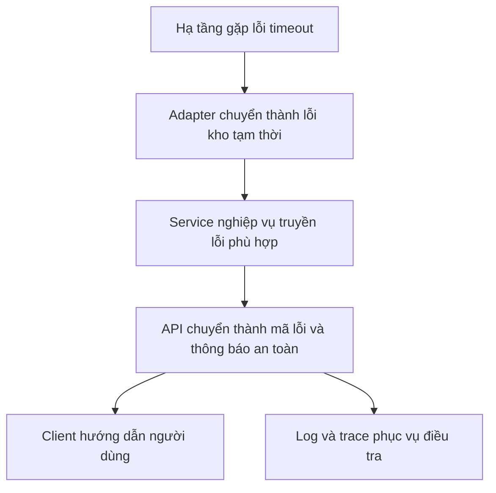

# Thiết kế thông báo lỗi đủ rõ để xử lý

Một hệ thống đáng tin cậy không phải là hệ thống **không bao giờ gặp lỗi**. Mạng có thể gián đoạn, dữ liệu người dùng có thể không hợp lệ, hàng trong kho có thể hết và dịch vụ bên ngoài có thể phản hồi chậm. Điều quan trọng là khi lỗi xảy ra, hệ thống phải **phát hiện đúng, diễn đạt rõ, hỗ trợ xử lý và tránh làm tình hình tệ hơn**.

Trong chương **Độ tin cậy** của `CODE_QUALITY_FUNDAMENTALS`, chúng ta tập trung vào **thiết kế thông báo lỗi đủ rõ để xử lý**. Chủ đề này gắn trực tiếp với mục tiêu hiểu những thuộc tính làm mã nguồn đáng tin cậy, dễ hiểu và dễ thay đổi: lỗi có thể xảy ra ở lúc chạy, nhưng cách mô tả và ghi nhận lỗi phải được thiết kế từ khi viết mã.

Sau bài này, bạn có thể phân biệt thông báo hướng tới người dùng, lập trình viên và nhân sự vận hành; thiết kế mã lỗi nhất quán; cung cấp hành động tiếp theo phù hợp; và viết mã Java chuyển một lỗi nghiệp vụ hoặc lỗi hạ tầng thành phản hồi an toàn, có thể truy vết.

## 1. Thông báo lỗi là một phần của khả năng phục hồi

Xét hai thông báo xuất hiện khi khách hàng cố đặt thêm hàng:

> **Thông báo A:** Có lỗi xảy ra.

> **Thông báo B:** Sản phẩm bạn chọn hiện không đủ số lượng. Hãy giảm số lượng hoặc chọn sản phẩm khác. Mã hỗ trợ: `req-7d21`.

Thông báo A cho biết có thất bại nhưng không giúp người dùng giải quyết. Thông báo B nêu tình huống, bước xử lý có thể thực hiện và mã giúp bộ phận hỗ trợ tìm đúng yêu cầu trong nhật ký.

Tuy nhiên, cùng một lỗi có thể cần **ba biểu diễn khác nhau**:

| Đối tượng nhận thông tin | Họ cần biết gì? | Ví dụ |
| --- | --- | --- |
| **Người dùng cuối** | Điều gì không thể hoàn tất, cần làm gì tiếp theo, có cần liên hệ hỗ trợ không | “Sản phẩm không đủ số lượng. Vui lòng giảm số lượng.” |
| **Mã gọi/API client** | Loại lỗi ổn định để xử lý bằng chương trình, HTTP status nếu dùng HTTP, dữ liệu cần thiết | `409`, `INSUFFICIENT_STOCK`, `correlationId` |
| **Nhóm phát triển/vận hành** | Dịch vụ, thời điểm, luồng xử lý, nguyên nhân kỹ thuật, mức nghiêm trọng và mã truy vết | Log có `correlationId`, tên thao tác, loại exception và nguyên nhân an toàn để ghi |

**Thông báo rõ ràng không có nghĩa là đưa toàn bộ stack trace cho người dùng.** Người dùng cần hướng giải quyết; nhóm vận hành cần chứng cứ chẩn đoán. Hai nhu cầu nên được liên kết bằng mã truy vết nhưng có mức chi tiết khác nhau.

### Một thông báo đủ rõ gồm những gì?

Một thông báo tốt thường trả lời được các câu hỏi sau, tùy đối tượng:

1. **Việc gì thất bại?** “Không thể giữ hàng”, “Không thể tải lịch sử đơn hàng”, “Không thể lưu hồ sơ”.
2. **Nguyên nhân nào có thể chia sẻ một cách chắc chắn?** “Số lượng phải lớn hơn 0”, “Phiên đăng nhập đã hết hạn”, “Dịch vụ hiện chưa sẵn sàng”.
3. **Người nhận nên làm gì?** Sửa trường nhập, thử sau, kiểm tra trạng thái hoặc liên hệ hỗ trợ.
4. **Có thể truy vết không?** Một mã lỗi ổn định và, khi cần, mã yêu cầu giúp tra cứu sự cố.
5. **Có an toàn không?** Không tiết lộ thông tin nhạy cảm, cấu trúc hệ thống hay chi tiết ngoài quyền người nhận.

Không phải lỗi nào cũng có thể giải thích chính xác ngay lúc phát hiện. Nếu nguyên nhân thực sự chưa được xác định, hãy diễn đạt đúng mức chắc chắn: “Không thể xác nhận kết quả, vui lòng kiểm tra trạng thái” thay vì khẳng định “Đơn hàng thất bại” khi thao tác có thể đã thành công ở hệ thống bên ngoài.

## 2. Phân biệt lỗi nghiệp vụ, lỗi đầu vào và lỗi kỹ thuật

Để người nhận biết nên xử lý thế nào, cần **phân loại lỗi theo bản chất**. Việc chỉ bắt mọi exception rồi trả “Có lỗi xảy ra” làm mất thông tin quyết định.

| Loại tình huống | Ví dụ | Phản hồi nên hướng tới |
| --- | --- | --- |
| **Đầu vào không hợp lệ** | Số lượng bằng 0, thiếu trường bắt buộc | Chỉ rõ trường hoặc quy tắc cần sửa; không gợi ý thử lại y nguyên |
| **Không tìm thấy tài nguyên** | Mã sản phẩm không tồn tại | Cho biết tài nguyên không được tìm thấy nếu người gọi được phép biết điều đó |
| **Xung đột trạng thái nghiệp vụ** | Số lượng yêu cầu vượt lượng hàng có thể giữ | Nêu điều kiện không được đáp ứng và bước thay thế hợp lý |
| **Lỗi tạm thời của hạ tầng** | Kết nối kho dữ liệu bị gián đoạn | Cho biết tạm thời không thể xử lý; chỉ gợi ý thử lại nếu an toàn |
| **Lỗi nội bộ ngoài dự kiến** | Lỗi lập trình, trạng thái không hợp lệ chưa được dự liệu | Thông báo chung, mã truy vết; ghi chi tiết để điều tra nội bộ |

Ví dụ đối với một API HTTP, ánh xạ thường gặp là:

- `400 Bad Request`: dữ liệu yêu cầu không hợp lệ theo hợp đồng API;
- `404 Not Found`: tài nguyên được phép tra cứu không tồn tại;
- `409 Conflict`: thao tác không thể hoàn thành vì trạng thái hiện tại, chẳng hạn hết hàng;
- `503 Service Unavailable`: hệ thống phụ thuộc tạm thời không phục vụ được;
- `500 Internal Server Error`: lỗi máy chủ ngoài dự kiến.

Đây là **ví dụ về quy ước thiết kế**, không phải bảng ánh xạ cứng cho mọi API. Một số hệ thống dùng `422 Unprocessable Content` cho một phần lỗi kiểm tra dữ liệu. Điều cần giữ nhất quán là **ý nghĩa của HTTP status, mã lỗi ứng dụng và hành động của client**.

Trong Java, exception là cơ chế báo hiệu lỗi cho mã gọi, còn HTTP response là cách diễn đạt lỗi tại **ranh giới giao tiếp**. Không nên để một exception kỹ thuật tự động quyết định mọi nội dung hiển thị cho người dùng.

## 3. Thiết kế hợp đồng lỗi ổn định

Một phản hồi lỗi có cấu trúc thường dễ duy trì hơn việc yêu cầu client phân tích câu chữ tiếng Việt:

```json
{
  "code": "INSUFFICIENT_STOCK",
  "message": "Số lượng sản phẩm hiện không đủ. Vui lòng giảm số lượng.",
  "correlationId": "req-7d21"
}
```

Trong đó:

- `code` là **định danh lỗi ổn định** dùng cho xử lý bằng chương trình, theo dõi hoặc tài liệu API;
- `message` là **nội dung hướng đến con người**, có thể được dịch hoặc điều chỉnh cách diễn đạt;
- `correlationId` liên kết phản hồi với log và trace của cùng yêu cầu, khi hệ thống có cơ chế truy vết.

**Không nên buộc ứng dụng client so khớp chuỗi `message`** để biết có phải hết hàng hay không. Nếu câu chữ thay đổi, chức năng client có thể bị hỏng. Thay vào đó, client xử lý `code`; giao diện có thể chọn bản dịch phù hợp với người dùng.

Khi thiết kế `code`, nên tránh các tên mơ hồ như `ERROR_1` hoặc `UNKNOWN_FAIL` cho những trường hợp đã biết. Tên kiểu `INVALID_QUANTITY`, `INSUFFICIENT_STOCK` và `INVENTORY_TEMPORARILY_UNAVAILABLE` thường cho biết vấn đề rõ hơn. Nhưng đừng tạo một mã mới chỉ vì câu thông báo có thêm dấu chấm; mã ứng dụng nên phản ánh **loại lỗi thực sự mà client có thể phân biệt và xử lý**.

Với lỗi kiểm tra dữ liệu, API có thể trả thông tin ở từng trường, chẳng hạn:

```json
{
  "code": "VALIDATION_FAILED",
  "message": "Vui lòng kiểm tra thông tin đã nhập.",
  "fieldErrors": {
    "quantity": "Số lượng phải lớn hơn 0."
  },
  "correlationId": "req-7d22"
}
```

Việc thêm `fieldErrors` làm hợp đồng phong phú hơn nhưng cũng đòi hỏi quy ước ổn định về tên trường, định dạng và phiên bản. Chỉ đưa ra các chi tiết giúp người gọi thực sự sửa được yêu cầu.

## 4. Ví dụ Java: chuyển lỗi thành phản hồi rõ ràng tại biên API

Giả sử ứng dụng có chức năng giữ hàng trong kho. Lớp nghiệp vụ có thể phát sinh ba lỗi: mã sản phẩm không tồn tại, không đủ hàng hoặc hệ thống kho tạm thời không thể phản hồi.

### 4.1. Cách xử lý kém hữu ích

```java
final class StockEndpoint {
    private final StockService service;

    StockEndpoint(StockService service) {
        this.service = service;
    }

    String reserve(String sku, int quantity) {
        try {
            service.reserve(sku, quantity);
            return "OK";
        } catch (RuntimeException exception) {
            return "ERROR";
        }
    }
}
```

Trong đoạn mã minh họa, `StockService` là một dịch vụ giả định có phương thức `reserve`. Với cách bắt exception này, người gọi không thể phân biệt nhập sai số lượng với hết hàng hay lỗi hạ tầng. Nhóm vận hành cũng không có thông tin hỗ trợ chẩn đoán, vì exception đã bị bỏ qua.

### 4.2. Xây dựng phản hồi và mã lỗi có chủ đích

Đoạn Java 17 dưới đây dùng một mô hình giản lược, độc lập với framework HTTP. Trong dự án thực tế, controller của Spring hoặc framework tương đương sẽ chuyển `HttpResult` thành HTTP response.

```java
import java.util.Objects;
import java.util.logging.Level;
import java.util.logging.Logger;

record ReserveRequest(String sku, int quantity) {}

record ApiError(String code, String message, String correlationId) {}

record HttpResult(int status, ApiError error) {}

interface StockService {
    void reserve(String sku, int quantity);
}

final class UnknownProductException extends RuntimeException {}
final class InsufficientStockException extends RuntimeException {}
final class InventoryUnavailableException extends RuntimeException {
    InventoryUnavailableException() {}

    InventoryUnavailableException(String message, Throwable cause) {
        super(message, cause);
    }
}

final class StockReservationEndpoint {
    private static final Logger LOG =
            Logger.getLogger(StockReservationEndpoint.class.getName());

    private final StockService stockService;

    StockReservationEndpoint(StockService stockService) {
        this.stockService = Objects.requireNonNull(stockService);
    }

    HttpResult reserve(ReserveRequest request, String correlationId) {
        // correlationId phải được tạo hoặc kiểm tra ở lớp hạ tầng tin cậy.
        if (request == null
                || request.sku() == null
                || request.sku().isBlank()
                || request.quantity() <= 0) {
            return error(400, "INVALID_REQUEST",
                    "Mã sản phẩm phải có giá trị và số lượng phải lớn hơn 0.",
                    correlationId);
        }

        try {
            stockService.reserve(request.sku(), request.quantity());
            return new HttpResult(204, null);
        } catch (UnknownProductException exception) {
            return error(404, "PRODUCT_NOT_FOUND",
                    "Không tìm thấy sản phẩm được yêu cầu.",
                    correlationId);
        } catch (InsufficientStockException exception) {
            return error(409, "INSUFFICIENT_STOCK",
                    "Sản phẩm không đủ số lượng. Vui lòng giảm số lượng.",
                    correlationId);
        } catch (InventoryUnavailableException exception) {
            LOG.log(Level.WARNING,
                    "Inventory unavailable; correlationId=" + correlationId,
                    exception);
            return error(503, "INVENTORY_TEMPORARILY_UNAVAILABLE",
                    "Chưa thể xác nhận yêu cầu. Vui lòng kiểm tra trạng thái trước khi thử lại.",
                    correlationId);
        } catch (RuntimeException exception) {
            LOG.log(Level.SEVERE,
                    "Unexpected reservation failure; correlationId=" + correlationId,
                    exception);
            return error(500, "INTERNAL_ERROR",
                    "Không thể hoàn tất yêu cầu. Vui lòng liên hệ hỗ trợ nếu lỗi tiếp diễn.",
                    correlationId);
        }
    }

    private static HttpResult error(
            int status, String code, String message, String correlationId) {
        return new HttpResult(status,
                new ApiError(code, message, correlationId));
    }
}
```

Ví dụ này minh họa nhiều quyết định thiết kế:

1. **Lỗi đầu vào được trả lời tại nơi có đủ ngữ cảnh.** Không cần gọi kho khi SKU rỗng hoặc số lượng không hợp lệ.
2. **Lỗi nghiệp vụ được phân biệt.** Không tìm thấy sản phẩm và không đủ hàng dẫn đến mã lỗi và hướng xử lý khác nhau.
3. **Lỗi hạ tầng có thông báo thận trọng.** Nếu dịch vụ kho không phản hồi, ta chưa chắc thao tác giữ hàng đã thành công hay thất bại; không nên khẳng định kết quả.
4. **Lỗi bất ngờ được ghi nhận.** Ranh giới API ghi exception để vận hành điều tra nhưng chỉ trả thông báo công khai an toàn.
5. **Mã truy vết liên kết hai phía.** Nhân viên hỗ trợ có thể dùng `correlationId` để tìm log tương ứng.

Đối với `204 No Content`, thực tế HTTP không gửi phần thân phản hồi. Việc dùng `null` ở `HttpResult.error()` ở đây chỉ nhằm biểu diễn “không có lỗi”; adapter HTTP phải phát ra phản hồi `204` không có body.

**Phạm vi của ví dụ:** Các exception chuyên biệt do `StockService` phát sinh theo hợp đồng của nó. Mã không trình bày cách dịch lỗi JDBC, HTTP hoặc timeout thành `InventoryUnavailableException`, cũng không triển khai idempotency hay giao dịch. Những vấn đề ấy phải được thiết kế ở lớp tương ứng. Bắt `RuntimeException` cuối cùng là một **hàng rào tại biên API** để trả phản hồi an toàn, không phải lời khuyên bắt và nuốt mọi exception ở từng lớp.

### 4.3. Kiểm tra hợp đồng lỗi bằng JUnit 5

Thay thế `StockService` giúp kiểm tra cách endpoint trả lỗi mà không cần kết nối kho thật:

```java
import static org.junit.jupiter.api.Assertions.assertEquals;
import static org.junit.jupiter.api.Assertions.assertNull;
import static org.junit.jupiter.api.Assertions.assertTrue;

import org.junit.jupiter.api.Test;

class StockReservationEndpointTest {
    @Test
    void invalidQuantityHasActionableMessage() {
        StockService fake = (sku, quantity) -> {
            throw new AssertionError("Stock service must not be called");
        };

        StockReservationEndpoint endpoint = new StockReservationEndpoint(fake);
        HttpResult response =
                endpoint.reserve(new ReserveRequest("SKU-42", 0), "req-101");

        assertEquals(400, response.status());
        assertEquals("INVALID_REQUEST", response.error().code());
        assertTrue(response.error().message().contains("lớn hơn 0"));
        assertEquals("req-101", response.error().correlationId());
    }

    @Test
    void outOfStockHasStableCode() {
        StockService fake = (sku, quantity) -> {
            throw new InsufficientStockException();
        };

        StockReservationEndpoint endpoint = new StockReservationEndpoint(fake);
        HttpResult response =
                endpoint.reserve(new ReserveRequest("SKU-42", 5), "req-102");

        assertEquals(409, response.status());
        assertEquals("INSUFFICIENT_STOCK", response.error().code());
        assertEquals("req-102", response.error().correlationId());
    }

    @Test
    void successfulReservationHasNoError() {
        StockService fake = (sku, quantity) -> { };

        StockReservationEndpoint endpoint = new StockReservationEndpoint(fake);
        HttpResult response =
                endpoint.reserve(new ReserveRequest("SKU-42", 1), "req-103");

        assertEquals(204, response.status());
        assertNull(response.error());
    }
}
```

Các kiểm thử trên áp dụng cho phiên bản ở mục 4.2, dùng JUnit 5 và kiểm tra hành vi phân loại lỗi ở biên API. Chúng **chưa chứng minh** việc giữ hàng thật diễn ra chính xác hoặc xử lý lỗi mạng an toàn. Cần thêm kiểm thử tích hợp cho adapter kho, giao dịch và luồng HTTP hoàn chỉnh.

## 5. Thông báo lỗi rõ phải đi kèm hướng xử lý đúng

Đưa ra một hành động sai có thể nguy hiểm hơn việc không đưa ra hành động nào. Chẳng hạn, client tự động gửi lại thao tác thanh toán sau timeout có thể tạo thanh toán trùng nếu hệ thống không bảo đảm tính idempotent.

| Tình huống | Hành động hợp lý | Điều cần tránh |
| --- | --- | --- |
| Thiếu trường bắt buộc | Sửa hoặc bổ sung trường được chỉ rõ | “Thử lại sau vài phút” |
| Số lượng yêu cầu vượt hàng còn | Giảm số lượng, chọn sản phẩm khác hoặc kiểm tra tồn kho | “Gửi lại yêu cầu ngay” khi tồn kho chưa đổi |
| Phiên đăng nhập hết hạn | Đăng nhập lại theo luồng được hỗ trợ | Hiển thị thông tin phiên hoặc token |
| Dịch vụ tạm thời quá tải | Thông báo tạm thời chưa thể phục vụ; thử sau nếu thao tác an toàn | Retry vô hạn và đồng loạt, làm quá tải nặng thêm |
| Kết quả thanh toán hoặc giữ hàng chưa rõ | Kiểm tra trạng thái giao dịch; dùng cơ chế idempotency nếu được hỗ trợ | Khẳng định thất bại hoặc gửi lại giao dịch mù quáng |
| Lỗi nội bộ ngoài dự kiến | Cung cấp mã yêu cầu và đường hỗ trợ phù hợp | Đưa stack trace cho người dùng hoặc khuyên họ tự sửa server |

Với các API cho phép retry, đội ngũ cần thiết kế **giới hạn số lần thử, backoff và jitter** khi phù hợp, cùng một cơ chế bảo vệ khỏi thực hiện trùng thao tác. Header `Retry-After` chỉ nên được trả khi hệ thống có thông tin đáng tin cậy để hướng dẫn thời điểm thử lại.

Một thông báo như “Vui lòng thử lại” chỉ hợp lý khi **thử lại thực sự có cơ hội giúp ích và không tạo nguy cơ mới**.

## 6. Phân biệt thông tin cho người dùng và thông tin chẩn đoán

### 6.1. Thông báo công khai cần ngắn, cụ thể và an toàn

Một thông báo công khai tốt thường có cấu trúc:

> **Không thể hoàn tất [thao tác].** [Lý do có thể chia sẻ và đã được xác minh]. [Bước xử lý phù hợp]. [Mã hỗ trợ nếu cần].

Ví dụ:

- “Không thể lưu hồ sơ. Trường số điện thoại chưa đúng định dạng. Vui lòng kiểm tra lại.”
- “Không thể đặt hàng. Sản phẩm vừa hết. Vui lòng chọn số lượng khác.”
- “Chưa thể xác nhận thanh toán. Vui lòng kiểm tra lịch sử giao dịch trước khi thử lại. Mã hỗ trợ: `req-2048`.”

Tránh những kiểu diễn đạt thiếu giá trị:

- “Error”, “Failed”, “Unknown exception”: không nói người nhận nên làm gì.
- “Đã có lỗi ở dòng 217 của `PaymentJdbcRepository`”: bộc lộ chi tiết triển khai không giúp khách hàng.
- “Lỗi do bạn nhập sai” khi vấn đề thực ra ở máy chủ: thiếu chính xác và gây mất tin tưởng.
- “Đặt hàng thất bại” khi chỉ biết phía đối tác không trả lời: dễ dẫn tới thao tác trùng.

Không cần mọi thông báo đều dài. Một trường hợp xác thực đơn giản có thể chỉ cần “Số lượng phải lớn hơn 0” đặt ngay cạnh ô nhập.

### 6.2. Log nội bộ cần đủ ngữ cảnh để điều tra

Thông báo trên màn hình không thay thế cho log. Đối với lỗi quan trọng, dữ liệu vận hành thường cần:

- **Thời điểm, dịch vụ và thao tác:** lỗi xảy ra ở đâu, trong bước nào.
- **Mã loại lỗi và mức độ:** giúp tổng hợp, cảnh báo và phân loại.
- **`correlationId` hoặc `traceId`:** kết nối các bản ghi của cùng một yêu cầu qua nhiều dịch vụ.
- **Thông tin ngữ cảnh không nhạy cảm:** tên thành phần phụ thuộc, trạng thái trả về, thời lượng hoặc tên bước xử lý.
- **Nguyên nhân kỹ thuật:** exception và chuỗi nguyên nhân khi thích hợp và đã kiểm tra an toàn thông tin.

Ví dụ bản ghi có cấu trúc:

```json
{
  "level": "WARN",
  "service": "inventory-api",
  "operation": "reserveStock",
  "code": "INVENTORY_TEMPORARILY_UNAVAILABLE",
  "correlationId": "req-7d21",
  "dependency": "inventory-db",
  "elapsedMs": 1200
}
```

Đây là **bản ghi minh họa**, không phải log sinh ra từ đoạn code ở trên. Trong hệ thống có logging tập trung, nên dùng trường có cấu trúc thay vì ghép tất cả vào một chuỗi khó tìm kiếm.

**Đừng ghi mọi lỗi ở mức `ERROR`.** Nhập sai dữ liệu là một trường hợp thường gặp và có thể chỉ cần thống kê; lỗi nội bộ khiến nhiều yêu cầu thất bại cần được cảnh báo phù hợp. Đặt mức log dựa trên tác động và mục đích vận hành, đồng thời hạn chế tạo hàng nghìn bản ghi giống nhau khi lưu lượng tăng.

### 6.3. Không tiết lộ dữ liệu nhạy cảm

Nội dung gửi ra ngoài hoặc ghi log cần tránh:

- Mật khẩu, access token, API key, mã OTP, cookie phiên;
- Thông tin thanh toán và dữ liệu cá nhân không cần thiết cho chẩn đoán;
- Câu truy vấn chứa dữ liệu nhạy cảm, đường dẫn nội bộ, cấu hình bí mật;
- Stack trace, thông điệp SQL hoặc thông báo của thư viện bên ngoài chưa được kiểm tra.

Một exception có thể chứa chuỗi kết nối hoặc dữ liệu đầu vào, nên **ghi nguyên exception không mặc nhiên an toàn**. Với môi trường yêu cầu bảo vệ dữ liệu, cần áp dụng quy tắc lọc, che dữ liệu và kiểm soát quyền đọc log. Khi có thể, ghi định danh kỹ thuật đã được phép sử dụng để liên kết sự kiện thay vì ghi toàn bộ nội dung yêu cầu.

`correlationId` cũng cần được **tạo hoặc xác thực tại lớp hạ tầng đáng tin cậy**, có định dạng và giới hạn độ dài. Không ghi thẳng một chuỗi không kiểm soát từ header do client gửi vào log, vì dữ liệu có thể gây nhầm lẫn hoặc làm hỏng định dạng log.

## 7. Giữ nguyên nguyên nhân, tránh nuốt lỗi

Một thông báo hữu ích cần được tạo ở đúng cấp độ. Ví dụ, lớp repository biết kết nối bị timeout nhưng không hiểu người dùng nên giảm số lượng hàng hay đăng nhập lại. Lớp API biết ngữ cảnh thao tác và cách giao tiếp với client, nhưng có thể không biết chi tiết JDBC.

Luồng xử lý lỗi nên giữ nguyên nhân qua các tầng cần thiết:



Trong Java, khi chuyển lỗi ở một tầng, có thể **giữ nguyên cause** để hỗ trợ truy vết:

```java
interface RemoteInventoryClient {
    void reserve(String sku, int quantity)
            throws java.net.SocketTimeoutException;
}

final class RemoteStockAdapter implements StockService {
    private final RemoteInventoryClient client;

    RemoteStockAdapter(RemoteInventoryClient client) {
        this.client = client;
    }

    @Override
    public void reserve(String sku, int quantity) {
        try {
            client.reserve(sku, quantity);
        } catch (java.net.SocketTimeoutException exception) {
            throw new InventoryUnavailableException(
                    "Inventory dependency timed out", exception);
        }
    }
}
```

Đoạn này sử dụng `StockService` và `InventoryUnavailableException` đã định nghĩa ở mục 4.2. Interface `RemoteInventoryClient` được rút gọn để minh họa thao tác I/O có thể ném `SocketTimeoutException`. Adapter giữ nguyên `cause`, chuyển lỗi về loại mà lớp API nhận biết. Khi đi qua ranh giới API, **không trả `getMessage()` của exception hạ tầng trực tiếp cho client**. Lý do là message nội bộ không được thiết kế như hợp đồng công khai và có thể chứa chi tiết không nên tiết lộ.

Cần tránh hai kiểu lỗi phổ biến:

1. **Nuốt lỗi:** `catch (Exception e) { return null; }` khiến nơi gọi không biết null là kết quả hợp lệ hay thất bại.
2. **Bọc lỗi vô nghĩa:** ném một exception mới nhưng bỏ hết thông tin nguyên nhân, rồi chỉ ghi “System failed”, khiến việc xác định điểm phát sinh lỗi khó khăn.

Không phải lúc nào cũng nên bắt exception. Nếu tầng hiện tại **không có cách xử lý hoặc bổ sung ngữ cảnh hữu ích**, hãy để lỗi đi tới tầng chịu trách nhiệm. Khi bắt, hãy có lý do rõ: phục hồi, chuyển sang loại lỗi thích hợp, dọn tài nguyên hoặc ánh xạ phản hồi ở biên hệ thống.

## 8. Thiết kế thông báo phù hợp bối cảnh vận hành

Một sản phẩm có thể có nhiều kênh nhận lỗi: biểu mẫu web, ứng dụng di động, API cho đối tác và công cụ nội bộ. Cùng một `code` có thể được hiển thị với cách diễn đạt khác nhau:

| Kênh | Cách thể hiện thích hợp |
| --- | --- |
| **Biểu mẫu web** | Thông báo ngay bên cạnh trường sai; giữ nguyên dữ liệu hợp lệ |
| **Ứng dụng di động** | Diễn đạt ngắn và nút hành động cụ thể nếu có |
| **API tích hợp** | HTTP status, mã lỗi ổn định, cấu trúc dữ liệu nhất quán và tài liệu xử lý |
| **Công cụ hỗ trợ khách hàng** | Mã yêu cầu, trạng thái xử lý, thông tin cần kiểm tra, quyền truy cập phù hợp |
| **Hệ thống giám sát** | Sự kiện có thể tổng hợp, biểu đồ tỷ lệ lỗi và cảnh báo theo mức độ ảnh hưởng |

Đừng lạm dụng thông báo lỗi kỹ thuật trong giao diện. Người dùng cuối không cần biết tên exception hoặc tầng kiến trúc. Nhưng cũng đừng làm chúng quá chung chung tới mức đội hỗ trợ chỉ có thể yêu cầu “Bạn thử lại xem”.

**Khả năng đọc và bảo trì:** Đặt quy tắc ánh xạ lỗi tại một số vị trí nhất quán, chẳng hạn controller advice hoặc error mapper, giúp tránh mỗi endpoint tự đặt chuỗi lỗi khác nhau. Hợp đồng lỗi cần có phiên bản hoặc nguyên tắc tương thích nếu hệ thống có nhiều client.

**Độ tin cậy:** Theo dõi tỷ lệ từng mã lỗi giúp phát hiện vấn đề. Ví dụ, tỷ lệ `INVENTORY_TEMPORARILY_UNAVAILABLE` đột ngột tăng có thể phản ánh lỗi phụ thuộc; tỷ lệ `INVALID_REQUEST` tăng sau khi cập nhật giao diện có thể phản ánh client đang gửi dữ liệu sai. Tuy nhiên, dữ liệu quan sát được cần đi kèm ngữ cảnh trước khi kết luận nguyên nhân.

**Khả năng phục hồi:** Có những lỗi nên được xử lý tự động bằng retry, circuit breaker hoặc fallback; có những lỗi cần người dùng sửa. Thông báo phải phản ánh **chiến lược xử lý thực tế đã hỗ trợ**, không chỉ liệt kê hành động nghe có vẻ tích cực.

## 9. Checklist review cho một thông báo lỗi

Khi code review, kiểm tra theo thứ tự:

1. **Có phân biệt được loại lỗi không?** Client và người vận hành có nhận ra lỗi đầu vào, nghiệp vụ, hạ tầng hay lỗi ngoài dự kiến?
2. **Lời nhắn có đúng sự thật không?** Có khẳng định quá mức khi kết quả thực tế chưa xác định?
3. **Hành động tiếp theo có khả thi và an toàn không?** Người dùng có thể sửa gì? Retry có thể gây trùng giao dịch không?
4. **Phản hồi có hợp đồng ổn định không?** `code`, HTTP status và các trường dữ liệu có ý nghĩa nhất quán?
5. **Có thể truy vết không?** Có mã yêu cầu và bản ghi nội bộ đủ thông tin để tìm nguyên nhân?
6. **Có bảo vệ dữ liệu không?** Có vô tình lộ stack trace, cấu hình, bí mật hoặc thông tin cá nhân?
7. **Có kiểm thử các đường lỗi quan trọng không?** Kiểm thử giá trị biên, dữ liệu sai, timeout, trạng thái xung đột và lỗi bất ngờ theo mức rủi ro?
8. **Có dễ thay đổi không?** Khi điều chỉnh câu chữ hoặc bổ sung bản dịch, client có tiếp tục xử lý đúng dựa trên mã lỗi?

### Một tình huống để thảo luận

Một API thanh toán nhận yêu cầu, gửi tới nhà cung cấp và bị timeout trước khi nhận phản hồi. Mã hiện tại trả:

```json
{
  "code": "PAYMENT_FAILED",
  "message": "Thanh toán thất bại. Hãy bấm thanh toán lại."
}
```

**Vấn đề là gì?** Timeout không chứng minh nhà cung cấp chưa xử lý giao dịch. Nếu client làm theo thông báo, khách có nguy cơ gửi yêu cầu thanh toán thêm lần nữa. Cần xác định trạng thái bằng mã giao dịch hoặc cơ chế xác nhận được hệ thống hỗ trợ, đồng thời thiết kế idempotency nếu cho phép retry.

Một phản hồi thận trọng hơn có thể là:

```json
{
  "code": "PAYMENT_STATUS_UNKNOWN",
  "message": "Chưa xác nhận được kết quả thanh toán. Vui lòng kiểm tra lịch sử giao dịch trước khi thử lại.",
  "correlationId": "req-8b91"
}
```

Phản hồi này chỉ an toàn về mặt thông tin; **nó không thay thế cơ chế xác minh giao dịch**. Cách xử lý đầy đủ còn phụ thuộc vào hợp đồng của nhà cung cấp thanh toán và kiến trúc hệ thống.

## 10. Tự kiểm tra hiểu bài

**Câu 1.** Vì sao không nên trả trực tiếp `SQLException.getMessage()` cho người dùng?

*Gợi ý:* Thông điệp của thư viện có thể chứa cấu trúc hoặc dữ liệu nội bộ, không đảm bảo ổn định và thường không chỉ ra hành động phù hợp cho người dùng. Thông tin cần thiết nên được ghi an toàn ở kênh vận hành và ánh xạ sang mã lỗi công khai.

**Câu 2.** Một API trả `400` cùng thông báo “Có lỗi xảy ra”. Người dùng vẫn không biết trường nào sai. Cần cải thiện gì?

*Gợi ý:* Nêu quy tắc bị vi phạm, trường liên quan khi được phép chia sẻ, và cách sửa; cung cấp mã lỗi ổn định để client xử lý. `400` chỉ là phân loại HTTP, chưa đủ cho trải nghiệm người dùng.

**Câu 3.** Tại sao `correlationId` hữu ích nhưng không nên cho phép client gửi tùy ý rồi ghi nguyên văn?

*Gợi ý:* Nó giúp nối phản hồi với log/trace. Giá trị không kiểm soát có thể gây nhiễu hoặc tấn công định dạng log, nên được tạo hoặc chuẩn hóa tại ranh giới tin cậy.

**Câu 4.** Khi hệ thống kho timeout, nên trả ngay “Không đủ hàng” hay “Chưa thể xác nhận yêu cầu”?

*Gợi ý:* Trả thông báo phản ánh điều đã biết: timeout cho thấy thiếu xác nhận, không chứng minh hết hàng. Hướng dẫn kiểm tra trạng thái và chỉ retry nếu thiết kế bảo đảm an toàn.

**Câu 5.** Vì sao kiểm thử chỉ xác nhận thông điệp chứa một câu chữ cố định có thể chưa đủ?

*Gợi ý:* Cần kiểm tra mã lỗi ổn định, trạng thái, dữ liệu hướng dẫn cần thiết và hành vi tại biên. Chuỗi diễn đạt có thể đổi theo ngôn ngữ; client nên dựa vào `code` thay vì phân tích `message`.

## Ghi nhớ

**Thông báo lỗi tốt là một phần của thiết kế độ tin cậy.** Nó mô tả đúng trạng thái đã biết, giúp đúng đối tượng chọn bước xử lý phù hợp, cung cấp dấu vết để điều tra và không làm lộ dữ liệu nhạy cảm. Trong Java, hãy phân loại lỗi ở các tầng có đủ ngữ cảnh, giữ nguyên nhân kỹ thuật khi cần, và ánh xạ lỗi tại biên API sang hợp đồng ổn định, dễ kiểm thử.

Thông báo lỗi đủ rõ không tự ngăn được mọi sự cố, nhưng giúp người dùng không hành động sai, giúp nhóm vận hành tìm nguyên nhân nhanh hơn và giúp mã nguồn **đáng tin cậy, dễ hiểu, dễ thay đổi** khi hệ thống phát triển.

