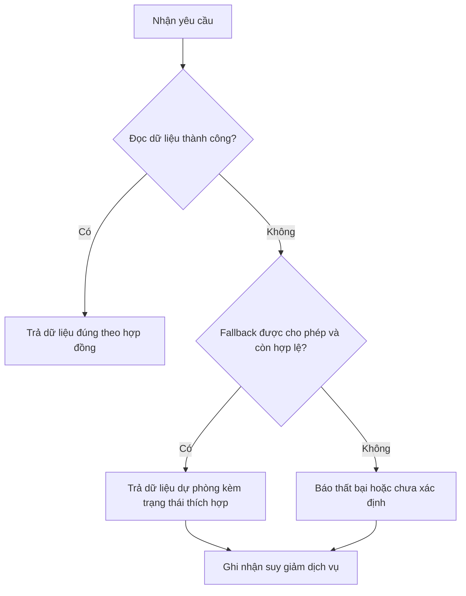

# Không che thất bại bằng kết quả có vẻ thành công

> **Chương:** Độ tin cậy  
> **Học phần:** CODE_QUALITY_FUNDAMENTALS — Hiểu những thuộc tính quyết định mã nguồn có đáng tin cậy, dễ hiểu và dễ thay đổi hay không.

Một ứng dụng có thể không hiển thị lỗi nào nhưng vẫn **không đáng tin cậy**. Chẳng hạn, hệ thống tìm sản phẩm trả về danh sách rỗng khi cơ sở dữ liệu ngừng phản hồi; màn hình thanh toán hiển thị “Thành công” dù chưa nhận được xác nhận từ cổng thanh toán; hoặc bộ phận lập báo cáo dùng giá trị `0` để thay thế một phép đo bị lỗi. Người dùng nhìn thấy một kết quả có vẻ hợp lệ và đưa ra quyết định dựa trên thông tin sai.

Trong phát triển phần mềm, **không che thất bại bằng kết quả có vẻ thành công** có nghĩa là giữ đúng sự khác biệt giữa:

- **Thành công thật:** hệ thống đã thực hiện được hành vi và có bằng chứng phù hợp.
- **Kết quả nghiệp vụ hợp lệ nhưng không có dữ liệu:** ví dụ tìm kiếm thành công và không có sản phẩm khớp.
- **Thất bại hoặc trạng thái chưa xác định:** hệ thống không thể cung cấp kết quả đúng, hoặc không đủ bằng chứng để khẳng định thao tác đã hoàn thành.

Đây là một nguyên tắc quan trọng của **độ tin cậy** (*reliability*). Độ tin cậy không chỉ nói về việc hệ thống “không bị crash”; nó còn yêu cầu ứng dụng phản ánh trung thực trạng thái của tác vụ, có cơ chế xử lý thất bại và tránh khiến người dùng hay thành phần khác hiểu sai.

Sau bài học, người học có thể nhận diện các dạng che lỗi, thiết kế ranh giới trả về thành công/thất bại rõ ràng, quyết định khi nào được phép dùng dữ liệu dự phòng và kiểm thử các nhánh lỗi thường bị bỏ sót.

## 1. Vì sao một kết quả “đẹp” có thể nguy hiểm hơn lỗi rõ ràng?

Xét màn hình danh sách đơn hàng. Khi truy vấn bình thường, cơ sở dữ liệu trả về `[]` vì khách hàng chưa có đơn: đây là kết quả hợp lệ. Nhưng khi kết nối cơ sở dữ liệu bị ngắt, ứng dụng cũng trả về `[]` thì người dùng sẽ tin rằng **họ không có đơn hàng**, dù thực tế hệ thống chưa thể kiểm tra.

Sự nhầm lẫn này gây hại theo nhiều cách:

1. **Quyết định dựa trên dữ liệu sai:** người dùng đặt lại hàng, quản trị viên duyệt thiếu bản ghi hoặc bộ phận tài chính đối soát sai.
2. **Thất bại khó phát hiện:** dashboard có thể thống kê tỷ lệ “thành công” cao vì mọi lỗi đều biến thành phản hồi thành công.
3. **Lỗi lan sang hệ thống khác:** bên nhận lưu giá trị `0`, danh sách rỗng hoặc trạng thái “đã xử lý” như dữ liệu thật.
4. **Khôi phục khó hơn:** khi sự cố được phát hiện, không còn biết bản ghi nào đã được xử lý đúng và bản ghi nào chỉ được đánh dấu thành công giả.
5. **Kiểm thử thiếu chính xác:** bài kiểm tra chỉ xem phương thức “không ném ngoại lệ” sẽ bỏ qua lỗi ngữ nghĩa.

So sánh hai phản hồi:

```json
{
  "orders": [],
  "status": "SUCCESS"
}
```

và:

```json
{
  "error": {
    "code": "ORDER_SERVICE_UNAVAILABLE",
    "message": "Chưa thể tải đơn hàng. Vui lòng thử lại."
  }
}
```

Phản hồi đầu chỉ phù hợp nếu hệ thống **đã truy vấn thành công** và xác nhận không có đơn. Phản hồi thứ hai trung thực hơn khi việc truy vấn thất bại. Trong HTTP API, trường hợp dịch vụ tạm thời không khả dụng thường thích hợp với mã `503`; nội dung JSON chỉ là một phần của hợp đồng lỗi, không thay thế mã trạng thái HTTP.

## 2. Phân biệt “không có”, “thất bại” và “chưa biết”

| Trạng thái | Nghĩa | Ví dụ | Cách xử lý thích hợp |
| --- | --- | --- | --- |
| **SUCCESS_WITH_DATA** | Đã hoàn thành, có dữ liệu hợp lệ | Tìm được ba đơn hàng | Trả dữ liệu cho người gọi |
| **SUCCESS_EMPTY** | Đã hoàn thành, xác nhận không có dữ liệu | Truy vấn thành công nhưng không có đơn khớp | Trả danh sách rỗng hoặc giá trị “không tìm thấy” theo hợp đồng |
| **FAILED** | Không hoàn thành tác vụ theo hợp đồng | Cơ sở dữ liệu từ chối truy vấn | Báo lỗi có ý nghĩa, cho phép retry/khôi phục nếu an toàn |
| **UNKNOWN** | Chưa xác định tác vụ đã hoàn thành hay chưa | Lệnh thanh toán bị timeout sau khi gửi | Tra cứu trạng thái, đối soát; không tự khẳng định thành công hoặc thất bại |

Không phải API nào cũng phải định nghĩa đúng bốn mã trên. Bảng này là cách **tư duy về trạng thái**, giúp người thiết kế tránh gộp những tình huống có ý nghĩa khác nhau.

Đặc biệt, `UNKNOWN` rất quan trọng với thao tác tạo tác dụng phụ. Một yêu cầu có thể đã được xử lý tại hệ thống bên ngoài trước khi kết nối bị ngắt. Khi đó, “không nhận được phản hồi thành công” **không đồng nghĩa** “chưa có gì xảy ra”.

## 3. Các dấu hiệu che giấu thất bại thường gặp

### 3.1. Nuốt ngoại lệ rồi trả giá trị mặc định

```java
List<Order> loadOrders(String customerId) {
    try {
        return repository.findByCustomerId(customerId);
    } catch (Exception ignored) {
        return Collections.emptyList();
    }
}
```

Hàm này đánh đồng “không có đơn” với “không truy vấn được đơn”. Nó còn bắt mọi `Exception`, nên có thể che cả lỗi lập trình mà nhóm cần phát hiện và sửa.

Một trường hợp tương tự:

```java
long calculateRevenueVnd() {
    try {
        return revenueRepository.sumRevenueVnd();
    } catch (RuntimeException ignored) {
        return 0L;
    }
}
```

`0` là một kết quả tài chính hợp lệ; dùng nó thay lỗi sẽ khiến báo cáo doanh thu trở nên sai lệch. Ghi log trước khi trả `0` **không giải quyết vấn đề ngữ nghĩa**: người gọi vẫn nhận kết quả có vẻ thành công.

### 3.2. Chỉ ghi log rồi tiếp tục như thể không có lỗi

```java
try {
    inventoryReservation.reserve(orderId);
} catch (Exception exception) {
    logger.warn("Reserve failed", exception);
}
orderRepository.markReadyToShip(orderId);
```

Nếu việc giữ hàng là điều kiện bắt buộc để xuất kho, lệnh đánh dấu đơn “sẵn sàng giao” đã vi phạm quy trình. Log là tín hiệu chẩn đoán; **log không biến thao tác thất bại thành thao tác thành công**.

### 3.3. Trả HTTP 200 cho lỗi kỹ thuật

```json
{
  "success": true,
  "orders": [],
  "warning": "Database timeout"
}
```

Phản hồi trên tự mâu thuẫn nếu hợp đồng khẳng định đã lấy đủ danh sách đơn hàng. Người tiêu thụ API có thể chỉ kiểm tra `success` hoặc mã HTTP và bỏ qua `warning`. Với trường hợp phụ thuộc tạm thời không khả dụng, cần chọn trạng thái lỗi thích hợp và để client phân biệt được nó với kết quả rỗng hợp lệ.

Một HTTP API vẫn có thể trả `200` cho **kết quả thành công một phần** nếu giao diện của nó công bố rõ loại kết quả, dữ liệu nào thiếu, và phía tiêu thụ chủ động chấp nhận điều đó. Nhưng **không được âm thầm gắn nhãn thành công toàn phần**.

### 3.4. Xóa dấu vết lỗi bằng một `catch` quá rộng

```java
try {
    processPayment(order);
} catch (Exception exception) {
    return true; // Cố giữ luồng xử lý "không bị gián đoạn".
}
```

Giá trị `true` khiến các thành phần sau có thể phát hành hóa đơn hoặc giao hàng trong khi việc thanh toán chưa được xác nhận. Việc bắt ngoại lệ là một quyết định thiết kế luồng xử lý lỗi; nó không đồng nghĩa với quyền đổi ý nghĩa của kết quả.

### 3.5. Thay mọi lỗi bằng dữ liệu cache mà không nói nguồn gốc

Một báo cáo có thể hiển thị doanh thu hôm qua từ cache khi hệ thống dữ liệu mới bị lỗi. Nếu không cho biết dữ liệu **đã cũ**, người xem có thể hiểu đó là số liệu hiện tại. Fallback chỉ đáng tin khi hợp đồng cho phép, nguồn gốc và độ mới của dữ liệu được thể hiện rõ, đồng thời những tác động không chấp nhận được được kiểm soát.

## 4. Mẫu thiết kế Java: danh sách rỗng chỉ có nghĩa khi truy vấn thành công

Giả sử một dịch vụ lấy danh sách mã sản phẩm còn hàng từ hệ thống danh mục:

- Truy vấn thành công và không còn sản phẩm nào: trả danh sách rỗng.
- Truy vấn thành công và có sản phẩm: trả danh sách tương ứng.
- Không truy vấn được do lỗi I/O: báo lỗi `CatalogUnavailableException` và giữ nguyên nguyên nhân gốc.

Định nghĩa client và loại lỗi ở ranh giới:

```java
import java.io.IOException;
import java.util.List;

@FunctionalInterface
interface CatalogClient {
    List<String> fetchAvailableSkus() throws IOException;
}

final class CatalogUnavailableException extends RuntimeException {
    CatalogUnavailableException(String message, Throwable cause) {
        super(message, cause);
    }
}
```

Dịch vụ không đánh tráo lỗi thành dữ liệu:

```java
import java.io.IOException;
import java.util.List;
import java.util.Objects;

public final class CatalogService {
    private final CatalogClient client;

    public CatalogService(CatalogClient client) {
        this.client = Objects.requireNonNull(client, "client");
    }

    public List<String> listAvailableSkus() {
        try {
            List<String> skus = client.fetchAvailableSkus();
            if (skus == null) {
                throw new IllegalStateException(
                        "Catalog client violated contract: returned null");
            }
            return skus;
        } catch (IOException cause) {
            throw new CatalogUnavailableException(
                    "Cannot load available products", cause);
        }
    }
}
```

Hành vi quan sát được nay có ý nghĩa:

| Client trả về / ném | `CatalogService` làm gì | Người gọi hiểu gì |
| --- | --- | --- |
| `List.of("SKU-1")` | Trả danh sách một phần tử | Đã tải thành công |
| `List.of()` | Trả danh sách rỗng | Đã tải thành công, không có sản phẩm |
| `IOException` | Ném `CatalogUnavailableException` với `cause` gốc | Không tải được danh sách |
| `null` dù hợp đồng không cho phép | Ném `IllegalStateException` | Client vi phạm hợp đồng, cần điều tra |

Ví dụ dùng `List.of(...)` tương thích với Java 9 trở lên. Trong ứng dụng thực tế, cần quy định thêm danh sách trả về có được phép sửa không và liệu dữ liệu có thể bị thay đổi bởi thành phần khác không; đó là một phần hợp đồng về kết quả.

**Vì sao không chỉ viết `catch (Exception e)`?** Trong ví dụ, lỗi I/O là thất bại đã được dự kiến ở ranh giới truy vấn. Những lỗi khác như `NullPointerException` do mã lập trình không nên bị âm thầm chuyển thành “không có sản phẩm”. Nếu một ranh giới cần bao gói thêm loại lỗi cụ thể, hãy làm theo hợp đồng thực sự của thành phần đó và giữ nguyên thông tin nguyên nhân.

### 4.1. Xử lý ở ranh giới API

Giả sử HTTP endpoint yêu cầu “trả danh sách đầy đủ hiện tại”. Nó có thể ánh xạ kết quả:

| Kết quả từ dịch vụ | HTTP minh họa | Ý nghĩa với client |
| --- | --- | --- |
| Có danh sách | `200 OK` với mảng dữ liệu | Đã xử lý thành công |
| Danh sách rỗng hợp lệ | `200 OK` với `[]` | Đã xử lý thành công, không có phần tử |
| Dịch vụ danh mục tạm thời không dùng được | `503 Service Unavailable` với mã lỗi rõ | Không thể xác nhận danh sách lúc này |
| Lỗi không mong đợi | `500 Internal Server Error` theo chính sách hệ thống | Có vấn đề cần xử lý |

Đây là gợi ý thiết kế; mã cụ thể còn phụ thuộc hợp đồng API, điều kiện triển khai và loại thất bại. Nếu trả `503`, chỉ thêm `Retry-After` khi hệ thống có cơ sở xác định thời điểm nên thử lại; không tự hứa khả năng phục hồi nếu chưa biết.

Tại ranh giới HTTP, có thể cho người dùng thông báo dễ hiểu và đồng thời ghi lại chi tiết kỹ thuật phục vụ xử lý sự cố. Không đưa thông tin nhạy cảm như token, chuỗi kết nối, dữ liệu thanh toán hoặc thông tin cá nhân vào nội dung lỗi công khai.

## 5. Kiểm thử để chứng minh lỗi không bị che

Với JUnit 5, nên kiểm tra cả dữ liệu thành công lẫn trường hợp phụ thuộc thất bại:

```java
import static org.junit.jupiter.api.Assertions.assertEquals;
import static org.junit.jupiter.api.Assertions.assertSame;
import static org.junit.jupiter.api.Assertions.assertThrows;

import java.io.IOException;
import java.util.List;
import org.junit.jupiter.api.Test;

class CatalogServiceTest {
    @Test
    void emptyListMeansSuccessfulEmptyCatalog() {
        CatalogService service = new CatalogService(() -> List.of());

        assertEquals(List.of(), service.listAvailableSkus());
    }

    @Test
    void successfulQueryReturnsProducts() {
        CatalogService service =
                new CatalogService(() -> List.of("SKU-1", "SKU-2"));

        assertEquals(
                List.of("SKU-1", "SKU-2"),
                service.listAvailableSkus());
    }

    @Test
    void ioFailureIsReportedInsteadOfReturningEmptyList() {
        IOException failure = new IOException("connection timed out");
        CatalogService service = new CatalogService(() -> {
            throw failure;
        });

        CatalogUnavailableException actual = assertThrows(
                CatalogUnavailableException.class,
                service::listAvailableSkus);

        assertSame(failure, actual.getCause());
    }

    @Test
    void invalidNullResultIsNotTreatedAsEmptyList() {
        CatalogService service = new CatalogService(() -> null);

        assertThrows(
                IllegalStateException.class,
                service::listAvailableSkus);
    }
}
```

Bài kiểm thử nhánh lỗi xác nhận **không có dữ liệu giả xuất hiện** khi hệ thống không lấy được dữ liệu. Kiểm thử ở tầng HTTP cần kiểm tra tiếp mã trạng thái và nội dung phản hồi; kiểm thử ở tầng giao diện cần xác nhận có trạng thái “Không thể tải” khác với “Không có sản phẩm”.

Không cần giả lập mọi loại ngoại lệ trong một bài kiểm thử. Hãy chọn các lỗi có thể xảy ra theo hợp đồng của phụ thuộc, cùng những tình huống gây hiểu sai nguy hiểm nhất.

## 6. Khi nào được phép dùng fallback?

Fallback là **cách ứng dụng tiếp tục cung cấp một mức dịch vụ đã định nghĩa** khi đường xử lý chính thất bại. Fallback có thể cải thiện trải nghiệm hoặc tính sẵn sàng, nhưng chỉ khi kết quả thay thế còn phù hợp với nhu cầu người dùng.

| Tình huống | Fallback có thể hợp lý | Cần truyền đạt rõ |
| --- | --- | --- |
| Ảnh sản phẩm từ CDN không tải được | Hiển thị ảnh đại diện mặc định | Ảnh chính không khả dụng |
| Bảng tin gợi ý nội dung bị lỗi | Bỏ phần gợi ý, vẫn cho người dùng xem trang chính | Chức năng gợi ý tạm thời không hoạt động |
| Dữ liệu thời tiết thời gian thực bị lỗi | Hiển thị bản cập nhật gần nhất nếu còn trong giới hạn chấp nhận | Thời điểm đo và trạng thái dữ liệu cũ |
| Tra cứu số dư để quyết định cho phép rút tiền | **Không tự suy số dư bằng `0` hoặc giá trị cache không được bảo đảm** | Không thể xác minh; tạm dừng thao tác có rủi ro |
| Cổng thanh toán timeout sau khi gửi lệnh thu | **Không tự coi là thanh toán thất bại hoặc thành công** | Trạng thái đang xác minh; cần tra cứu hoặc đối soát |

Hệ thống nên xác định trước:

1. **Mức dịch vụ tối thiểu** mà fallback vẫn cung cấp đúng.
2. **Giới hạn sử dụng**: thời gian dữ liệu cache còn chấp nhận được, phạm vi người dùng hoặc loại thao tác được dùng.
3. **Tín hiệu phân biệt**: trạng thái `DEGRADED`, `STALE` hoặc thông điệp tương đương thay vì `FRESH` / `SUCCESS` nếu chúng không đúng.
4. **Quan sát được lỗi gốc**: đếm số lần fallback, lý do, thời gian kéo dài và khả năng khôi phục.
5. **Điều kiện dừng fallback**: không tiếp tục trả dữ liệu quá cũ hoặc thiếu thuộc tính an toàn bắt buộc.

Ví dụ, một kết quả đọc cache có thể biểu đạt:

```json
{
  "state": "STALE",
  "lastUpdatedAt": "2026-10-20T08:30:00Z",
  "products": ["SKU-1", "SKU-2"]
}
```

Thời điểm trên chỉ là dữ liệu ví dụ. Người gọi phải được thiết kế để hiểu `STALE` và quyết định hành vi phù hợp. Trả cùng dữ liệu cache nhưng gắn `state: "SUCCESS"` mà không báo độ mới có thể là che giấu sự xuống cấp.

**Không phải mọi fallback đều phải hiện thông báo lớn cho người dùng.** Với ảnh đại diện thay thế, việc hiển thị ngầm có thể nằm trong hợp đồng trải nghiệm. Nhưng với dữ liệu dùng để ra quyết định tiền bạc, vận hành hoặc an toàn, trạng thái không chắc chắn phải được thể hiện ở nơi cần thiết.

## 7. “Không nhận được phản hồi” khác với “thao tác chưa thực hiện”

Đây là sự khác biệt quan trọng trong hệ thống phân tán. Xét luồng:

```text
Ứng dụng gửi yêu cầu thu tiền ---> Cổng thanh toán nhận và thu tiền
Ứng dụng chờ phản hồi <--- Kết nối bị ngắt trước khi phản hồi về
```

Ứng dụng nhận timeout nhưng **không thể suy ra** cổng thanh toán chưa thu tiền. Những cách xử lý nguy hiểm bao gồm:

- Trả `true` để coi như thanh toán thành công mà chưa xác nhận.
- Trả `false` với ý nghĩa “chưa thu tiền”, rồi cho phép gửi yêu cầu thu lại như một giao dịch mới.
- Lập tức thử lại nhiều lần mà không có cơ chế tránh tác dụng phụ trùng lặp.
- Đánh dấu đơn hàng đã thanh toán chỉ để luồng xử lý tiếp tục.

Một mô hình kết quả có thể phân biệt:

```java
enum PaymentOutcome {
    CONFIRMED_PAID,
    CONFIRMED_NOT_PAID,
    PENDING_VERIFICATION
}
```

Tên `CONFIRMED_NOT_PAID` chỉ nên dùng khi nguồn có thẩm quyền xác nhận giao dịch không được thực hiện hoặc bị từ chối theo hợp đồng. Nếu chỉ có timeout, `PENDING_VERIFICATION` diễn đạt đúng hơn.

Để xử lý an toàn, một luồng thanh toán thực tế thường cần khóa idempotency nhất quán, tra cứu trạng thái từ cổng thanh toán hoặc webhook đã được xác thực, lưu trạng thái bền vững và quy trình đối soát. Chi tiết thực hiện phụ thuộc giao thức của nhà cung cấp. **Retry không đủ để giải quyết kết quả chưa xác định** nếu thao tác có tác dụng phụ và chưa bảo đảm lặp lại an toàn.

## 8. Khi retry và circuit breaker trở thành một phần của độ tin cậy

Thử lại (*retry*) có ích với một số lỗi tạm thời, nhưng chính sách retry phải thể hiện rõ trạng thái thất bại:

- **Chọn đúng lỗi:** không retry đầu vào sai hoặc yêu cầu bị từ chối vĩnh viễn như thể chúng là lỗi mạng tạm thời.
- **Giới hạn số lần và thời gian:** tránh vòng lặp vô hạn; cân nhắc backoff và jitter khi nhiều client cùng thất bại.
- **Tôn trọng thời hạn của người gọi:** retry quá lâu có thể khiến toàn bộ yêu cầu hết thời gian xử lý.
- **Kiểm soát tác dụng phụ:** chỉ retry thao tác ghi khi có cơ chế bảo đảm an toàn như idempotency key và quy tắc của dịch vụ đích.
- **Giữ nguyên trạng thái khi đã hết cách phục hồi:** nếu mọi lần thử đều thất bại, trả lỗi hoặc trạng thái không chắc chắn theo hợp đồng, không đổi thành kết quả “thành công”.

*Circuit breaker* có thể tạm ngăn gọi một phụ thuộc đang lỗi liên tục, giúp hạn chế quá tải và giảm thời gian chờ. Tuy nhiên, khi circuit mở, dịch vụ vẫn **không có kết quả mới** từ phụ thuộc đó. Chọn trả lỗi hay dữ liệu dự phòng phải theo hợp đồng của từng chức năng; circuit breaker không tự tạo ra dữ liệu đúng.

Có thể hình dung:



Sơ đồ diễn tả quyết định ở mức khái niệm. Hệ thống thật có thể retry có giới hạn, circuit breaker và nhiều ranh giới phục hồi trước khi đi tới kết quả cuối.

## 9. Không che lỗi ở tầng dữ liệu và xử lý theo lô

Một job nhập 1.000 bản ghi có 997 bản ghi thành công và ba bản ghi thất bại. Nếu chỉ trả “Đã nhập thành công” thì bên gọi có thể tin rằng cả 1.000 bản ghi đã được xử lý. Ngược lại, nếu trả lỗi mà không mô tả 997 bản ghi đã lưu, bên gọi có thể chạy lại tất cả và tạo dữ liệu trùng lặp.

Nên xác định hợp đồng rõ:

| Cách xử lý | Phản hồi phù hợp |
| --- | --- |
| **Tất cả hoặc không có gì** bằng giao dịch hỗ trợ nguyên tử | Thành công toàn bộ hoặc thất bại, không ghi một phần trong phạm vi giao dịch |
| **Chấp nhận thành công một phần** | Trả số lượng đã xử lý, danh sách bản ghi lỗi, khả năng thử lại và định danh để đối soát |
| **Xử lý bất đồng bộ** | Trả mã job/trạng thái đã nhận; kết quả cuối lấy từ nơi theo dõi job, chưa coi là hoàn tất |

Ví dụ về kết quả một phần có thể là:

```json
{
  "jobId": "import-42",
  "state": "PARTIAL",
  "processed": 1000,
  "succeeded": 997,
  "failed": 3
}
```

Cách tổ chức phản hồi, kể cả mã HTTP, cần thống nhất từ hợp đồng API. Quan trọng là bên gọi **không đánh đồng việc nhận yêu cầu, xử lý một phần và hoàn tất toàn bộ**.

Trong batch hoặc message consumer, cần cân nhắc cách đánh dấu đã xử lý: xác nhận thành công quá sớm có thể làm mất việc; retry vô điều kiện có thể xử lý trùng. Idempotency, dấu vết bản ghi và luồng xử lý lỗi cần phù hợp với ngữ nghĩa giao nhận của hệ thống.

## 10. Quan sát lỗi mà không làm sai hợp đồng

Một hệ thống có thể bắt lỗi đúng nhưng vẫn khó vận hành nếu không có đủ tín hiệu. Để phát hiện khi độ tin cậy suy giảm, cần cân nhắc:

| Tín hiệu | Mục đích |
| --- | --- |
| Tỷ lệ yêu cầu thành công thực sự | Phân biệt đáp ứng hợp đồng với chỉ trả về HTTP 200 |
| Tỷ lệ lỗi theo phụ thuộc và loại lỗi | Xác định nguồn gây thất bại và phạm vi ảnh hưởng |
| Số lần dùng fallback | Biết hệ thống có đang phụ thuộc vào đường dự phòng không |
| Độ mới của dữ liệu được phục vụ | Phát hiện dữ liệu cache đã vượt giới hạn chấp nhận |
| Số yêu cầu thanh toán chờ xác minh | Phát hiện trạng thái chưa xác định cần đối soát |
| Độ trễ, timeout và số lần retry | Nhận diện xu hướng suy giảm trước khi thất bại tăng mạnh |

Khi ghi log, nên cung cấp ngữ cảnh đủ để truy vết như loại thao tác, mã lỗi, mã tương quan và tên phụ thuộc. Không ghi mật khẩu, mã truy cập, thông tin thẻ, hay dữ liệu nhạy cảm để “debug cho dễ”.

Tránh cùng một lỗi bị ghi lặp ở mọi tầng đến mức log đầy nhiễu; xác định ranh giới có trách nhiệm ghi và cảnh báo. Đồng thời, **không thay kết quả lỗi thành thành công chỉ để cải thiện dashboard**. Tỷ lệ thành công có ý nghĩa khi nó phản ánh điều người dùng thật sự nhận được.

## 11. Đánh đổi giữa sẵn sàng và trung thực

Không phải lúc nào cũng cần từ chối toàn bộ chức năng chỉ vì một thành phần phụ hỏng. Cần chọn hành vi dựa trên mức độ quan trọng của dữ liệu và cam kết với người dùng:

| Lựa chọn | Khi có thể phù hợp | Rủi ro nếu dùng sai |
| --- | --- | --- |
| **Fail fast**: báo lỗi sớm | Đầu vào sai, thiếu điều kiện an toàn, phụ thuộc thiết yếu không dùng được | Có thể làm giảm tính sẵn sàng nếu lỗi có thể phục hồi an toàn |
| **Fail closed**: không cho phép thao tác nhạy cảm khi không xác minh được | Kiểm tra quyền, số dư, giới hạn giao dịch | Có thể từ chối tạm thời người dùng hợp lệ |
| **Graceful degradation**: duy trì một phần chức năng | Ảnh dự phòng, đề xuất không thiết yếu, dữ liệu cache còn hợp lệ | Người dùng tưởng đây là kết quả đầy đủ hoặc mới nhất |
| **Retry/khôi phục có kiểm soát** | Lỗi tạm thời và thao tác có thể lặp lại an toàn | Tăng tải, vượt timeout, gây tác dụng phụ trùng |
| **Báo trạng thái chưa xác định** | Gửi lệnh có tác dụng phụ nhưng chưa có xác nhận | Người gọi không biết phải tra cứu/đối soát nếu API thiếu hướng dẫn |

Điểm chung của các lựa chọn tốt là **hợp đồng mô tả đúng tình trạng thực tế**. Một hệ thống trả `503` khi không thể xác minh số dư có thể đáng tin hơn hệ thống trả `200` cùng số dư cache không được bảo đảm.

“Thất bại rõ ràng” cũng không có nghĩa phải để ứng dụng crash hoặc làm lộ thông tin kỹ thuật. Có thể hiển thị một thông báo phù hợp với người dùng, bảo toàn dữ liệu, cho phép thử lại khi an toàn và cung cấp thông tin điều tra cho đội vận hành.

## 12. Checklist dành cho người review

Khi một đoạn mã xử lý ngoại lệ, giá trị mặc định hoặc đường dự phòng, hãy kiểm tra:

1. Giá trị `0`, `false`, `null`, `Optional.empty()` hoặc danh sách rỗng có thể là một **kết quả nghiệp vụ hợp lệ** không? Nếu có, lỗi kỹ thuật có bị biến thành chính giá trị đó không?
2. Người gọi có phân biệt được **không tìm thấy**, **không truy cập được** và **chưa biết kết quả** không?
3. Nếu bắt ngoại lệ, đoạn mã có xử lý được thật sự, hay chỉ nuốt lỗi rồi tiếp tục?
4. Nếu dùng fallback, hợp đồng có cho phép không và người dùng có biết dữ liệu thiếu hoặc đã cũ khi điều đó quan trọng không?
5. Nếu một yêu cầu có tác dụng phụ bị timeout, có nguy cơ thực hiện trùng khi retry không?
6. Nếu xử lý một phần, hệ thống có trả đủ thông tin để tiếp tục, thử lại hoặc đối soát không?
7. Có kiểm thử nhánh phụ thuộc lỗi và trạng thái sau lỗi, bên cạnh kiểm thử đường thành công không?
8. Có log/metric/cảnh báo đủ để phát hiện suy giảm dịch vụ mà không chứa dữ liệu nhạy cảm không?

**Dấu hiệu cần cảnh giác:** một bài kiểm thử chỉ khẳng định “không ném ngoại lệ” hoặc “HTTP 200” dù phụ thuộc cốt lõi đã thất bại. Kiểm thử tốt phải xác nhận **ý nghĩa của kết quả**, không chỉ hình thức của phản hồi.

## 13. Bài tập thực hành

Một trang quản trị hiển thị số lượng đơn hàng cần xử lý. Mã hiện tại:

```java
int countPendingOrders() {
    try {
        return orderRepository.countPending();
    } catch (Exception exception) {
        return 0;
    }
}
```

Giả sử `countPending()` trả một số nguyên không âm khi truy vấn thành công, và có thể ném ngoại lệ do cơ sở dữ liệu không truy cập được.

Hãy thực hiện các yêu cầu:

1. Giải thích vì sao trả `0` trong nhánh `catch` có thể khiến người vận hành đưa ra quyết định sai.
2. Đề xuất hợp đồng phân biệt “không có đơn đang chờ” với “không thể lấy số lượng”. Có thể chọn ngoại lệ rõ nghĩa, hoặc một kiểu kết quả chứa trạng thái; giải thích lựa chọn.
3. Viết lại phương thức để không dùng một kết quả hợp lệ thay cho lỗi truy vấn.
4. Mô tả thông báo giao diện cho hai trường hợp: **số lượng thật sự bằng 0** và **dịch vụ không khả dụng**.
5. Viết hoặc phác thảo các ca kiểm thử: thành công với `0`, thành công với `12`, và phụ thuộc ném ngoại lệ. Kiểm tra đúng giá trị **hoặc** kiểu lỗi, không chỉ kiểm tra “hàm chạy xong”.
6. Giả sử dashboard có cache từ 10 phút trước: xác định khi nào được phép hiện cache, cần ghi nhãn gì và chỉ số nào cho biết hệ thống đang sử dụng fallback.

**Mở rộng:** Nếu mã trên không phải thống kê đơn hàng mà là kiểm tra số dư trước khi trừ tiền, bạn sẽ thay đổi chính sách fallback như thế nào? Hãy lý giải bằng hậu quả của việc cho phép giao dịch dựa trên dữ liệu không được xác minh.

## Ghi nhớ

Độ tin cậy đòi hỏi hệ thống **nói đúng những gì nó biết**. Một kết quả rỗng, giá trị `0`, HTTP 200 hoặc thông báo “Hoàn tất” chỉ là thành công khi công việc tương ứng thực sự đáp ứng hợp đồng. Khi thất bại, hãy báo lỗi rõ nghĩa, giới hạn tác dụng phụ, cung cấp khả năng phục hồi và quan sát phù hợp. Khi chưa biết kết quả, hãy thể hiện trạng thái chưa xác định để có thể xác minh và đối soát; đừng tự tạo ra thành công bằng cách che mất sự thật.
