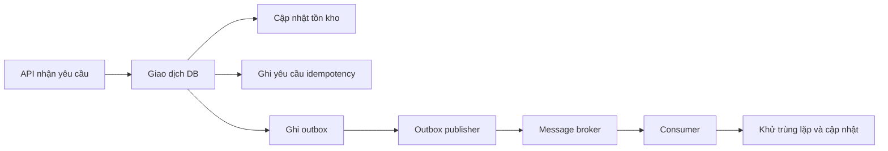

# Thực hiện lặp an toàn và kiểm soát tác dụng phụ

Trong hệ thống thực tế, một yêu cầu có thể thất bại vì mạng bị ngắt, máy chủ quá tải hoặc kết nối đến cơ sở dữ liệu hết thời gian chờ. Thử lại (*retry*) thường giúp hệ thống phục hồi sau lỗi tạm thời, nhưng chính thao tác thử lại cũng có thể gây lỗi nghiêm trọng: trừ tiền hai lần, giữ hàng hai lần, gửi hai email xác nhận hoặc tạo hai đơn hàng từ cùng một ý định của người dùng.

Trong chương **Độ tin cậy** của **CODE_QUALITY_FUNDAMENTALS**, việc thực hiện lặp an toàn và kiểm soát tác dụng phụ trả lời câu hỏi: **Khi cùng một yêu cầu được thực thi nhiều lần, hệ thống có tiếp tục duy trì kết quả nghiệp vụ đúng và trạng thái nhất quán không?** Đây là một khía cạnh của mục tiêu học phần: hiểu những thuộc tính khiến mã nguồn đáng tin cậy, dễ hiểu và dễ thay đổi.

## Mục tiêu học tập

Sau bài này, bạn có thể:

1. Phân biệt **retry**, **idempotency** và **tác dụng phụ** (*side effect*).
2. Giải thích vì sao timeout không cho biết chắc yêu cầu trước đó đã được thực hiện hay chưa.
3. Xác định những thao tác có thể lặp an toàn, những thao tác cần khóa idempotency và những lỗi không nên tự động thử lại.
4. Thiết kế điểm kiểm soát tác dụng phụ bằng giao dịch, ràng buộc duy nhất, *transactional outbox* và xử lý sự kiện trùng lặp.
5. Viết chiến lược retry có giới hạn, *backoff*, *jitter* và bộ kiểm thử tập trung vào kết quả nghiệp vụ.

## 1. Vấn đề cốt lõi: một ý định, nhiều lần thực thi

Giả sử người dùng bấm **Đặt hàng** đúng một lần. Máy khách gửi yêu cầu đến dịch vụ, dịch vụ đã ghi đơn hàng thành công, nhưng phản hồi bị mất trên đường truyền:

```text
Khách hàng                 Dịch vụ đặt hàng               Cơ sở dữ liệu
    | POST đặt hàng               |                             |
    |---------------------------->|                             |
    |                             | INSERT đơn hàng             |
    |                             |---------------------------->|
    |                             |<----------------------------|
    |                             | COMMIT thành công           |
    |        X phản hồi bị mất     |                             |
    |                             |                             |
    | POST đặt hàng lần nữa       |                             |
    |---------------------------->|    Có tạo thêm đơn không?   |
```

Đối với máy khách, timeout chỉ nói rằng **chưa nhận được câu trả lời trong thời gian cho phép**. Nó **không chứng minh** thao tác phía máy chủ đã thất bại. Nếu máy khách tạo một yêu cầu mới mỗi lần thử lại, cùng một ý định có thể tạo nhiều đơn hàng.

Có ba kết quả có thể xảy ra trước khi máy khách nhận timeout:

| Tình huống thực tế | Máy khách nhìn thấy | Rủi ro khi thử lại |
| --- | --- | --- |
| Yêu cầu chưa tới máy chủ. | Timeout. | Cần gửi lại để hoàn thành. |
| Máy chủ nhận yêu cầu nhưng giao dịch chưa commit hoặc đã rollback. | Timeout. | Gửi lại thường cần thiết; trạng thái chưa chắc rõ từ phía khách. |
| Máy chủ đã commit nhưng phản hồi bị mất. | Timeout. | Gửi lại không an toàn có thể tạo thêm tác dụng phụ. |

Một chiến lược đáng tin cậy phải xử lý được cả ba tình huống **với cùng một hợp đồng**.

## 2. Phân biệt tính lặp an toàn và tác dụng phụ

### 2.1. Tác dụng phụ là gì?

Một hàm có **tác dụng phụ** khi thực thi của nó thay đổi trạng thái có thể quan sát bên ngoài kết quả trả về, chẳng hạn:

- Ghi cơ sở dữ liệu, thay đổi số dư hoặc số lượng hàng.
- Gửi email, thông báo, tin nhắn hoặc yêu cầu đến dịch vụ bên ngoài.
- Ghi tệp, phát sự kiện, gửi lệnh thanh toán.
- Thay đổi trạng thái bộ nhớ dùng chung hoặc một bộ đếm.

Hàm thuần (*pure function*) chỉ tính giá trị dựa trên đầu vào, không tạo tác dụng phụ có thể quan sát:

```java
static long remainingStock(long available, long quantity) {
    if (available < 0 || quantity <= 0 || quantity > available) {
        throw new IllegalArgumentException("Invalid stock reservation");
    }
    return available - quantity;
}
```

Gọi nhiều lần `remainingStock(10, 2)` đều cho kết quả `8`, vì hàm không tự thay đổi tồn kho. Ngược lại, nếu mỗi lần gọi `reserveStock("SKU-42", 2)` đều ghi giảm tồn kho đi 2 đơn vị, thì gọi hai lần có thể trừ tổng cộng 4 đơn vị.

Lưu ý: **hàm thuần không đương nhiên là hàm idempotent theo định nghĩa toán học**. Ví dụ `f(x) = x - 2` thuần nhưng `f(f(10)) = 6` khác `f(10) = 8`. Hai khái niệm trả lời hai câu hỏi khác nhau: *hàm có tác dụng phụ hay không?* và *áp dụng thao tác lặp có giữ cùng kết quả/trạng thái theo hợp đồng hay không?*

### 2.2. Idempotency là gì?

Một thao tác được gọi là **idempotent** khi thực hiện lại thao tác đó với cùng ngữ nghĩa yêu cầu không làm thay đổi thêm **kết quả/trạng thái nghiệp vụ mà hợp đồng quan tâm**, so với thực hiện một lần.

Theo cách nhìn toán học về phép biến đổi trạng thái `f`, điều kiện là:

```text
f(f(state)) = f(state)
```

Ví dụ:

| Thao tác | Có idempotent theo ngữ nghĩa nêu ra? | Lý do |
| --- | --- | --- |
| Đặt trạng thái đơn hàng thành `CANCELLED`. | Có thể có. | Đặt lại cùng trạng thái không làm đổi thêm trạng thái đích, nếu tác dụng phụ đi kèm được kiểm soát. |
| Gán tồn kho bằng một giá trị cụ thể `setStock(8)`. | Có thể có. | Gán lặp cùng giá trị không làm thay đổi tiếp tồn kho, nếu không có các cập nhật xen giữa và hợp đồng cho phép ghi đè. |
| Giảm tồn kho bằng `decreaseStock(2)`. | Không. | Mỗi lần thực thi tiếp tục trừ 2. |
| Gửi email xác nhận. | Không mặc nhiên. | Gọi lại có thể tạo một email thứ hai. |
| Tạo đơn hàng mới. | Không mặc nhiên. | Mỗi lần có thể tạo đơn hàng khác. |
| Tạo đơn hàng với **khóa idempotency** và cơ chế khử trùng lặp. | Có thể đạt tính lặp an toàn. | Các yêu cầu cùng khóa và cùng nội dung được quy về một kết quả nghiệp vụ. |

**Idempotency không có nghĩa là mọi thứ đều y hệt qua các lần gọi.** Mã HTTP, thời gian phản hồi hoặc log kỹ thuật có thể khác nhau. Điều cần bảo đảm là **những tác dụng phụ nghiệp vụ được nêu trong hợp đồng** chỉ xảy ra theo ngữ nghĩa đã định. Nếu hợp đồng yêu cầu trả lại đúng kết quả gốc, máy chủ cần lưu hoặc tái tạo kết quả đó một cách nhất quán.

### 2.3. Các phương thức HTTP không thay thế thiết kế nghiệp vụ

Theo ngữ nghĩa HTTP, các phương thức như `GET`, `PUT` và `DELETE` được định nghĩa có tính idempotent đối với **tác động dự định lên tài nguyên**; `POST` không được bảo đảm như vậy. Tuy nhiên:

- `GET` nên an toàn đối với trạng thái nghiệp vụ; dùng `GET` để trừ tiền là sai ngữ nghĩa.
- `PUT /profiles/123` đặt tài nguyên về biểu diễn mong muốn có thể lặp an toàn, nhưng yêu cầu đồng thời vẫn có thể cần `ETag` và `If-Match` để tránh ghi đè bản cập nhật mới.
- `DELETE` lặp lại có thể trả mã khác (ví dụ lần đầu thành công, lần sau không tìm thấy); điều đó không tự làm mất tính idempotent của tác động dự định.
- `POST /orders` có thể **được thiết kế lặp an toàn** bằng khóa idempotency, dù bản thân phương thức `POST` không mặc nhiên bảo đảm điều này.

Tên phương thức, retry ở thư viện HTTP hoặc nút bấm bị vô hiệu hóa trên giao diện đều **không thay thế** ràng buộc bảo vệ tác dụng phụ trong hệ thống.

## 3. Khóa idempotency: nhận diện một ý định nghiệp vụ

**Idempotency key** là một định danh ổn định mà máy khách gửi cùng một **ý định nghiệp vụ** qua tất cả lần thử lại. Ví dụ:

```http
POST /stock-reservations HTTP/1.1
Content-Type: application/json
Idempotency-Key: 5d6a6308-0f3a-45cf-a605-c87093065234

{"sku":"SKU-42","quantity":2}
```

Nếu không nhận phản hồi, máy khách gửi **đúng khóa trên** với **cùng payload**. Khi người dùng chủ động tạo một yêu cầu giữ hàng mới, máy khách phải sinh khóa mới.

Hợp đồng máy chủ có thể quy định:

1. **Khóa chưa tồn tại:** kiểm tra đầu vào, thực hiện yêu cầu và lưu kết quả gắn với khóa.
2. **Khóa đã tồn tại, payload trùng khớp, đã hoàn tất:** trả lại kết quả nghiệp vụ đã ghi nhận, không lặp tác dụng phụ.
3. **Khóa đã tồn tại, payload khác:** từ chối, ví dụ `409 Conflict`, để không dùng một định danh cho hai ý định khác nhau.
4. **Khóa đang được xử lý:** chờ kết quả trong giới hạn hợp lý hoặc thông báo đang xử lý (ví dụ `202 Accepted` cùng điểm tra cứu trạng thái), theo hợp đồng API.
5. **Yêu cầu trước bị rollback hoàn toàn:** cho phép một lần thử thực hiện lại theo hợp đồng xử lý lỗi và trạng thái khóa.

Trạng thái, mã HTTP và thời hạn giữ khóa là **quyết định thiết kế API**, không có một quy tắc mặc định phù hợp cho mọi nghiệp vụ.

### Phạm vi và vòng đời của khóa

Khóa phải được xét trong đúng **phạm vi sở hữu**, chẳng hạn cặp `(tenantId, idempotencyKey)`, để hai khách hàng độc lập có thể dùng cùng một chuỗi khóa mà không ảnh hưởng nhau. Cần chuẩn hóa hoặc tạo dấu vân tay (*fingerprint*) cho những trường quyết định ý nghĩa thao tác, ví dụ `sku` và `quantity`. Việc băm một JSON thô có thứ tự khóa khác nhau có thể dẫn đến khác biệt không cần thiết; nên xác định rõ cách biểu diễn chuẩn trước khi băm.

Khóa không phải bằng chứng xác thực và không thay thế phân quyền. Thời gian lưu khóa cũng phải **dài hơn cửa sổ retry có thể xảy ra**, kể cả retry trễ từ hàng đợi hay máy khách ngoại tuyến. Nếu xóa khóa quá sớm, yêu cầu cũ tới muộn có thể bị coi là yêu cầu mới và gây tác dụng phụ lần hai.

## 4. Kiểm soát tác dụng phụ tại ranh giới cơ sở dữ liệu

Xét yêu cầu **giữ 2 sản phẩm SKU-42**. Hợp đồng minh họa:

- `quantity > 0`; sản phẩm phải tồn tại và đủ tồn kho.
- Một ý định giữ hàng, được nhận diện bởi `tenantId + idempotencyKey`, chỉ tạo **một lượt giữ hàng**.
- Tồn kho không âm sau mỗi giao dịch đã commit.
- Cùng khóa nhưng khác SKU hoặc số lượng phải bị từ chối.
- Khi giữ hàng được ghi nhận thành công, hệ thống phát sinh **một sự kiện nghiệp vụ có định danh** để xử lý tiếp; quá trình vận chuyển sự kiện có thể phát lại.

### 4.1. Giao dịch nguyên tử và ràng buộc duy nhất

Một thiết kế quan hệ có thể dùng:

```sql
-- Cú pháp mang tính minh họa theo PostgreSQL.
CREATE TABLE reservation_requests (
    tenant_id BIGINT NOT NULL,
    idempotency_key VARCHAR(120) NOT NULL,
    payload_hash CHAR(64) NOT NULL,
    response_body JSONB,
    PRIMARY KEY (tenant_id, idempotency_key)
);

CREATE TABLE inventory (
    sku VARCHAR(100) PRIMARY KEY,
    available BIGINT NOT NULL CHECK (available >= 0)
);

CREATE TABLE reservations (
    reservation_id UUID PRIMARY KEY,
    tenant_id BIGINT NOT NULL,
    sku VARCHAR(100) NOT NULL,
    quantity BIGINT NOT NULL CHECK (quantity > 0)
);

CREATE TABLE outbox (
    event_id UUID PRIMARY KEY,
    event_type VARCHAR(100) NOT NULL,
    payload JSONB NOT NULL,
    published_at TIMESTAMPTZ
);
```

Trong **một transaction**, dịch vụ thực hiện:

1. Thử chèn `(tenant_id, idempotency_key, payload_hash)`. Ràng buộc `PRIMARY KEY` quyết định ai được nhận khóa; nếu có xung đột, đọc bản ghi hiện có, kiểm tra `payload_hash`, rồi xử lý như yêu cầu lặp.
2. Nếu nhận khóa mới, **cập nhật tồn kho có điều kiện** và kiểm tra số dòng bị ảnh hưởng:

```sql
UPDATE inventory
SET available = available - :quantity
WHERE sku = :sku
  AND available >= :quantity;
```

3. Nếu cập nhật thành công đúng một dòng, tạo `reservations`, tạo bản ghi `outbox` cho sự kiện `StockReserved`, và lưu `response_body` chứa mã giữ hàng.
4. `COMMIT` tất cả thay đổi. Nếu lỗi trước commit, rollback cả bản ghi khóa, tồn kho, lượt giữ hàng và outbox.

Với PostgreSQL, một cách nhận khóa thường gặp là:

```sql
INSERT INTO reservation_requests
    (tenant_id, idempotency_key, payload_hash)
VALUES (:tenant_id, :key, :hash)
ON CONFLICT (tenant_id, idempotency_key) DO NOTHING;
```

Ứng dụng phải kiểm tra **số dòng được chèn**. Khi số dòng bằng 0, không thực hiện giữ hàng lần nữa; thay vào đó truy vấn bản ghi tương ứng và đối chiếu payload. Nếu có yêu cầu đồng thời cùng khóa, ràng buộc duy nhất của cơ sở dữ liệu mới là cơ chế phân xử, không phải câu lệnh `SELECT` kiểm tra trước ở ứng dụng. Cần chọn mức cô lập, xử lý lỗi khóa và các lần thử lại giao dịch phù hợp với hệ quản trị sử dụng.

Nếu không đủ tồn kho hoặc SKU không tồn tại, hệ thống phải xác định rõ **có lưu kết quả từ chối hay không**. Lưu một kết quả thất bại nghiệp vụ có thể giúp cùng khóa luôn nhận cùng phản hồi. Ngược lại, rollback và cho phép thử lại sau khi nhập thêm hàng tạo ra hợp đồng khác. Hai cách đều có thể hợp lý, nhưng phải thống nhất với yêu cầu và được kiểm thử.

### 4.2. Vì sao không được gọi dịch vụ ngoài tùy tiện trong transaction?

Giả sử dịch vụ gọi API gửi email **trước khi commit**. Email đã gửi thành công, nhưng lệnh ghi dữ liệu cuối cùng lỗi và transaction rollback. Khi yêu cầu được thử lại, email có thể được gửi lần nữa dù bản ghi trước chưa tồn tại.

Chiều ngược lại cũng nguy hiểm: cơ sở dữ liệu commit xong nhưng tiến trình chết **trước khi** gọi dịch vụ phát sự kiện. Khi đó trạng thái nghiệp vụ đã đổi nhưng không có thông báo cho hệ thống kế tiếp.

Một transaction SQL thông thường **không tự rollback được email, HTTP request hay sự kiện đã phát ra ngoài**. Các hiệu ứng này phải có cơ chế riêng để hòa giải khi thành công, lỗi và thử lại.

## 5. Transactional outbox và người tiêu thụ sự kiện

**Transactional outbox** lưu sự kiện dự định phát vào cùng cơ sở dữ liệu và cùng transaction với thay đổi nghiệp vụ. Một tiến trình khác đọc bản ghi outbox và gửi thông điệp ra broker.



Nếu transaction rollback, sự kiện outbox cũng không tồn tại. Nếu commit thành công, publisher có thể đọc và gửi sự kiện sau đó, kể cả khi tiến trình API chết ngay sau commit.

**Outbox không tự bảo đảm giao hàng đúng một lần.** Publisher có thể gửi sự kiện thành công rồi chết trước khi đánh dấu `published_at`. Khi chạy lại, nó gửi cùng sự kiện thêm lần nữa. Vì vậy:

- Mỗi sự kiện cần `event_id` ổn định.
- Consumer cần xử lý trùng lặp bằng `event_id` hoặc khóa nghiệp vụ thích hợp.
- Tác dụng phụ nội bộ của consumer và việc đánh dấu `event_id` đã xử lý nên được commit **trong cùng transaction** khi cùng sử dụng một cơ sở dữ liệu.
- Nếu consumer phải gọi dịch vụ bên ngoài, cần cơ chế idempotency hoặc điều phối và đối soát với dịch vụ đó; ghi `event_id` ở DB nội bộ không thể tự biến lời gọi ngoài thành nguyên tử.

### Ví dụ inbox khử trùng lặp

```sql
CREATE TABLE processed_events (
    consumer_name VARCHAR(100) NOT NULL,
    event_id UUID NOT NULL,
    PRIMARY KEY (consumer_name, event_id)
);
```

Khi nhận sự kiện `StockReserved`, consumer thực hiện trong transaction:

1. Thử ghi `(consumer_name, event_id)` vào `processed_events`.
2. Nếu bản ghi đã tồn tại, bỏ qua **tác động nghiệp vụ** của sự kiện trùng lặp và xác nhận thông điệp theo giao thức broker.
3. Nếu ghi thành công, thực hiện cập nhật nghiệp vụ và commit **cùng bản ghi đánh dấu sự kiện**.
4. Chỉ xác nhận thông điệp sau khi transaction hoàn tất theo chính sách của broker/consumer.

Nếu transaction rollback, dấu vết đã xử lý cũng rollback, nên lần nhận tiếp theo vẫn có thể thực hiện lại. Nếu commit thành công nhưng xác nhận thông điệp bị mất, broker có thể phát lại, song consumer sẽ nhận ra `event_id` cũ.

Giải pháp này hướng tới **một tác dụng nghiệp vụ được ghi nhận hiệu quả đúng một lần**, trong khi việc truyền thông điệp vẫn có thể theo mô hình *at-least-once*. Không nên tuyên bố “exactly once end-to-end” nếu không có bảo đảm cụ thể cho toàn bộ ranh giới, nhất là khi liên quan hệ thống bên ngoài.

## 6. Chính sách retry: khi nào, bao nhiêu lần và với độ trễ nào?

Retry phải bắt đầu từ phân loại lỗi. Không phải lỗi nào cũng là lỗi tạm thời:

| Tình huống | Hướng xử lý thông thường | Lý do |
| --- | --- | --- |
| Mất kết nối, timeout, lỗi mạng tạm thời. | Có thể thử lại **nếu thao tác có cơ chế lặp an toàn**. | Kết quả xử lý trước đó có thể không rõ. |
| HTTP `429` hoặc `503`. | Cân nhắc retry có giới hạn và tôn trọng `Retry-After` khi có. | Hệ thống đang giới hạn hoặc thiếu khả năng phục vụ. |
| HTTP `400` do dữ liệu sai. | Không retry nguyên payload. | Gửi lại vẫn vi phạm yêu cầu. |
| HTTP `401` / `403`. | Sửa thông tin xác thực hoặc quyền trước. | Retry không giải quyết nguyên nhân. |
| HTTP `409` do cùng khóa, khác payload. | Sửa lỗi sử dụng khóa; không tự động thử lại cùng payload sai. | Đây là xung đột ý định, không phải lỗi mạng. |
| Deadlock/giao dịch bị hủy do tranh chấp. | Có thể retry **toàn bộ transaction** trong giới hạn. | Kết quả chưa commit, nhưng phải xét ngữ nghĩa và tính an toàn. |
| Thao tác đã commit nhưng phản hồi bị mất. | Gửi lại với cùng khóa idempotency hoặc truy vấn trạng thái. | Mục tiêu là lấy lại kết quả, không tạo hiệu ứng mới. |

Các mã HTTP là hướng dẫn tổng quát; quy tắc chính xác phải dựa vào **hợp đồng của API đang gọi**. Đặc biệt, không nên coi mọi lỗi `5xx` là bằng chứng “chưa làm gì”.

### Backoff, jitter, số lần thử và deadline

Nếu hàng nghìn máy khách cùng retry ngay lập tức, chúng có thể làm dịch vụ đang quá tải nặng hơn. Một chính sách phổ biến dùng **exponential backoff** và **jitter**:

```text
attempt 1: gửi yêu cầu
attempt 2: chờ một khoảng ngẫu nhiên trong [0, 200 ms]
attempt 3: chờ một khoảng ngẫu nhiên trong [0, 400 ms]
attempt 4: chờ một khoảng ngẫu nhiên trong [0, 800 ms]
...
```

Các con số chỉ để minh họa; giá trị thực tế cần phù hợp độ trễ mạng, tải hệ thống, quy định `Retry-After`, ngân sách độ trễ và giới hạn tổng số lần thử. Cần phân biệt **timeout mỗi lần gọi** với **deadline tổng**; nếu mỗi lần gọi có timeout dài và số lần thử quá nhiều, một yêu cầu đã hết giá trị vẫn có thể tiếp tục gây tải.

### Ví dụ Java: retry có giới hạn

Đây là một tiện ích đơn giản chỉ minh họa *retry policy*, không tự cung cấp idempotency cho thao tác được gọi:

```java
import java.io.IOException;
import java.time.Duration;
import java.util.concurrent.Callable;
import java.util.concurrent.ThreadLocalRandom;
import java.util.function.Predicate;

public final class RetryPolicy {
    private RetryPolicy() {}

    public static <T> T execute(
            Callable<T> operation,
            Predicate<Exception> retryable,
            int maxAttempts,
            Duration initialBackoff) throws Exception {

        if (operation == null || retryable == null || initialBackoff == null) {
            throw new IllegalArgumentException("Arguments must not be null");
        }
        long baseMillis = initialBackoff.toMillis();
        if (maxAttempts < 1 || baseMillis < 1 || baseMillis > 2_000) {
            throw new IllegalArgumentException("Invalid retry settings");
        }

        for (int attempt = 1; ; attempt++) {
            try {
                return operation.call();
            } catch (Exception error) {
                if (attempt >= maxAttempts || !retryable.test(error)) {
                    throw error;
                }
                long boundMillis = Math.min(
                        2_000L,
                        baseMillis * (1L << Math.min(attempt - 1, 10)));
                long delayMillis = ThreadLocalRandom.current()
                        .nextLong(boundMillis + 1);
                Thread.sleep(delayMillis);
            }
        }
    }
}
```

Tiện ích này thử tối đa `maxAttempts`, chỉ lặp khi bộ phân loại lỗi cho phép, đồng thời giới hạn thời gian chờ mỗi lần. Nó **chưa có deadline tổng** và không cấu hình timeout của thao tác `operation`; ứng dụng thực tế cần bổ sung ở lớp gọi dịch vụ. Trường hợp luồng bị ngắt khi `Thread.sleep`, ngoại lệ được chuyển cho phía gọi xử lý thay vì tiếp tục retry.

Trong đoạn gọi dưới đây, `stockApi` được hiểu là một client có phương thức `reserve(request)`, và máy chủ phải thực thi hợp đồng idempotency đã mô tả:

```java
// Sinh khóa một lần cho một ý định giữ hàng.
String key = java.util.UUID.randomUUID().toString();
ReserveRequest request = new ReserveRequest(key, "SKU-42", 2);

// Mọi lần thử đều dùng cùng request và cùng key.
ReserveResult result = RetryPolicy.execute(
        () -> stockApi.reserve(request),
        error -> error instanceof IOException,
        4,
        Duration.ofMillis(200));
```

`ReserveRequest`, `ReserveResult` và `stockApi` là các thành phần API minh họa; đoạn gọi cho thấy cách sử dụng chính sách, không phải một chương trình hoàn chỉnh. Với lỗi HTTP được ánh xạ thành ngoại lệ riêng, phải phân loại chính xác mã lỗi và chính sách của API; chỉ retry `IOException` là một lựa chọn đơn giản để học.

Điểm quyết định là **khóa và payload được tạo trước vòng retry**. Nếu mỗi lần thử lại gọi `UUID.randomUUID()`, phía máy chủ sẽ nhìn thấy nhiều ý định khác nhau.

## 7. Phân chia rõ bước tính toán và bước tạo tác dụng phụ

Một cách giúp mã dễ hiểu, dễ kiểm chứng là tách:

1. **Kiểm tra và tính toán:** dữ liệu nào hợp lệ, số lượng cần giữ, chuyển trạng thái mong muốn.
2. **Quyết định nghiệp vụ:** thao tác có được phép với trạng thái hiện tại hay không.
3. **Ghi thay đổi nguyên tử:** áp dụng thay đổi qua transaction hoặc cơ chế đồng bộ phù hợp.
4. **Ghi nhận tác dụng phụ sẽ thực hiện:** outbox, job hoặc bản ghi lệnh có định danh.
5. **Thực hiện tác dụng phụ bên ngoài:** xử lý retry, khử trùng lặp và đối soát riêng.

Ví dụ, hàm kiểm tra số lượng:

```java
static long stockAfterReservation(long available, long requested) {
    if (available < 0 || requested <= 0 || requested > available) {
        throw new IllegalArgumentException("Invalid stock");
    }
    return available - requested;
}
```

Hàm này giúp kiểm thử quy tắc miền nhưng **không đủ** để bảo đảm tồn kho không âm khi hai yêu cầu chạy đồng thời. Hai luồng có thể cùng đọc `available = 3`, cùng tính `3 - 2 = 1` và cùng chấp nhận. Ràng buộc `UPDATE ... WHERE available >= :quantity` trong transaction bảo vệ bất biến tại nơi cập nhật trạng thái thật.

Việc đặt tên thao tác cũng giúp phát hiện tác dụng phụ: `calculateTotal()` nên tập trung tính toán; `chargePayment()`, `publishEvent()` hoặc `reserveStock()` nói rõ đó là thao tác làm thay đổi hệ thống. Nếu một hàm tưởng như chỉ đọc lại gửi email hoặc trừ điểm, người gọi rất dễ retry sai.

## 8. Kiểm thử: chứng minh một ý định không bị áp dụng hai lần

Không chỉ kiểm tra kết quả trả về: hãy kiểm tra **số tác dụng phụ nghiệp vụ thực sự được ghi nhận**. Với hệ thống giữ hàng, các trường hợp quan trọng gồm:

| Kịch bản | Kỳ vọng |
| --- | --- |
| Khóa mới, hàng đủ. | Ghi một lượt giữ hàng, giảm tồn kho một lần, ghi một sự kiện outbox. |
| Gửi lại cùng khóa và cùng payload sau commit. | Trả kết quả trước đó; không giảm thêm tồn kho, không tạo lượt giữ hàng/sự kiện mới. |
| Gửi lại cùng khóa nhưng khác số lượng. | Trả lỗi xung đột; không ghi tác dụng phụ mới. |
| Hai yêu cầu cùng khóa chạy đồng thời. | Ràng buộc duy nhất phân xử; kết quả nghiệp vụ chỉ được áp dụng một lần. |
| Lỗi ngay trước commit. | Transaction rollback đầy đủ; retry có thể thực hiện lại theo hợp đồng. |
| Phản hồi mất ngay sau commit. | Retry lấy lại kết quả đã commit; không tạo bản ghi thứ hai. |
| Publisher gửi xong rồi chết trước khi đánh dấu đã gửi. | Sự kiện có thể phát lại; consumer không cập nhật nghiệp vụ thêm lần nữa. |
| Hai khóa khác nhau cùng giữ số hàng cuối cùng. | Không vượt quá tồn kho nhờ cập nhật có điều kiện và giao dịch. |
| Thông điệp tới muộn sau khi khóa hết hạn lưu. | Chính sách lưu khóa/đối soát bảo vệ cửa sổ retry đã cam kết. |

### Kiểm thử đơn vị cho retry policy

JUnit 5 có thể kiểm tra số lần thử và phân loại lỗi mà không cần kết nối mạng:

```java
import static org.junit.jupiter.api.Assertions.*;

import java.io.IOException;
import java.time.Duration;
import java.util.concurrent.atomic.AtomicInteger;
import org.junit.jupiter.api.Test;

class RetryPolicyTest {

    @Test
    void retriesTransientFailureWithinLimit() throws Exception {
        AtomicInteger attempts = new AtomicInteger();

        String result = RetryPolicy.execute(
                () -> {
                    if (attempts.incrementAndGet() < 3) {
                        throw new IOException("Temporary connection failure");
                    }
                    return "OK";
                },
                e -> e instanceof IOException,
                3,
                Duration.ofMillis(1));

        assertEquals("OK", result);
        assertEquals(3, attempts.get());
    }

    @Test
    void doesNotRetryPermanentFailure() {
        AtomicInteger attempts = new AtomicInteger();

        assertThrows(IllegalArgumentException.class,
                () -> RetryPolicy.execute(
                        () -> {
                            attempts.incrementAndGet();
                            throw new IllegalArgumentException("Bad input");
                        },
                        e -> e instanceof IOException,
                        4,
                        Duration.ofMillis(1)));

        assertEquals(1, attempts.get());
    }
}
```

Hai kiểm thử này chỉ chứng minh **tiện ích retry** áp dụng số lần và bộ phân loại lỗi như mong muốn; chúng **không chứng minh** dịch vụ giữ hàng idempotent. Với tính lặp an toàn của tác dụng phụ, cần kiểm thử tích hợp với cơ sở dữ liệu thật hoặc môi trường đủ sát thực tế, bao gồm cả **lỗi giữa commit và phản hồi**, **truy cập đồng thời**, và **gửi sự kiện trùng**.

### Quan sát khi vận hành

Các tín hiệu thường hữu ích là tỷ lệ retry theo loại lỗi, số yêu cầu trùng khóa, số xung đột payload, độ trễ xử lý, hàng đợi outbox tồn đọng, số lần giao lại sự kiện và số sai lệch khi đối soát trạng thái nghiệp vụ.

Đừng dùng số lần log hoặc số lần gửi HTTP như thước đo “số thao tác đã xảy ra”: retry được thiết kế để có thể phát sinh nhiều lần gửi. Chỉ số chính nên bám theo **định danh nghiệp vụ** và trạng thái đã commit. Log cần mang `requestId`, `idempotencyKey` hay `eventId` ở mức phù hợp, đồng thời tránh ghi dữ liệu nhạy cảm.

## 9. Những sai lầm thường gặp

**“Timeout nghĩa là máy chủ chưa xử lý.”** Timeout chỉ nói máy khách không nhận kết quả đúng hạn; server có thể đã commit. Giải pháp là truy vấn trạng thái hoặc gửi lại với cùng định danh và cơ chế khử trùng lặp.

**“Retry ba lần thì xác suất thành công cao hơn mà không có rủi ro.”** Với thao tác tăng bộ đếm, thanh toán hoặc gửi tin nhắn, retry thiếu idempotency có thể nhân tác dụng phụ lên ba lần.

**“Chỉ cần kiểm tra khóa tồn tại bằng SELECT trước khi INSERT.”** Hai yêu cầu song song có thể cùng thấy khóa chưa tồn tại rồi cùng xử lý. Cần ràng buộc duy nhất và thao tác nguyên tử phù hợp.

**“Đã ghi outbox thì broker sẽ gửi đúng một lần.”** Publisher có thể gửi lặp sau khi mất xác nhận; consumer phải xử lý trùng lặp và tác dụng phụ đằng sau.

**“Đã lưu eventId là đủ để chống trùng.”** Nếu dấu `processed_events` được commit riêng, sự cố ở giữa có thể để lại trạng thái ghi dấu mà tác dụng phụ chưa hoàn tất, hoặc ngược lại. Các thay đổi thuộc cùng cơ sở dữ liệu cần được commit trong một giao dịch.

**“Mọi lỗi 5xx đều nên retry ngay.”** Có lỗi kéo dài và lỗi đã làm xong nghiệp vụ nhưng thất bại ở bước phản hồi. Cần phân loại lỗi, giới hạn retry, backoff và bảo đảm lặp an toàn.

**“Dùng cùng khóa với payload mới cũng được.”** Một khóa biểu diễn một ý định; đổi số lượng hoặc người thụ hưởng dưới cùng khóa phải được phát hiện để tránh trả một kết quả không tương ứng.

**“Lưu khóa mãi mãi hoặc xóa ngay đều ổn.”** Lưu khóa có chi phí và yêu cầu bảo vệ dữ liệu; xóa quá sớm có thể tái thực hiện tác dụng phụ. Chọn thời hạn theo hợp đồng nghiệp vụ, cửa sổ retry và quy tắc lưu trữ.

## 10. Quy trình thiết kế một thao tác có thể retry

1. **Xác định ý định nghiệp vụ.** Một lần bấm nút, một lần đặt hàng hay một lần xử lý sự kiện được nhận diện bằng gì?
2. **Liệt kê tất cả tác dụng phụ.** Những gì thay đổi trong cơ sở dữ liệu, hệ thống ngoài, email, broker và tệp? Điều gì có thể xảy ra nhiều lần?
3. **Làm rõ hợp đồng lặp.** Lần gửi lại cùng ý định cần trả kết quả nào? Khóa tồn tại bao lâu? Cùng khóa khác payload bị xử lý ra sao?
4. **Đặt cơ chế bảo vệ tại nơi ghi trạng thái.** Dùng unique constraint, transaction, cập nhật có điều kiện, phiên bản dữ liệu hoặc khóa phù hợp; tránh chỉ kiểm tra ở frontend.
5. **Tách tác dụng phụ bên ngoài khỏi transaction nội bộ.** Cân nhắc outbox/inbox, idempotency của nhà cung cấp hoặc quy trình đối soát khi không thể dùng chung transaction.
6. **Đặt chính sách retry có giới hạn.** Chỉ retry lỗi phù hợp; dùng backoff, jitter, giới hạn số lần, timeout mỗi lần và deadline tổng.
7. **Kiểm thử đúng các thời điểm lỗi.** Trước commit, sau commit nhưng mất phản hồi, xử lý đồng thời, giao trùng sự kiện, retry đến muộn.
8. **Theo dõi và đối soát ở vận hành.** Đo số lần retry, duplicate, dead letter, giao dịch treo và hiệu ứng nghiệp vụ; xử lý được các trạng thái không chắc chắn.

## 11. Câu hỏi tự kiểm tra

**Câu 1.** Một API trừ 100.000 đồng khỏi số dư, đã commit nhưng phản hồi timeout. Máy khách gửi lại nguyên POST không có khóa idempotency. Lỗi gì có thể xảy ra?

*Gợi ý:* Có thể trừ tiền lần hai. Timeout không nói được lần đầu có commit chưa. Cần định danh một ý định chuyển tiền, cơ chế idempotency ở máy chủ và khả năng tra cứu/đối soát trạng thái.

**Câu 2.** Vì sao một hàm `return amount * 2` có thể thuần nhưng không idempotent theo nghĩa toán học?

*Gợi ý:* Hàm không có tác dụng phụ, nhưng `f(f(3)) = 12` khác `f(3) = 6`. Tính thuần và idempotency là hai thuộc tính khác nhau.

**Câu 3.** Hai yêu cầu cùng khóa idempotency được xử lý đồng thời. Vì sao lệnh `SELECT` kiểm tra khóa trước khi ghi chưa đủ?

*Gợi ý:* Cả hai có thể đọc thấy chưa có khóa. Ràng buộc duy nhất và transaction mới phân xử được quyền xử lý đúng một lần trên trạng thái chung.

**Câu 4.** Publisher đã đưa thông điệp ra broker nhưng chưa đánh dấu outbox đã gửi thì bị dừng. Khi chạy lại, hệ thống nên xử lý thế nào?

*Gợi ý:* Chấp nhận khả năng gửi trùng cùng `eventId`; consumer cần khử trùng lặp hiệu ứng bằng định danh ổn định và transaction phù hợp.

**Câu 5.** Một thao tác chỉ đọc giá nhưng tự động gửi email marketing trong lúc chạy. Có nên retry nó như một phép đọc vô hại không?

*Gợi ý:* Không nên mặc định. Dù kết quả trả về là giá, email là tác dụng phụ; cần tách hoặc kiểm soát hành vi này trước khi thiết kế retry.

## Ghi nhớ

- **Retry** là cách gọi lại; **idempotency** là bảo đảm các lần gọi tương đương không làm phát sinh thêm hiệu ứng nghiệp vụ ngoài hợp đồng; **tác dụng phụ** là thay đổi có thể quan sát bên ngoài giá trị trả về.
- Sau timeout, kết quả ở máy chủ có thể **chưa thực hiện, đã rollback hoặc đã commit**. Một yêu cầu thử lại cần dùng định danh ổn định và được xử lý an toàn trong cả ba tình huống.
- Bảo vệ tác dụng phụ trong cơ sở dữ liệu bằng **ràng buộc duy nhất, giao dịch và cập nhật nguyên tử**; bảo vệ các bước phát sự kiện bằng **outbox**, và bảo vệ người nhận bằng **khử trùng lặp**.
- Retry cần **phân loại lỗi, backoff, jitter, giới hạn số lần và deadline**. Không có tiện ích retry chung nào tự khiến thao tác nghiệp vụ không idempotent trở nên an toàn.
- Kiểm thử và theo dõi phải chứng minh **một ý định nghiệp vụ chỉ dẫn đến số tác dụng phụ hợp lệ**, kể cả khi có lỗi mạng, trễ phản hồi, chạy đồng thời hoặc nhận trùng thông điệp.

**Câu hỏi cần đặt trước khi thêm retry:** “Nếu lời gọi trước đã thực hiện thành công nhưng tôi chưa nhận được phản hồi, lời gọi tiếp theo sẽ gây ra điều gì?” Câu trả lời quyết định hệ thống có thực sự đáng tin cậy khi gặp lỗi hay không.
