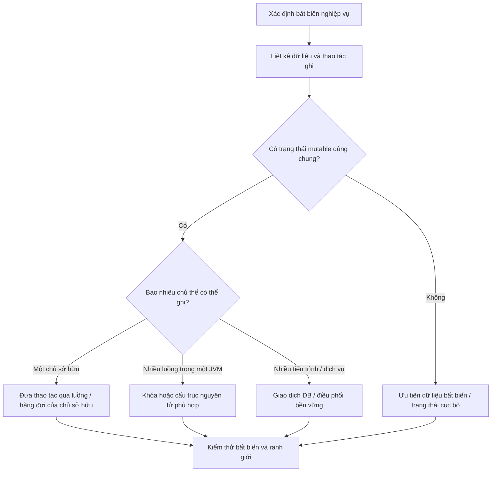

# Xử lý đồng thời theo bất biến và quyền sở hữu trạng thái

Trong module `CODE_QUALITY_FUNDAMENTALS`, chất lượng mã nguồn được đánh giá qua những thuộc tính quyết định phần mềm có **đáng tin cậy, dễ hiểu và dễ thay đổi** hay không. Ở chương **Độ tin cậy**, xử lý đồng thời là một thử thách quan trọng: chương trình có thể đúng khi chỉ một luồng thực thi, nhưng tạo kết quả sai khi nhiều yêu cầu truy cập và sửa cùng một trạng thái.

Thay vì bắt đầu bằng câu hỏi “nên dùng `synchronized`, `volatile` hay `AtomicInteger`?”, hãy bắt đầu từ hai câu hỏi nền tảng:

1. **Bất biến (invariant) nào luôn phải đúng?** Ví dụ: số sản phẩm còn trong kho không được âm; một đơn hàng không được thanh toán thành công hai lần; tổng tiền trước và sau chuyển khoản phải được bảo toàn.
2. **Ai sở hữu quyền thay đổi trạng thái?** Một đối tượng có khóa riêng, một luồng xử lý duy nhất, một giao dịch cơ sở dữ liệu hay một dịch vụ có quyền quyết định? Quyền này được thực thi bằng cơ chế nào?

Trả lời rõ hai câu hỏi sẽ giúp lựa chọn biện pháp đồng bộ phù hợp, giới hạn nơi cần suy luận về cạnh tranh và thiết kế kiểm thử có ý nghĩa.

Sau bài học, người học có thể phân biệt race condition, tính nguyên tử và tính hiển thị; xác định bất biến và phạm vi trạng thái dùng chung; áp dụng các chiến lược quyền sở hữu trạng thái trong Java; nhận biết giới hạn của khóa trong một tiến trình và giao dịch cơ sở dữ liệu; đồng thời đề xuất cách kiểm chứng, giám sát và xử lý lỗi đồng thời.

## 1. Độ tin cậy bị đe dọa như thế nào khi có xử lý đồng thời?

**Đồng thời (concurrency)** nghĩa là nhiều tác vụ có khoảng thời gian thực hiện chồng lấp và có thể xen kẽ các bước, ngay cả khi một CPU chỉ chạy một bước tại một thời điểm. **Song song (parallelism)** nghĩa là các bước thật sự chạy cùng lúc trên nhiều tài nguyên xử lý. Lỗi đồng thời có thể xảy ra trong cả hai trường hợp.

Ví dụ, kho chỉ còn một sản phẩm. Hai yêu cầu A và B cùng đặt mua:

| Thời điểm | Yêu cầu A | Yêu cầu B | Số lượng quan sát |
| --- | --- | --- | --- |
| 1 | Đọc số lượng còn là 1 | | 1 |
| 2 | | Đọc số lượng còn là 1 | 1 |
| 3 | Kiểm tra `1 >= 1`, cho phép đặt | | 1 |
| 4 | | Kiểm tra `1 >= 1`, cho phép đặt | 1 |
| 5 | Ghi số lượng mới là 0 | | 0 |
| 6 | | Ghi số lượng mới là 0 | 0 |

Kết thúc, hệ thống báo **hai đơn hàng thành công nhưng chỉ có một sản phẩm**. Giá trị lưu cuối cùng là 0 nên một phép kiểm tra đơn giản “kho không âm” vẫn có thể bỏ sót lỗi. Bất biến đầy đủ hơn phải liên hệ số lượng đã xác nhận và số lượng tồn: **không thể xác nhận nhiều đơn vị hàng hơn số lượng thực sự có thể cấp phát**.

Đây là lỗi **race condition**: kết quả nghiệp vụ phụ thuộc vào thứ tự xen kẽ của những thao tác trên trạng thái chia sẻ. Một trường hợp thường gặp là *check-then-act*: kiểm tra điều kiện rồi mới cập nhật, nhưng điều kiện có thể thay đổi ở giữa hai bước.

Các dạng lỗi dễ gặp khác:

- **Lost update:** hai tác vụ tính giá trị mới từ cùng giá trị cũ; lần ghi sau làm mất cập nhật của lần trước.
- **Đọc trạng thái không nhất quán:** một tác vụ đọc các trường của đối tượng vào những thời điểm khác nhau, nhận được tổ hợp chưa từng là trạng thái hợp lệ.
- **Vấn đề hiển thị (visibility):** luồng này cập nhật một giá trị, luồng khác không có bảo đảm quan sát cập nhật đúng lúc.
- **Deadlock:** hai tác vụ đợi các khóa do nhau giữ, không tác vụ nào tiếp tục được.
- **Starvation hoặc nghẽn:** một tác vụ bị trì hoãn quá lâu vì tranh chấp khóa, hàng đợi hoặc tác vụ khác.

Không phải mọi tình huống có nhiều luồng đều lỗi: dữ liệu **bất biến**, các biến cục bộ không chia sẻ và tác vụ chỉ đọc dữ liệu được công bố an toàn thường dễ suy luận hơn. Vấn đề xuất hiện khi nhiều tác vụ cùng truy cập **trạng thái có thể thay đổi**, đặc biệt khi có ít nhất một tác vụ ghi mà thiếu phối hợp thích hợp.

## 2. Thiết kế bắt đầu từ bất biến

**Bất biến** là điều kiện phải được duy trì ở những điểm quan sát được đã quy định trong hợp đồng hệ thống. Không nhất thiết mọi bước trung gian trong một vùng được khóa đều phải thỏa mọi điều kiện, miễn là trạng thái chưa hợp lệ không bị lộ cho bên ngoài và điều kiện được khôi phục trước khi kết thúc thao tác nguyên tử.

Ví dụ với kho hàng:

- `initialStock >= 0`.
- `requestedQuantity > 0` với một yêu cầu đặt hàng hợp lệ.
- `available >= 0` sau mọi lần đặt thành công hoặc thất bại.
- Mỗi lần đặt thành công giảm tồn kho đúng `requestedQuantity` và không xác nhận lượng hàng vượt khả năng cấp phát.
- Mỗi yêu cầu phải có kết quả xác định: thành công hoặc thất bại; không thể đồng thời ở hai trạng thái.

Với chuyển khoản:

- Số dư từng tài khoản không âm nếu nghiệp vụ không cho phép thấu chi.
- Khoản tiền rút khỏi nguồn phải tương ứng với khoản tiền cộng vào đích, hoặc phải có trạng thái giao dịch được ghi nhận rõ.
- Cùng một yêu cầu chuyển khoản được gửi lại không được tự động tạo lần chuyển tiền thứ hai.

**Bất biến thuộc về nghiệp vụ, không thuộc về cú pháp Java.** `synchronized` giúp phối hợp các luồng trong một phạm vi, nhưng không cho biết cần bảo vệ điều kiện nào. Ngược lại, bất biến rõ ràng giúp xác định những thao tác phải diễn ra cùng nhau.

| Trạng thái cần bảo vệ | Bất biến | Chủ thể có thể giữ quyền quyết định | Ranh giới nguyên tử cần xem xét |
| --- | --- | --- | --- |
| Tồn kho trong một đối tượng Java | Không bán quá lượng có sẵn | Đối tượng `Inventory` | Kiểm tra và giảm tồn kho cùng vùng đồng bộ |
| Hàng đợi tác vụ của một phiên xử lý | Mỗi sự kiện làm đổi trạng thái đúng một lần theo quy tắc | Luồng xử lý sở hữu phiên | Xử lý tuần tự một sự kiện |
| Tồn kho nhiều bản sao dịch vụ | Không cấp phát trùng một đơn vị hàng | Giao dịch hoặc cơ chế điều phối tại kho dữ liệu | Cập nhật có điều kiện, kiểm tra số hàng bị ảnh hưởng |
| Giao dịch qua nhiều bước/dịch vụ | Không ghi nhận hai lần cùng yêu cầu | Hệ thống lưu trạng thái giao dịch và khóa định danh | Chống trùng bền vững, trạng thái chuyển tiếp rõ ràng |

Một lưu ý quan trọng: **quyền sở hữu trạng thái là trách nhiệm thiết kế**. Java không tự động cấm một đối tượng khác giữ tham chiếu đến cấu trúc có thể thay đổi. Muốn thực thi quyền sở hữu phải chủ động che giấu dữ liệu, không trả tham chiếu mutable và chỉ cung cấp các thao tác hợp lệ.

## 3. Xác định ranh giới chia sẻ và chủ sở hữu

Trước khi chọn công cụ đồng bộ, vẽ đường đi của dữ liệu:

1. Trạng thái được tạo ở đâu, tồn tại bao lâu và có thể thay đổi bởi những luồng/tác vụ nào?
2. Những thao tác nào chỉ đọc; thao tác nào phải đọc, kiểm tra và cập nhật như **một quyết định**?
3. Trạng thái có bị chia sẻ ra bên ngoài qua tham chiếu, callback, cache, đối tượng ORM hoặc biến `static` không?
4. Có nhiều tiến trình, nhiều pod hoặc nhiều dịch vụ cùng ghi vào một nguồn dữ liệu không?
5. Ai chịu trách nhiệm giữ bất biến khi xảy ra retry, timeout, crash hoặc triển khai đồng thời nhiều phiên bản?

Sơ đồ tư duy đơn giản:



Thường có bốn hướng giải quyết:

- **Không chia sẻ trạng thái mutable:** sử dụng giá trị bất biến, sao chép dữ liệu cần thiết, chuyển kết quả thay vì đưa quyền sửa cho nhiều nơi.
- **Sở hữu duy nhất:** mọi thay đổi được gửi đến một luồng hoặc tác nhân (*actor*) chịu trách nhiệm một nhóm trạng thái.
- **Đồng bộ truy cập:** nếu nhiều luồng phải vào cùng đối tượng, bảo vệ **toàn bộ thao tác giữ bất biến** bằng khóa hoặc cơ chế nguyên tử.
- **Ủy quyền cho kho dữ liệu chung:** nếu nhiều phiên bản ứng dụng tham gia, thực thi bất biến bằng cập nhật có điều kiện, ràng buộc, giao dịch hoặc giao thức phối hợp tại nơi lưu dữ liệu.

Không có hướng nào phù hợp cho mọi trường hợp. Chọn cơ chế đơn giản nhất vẫn có thể bảo vệ **toàn bộ bất biến trong phạm vi có thể phát sinh cạnh tranh**.

## 4. Ví dụ Java: kiểm tra tồn kho và cập nhật phải cùng một thao tác

### 4.1. Cách làm có race condition

```java
final class UnsafeInventory {
    private int available = 1;

    boolean reserve(int quantity) {
        if (quantity <= 0) {
            throw new IllegalArgumentException("quantity must be positive");
        }
        if (available < quantity) {
            return false;
        }
        available -= quantity;
        return true;
    }
}
```

Giả sử hai luồng cùng gọi `reserve(1)`. Mỗi luồng có thể thấy `available == 1` và đều trả về `true`. Phép `available -= quantity` là chuỗi đọc–tính–ghi; bản thân việc khai báo `int` không biến toàn bộ chuỗi thành một thao tác nguyên tử.

Thêm `volatile` vào `available` cũng **không sửa được** lỗi check-then-act. `volatile` hỗ trợ các bảo đảm về hiển thị và thứ tự phù hợp trong mô hình bộ nhớ Java, nhưng không gộp thao tác kiểm tra với cập nhật thành một quyết định nguyên tử.

### 4.2. Bảo vệ bất biến bằng cùng một khóa

```java
final class Inventory {
    private int available;

    Inventory(int initialStock) {
        if (initialStock < 0) {
            throw new IllegalArgumentException("initialStock must be >= 0");
        }
        this.available = initialStock;
    }

    public synchronized boolean reserve(int quantity) {
        if (quantity <= 0) {
            throw new IllegalArgumentException("quantity must be positive");
        }
        if (available < quantity) {
            return false;
        }
        available -= quantity;
        return true;
    }

    public synchronized int remaining() {
        return available;
    }
}
```

Ở đây, `reserve` và `remaining` cùng khóa trên **một đối tượng `Inventory`**. Chỉ một luồng thực hiện phần được bảo vệ tại một thời điểm đối với đối tượng đó; mỗi quyết định đặt hàng kiểm tra và cập nhật trạng thái trong cùng vùng khóa. Khóa cũng thiết lập quan hệ *happens-before* cần thiết giữa lần nhả và lần lấy **cùng khóa**, giúp luồng lấy khóa sau thấy những ghi đã được công bố qua khóa đó.

Những điểm phải giữ:

- `available` là `private`; không công khai một đường ghi khác bỏ qua khóa.
- Mọi thao tác đọc cần tính nhất quán, kể cả `remaining`, dùng cùng kỷ luật đồng bộ.
- Hàm kiểm tra tồn kho và hàm giảm kho không bị tách thành hai phương thức public độc lập rồi gọi nối tiếp từ ngoài.
- Không gọi mạng, ghi log đồng bộ chậm hoặc chạy callback không tin cậy khi đang giữ khóa nếu có thể tránh; các tác vụ đó làm kéo dài tranh chấp và có thể tạo vòng chờ.
- Nếu còn các trường khác tham gia cùng bất biến, việc khóa một mình `available` có thể chưa đủ.

Giải pháp này bảo vệ một đối tượng `Inventory` trong **một JVM**. Nếu hai instance ứng dụng có hai đối tượng `Inventory` riêng cùng đại diện một sản phẩm ở cơ sở dữ liệu, khóa Java này không điều phối được việc cấp phát toàn hệ thống.

### 4.3. Khi trạng thái chỉ là một biến nguyên tử

Với bất biến chỉ phụ thuộc vào **một bộ đếm** và mỗi yêu cầu giảm tồn kho theo điều kiện, `AtomicInteger` có thể phù hợp:

```java
import java.util.concurrent.atomic.AtomicInteger;

final class AtomicInventory {
    private final AtomicInteger available;

    AtomicInventory(int initialStock) {
        if (initialStock < 0) {
            throw new IllegalArgumentException("negative stock");
        }
        available = new AtomicInteger(initialStock);
    }

    boolean reserve(int quantity) {
        if (quantity <= 0) {
            throw new IllegalArgumentException("quantity must be positive");
        }
        int before = available.getAndUpdate(current ->
                current >= quantity ? current - quantity : current);
        return before >= quantity;
    }

    int remaining() {
        return available.get();
    }
}
```

Hàm cập nhật được áp dụng bằng cơ chế nguyên tử kiểu compare-and-set và có thể được tính lại khi xảy ra cạnh tranh; vì thế hàm lambda phải **không có tác dụng phụ** như ghi log nghiệp vụ, gọi API hoặc phát sự kiện. `getAndUpdate` trả về giá trị trước lần cập nhật thành công, cho phép biết yêu cầu có được cấp phát hay không.

`AtomicInteger` không giải quyết bất biến trải trên **nhiều biến** (ví dụ đồng thời phải giảm `available`, tăng `reserved` và tạo một bản ghi đơn hàng). Khi đó cần một ranh giới nguyên tử rộng hơn.

`ConcurrentHashMap` cũng không tự động làm mọi chuỗi “`get` rồi `put`” trở nên nguyên tử; phải dùng các thao tác phù hợp như `compute`, `merge`, hoặc đồng bộ bên ngoài theo bất biến. `LongAdder` hữu ích với thống kê nhiều luồng nhưng không thích hợp làm nguồn sự thật để cấp phát hạn mức yêu cầu quyết định chính xác.

## 5. Chỉ một tác nhân được phép thay đổi trạng thái

Một phương án khác là **single-writer ownership**: chỉ một luồng thực thi các thao tác thay đổi một nhóm trạng thái, còn những luồng khác gửi yêu cầu qua hàng đợi. Khi đó, các thao tác được xử lý tuần tự tại ranh giới sở hữu.

Ví dụ một thành phần đơn giản xử lý tồn kho trên một luồng chuyên trách:

```java
import java.util.concurrent.ExecutorService;
import java.util.concurrent.Executors;
import java.util.concurrent.Future;

final class InventoryWorker implements AutoCloseable {
    private final ExecutorService owner =
            Executors.newSingleThreadExecutor();
    private int available;

    InventoryWorker(int initialStock) {
        if (initialStock < 0) {
            throw new IllegalArgumentException("negative stock");
        }
        this.available = initialStock;
    }

    Future<Boolean> reserve(int quantity) {
        if (quantity <= 0) {
            throw new IllegalArgumentException("quantity must be positive");
        }
        return owner.submit(() -> {
            if (available < quantity) {
                return false;
            }
            available -= quantity;
            return true;
        });
    }

    Future<Integer> remaining() {
        return owner.submit(() -> available);
    }

    @Override
    public void close() {
        owner.shutdown();
    }
}
```

Trong ví dụ trên, sau khi khởi tạo đối tượng, **mọi lần đọc/ghi `available` đều diễn ra trong tác vụ gửi vào `owner`**; các luồng gọi chỉ nhận `Future` của kết quả. Vì vậy không cần thêm khóa quanh `available` trong phạm vi thiết kế này. `Future.get()` cho phép bên gọi chờ kết quả, với cách xử lý ngắt luồng, timeout hoặc lỗi tác vụ thích hợp.

Các ràng buộc cần duy trì:

- Không thêm getter trả trực tiếp `available` từ luồng bất kỳ, vì điều đó phá kỷ luật sở hữu.
- Không trả tham chiếu tới bộ sưu tập mutable đang thuộc về tác nhân. Hãy trả bản sao hoặc một giá trị bất biến.
- Không thực hiện I/O kéo dài ngay trong luồng xử lý nếu độ trễ hàng đợi là vấn đề; cân nhắc phân chia tác vụ và gửi kết quả trở lại.
- Quản lý vòng đời và lượng yêu cầu chờ. Ví dụ dùng `newSingleThreadExecutor` có hàng đợi không giới hạn theo mặc định; hệ thống sản xuất có thể cần giới hạn số yêu cầu, cơ chế từ chối hoặc backpressure.
- Nếu tạo nhiều `InventoryWorker` đại diện cùng một mã hàng thì quyền sở hữu duy nhất đã bị phân tán. Cần cơ chế định tuyến cùng mã hàng về cùng chủ sở hữu, hoặc một kho dữ liệu điều phối toàn cục.

Đây là ý tưởng đứng sau mô hình actor hoặc vòng lặp sự kiện (*event loop*): thay vì cho nhiều nơi tùy ý sửa cùng dữ liệu, gửi thông điệp tới chủ thể chịu trách nhiệm dữ liệu. Đổi lại, cần nghĩ kỹ về thứ tự xử lý, hàng đợi, sức tải, khôi phục trạng thái và xử lý sự cố.

### Dữ liệu bất biến làm giảm nhu cầu đồng bộ

Nếu một tác vụ chỉ cần một bản chụp thông tin, hãy truyền giá trị không thể sửa qua lại giữa các luồng thay vì chia sẻ đối tượng đang thay đổi. Ví dụ với Java 17:

```java
import java.math.BigDecimal;

record PriceQuote(String sku, BigDecimal unitPrice, int quantity) {
    PriceQuote {
        if (sku == null || sku.isBlank() || unitPrice == null
                || quantity <= 0) {
            throw new IllegalArgumentException("invalid price quote");
        }
    }
}
```

Một `record` có các trường `final` nhưng **chỉ bất biến nông**: nếu trường giữ một danh sách mutable hoặc đối tượng có thể thay đổi, người sở hữu tham chiếu vẫn có thể làm đổi nội dung. Với tập hợp, có thể dùng bản sao không sửa được như `List.copyOf` tại ranh giới khi các phần tử cũng có đặc tính bất biến phù hợp.

## 6. Hiểu đúng tính nguyên tử, hiển thị và thứ tự trong Java

Java Memory Model quy định những kết quả được phép khi các luồng chia sẻ bộ nhớ. Ba câu hỏi sau phải được phân biệt:

| Câu hỏi | Ý nghĩa | Ví dụ |
| --- | --- | --- |
| **Nguyên tử (atomicity)** | Nhiều bước có được quan sát như một thao tác không bị xen kẽ tại ranh giới cần bảo vệ không? | Kiểm tra đủ tồn kho và trừ tồn kho phải là cùng một quyết định. |
| **Hiển thị (visibility)** | Ghi của một luồng có được luồng khác nhìn thấy theo quan hệ đồng bộ đã định nghĩa không? | Luồng đọc phải thấy cập nhật trước đó sau khi lấy cùng khóa. |
| **Thứ tự (ordering)** | Những hành động nào được bảo đảm xảy ra trước những hành động khác trong quan hệ quan sát giữa các luồng? | Công bố dữ liệu trước khi báo tín hiệu cho luồng tiêu thụ. |

Quan hệ **happens-before** cung cấp cơ sở để suy luận về thứ tự và hiển thị. Ví dụ, nhả một monitor xảy ra trước lần lấy monitor đó tiếp theo; một lần ghi `volatile` xảy ra trước một lần đọc `volatile` phù hợp tiếp theo; các cơ chế phối hợp trong `java.util.concurrent` có quy tắc công bố và tiếp nhận riêng.

Một số nhầm lẫn thường gặp:

- **`volatile int count` cùng `count++`:** các luồng nhìn thấy ghi tốt hơn, nhưng `count++` vẫn gồm đọc, cộng, ghi; các cập nhật có thể bị mất.
- **`final List<Item> items`:** không thể đổi tham chiếu `items` sau khởi tạo, nhưng có thể vẫn sửa phần tử hoặc nội dung danh sách nếu không kiểm soát.
- **“Chỉ một người dùng dữ liệu này”:** không đủ nếu một job nền, listener, callback hay request khác cũng giữ tham chiếu đến dữ liệu.
- **“Có `synchronized` ở phương thức ghi”:** không đủ nếu phương thức đọc, đường ghi khác hoặc một chuỗi kiểm tra–sử dụng cần đồng bộ nhưng lại bỏ qua khóa.
- **“Thử chạy nhiều lần vẫn đúng”:** race condition phụ thuộc lịch thực thi; khó tái hiện không đồng nghĩa không tồn tại.
- **“Thêm `Thread.sleep()` là đủ đồng bộ”:** ngủ chỉ trì hoãn, không thiết lập hợp đồng thứ tự hay quyền sở hữu cần thiết.

Khi cần khóa tường minh bằng `ReentrantLock`, luôn nhả khóa trong `finally`:

```java
lock.lock();
try {
    // Kiểm tra và cập nhật toàn bộ trạng thái thuộc bất biến.
} finally {
    lock.unlock();
}
```

Nếu phải nắm nhiều khóa, thống nhất **thứ tự lấy khóa** dựa trên định danh duy nhất, ổn định để hạn chế deadlock. Ví dụ, mọi giao dịch lấy khóa tài khoản có ID nhỏ hơn trước, sau đó mới tới tài khoản có ID lớn hơn. Với hai đối tượng có cùng khóa định danh hoặc thứ tự không nhất quán, cần cơ chế xử lý riêng. Thêm timeout cho thao tác chờ khi phù hợp, và không xem timeout là bằng chứng giao dịch **chưa thực hiện**; tác vụ ở bên kia có thể đã hoàn tất.

## 7. Nhiều JVM hoặc nhiều dịch vụ: đặt bất biến ở nơi dùng chung

Trong một hệ thống chạy nhiều instance, khóa Java bảo vệ riêng bộ nhớ của từng instance. Để ngăn bán vượt tồn kho toàn cục, bất biến thường phải được kiểm tra tại nguồn dữ liệu chung.

Ví dụ với cơ sở dữ liệu quan hệ, có thể thực hiện **cập nhật có điều kiện** (cú pháp tham số có tên là dạng minh họa):

```sql
UPDATE inventory
SET available = available - :quantity
WHERE sku = :sku
  AND available >= :quantity;
```

Sau khi kiểm tra `quantity > 0`, ứng dụng đánh giá số hàng bị cập nhật:

- **1 hàng:** thao tác trừ kho hợp lệ đã được ghi nhận trong phạm vi giao dịch.
- **0 hàng:** không tìm thấy mã hàng, không đủ tồn kho hoặc điều kiện không còn đúng; ứng dụng cần phân biệt nguyên nhân nếu nghiệp vụ yêu cầu.

Việc kiểm tra điều kiện và cập nhật ở cùng câu lệnh giúp tránh race “đọc trước rồi ghi sau” cho **một hàng tồn kho** theo khả năng nguyên tử của cơ sở dữ liệu. Cần bảo đảm hệ quản trị và cấu hình giao dịch thực sự thực thi đúng các bảo đảm đang dựa vào, đồng thời xử lý lỗi, deadlock và thử lại có kiểm soát.

Nếu bất biến bao gồm **nhiều hàng hoặc nhiều bảng**, một câu lệnh cập nhật có điều kiện có thể chưa đủ. Ví dụ: “luôn phải có ít nhất một bác sĩ trực” khi mỗi bác sĩ nằm ở một hàng. Hai giao dịch cùng nhìn thấy còn hai bác sĩ rồi mỗi giao dịch chuyển một người sang nghỉ có thể vi phạm bất biến khi cùng commit dưới một số mức cô lập, dù từng hàng được cập nhật đúng. Đây là tình huống *write skew*. Cần thiết kế lại điểm tranh chấp, dùng khóa thích hợp, ràng buộc hoặc mức cô lập giao dịch đủ mạnh (ví dụ `SERIALIZABLE` khi phù hợp) và xử lý giao dịch bị từ chối/retry.

### Không nhầm tính nguyên tử với chống xử lý lặp

Một cập nhật tồn kho nguyên tử chưa ngăn được **cùng một yêu cầu bị xử lý hai lần** vì client timeout rồi thử lại, broker phát lại thông điệp hoặc worker khởi động lại.

Ví dụ: client gửi lệnh `reserve(order-123, 1)`; server đã trừ kho và lưu thành công, nhưng phản hồi thất lạc. Client gửi lại. Nếu không có cơ chế chống trùng, lần thứ hai có thể trừ tiếp một sản phẩm.

Một cách phổ biến là dùng **idempotency key** được lưu bền vững cùng trạng thái xử lý, có ràng buộc duy nhất phù hợp. Trong cùng giao dịch, ứng dụng kiểm tra/ghi nhận khóa yêu cầu và thực hiện thay đổi nghiệp vụ sao cho hai yêu cầu cạnh tranh không cùng được xác nhận. Khi yêu cầu được gửi lại, hệ thống trả trạng thái hoặc kết quả đã lưu, thay vì tạo một hành động mới.

Khi thao tác còn cần phát sự kiện sang hệ thống khác, cân nhắc mẫu *transactional outbox*: ghi kết quả nghiệp vụ và bản ghi sự kiện cần gửi trong cùng giao dịch, sau đó phát sự kiện từ outbox. Bên nhận vẫn nên xử lý việc phát lại; outbox chủ yếu giảm nguy cơ “ghi DB thành công nhưng sự kiện không bao giờ được gửi”, không tự bảo đảm chỉ giao đúng một lần cho toàn hệ thống.

### Xác định chủ sở hữu trong hệ thống phân tán

Một dịch vụ có thể là “chủ” của quy tắc nghiệp vụ nhưng còn phải chỉ rõ **nguồn sự thật** và cơ chế phân quyền ghi:

- Nếu chỉ một instance được ghi, hệ thống phải có cơ chế bầu chọn/chuyển giao quyền và ngăn chủ cũ tiếp tục ghi sau khi mất quyền (ví dụ dùng số thế hệ hoặc *fencing token* được nơi lưu dữ liệu kiểm tra).
- Nếu nhiều instance cùng ghi, bất biến phải được giữ tại ranh giới chung (giao dịch, ràng buộc hoặc điều phối khác).
- Nếu dùng cache để tăng tốc đọc, cần làm rõ liệu giá trị cache có đủ tin cậy cho quyết định cấp phát hay không. Cache không đồng bộ thông thường không nên là nguồn quyết định duy nhất về tồn kho.

Khóa phân tán có thời hạn không phải lời giải tự động: chủ đang giữ khóa có thể bị treo, khóa hết hạn và chủ mới hoạt động trong khi chủ cũ chưa dừng. Đối với dữ liệu có rủi ro cao, nguồn lưu trữ vẫn cần từ chối những ghi không còn quyền hợp lệ.

## 8. Kiểm thử đồng thời phải xác minh bất biến

Kiểm thử đồng thời nên nêu rõ **trạng thái cuối và kết quả được phép xảy ra**, thay vì chỉ khẳng định chương trình “không ném exception”. Với `Inventory` đã dùng khóa, có thể tạo hai tác vụ cạnh tranh từ cùng một điểm bắt đầu bằng JUnit 5:

```java
import static org.junit.jupiter.api.Assertions.assertEquals;

import java.util.concurrent.Callable;
import java.util.concurrent.CountDownLatch;
import java.util.concurrent.ExecutorService;
import java.util.concurrent.Executors;
import java.util.concurrent.Future;
import java.util.concurrent.TimeUnit;
import org.junit.jupiter.api.Test;

class InventoryConcurrencyTest {
    @Test
    void onlyOneOfTwoReservationsCanSucceed() throws Exception {
        Inventory inventory = new Inventory(1);
        ExecutorService pool = Executors.newFixedThreadPool(2);
        CountDownLatch start = new CountDownLatch(1);

        Callable<Boolean> attempt = () -> {
            start.await();
            return inventory.reserve(1);
        };

        try {
            Future<Boolean> first = pool.submit(attempt);
            Future<Boolean> second = pool.submit(attempt);
            start.countDown();

            int successful = (first.get(10, TimeUnit.SECONDS) ? 1 : 0)
                    + (second.get(10, TimeUnit.SECONDS) ? 1 : 0);

            assertEquals(1, successful);
            assertEquals(0, inventory.remaining());
        } finally {
            pool.shutdownNow();
        }
    }
}
```

`CountDownLatch` giúp hai tác vụ có điều kiện bắt đầu gần nhau, còn `Future.get` chờ kết quả; chúng không ép mọi lịch xen kẽ xảy ra. Một lần kiểm thử thành công không chứng minh tuyệt đối rằng không có race. Có thể bổ sung kiểm thử áp lực có kiểm soát, thử nhiều số lượng yêu cầu khác nhau, kiểm thử mô hình trạng thái hoặc công cụ phân tích chuyên dụng khi mức rủi ro cao.

Những bất biến đáng kiểm tra:

| Tình huống | Kết quả cần kiểm chứng |
| --- | --- |
| Hai yêu cầu cùng mua một sản phẩm còn lại | Tối đa một yêu cầu thành công, tồn kho không âm. |
| Nhiều yêu cầu giảm 2 đơn vị từ kho 5 đơn vị | Tổng số đơn vị được xác nhận không vượt 5, không chỉ kiểm tra giá trị biến cuối. |
| Cùng idempotency key được gửi đồng thời rồi gửi lại | Chỉ một thay đổi nghiệp vụ được xác nhận; các lần gọi sau nhận kết quả nhất quán. |
| Một luồng đọc trong lúc luồng khác cập nhật nhiều trường | Không nhìn thấy tổ hợp trạng thái vi phạm hợp đồng tại ranh giới công khai. |
| Timeout khi chờ phản hồi từ hệ thống khác | Trạng thái giao dịch được truy vấn/đối soát trước khi quyết định có thử lại hay không. |
| Worker bị dừng, thông điệp được phát lại | Không mất một thao tác đã xác nhận và không thực hiện tác dụng phụ không mong muốn hai lần. |

Với bài toán phức tạp, xác định **điểm tuyến tính hóa** (*linearization point*): thời điểm một thao tác được xem là có hiệu lực như một bước nguyên tử. Ví dụ, với `Inventory.reserve` dùng khóa, thao tác kiểm tra và trừ hàng trong vùng khóa có thể được xem như một quyết định nguyên tử đối với trạng thái của đối tượng. Trong hệ thống phân tán, điểm đó thường là bản ghi/giao dịch được commit và được ràng buộc tại nơi lưu dữ liệu, chứ không chỉ là thời điểm client nhận phản hồi.

## 9. Khi nào dùng cơ chế nào?

| Bối cảnh | Hướng xử lý thường phù hợp | Điều phải kiểm tra |
| --- | --- | --- |
| Dữ liệu chỉ đọc, đã tạo xong | Giá trị bất biến, công bố an toàn | Có tham chiếu tới đối tượng mutable lồng bên trong không? |
| Một biến đếm trong một JVM | `AtomicInteger` hoặc cơ chế nguyên tử tương đương | Bất biến có thực sự chỉ phụ thuộc vào một giá trị không? |
| Nhiều trường có quan hệ ràng buộc trong một đối tượng | `synchronized` hoặc `Lock` bảo vệ toàn bộ thao tác | Mọi đường đọc/ghi có tuân thủ cùng kỷ luật khóa không? |
| Trạng thái một phiên có thể giao cho một luồng | Luồng sở hữu duy nhất và hàng đợi thông điệp | Hàng đợi có giới hạn không, có kiểm soát thứ tự và vòng đời không? |
| Nhiều JVM cùng ghi một bảng | Giao dịch, ràng buộc và cập nhật có điều kiện | Có xử lý xung đột, retry và mức cô lập giao dịch không? |
| Một yêu cầu được gửi lại qua mạng | Idempotency key bền vững và mô hình trạng thái | Ghi khóa và kết quả nghiệp vụ có nguyên tử không? |
| Nhiều dịch vụ cùng tham gia một quy trình | Phân định quyền ghi, trạng thái chuyển tiếp và cơ chế đối soát/bù trừ | Chuyện gì xảy ra nếu một bước thành công và bước khác thất bại? |

Đánh đổi cần cân nhắc: khóa lớn dễ bảo vệ bất biến nhưng tăng tranh chấp; khóa nhỏ tăng tính đồng thời nhưng dễ bỏ sót quan hệ giữa các trường; một luồng sở hữu đơn giản hóa suy luận nhưng có thể thành nút nghẽn; mức cô lập DB mạnh hơn có thể tăng xung đột và số giao dịch cần thử lại. Lựa chọn cần dựa trên **mức rủi ro, tải thực tế, độ trễ chấp nhận được và phạm vi bất biến**.

## 10. Quan sát và điều tra lỗi đồng thời trong vận hành

Không chỉ kiểm tra throughput hoặc số lượng thread. Để biết bất biến có được giữ, cần theo dõi tín hiệu gần với hành vi nghiệp vụ:

- Số lần từ chối đặt hàng vì hết tồn, số lần cập nhật có điều kiện trả về 0 hàng và tỷ lệ đặt thành công.
- Số yêu cầu trùng, số lần retry, deadlock hoặc xung đột giao dịch; số lần rơi vào trạng thái chờ đối soát.
- Độ dài hàng đợi, thời gian chờ khóa, thời gian chờ phản hồi, timeout, tác vụ bị từ chối và thời gian xử lý ở phân vị cao.
- Độ lệch giữa tồn kho, số hàng đã đặt và số hàng được cấp phát; cảnh báo khi phát hiện trạng thái trái bất biến.

Khi điều tra sự cố, ưu tiên dựng lại **chuỗi sự kiện theo một định danh nghiệp vụ** (mã đơn hàng, giao dịch, idempotency key), kèm dấu thời gian, phiên bản dịch vụ và thông tin commit. Không nên suy kết luận chỉ từ thứ tự xuất hiện của log ở các máy khác nhau vì đồng hồ và thời gian ghi log có thể không đồng bộ.

Trong code review, các câu hỏi thực tế là: “Bất biến nào đang được giữ? Ai có quyền ghi? Điểm nào là thao tác nguyên tử? Có đường nào bỏ qua ranh giới đó không? Nếu lệnh được thực hiện hai lần hoặc mất phản hồi, kết quả sẽ ra sao?”

## 11. Bài thực hành

**Bài 1 — Nhận diện race:** từ lớp `UnsafeInventory`, mô tả lịch xen kẽ khiến hai yêu cầu `reserve(1)` cùng thành công khi chỉ có một sản phẩm. Chỉ rõ thao tác nào là check-then-act và vì sao thêm `volatile` không đủ.

**Bài 2 — Giữ bất biến:** bổ sung phương thức `release(int quantity)` cho `Inventory`. Quy định điều kiện đầu vào và bất biến cần bảo vệ. Bảo đảm mọi thao tác cập nhật và truy vấn trạng thái đều tuân thủ cùng một ranh giới đồng bộ; cân nhắc có cần giới hạn số lượng được trả về dựa trên số đã đặt hay không.

**Bài 3 — Chọn chiến lược:** hệ thống chạy ba JVM, mỗi JVM nhận yêu cầu đặt cùng một SKU. Giải thích vì sao `synchronized` trong từng JVM không đủ; thiết kế thao tác cập nhật có điều kiện tại cơ sở dữ liệu và cách nhận biết đặt hàng thành công.

**Bài 4 — Retry và idempotency:** một yêu cầu đặt hàng đã commit nhưng client không nhận được phản hồi. Thiết kế khóa chống trùng, dữ liệu kết quả lưu lại, phản hồi khi gọi lại và cách giải quyết hai yêu cầu trùng đến cùng lúc.

**Bài 5 — Đánh đổi thiết kế:** so sánh ba phương án: dùng `synchronized`, dùng một worker sở hữu trạng thái, dùng giao dịch DB. Nêu phạm vi hiệu lực, rủi ro vận hành, cách kiểm thử và điều kiện khiến bạn đổi phương án.

Tiêu chí tự đánh giá: giải pháp có phát biểu rõ bất biến; định nghĩa đúng chủ sở hữu và ranh giới nguyên tử; không để đường truy cập bỏ qua kiểm soát; có chính sách xử lý retry/crash phù hợp; và có kiểm thử kiểm chứng kết quả nghiệp vụ trong điều kiện cạnh tranh.

## Ghi nhớ

Độ tin cậy của xử lý đồng thời được xây dựng từ **bất biến rõ ràng** và **quyền sở hữu trạng thái có thể thực thi**. Công cụ đồng bộ chỉ là cách hiện thực hóa ranh giới đó. Trong một JVM, hãy ưu tiên trạng thái cục bộ hoặc bất biến, một chủ sở hữu, hoặc khóa/cấu trúc nguyên tử bảo vệ trọn thao tác. Khi nhiều tiến trình cùng tham gia, hãy đặt bảo đảm ở nguồn dữ liệu chung và thiết kế chống xử lý lặp. Cuối cùng, kiểm thử và giám sát cần xác minh điều kiện nghiệp vụ vẫn đúng dù các tác vụ đến đồng thời, thất bại hoặc được gửi lại.
