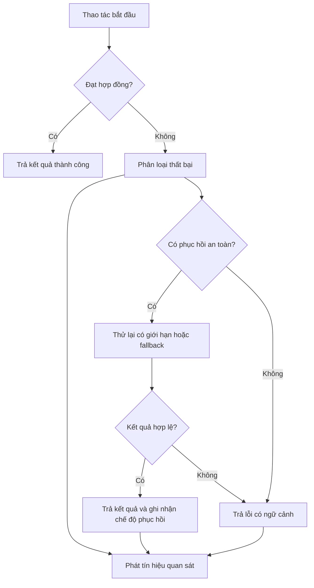

# Khôi phục và quan sát thất bại trong phạm vi trách nhiệm của mã

## 1. Mục tiêu bài học

Trong chương **Độ tin cậy** của module **CODE_QUALITY_FUNDAMENTALS**, câu hỏi trọng tâm là: khi một thao tác thất bại, mã nguồn có thể làm gì để giảm tác động, giữ dữ liệu nhất quán và giúp con người tìm được nguyên nhân? Đây là một phần của mục tiêu **hiểu những thuộc tính quyết định mã nguồn có đáng tin cậy, dễ hiểu và dễ thay đổi hay không**.

Sau bài học, bạn có thể:

- Phân biệt **phát hiện thất bại**, **khôi phục** và **quan sát thất bại** ở ranh giới của một thành phần mã.
- Chọn phản ứng phù hợp cho lỗi nghiệp vụ, lỗi tạm thời và lỗi không thể tự xử lý.
- Giải thích điều kiện sử dụng retry, timeout, fallback, idempotency và cơ chế giữ trạng thái nhất quán.
- Thiết kế đường xử lý lỗi Java có hành vi rõ ràng, dễ kiểm thử và đủ tín hiệu chẩn đoán.
- Nhận biết giới hạn: một hàm có thể phục hồi một số tình huống, nhưng không thể tự bảo đảm độ tin cậy của cả hệ thống.

## 2. Thất bại, khôi phục và quan sát nghĩa là gì?

Trong thực tế, **thất bại (failure)** là khi một thao tác không tạo ra kết quả hoặc không đáp ứng hợp đồng mong đợi. Nguyên nhân có thể đến từ dữ liệu đầu vào, lỗi lập trình, tài nguyên cạn kiệt, kết nối mạng hoặc dịch vụ phụ thuộc.

**Khôi phục (recovery)** là đưa xử lý trở lại một trạng thái được chấp nhận theo yêu cầu, hoặc dừng có kiểm soát khi không thể tiếp tục an toàn. Khôi phục không nhất thiết có nghĩa là “làm cho mọi thứ thành công”: từ chối một giao dịch sai, hủy một phần thay đổi và trả lỗi rõ ràng có thể là cách xử lý đúng.

**Quan sát thất bại (failure observability)** là tạo và duy trì các tín hiệu cho phép nhóm phát triển và vận hành biết *đã xảy ra điều gì, tại đâu, với mức ảnh hưởng nào*; bao gồm log, metric, trace, trạng thái kết quả và nguyên nhân lỗi được truyền qua các tầng.

Ba bước này liên quan nhau nhưng có mục đích riêng:

| Khả năng | Câu hỏi | Kết quả mong đợi |
| --- | --- | --- |
| Phát hiện | Thao tác nào không đạt hợp đồng? | Nhận ra loại lỗi tại ranh giới phù hợp. |
| Khôi phục | Có cách tiếp tục an toàn hay cần dừng? | Trả dữ liệu hợp lệ, fallback có điều kiện, hoàn tác hoặc thất bại rõ ràng. |
| Quan sát | Người khác có nhận ra và điều tra được không? | Có trạng thái, nguyên nhân và tín hiệu đo được, không che giấu lỗi. |

Ví dụ, dịch vụ hiển thị mô tả sản phẩm không kết nối được nguồn dữ liệu. Nếu yêu cầu cho phép dùng bản lưu tạm còn mới, mã có thể trả bản lưu và đánh dấu **chế độ suy giảm (degraded)**. Nếu bản lưu quá cũ, cần trả lỗi. Cả hai trường hợp đều phải được ghi nhận để đội phụ trách không lầm tưởng rằng nguồn dữ liệu đang hoạt động bình thường.

## 3. Ranh giới trách nhiệm của mã

Chất lượng mã nguồn giúp giảm xác suất lỗi và giới hạn tác động của một số lỗi, nhưng một hàm không thể tự giải quyết mất điện trung tâm dữ liệu, sự cố DNS toàn khu vực hay chính sách nghiệp vụ chưa được làm rõ.

| Tình huống | Việc mã có thể và nên làm | Phần cần phối hợp ngoài hàm |
| --- | --- | --- |
| Tham số sai hợp đồng | Kiểm tra đầu vào, trả lỗi có ý nghĩa; không thử lại vô ích. | Làm rõ đặc tả, kiểm tra dữ liệu ở nguồn gửi. |
| Dịch vụ phụ thuộc tạm thời lỗi | Timeout, retry có giới hạn khi an toàn, fallback theo quy tắc. | Giám sát tình trạng phụ thuộc, điều chỉnh năng lực hoặc xử lý sự cố. |
| Ghi dữ liệu thất bại giữa chừng | Giao dịch, rollback hoặc thiết kế nhất quán phù hợp; tránh công bố thành công giả. | Thiết kế cơ sở dữ liệu, cơ chế sao lưu và phục hồi dữ liệu. |
| Tải tăng đột biến | Giới hạn công việc, từ chối sớm có kiểm soát, tránh hàng đợi vô hạn. | Cân bằng tải, điều chỉnh tài nguyên, chính sách năng lực. |
| Lỗi logic chưa được biết trước | Giữ ngữ cảnh lỗi, bảo vệ bất biến và để lỗi đến ranh giới có thể xử lý. | Điều tra, sửa mã, kiểm thử hồi quy, phát hành bản sửa. |

**Phạm vi trách nhiệm** nên được thể hiện bằng hợp đồng của thành phần: thành phần được phép tự xử lý lỗi nào, kết quả suy giảm có thể chấp nhận đến đâu, lỗi nào phải báo lên và ai chịu trách nhiệm đối với trạng thái dữ liệu.

Một đường xử lý lỗi có thể mô tả như sau:



Sơ đồ chỉ mô tả luồng quyết định. Trên thực tế, các tín hiệu thường được phát ra ngay tại thời điểm phát hiện lỗi, khi thử lại, khi fallback và khi thao tác kết thúc.

## 4. Phân loại lỗi trước khi chọn hành động

Không phải mọi ngoại lệ đều nên được bắt và thử lại.

| Loại tình huống | Ví dụ | Cách xử lý thường phù hợp |
| --- | --- | --- |
| **Sai quy tắc hoặc đầu vào** | Mã sản phẩm trống, số lượng âm | Từ chối rõ ràng; sửa đầu vào hoặc yêu cầu. |
| **Kết quả nghiệp vụ hợp lệ** | Không tìm thấy sản phẩm | Trả kết quả vắng mặt hoặc lỗi nghiệp vụ được định nghĩa; không coi mọi trường hợp là sự cố hạ tầng. |
| **Lỗi tạm thời (transient)** | Timeout mạng, HTTP 503 từ phụ thuộc | Có thể thử lại nếu thao tác an toàn, với thời hạn và số lần giới hạn. |
| **Lỗi kéo dài hoặc không thể tự giải quyết** | Sai thông tin xác thực, schema không tương thích | Dừng và truyền lỗi; không lặp vô hạn. |
| **Kết quả không xác định** | Gửi lệnh thanh toán rồi mất kết nối trước khi nhận phản hồi | Cần đối soát hoặc idempotency; không tự suy ra giao dịch thất bại. |
| **Lỗi lập trình** | Giả định sai, `NullPointerException` ngoài dự kiến | Giữ ngữ cảnh, báo lỗi và sửa nguyên nhân; tránh nuốt ngoại lệ. |

Điều quan trọng nhất là **phân biệt lỗi có thể phục hồi với lỗi không nên phục hồi**. Chẳng hạn, thử lại một phép đọc dữ liệu không có tác dụng phụ thường có rủi ro thấp hơn thử lại lệnh chuyển tiền. Với lệnh có tác dụng phụ, timeout có thể xuất hiện *sau khi* hệ thống nhận lệnh; gửi lại thiếu kiểm soát có thể tạo thao tác trùng.

## 5. Những cơ chế phục hồi thường dùng

### 5.1. Timeout và giới hạn thời gian

Nếu một lời gọi bên ngoài có thể chờ vô hạn, luồng xử lý, kết nối hoặc tài nguyên của hệ thống có thể bị giữ lâu hơn mức cho phép. **Timeout** đặt một giới hạn cho việc chờ; ở luồng nhiều bước nên có **ngân sách thời gian tổng thể (deadline)** để các lần thử không vượt quá hạn của yêu cầu.

Timeout giúp hệ thống ngừng chờ, nhưng **không chứng minh bên nhận chưa thực hiện thao tác**. Đặc biệt với thao tác ghi, cần kiểm tra kết quả bằng khóa idempotency, truy vấn trạng thái hoặc cơ chế đối soát.

### 5.2. Retry có kiểm soát

Retry hữu ích cho lỗi tạm thời khi thao tác có thể lặp lại an toàn. Hãy giới hạn số lần, tổng thời gian và nhóm lỗi được phép thử lại. Khi nhiều yêu cầu cùng lỗi, cần tính đến **backoff** và **jitter** để tránh dồn thêm tải lên phụ thuộc đang gặp sự cố. Đừng thử lại lỗi xác thực hoặc dữ liệu đầu vào sai.

### 5.3. Fallback và suy giảm có chủ đích

Fallback dùng phương án thay thế khi nguồn chính thất bại: dữ liệu lưu tạm, câu trả lời tối giản hoặc tính năng tạm thời không khả dụng. Chỉ dùng khi **nghiệp vụ cho phép**. Một bản mô tả sản phẩm cũ vài phút có thể chấp nhận được ở màn hình giới thiệu; một mức giá thanh toán cũ có thể gây sai tiền.

Kết quả fallback nên mang thông tin đủ để bên gọi biết đây là kết quả suy giảm. Nếu âm thầm dùng dữ liệu cũ và trả về như dữ liệu vừa cập nhật, hệ thống có thể “trông ổn” trong khi đang sai.

### 5.4. Giữ trạng thái nhất quán

Trước khi thử khôi phục, mã phải biết thao tác đã thay đổi trạng thái đến đâu. Với thay đổi trong một cơ sở dữ liệu, transaction có thể hỗ trợ commit hoặc rollback theo ranh giới phù hợp. Với nhiều hệ thống độc lập, một transaction cục bộ **không tự bao phủ** tất cả; có thể cần outbox, idempotency, đối soát hoặc cơ chế bù trừ được thiết kế rõ.

Không hứa hẹn “thực hiện đúng một lần” chỉ vì có retry hay hàng đợi. Khi xử lý lại thông điệp, mã cần có quy tắc nhận biết và xử lý các lần thực thi trùng.

### 5.5. Giải phóng tài nguyên và dừng an toàn

Dù thao tác thành công hay thất bại, cần đóng tài nguyên đúng cách, chẳng hạn qua `try-with-resources` với `AutoCloseable`. Khi không thể tiếp tục, hãy trả lỗi có ngữ cảnh và để tầng có trách nhiệm quyết định phản hồi; không trả giá trị mặc định có thể bị hiểu nhầm là dữ liệu hợp lệ.

## 6. Ví dụ Java: đọc dữ liệu sản phẩm với fallback quan sát được

Giả sử một màn hình hiển thị **tên sản phẩm** từ dịch vụ danh mục bên ngoài. Quy tắc được xác định trước:

- Nếu đọc từ nguồn chính thành công, dùng dữ liệu mới.
- Nếu nguồn chính gặp **lỗi tạm thời**, cho phép tối đa **hai lần gọi** trong minh họa.
- Sau hai lần thất bại, chỉ dùng ảnh chụp cache có tuổi **không quá 5 phút**, và đánh dấu nguồn `CACHE`.
- Nếu không có cache đủ mới, ném ngoại lệ để tầng gọi trả lỗi phù hợp.
- Cache ở đây dùng cho **dữ liệu hiển thị**; không suy rộng chính sách này sang giá thanh toán, tồn kho hoặc dữ liệu bảo mật.

Ví dụ dùng **Java 17** và tách ba ranh giới phụ thuộc: gọi từ xa, đọc cache và ghi nhận tín hiệu quan sát.

```java
import java.time.Clock;
import java.time.Duration;
import java.time.Instant;
import java.util.Objects;
import java.util.Optional;

public final class CatalogReadService {
    private static final int MAX_ATTEMPTS = 2;
    private static final Duration MAX_CACHE_AGE = Duration.ofMinutes(5);

    public record ProductCard(String name) {
        public ProductCard {
            if (name == null || name.isBlank()) {
                throw new IllegalArgumentException("name must not be blank");
            }
        }
    }

    public record Snapshot(ProductCard card, Instant savedAt) {
        public Snapshot {
            Objects.requireNonNull(card, "card");
            Objects.requireNonNull(savedAt, "savedAt");
        }
    }

    public enum Origin { REMOTE, CACHE }

    public record Result(ProductCard card, Origin origin) {}

    @FunctionalInterface
    public interface RemoteCatalog {
        ProductCard fetch(String sku);
    }

    @FunctionalInterface
    public interface SnapshotCache {
        Optional<Snapshot> find(String sku);
    }

    public interface Observability {
        void increment(String metricName);
        void report(String eventName, Throwable cause);
    }

    public static final class TemporaryRemoteFailure
            extends RuntimeException {
        public TemporaryRemoteFailure(String message) {
            super(message);
        }
    }

    public static final class CatalogUnavailable
            extends RuntimeException {
        public CatalogUnavailable(String message, Throwable cause) {
            super(message, cause);
        }
    }

    private final RemoteCatalog remote;
    private final SnapshotCache cache;
    private final Observability signals;
    private final Clock clock;

    public CatalogReadService(RemoteCatalog remote, SnapshotCache cache,
                              Observability signals, Clock clock) {
        this.remote = Objects.requireNonNull(remote);
        this.cache = Objects.requireNonNull(cache);
        this.signals = Objects.requireNonNull(signals);
        this.clock = Objects.requireNonNull(clock);
    }

    public Result lookup(String sku) {
        if (sku == null || sku.isBlank()) {
            throw new IllegalArgumentException("sku must not be blank");
        }

        TemporaryRemoteFailure lastFailure = null;
        for (int attempt = 1; attempt <= MAX_ATTEMPTS; attempt++) {
            try {
                ProductCard card =
                        Objects.requireNonNull(remote.fetch(sku), "card");
                return new Result(card, Origin.REMOTE);
            } catch (TemporaryRemoteFailure e) {
                lastFailure = e;
                signals.increment("catalog_remote_attempt_failed");
                signals.report("catalog_remote_attempt_failed", e);
            }
        }

        Optional<Snapshot> candidate = cache.find(sku);
        if (candidate.isPresent()) {
            Snapshot snapshot = candidate.get();
            Duration age =
                    Duration.between(snapshot.savedAt(), clock.instant());
            if (!age.isNegative() && age.compareTo(MAX_CACHE_AGE) <= 0) {
                signals.increment("catalog_fallback_used");
                return new Result(snapshot.card(), Origin.CACHE);
            }
        }

        signals.increment("catalog_unavailable");
        throw new CatalogUnavailable(
                "Catalog lookup unavailable", lastFailure);
    }
}
```

**Đọc đoạn mã theo trách nhiệm:**

1. `lookup` chỉ bắt `TemporaryRemoteFailure` để xử lý lỗi đã được phân loại là tạm thời; ngoại lệ dữ liệu không hợp lệ và lỗi lập trình không bị âm thầm đổi thành fallback.
2. Chỉ có tối đa hai lời gọi đến nguồn chính. Nếu lời gọi thứ hai thành công thì nhận kết quả `REMOTE`.
3. Điều kiện tuổi cache được đo bằng `Clock` truyền vào, giúp kiểm thử ranh giới thời gian; snapshot có thời điểm trong tương lai cũng bị từ chối để tránh chấp nhận dữ liệu với tuổi âm.
4. Kết quả có `Origin.CACHE` để bên gọi quyết định hiển thị cảnh báo hoặc truyền trạng thái suy giảm theo hợp đồng giao diện.
5. Nếu không có dữ liệu đủ mới, hàm ném `CatalogUnavailable` với nguyên nhân ban đầu, không trả về một sản phẩm giả hay chuỗi trống.
6. Có tín hiệu riêng khi lỗi gọi từ xa, khi dùng fallback và khi thất bại cuối cùng; nhờ vậy tỷ lệ “thành công do cache” không bị tính nhầm thành hệ thống phụ thuộc hoàn toàn khỏe mạnh.

**Giới hạn có chủ đích của ví dụ:** `RemoteCatalog` là adapter cho phép đọc lại an toàn. Adapter thực tế phải cấu hình timeout, phân loại chính xác lỗi từ HTTP/client và tuân thủ deadline. Hai lần thử ngay lập tức ở đây chỉ để minh họa ranh giới; môi trường thực cần cân nhắc backoff, jitter, retry budget và mức tải. Mẫu không triển khai việc làm mới cache, vì đó là một trách nhiệm riêng cần hợp đồng vòng đời và kiểm thử. Lỗi của chính hệ thống cache hoặc hệ thống ghi metric cần được xử lý/quan sát ở ranh giới thích hợp của ứng dụng; đừng mặc định mọi lỗi đều có thể che giấu.

## 7. Kiểm thử sự phục hồi và khả năng quan sát

Một bài kiểm thử đường thành công là chưa đủ. Ta phải chủ động **tạo thất bại** để xem mã phản ứng theo hợp đồng hay không. Việc tiêm phụ thuộc qua interface và dùng `Clock` giúp kiểm thử ổn định mà không cần một dịch vụ mạng thật.

Ví dụ JUnit 5 cho hai trường hợp: nguồn chính lỗi hai lần, cache còn mới; và cache đã quá hạn.

```java
import static org.junit.jupiter.api.Assertions.assertEquals;
import static org.junit.jupiter.api.Assertions.assertThrows;

import java.time.Clock;
import java.time.Instant;
import java.time.ZoneOffset;
import java.util.Optional;
import java.util.concurrent.atomic.AtomicInteger;
import org.junit.jupiter.api.Test;

class CatalogReadServiceTest {
    private static final Instant NOW =
            Instant.parse("2026-11-16T10:00:00Z");

    private static CatalogReadService.Observability noOpSignals() {
        return new CatalogReadService.Observability() {
            @Override
            public void increment(String metricName) {}

            @Override
            public void report(String eventName, Throwable cause) {}
        };
    }

    @Test
    void usesRecentCacheAfterTwoTemporaryFailures() {
        AtomicInteger calls = new AtomicInteger();
        CatalogReadService.RemoteCatalog remote = sku -> {
            calls.incrementAndGet();
            throw new CatalogReadService.TemporaryRemoteFailure("503");
        };
        CatalogReadService.SnapshotCache cache = sku ->
            Optional.of(new CatalogReadService.Snapshot(
                new CatalogReadService.ProductCard("Sổ tay"),
                NOW.minusSeconds(4 * 60)
            ));
        var service = new CatalogReadService(
            remote, cache, noOpSignals(),
            Clock.fixed(NOW, ZoneOffset.UTC));

        var result = service.lookup("SKU-1");
        assertEquals(CatalogReadService.Origin.CACHE, result.origin());
        assertEquals("Sổ tay", result.card().name());
        assertEquals(2, calls.get());
    }

    @Test
    void failsWhenCacheIsTooOld() {
        CatalogReadService.RemoteCatalog remote = sku -> {
            throw new CatalogReadService.TemporaryRemoteFailure("timeout");
        };
        CatalogReadService.SnapshotCache cache = sku ->
            Optional.of(new CatalogReadService.Snapshot(
                new CatalogReadService.ProductCard("Sổ tay"),
                NOW.minusSeconds(6 * 60)
            ));
        var service = new CatalogReadService(
            remote, cache, noOpSignals(),
            Clock.fixed(NOW, ZoneOffset.UTC));

        assertThrows(CatalogReadService.CatalogUnavailable.class,
            () -> service.lookup("SKU-1"));
    }
}
```

Hai ca trên minh họa các nhánh quan trọng; **chưa chứng minh toàn bộ thiết kế đúng**. Một bộ kiểm thử đủ tin cậy cần xét thêm:

| Kịch bản | Hành vi cần xác nhận |
| --- | --- |
| Nguồn chính thành công ngay | Trả `REMOTE`; không cần cache fallback. |
| Nguồn chính lỗi một lần rồi thành công | Không gọi lần thứ ba, không dùng fallback. |
| Cache có tuổi đúng 5 phút | Được chấp nhận theo điều kiện `<= 5 phút`. |
| Cache 5 phút cộng một phần thời gian | Bị từ chối; không dùng dữ liệu quá hạn. |
| Cache trống hoặc thời điểm cache nằm trong tương lai | Thất bại rõ ràng. |
| Đầu vào sai, `RemoteCatalog` ném lỗi không thuộc loại tạm thời | Không retry và không biến lỗi thành thành công giả. |
| Nguồn chính lỗi và cache hợp lệ | Bộ đếm lỗi gọi từ xa và bộ đếm fallback cùng phản ánh đúng tình huống. |
| Nguồn chính lỗi và không thể fallback | Bộ đếm unavailable tăng, ngoại lệ giữ nguyên nhân. |

Một kiểm thử riêng cần dùng **fake observability** có bộ đếm thật thay cho `noOpSignals()` để chứng minh tên metric và số lần ghi phù hợp. Khi tích hợp HTTP và cache thật, cần thêm kiểm thử timeout, lỗi kết nối, trường hợp client phân loại nhầm HTTP 4xx/5xx và cách phản hồi của tầng API.

## 8. Log, metric và trace: quan sát đủ mà không gây nhiễu

Một ngoại lệ được bắt thành công chưa đủ nếu không ai biết hệ thống đang phải dùng đường phục hồi. Ba nhóm tín hiệu thường phối hợp với nhau:

| Tín hiệu | Dùng để trả lời | Ví dụ tại ranh giới mã |
| --- | --- | --- |
| **Log có cấu trúc** | Lỗi cụ thể nào vừa xảy ra, có ngữ cảnh gì? | Tên thao tác, loại lỗi, số lần thử, `traceId`, nguồn phụ thuộc. |
| **Metric** | Mức độ và xu hướng thất bại ra sao? | Tốc độ `catalog_remote_attempt_failed`, `catalog_fallback_used`, `catalog_unavailable`. |
| **Trace phân tán** | Lỗi phát sinh ở bước nào trong chuỗi gọi? | Span của request và lần gọi danh mục, thời gian chờ, trạng thái. |

Nên dùng **tên metric ổn định** và nhãn có tập giá trị giới hạn như `outcome=remote|cache|error`, `dependency=catalog`, `error_type=timeout|unavailable`. Không đưa `sku`, email, token hoặc mã yêu cầu ngẫu nhiên vào nhãn metric vì dễ tăng cardinality và lộ dữ liệu. Thông tin chi tiết có thể đặt trong log/trace với quy tắc bảo vệ dữ liệu phù hợp.

Khi ghi log, giữ **nguyên nhân gốc** hoặc chuỗi nguyên nhân, ghi mức nghiêm trọng theo tác động và tận dụng `traceId` từ ngữ cảnh request. Tránh ghi toàn bộ nội dung yêu cầu, bí mật hoặc thông tin cá nhân. Một lỗi tạm thời được phục hồi có thể là tín hiệu mức cảnh báo; lỗi cuối cùng làm yêu cầu thất bại cần được ghi nhận ở ranh giới trả lỗi, tránh mỗi tầng cùng ghi stack trace khiến log trùng lặp.

Ví dụ, một lần gọi danh mục thất bại nhưng fallback thành công nên xuất hiện trong **chỉ số phụ thuộc đang lỗi** và **chỉ số suy giảm**. Tỷ lệ request trả HTTP 200 một mình sẽ che giấu rủi ro này. Ngược lại, báo động cho mọi lần thử lỗi đơn lẻ có thể gây nhiễu; nên đánh giá theo tỷ lệ, thời gian kéo dài và tác động đến các mục tiêu dịch vụ.

## 9. Những sai lầm thường gặp

**Nuốt ngoại lệ rồi trả giá trị giả.** Đoạn `catch (Exception e) { return 0; }` có thể khiến `0` bị hiểu là giá hợp lệ hay số lượng tồn kho thật. Khi không có giá trị thay thế được chấp nhận theo hợp đồng, hãy trả lỗi rõ ràng.

**Retry mọi ngoại lệ.** Dữ liệu sai, quyền truy cập bị từ chối hoặc lỗi lập trình hiếm khi được khắc phục nhờ thử lại. Retry không giới hạn có thể làm cạn tài nguyên và khuếch đại sự cố.

**Coi timeout của lệnh ghi là thất bại chắc chắn.** Bên nhận có thể đã ghi dữ liệu rồi mất kết nối ở chiều phản hồi. Cần idempotency key và cơ chế xác minh trạng thái, nhất là với thanh toán và tác vụ có tác dụng phụ.

**Fallback dữ liệu cũ mà không đánh dấu.** Trải nghiệm có vẻ hoạt động, nhưng người dùng hoặc dịch vụ khác có thể ra quyết định dựa trên dữ liệu lỗi thời. Chính sách độ mới và trạng thái suy giảm phải rõ ràng.

**Ghi log quá nhiều hoặc thiếu ngữ cảnh.** In cùng một lỗi ở năm tầng làm khó điều tra; chỉ in `"failed"` không có trace hay loại lỗi cũng không đủ. Cần chọn vị trí quan sát và thông tin có ý nghĩa.

**Đo thành công bằng HTTP 200.** Request có thể thành công nhờ fallback liên tục trong khi phụ thuộc chính đã hỏng. Cần đo tỷ lệ fallback và lỗi chưa phục hồi.

**Giả định cơ chế của thư viện bảo đảm độ tin cậy.** Thêm một annotation retry/circuit breaker mà chưa xác định idempotency, deadline, giới hạn tải và hành vi khi thất bại có thể tạo thêm lỗi.

## 10. Quy trình thực hành tại một ranh giới mã

Khi review một đoạn mã gọi sang dịch vụ khác, xử lý thông điệp hoặc thay đổi dữ liệu, hãy lần lượt:

1. **Nêu hợp đồng:** thao tác thành công được định nghĩa thế nào? Khi thất bại, tầng gọi mong đợi giá trị rỗng, lỗi nghiệp vụ, kết quả suy giảm hay ngoại lệ?
2. **Liệt kê kiểu lỗi có khả năng xảy ra:** đầu vào, timeout, ngắt kết nối, HTTP lỗi, dữ liệu thiếu, lưu trữ lỗi, chạy lặp và lỗi lập trình.
3. **Chọn cơ chế theo từng loại:** từ chối, retry giới hạn, fallback có điều kiện, rollback, idempotency hoặc đẩy lỗi lên tầng chịu trách nhiệm.
4. **Bảo vệ trạng thái và thời gian:** xác nhận tác dụng phụ có thể lặp an toàn, tài nguyên được giải phóng và mọi nỗ lực đều nằm trong ngân sách thời gian/tải.
5. **Thiết kế tín hiệu quan sát:** có kết quả cuối, nguyên nhân, số lần thử, trạng thái fallback và liên kết trace; tránh log dữ liệu nhạy cảm.
6. **Kiểm thử bằng cách tạo lỗi:** tiêm ngoại lệ, dùng clock cố định, làm sai lệch thời điểm, cho phụ thuộc trả lỗi tạm thời và kiểm tra số lần thử cùng metric.
7. **Kiểm tra kết quả ngoài thành phần:** xác nhận tầng API hoặc worker phản hồi hợp lý, metric phản ánh tình trạng thật và có người nhận cảnh báo khi ngưỡng bị vượt.

Các bước này giúp mã **đáng tin cậy** hơn mà vẫn **dễ hiểu và dễ thay đổi**: trách nhiệm được phân biệt, ranh giới lỗi rõ ràng và hành vi có thể kiểm chứng bằng thử nghiệm.

## 11. Câu hỏi tự kiểm tra

1. Vì sao việc bắt được ngoại lệ và trả về một giá trị bất kỳ chưa được xem là khôi phục thành công?
2. Khi một yêu cầu đọc dữ liệu thất bại ba lần rồi dùng cache, cần những tín hiệu nào để người vận hành biết đang xảy ra suy giảm?
3. Nếu gọi cổng thanh toán bị timeout, vì sao không nên tự động gửi lại một yêu cầu mới với mã giao dịch khác?
4. Trong ví dụ Java, điều gì xảy ra khi cache đã quá 5 phút? Nếu nguồn chính ném ngoại lệ lập trình thay vì `TemporaryRemoteFailure`, có nên dùng fallback không?
5. Vì sao metric chứa `sku` làm nhãn có thể gây vấn đề, dù thông tin này rất hữu ích khi điều tra một sản phẩm cụ thể?

**Gợi ý:** (1) Kết quả phải đáp ứng hợp đồng và không che giấu sai lệch; nếu không thể phục hồi cần dừng rõ ràng. (2) Cần số lần lỗi phụ thuộc, tỷ lệ fallback, trạng thái cuối cùng và ngữ cảnh trace/log. (3) Lệnh đầu có thể đã hoàn tất, tạo yêu cầu mới có thể dẫn đến xử lý trùng; phải dùng idempotency và đối soát. (4) Ném `CatalogUnavailable` khi không có cache hợp lệ; lỗi lập trình không thuộc nhóm fallback của ví dụ. (5) Nó tạo rất nhiều tổ hợp nhãn, tăng chi phí hệ thống metric và có thể lộ dữ liệu; nên đặt chi tiết ở log/trace có kiểm soát.

## 12. Ghi nhớ

Khôi phục thất bại đúng nghĩa là **tiếp tục an toàn theo hợp đồng hoặc dừng có kiểm soát**, đồng thời phát tín hiệu để có thể nhận biết và điều tra. Mã chịu trách nhiệm phân loại lỗi, giữ bất biến, giới hạn retry, áp dụng fallback khi được cho phép, và cung cấp thông tin quan sát tại ranh giới của mình. Độ tin cậy của sản phẩm còn phụ thuộc vào dữ liệu, hạ tầng, cấu hình, vận hành và các dịch vụ bên ngoài; vì vậy cần kiểm thử đường lỗi và quan sát kết quả toàn hệ thống. Một đoạn mã tốt làm cho **thành công, suy giảm và thất bại** đều rõ ràng và có thể kiểm chứng.
