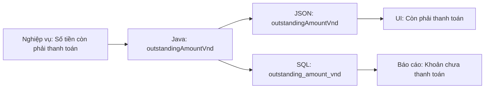
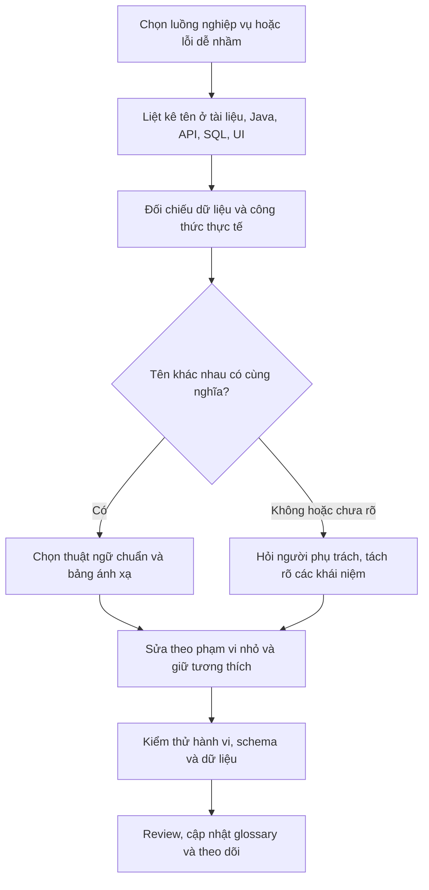

# Từ vựng nhất quán giữa mã, dữ liệu và nghiệp vụ

Một lập trình viên đọc biến `total` trong dịch vụ tính tiền và cho rằng đó là **tổng tiền hàng**. Người viết API lại hiểu `total` là **số tiền khách phải thanh toán**. Trong cơ sở dữ liệu, cột `order_total` lưu số tiền **sau giảm giá**, còn giao diện hiển thị nhãn “Tổng tiền”. Cả bốn cách gọi đều có vẻ hợp lý khi đứng riêng lẻ, nhưng khi phối hợp chúng có thể khiến người sửa tính sai phí, viết nhầm báo cáo hoặc áp dụng chính sách khuyến mãi lên sai số tiền.

Trong chương **Khả năng đọc** của module **CODE_QUALITY_FUNDAMENTALS**, chất lượng tên gọi không dừng ở việc đọc được một dòng mã. Mục tiêu là để người đọc nhận ra **cùng một khái niệm nghiệp vụ** khi nó đi qua tài liệu, Java, API, cơ sở dữ liệu, thông báo lỗi và giao diện; đồng thời nhận ra **hai khái niệm khác nhau** dù chúng có hình thức gần giống nhau. Điều đó góp phần làm mã nguồn đáng tin cậy, dễ hiểu và dễ thay đổi.

## 1. Nhất quán về nghĩa, không chỉ nhất quán về cách viết

**Từ vựng miền nghiệp vụ** (*domain vocabulary*) là tập hợp các khái niệm dùng để mô tả hoạt động của hệ thống: đơn hàng, thanh toán, khoản giảm giá, số tiền cần thu, hoàn tiền, giao hàng, v.v.

Một thuật ngữ tốt cần trả lời được hai câu hỏi:

1. **Nó đại diện cho điều gì?** Có định nghĩa đủ rõ để phân biệt với những khái niệm gần đó không?
2. **Nó xuất hiện ở đâu?** Khi sang các lớp kỹ thuật khác nhau, cách gọi có còn giữ nguyên ý nghĩa không?

Nhất quán **không** có nghĩa là mọi nơi phải dùng cùng chuỗi ký tự. Tài liệu nghiệp vụ và giao diện có thể viết tiếng Việt “Số tiền phải thanh toán”, Java dùng `amountDueVnd`, JSON dùng `amountDueVnd`, SQL dùng `amount_due_vnd`. Chúng tương ứng với **một khái niệm** và tuân thủ quy ước đặt tên của từng lớp.

Ngược lại, hai trường đều tên `total` chưa chắc cùng nghĩa. Một trường có thể là tổng giá hàng trước khuyến mãi; trường kia là số tiền còn nợ sau khi khách đã thanh toán một phần. **Giống chữ không đồng nghĩa giống nghiệp vụ.**

| Mức độ | Câu hỏi | Kết quả mong muốn |
| --- | --- | --- |
| **Ngữ nghĩa** | Các tên đang nói về cùng một sự vật và cùng quy tắc tính? | Một định nghĩa chung cho một khái niệm |
| **Phân biệt** | Hai khái niệm có khác nhau về thời điểm, phạm vi hoặc đơn vị? | Tên đủ chính xác để không dùng nhầm |
| **Cú pháp** | Tên đã tuân thủ quy ước Java, JSON, SQL và UI? | Người đọc đoán được tên tương ứng ở từng lớp |
| **Truy vết** | Có biết trường dữ liệu này sinh ra từ quy tắc nào? | Dễ đi từ yêu cầu đến mã và dữ liệu, rồi trở lại |

## 2. Ví dụ xuyên suốt: một đơn hàng có giảm giá và thanh toán một phần

Giả sử yêu cầu nghiệp vụ là:

> “Khách được giảm một khoản tiền trên giá hàng. Sau khi trừ giảm giá, khách có thể thanh toán một phần và tiếp tục thanh toán khoản còn lại.”

Chỉ riêng chữ **“tổng tiền”** đã không đủ để biểu diễn mọi số tiền của luồng này. Ta cần định nghĩa:

| Thuật ngữ nghiệp vụ | Tên dùng trong Java/JSON | Ý nghĩa chính xác | Giá trị ví dụ |
| --- | --- | --- | --- |
| **Tiền hàng trước giảm giá** | `merchandiseSubtotalVnd` | Tổng giá hàng trước khi áp dụng khoản giảm, chưa xét phí vận chuyển và thuế trong ví dụ | 500.000 |
| **Khoản giảm giá** | `discountAmountVnd` | Số tiền giảm được áp dụng lên tiền hàng | 50.000 |
| **Số tiền phải thanh toán** | `amountDueVnd` | Nghĩa vụ thanh toán của đơn trong phạm vi ví dụ, sau giảm giá | 450.000 |
| **Số tiền đã thanh toán** | `paidAmountVnd` | Số tiền khách đã trả và đã được ghi nhận | 200.000 |
| **Số tiền còn phải thanh toán** | `outstandingAmountVnd` | Phần chưa thanh toán của nghĩa vụ hiện tại | 250.000 |

Các quan hệ trong **mô hình minh họa**:

```text
amountDueVnd = merchandiseSubtotalVnd - discountAmountVnd
outstandingAmountVnd = amountDueVnd - paidAmountVnd
```

Giả định `0 <= discountAmountVnd <= merchandiseSubtotalVnd` và `0 <= paidAmountVnd <= amountDueVnd`. Những công thức này chỉ áp dụng cho ví dụ **chưa xét thuế, phí, hoàn tiền, thanh toán vượt mức và việc thay đổi đơn sau thanh toán**. Nếu sản phẩm có các trường hợp đó, phải xác định thêm khái niệm và quy tắc tương ứng thay vì kéo dài ý nghĩa của tên cũ một cách âm thầm.

**Điểm phân biệt quan trọng:** `amountDueVnd` và `outstandingAmountVnd` đều có thể được gọi trong hội thoại là “tiền khách cần trả”, nhưng một bên là **nghĩa vụ của đơn**, bên còn lại là **phần chưa được trả tại thời điểm hiện tại**. Sau khi khách thanh toán 200.000 đồng, hai số này khác nhau; dùng chung tên `total` hoặc `remaining` dễ che giấu sự khác biệt đó.

## 3. Hệ quả khi mỗi lớp dùng một từ khác nghĩa

Ví dụ hệ thống đang có những tên sau:

| Nơi xuất hiện | Tên hiện tại | Người đọc có thể hiểu | Dữ liệu thực sự lưu |
| --- | --- | --- | --- |
| Tài liệu nghiệp vụ | “Tổng tiền” | Tổng giá trị của đơn | Chưa xác định |
| Java | `total` | Tổng tiền hàng | Tiền hàng sau giảm giá |
| API JSON | `balance` | Số dư hoặc số tiền còn nợ | Tiền hàng sau giảm giá |
| SQL | `order_total` | Tiền của toàn đơn | Tiền hàng sau giảm giá |
| Giao diện | “Còn phải trả” | Số tiền chưa được thanh toán | Tiền hàng sau giảm giá, chưa trừ khoản đã trả |

Với đơn trong ví dụ, một báo cáo chọn `balance` và ghi “nợ phải thu 450.000 đồng” sẽ **không đúng với khoản nợ thực tế 250.000 đồng**. Lỗi bắt đầu từ cách hiểu dữ liệu, dù truy vấn SQL có thể hoàn toàn hợp lệ về cú pháp.

### 3.1. Tên mơ hồ làm tăng chi phí nhận thức

Khi gặp `total`, `value`, `data`, `result`, `flag` hoặc `status`, người đọc phải tìm nơi khai báo, đường truyền dữ liệu và logic tính để biết nghĩa. Nếu tên mang sẵn ý nghĩa và đơn vị, việc đọc và review thường trực tiếp hơn:

```java
// Khó xác định ý nghĩa:
long total = subtotal - discount;
long remaining = total - paid;

// Dễ nối với từ điển nghiệp vụ:
long amountDueVnd = merchandiseSubtotalVnd - discountAmountVnd;
long outstandingAmountVnd = amountDueVnd - paidAmountVnd;
```

Đổi tên đơn thuần **không chứng minh** hệ thống đúng. Cần đối chiếu dữ liệu và công thức để chắc chắn tên mới phản ánh đúng nghĩa hiện có; nếu không, tên đẹp hơn có thể khiến người khác tin vào một giả định sai.

### 3.2. Từ đồng nghĩa có thể che giấu quy tắc trùng lặp

`netTotal`, `finalPrice`, `payable`, `billAmount` có thể cùng chỉ một khái niệm, hoặc mỗi tên chỉ một bước tính khác nhau. Khi chưa định nghĩa rõ, nhóm dễ viết nhiều hàm giống nhau nhưng xử lý giảm giá khác nhau:

```java
long calculateFinalTotal(...);
long computePayable(...);
long getNetAmount(...);
```

Đừng vội gộp ba hàm chỉ vì nghe giống nhau. Trước tiên hãy kiểm tra đầu vào, kết quả, thời điểm tính và các khoản phí được bao gồm. **Chỉ chuẩn hóa thành một tên** khi chúng thật sự đại diện cùng một khái niệm.

### 3.3. Một từ có nhiều nghĩa gây xung đột trạng thái

`completed` của đơn hàng có thể nghĩa là đã giao hàng; `completed` của thanh toán có thể nghĩa là đã thu tiền. Nếu cùng dùng cờ `isDone`, người đọc rất khó biết trạng thái nào đang được kiểm tra. Hai miền trạng thái nên được gọi riêng, chẳng hạn `paymentStatus` và `fulfillmentStatus`, với giá trị có định nghĩa.

Ví dụ, trạng thái `SHIPPED` (đã bàn giao cho bên vận chuyển) khác `DELIVERED` (đã được giao đến người nhận); `PAID` khác `REFUNDED`. Tên gọi cần mô tả **sự kiện hoặc điều kiện nghiệp vụ**, không dựa vào việc hai giá trị nằm gần nhau trong quy trình.

## 4. Xây dựng từ điển nghiệp vụ dùng chung

Một **glossary** (bảng thuật ngữ) là công cụ đơn giản để giảm tranh luận và suy đoán khi nhiều nhóm cùng làm việc. Từ điển cần được thảo luận với người am hiểu nghiệp vụ, không chỉ do lập trình viên tự đặt.

Mỗi mục nên có tối thiểu:

| Thành phần | Câu hỏi cần trả lời | Minh họa cho `amountDueVnd` |
| --- | --- | --- |
| Tên chuẩn | Gọi khái niệm này là gì? | Số tiền phải thanh toán |
| Định nghĩa | Giá trị đại diện cho điều gì? | Nghĩa vụ thanh toán của đơn sau giảm giá trong phạm vi đã thống nhất |
| Công thức/quy tắc | Tính từ dữ liệu nào? | Tiền hàng trước giảm trừ khoản giảm |
| Đơn vị và kiểu | VND, cent, số nguyên hay số thập phân? | VND, lưu dưới dạng số nguyên `long` |
| Thời điểm và phạm vi | Giá trị cố định hay thay đổi khi thanh toán? | Thuộc đơn, không giảm khi khách thanh toán một phần |
| Những thứ không bao gồm | Dễ nhầm với điều gì? | Không phải số tiền còn nợ; không gồm phí/thuế trong ví dụ |
| Tên tương ứng | Các tên trong Java, API, SQL, UI? | `amountDueVnd` / `amount_due_vnd` / “Số tiền phải thanh toán” |
| Người chịu trách nhiệm | Ai có quyền chốt hoặc thay đổi ý nghĩa? | Người phụ trách nghiệp vụ thanh toán theo quy trình sản phẩm |

Một từ điển hữu ích có **ví dụ phân biệt**. Chẳng hạn: “Khi đã thanh toán 200.000 trong số 450.000 đồng, `amountDueVnd` vẫn là 450.000, còn `outstandingAmountVnd` là 250.000”. Ví dụ này ngăn cách hiểu sai hiệu quả hơn một định nghĩa chung chung.

Không cần lập từ điển cho mọi biến cục bộ, chỉ cần tập trung vào các thuật ngữ quan trọng, dễ nhầm, được dùng qua nhiều lớp hoặc có rủi ro khi thay đổi. Tên biến đếm vòng lặp `i` trong phạm vi nhỏ thường không cần xuất hiện trong glossary.

### 4.1. Quy tắc đặt tên nhất quán theo từng lớp

| Bối cảnh | Quy ước minh họa | Lưu ý |
| --- | --- | --- |
| Tài liệu và giao diện tiếng Việt | “Số tiền còn phải thanh toán” | Dùng ngôn ngữ người dùng hiểu và giữ đúng nghĩa |
| Java | `outstandingAmountVnd` | `lowerCamelCase`, danh từ phản ánh giá trị, kèm đơn vị khi hữu ích |
| Java method | `calculateAmountDueVnd(...)` | Động từ diễn đạt phép tính; không dùng tên `get...` nếu phép tính có nghiệp vụ đáng kể mà người đọc cần biết |
| API JSON | `outstandingAmountVnd` | Áp dụng quy ước của API; không thay tên tùy ý vì ảnh hưởng client |
| SQL | `outstanding_amount_vnd` | `snake_case` theo quy ước schema |
| Biến Boolean | `isPaymentCompleted` hoặc `hasOutstandingBalance` | Tên có thể trả lời câu hỏi đúng/sai |
| Enum | `PaymentStatus.PAID`, `FulfillmentStatus.DELIVERED` | Tên kiểu làm rõ miền giá trị |

Không bắt buộc dùng `Vnd` trong mọi tên tiền tệ; nếu toàn bộ hệ thống đã có kiểu `Money` chứa đơn vị, hoặc quy ước thống nhất thể hiện đơn vị ở kiểu dữ liệu, có thể tránh lặp. Tuy nhiên, đối với trường số nguyên trần dễ đi qua API hay cơ sở dữ liệu, hậu tố đơn vị giúp giảm nhầm VND với các đơn vị tiền khác.

### 4.2. Tránh viết tắt và dịch máy móc

Những tên như `amt`, `disc`, `bal`, `qty` đôi khi quen thuộc trong một nhóm nhưng có thể khó đoán với người mới hoặc người từ miền khác. Chỉ dùng viết tắt đã phổ biến và được thống nhất trong dự án. Ngược lại, không nên đặt tên quá dài chỉ để diễn đạt mọi điều kiện, chẳng hạn `amountDueAfterDiscountBeforeShippingAndTaxForNormalOrdersVnd`. Tên phù hợp cần có nghĩa rõ **trong đúng ngữ cảnh**; phần định nghĩa chi tiết nằm trong hợp đồng nghiệp vụ và kiểu dữ liệu.

Khi dịch giữa tiếng Việt và tiếng Anh, ưu tiên **khái niệm**: “công nợ còn phải thu” có thể ánh xạ thành `outstandingReceivable` trong bối cảnh kế toán, trong khi “số tiền còn phải thanh toán” tại trang đặt hàng là `outstandingAmount`. Chọn từ gần nghĩa theo miền, không chỉ dịch từng chữ.

## 5. Ví dụ Java: đặt tên theo nghĩa đã xác nhận

Ta triển khai phép tính trong mô hình đơn hàng đơn giản ở phần 2. Quy tắc đã thống nhất:

1. Tiền hàng và giảm giá là số nguyên VND không âm.
2. Giảm giá không vượt tiền hàng.
3. Số tiền phải thanh toán bằng tiền hàng trừ giảm giá.
4. Số tiền đã trả không âm và không vượt số tiền phải thanh toán.
5. Số tiền còn phải thanh toán bằng số tiền phải thanh toán trừ số đã trả.

### 5.1. Ví dụ khó đọc do thuật ngữ mơ hồ

```java
static long getRemaining(long total, long off, long paid) {
    long finalTotal = total - off;
    return finalTotal - paid;
}
```

Hàm này có thể cho kết quả đúng với dữ liệu phù hợp, nhưng tên `total`, `off` và `finalTotal` chưa cho biết tính trên khoản tiền nào, trước hay sau khuyến mãi, cùng đơn vị gì. Người gọi có thể truyền số tiền sau giảm giá vào `total` và khiến khoản giảm bị trừ hai lần.

### 5.2. Phiên bản thể hiện hợp đồng bằng tên

```java
package com.example.orders;

public final class OrderAmounts {
    private OrderAmounts() {
        // Lớp tiện ích; không tạo instance.
    }

    public static long calculateAmountDueVnd(
            long merchandiseSubtotalVnd,
            long discountAmountVnd) {

        if (merchandiseSubtotalVnd < 0
                || discountAmountVnd < 0
                || discountAmountVnd > merchandiseSubtotalVnd) {
            throw new IllegalArgumentException("Invalid merchandise subtotal or discount");
        }
        return merchandiseSubtotalVnd - discountAmountVnd;
    }

    public static long calculateOutstandingAmountVnd(
            long amountDueVnd,
            long paidAmountVnd) {

        if (amountDueVnd < 0
                || paidAmountVnd < 0
                || paidAmountVnd > amountDueVnd) {
            throw new IllegalArgumentException("Invalid amount due or paid amount");
        }
        return amountDueVnd - paidAmountVnd;
    }
}
```

Tên tham số xác định **vai trò** của từng số tiền ngay tại lời gọi. Hai phương thức tách riêng nghĩa vụ thanh toán với số còn nợ; người đọc không cần biết trước công thức mới hiểu được sự khác nhau. Việc kiểm tra đầu vào giúp các tên phản ánh miền dữ liệu hợp lệ, thay vì chỉ có tên đẹp trong khi nhận dữ liệu vô nghĩa.

Phép trừ `long` trong hai phương thức này an toàn với các điều kiện đầu vào đã kiểm tra: ta luôn trừ một giá trị nằm từ 0 đến số bị trừ không âm, nên kết quả không âm và không vượt `Long.MAX_VALUE`. Trong hệ thống thực tế có phí, thuế, hoàn tiền hoặc nhiều tiền tệ, hợp đồng và tên các thành phần phải được mở rộng tương ứng.

### 5.3. Cách gọi làm lộ sai khác về ngữ nghĩa

```java
long merchandiseSubtotalVnd = 500_000L;
long discountAmountVnd = 50_000L;
long paidAmountVnd = 200_000L;

long amountDueVnd = OrderAmounts.calculateAmountDueVnd(
        merchandiseSubtotalVnd, discountAmountVnd);
long outstandingAmountVnd = OrderAmounts.calculateOutstandingAmountVnd(
        amountDueVnd, paidAmountVnd);

// amountDueVnd = 450_000
// outstandingAmountVnd = 250_000
```

Khi sửa chương trình tính công nợ, biến `outstandingAmountVnd` cho thấy ngay đây là khoản cần dùng; nếu dùng `amountDueVnd` thay thế, sự khác nhau dễ bị nhận ra trong code review.

### 5.4. Kiểm thử đặt tên theo hành vi nghiệp vụ

```java
package com.example.orders;

import static org.junit.jupiter.api.Assertions.assertEquals;
import static org.junit.jupiter.api.Assertions.assertThrows;

import org.junit.jupiter.api.Test;

class OrderAmountsTest {
    @Test
    void discountReducesAmountDue() {
        assertEquals(450_000L,
                OrderAmounts.calculateAmountDueVnd(500_000L, 50_000L));
    }

    @Test
    void partialPaymentReducesOutstandingAmountNotAmountDue() {
        long amountDueVnd = OrderAmounts.calculateAmountDueVnd(
                500_000L, 50_000L);

        assertEquals(450_000L, amountDueVnd);
        assertEquals(250_000L,
                OrderAmounts.calculateOutstandingAmountVnd(
                        amountDueVnd, 200_000L));
    }

    @Test
    void fullyPaidOrderHasNoOutstandingAmount() {
        assertEquals(0L,
                OrderAmounts.calculateOutstandingAmountVnd(
                        450_000L, 450_000L));
    }

    @Test
    void invalidDiscountIsRejected() {
        assertThrows(IllegalArgumentException.class,
                () -> OrderAmounts.calculateAmountDueVnd(
                        100_000L, 120_000L));
    }

    @Test
    void overpaymentIsNotSupportedByThisModel() {
        assertThrows(IllegalArgumentException.class,
                () -> OrderAmounts.calculateOutstandingAmountVnd(
                        100_000L, 120_000L));
    }
}
```

Tên kiểm thử diễn đạt **quy tắc cần giữ**. Nếu sau này hệ thống hỗ trợ thanh toán vượt mức hoặc hoàn tiền, các tên kiểm thử giúp xác định rằng đó là thay đổi mô hình nghiệp vụ, chứ không chỉ là thay tên biến.

Đây là ví dụ minh họa để học cách đặt tên và gắn hợp đồng; không phải báo cáo một lần chạy kiểm thử trong dự án.

## 6. Duy trì nghĩa khi đi từ Java sang API, cơ sở dữ liệu và UI

Một API bán hàng có thể dùng các trường JSON sau:

```json
{
  "merchandiseSubtotalVnd": 500000,
  "discountAmountVnd": 50000,
  "amountDueVnd": 450000,
  "paidAmountVnd": 200000,
  "outstandingAmountVnd": 250000
}
```

Trong cơ sở dữ liệu, cùng nghĩa có thể được đặt ở các cột `merchandise_subtotal_vnd`, `discount_amount_vnd`, `amount_due_vnd`, `paid_amount_vnd` và `outstanding_amount_vnd`. Giao diện hiển thị “Tiền hàng trước giảm”, “Giảm giá”, “Phải thanh toán”, “Đã thanh toán”, “Còn phải thanh toán”.



Sơ đồ không có nghĩa mỗi lớp phải tính lại cùng một công thức. Với giá trị dẫn xuất, nhóm cần xác định **nguồn dữ liệu chính**, nơi tính toán và cơ chế đồng bộ; nếu cùng một số được lưu ở nhiều chỗ thì phải bảo đảm chúng không lệch nhau. Từ vựng nhất quán giúp phát hiện sự lệch nghĩa, nhưng không thay thế thiết kế đồng bộ dữ liệu.

### 6.1. Phân biệt khác biệt trình bày với khác biệt ý nghĩa

| Hiện tượng | Cách xử lý |
| --- | --- |
| Java dùng `camelCase`, SQL dùng `snake_case` | Chỉ khác quy ước cú pháp; có thể ánh xạ trực tiếp |
| UI tiếng Việt, API tiếng Anh | Đặt nhãn tiếng Việt tương ứng định nghĩa, không cần dịch từng chữ |
| API lưu VND, giao diện hiển thị “450.000 đ” | Định dạng biểu diễn không làm đổi số tiền |
| API trả `amountDueVnd`, UI ghi “Còn phải thanh toán” | Có thể **sai nghĩa** khi khách đã trả một phần; cần dùng `outstandingAmountVnd` |
| Trường `balance` ở dịch vụ ví và ở dịch vụ công nợ | Có thể đại diện hai miền khác nhau; cần tên hoặc ngữ cảnh phân biệt |

Tên và công thức nên được **truy vết** qua một bảng ánh xạ, hợp đồng API hoặc tài liệu schema, nhất là khi dữ liệu được nhiều nhóm sử dụng. Nếu có hai tên cùng tồn tại vì lý do tương thích, cần nói rõ tên nào là chuẩn và tên nào là bí danh cũ.

### 6.2. Không đánh đổi tương thích dữ liệu chỉ để đổi tên

Đổi tên một biến cục bộ thường tương đối đơn giản. Đổi tên trường JSON, cột SQL hoặc sự kiện truyền giữa dịch vụ có thể **phá vỡ khách hàng đang sử dụng** dù nghĩa không thay đổi.

Ví dụ, API cũ có `total` mà nhóm quyết định chuẩn hóa thành `amountDueVnd`. Một cách chuyển đổi có kiểm soát:

1. **Xác minh nghĩa thật của `total`** ở dữ liệu và mọi nơi sử dụng; không giả định tên cũ đã đúng.
2. **Chốt tên chuẩn**, định nghĩa và phạm vi hiệu lực; cập nhật tài liệu API và từ điển.
3. **Hỗ trợ ánh xạ chuyển tiếp** ở ranh giới tương thích, chẳng hạn adapter nội bộ đọc `total` thành `amountDueVnd` nếu hai trường thực sự tương đương.
4. **Chuyển từng client**, cập nhật truy vấn, báo cáo, hợp đồng schema và kiểm thử; theo dõi lưu lượng sử dụng tên cũ.
5. **Loại bỏ bí danh cũ** theo chính sách phiên bản và thông báo thay đổi đã công bố.

Không nên duy trì `total` và `amountDueVnd` như hai nguồn dữ liệu độc lập; chúng có thể lệch nhau. Nếu API trả đồng thời hai trường trong thời gian chuyển tiếp, phải quy định rõ một nguồn tính và cách bảo đảm hai giá trị khớp. Đừng thay tên cột hoặc thuộc tính công khai trực tiếp khi chưa kiểm tra các nơi phụ thuộc.

## 7. Khi nào nên dùng một từ, khi nào cần phân biệt?

Nguyên tắc “một khái niệm, một tên chuẩn” có giới hạn: có những hệ thống chứa nhiều **ngữ cảnh nghiệp vụ** (*bounded contexts*) với cách hiểu khác nhau.

Ví dụ:

- Với bộ phận giao vận, “đơn hoàn tất” có thể nghĩa là **đã giao đến người nhận**.
- Với bộ phận kế toán, “đơn hoàn tất” có thể nghĩa là **đã thu đủ tiền và chốt chứng từ**.
- Với bộ phận chăm sóc khách hàng, “đơn hoàn tất” có thể nghĩa là **đã kết thúc mọi yêu cầu hỗ trợ**.

Nếu ba định nghĩa khác nhau, ép tất cả dùng một Boolean `completed` sẽ làm mất thông tin. Nên xác định các khái niệm như `deliveredAt`, `paymentSettledAt` hoặc `supportCaseClosedAt`, tùy sự kiện thực sự cần theo dõi.

Để quyết định hai tên có thể thống nhất hay không, hãy hỏi:

1. Hai giá trị có cùng **đối tượng** và **thời điểm** được đo không?
2. Chúng có cùng **đơn vị**, **công thức**, **quy tắc điều kiện** và **đường lỗi** không?
3. Nếu một giá trị thay đổi, giá trị kia có nhất thiết thay đổi cùng cách không?
4. Chúng có cùng **vòng đời** và cùng người chịu trách nhiệm nghiệp vụ không?

Nếu có khác biệt quan trọng, hãy dùng hai tên; nếu cùng nghĩa, chọn một tên chuẩn và ánh xạ các biến thể cú pháp. “Nhất quán” không đồng nghĩa xóa bỏ những khác biệt nghiệp vụ thật sự.

## 8. Quy trình cải thiện từ vựng trong mã có sẵn

Khi gặp hệ thống đã phát triển nhiều năm, không nên đổi hàng loạt tên theo cảm giác. Có thể dùng một vòng cải thiện nhỏ:



### Bước 1 — Thu thập các tên và ví dụ dữ liệu thật

Bắt đầu với một luồng quan trọng, chẳng hạn “tính số tiền còn phải thanh toán”. Ghi lại tên từ tài liệu, câu chữ người dùng, hàm Java, trường JSON, cột SQL, cấu trúc báo cáo và các tên xuất hiện trong kiểm thử. Cùng lúc lấy **một vài trường hợp dữ liệu hợp lệ** đủ phân biệt những cách hiểu khác nhau, ví dụ đơn chưa trả tiền và đơn đã trả một phần.

### Bước 2 — Chốt nghĩa và phạm vi

Đặt từng tên cạnh định nghĩa và công thức. Nếu `finalTotal` vừa chỉ “sau giảm giá” ở một nơi vừa chỉ “còn phải thu” ở nơi khác, tách thành `amountDueVnd` và `outstandingAmountVnd`. Nếu tên không thể xác minh từ tài liệu, cần trao đổi với người có trách nhiệm nghiệp vụ trước khi chuẩn hóa.

### Bước 3 — Đổi tên theo độ rủi ro

Ưu tiên các thay đổi ít gây tác động: tên biến nội bộ, tên tham số, phương thức dùng trong module, kiểm thử và tài liệu. Với API, schema SQL, sự kiện và báo cáo, cần đánh giá tương thích, dùng adapter hoặc phương án di trú theo phiên bản. Tránh gộp **đổi nghĩa** và **đổi tên** vào cùng một thay đổi khó kiểm soát.

### Bước 4 — Kiểm chứng bằng hành vi và khả năng hiểu

Kiểm thử các giá trị trước/sau giảm giá, trước/sau thanh toán; đảm bảo các API contract, truy vấn và báo cáo vẫn dùng đúng số tiền. Trong code review, một người không viết thay đổi có thể nhận diện đúng nghĩa của tên mới không? Họ có thể liên kết tên với khái niệm trong từ điển không? Nếu không, tên vẫn chưa đủ tốt.

### Bước 5 — Duy trì từ điển khi nghiệp vụ đổi

Khi thêm thuế, phí giao hàng, hoàn tiền hoặc hình thức thanh toán mới, xem lại định nghĩa: “Số tiền phải thanh toán” có bao gồm thuế chưa? “Đã thanh toán” có trừ phần hoàn tiền không? **Thay đổi quy tắc thì phải cập nhật cả ý nghĩa tên, hợp đồng dữ liệu và kiểm thử.**

## 9. Những ngộ nhận thường gặp

| Ngộ nhận | Vì sao gây hại | Cách làm phù hợp |
| --- | --- | --- |
| “Tên ngắn luôn dễ đọc hơn.” | `total` ngắn nhưng giấu nghĩa và đơn vị | Chọn tên đủ diễn đạt khái niệm trong phạm vi sử dụng |
| “Tên giống nhau nghĩa là cùng dữ liệu.” | Hai miền có thể định nghĩa “hoàn tất” khác nhau | Kiểm tra định nghĩa, thời điểm và quy tắc |
| “Tên khác nhau thì là hai khái niệm.” | `amount_due_vnd` và `amountDueVnd` chỉ khác quy ước | Tạo ánh xạ một-một về ngữ nghĩa |
| “Đổi tên là refactor vô hại.” | Đổi cột, JSON hoặc event có thể phá API/schema | Chia ranh giới, kiểm tra client và tương thích |
| “Thuật ngữ kỹ thuật có thể thay yêu cầu.” | `balance` không cho biết số dư ví hay số còn nợ | Xác nhận với nghiệp vụ và ví dụ dữ liệu |
| “Gom mọi trường `status` thành một enum.” | Trạng thái thanh toán khác giao vận | Tách thành các trạng thái có miền rõ ràng |
| “Có glossary rồi thì không cần sửa code.” | Tên trong mã vẫn khiến người đọc suy diễn sai | Đồng bộ tên, tài liệu, dữ liệu và kiểm thử |

## 10. Bài tập vận dụng

Một hệ thống đăng ký khóa học có dữ liệu:

```text
Giá niêm yết: 2.000.000 VND
Học bổng:       300.000 VND
Đã nộp:         500.000 VND
```

Trong mã có các tên `coursePrice`, `total`, `netFee`, `balance`. API trả `{"total":1700000,"paid":500000,"remaining":1200000}`. Giao diện lại hiển thị ba nhãn “Học phí”, “Đã nộp”, “Còn phải nộp”.

Hãy thực hiện:

1. Viết **năm mục từ điển**: giá niêm yết, học bổng được trừ, học phí phải nộp sau học bổng, số tiền đã nộp, số tiền còn phải nộp. Với mỗi mục, ghi định nghĩa, công thức nếu có, đơn vị và tên Java/JSON/SQL phù hợp.
2. Xác định điểm mơ hồ của `total`, `netFee` và `balance`. Đề xuất tên phân biệt hai số 1.700.000 VND và 1.200.000 VND.
3. Viết một phương thức Java trả về **số tiền còn phải nộp**, có kiểm tra học bổng không vượt học phí niêm yết và số tiền đã nộp không vượt học phí sau học bổng.
4. Nêu ba ca kiểm thử để bảo đảm tên mới tương ứng với đúng dữ liệu: chưa nộp tiền, đã nộp một phần và đã nộp đủ.
5. Giả sử client cũ vẫn dùng `total`, hãy đề xuất cách chuyển sang tên mới mà không phá ứng dụng đang sử dụng API.

**Hướng tự đối chiếu:** Với dữ liệu trên, **học phí phải nộp sau học bổng = 1.700.000 VND**, **còn phải nộp = 1.200.000 VND**. Hai giá trị cần hai tên riêng. Tên ở lớp Java và SQL có thể khác kiểu chữ nhưng phải giữ nghĩa. Việc thay `total` công khai trong API cần một bước tương thích và kiểm thử client, không chỉ thay tên ở mã nguồn.

## 11. Ghi nhớ

- **Một khái niệm nghiệp vụ cần một nghĩa được thống nhất**; mỗi lớp kỹ thuật có thể biểu diễn bằng quy ước đặt tên riêng.
- **Hai khái niệm khác nhau cần được phân biệt**, nhất là khi có khác biệt về thời điểm, đơn vị, trạng thái hoặc công thức.
- **Từ điển gắn với ví dụ cụ thể** giúp phát hiện chỗ đồng nghĩa, đa nghĩa và quy tắc chưa rõ.
- **Đổi tên không tự sửa lỗi tính toán**: phải xác minh dữ liệu, hợp đồng và các nơi dùng giá trị.
- **Tên công khai là một phần của hợp đồng tích hợp**: thay đổi API hay schema cần kế hoạch tương thích.

Khi từ vựng trong tài liệu, Java, API, dữ liệu và giao diện cùng trỏ đến những định nghĩa rõ ràng, người phát triển có thể đọc đúng ý định nghiệp vụ mà không phải lần theo toàn bộ hệ thống. Đó là nền tảng quan trọng để giữ mã dễ hiểu và thay đổi một cách đáng tin cậy.
