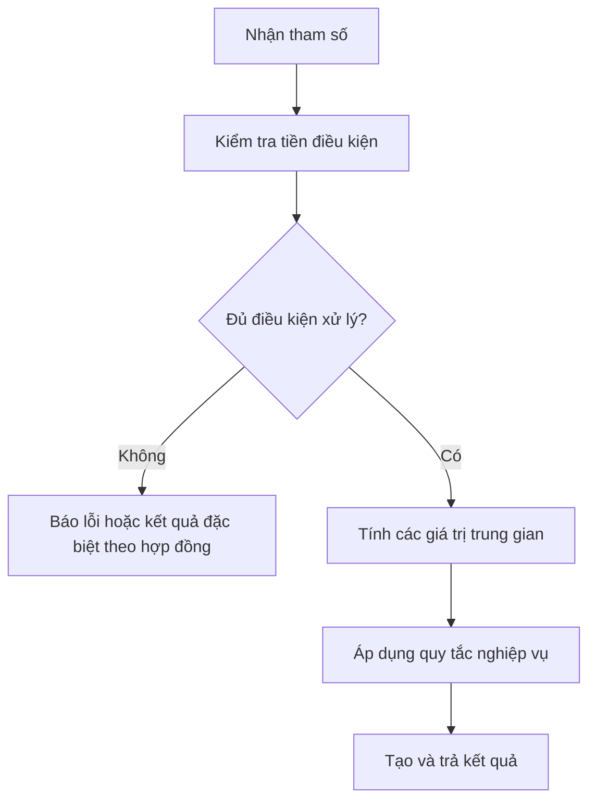

# Tổ chức phương thức theo một mạch xử lý dễ theo dõi

> **Chương:** Khả năng đọc  
> **Học phần:** CODE_QUALITY_FUNDAMENTALS — Hiểu những thuộc tính quyết định mã nguồn có đáng tin cậy, dễ hiểu và dễ thay đổi hay không.

Khi đọc một phương thức, lập trình viên thường muốn trả lời lần lượt: **đầu vào có hợp lệ không, thao tác chính là gì, trường hợp đặc biệt được xử lý ra sao và kết quả được tạo ở đâu?** Nếu các bước nằm rải rác giữa nhiều nhánh lồng nhau, các lệnh cập nhật trạng thái chen vào lúc tính toán hoặc những lời gọi hàm có tên không rõ nghĩa, người đọc phải tự ghép lại câu chuyện xử lý trong đầu.

Một phương thức **có mạch xử lý dễ theo dõi** cho phép người đọc đi từ đầu đến cuối và nhận ra trình tự quyết định mà không liên tục nhảy qua lại để đoán mục đích. Đây là một khía cạnh của *khả năng đọc* (*readability*), có liên hệ trực tiếp với tính đúng đắn, khả năng kiểm thử và khả năng thay đổi: càng dễ nhận ra các bước và ranh giới, người sửa càng có cơ sở đánh giá tác động của một thay đổi.

Mục tiêu của bài học là biết tổ chức **luồng chính, điều kiện ngoại lệ, mức trừu tượng, dữ liệu trung gian và tác dụng phụ** thành một trình tự rõ nghĩa; đồng thời tránh refactor làm thay đổi hành vi đã có.

## 1. “Mạch xử lý” trong một phương thức là gì?

Hãy hình dung một phương thức như phần trình bày ngắn về một công việc. Người đọc cần thấy:

1. **Điều kiện để bắt đầu:** dữ liệu và trạng thái nào hợp lệ?
2. **Các bước chính:** phương thức chuyển đổi, kiểm tra hoặc tác động lên dữ liệu theo thứ tự nào?
3. **Những nhánh cần quyết định:** trường hợp nào dừng sớm, trường hợp nào đi tiếp?
4. **Kết quả hoặc hậu quả:** phương thức trả về gì, thay đổi gì và báo lỗi khi nào?

Một sơ đồ tham khảo cho thao tác tính kết quả thuần túy:



Đây là một **mẫu để suy nghĩ**, không phải khuôn mẫu bắt buộc. Có phương thức chỉ cần trả một biểu thức; có phương thức cần mở tài nguyên, thực hiện giao dịch hoặc xử lý nhiều trường hợp bằng `switch`. Điều cốt lõi là **cấu trúc mã phản ánh các bước có ý nghĩa trong hợp đồng của phương thức**.

### Dấu hiệu của một luồng dễ đọc

| Dấu hiệu | Người đọc nhận được gì? |
| --- | --- |
| Trường hợp đầu vào không hợp lệ xuất hiện ở vị trí dễ tìm | Biết khi nào xử lý chính không diễn ra |
| Luồng thành công được đặt ở vị trí nổi bật | Có thể kể lại mục đích của phương thức trong một câu |
| Các điều kiện có tên phản ánh nghiệp vụ | Hiểu tại sao một nhánh được chọn |
| Các bước dùng cùng mức độ chi tiết tương đối | Không bị kéo khỏi câu chuyện chính bởi tiểu tiết |
| Biến trung gian được tạo gần nơi sử dụng | Không phải nhớ trạng thái từ quá xa |
| Tác dụng phụ được đặt và gọi tên có chủ đích | Biết thời điểm hệ thống bắt đầu thay đổi trạng thái |
| Ngoại lệ và đường thoát được thể hiện rõ | Có thể suy ra chuyện gì xảy ra khi thao tác không hoàn tất |

Mã ngắn không tự động dễ đọc: một biểu thức nhiều toán tử và phủ định có thể khó hiểu hơn vài câu lệnh với tên rõ. Ngược lại, chia một phép tính đơn giản thành năm phương thức phụ cũng có thể khiến người đọc mất mạch.

## 2. Nhận diện những cấu trúc làm đứt mạch

### 2.1. Lồng điều kiện sâu trong khi chỉ có một đường đi chính

```java
void sendConfirmation(Order order) {
    if (order != null) {
        if (order.isPaid()) {
            if (!order.isCancelled()) {
                mailSender.send(order.getCustomerEmail());
            }
        }
    }
}
```

Để tìm ra thao tác chính `mailSender.send(...)`, người đọc phải đi qua ba tầng `if`. Nếu quy tắc thật sự là “chỉ gửi thư cho đơn đã thanh toán và chưa hủy”, có thể làm phẳng các điều kiện:

```java
void sendConfirmation(Order order) {
    if (order == null) {
        return;
    }
    if (!order.isPaid()) {
        return;
    }
    if (order.isCancelled()) {
        return;
    }

    mailSender.send(order.getCustomerEmail());
}
```

Các câu lệnh `return` đầu hàm được gọi là **điều kiện bảo vệ** (*guard clauses*). Chúng giúp luồng chính nổi bật và giảm số tầng lồng nhau. Hai đoạn trên tương đương về việc **có gọi gửi thư hay không** trong điều kiện giả định các phương thức truy vấn trạng thái không có tác dụng phụ bất ngờ.

Quan trọng: nếu hợp đồng yêu cầu `order == null` phải ném `IllegalArgumentException` thay vì bỏ qua, đổi sang `return` sẽ làm thay đổi hành vi. Guard clause chỉ là cách tổ chức luồng, **không tự quyết định quy tắc nghiệp vụ**.

### 2.2. Trộn kiểm tra dữ liệu, tính toán và ghi trạng thái

```java
void updateInvoice(Invoice invoice, long discountVnd) {
    invoice.setDiscountVnd(discountVnd);
    if (discountVnd < 0L) {
        throw new IllegalArgumentException("Negative discount");
    }
    invoice.setPayableVnd(invoice.getSubtotalVnd() - discountVnd);
}
```

Phương thức trên **đã thay đổi** `discountVnd` trong hóa đơn trước khi kiểm tra tính hợp lệ. Khi ngoại lệ xảy ra, hóa đơn có thể đang ở trạng thái không mong muốn.

Nếu hợp đồng yêu cầu không thay đổi hóa đơn khi đầu vào sai, luồng nên là:

```java
void updateInvoice(Invoice invoice, long discountVnd) {
    Objects.requireNonNull(invoice, "invoice");

    long subtotalVnd = invoice.getSubtotalVnd();
    if (subtotalVnd < 0L || discountVnd < 0L || discountVnd > subtotalVnd) {
        throw new IllegalArgumentException("Invalid subtotal or discount");
    }

    long payableVnd = subtotalVnd - discountVnd;
    invoice.setDiscountVnd(discountVnd);
    invoice.setPayableVnd(payableVnd);
}
```

Ví dụ này làm rõ ba pha: **xác minh → tính kết quả → cập nhật**. Tuy nhiên, hai lệnh `set...` không tự trở thành một cập nhật nguyên tử; nếu setter có thể ném ngoại lệ hoặc đối tượng được nhiều luồng truy cập, vẫn cần thiết kế phù hợp với hợp đồng và mô hình đồng thời của ứng dụng.

### 2.3. Điều kiện khó đọc vì vừa kiểm tra vừa thay đổi trạng thái

Một điều kiện như:

```java
if (attempts++ < MAX_ATTEMPTS && connect() && !cancelled) {
    // ...
}
```

bắt người đọc suy nghĩ cùng lúc về số lần thử, thứ tự tính toán, tác dụng phụ của `connect()` và ý nghĩa của `cancelled`. Trong Java, toán tử `&&` đánh giá từ trái qua phải và dừng sớm; vì vậy việc tách hoặc đổi thứ tự các thành phần phải giữ nguyên hành vi phụ.

Nếu những bước đó có vai trò riêng, diễn đạt chúng thành các câu lệnh hoặc phương thức có tên là một lựa chọn dễ kiểm tra hơn. Không nên đơn giản hoán đổi các điều kiện chỉ vì muốn biểu thức trông “gọn”.

## 3. Ví dụ Java xuyên suốt: tính báo giá giao hàng

Giả sử một ứng dụng có quy tắc báo giá **minh họa**:

- `subtotalVnd` là tổng tiền hàng trước khoản giảm đang xét; `discountVnd` nằm trong khoảng từ `0` đến `subtotalVnd`.
- Khu vực giao hàng không được hỗ trợ thì yêu cầu báo giá bị từ chối.
- Giao hàng **nhanh** có phí cố định **50.000 VND**.
- Giao hàng **tiêu chuẩn** có phí **30.000 VND**, nhưng được miễn khi tiền hàng sau giảm giá **từ 500.000 VND trở lên**.
- Tổng thanh toán = tiền hàng sau giảm giá + phí giao hàng; nếu phép cộng vượt giới hạn `long`, thao tác báo lỗi.

Ví dụ dùng số nguyên đơn vị VND để tránh độ phức tạp về số thập phân và làm tròn. Các giá trị là quy tắc giả định phục vụ bài học, không phải chính sách của một hệ thống cụ thể.

### 3.1. Phiên bản có nhiều mức lồng nhau

Giả sử `ShippingQuote` là lớp kết quả chứa ba giá trị `payableVnd`, `shippingFeeVnd` và `totalVnd`.

```java
public ShippingQuote quote(
        long subtotalVnd,
        long discountVnd,
        boolean deliverySupported,
        boolean express) {

    if (subtotalVnd < 0 || discountVnd < 0 || discountVnd > subtotalVnd) {
        throw new IllegalArgumentException("Invalid amounts");
    }

    if (deliverySupported) {
        long payableVnd = subtotalVnd - discountVnd;
        long shippingFeeVnd = 30_000L;

        if (express) {
            shippingFeeVnd = 50_000L;
        } else {
            if (payableVnd >= 500_000L) {
                shippingFeeVnd = 0L;
            }
        }

        long totalVnd = Math.addExact(payableVnd, shippingFeeVnd);
        return new ShippingQuote(payableVnd, shippingFeeVnd, totalVnd);
    } else {
        throw new IllegalArgumentException("Unsupported delivery area");
    }
}
```

Mã có thể thực hiện đúng chính sách nhưng phần lớn công việc chính lại nằm trong một khối `if`. Nhánh `else` báo lỗi xuất hiện ở cuối, các con số mang nghĩa nghiệp vụ chưa được đặt tên, và việc lựa chọn phí bị lồng trong phần tạo báo giá.

### 3.2. Phiên bản có mạch chính rõ ràng

Đoạn dưới là ví dụ Java hoàn chỉnh cho phần tính toán; có thể đặt nó trong tệp `ShippingQuoteCalculator.java`:

```java
public final class ShippingQuoteCalculator {
    private static final long STANDARD_FEE_VND = 30_000L;
    private static final long EXPRESS_FEE_VND = 50_000L;
    private static final long FREE_STANDARD_MIN_PAYABLE_VND = 500_000L;

    public ShippingQuote quote(
            long subtotalVnd,
            long discountVnd,
            boolean deliverySupported,
            boolean express) {

        validateAmounts(subtotalVnd, discountVnd);
        if (!deliverySupported) {
            throw new IllegalArgumentException("Unsupported delivery area");
        }

        long payableVnd = subtotalVnd - discountVnd;
        long shippingFeeVnd = calculateShippingFeeVnd(payableVnd, express);
        long totalVnd = Math.addExact(payableVnd, shippingFeeVnd);

        return new ShippingQuote(payableVnd, shippingFeeVnd, totalVnd);
    }

    private static void validateAmounts(long subtotalVnd, long discountVnd) {
        if (subtotalVnd < 0L || discountVnd < 0L || discountVnd > subtotalVnd) {
            throw new IllegalArgumentException("Invalid amounts");
        }
    }

    private static long calculateShippingFeeVnd(
            long payableVnd, boolean express) {

        if (express) {
            return EXPRESS_FEE_VND;
        }
        if (payableVnd >= FREE_STANDARD_MIN_PAYABLE_VND) {
            return 0L;
        }
        return STANDARD_FEE_VND;
    }

    public static final class ShippingQuote {
        private final long payableVnd;
        private final long shippingFeeVnd;
        private final long totalVnd;

        public ShippingQuote(
                long payableVnd, long shippingFeeVnd, long totalVnd) {
            this.payableVnd = payableVnd;
            this.shippingFeeVnd = shippingFeeVnd;
            this.totalVnd = totalVnd;
        }

        public long getPayableVnd() {
            return payableVnd;
        }

        public long getShippingFeeVnd() {
            return shippingFeeVnd;
        }

        public long getTotalVnd() {
            return totalVnd;
        }
    }
}
```

Để đọc `quote(...)`, ta có thể đi theo đúng thứ tự mà nghiệp vụ cần:

1. **Kiểm tra số tiền** và **khu vực** trước khi tính.
2. **Tính tiền hàng sau giảm giá**.
3. **Xác định phí giao hàng** theo chính sách.
4. **Tính tổng** với kiểm tra tràn số.
5. **Tạo kết quả** và trả về.

Phần lựa chọn mức phí được tách thành `calculateShippingFeeVnd(...)` vì đó là **một quy tắc có tên riêng**; khi cần đổi ngưỡng miễn phí giao hàng, người đọc biết nơi phù hợp để xem xét. Các hằng số giải thích ý nghĩa của giá trị. Mạch chính không phải nhảy vào chi tiết `if` để hiểu báo giá được hình thành như thế nào.

**Không phải cứ trích phương thức là tốt.** Nếu `calculateShippingFeeVnd(...)` chỉ trả về một biến không tên hoặc ẩn những tác dụng phụ đáng kể, việc trích có thể làm khó hiểu hơn. Ở đây, tên phương thức diễn đạt một bước có ý nghĩa, có đầu vào/đầu ra xác định và không thay đổi trạng thái bên ngoài.

### 3.3. Giữ nguyên các hành vi đáng kiểm tra

| Đầu vào | Tiền hàng sau giảm giá | Phí giao hàng | Tổng tiền / kết quả |
| --- | ---: | ---: | --- |
| 499.999 VND, giảm 0, khu vực hỗ trợ, tiêu chuẩn | 499.999 | 30.000 | 529.999 |
| 500.000 VND, giảm 0, khu vực hỗ trợ, tiêu chuẩn | 500.000 | 0 | 500.000 |
| 600.000 VND, giảm 100.000, khu vực hỗ trợ, tiêu chuẩn | 500.000 | 0 | 500.000 |
| 600.000 VND, giảm 0, khu vực hỗ trợ, nhanh | 600.000 | 50.000 | 650.000 |
| 600.000 VND, giảm 0, khu vực không hỗ trợ | — | — | `IllegalArgumentException` |
| 100.000 VND, giảm 120.000 | — | — | `IllegalArgumentException` |
| `Long.MAX_VALUE` VND, giảm 0, nhanh | Giá trị hợp lệ | 50.000 | `ArithmeticException` khi cộng tổng |

Các trường hợp biên chứng minh vì sao việc chuyển mã thành những bước dễ đọc vẫn phải đi kèm **kiểm tra tương đương hành vi**. Nếu vô tình chuyển ngưỡng từ `>=` sang `>`, trường hợp đúng bằng 500.000 VND sẽ đổi kết quả. Nếu bỏ `Math.addExact`, phép cộng kiểu `long` có thể tràn và cho ra tổng sai.

### 3.4. Kiểm thử tập trung vào mạch nghiệp vụ

Ví dụ JUnit 5, với lớp `ShippingQuoteCalculator` đã định nghĩa:

```java
import static org.junit.jupiter.api.Assertions.assertEquals;
import static org.junit.jupiter.api.Assertions.assertThrows;

import org.junit.jupiter.api.Test;

class ShippingQuoteCalculatorTest {
    private final ShippingQuoteCalculator calculator =
            new ShippingQuoteCalculator();

    @Test
    void standardShippingIsFreeAtThreshold() {
        ShippingQuoteCalculator.ShippingQuote quote =
                calculator.quote(600_000L, 100_000L, true, false);

        assertEquals(500_000L, quote.getPayableVnd());
        assertEquals(0L, quote.getShippingFeeVnd());
        assertEquals(500_000L, quote.getTotalVnd());
    }

    @Test
    void standardShippingCostsFeeBelowThreshold() {
        ShippingQuoteCalculator.ShippingQuote quote =
                calculator.quote(499_999L, 0L, true, false);

        assertEquals(30_000L, quote.getShippingFeeVnd());
        assertEquals(529_999L, quote.getTotalVnd());
    }

    @Test
    void expressShippingKeepsItsFeeAboveThreshold() {
        ShippingQuoteCalculator.ShippingQuote quote =
                calculator.quote(600_000L, 0L, true, true);

        assertEquals(50_000L, quote.getShippingFeeVnd());
        assertEquals(650_000L, quote.getTotalVnd());
    }

    @Test
    void unsupportedAreaIsRejected() {
        assertThrows(
                IllegalArgumentException.class,
                () -> calculator.quote(600_000L, 0L, false, false));
    }

    @Test
    void totalOverflowIsRejected() {
        assertThrows(
                ArithmeticException.class,
                () -> calculator.quote(Long.MAX_VALUE, 0L, true, true));
    }
}
```

Các bài kiểm thử trên bảo vệ một số trường hợp quan trọng. Chúng **không tự chứng minh toàn bộ hệ thống đúng**; nếu trong thực tế còn tính thuế, làm tròn, giảm giá nhiều tầng hoặc giao hàng nhiều khu vực, hợp đồng và bộ kiểm thử phải được mở rộng theo những quy tắc đó.

## 4. Đặt điều kiện bảo vệ ở đâu?

Guard clause thường phù hợp khi có những trường hợp **không thể hoặc không nên đi vào luồng chính**:

```java
Customer loadActiveCustomer(String customerId) {
    if (customerId == null || customerId.isBlank()) {
        throw new IllegalArgumentException("Customer ID is required");
    }

    Customer customer = repository.findById(customerId);
    if (customer == null) {
        throw new CustomerNotFoundException(customerId);
    }
    if (!customer.isActive()) {
        throw new CustomerInactiveException(customerId);
    }

    return customer;
}
```

Ví dụ dùng các kiểu `Customer`, `repository` và ngoại lệ nghiệp vụ như những thành phần giả định của ứng dụng. Điểm cần quan sát là **nguyên nhân từ chối được đặt trước kết quả hợp lệ**. Nếu cần hiểu luồng thành công, người đọc chỉ phải đi qua các kiểm tra rồi đến `return customer`.

Tuy nhiên, nhiều `return` rải rác trong một phương thức lớn có thể gây khó xác định điểm thoát và trạng thái đã thay đổi. Hãy cân nhắc:

- Trường hợp lỗi có hợp đồng riêng không? Nếu có, nên thể hiện rõ thay vì chỉ `return null`.
- Có tài nguyên cần đóng hoặc giao dịch cần hoàn tất không? Ưu tiên `try-with-resources` và cơ chế quản lý giao dịch phù hợp khi cần.
- Có tác dụng phụ nào đã xảy ra trước `return` không? Nếu có, người đọc cần hiểu trạng thái sau khi thoát.
- Hai nhánh đều là nghiệp vụ chính có tầm quan trọng tương đương không? Nếu có, biểu diễn bằng `if/else`, `switch` hoặc xử lý tách biệt có thể rõ hơn việc nhấn một nhánh là “bất thường”.

**Không có quy tắc “luôn chỉ có một return” hay “luôn dùng early return”.** Một mạch dễ theo dõi phụ thuộc vào hợp đồng và số bước người đọc cần giữ trong đầu.

## 5. Giữ cùng mức trừu tượng trong luồng chính

Xem ví dụ:

```java
void submitOrder(Order order) {
    validateOrder(order);
    long totalVnd = 0L;
    for (OrderLine line : order.getLines()) {
        totalVnd = Math.addExact(
                totalVnd,
                Math.multiplyExact(line.getUnitPriceVnd(), line.getQuantity()));
    }
    reserveInventory(order);
    orderRepository.save(order);
}
```

Các bước `validateOrder`, `reserveInventory` và `save` là các thao tác nghiệp vụ có tên, nhưng phép tính tổng nằm trực tiếp giữa chúng. Nếu vòng lặp chứa nhiều quy tắc riêng, có thể diễn đạt ở mức nhất quán hơn:

```java
void submitOrder(Order order) {
    validateOrder(order);
    long totalVnd = calculateTotalVnd(order);
    reserveInventory(order);
    saveSubmittedOrder(order, totalVnd);
}
```

Tên các bước giúp người đọc nhìn thấy một tiến trình: **kiểm tra → tính → giữ hàng → lưu**. Nhưng ví dụ thứ hai chỉ là bản phác thảo; để đúng về hành vi, `calculateTotalVnd` phải giữ các quy tắc kiểm tra tràn số, và `saveSubmittedOrder` phải lưu chính xác tổng tiền như phiên bản trước theo hợp đồng. Ngoài ra, việc giữ hàng rồi lưu có thể sinh trạng thái một phần nếu một bước thất bại. Việc trích hàm **không tự mang lại tính nguyên tử**.

Một tiêu chí hữu ích khi trích hàm: **tên của hàm mới có giải thích được ý định mà người đọc đang cần không?** Nếu tên chỉ là `doStep1()`, `handleData()` hoặc `process()`, người đọc vẫn phải mở nội dung để hiểu. Ngược lại, việc tạo quá nhiều hàm chỉ chứa một lệnh đơn giản đôi khi làm mất liên tục của luồng.

### Khi nào nên giữ chi tiết tại chỗ?

Một bước như:

```java
long payableVnd = subtotalVnd - discountVnd;
```

có thể rõ ràng ngay tại chỗ nếu cả hai biến đã có nghĩa và phép trừ đúng với đặc tả. Tạo thêm `subtractDiscountFromSubtotal(...)` chỉ để bọc phép trừ có thể làm người đọc phải nhảy nơi khác mà không học thêm thông tin. Hãy ưu tiên **ranh giới ngữ nghĩa** thay vì đặt mục tiêu mỗi phương thức phải có rất ít dòng.

## 6. Nhóm các bước theo quan hệ dữ liệu

Một nguyên nhân thường gặp khiến luồng rối là biến được tạo quá sớm, sau đó bị chỉnh sửa qua nhiều nhánh:

```java
long feeVnd = 0L;
// ... nhiều bước không liên quan ...
if (express) {
    feeVnd = 50_000L;
}
// ... nhiều bước khác ...
if (!express && payableVnd < 500_000L) {
    feeVnd = 30_000L;
}
```

Người đọc phải giữ trong đầu giá trị hiện tại của `feeVnd` để biết nhánh sau có ghi đè nhánh trước không. Nếu có thể xác định phí trong một bước riêng:

```java
long feeVnd = calculateShippingFeeVnd(payableVnd, express);
```

thì thông tin liên quan được gom về một nơi. Với dữ liệu chỉ cần gán một lần, có thể dùng `final` để diễn đạt rằng biến cục bộ không bị gán lại:

```java
final long payableVnd = subtotalVnd - discountVnd;
final long feeVnd = calculateShippingFeeVnd(payableVnd, express);
```

`final` không làm mọi đối tượng trở nên bất biến; với biến tham chiếu, nó chỉ ngăn gán lại tham chiếu. Điểm chính ở đây là giảm việc theo dõi những biến thay đổi qua nhiều bước.

Khi xây dựng một đối tượng lớn, có thể cần nhiều câu lệnh thiết lập. Nếu quá trình đó có thứ tự quan trọng, hãy thể hiện bằng nhóm bước hợp lý hoặc một kiểu kết quả/hàm dựng có hợp đồng rõ. Tránh để dữ liệu chỉ hợp lệ một phần lưu hành ngoài phạm vi cần thiết.

## 7. Sắp xếp tác dụng phụ theo đúng ý nghĩa

Trong một phương thức có ghi dữ liệu hoặc gọi dịch vụ khác, thứ tự không còn là chuyện trình bày. Ví dụ:

```java
void confirmOrder(Order order) {
    orderRepository.markConfirmed(order.getId());
    inventoryService.reserve(order);
    notificationService.sendOrderConfirmed(order);
}
```

Đọc từ trên xuống, người ta có thể hiểu rằng đơn được đánh dấu xác nhận **trước** khi giữ hàng. Nếu `reserve(...)` thất bại, dữ liệu có thể đã mang trạng thái `CONFIRMED` nhưng chưa giữ được hàng. Liệu đó là sai hay là một trạng thái trung gian hợp lệ phụ thuộc vào thiết kế nghiệp vụ.

Một refactor “để đẹp” không được tự ý thay thứ tự ba lời gọi hoặc gộp chúng vào một tên `processOrder()` vì có thể che những trạng thái quan trọng. Cần làm rõ trước:

1. Thành công được định nghĩa là hoàn tất những bước nào?
2. Nếu bước thứ hai hoặc thứ ba thất bại, các bước trước đã tạo tác dụng phụ gì?
3. Có giao dịch, cơ chế bù, retry an toàn hoặc đối soát nào bảo vệ tính nhất quán không?
4. Người gọi có biết thao tác đang hoàn thành một phần hay trạng thái chưa xác định không?

Mạch dễ theo dõi nên **làm lộ trình tự quan trọng**, đồng thời chỉ giấu tiểu tiết không cần thiết. Nếu một phương thức thực hiện nhiều tác dụng phụ thuộc những hợp đồng khác nhau, có thể cần một tầng điều phối có tên rõ, nhưng việc tách lớp không tự khắc phục tính nhất quán khi xảy ra lỗi.

## 8. Tổ chức nhánh điều kiện khi có nhiều đường đi chính

Guard clause thường hợp với điều kiện từ chối rõ ràng. Nhưng nếu một phương thức xử lý ba loại yêu cầu đều hợp lệ, `switch` hoặc phân phối theo loại có thể là lựa chọn tốt hơn một chuỗi điều kiện lồng nhau:

```java
long calculateFeeVnd(DeliveryType type, long payableVnd) {
    switch (type) {
        case STANDARD:
            return payableVnd >= 500_000L ? 0L : 30_000L;
        case EXPRESS:
            return 50_000L;
        case PICKUP:
            return 0L;
        default:
            throw new IllegalArgumentException("Unsupported delivery type");
    }
}
```

Với enum `DeliveryType` gồm `STANDARD`, `EXPRESS` và `PICKUP`, các nhánh đều mô tả một quyết định nghiệp vụ hợp lệ. Cấu trúc này giúp thấy đủ các lựa chọn tại một nơi. Nếu trong tương lai mỗi loại có nhiều bước phức tạp, có thể cân nhắc các chiến lược riêng, nhưng điều đó chỉ đáng làm khi độ phức tạp thực tế xuất hiện.

Không nên ép mọi điều kiện vào một biểu thức ba ngôi (*ternary*) dài hoặc chuyển chúng thành bản đồ hàm nếu cách đó khiến quy tắc khó nhìn thấy hơn. **Cú pháp ngắn nhất không nhất thiết là mạch dễ đọc nhất**.

## 9. Quy trình refactor để người khác dễ đọc mà hành vi vẫn đúng

Khi gặp phương thức khó theo dõi, hãy tiến hành theo một chuỗi có kiểm soát:

### Bước 1: Phát biểu hợp đồng hiện tại

Xác định đầu vào hợp lệ, kết quả trả về, ngoại lệ và tác dụng phụ. Ghi chú trường hợp quan trọng như `null`, ranh giới so sánh, thứ tự gọi dịch vụ và điều kiện kết thúc sớm. Nếu chưa rõ hợp đồng, phải tìm hiểu trước khi đổi cấu trúc luồng.

### Bước 2: Đọc và kể lại mạch xử lý bằng ngôn ngữ nghiệp vụ

Ví dụ: “kiểm tra số tiền, xác minh khu vực, tính tiền sau giảm giá, chọn phí giao hàng, trả báo giá”. Nếu không thể phát biểu một mạch ngắn vì phương thức thực hiện những trách nhiệm không liên quan, đó là dấu hiệu cần xem xét tách trách nhiệm.

### Bước 3: Đánh dấu các nhánh dừng và tác dụng phụ

Các lệnh `return`, `throw`, `break`, `continue`, lời gọi ghi dữ liệu và gửi thông điệp đáng được lưu ý. Những vị trí này là nơi việc di chuyển câu lệnh dễ làm thay đổi hành vi. Đặc biệt cẩn trọng với biểu thức có tác dụng phụ hoặc phụ thuộc vào thứ tự đánh giá.

### Bước 4: Cải thiện từng thay đổi nhỏ

- Đặt lại tên biến/hàm/hằng số để phản ánh mục đích.
- Đưa kiểm tra điều kiện đầu vào đến nơi giúp làm rõ luồng, **chỉ khi hành vi tương đương**.
- Làm phẳng nhánh bao quanh luồng chính khi phù hợp.
- Nhóm tính toán có cùng mục tiêu và giới hạn phạm vi biến cục bộ.
- Trích phương thức theo quy tắc nghiệp vụ hoặc trách nhiệm rõ ràng.
- Giữ các tác dụng phụ có chủ đích và những trường hợp thất bại quan trọng ở vị trí dễ nhận biết.

Không cần áp dụng toàn bộ kỹ thuật cho mỗi phương thức. Chọn sự thay đổi giúp người đọc hiểu đúng với ít thao tác suy luận hơn.

### Bước 5: Xác minh hành vi sau thay đổi

Chạy bộ kiểm thử liên quan, bổ sung các trường hợp biên đang thiếu và xem lại những nơi gọi. So sánh không chỉ giá trị `return` mà còn **loại ngoại lệ, thời điểm thay đổi trạng thái và số lần gọi phụ thuộc** nếu hợp đồng yêu cầu. Với hàm có side effect, kiểm thử bằng mock có thể giúp kiểm tra thứ tự hoặc số lần gọi ở mức phù hợp, nhưng cần kết hợp kiểm thử tích hợp khi tính đúng đắn phụ thuộc hệ thống bên ngoài.

Refactor với mục đích đọc dễ hơn được xem là thành công khi **mạch rõ hơn trong khi hợp đồng quan sát được vẫn được giữ**. Nếu chủ động thay đổi nghiệp vụ, hãy mô tả đó là thay đổi hành vi riêng và kiểm thử theo yêu cầu mới.

## 10. Các ngộ nhận và đánh đổi thường gặp

| Ngộ nhận | Điều cần xem xét |
| --- | --- |
| “Mỗi phương thức chỉ nên có một `return`.” | Nhiều guard clause đôi khi giúp luồng chính rõ hơn; nhưng quá nhiều điểm thoát sau tác dụng phụ lại khó theo dõi |
| “Hàm càng ít dòng càng tốt.” | Mật độ logic và độ rõ ngữ nghĩa quan trọng hơn số dòng tuyệt đối |
| “Trích càng nhiều phương thức càng dễ đọc.” | Quá nhiều hàm nhỏ có thể buộc người đọc nhảy nơi khác liên tục |
| “Đưa mọi điều kiện lên đầu là tốt.” | Chuyển điều kiện có tác dụng phụ hoặc phụ thuộc trạng thái có thể làm đổi hành vi |
| “Đặt tên `process` hoặc `handle` là đủ.” | Những tên chung chung không giúp người đọc biết bước nào thực sự đang diễn ra |
| “Mã dễ đọc thì chắc chắn đúng.” | Cấu trúc rõ giúp phát hiện lỗi nhưng không thay thế kiểm thử và hiểu hợp đồng |
| “Các bước gọi dịch vụ có thể đổi thứ tự để đẹp hơn.” | Thứ tự tác dụng phụ là một phần của hành vi, có thể gây sai trạng thái hoặc giao dịch |

Một phương thức có thể dài nhưng vẫn dễ hiểu nếu nó là một trình tự cần nhìn tổng thể, với từng bước rõ nghĩa. Một phương thức ngắn cũng có thể khó hiểu nếu nó ẩn những quyết định quan trọng sau tên hàm mơ hồ. Hãy đánh giá bằng **khả năng đọc lại và giải thích chính xác**, không chỉ bằng một chỉ số cơ học.

## 11. Checklist khi review mạch xử lý

Khi mở một phương thức chưa quen, hãy trả lời:

1. Có thể nói **mục tiêu chính** của phương thức trong một câu không?
2. Có tìm thấy nhanh **điều kiện từ chối** và đường đi thành công không?
3. Có thể liệt kê các bước theo **thứ tự nghiệp vụ** mà không mở quá nhiều hàm phụ không?
4. Những nhánh điều kiện có nêu rõ lý do và giữ mức lồng nhau hợp lý không?
5. Biến trung gian có tên, phạm vi và vòng đời vừa đủ để theo dõi không?
6. Phép tính, kiểm tra và tác dụng phụ có được phân biệt rõ không?
7. Nếu bước giữa chừng thất bại, có biết phương thức đã thay đổi điều gì không?
8. Mức trừu tượng có nhất quán, và các hàm được trích có tên giải thích ý định không?
9. Có trường hợp biên hoặc thứ tự xử lý nào mà refactor có thể vô tình thay đổi không?
10. Một người mới có thể giải thích phương thức theo luồng **đầu vào → quyết định → xử lý → kết quả** không?

Không nhất thiết mọi câu đều dẫn đến một chỉnh sửa. Checklist dùng để phát hiện chỗ làm người đọc phải đoán và giúp nhóm thảo luận bằng những vấn đề cụ thể.

## 12. Bài tập áp dụng

Một hệ thống chỉ cho phép phát hành hóa đơn cho đơn hàng đã thanh toán, chưa hủy và có tổng tiền hợp lệ. Xét đoạn mã minh họa:

```java
void issueInvoice(Order order) {
    if (order != null) {
        if (!order.isCancelled()) {
            if (order.isPaid()) {
                if (order.getTotalVnd() >= 0) {
                    invoiceRepository.save(Invoice.from(order));
                    notificationService.sendInvoice(order.getCustomerId());
                }
            }
        }
    }
}
```

Thực hiện các yêu cầu sau:

1. Viết lại mục đích của phương thức bằng một câu nghiệp vụ, bao gồm điều kiện cho phép phát hành hóa đơn.
2. Chuyển các điều kiện từ chối thành guard clause nếu phù hợp, rồi đọc lại để xem lời gọi tạo hóa đơn có dễ nhận ra hơn không.
3. Cân nhắc có nên trích một phương thức `validateInvoiceEligibility(order)` hay không. Tên và hợp đồng của nó cần nói rõ điều gì?
4. Giữ nguyên các hành vi hiện tại khi refactor: **đơn không hợp lệ bị bỏ qua**, hóa đơn được lưu **trước** khi gửi thông báo. Nếu muốn thay đổi cách xử lý lỗi đầu vào, hãy ghi đó thành yêu cầu riêng.
5. Phân tích tình huống `invoiceRepository.save(...)` thành công nhưng `notificationService.sendInvoice(...)` thất bại. Việc sắp xếp lại mã có đủ để bảo đảm hệ thống nhất quán không? Còn cần làm rõ hợp đồng hoặc cơ chế khôi phục nào?
6. Phác thảo kiểm thử cho các trường hợp: `order == null`, đơn đã hủy, đơn chưa thanh toán, tổng tiền âm và đơn hợp lệ. Kiểm tra **số lần gọi lưu hóa đơn/gửi thông báo** bên cạnh kết quả điều kiện.

**Câu hỏi mở rộng:** Nếu sau này yêu cầu cho phép hóa đơn nháp đối với đơn chưa thanh toán, bạn sẽ tổ chức mạch xử lý thế nào để hai đường đi “hóa đơn chính thức” và “hóa đơn nháp” đều rõ nghĩa mà không tăng quá nhiều nhánh lồng nhau?

## Ghi nhớ

Tổ chức phương thức theo một mạch xử lý dễ theo dõi có nghĩa là để **cấu trúc mã kể được câu chuyện nghiệp vụ**: kiểm tra điều kiện, thực hiện những bước cần thiết, xử lý trường hợp đặc biệt và tạo kết quả. Sử dụng guard clause, tên rõ nghĩa, biến có phạm vi nhỏ và phương thức phụ có trách nhiệm xác định khi chúng thực sự giúp người đọc. Đặc biệt, hãy giữ đúng **thứ tự tác dụng phụ, ngoại lệ và trường hợp biên** khi refactor. Mạch xử lý tốt giúp người tiếp theo hiểu, kiểm thử và thay đổi mã với ít suy đoán hơn.
