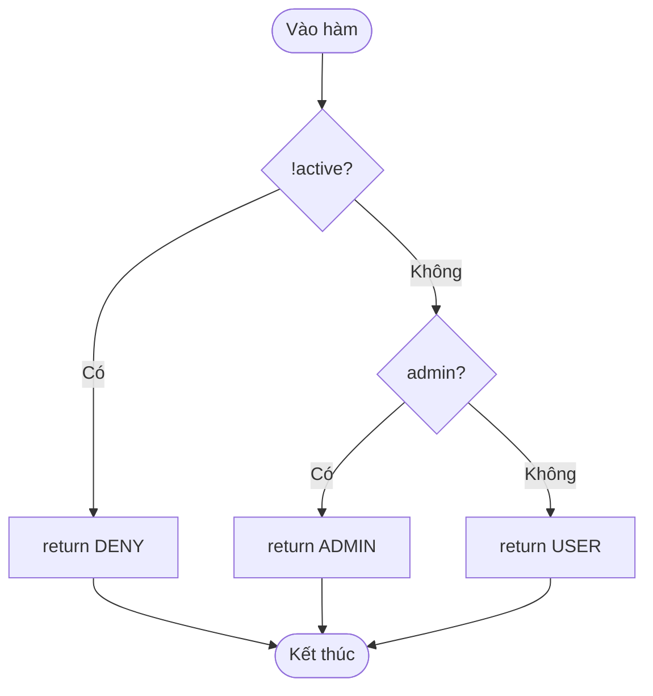

# Độ phức tạp chu trình và phạm vi mà chỉ số phản ánh

Trong module `CODE_QUALITY_FUNDAMENTALS`, mục tiêu là hiểu các thuộc tính quyết định mã nguồn có **đáng tin cậy, dễ hiểu và dễ thay đổi** hay không. Ở chương **Độ phức tạp**, một công cụ phổ biến để quan sát độ phức tạp của *luồng điều khiển* là **độ phức tạp chu trình** (*cyclomatic complexity*, thường ký hiệu là `V(G)` hoặc `M`). Chỉ số này có ích khi tìm các phương thức có nhiều nhánh quyết định cần đọc, kiểm thử hoặc sửa đổi.

Tuy nhiên, một con số không thể đại diện cho toàn bộ chất lượng của mã. Phương thức có độ phức tạp chu trình thấp vẫn có thể chứa thuật toán rất tốn tài nguyên, phụ thuộc ẩn, lỗi đồng thời hoặc một quy tắc nghiệp vụ khó hiểu. Ngược lại, một phương thức có nhiều nhánh nhưng diễn đạt rõ quy tắc nghiệp vụ chưa chắc cần tách nhỏ ngay.

Bài học này tập trung vào hai câu hỏi: **Chỉ số thực sự đo điều gì?** và **cần dùng, diễn giải, giới hạn nó như thế nào để cải thiện chất lượng mã?**

Sau khi học, bạn có thể:

- Giải thích độ phức tạp chu trình dựa trên đồ thị luồng điều khiển (*control-flow graph*, CFG).
- Tính chỉ số trên ví dụ Java đơn giản và nhận ra trường hợp công cụ tính khác nhau.
- Phân biệt số đường đi độc lập với số trường hợp đầu vào, số đường thực thi và số ca kiểm thử.
- Nhận diện những đặc tính quan trọng mà chỉ số **không** phản ánh.
- Dùng chỉ số làm tín hiệu ưu tiên review, thiết kế kiểm thử và refactor một cách có ngữ cảnh.

## 1. Độ phức tạp của luồng điều khiển

Chương trình không phải lúc nào cũng chạy từ dòng đầu đến dòng cuối. Các cấu trúc `if`, `switch`, vòng lặp, điều kiện có đoản mạch và một số đường xử lý ngoại lệ tạo ra những lựa chọn về bước tiếp theo.

Ví dụ, đoạn mã sau có ba kết quả tùy thuộc trạng thái tài khoản:

```java
static String accessLevel(boolean active, boolean admin) {
    if (!active) {
        return "DENY";
    }
    if (admin) {
        return "ADMIN";
    }
    return "USER";
}
```

Người đọc cần hiểu hai quyết định: tài khoản có hoạt động không, và nếu có thì có quyền quản trị không. Khi sửa yêu cầu phân quyền, người phát triển phải nhận diện những nhánh này và xem thay đổi có ảnh hưởng tới các trường hợp đang hợp lệ không.

Độ phức tạp chu trình được Edsger McCabe đề xuất như một thước đo cấu trúc của luồng điều khiển. Nó dựa trên số đường đi **độc lập tuyến tính** trong CFG, tức tập đường đi cơ sở có thể biểu diễn cấu trúc lựa chọn trong đồ thị. Trong cách tính đơn giản với các quyết định hai nhánh, mỗi quyết định bổ sung thường làm chỉ số tăng một đơn vị.

Không nên hiểu “đường đi độc lập” là tất cả chuỗi lệnh chương trình có thể thực hiện. Một vòng lặp có thể chạy 0, 1, 2, ... lần nên số đường thực thi cụ thể có thể rất lớn hoặc không bị chặn, trong khi chỉ số chu trình của phương thức vẫn hữu hạn.

## 2. Tính từ đồ thị luồng điều khiển

**CFG** mô tả những bước và lối chuyển điều khiển trong một đơn vị mã:

- **Đỉnh (node)** biểu diễn một bước, khối lệnh hoặc điểm quyết định; cách chia khối có thể khác nhau nhưng phải nhất quán.
- **Cạnh (edge)** biểu diễn một cách chuyển từ bước này sang bước khác.
- Các nhánh điều kiện tạo thêm lối đi. Trong cách mô hình hóa thông dụng, mọi lối thoát của phương thức được nối tới một điểm kết thúc chung để tính toán.

Đối với một CFG liên thông ứng với **một phương thức**, công thức thường dùng là:

\[
V(G) = E - N + 2
\]

Trong đó `E` là số cạnh và `N` là số đỉnh của CFG. Với nhiều thành phần liên thông độc lập được tính chung, dạng tổng quát là `V(G) = E - N + 2P`, trong đó `P` là số thành phần. Khi phân tích một phương thức có một CFG thông thường, `P = 1`.

Với đồ thị chỉ chứa các điểm quyết định có **hai** hướng và các điểm còn lại có một hướng, có thể đếm nhanh:

\[
V(G) = D + 1
\]

Trong đó `D` là số điểm quyết định hai nhánh. Khi có điểm rẽ ra hơn hai nhánh, cần tính theo số hướng đi thực tế trên CFG hoặc quy ước của công cụ thay vì áp dụng máy móc `D + 1`.

### Ví dụ kiểm tra bằng CFG

Đồ thị rút gọn cho phương thức `accessLevel`:



Sơ đồ gồm **7 đỉnh**, **8 cạnh** và một thành phần liên thông. Do đó `V(G) = 8 - 7 + 2 = 3`. Cách đếm nhanh cũng cho kết quả `2` điều kiện `if` + `1` = **3**.

Ba đường đi cơ sở có thể biểu diễn bằng các tình huống sau:

| Tình huống | `active` | `admin` | Kết quả |
| --- | --- | --- | --- |
| Tài khoản bị vô hiệu | `false` | bất kỳ | `DENY` |
| Tài khoản đang hoạt động và là quản trị viên | `true` | `true` | `ADMIN` |
| Tài khoản đang hoạt động và là người dùng thường | `true` | `false` | `USER` |

Một biến thể đầu vào `active=false, admin=true` cũng đi qua nhánh đầu tiên giống `active=false, admin=false`; nó không tạo thêm một đường điều khiển độc lập. Tuy vậy, việc cả hai dùng chung đường đi không có nghĩa mọi giá trị dữ liệu trên đường đi đó đều tương đương về nghiệp vụ.

### Diễn giải số đo đúng phạm vi

Ở ví dụ này, `V(G)=3` nói rằng cấu trúc có ba đường đi cơ sở. Nó **không** nói rằng xác suất lỗi là 3%, phương thức cần đúng ba bài kiểm thử, hay mọi tình huống được bảo vệ chỉ bằng ba ca dữ liệu.

Trong kiểm thử cấu trúc, việc đi qua một tập đường độc lập khả thi là một cách thiết kế kiểm thử cơ bản. Nhưng vẫn cần kiểm tra giá trị biên, lỗi dữ liệu, hợp đồng và tương tác bên ngoài. Một tập đường có thể chứa đường **không thể thực hiện** vì các điều kiện ràng buộc lẫn nhau; chỉ số không bảo đảm tự động có đủ đầu vào để kích hoạt từng đường.

## 3. Những cấu trúc Java thường làm chỉ số tăng

Một phép tính thủ công đơn giản có thể đếm những quyết định làm luồng xử lý rẽ hướng. Tuy nhiên, **định nghĩa CFG và quy tắc tính của từng công cụ phân tích có thể khác nhau**. Vì vậy, khi đối chiếu kết quả báo cáo từ các công cụ, phải biết phiên bản và quy tắc đang sử dụng.

| Cấu trúc | Ảnh hưởng thường gặp | Điểm cần lưu ý |
| --- | --- | --- |
| `if / else if` | Mỗi điều kiện nhánh thường tăng một đơn vị | `else` tự thân không thêm một quyết định mới. |
| `for / while / do-while` | Điều kiện vòng lặp thường làm tăng một đơn vị | Số vòng lặp chạy trong thực tế không làm chỉ số tăng tương ứng. |
| `switch` hoặc `switch expression` | Các nhánh lựa chọn làm tăng độ phức tạp | Điểm rẽ nhiều hướng cần xét số lối đi; công cụ có thể đếm `case`/`default` khác nhau. |
| Toán tử ba ngôi `condition ? a : b` | Tạo một lựa chọn hai hướng | Viết ngắn trên một dòng không loại bỏ quyết định. |
| `&&` và `||` đoản mạch | Có thể tạo thêm các nhánh điều khiển | Công cụ có thể cộng độ phức tạp theo từng toán tử logic; không thể chỉ đếm câu lệnh `if`. |
| `catch` hoặc đường đi do ngoại lệ | Cách xử lý có thể tạo lối đi khác | Cách mô hình hóa đường ngoại lệ và cách tính của công cụ không hoàn toàn thống nhất. |
| `return` sớm, `break`, `continue` | Thay đổi cạnh và lối thoát trong CFG | Không nên cứ thấy một từ khóa là mặc định cộng thêm 1; phải xét đồ thị/quy tắc của công cụ. |
| Lời gọi phương thức khác | Không tự mở rộng toàn bộ CFG của phương thức gọi theo mã bên trong hàm được gọi | Độ phức tạp có thể nằm tại hàm được gọi hoặc trải qua nhiều thành phần. |

Ví dụ, mã sau có một vòng lặp và ba điều kiện lồng nhau trong vòng lặp, cùng một điều kiện kiểm tra đầu vào:

```java
import java.util.List;

static int sumPositiveEven(List<Integer> numbers) {
    if (numbers == null) {
        throw new IllegalArgumentException("numbers is required");
    }

    int sum = 0;
    for (Integer value : numbers) {
        if (value != null) {
            if (value > 0) {
                if (value % 2 == 0) {
                    sum += value;
                }
            }
        }
    }
    return sum;
}
```

Nếu mỗi `if` và điều kiện `for` được mô hình hóa là một quyết định hai nhánh, ta có **5 điểm quyết định**: kiểm tra `numbers == null`, vòng `for`, kiểm tra `value != null`, `value > 0` và `value % 2 == 0`. Khi đó `V(G) = 5 + 1 = 6`. Đây là phép tính cho mô hình CFG nêu trên; khi so sánh công cụ thật, vẫn phải đối chiếu quy tắc đếm của công cụ đó.

Lưu ý một danh sách có 10.000 phần tử không làm `V(G)` thành 10.000. Số phần tử ảnh hưởng tới **số bước chạy và chi phí thời gian**, còn chỉ số chu trình biểu diễn cấu trúc nhánh.

### Điều kiện gộp và đoản mạch

Xét hai biểu thức Java:

```java
boolean eligible = active && balance > 0;
boolean flagged = expired || blocked;
```

Với `&&`, Java không đánh giá vế phải khi vế trái là `false`; với `||`, Java không đánh giá vế phải khi vế trái là `true`. Vì vậy, nếu CFG mô hình hóa các quyết định ngắn mạch, nó có thêm nhánh ngay cả khi toàn bộ biểu thức chỉ nằm trên một dòng.

Đặc biệt với điều kiện gồm nhiều toán tử logic, **không suy chỉ số chính xác từ mắt thường rồi so sánh với dashboard**; cần xem phương pháp của analyzer. Hai công cụ có thể cùng cung cấp chỉ số “cyclomatic complexity” nhưng thống kê các dạng biểu thức Java khác nhau.

## 4. Những gì độ phức tạp chu trình phản ánh

Chỉ số hữu ích nhất khi đặt câu hỏi về **cấu trúc điều khiển của một đơn vị mã**:

1. **Có bao nhiêu điểm luồng điều khiển có thể tách hướng?** Nhiều điều kiện thường khiến việc suy luận diễn biến trở nên khó hơn.
2. **Bề mặt kiểm thử cấu trúc đáng chú ý ở đâu?** Phương thức có nhiều lối đi có thể cần chú ý hơn khi kiểm thử hồi quy hoặc review thay đổi.
3. **Nên ưu tiên đọc và xem xét phương thức nào?** Khi kết hợp với tần suất thay đổi, lỗi đã xảy ra và tác động nghiệp vụ, chỉ số có thể giúp tìm vùng mã rủi ro.
4. **Một thay đổi đang thêm hoặc bỏ quyết định?** So sánh cách tính nhất quán của cùng một công cụ trước và sau bản sửa giúp thấy điều khiển có phức tạp thêm hay không.

Trong những giới hạn đó, chỉ số có mối liên hệ thực tế với **khả năng hiểu, kiểm thử và bảo trì**, nhưng đây là **tín hiệu cấu trúc**, không phải kết luận trực tiếp về chất lượng.

Hai phương thức cùng có `V(G)=6` có thể rất khác nhau. Một phương thức diễn đạt sáu trường hợp nghiệp vụ rõ ràng, mỗi nhánh ngắn và dễ kiểm tra; phương thức khác lồng nhiều điều kiện, sửa trạng thái toàn cục và gọi nhiều dịch vụ. Chỉ số bằng nhau không có nghĩa công sức bảo trì hay nguy cơ sai sót bằng nhau.

## 5. Những gì chỉ số không đo

Sẽ dễ hiểu lầm nếu coi `V(G)` như thước đo tổng quát cho mọi khía cạnh phức tạp:

| Khía cạnh khác | Ví dụ | Vì sao `V(G)` chưa đủ? |
| --- | --- | --- |
| **Độ phức tạp thời gian** | Một vòng lặp tìm kiếm hoặc thuật toán tăng theo `n²` | Chỉ số không thể hiện tốc độ tăng số bước theo kích thước đầu vào. |
| **Bộ nhớ và tài nguyên** | Tạo danh sách rất lớn trong hàm ít nhánh | Không phản ánh lượng bộ nhớ cấp phát hay I/O. |
| **Độ khó nhận thức** | Nhiều điều kiện lồng sâu và nhảy luồng khó theo dõi | Cùng số nhánh nhưng cách lồng và cách trình bày có thể tạo gánh nặng khác nhau. |
| **Khớp nối và phụ thuộc** | Hàm một nhánh gọi nhiều hệ thống ngoài | CFG của hàm không biểu diễn toàn bộ mạng phụ thuộc và hợp đồng. |
| **Độ phức tạp dữ liệu/trạng thái** | Phép tính trên hàng chục trường có ràng buộc lẫn nhau | Nhiều bất biến và trạng thái tiềm ẩn có thể tồn tại dù ít `if`. |
| **Đồng thời và phân tán** | Hai yêu cầu cập nhật cùng dữ liệu và phát sinh race condition | Lịch xen kẽ giữa các tác vụ không được đếm qua CFG của từng hàm. |
| **Độ đúng và bảo mật** | Một câu truy vấn SQL không tham số hóa, chỉ có một đường thực thi | Ít nhánh không chứng minh kết quả đúng hay hệ thống an toàn. |
| **Mức độ thay đổi nghiệp vụ** | Hàm cấu hình đơn giản nhưng thường bị sửa bởi nhiều yêu cầu | Chỉ số không biết tần suất đổi, hậu quả sai hoặc chi phí kiểm thử thực tế. |

Đặc biệt, không được nhầm **cyclomatic complexity** với **độ phức tạp thuật toán** (ký hiệu Big-O). Hai khái niệm dùng chung từ “độ phức tạp” nhưng hỏi các câu khác nhau:

- `V(G)`: “Luồng điều khiển có bao nhiêu đường đi cơ sở?”
- `O(n)`, `O(n log n)`, `O(n²)`: “Chi phí chạy tăng ra sao khi quy mô đầu vào tăng?”

Một thuật toán đơn giản gồm vòng lặp lồng nhau có thể có `V(G)` nhỏ nhưng chi phí `O(n²)`, trong khi hàm xét 20 quy tắc nghiệp vụ độc lập có `V(G)` cao nhưng thời gian chạy gần như hằng số đối với đầu vào kích thước cố định.

Chỉ số **cognitive complexity** cũng nhằm phục vụ câu hỏi khác, thường phản ánh chi phí hiểu các cấu trúc điều khiển, mức lồng nhau và việc phá vỡ luồng đọc. Độ phức tạp chu trình tập trung vào cấu trúc đường đi cơ sở; vì thế hai chỉ số có thể khác nhau ngay trên một đoạn mã.

## 6. Dùng chỉ số để hỗ trợ thiết kế kiểm thử

Khi một phương thức có nhiều nhánh, bước đầu tiên là **liệt kê quyết định và hành vi đầu ra**. Độ phức tạp chu trình giúp nhắc rằng có nhiều luồng xử lý cần xem xét, nhưng ca kiểm thử nên xuất phát từ hợp đồng nghiệp vụ và các lỗi có thể xảy ra.

Xét hàm ra quyết định giao hàng:

```java
static String shippingDecision(
        int stock, int requested, boolean accountActive) {
    if (!accountActive) {
        return "BLOCKED";
    }
    if (requested <= 0) {
        return "INVALID_QUANTITY";
    }
    if (stock < requested) {
        return "OUT_OF_STOCK";
    }
    return "ACCEPTED";
}
```

Trong mô hình CFG đơn giản, có **3 điều kiện `if`**, nên `V(G) = 4`. Bốn đường đi cơ sở là: tài khoản bị chặn; số lượng yêu cầu không hợp lệ; số lượng hợp lệ nhưng tồn kho không đủ; và yêu cầu được chấp nhận.

Tuy nhiên, một tập kiểm thử chú trọng nghiệp vụ nên bao gồm cả các giá trị biên:

| `stock` | `requested` | `accountActive` | Kết quả mong đợi | Mục đích |
| ---: | ---: | --- | --- | --- |
| 5 | 1 | `false` | `BLOCKED` | Nhánh tài khoản không hoạt động. |
| 5 | 0 | `true` | `INVALID_QUANTITY` | Biên không hợp lệ. |
| 5 | -1 | `true` | `INVALID_QUANTITY` | Đầu vào âm. |
| 0 | 1 | `true` | `OUT_OF_STOCK` | Kho trống. |
| 2 | 3 | `true` | `OUT_OF_STOCK` | Thiếu một đơn vị hàng. |
| 2 | 2 | `true` | `ACCEPTED` | Đúng bằng số lượng còn. |
| 2 | 1 | `true` | `ACCEPTED` | Còn dư hàng. |

Có **7 ca minh họa** dù chỉ số là **4**. Điều này không mâu thuẫn: nhiều ca có cùng đường điều khiển nhưng kiểm tra những điều kiện nghiệp vụ khác nhau. Ngược lại, việc chạy bốn ca không tự động chứng minh tính đúng đắn. Ví dụ chưa định nghĩa điều gì xảy ra khi `stock < 0`; nếu hệ thống không cho phép tồn kho âm thì cần bổ sung ràng buộc và kiểm thử riêng.

### Độ bao phủ đường đi không đồng nghĩa độ bao phủ điều kiện

Ba khái niệm thường bị gộp nhầm:

- **Statement coverage:** phần trăm câu lệnh đã được thực thi.
- **Branch coverage:** những kết quả rẽ nhánh (ví dụ `true` và `false`) đã được thực thi tới mức nào.
- **Path coverage:** những chuỗi nhánh cụ thể đã được đi qua tới mức nào; số đường thực thi có thể tăng rất nhanh do điều kiện phối hợp và vòng lặp.

Độ phức tạp chu trình liên quan tới **số đường đi cơ sở độc lập trên CFG**, nhưng **không phải** tỷ lệ statement coverage, branch coverage, toàn bộ path coverage hoặc một chỉ số kiểm thử đầy đủ.

Với điều kiện phức hợp như `(age >= 18 && verified) || admin`, một bộ kiểm thử chỉ cho điều kiện chung kết quả `true` và `false` chưa chắc chứng minh từng mệnh đề thành phần đã được kiểm tra phù hợp. Trong miền rủi ro cao, có thể cân nhắc kiểm thử theo bảng quyết định hoặc tiêu chí điều kiện độc lập như **MC/DC** khi cần, nhưng phải dựa trên yêu cầu dự án; không tự suy ra MC/DC từ `V(G)`.

Với vòng lặp, các trường hợp thường có giá trị là **0 lần lặp**, **1 lần lặp**, **nhiều lần lặp** và ranh giới liên quan. Một vòng `for` thường chỉ cộng một quyết định vào cách tính đơn giản, nhưng kiểm thử một lần lặp không thể thay thế mọi trường hợp tải và dữ liệu.

## 7. Cùng một độ phức tạp, khả năng đọc vẫn khác nhau

Xét một điều kiện công bố nội dung: chỉ công bố khi có ít nhất hai lượt đánh giá và đã được phê duyệt.

**Phiên bản lồng nhánh:**

```java
static boolean mayPublish(int reviewCount, boolean approved) {
    if (reviewCount >= 2) {
        if (approved) {
            return true;
        }
    }
    return false;
}
```

**Phiên bản điều kiện bảo vệ (guard clause):**

```java
static boolean mayPublish(int reviewCount, boolean approved) {
    if (reviewCount < 2) {
        return false;
    }
    if (!approved) {
        return false;
    }
    return true;
}
```

Cả hai đều có **2 câu lệnh `if`**, nên theo cách đếm nhánh nhị phân đơn giản đều có `V(G) = 3`. Dù con số không đổi, phiên bản thứ hai giúp người đọc nhận ra ngay các lý do từ chối và không phải theo dõi nhiều cấp lồng nhau. Đây là một ví dụ cho thấy **cải thiện khả năng hiểu không nhất thiết làm giảm độ phức tạp chu trình**.

Cũng có thể viết:

```java
static boolean mayPublish(int reviewCount, boolean approved) {
    return reviewCount >= 2 && approved;
}
```

Biểu thức ngắn gọn hơn, nhưng vẫn có lựa chọn do `&&` đoản mạch. Một số analyzer tính toán tử này là quyết định, một số cách đếm chỉ dựa trên số `if` sẽ cho con số khác. Quy tắc nghiệp vụ “đủ hai đánh giá **và** được phê duyệt” không biến mất chỉ vì được viết thành một biểu thức.

Trong trường hợp đơn giản, dòng `return` gộp có thể dễ hiểu nhất. Khi từng điều kiện cần thông báo lỗi riêng, ghi nhận lý do từ chối hoặc thực hiện hành vi riêng, cách dùng guard clause có thể rõ ràng hơn. **Tiêu chí lựa chọn là khả năng mô tả và kiểm chứng hành vi, không phải chỉ số nhỏ nhất.**

### Tách phương thức: số đo cục bộ giảm, độ khó tổng thể có thể không giảm

Giả sử một phương thức có nhiều `if` được tách thành bốn helper. Độ phức tạp tính **trên từng phương thức** có thể giảm đáng kể, vì mỗi helper chỉ chứa một phần luồng điều khiển. Nhưng toàn bộ quy tắc nghiệp vụ vẫn tồn tại và người đọc có thể phải truy cập thêm bốn nơi.

Nên tách khi có một ranh giới trách nhiệm thực sự:

- Một nhóm điều kiện tạo nên **quy tắc nghiệp vụ có tên rõ nghĩa**, ví dụ `isEligibleForRefund`.
- Đơn vị mới có hợp đồng, đầu vào, đầu ra và tác dụng phụ được xác định.
- Có thể kiểm thử riêng quy tắc mà không phải dựng quá nhiều phụ thuộc.
- Các thay đổi tương lai có thể xảy ra độc lập, hoặc việc tách làm luồng chính dễ đọc hơn.

Không nên tách chỉ để mỗi phương thức xuống dưới một ngưỡng số học, khiến luồng xử lý bị phân tán và khó lần theo. **Độ phức tạp có thể được chuyển vị trí, chứ chưa chắc được loại bỏ**.

## 8. Đọc và so sánh báo cáo từ công cụ phân tích

Độ phức tạp chu trình thường được tính tự động bởi công cụ phân tích mã tĩnh hoặc bộ đo chất lượng. Để diễn giải đúng, cần xác định:

1. **Đơn vị đo:** một phương thức, một lớp, một tệp hay tổng hợp cả dự án? Tổng chỉ số của một tệp có thể tăng chỉ vì thêm chức năng mới dù các phương thức cũ không phức tạp hơn.
2. **Ngôn ngữ và phiên bản phân tích:** `switch expression`, lambda, pattern matching và các cấu trúc Java mới được công cụ hỗ trợ, đếm thế nào?
3. **Quy tắc đếm:** toán tử `&&`/`||`, `case`, `catch`, ternary, điều kiện vòng lặp có được tính không?
4. **Cách gán trọng số và ngưỡng cảnh báo:** ngưỡng đang áp cho thay đổi mới hay toàn bộ mã cũ, và có ngoại lệ nghiệp vụ hợp lý không?
5. **Phạm vi so sánh:** các lần đo có dùng cùng công cụ, phiên bản, cấu hình và tập mã nguồn không?

Ví dụ, dashboard báo độ phức tạp của phương thức tăng từ 7 lên 9. Điều đáng hỏi là **hai điểm điều khiển mới thuộc quy tắc nào**, chúng có cần thiết không, và kiểm thử đã phản ánh hai nhánh đó chưa. Không nên kết luận bản sửa kém chất lượng chỉ vì số tăng: bổ sung xử lý lỗi rõ ràng có thể làm luồng điều khiển tăng nhưng lại cải thiện độ tin cậy.

### Ngưỡng cảnh báo không phải định luật

Một nhóm có thể chọn ngưỡng cảnh báo, chẳng hạn `V(G) > 10` cho một phương thức, để ưu tiên xem xét. Đây là **ví dụ về quy ước nội bộ**, không phải ngưỡng chất lượng áp dụng cho mọi dự án và mọi phương pháp đếm.

Các yếu tố cần cân nhắc khi thiết lập ngưỡng:

| Yếu tố | Câu hỏi thực hành |
| --- | --- |
| Rủi ro nghiệp vụ | Phương thức liên quan tới tiền, phân quyền hay dữ liệu quan trọng không? |
| Tần suất thay đổi | Đoạn mã có thường xuyên phải cập nhật quy tắc không? |
| Độ rõ của cấu trúc | Các nhánh có minh bạch và có tên nghiệp vụ tốt không? |
| Bằng chứng kiểm thử | Các kết quả quan trọng, trường hợp biên và lỗi đã có kiểm thử không? |
| Lịch sử sự cố | Những lần sửa trước có gây lỗi hồi quy hoặc khó chẩn đoán không? |
| Chi phí refactor | Thay đổi cấu trúc có thực sự giảm công sức hiểu và sửa, hay chỉ thêm tầng trừu tượng? |

Chỉ số nên khởi động một cuộc thảo luận có bằng chứng. Quyết định cải thiện cần dựa vào việc người phát triển phải hiểu gì, rủi ro thay đổi ra sao và lợi ích nào có thể đo được.

## 9. Quy trình ứng dụng trong code review và cải tiến

Một quy trình phù hợp có thể gồm sáu bước:

**Bước 1 — Chọn phạm vi.** Tập trung vào phương thức đang sửa, đường xử lý nhiều lỗi hoặc nơi có nhu cầu thay đổi thực tế. Không cần đồng loạt sửa tất cả phương thức có con số lớn.

**Bước 2 — Hiểu hành vi.** Ghi lại đầu vào hợp lệ, kết quả, tác dụng phụ và các bất biến. Đọc các nhánh để biết chúng ứng với tình huống nghiệp vụ nào.

**Bước 3 — Xem số đo và CFG.** Nếu công cụ báo giá trị cao, đối chiếu các điểm quyết định thực tế. Tìm điều kiện lặp, nhánh không thể tới, lồng sâu hoặc tổ hợp làm kết quả khó dự đoán.

**Bước 4 — Thiết kế bằng chứng bảo vệ.** Bổ sung kiểm thử ở ranh giới và những điều kiện có rủi ro. Nếu refactor, trước hết kiểm tra hành vi hiện tại; nếu thay yêu cầu, ghi rõ hành vi cũ và mới.

**Bước 5 — Cải tiến phù hợp.** Có thể dùng guard clause, bảng tra cứu, `switch` theo enum, tách quy tắc thành phương thức có tên hoặc thay đổi ranh giới trách nhiệm. Cần đánh giá cả khả năng hiểu, tính đúng đắn và chi phí phụ thuộc.

**Bước 6 — Kiểm chứng sau thay đổi.** Chạy lại kiểm thử phù hợp, xem báo cáo cùng quy tắc đếm, kiểm tra ảnh hưởng tới các bên gọi và đánh giá xem bản sửa có thực sự dễ hiểu, dễ bảo trì hơn không.

Trong review, những câu hỏi hữu ích là: “Nhánh mới giải quyết tình huống nào? Có nhánh nào không thể xảy ra hoặc bị trùng? Trường hợp biên đã được kiểm chứng chưa? Nếu tách logic, người đọc sẽ tìm quy tắc ở đâu?”

### Tránh tối ưu số đo nhưng làm xấu mã

Không nên xem việc giảm `V(G)` là mục đích tự thân. Những cách sau có thể tạo số liệu đẹp nhưng không cải thiện hệ thống:

- Chuyển nhiều điều kiện sang các helper tên chung chung như `check1`, `check2` chỉ để giảm giá trị **trên một phương thức**.
- Che giấu logic trong cấu hình phức tạp, biểu thức khó đọc hoặc các callback rời rạc mà không có hợp đồng rõ ràng.
- Loại bỏ kiểm tra lỗi cần thiết để đạt ngưỡng cảnh báo.
- Viết nhánh gộp quá ngắn nhưng không thể phân biệt nguyên nhân thất bại.
- Cố ép mọi trường hợp vào một trừu tượng chung dù chúng có ý nghĩa nghiệp vụ khác nhau.

Nếu việc giảm chỉ số khiến khả năng quan sát lỗi, kiểm thử hoặc truy vết tệ đi, cần đánh giá lại quyết định. **Một thiết kế tốt giảm độ khó thực sự của việc hiểu và thay đổi hệ thống.**

## 10. Bài tập thực hành

### Bài 1 — Tính chỉ số từ Java

Xét đoạn mã:

```java
static String category(int score, boolean verified) {
    if (score < 0) {
        return "INVALID";
    }
    if (score >= 90) {
        return verified ? "EXCELLENT" : "PENDING";
    }
    if (score >= 60) {
        return "PASS";
    }
    return "RETRY";
}
```

Hãy vẽ CFG rút gọn và tính `V(G)` nếu mỗi `if` và toán tử ba ngôi tạo một quyết định hai nhánh. Đáp án cho mô hình này: **4 điểm quyết định, `V(G)=5`**. Nêu ít nhất năm đường đi cơ sở, sau đó bổ sung các giá trị biên như `score=-1, 0, 59, 60, 89, 90` để kiểm tra hợp đồng.

### Bài 2 — Nhận diện giới hạn

Xét hai phương thức: một phương thức có một vòng lặp lồng nhau trên mảng kích thước `n` và một phương thức có 12 nhánh xử lý mã trạng thái. Phương thức nào có `V(G)` lớn hơn? Phương thức nào có thời gian chạy tăng nhanh hơn? Có đủ thông tin để kết luận không?

Gợi ý: **chưa đủ thông tin** nếu không có cấu trúc nhánh và thuật toán cụ thể. Thời gian chạy và độ phức tạp chu trình là hai trục khác nhau.

### Bài 3 — Refactor có lý do

Viết lại hai phiên bản `mayPublish` ở mục 7 bằng các phong cách khác nhau. Giữ hành vi cho các trường hợp `reviewCount=-1, 0, 1, 2` và cả hai giá trị `approved`. Giải thích vì sao số đo có thể giữ nguyên trong khi mã dễ hiểu hơn.

### Bài 4 — Thiết kế kiểm thử

Với `shippingDecision` ở mục 6, nêu những trường hợp một bộ kiểm thử chỉ có bốn ca theo đường đi cơ sở có thể bỏ sót. Hãy đề xuất hợp đồng cho tồn kho âm, xác định ca kiểm thử đầu vào không hợp lệ và quyết định có cần bổ sung hành vi xử lý mới hay không.

### Bài 5 — Đánh giá cảnh báo

Một công cụ báo phương thức `calculateInvoice` có `V(G)=14`, thường được sửa nhưng gần đây không có lỗi ghi nhận. Hãy đề xuất các thông tin cần thu thập trước khi quyết định refactor: ý nghĩa nhánh, kiểm thử hiện có, mức khớp nối, thay đổi trước đây, chi phí đọc hiểu, các trường hợp không tương thích và khả năng tách theo ranh giới nghiệp vụ. Giải thích vì sao **chỉ riêng số 14** chưa đủ kết luận.

**Tiêu chí tự đánh giá:** Bạn có thể tính và giải thích `V(G)` từ một CFG nhất quán; nêu rõ quy tắc đếm và sự khác biệt giữa các công cụ; phân biệt đường đi cơ sở với độ bao phủ và số trường hợp nghiệp vụ; đồng thời đưa ra quyết định kiểm thử/refactor dựa trên rủi ro thực tế.

## Ghi nhớ

**Độ phức tạp chu trình** phản ánh cấu trúc các hướng đi của luồng điều khiển, thường được biểu diễn bằng `V(G) = E - N + 2` cho một CFG liên thông. Nó hữu ích để nhận diện nơi cần chú ý khi đọc mã, thiết kế kiểm thử cấu trúc và review thay đổi. Nó **không** đo trực tiếp tính đúng đắn, độ khó nhận thức, khớp nối, mức sử dụng tài nguyên, độ phức tạp thuật toán hay rủi ro nghiệp vụ. Hãy dùng chỉ số cùng với hợp đồng hành vi, bằng chứng kiểm thử và ngữ cảnh bảo trì; một bản cải tiến tốt giúp mã dễ hiểu và thay đổi an toàn hơn, ngay cả khi số đo không giảm.
