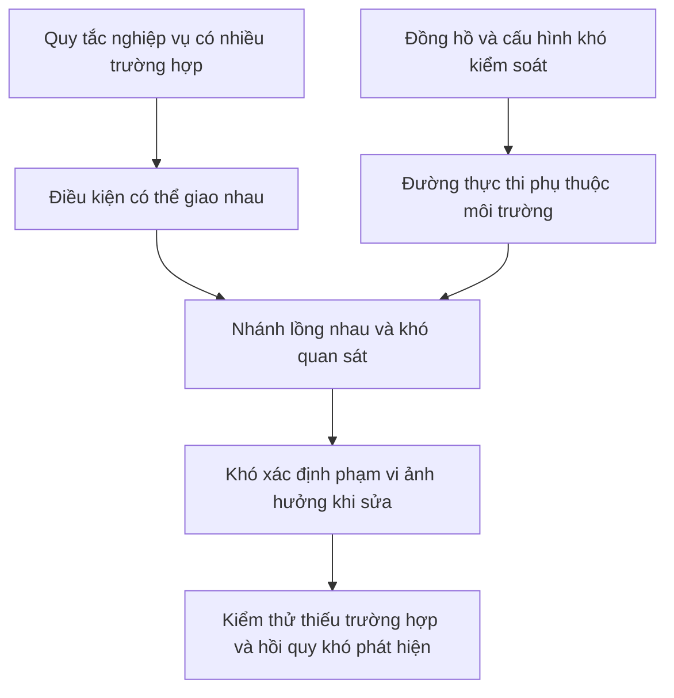
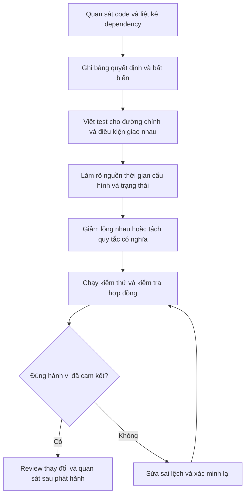

# Mức lồng nhau, phụ thuộc ngầm và điều kiện chồng chéo

## 1. Vì sao ba yếu tố này khiến mã nguồn khó hiểu và khó thay đổi?

Một phương thức có thể chỉ dài vài chục dòng nhưng vẫn rất khó bảo trì. Người đọc phải ghi nhớ nhiều lớp `if`, suy luận xem những điều kiện nào có thể cùng đúng, đồng thời tìm hiểu một biến cấu hình hoặc trạng thái toàn cục được lấy từ đâu. Khi sửa một nhánh, họ không chắc nhánh khác có bị ảnh hưởng. Nếu có sự cố, người vận hành cũng khó trả lời vì sao hệ thống chọn một kết quả cụ thể.

Trong module `CODE_QUALITY_FUNDAMENTALS`, mục tiêu là **hiểu những thuộc tính quyết định mã nguồn có đáng tin cậy, dễ hiểu và dễ thay đổi hay không**. Bài thuộc chương **Độ phức tạp** này nghiên cứu ba nguồn làm tăng gánh nặng suy luận:

1. **Mức lồng nhau (nesting depth):** số tầng điều khiển phải theo dõi khi đọc một vị trí trong mã.
2. **Phụ thuộc ngầm (implicit dependencies):** dữ liệu, cấu hình, tài nguyên hoặc điều kiện vận hành ảnh hưởng đến kết quả nhưng không hiện rõ trong hợp đồng hay đường gọi.
3. **Điều kiện chồng chéo (overlapping conditions):** nhiều điều kiện cùng có thể đúng, giao nhau hoặc che khuất nhau; thứ tự kiểm tra làm thay đổi hành vi.

Ba yếu tố này thường đi cùng nhau. Một chuỗi điều kiện sâu dễ che giấu các giả định, còn một phụ thuộc ngầm làm cho từng điều kiện khó kiểm chứng hơn. Mục tiêu khi cải thiện mã là **giảm lượng thông tin phải giữ trong đầu để hiểu hành vi**, đồng thời bảo vệ đúng quy tắc nghiệp vụ.

Sau bài học, bạn có thể nhận diện các dấu hiệu đó, phân biệt độ phức tạp cần thiết với độ phức tạp do cách triển khai, và cải thiện code Java bằng guard clause, bảng quyết định, kiểu dữ liệu rõ nghĩa, ranh giới phụ thuộc và kiểm thử trường hợp biên.

## 2. Độ phức tạp có nhiều chiều, không chỉ là số dòng

**Độ phức tạp logic** liên quan đến số đường thực thi và sự kết hợp điều kiện. **Độ phức tạp nhận thức** liên quan đến công sức người đọc phải bỏ ra để hiểu luồng xử lý. **Độ phức tạp phụ thuộc** liên quan đến số quan hệ và ảnh hưởng giữa các thành phần. Chúng có liên quan nhưng không đồng nhất.

| Góc nhìn | Dấu hiệu thường thấy | Tại sao đáng quan tâm? |
| --- | --- | --- |
| Luồng điều khiển | Nhiều `if`, `else`, `switch`, vòng lặp, `catch` | Có nhiều đường đi cần xem xét và kiểm thử |
| Mức lồng nhau | `if` nằm trong `if`, vòng lặp trong nhánh, xử lý lỗi trong vòng lặp | Người đọc phải nhớ điều kiện của các khối bao ngoài |
| Biểu thức điều kiện | Kết hợp `&&`, `||`, `!` cùng nhiều nhánh ưu tiên | Khó biết tập dữ liệu nào đi vào nhánh nào |
| Phụ thuộc | Hàm đọc biến toàn cục, đồng hồ, môi trường, database hoặc trạng thái ẩn | Khó tái hiện kết quả, test độc lập và dự báo ảnh hưởng |
| Trạng thái | Nhiều cờ boolean có thể kết hợp thành những trạng thái khác nhau | Dễ xuất hiện tổ hợp vô nghĩa hoặc chưa được xử lý |
| Tác dụng phụ | Một hàm vừa kiểm tra, vừa ghi, vừa gửi thông báo | Không rõ việc gì đã hoàn thành khi có lỗi giữa chừng |

**Cyclomatic complexity** thường liên quan đến số đường thực thi độc lập qua đồ thị điều khiển; **cognitive complexity** là một cách đánh giá khác, chú trọng mức khó theo dõi khi có ngắt luồng và lồng nhau. Các công cụ có quy tắc tính cụ thể, nên không nên coi hai chỉ số là cùng một đại lượng. Một hàm ít nhánh nhưng phụ thuộc vào một biến toàn cục thay đổi bất ngờ vẫn có thể khó hiểu, dù điểm cyclomatic thấp.

Đừng nhầm **độ phức tạp thiết yếu** với **độ phức tạp do triển khai**. Một quy tắc tính thuế có nhiều ngoại lệ pháp lý có thể thực sự cần nhiều trường hợp; việc đổi tên hàm không làm số trường hợp biến mất. Nhưng việc viết quy tắc đó thành chuỗi lồng nhau sâu, thiếu bảng điều kiện và có nhiều cấu hình ẩn tạo thêm độ phức tạp không cần thiết.

## 3. Mức lồng nhau: người đọc phải nhớ quá nhiều điều kiện

### 3.1. Vì sao `if` lồng sâu khó theo dõi?

Xét một quy tắc xử lý đơn hàng giả định: chỉ cho phép chuẩn bị giao hàng nếu đơn **không bị hủy**, **không bị giữ để kiểm tra rủi ro**, **đã thanh toán** và **đã giữ được hàng trong kho**. Đồng thời, hệ thống cần trả về lý do cụ thể khi chưa thể xử lý.

```java
Decision decide(Order order) {
    if (order != null) {
        if (!order.cancelled()) {
            if (!order.fraudHold()) {
                if (order.paid()) {
                    if (order.stockReserved()) {
                        return Decision.READY;
                    } else {
                        return Decision.WAITING_STOCK;
                    }
                } else {
                    return Decision.WAITING_PAYMENT;
                }
            } else {
                return Decision.MANUAL_REVIEW;
            }
        } else {
            return Decision.CANCELED;
        }
    }
    throw new IllegalArgumentException("order không được null");
}
```

Đoạn mã diễn đạt được quy tắc nhưng mỗi khi đọc phần ở sâu nhất, người đọc phải nhớ toàn bộ điều kiện bao ngoài. Nếu thêm một điều kiện mới như `addressVerified`, thay đổi có thể làm cấu trúc thụt lề và nhánh `else` phình thêm. Khi một nhánh bị di chuyển, thứ tự ưu tiên của các lý do từ chối cũng có nguy cơ thay đổi.

**Lồng nhau không phải lỗi tự thân.** Một vòng lặp qua dòng hàng có kiểm tra giá trị biên bên trong thường hợp lý. Vấn đề xuất hiện khi độ sâu không mang thêm thông tin hữu ích tương xứng và khiến việc suy luận về từng đường đi trở nên tốn kém.

### 3.2. Dùng guard clause để giải quyết các trường hợp kết thúc sớm

**Guard clause** là kiểm tra một điều kiện ở đầu hàm hoặc gần nơi cần bảo vệ, sau đó thoát khỏi đường xử lý hiện tại nếu điều kiện không thỏa. Với quy tắc trên:

```java
Decision decide(Order order) {
    if (order == null) {
        throw new IllegalArgumentException("order không được null");
    }
    if (order.cancelled()) {
        return Decision.CANCELED;
    }
    if (order.fraudHold()) {
        return Decision.MANUAL_REVIEW;
    }
    if (!order.paid()) {
        return Decision.WAITING_PAYMENT;
    }
    if (!order.stockReserved()) {
        return Decision.WAITING_STOCK;
    }
    return Decision.READY;
}
```

Mỗi kiểm tra có một ý nghĩa riêng. Khi đến `return READY`, người đọc có thể kết luận các trường hợp chặn trước đó đều đã bị loại. Độ sâu của thân hàm không tăng theo số điều kiện.

Điều kiện quan trọng để refactor an toàn là **giữ nguyên thứ tự ưu tiên và hành vi**. Trong ví dụ, nếu đơn vừa bị hủy vừa bị giữ để kiểm tra rủi ro, kết quả vẫn là `CANCELED` vì đó là điều kiện được xem trước. Thứ tự này là một quyết định nghiệp vụ của ví dụ, không phải quy luật áp dụng cho mọi hệ thống.

### 3.3. Khi guard clause chưa chắc phù hợp

- Một chuỗi bước cần hoàn tác hoặc đóng tài nguyên có thể bị bỏ qua nếu `return` đặt sai chỗ. Hãy sử dụng `try-with-resources`, `finally` hoặc ranh giới giao dịch phù hợp thay vì tự phụ thuộc vào một đoạn cleanup nằm cuối hàm.
- Nếu có nhiều điểm thoát nhưng mỗi điểm lại tạo các tác dụng phụ khác nhau, đường đi có thể trở nên khó kiểm soát hơn. Khi đó nên tách **xác định quyết định** khỏi **thi hành quyết định**.
- Một thuật toán thực sự có cấu trúc cây, ví dụ duyệt cây cú pháp, có thể tự nhiên cần lồng nhau hoặc đệ quy; không phải lúc nào làm phẳng mọi nhánh cũng dễ đọc hơn.
- Việc chia một hàm thành nhiều hàm có tên chung chung như `handlePart1()` và `handlePart2()` chỉ chuyển gánh nặng suy luận sang việc nhảy giữa các tệp.

Mục tiêu của guard clause là làm **đường đi chính và điều kiện loại trừ rõ ràng**, không phải đạt một con số thụt lề bằng mọi giá.

## 4. Điều kiện chồng chéo: khi nhiều nhánh cùng đúng

### 4.1. `if`, `else if` và `if` độc lập thể hiện các hợp đồng khác nhau

```java
if (score >= 80) {
    category = "HIGH";
} else if (score >= 60) {
    category = "MEDIUM";
} else {
    category = "LOW";
}
```

Ở đây, `score >= 80` **cũng thỏa** `score >= 60`. Nhờ `else if`, chỉ nhánh đầu tiên đúng được thực hiện. Thứ tự từ ngưỡng cao xuống thấp là một phần của hợp đồng. Đảo thứ tự sẽ khiến nhánh `HIGH` không bao giờ được chọn khi điểm từ 80 trở lên.

Nếu viết thành những `if` độc lập, nhiều nhánh có thể chạy và ghi đè kết quả:

```java
if (score >= 80) {
    category = "HIGH";
}
if (score >= 60) {
    category = "MEDIUM"; // Ghi đè HIGH khi score >= 80.
}
```

Không phải mọi điều kiện chồng chéo đều sai: các `if` độc lập là đúng khi thực sự muốn thực hiện **nhiều hành động đồng thời**. Cần xác định đây là *phân loại loại trừ nhau*, *các tác vụ độc lập*, hay *các quy tắc ưu tiên* trước khi chọn cấu trúc.

### 4.2. Điều kiện bị che khuất và nhánh không thể tới

```java
if (amount > 100) {
    return FeeBand.HIGH;
} else if (amount > 200) {
    return FeeBand.VERY_HIGH; // Không thể tới.
}
```

Mọi giá trị lớn hơn 200 đều lớn hơn 100, nên nhánh thứ hai không thể chạy. Việc có nhiều nhánh `else if` không bảo đảm đã xử lý đúng các khoảng giá trị. Nếu muốn phân loại theo ngưỡng 100 và 200, cần kiểm tra ngưỡng cao hơn trước và định nghĩa rõ các trường hợp đúng bằng ngưỡng.

### 4.3. Nhiều cờ boolean tạo ra tổ hợp trạng thái

Giả sử một đơn có bốn thuộc tính boolean: `cancelled`, `fraudHold`, `paid`, `stockReserved`. Về mặt tổ hợp, bốn cờ độc lập có tối đa \(2^4 = 16\) bộ giá trị, nhưng không phải bộ nào cũng có nghĩa hoặc cần xử lý theo một cách riêng.

Ví dụ, đơn đã hủy và có dấu hiệu rủi ro có thể đồng thời tồn tại. Nếu một nhánh trả `CANCELED`, nhánh khác trả `MANUAL_REVIEW`, cần quy định rõ kết quả nào được ưu tiên. Nếu một số trạng thái là **bất hợp lệ**, chẳng hạn dữ liệu nghiệp vụ không cho phép đơn đã hủy chuyển sang trạng thái mới, thì cần bảo vệ bất biến chứ không chỉ tùy ý đặt thứ tự `if` để che khuất dữ liệu sai.

### 4.4. Bảng quyết định làm rõ thứ tự ưu tiên

Với quy tắc chuẩn bị giao hàng ở phần 3, có thể lập bảng quyết định. Ký hiệu `—` nghĩa là giá trị đó không ảnh hưởng đến kết quả của dòng tương ứng, **do những điều kiện ưu tiên trước đã quyết định**.

| Ưu tiên | Đã hủy | Giữ kiểm tra rủi ro | Đã thanh toán | Đã giữ kho | Kết quả |
| --- | --- | --- | --- | --- | --- |
| 1 | Có | — | — | — | `CANCELED` |
| 2 | Không | Có | — | — | `MANUAL_REVIEW` |
| 3 | Không | Không | Không | — | `WAITING_PAYMENT` |
| 4 | Không | Không | Có | Không | `WAITING_STOCK` |
| 5 | Không | Không | Có | Có | `READY` |

Bảng làm lộ rõ tính **chồng chéo có chủ đích** của điều kiện: các dòng có thứ tự, mỗi dòng được kiểm tra sau khi loại trừ các dòng trước. Nó còn giúp viết test cho cặp điều kiện cùng đúng, ví dụ `cancelled=true` và `fraudHold=true`. Với nghiệp vụ nhiều chiều hơn, bảng quyết định hoặc bảng chân trị có thể phát hiện khoảng trống và trường hợp mâu thuẫn trước khi viết mã.

### 4.5. Biểu thức boolean dài thường cần đặt tên hoặc tách quy tắc

```java
// Khó giải thích khi review:
if ((paid && reserved || managerOverride) && !fraudHold && !cancelled) {
    // ...
}
```

Theo độ ưu tiên toán tử Java, `&&` được đánh giá trước `||`, nên điều kiện trên tương đương với `((paid && reserved) || managerOverride) && !fraudHold && !cancelled`. Ngữ nghĩa của `managerOverride` cho phép bỏ qua yêu cầu thanh toán và giữ kho hay chỉ bỏ qua một kiểm tra cụ thể? Nếu không có quy tắc nghiệp vụ, **không thể khẳng định** cách nhóm này đúng.

Có thể đặt tên các mệnh đề đã được xác nhận:

```java
boolean normalRequirementsMet = paid && reserved;
boolean isBlocked = fraudHold || cancelled;
boolean canProceed = (normalRequirementsMet || managerOverride) && !isBlocked;
```

Đặt tên giúp thảo luận nhưng chưa giải quyết tự động việc `managerOverride` có quyền nào. Khi chính sách nhiều trường hợp và thường xuyên thay đổi, enum trạng thái, kiểu kết quả miền nghiệp vụ hoặc một đối tượng policy có test rõ ràng có thể phù hợp hơn một biểu thức boolean quá dài.

Ngoài ra, Java sử dụng **short-circuit evaluation** cho `&&` và `||`: vế sau có thể không được thực hiện. Đừng dựa vào tác dụng phụ trong một điều kiện nếu việc bỏ qua vế sau sẽ làm thay đổi dữ liệu hoặc log quan trọng.

## 5. Ví dụ Java đầy đủ: làm phẳng luồng mà giữ nguyên thứ tự quyết định

Một triển khai Java 17+ có thể diễn đạt quy tắc đã xác nhận bằng kiểu dữ liệu cụ thể. Đặt đoạn sau trong tệp `OrderFulfillmentPolicy.java` khi dùng trong dự án thật:

```java
import java.util.Objects;

public final class OrderFulfillmentPolicy {
    private OrderFulfillmentPolicy() {}

    public record Order(
            boolean cancelled,
            boolean fraudHold,
            boolean paid,
            boolean stockReserved) {}

    public enum Decision {
        CANCELED,
        MANUAL_REVIEW,
        WAITING_PAYMENT,
        WAITING_STOCK,
        READY
    }

    /**
     * Thứ tự ưu tiên: hủy > kiểm tra rủi ro > thanh toán > tồn kho.
     * Hàm chỉ đưa ra quyết định, không ghi database hay phát sự kiện.
     */
    public static Decision decide(Order order) {
        Objects.requireNonNull(order, "order");

        if (order.cancelled()) {
            return Decision.CANCELED;
        }
        if (order.fraudHold()) {
            return Decision.MANUAL_REVIEW;
        }
        if (!order.paid()) {
            return Decision.WAITING_PAYMENT;
        }
        if (!order.stockReserved()) {
            return Decision.WAITING_STOCK;
        }
        return Decision.READY;
    }
}
```

Lớp này mang ba lợi ích cụ thể:

- **Mức lồng nhau thấp:** mọi điều kiện đều nằm ở cùng tầng, đường đi hoàn tất ở cuối dễ nhận ra.
- **Hành vi chồng chéo có chủ đích:** thứ tự ưu tiên hiện ở cả code lẫn bảng quyết định; điều kiện `cancelled` kết thúc trước `fraudHold`.
- **Ít phụ thuộc ngầm:** `decide` chỉ cần đối tượng `Order` được cung cấp, không đọc đồng hồ, database, biến toàn cục hoặc cấu hình khi tính kết quả.

Đây là policy giả định dùng cho mục đích học tập. Ứng dụng thật còn phải xác minh dữ liệu `Order` phản ánh trạng thái mới nhất, bảo vệ những bất biến nghiệp vụ và kiểm soát giao dịch khi thực hiện hành động theo quyết định. **Một hàm thuần trả `READY` không tự bảo đảm có thể giao hàng an toàn trong môi trường đồng thời.**

### 5.1. Kiểm thử điều kiện ưu tiên và ranh giới

Các kiểm thử JUnit 5 sau là ví dụ về cách bảo vệ hợp đồng thay vì chỉ kiểm tra đường đi thành công:

```java
import static org.junit.jupiter.api.Assertions.*;
import org.junit.jupiter.api.Test;

class OrderFulfillmentPolicyTest {
    @Test
    void canceledTakesPriorityOverFraudHoldAndPayment() {
        var order = new OrderFulfillmentPolicy.Order(true, true, false, false);

        assertEquals(OrderFulfillmentPolicy.Decision.CANCELED,
                OrderFulfillmentPolicy.decide(order));
    }

    @Test
    void fraudHoldTakesPriorityOverMissingPayment() {
        var order = new OrderFulfillmentPolicy.Order(false, true, false, false);

        assertEquals(OrderFulfillmentPolicy.Decision.MANUAL_REVIEW,
                OrderFulfillmentPolicy.decide(order));
    }

    @Test
    void unpaidOrderWaitsForPaymentEvenWhenStockIsNotReserved() {
        var order = new OrderFulfillmentPolicy.Order(false, false, false, false);

        assertEquals(OrderFulfillmentPolicy.Decision.WAITING_PAYMENT,
                OrderFulfillmentPolicy.decide(order));
    }

    @Test
    void paidOrderWithoutStockWaitsForStock() {
        var order = new OrderFulfillmentPolicy.Order(false, false, true, false);

        assertEquals(OrderFulfillmentPolicy.Decision.WAITING_STOCK,
                OrderFulfillmentPolicy.decide(order));
    }

    @Test
    void eligibleOrderIsReady() {
        var order = new OrderFulfillmentPolicy.Order(false, false, true, true);

        assertEquals(OrderFulfillmentPolicy.Decision.READY,
                OrderFulfillmentPolicy.decide(order));
    }
}
```

Đáng chú ý, hai test đầu có **hai điều kiện cùng đúng về mặt ưu tiên**. Nếu người sửa vô tình đảo vị trí guard clause, test sẽ phát hiện thay đổi. Những test còn lại bảo vệ thứ tự hai điều kiện thiếu thanh toán và thiếu tồn kho. Trong hệ thống thực, cần thêm test `null`, test bất biến dữ liệu và integration test về cập nhật trạng thái nếu policy tham gia vào một transaction.

## 6. Phụ thuộc ngầm: đầu vào của hàm không phản ánh mọi điều ảnh hưởng tới kết quả

Một hàm nhìn như chỉ nhận `expiresAt` nhưng bên trong gọi `Instant.now()` sẽ có kết quả khác nhau theo thời gian thực. Một lớp dùng singleton mutable có thể trả kết quả phụ thuộc vào thứ tự chạy test. Một phương thức gọi database hoặc đọc environment variable mà chữ ký không gợi ý sẽ khó được dùng, kiểm thử và vận hành an toàn.

### 6.1. Những phụ thuộc thường bị che khuất

| Phụ thuộc | Dấu hiệu | Rủi ro | Cách làm rõ |
| --- | --- | --- | --- |
| Đồng hồ hệ thống | `System.currentTimeMillis()`, `Instant.now()` trong logic | Test phụ thuộc thời điểm; khó mô phỏng đúng hạn | Truyền `Clock` hoặc `Instant` ở ranh giới |
| Múi giờ, locale mặc định | `ZoneId.systemDefault()`, xử lý chuỗi/số không nêu locale | Kết quả khác môi trường chạy | Chọn múi giờ hoặc locale theo hợp đồng nghiệp vụ |
| Biến môi trường / cấu hình ẩn | Gọi `System.getenv()` sâu trong hàm | Khó biết cấu hình nào ảnh hưởng hành vi | Nạp và validate cấu hình ở ranh giới, truyền đối tượng cấu hình |
| Trạng thái toàn cục | `static` mutable, singleton chứa dữ liệu thay đổi | Test ảnh hưởng lẫn nhau, race condition | Giảm trạng thái chia sẻ, quản lý vòng đời rõ |
| Database / network | Logic nghiệp vụ tự gọi repository hoặc client ở nhiều nơi | Test chậm, kết quả phụ thuộc hạ tầng | Tách ranh giới I/O, nêu dependency qua constructor |
| Transaction ngầm | Hàm mặc định caller đã mở transaction | Thao tác cập nhật có thể không nguyên tử | Làm rõ hợp đồng giao dịch tại lớp chịu trách nhiệm |
| Thứ tự gọi trước đó | Hàm chỉ chạy đúng sau `initialize()` hoặc `load()` | Dễ lỗi khi gọi sai thứ tự | Biểu diễn trạng thái hợp lệ bằng đối tượng/kiểu hoặc API có hợp đồng |
| Ngữ cảnh luồng | `ThreadLocal`, security context, request scope | Hàm chạy khác trên thread khác | Nêu rõ ranh giới ngữ cảnh và truyền dữ liệu cần thiết |

Không phải tất cả dependency phải được chuyển thành tham số của từng hàm. Một ứng dụng vẫn cần logging, transaction, DI framework và cấu hình dùng chung. Điều quan trọng là **người đọc biết chúng đi vào từ đâu, ảnh hưởng gì và được quản lý ở ranh giới nào**.

### 6.2. Tránh gọi đồng hồ trực tiếp trong quy tắc có thể kiểm thử

Ví dụ ban đầu:

```java
boolean isExpired(Instant expiresAt) {
    return !Instant.now().isBefore(expiresAt);
}
```

Kết quả có thể thay đổi giữa hai lần chạy với cùng `expiresAt`. Tại đúng thời điểm hết hạn, test dễ bất ổn vì không kiểm soát được `now`.

Đưa dependency vào constructor và thể hiện quy tắc bằng một lớp Java 17+:

```java
import java.time.Clock;
import java.time.Instant;
import java.util.Objects;

public final class ExpirationPolicy {
    private final Clock clock;

    public ExpirationPolicy(Clock clock) {
        this.clock = Objects.requireNonNull(clock, "clock");
    }

    public boolean isExpired(Instant expiresAt) {
        Objects.requireNonNull(expiresAt, "expiresAt");
        return !clock.instant().isBefore(expiresAt);
    }
}
```

Khi chạy thật, caller có thể tạo `new ExpirationPolicy(Clock.systemUTC())`. Trong kiểm thử:

```java
import static org.junit.jupiter.api.Assertions.*;

import java.time.Clock;
import java.time.Instant;
import java.time.ZoneOffset;
import org.junit.jupiter.api.Test;

class ExpirationPolicyTest {
    @Test
    void expiresAtExactDeadline() {
        Instant deadline = Instant.parse("2026-11-16T08:00:00Z");
        Clock frozenClock = Clock.fixed(deadline, ZoneOffset.UTC);
        ExpirationPolicy policy = new ExpirationPolicy(frozenClock);

        assertTrue(policy.isExpired(deadline));
    }

    @Test
    void doesNotExpireBeforeDeadline() {
        Instant deadline = Instant.parse("2026-11-16T08:00:00Z");
        Clock frozenClock = Clock.fixed(
                Instant.parse("2026-11-16T07:59:59Z"), ZoneOffset.UTC);

        assertFalse(new ExpirationPolicy(frozenClock).isExpired(deadline));
    }
}
```

Ở đây, độ phức tạp không biến mất hoàn toàn: lớp vẫn có dependency `Clock`. Nhưng dependency trở nên **hiển thị, điều khiển được và kiểm thử lặp lại được**. Lựa chọn truyền `Clock` vào constructor hay truyền `Instant now` làm tham số tùy vào mức độ dùng lại policy và kiến trúc hiện tại; cả hai đều có thể phù hợp.

### 6.3. Phụ thuộc ẩn còn ảnh hưởng đến vận hành

Nếu một hàm phụ thuộc múi giờ mặc định trên máy chủ, cùng request có thể cho kết quả khác sau khi triển khai sang vùng mới. Nếu logic đọc feature flag trong một singleton mutable nhưng không có dấu vết phiên bản cấu hình, người vận hành khó giải thích vì sao hai nút trả kết quả khác nhau. Với dependency ngoài, cần xác định timeout, phân loại lỗi, số lần retry, khả năng quan sát và tính lặp an toàn khi thao tác có tác dụng phụ.

Ẩn những điều này khỏi public API có thể là chủ đích thiết kế hợp lý. Nhưng ranh giới của module phải mô tả rõ **nơi nạp cấu hình, nơi thực hiện I/O, nơi quản lý transaction và cách ghi lại quyết định** để hệ thống có thể chẩn đoán được khi chạy thật.

## 7. Ba nguồn phức tạp có thể khuếch đại lẫn nhau

Xét một hàm giả định kiểm tra có được hoàn tiền không:

```java
boolean canRefund(Order order) {
    if (order != null) {
        if (ConfigManager.current().refundEnabled()) {
            if (order.paid() && !order.refunded()
                    || order.managerOverride()) {
                if (Instant.now().isBefore(order.refundDeadline())) {
                    return true;
                }
            }
        }
    }
    return false;
}
```

Đoạn mã cố ý minh họa nhiều vấn đề cùng lúc:

- **Lồng nhau:** bốn tầng kiểm tra khiến khó thấy điều kiện nào bắt buộc để trả `true`.
- **Phụ thuộc ngầm:** `ConfigManager.current()` và `Instant.now()` làm kết quả thay đổi theo trạng thái bên ngoài; test không kiểm soát được nếu không có cơ chế thay thế.
- **Điều kiện chồng chéo:** do `&&` ưu tiên trước `||`, `managerOverride` có thể bỏ qua cả kiểm tra `paid` và `!refunded`. Nếu mục đích là chỉ bỏ qua điều kiện `paid`, biểu thức đã sai.
- **Hành vi bị gộp:** `false` có thể do đơn không tồn tại, tính năng bị tắt, đơn đã hoàn tiền hoặc quá hạn; caller không thể biết lý do.

Không thể sửa an toàn chỉ bằng một lần chuyển thành guard clause. Trước tiên phải hỏi **`managerOverride` được phép bỏ qua điều kiện nào**, trạng thái `refunded` có được bỏ qua hay không, và giờ hết hạn là mốc UTC nào. Sau khi xác nhận hợp đồng, mới có cơ sở chọn biểu thức, tên mệnh đề, kiểu kết quả và cách truyền dependency phù hợp.

Sơ đồ dưới đây cho thấy vì sao những yếu tố đó làm khó một thay đổi:



Khi cải thiện, cần giải quyết từng nguồn phức tạp: **viết lại quy tắc theo ngôn ngữ miền nghiệp vụ**, **làm hiện dependency**, rồi **giảm lồng nhau** mà vẫn kiểm chứng hành vi. Thứ tự thực tế có thể khác tùy phần nào đang gây rủi ro lớn nhất.

## 8. Quy trình refactor an toàn cho mã có nhiều nhánh và phụ thuộc

### Bước 1 — Ghi rõ hợp đồng hiện tại

Liệt kê đầu vào, kết quả, các ngoại lệ, tác dụng phụ và mọi điều kiện phụ thuộc môi trường. Đặc biệt, hãy xác định trường hợp **nhiều điều kiện cùng đúng**. Nếu hành vi hiện tại chưa rõ hoặc có thể sai, cần phân biệt hai mục tiêu: *giữ hành vi khi tái cấu trúc* và *sửa quy tắc nghiệp vụ*. Trộn hai mục tiêu làm review khó phân biệt hồi quy với thay đổi có chủ đích.

### Bước 2 — Vẽ bảng quyết định hoặc liệt kê các trạng thái

Với bốn cờ boolean, không nhất thiết phải viết đủ 16 test nếu nhiều tổ hợp có cùng hành vi do ưu tiên; nhưng phải giải thích được **vì sao** các trường hợp được gộp. Hãy ghi lại các tình huống cận biên và trường hợp điều kiện giao nhau. Nếu một bộ giá trị không được phép tồn tại, tạo validation hoặc bất biến thay vì âm thầm xử lý như dữ liệu bình thường.

### Bước 3 — Khóa hành vi cần giữ bằng kiểm thử

Đặt unit test cho các quy tắc thuần, regression test cho ca lỗi thực tế, integration test cho những tác động qua database hoặc mạng. Với dependency thời gian, dùng đồng hồ cố định; với cấu hình, dùng giá trị tường minh; với xử lý đồng thời, cần test cạnh tranh hoặc test ở ranh giới lưu trữ. **Một test chỉ xác nhận `return true` không thể chứng minh giao dịch ngoài đã hoàn tất.**

### Bước 4 — Làm rõ dependency và dữ liệu đầu vào

Chuyển việc đọc `System.getenv`, `Instant.now`, global state hoặc client mạng ra vị trí dễ kiểm soát. Dùng constructor injection, phương thức nhận dữ liệu tường minh hoặc đối tượng context có phạm vi cụ thể. Tránh tạo một `Context` khổng lồ chứa mọi dịch vụ nếu điều đó chỉ giấu dependency dưới một tên chung.

### Bước 5 — Giảm lồng nhau theo ý nghĩa

Áp dụng guard clause cho điều kiện loại trừ, đặt tên các mệnh đề dài, tách bước tính toán thuần khỏi bước thực hiện tác dụng phụ. Không nhất thiết tách mọi `if` thành một method; chỉ trích xuất khi tên mới truyền đạt một quy tắc hoặc trách nhiệm rõ ràng.

### Bước 6 — Kiểm tra tương thích, triển khai và quan sát

Đổi tên public API, thay đổi thứ tự lỗi hoặc kiểu kết quả có thể phá caller cũ dù mã mới dễ đọc hơn. Kiểm tra hợp đồng, chuẩn bị đường chuyển đổi, giám sát metrics phù hợp và thiết kế khả năng rollback nếu hệ thống đang chạy production. Sau thay đổi, theo dõi các kết quả nghiệp vụ quan trọng để phát hiện điều kiện đã bị xử lý sai.



## 9. Đo lường độ phức tạp: chỉ số hữu ích nhưng không tự đưa ra quyết định

Những chỉ số như độ sâu lồng nhau, cyclomatic complexity, cognitive complexity, số tham số, độ dài hàm và mức độ phụ thuộc có thể giúp **định vị nơi cần đọc kỹ**. Tuy nhiên, chúng là tín hiệu hỗ trợ review chứ không phải chứng minh một hàm đúng hay sai.

| Chỉ số hoặc quan sát | Có thể giúp phát hiện | Điều nó không tự chứng minh |
| --- | --- | --- |
| Số tầng lồng nhau | Đường đi buộc người đọc giữ nhiều điều kiện trong đầu | Mọi cấu trúc sâu đều sai hoặc phải làm phẳng |
| Cyclomatic complexity | Số đường thực thi độc lập liên quan đến luồng điều khiển | Tất cả tổ hợp điều kiện đã được kiểm thử đủ |
| Cognitive complexity | Đo gánh nặng nhận thức theo quy tắc của một công cụ cụ thể | Mọi người đều cảm nhận khó đọc như nhau |
| Số dependency | Mức độ liên hệ giữa các lớp và dịch vụ | Dependency nào cũng không cần thiết hoặc phải tiêm qua constructor |
| Số cờ boolean | Khả năng có nhiều tổ hợp trạng thái | Mọi tổ hợp đều hợp lệ hoặc đều cần một test riêng |
| Số lần sửa cùng khu vực | Khu vực thay đổi thường xuyên, dễ gây hồi quy | Nguyên nhân chắc chắn là số dòng hoặc số nhánh |

Một hàm quyết định theo bảng gồm nhiều trường hợp nghiệp vụ rõ ràng có thể có điểm cyclomatic cao nhưng vẫn dễ review hơn một hàm ngắn đọc nhiều cấu hình ngầm. Ngược lại, điểm thấp không cứu được một điều kiện gộp sai khiến ứng dụng bỏ qua kiểm tra an toàn.

Nếu công cụ báo chỉ số vượt ngưỡng, hãy đọc cả **điều kiện giao nhau, phụ thuộc và kiểm thử** trước khi chọn refactor. Tránh tối ưu điểm số bằng cách chia một hàm thành nhiều hàm chỉ có tên `partA`, `partB` mà không giảm gánh nặng hiểu nghiệp vụ.

## 10. Những đánh đổi và sai lầm thường gặp

| Cách cải thiện | Lợi ích | Rủi ro khi áp dụng máy móc |
| --- | --- | --- |
| Dùng guard clause | Giảm lồng nhau, đường đi chính rõ | Thay đổi thứ tự ưu tiên; bỏ qua bước cleanup |
| Trích xuất method | Đặt tên cho quy tắc, tái sử dụng và test | Người đọc phải nhảy giữa quá nhiều hàm nhỏ |
| Gộp điều kiện bằng `&&` và `||` | Code ngắn gọn | Che khuất ưu tiên, ngữ nghĩa và short-circuit |
| Dùng bảng quyết định | Thấy được các trường hợp giao nhau và thiếu | Bảng có thể lỗi thời nếu không gắn với test và hợp đồng |
| Dùng enum/trạng thái có kiểu | Giảm tổ hợp boolean mơ hồ | Có thể quá nặng cho một cờ thực sự chỉ có hai giá trị |
| Constructor injection | Dependency dễ quan sát, test và thay thế | Constructor phình to có thể báo hiệu lớp nhận quá nhiều trách nhiệm |
| Tách logic thuần khỏi I/O | Test nhanh và dự báo hành vi tốt hơn | Vẫn cần integration test cho giao dịch và tác dụng phụ thật |
| Áp dụng rule engine | Có thể quản lý nhiều quy tắc biến động | Thêm ngôn ngữ và tầng vận hành; đôi khi khó debug hơn code thường |

Một số dấu hiệu cần đặc biệt tránh:

- **"Refactor" đồng thời đổi nghiệp vụ:** chuyển `&&` thành `||` vì nhìn ngắn hơn nhưng chưa xác nhận điều kiện ưu tiên.
- **Ngụy trang phụ thuộc:** thay `ConfigManager.current()` bằng `context.getConfig()` trong khi `context` vẫn là singleton chứa mọi trạng thái, không làm nguồn dữ liệu rõ hơn.
- **Ẩn tác dụng phụ trong tên kiểm tra:** một phương thức `isAllowed()` lại ghi log giao dịch, thay đổi database hoặc gọi API có tác dụng phụ.
- **Cắt nhánh bằng giá trị mặc định:** bắt mọi `Exception` rồi trả `false`, khiến lỗi hạ tầng bị hiểu là kết quả từ chối nghiệp vụ.
- **Thay một boolean rối bằng nhiều boolean khác:** số cờ tăng lên nhưng không có mô hình trạng thái hoặc bất biến để kiểm soát tổ hợp.
- **Định nghĩa thiếu điều kiện biên:** dùng `>` thay `>=` mà không thảo luận tại đúng thời điểm hết hạn hay đúng ngưỡng thì hành vi nào được cam kết.

Thay đổi tốt cần làm giảm **độ khó giải thích** của mã. Người review nên có thể nói thành lời: "Nếu đơn đã hủy thì dừng; nếu không, ưu tiên kiểm tra rủi ro; tiếp đó yêu cầu thanh toán và tồn kho; khi mọi điều kiện thỏa thì sẵn sàng". Nếu sau refactor vẫn không diễn đạt được quy tắc, vấn đề có thể nằm ở yêu cầu nghiệp vụ chưa rõ hoặc mô hình trạng thái chưa phù hợp.

## 11. Bài tập tình huống và câu hỏi tự đánh giá

### Bài tập 1 — Nhận diện thứ tự che khuất

Cho đoạn mã:

```java
if (age >= 18) {
    return "ADULT";
} else if (age >= 65) {
    return "SENIOR";
}
return "MINOR";
```

Hãy chỉ ra nhánh nào không thể chạy, viết lại theo ngưỡng phù hợp và kiểm thử tại các tuổi `17`, `18`, `64`, `65`. Giải thích vì sao việc chỉ đổi `else if` thành `if` có thể tạo hai kết quả chồng nhau nếu phương thức ghi dữ liệu thay vì `return` ngay.

### Bài tập 2 — Mô hình điều kiện giao nhau

Một đơn được miễn phí giao hàng nếu là thành viên ưu tiên **hoặc** đạt ngưỡng giá trị. Tuy nhiên, dịch vụ giao nhanh luôn tính phụ phí và một số khu vực không hỗ trợ giao nhanh. Hãy định nghĩa rõ xem “miễn phí giao hàng” có miễn phụ phí giao nhanh không, rồi lập bảng quyết định cho các trường hợp giao nhau. Sau đó mới chọn cấu trúc `if` hoặc policy thích hợp.

### Bài tập 3 — Tìm phụ thuộc ngầm

Một unit test kiểm tra thời hạn thỉnh thoảng thất bại ở máy CI nhưng luôn chạy được trên máy tác giả. Hàm dùng `LocalDateTime.now()` và `ZoneId.systemDefault()`. Hãy liệt kê các yếu tố môi trường ảnh hưởng, chọn kiểu thời gian/múi giờ theo hợp đồng và đề xuất cách kiểm thử bằng đồng hồ cố định.

### Bài tập 4 — Refactor mã đang vận hành

Một hàm xử lý hoàn tiền có ba tầng `if`, đọc `System.getenv("REFUND_ENABLED")`, truy vấn database và gửi yêu cầu đến cổng thanh toán. Nó chỉ trả `boolean` cho caller. Hãy mô tả cách tách quy tắc nghiệp vụ khỏi I/O, các kết quả cần biểu diễn (kể cả trạng thái chưa xác định sau timeout), cơ chế quan sát và ca integration test để không tạo hoàn tiền trùng.

### Bài tập 5 — Chỉ số và ngữ nghĩa

Hai hàm cùng có điểm cyclomatic complexity bằng nhau. Hàm A là bảng phân loại ngắn, dữ liệu hoàn toàn tường minh; hàm B đọc nhiều trạng thái toàn cục và một điều kiện có nhiều phủ định. Hãy giải thích vì sao không thể kết luận hai hàm dễ hiểu ngang nhau chỉ từ chỉ số và bạn sẽ đọc thêm bằng chứng nào.

### Câu hỏi review nhanh

1. Khi tới nhánh sâu nhất, người đọc phải nhớ bao nhiêu điều kiện bao ngoài?
2. Có nhánh nào không thể tới hoặc chỉ đúng do thứ tự `else if` không?
3. Khi hai điều kiện cùng đúng, kết quả ưu tiên đã được định nghĩa và kiểm thử chưa?
4. Có cờ boolean nào thực chất cần trạng thái thứ ba hoặc mô hình chuyển trạng thái không?
5. Hàm còn phụ thuộc đồng hồ, múi giờ, cấu hình, giao dịch, thread context hay đối tượng mutable nào chưa được thể hiện?
6. Guard clause hoặc method được tách ra có làm rõ một khái niệm nghiệp vụ thực sự không?
7. Refactor có giữ hành vi đã cam kết hay vô tình thay thứ tự ưu tiên, ngoại lệ hoặc tác dụng phụ?
8. Unit test và integration test đã bao phủ điều kiện biên, phụ thuộc thật và những đường đi có hậu quả lớn chưa?

## 12. Ghi nhớ

Độ phức tạp của mã nguồn không chỉ nằm ở số câu lệnh. **Lồng nhau sâu** tăng số điều kiện phải ghi nhớ; **phụ thuộc ngầm** khiến hành vi khó dự đoán và khó tái hiện; **điều kiện chồng chéo** khiến thứ tự nhánh quyết định kết quả và tạo khoảng trống kiểm thử.

Để cải thiện, hãy bắt đầu bằng **hợp đồng nghiệp vụ và bảng quyết định**, làm rõ nguồn dữ liệu và dependency, rồi giảm lồng nhau bằng guard clause hoặc các phương thức có ý nghĩa. Dùng test để bảo vệ cả đường đi chính lẫn trường hợp giao nhau. Mã nguồn dễ hiểu và dễ thay đổi là mã mà người tiếp theo có thể giải thích **vì sao nhánh đó chạy, phụ thuộc vào điều gì, và hậu quả sẽ ra sao khi điều kiện thay đổi**, thay vì phải đoán từ cấu trúc lồng nhau và trạng thái ẩn.
