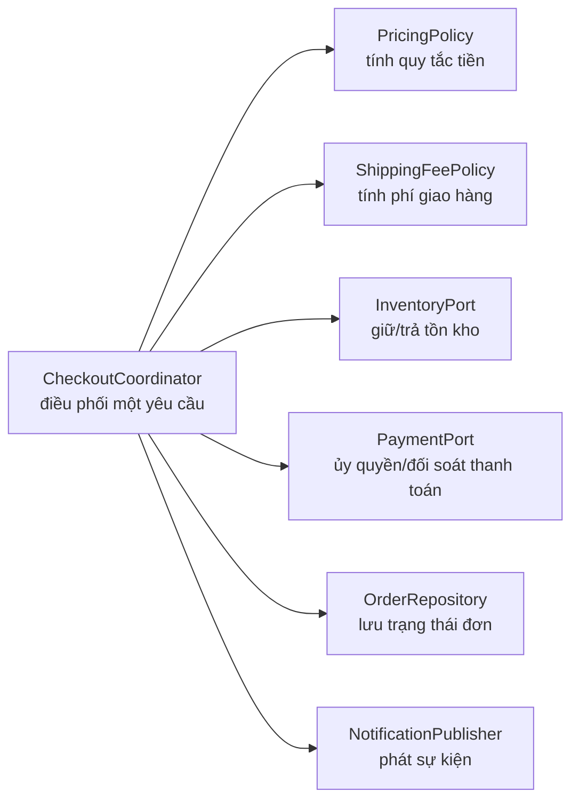
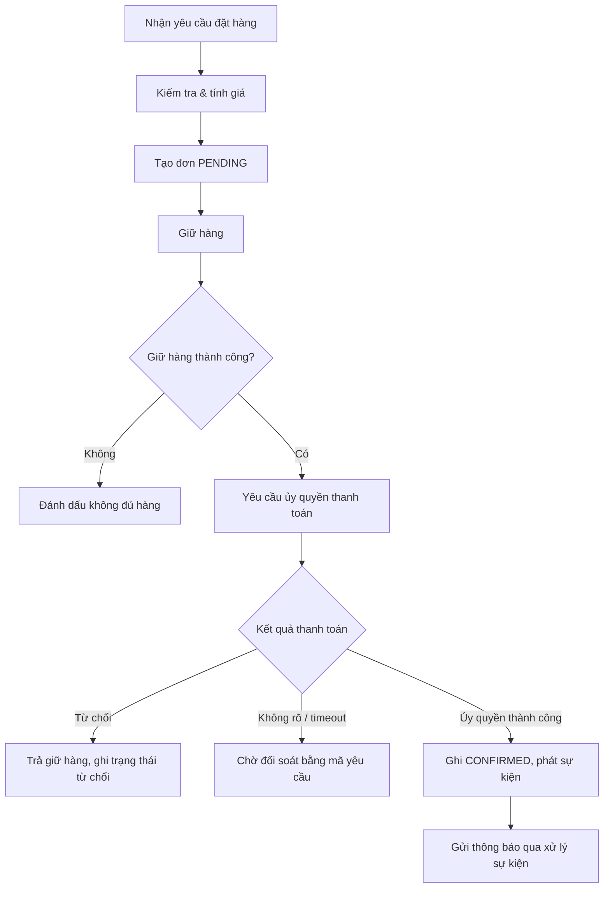

# Độ phức tạp ở cấp phương thức, lớp và toàn luồng xử lý

Một phương thức chỉ có mười dòng vẫn có thể khó sửa nếu nó phụ thuộc vào nhiều trạng thái ẩn. Một lớp có nhiều phương thức chưa chắc phức tạp nếu chúng cùng phục vụ một trách nhiệm rõ ràng. Một luồng đặt hàng gồm toàn những phương thức ngắn vẫn có thể khó kiểm soát khi phải phối hợp tồn kho, thanh toán và thông báo trên nhiều dịch vụ.

Trong chương **Độ phức tạp** của module **CODE_QUALITY_FUNDAMENTALS**, mục tiêu là hiểu vì sao chất lượng mã nguồn phụ thuộc vào **nơi sự phức tạp xuất hiện**. Mã đáng tin cậy, dễ hiểu và dễ thay đổi cần được xem xét ở ba mức: **phương thức**, **lớp** và **toàn luồng xử lý**. Cải thiện một mức không tự động làm hai mức còn lại đơn giản hơn.

## 1. Ba cấp độ cần quan sát

| Cấp độ | Đơn vị quan sát | Câu hỏi chính | Dấu hiệu đáng kiểm tra |
| --- | --- | --- | --- |
| **Phương thức** (*method*) | Một hàm hoặc thao tác | Có dễ hiểu các nhánh quyết định, dữ liệu vào/ra và tác dụng phụ không? | Điều kiện lồng sâu, nhiều trường hợp đặc biệt, tham số khó phân biệt, biến thay đổi nhiều lần |
| **Lớp** (*class*) | Một đơn vị có trạng thái, phương thức và phụ thuộc | Lớp có một trách nhiệm mạch lạc và giữ được bất biến của mình không? | Nhiều lý do phải thay đổi, phụ thuộc chằng chịt, phương thức không liên quan, trạng thái dùng chung khó theo dõi |
| **Toàn luồng xử lý** (*end-to-end flow*) | Chuỗi bước xuyên qua lớp, module hoặc dịch vụ | Một yêu cầu được xử lý qua bao nhiêu trạng thái, hệ thống và đường lỗi? | Nhiều lượt gọi, nhánh lỗi giao thoa, retry, timeout, giao dịch phân tán, khó lần theo kết quả cuối |

Ba cấp độ này có liên hệ nhưng không thể thay thế nhau. Khi tách một phương thức dài thành năm phương thức ngắn, **độ phức tạp tại từng phương thức** có thể giảm, còn **số bước cần lần theo** ở cấp lớp hoặc toàn luồng có thể tăng. Khi chia một lớp lớn thành nhiều dịch vụ, trách nhiệm mỗi lớp có thể rõ hơn nhưng số giao tiếp và tình huống lỗi liên dịch vụ cũng có thể tăng.

Trong bài này, từ **độ phức tạp** chủ yếu chỉ độ khó để **hiểu, kiểm chứng và thay đổi hành vi**. Đừng nhầm nó với **độ phức tạp thuật toán** như `O(n)` hoặc `O(n log n)`: một thuật toán chạy nhanh vẫn có thể chứa nhiều nhánh nghiệp vụ khó bảo trì; một vòng lặp `O(n)` đơn giản có thể rất dễ hiểu.

### 1.1. Những dạng phức tạp thường giao nhau

- **Phức tạp điều khiển:** có bao nhiêu nhánh, vòng lặp, đường thoát và trường hợp ngoại lệ?
- **Phức tạp dữ liệu:** các giá trị có nhiều trạng thái hợp lệ, điều kiện tương quan hoặc thay đổi theo thời gian không?
- **Phức tạp phụ thuộc:** muốn hiểu một đơn vị phải đọc bao nhiêu nơi khác, bao gồm các tác dụng phụ?
- **Phức tạp phối hợp:** có bao nhiêu bước phải đồng bộ, khôi phục, thử lại hoặc xử lý kết quả không chắc chắn?

Không có một phép đo duy nhất phản ánh đầy đủ cả bốn dạng. Muốn chọn cách cải thiện đúng, trước hết phải **xác định cấp độ và loại khó khăn cụ thể**.

## 2. Cấp phương thức: hiểu những quyết định được thực hiện

Ở cấp phương thức, người đọc cần trả lời được: điều kiện nào dẫn tới kết quả nào; thứ tự ưu tiên giữa các quy tắc ra sao; trạng thái nào bị sửa; và điều gì xảy ra khi đầu vào không hợp lệ?

Ví dụ giả định về phí giao hàng:

1. Đơn thuộc **vùng xa** chịu phí 45.000 VND, ưu tiên so với mọi trường hợp khác.
2. Đơn ở vùng thường chọn **giao nhanh** chịu phí 30.000 VND.
3. Đơn ở vùng thường, **giao tiêu chuẩn**, khách là thành viên và tiền hàng sau giảm giá đạt từ 500.000 VND được miễn phí.
4. Các đơn giao tiêu chuẩn còn lại chịu phí 15.000 VND.
5. Tiền hàng và giảm giá không âm; giảm giá không được vượt tiền hàng.

Đây là **chính sách minh họa đã được giả định rõ** để phục vụ ví dụ, không phải quy tắc bắt buộc của một hệ thống thương mại điện tử cụ thể.

### 2.1. Phiên bản lồng nhánh khó theo dõi

```java
package com.example.shipping;

public final class LegacyShippingFee {
    private LegacyShippingFee() {}

    public static long feeVnd(
            long subtotalVnd,
            long discountVnd,
            boolean member,
            boolean express,
            boolean remote) {

        if (subtotalVnd < 0 || discountVnd < 0
                || discountVnd > subtotalVnd) {
            throw new IllegalArgumentException("invalid amounts");
        }

        long payableVnd = subtotalVnd - discountVnd;
        long fee;
        if (remote) {
            fee = 45_000L;
        } else {
            if (express) {
                fee = 30_000L;
            } else {
                if (member) {
                    if (payableVnd >= 500_000L) {
                        fee = 0L;
                    } else {
                        fee = 15_000L;
                    }
                } else {
                    fee = 15_000L;
                }
            }
        }
        return fee;
    }
}
```

Đoạn mã có thể cho kết quả đúng theo chính sách đã đặt ra, nhưng người đọc phải giữ trong đầu nhiều mức lồng nhau mới thấy được **vùng xa được ưu tiên**, **giao nhanh loại trừ miễn phí**, và **quy tắc miễn phí chỉ áp dụng giao tiêu chuẩn**. Các tham số Boolean liên tiếp còn khiến lời gọi như `feeVnd(600_000, 100_000, true, false, true)` khó đọc: `true` cuối cùng là ý gì?

### 2.2. Phiên bản làm rõ đầu vào và thứ tự quyết định

Các đoạn mã sau dùng **Java 17** (cú pháp `record` đã được hỗ trợ) và cùng package `com.example.shipping`.

Tạo bản ghi dữ liệu trong tệp `ShippingRequest.java`:

```java
package com.example.shipping;

public record ShippingRequest(
        long merchandiseSubtotalVnd,
        long discountAmountVnd,
        boolean member,
        DeliverySpeed speed,
        DeliveryArea area) {

    public enum DeliverySpeed { STANDARD, EXPRESS }
    public enum DeliveryArea { REGULAR, REMOTE }
}
```

Và chính sách tính phí trong `ShippingFeePolicy.java`:

```java
package com.example.shipping;

import java.util.Objects;

public final class ShippingFeePolicy {
    private static final long REMOTE_FEE_VND = 45_000L;
    private static final long EXPRESS_FEE_VND = 30_000L;
    private static final long STANDARD_FEE_VND = 15_000L;
    private static final long FREE_STANDARD_MIN_VND = 500_000L;

    private ShippingFeePolicy() {}

    public static long feeVnd(ShippingRequest request) {
        Objects.requireNonNull(request, "request");
        Objects.requireNonNull(request.speed(), "speed");
        Objects.requireNonNull(request.area(), "area");
        validateAmounts(request);

        if (request.area() == ShippingRequest.DeliveryArea.REMOTE) {
            return REMOTE_FEE_VND;
        }
        if (request.speed() == ShippingRequest.DeliverySpeed.EXPRESS) {
            return EXPRESS_FEE_VND;
        }
        return qualifiesForFreeStandardShipping(request)
                ? 0L
                : STANDARD_FEE_VND;
    }

    private static void validateAmounts(ShippingRequest request) {
        if (request.merchandiseSubtotalVnd() < 0
                || request.discountAmountVnd() < 0
                || request.discountAmountVnd() > request.merchandiseSubtotalVnd()) {
            throw new IllegalArgumentException("invalid amounts");
        }
    }

    private static boolean qualifiesForFreeStandardShipping(
            ShippingRequest request) {
        long payableVnd =
                request.merchandiseSubtotalVnd() - request.discountAmountVnd();
        return request.member() && payableVnd >= FREE_STANDARD_MIN_VND;
    }
}
```

Trình tự điều kiện giờ đọc từ trên xuống: **vùng xa → giao nhanh → chính sách miễn phí giao tiêu chuẩn**. Kiểu `DeliverySpeed` và `DeliveryArea` làm rõ ý nghĩa tham số; các hằng số làm rõ đơn vị và ngưỡng. Hàm `qualifiesForFreeStandardShipping` chỉ được gọi sau khi hai trường hợp ưu tiên đã được loại trừ, nên tên hàm phản ánh đúng phạm vi sử dụng.

Điều đáng chú ý: phiên bản mới **không loại bỏ sự phức tạp thực sự của quy tắc nghiệp vụ**. Nó chỉ tổ chức lại cách diễn đạt để giảm số ngữ cảnh phải giữ trong đầu khi đọc một phương thức. Tổng số quy tắc, trường hợp biên và lựa chọn nghiệp vụ vẫn cần được kiểm chứng.

### 2.3. Kiểm thử hành vi bảo vệ việc cải thiện

Các ví dụ JUnit 5 dưới đây giả sử hai lớp mới ở cùng package `com.example.shipping`:

```java
package com.example.shipping;

import static org.junit.jupiter.api.Assertions.assertEquals;
import static org.junit.jupiter.api.Assertions.assertThrows;
import static com.example.shipping.ShippingRequest.DeliveryArea.REGULAR;
import static com.example.shipping.ShippingRequest.DeliveryArea.REMOTE;
import static com.example.shipping.ShippingRequest.DeliverySpeed.EXPRESS;
import static com.example.shipping.ShippingRequest.DeliverySpeed.STANDARD;

import org.junit.jupiter.api.Test;

class ShippingFeePolicyTest {
    private static ShippingRequest quote(
            long subtotal, long discount, boolean member,
            ShippingRequest.DeliverySpeed speed,
            ShippingRequest.DeliveryArea area) {
        return new ShippingRequest(
                subtotal, discount, member, speed, area);
    }

    @Test
    void standardMemberGetsFreeShippingAtInclusiveThreshold() {
        assertEquals(15_000L, ShippingFeePolicy.feeVnd(
                quote(499_999L, 0L, true, STANDARD, REGULAR)));
        assertEquals(0L, ShippingFeePolicy.feeVnd(
                quote(600_000L, 100_000L, true, STANDARD, REGULAR)));
    }

    @Test
    void standardNonMemberPaysNormalFee() {
        assertEquals(15_000L, ShippingFeePolicy.feeVnd(
                quote(600_000L, 0L, false, STANDARD, REGULAR)));
    }

    @Test
    void expressAndRemoteOverrideMemberDiscount() {
        assertEquals(30_000L, ShippingFeePolicy.feeVnd(
                quote(600_000L, 0L, true, EXPRESS, REGULAR)));
        assertEquals(45_000L, ShippingFeePolicy.feeVnd(
                quote(600_000L, 0L, true, EXPRESS, REMOTE)));
    }

    @Test
    void invalidAmountsAreRejected() {
        assertThrows(IllegalArgumentException.class,
                () -> ShippingFeePolicy.feeVnd(
                        quote(100_000L, 100_001L, true, STANDARD, REGULAR)));
    }
}
```

Bộ kiểm thử kiểm tra một số nhánh quan trọng và thứ tự ưu tiên; **nó chưa bao phủ mọi tổ hợp**. Với chính sách thật, cần thêm các trường hợp vùng xa giao tiêu chuẩn, giá trị đúng dưới/trên ngưỡng, đầu vào `null` và những trạng thái nghiệp vụ khác được hỗ trợ. Các đoạn mã chỉ là ví dụ hướng dẫn, chưa phải kết quả biên dịch hoặc chạy kiểm thử trong dự án.

### 2.4. Đo độ phức tạp của phương thức thế nào?

Hai nhóm phép đo thường được thảo luận:

- **Cyclomatic complexity (độ phức tạp chu trình):** mô tả số đường đi độc lập tuyến tính qua đồ thị luồng điều khiển. Với đồ thị liên thông đơn giản một thành phần, có thể viết `V(G) = E - N + 2`, trong đó `E` là số cạnh và `N` là số nút. Cách tính thực tế cho toán tử Boolean, `switch`, `catch` hoặc các cấu trúc ngôn ngữ có thể khác nhau giữa công cụ.
- **Cognitive complexity (độ phức tạp nhận thức):** một nhóm quy tắc chấm điểm nhằm phản ánh mức khó hiểu của luồng điều khiển; thường tăng theo lồng nhánh và những lần ngắt mạch đọc tự nhiên. Đây là **điểm theo một quy tắc công cụ**, không phải phép đo trực tiếp năng lực hiểu của từng người.

| Tín hiệu | Nó giúp phát hiện | Điều nó không tự chứng minh |
| --- | --- | --- |
| Nhiều `if`, `switch` và vòng lặp | Có nhiều quyết định cần kiểm tra | Các quyết định đó đều có thể giản lược |
| Lồng nhánh sâu | Người đọc phải nhớ nhiều điều kiện bao quanh | Đổi mọi nhánh thành guard clause luôn tốt |
| Nhiều tham số Boolean | Ý nghĩa lời gọi có thể khó nhận ra | Mỗi Boolean đều cần một lớp kiểu mới |
| Nhiều đường thoát và ngoại lệ | Khó lần theo hậu điều kiện/tác dụng phụ | Một phương thức bắt buộc phải có một `return` |
| Chỉ số cyclomatic hoặc cognitive cao | Ứng viên đáng kiểm tra sâu hơn | Phương thức chắc chắn sai hoặc sửa sẽ có lợi |

Không có ngưỡng “mọi phương thức quá X điểm đều phải tách” đúng cho tất cả dự án. Khi đánh giá, hãy xét số quy tắc thực tế, tần suất thay đổi, thử nghiệm có sẵn và mức độ dễ tái hiện lỗi.

## 3. Cấp lớp: các trách nhiệm và trạng thái liên kết ra sao?

Một lớp có thể gồm toàn phương thức ngắn nhưng vẫn khó bảo trì nếu phải sửa nó vì **nhiều loại thay đổi không liên quan**. Ví dụ, lớp `CheckoutManager` vừa tính khuyến mãi, giữ hàng, thanh toán, lưu đơn, gửi email và giải quyết thanh toán thất bại. Mỗi phương thức có thể ngắn, nhưng lớp phải biết quá nhiều thành phần:

```text
CheckoutManager
  - validateCheckout(...)
  - calculateShippingFee(...)
  - applyPromotion(...)
  - reserveInventory(...)
  - authorizePayment(...)
  - persistOrder(...)
  - sendConfirmation(...)
  - handlePaymentFailure(...)
```

Đây chỉ là **phác họa trách nhiệm**, không phải lớp Java hoàn chỉnh. Vấn đề chưa nằm ở số lượng tám phương thức; nó nằm ở những câu hỏi như:

1. Khi bảng phí thay đổi, có cần sửa cùng lớp đang quyết định thứ tự thanh toán không?
2. Khi cổng thanh toán đổi API, có thể sửa riêng phần tích hợp không?
3. Khi một phương thức giữ hàng thay đổi trạng thái, những phương thức nào đang ngầm dựa vào trạng thái đó?
4. Muốn kiểm thử tính phí có phải dựng cơ sở dữ liệu, cổng thanh toán và dịch vụ email không?
5. Một thay đổi nhỏ có làm nhiều kiểm thử không liên quan thất bại không?

### 3.1. Phân chia theo trách nhiệm có ý nghĩa

Một hướng thiết kế minh họa:



Ở sơ đồ này, `PricingPolicy` và `ShippingFeePolicy` có thể được kiểm thử như các tính toán thuần; thành phần giao tiếp tồn kho và thanh toán có hợp đồng riêng. `CheckoutCoordinator` vẫn có trách nhiệm **điều phối thứ tự và các nhánh lỗi**; không thể xóa trách nhiệm ấy chỉ bằng cách di chuyển từng lời gọi sang lớp khác.

Điều cần bảo đảm là các ranh giới khớp với **lý do thay đổi** và **bất biến nghiệp vụ**. Nếu tách một quy tắc nhỏ thành năm lớp không mang thêm ý nghĩa, người đọc lại phải mở năm tệp mới hiểu được một hành vi. Việc tăng số lớp hoặc sử dụng interface không mặc nhiên làm hệ thống ít phức tạp hơn.

### 3.2. Đọc độ phức tạp cấp lớp bằng nhiều góc nhìn

| Góc nhìn | Câu hỏi nên đặt | Dấu hiệu cần xem xét |
| --- | --- | --- |
| **Cohesion – tính gắn kết** | Các phương thức có cùng phục vụ một trách nhiệm rõ ràng không? | Nhiều nhóm phương thức không dùng chung quy tắc hoặc dữ liệu |
| **Coupling – mức liên kết** | Lớp phải biết bao nhiêu chi tiết của lớp khác? | Gọi sâu vào cấu trúc nội bộ, thay đổi lan rộng |
| **Trách nhiệm thay đổi** | Có bao nhiêu nguyên nhân độc lập khiến lớp phải sửa? | Khuyến mãi, giao vận và thanh toán đều tác động lên cùng lớp |
| **Trạng thái nội bộ** | Các trường có quan hệ, bất biến và vòng đời rõ không? | Cập nhật từng phần làm trạng thái không nhất quán |
| **Bề mặt công khai** | Người gọi cần biết bao nhiêu thao tác và thứ tự gọi? | API buộc gọi `prepare` rồi `reserve` rồi `commit` mà không bảo vệ thứ tự |
| **Khả năng kiểm thử** | Một hành vi có kiểm tra độc lập được không? | Kiểm thử phép tính thuần lại phải khởi tạo nhiều dịch vụ |

Một số công cụ báo cáo **WMC** (trọng số các phương thức của lớp), **CBO** (mức liên kết giữa các lớp), **LCOM** (các biến thể chỉ số thiếu gắn kết), hoặc fan-in/fan-out. **Định nghĩa và cách tính phụ thuộc công cụ**, nên kết quả chỉ hữu ích khi biết phiên bản, phạm vi và quy tắc chấm điểm. Một lớp điều phối có fan-out cao có thể là điều **có chủ đích**; một lớp mô hình có nhiều phương thức nhưng cùng bảo vệ một bất biến có thể hợp lý.

### 3.3. Đừng đẩy bất biến ra khắp nơi

Giả sử lớp `Stock` phải giữ bất biến `available + reserved = total`. Tách phép trừ `available` vào `AvailableStockUpdater` và phép cộng `reserved` vào `ReservedStockUpdater` mà không có thao tác nguyên tử sẽ làm việc duy trì bất biến khó hơn. Ranh giới thiết kế tốt là ranh giới **bảo vệ được quy tắc**, không chỉ tối thiểu số dòng mỗi lớp.

Trong nhiều trường hợp, giữ các thao tác bảo toàn trạng thái trong **một đối tượng có trách nhiệm rõ** lại dễ hiểu và đáng tin cậy hơn chia ra các lớp nhỏ tùy tiện.

## 4. Toàn luồng xử lý: đường đi qua các hệ thống

Hãy xét quy trình đặt hàng giả định:

1. Kiểm tra yêu cầu và áp dụng chính sách giá.
2. Tạo đơn ở trạng thái `PENDING`.
3. Gửi yêu cầu giữ hàng.
4. Yêu cầu cổng thanh toán ủy quyền thanh toán.
5. Chuyển đơn sang `CONFIRMED` và phát sự kiện xác nhận.
6. Gửi thông báo cho khách bằng bộ xử lý sự kiện riêng.

Nếu chỉ đọc từng phương thức, tất cả đều có thể ngắn. Tuy nhiên, tính đúng đắn của cả quy trình phụ thuộc vào **thứ tự**, **trạng thái chung** và **cách xử lý khi một bước thất bại**.



Sơ đồ thể hiện **luồng nghiệp vụ mong muốn**, chưa phải triển khai bảo đảm giao dịch của nhiều hệ thống. Giữa các bước có thể xảy ra sự cố mạng, dữ liệu ghi một phần hoặc phản hồi bị thất lạc. Muốn kiểm chứng tính đúng đắn, cần xác định trạng thái nào hợp lệ ở **mỗi ranh giới** và ai chịu trách nhiệm khôi phục.

### 4.1. Các đường lỗi làm tăng độ phức tạp

| Điểm lỗi | Câu hỏi cần giải quyết | Chính sách minh họa |
| --- | --- | --- |
| Không tạo được đơn `PENDING` | Có tác dụng bên ngoài nào đã xảy ra chưa? | Từ chối yêu cầu trước khi gọi hệ thống ngoài |
| Không giữ được hàng | Đơn chuyển sang trạng thái nào? | Ghi `REJECTED` hoặc trạng thái tương đương |
| Cổng thanh toán từ chối | Lượng hàng đã giữ được trả thế nào? | Hoàn trả giữ hàng và lưu kết quả từ chối |
| Thanh toán timeout | Đã trừ tiền hay chưa? | Dùng khóa idempotency và truy vấn/đối soát trạng thái trước khi quyết định thử lại |
| Đã ủy quyền nhưng ghi `CONFIRMED` thất bại | Ai phát hiện và khôi phục trạng thái? | Có cơ chế retry/đối soát bền vững; tránh tạo giao dịch thanh toán thứ hai |
| Email xác nhận thất bại | Có cần hủy đơn đã thanh toán không? | Gửi lại thông báo theo cơ chế xử lý sự kiện; không tự động thu tiền lại |

Các lựa chọn trên cần được cụ thể hóa trong thiết kế thật. Ví dụ, “trả giữ hàng” hoặc “hủy ủy quyền thanh toán” đều là **thao tác mới có thể thất bại**, nên phải được theo dõi và đối soát; không thể giả định một câu lệnh `catch` đã làm mọi thứ trở lại trạng thái ban đầu.

Giao dịch cơ sở dữ liệu cục bộ **không tự bảo đảm tính nguyên tử** của cả chuỗi gọi dịch vụ kho, cổng thanh toán và hệ thống thông báo. Những chiến lược như **idempotency**, **outbox**, **saga** hoặc hàng đợi có thể hỗ trợ các yêu cầu cụ thể, nhưng mỗi cơ chế cũng thêm thành phần, trạng thái và quy tắc vận hành. Chỉ đưa vào khi rủi ro và hợp đồng luồng xử lý thật sự cần.

### 4.2. Số tổ hợp tăng nhanh theo các quyết định độc lập

Một luồng có:

- 2 hình thức giao hàng;
- 3 trạng thái thanh toán có ý nghĩa (`SUCCESS`, `DECLINED`, `UNKNOWN`);
- 2 khả năng giữ hàng (thành công hoặc không);
- 2 loại khách hàng (thành viên hoặc thường).

Nếu xem chúng là các chiều lựa chọn độc lập để lập **không gian kiểm thử thô**, có thể có tới `2 × 3 × 2 × 2 = 24` tổ hợp. Không phải tất cả tổ hợp đều có thể đến được trong luồng thật: chẳng hạn khi giữ hàng thất bại, hệ thống có thể không gọi thanh toán. Đây là **ước lượng để nhận diện rủi ro bùng nổ trường hợp**, không phải số đường đi thực tế chính xác.

Để lập kiểm thử, cần thêm **ràng buộc giữa các bước**, ưu tiên trường hợp biên, bất biến và đường lỗi có tác động lớn. Có thể dùng bảng quyết định, kiểm thử theo trạng thái hoặc kỹ thuật kết hợp cặp (*pairwise*) trong những tình huống thích hợp; nhưng pairwise không thay thế kiểm thử chuỗi trạng thái hoặc tương tác nguy hiểm đã biết.

### 4.3. Các thước đo ở cấp toàn luồng

| Cần quan sát | Dữ liệu có thể thu thập | Giới hạn cần nhớ |
| --- | --- | --- |
| Số bước và hệ thống tham gia | Sơ đồ sequence/flow và dependency graph | Nhiều bước không đồng nghĩa thiết kế sai nếu trách nhiệm rõ |
| Số trạng thái và chuyển trạng thái | State machine, sự kiện, các trường hợp lỗi | Đếm trạng thái chưa phản ánh độ khó của quy tắc chuyển |
| Đường lỗi và khôi phục | Ma trận timeout, retry, compensation, đối soát | Bỏ đường lỗi khỏi sơ đồ làm số liệu thấp giả |
| Độ phụ thuộc theo thời gian | Những bước phải chờ, dữ liệu cần nhất quán, thứ tự bắt buộc | Bất đồng bộ làm mất bước chờ nhưng thêm yêu cầu theo dõi trạng thái |
| Quan sát và chẩn đoán | Correlation ID, mã yêu cầu, log/tracing theo từng bước | Ít log không làm luồng đơn giản hơn; chỉ làm khó hiểu sự cố hơn |
| Thay đổi nghiệp vụ lan xa | Số module và hợp đồng cần cập nhật khi đổi một quy tắc | Phải phân biệt thay đổi bắt buộc và thay đổi do coupling không cần thiết |

Một công cụ báo cáo độ phức tạp của từng phương thức **không nhìn thấy đầy đủ** các lần gọi mạng, chính sách thử lại, thời gian chờ và thứ tự sự kiện. Vì vậy một hệ thống có điểm cyclomatic thấp vẫn có thể có độ phức tạp toàn luồng cao.

## 5. Ví dụ: thay đổi nhỏ ở đâu thì phù hợp?

Giả sử nhóm phát hiện lỗi: **khách thành viên không được miễn phí giao hàng khi tiền hàng sau giảm giá đúng 500.000 VND**.

| Cấp độ | Cần kiểm tra | Hành động có thể phù hợp |
| --- | --- | --- |
| **Phương thức** | Có dùng `> 500_000` thay vì `>= 500_000`? Quy tắc áp dụng ở nhánh nào? | Sửa điều kiện đúng phạm vi và thêm kiểm thử biên |
| **Lớp** | Có nhiều phương thức/lớp cùng tự tính điều kiện miễn phí không? | Xác định điểm quản lý chính sách, tránh sao chép các quy tắc khác nhau |
| **Toàn luồng** | Giá trị sau giảm giá được tính ở đâu? Lúc tạo đơn và lúc báo giá có dùng cùng giá trị không? | Kiểm tra đường dữ liệu qua API, dịch vụ giá, đơn hàng và các trạng thái được lưu |

Nếu lỗi chỉ đến từ dấu so sánh trong một hàm thuần, có thể sửa ở cấp phương thức. Nếu dịch vụ báo giá và dịch vụ chốt đơn sử dụng **hai bản sao chính sách khác nhau**, sửa một hàm chưa đủ. Nếu tiền hàng đến muộn hoặc bị cập nhật giữa bước báo giá và đặt đơn, vấn đề còn liên quan tới hợp đồng toàn luồng.

**Nguyên tắc:** xác định nguyên nhân ở cấp nào thì sửa ở cấp đó, rồi kiểm chứng các cấp liên quan. Tránh thiết kế lại cả hệ thống chỉ vì một điều kiện nhỏ, nhưng cũng tránh tuyên bố hoàn tất khi mới sửa phần nhìn thấy đầu tiên.

## 6. Một cải thiện ở cấp này có thể làm cấp khác phức tạp hơn

| Kỹ thuật | Lợi ích có thể đạt | Chi phí cần kiểm tra |
| --- | --- | --- |
| Trả về sớm (*guard clauses*) | Giảm lồng nhánh trong phương thức | Nhiều điểm thoát cần giữ cùng hợp đồng hậu điều kiện |
| Tách phương thức | Đặt tên cho bước logic, dễ kiểm thử cục bộ | Người đọc phải chuyển giữa nhiều hàm; dữ liệu bị chuyền vòng |
| Tách lớp theo trách nhiệm | Hạn chế lý do thay đổi, cô lập phụ thuộc | Tăng số đối tượng và hợp đồng phối hợp |
| Dùng chiến lược/đa hình | Tách chính sách khác nhau theo loại nghiệp vụ | Khó nhìn toàn bộ lựa chọn nếu số chiến lược quá lớn |
| Chuyển lời gọi đồng bộ thành sự kiện | Giảm chờ và kết nối trực tiếp ở một số điểm | Thêm độ trễ, thứ tự sự kiện, retry và đối soát |
| Chia một module thành microservice | Có thể độc lập triển khai và mở rộng khi cần | Thêm giao tiếp mạng, tính nhất quán phân tán và vận hành |
| Tập trung chính sách trong một thành phần | Giảm trùng lặp quy tắc | Có thể tạo điểm phụ thuộc chung hoặc nghẽn nếu thiết kế không phù hợp |

Đặc biệt cần tránh hai cực đoan: **một phương thức khổng lồ để “không phải nhảy tệp”** và **hàng chục lớp/phương thức siêu nhỏ chỉ để đạt chỉ số công cụ**. Kích thước hợp lý là kích thước giúp người đọc hiểu **một trách nhiệm có ý nghĩa**, kiểm tra được ranh giới và thay đổi ít lan rộng.

## 7. Quy trình đánh giá độ phức tạp có bằng chứng

Một cách làm thực tế gồm sáu bước:

1. **Chọn tình huống cụ thể.** Ví dụ: thêm ưu đãi giao hàng thường mất nhiều thời gian review và hay gây lỗi hồi quy.
2. **Vẽ đường thực thi.** Ở phương thức, liệt kê điều kiện; ở lớp, liệt kê trách nhiệm và phụ thuộc; ở toàn luồng, ghi các bước, trạng thái và đường lỗi.
3. **Ghi mốc ban đầu.** Lưu ví dụ đầu vào/đầu ra, kiểm thử hiện có, sơ đồ phụ thuộc và chỉ số phù hợp. Ghi rõ phạm vi và công cụ đo.
4. **Nêu giả thuyết.** Chẳng hạn “chuyển chính sách tính phí vào một thành phần thuần sẽ giúp thay đổi ngưỡng mà không cần sửa bộ điều phối thanh toán”.
5. **Thay đổi nhỏ và kiểm chứng.** Chạy lại kiểm thử nghiệp vụ, kiểm thử tích hợp cho đường dữ liệu và kiểm tra các đường lỗi có thể bị ảnh hưởng.
6. **Đánh giá lại trên cả ba cấp.** Mã có dễ đọc hơn không? Trách nhiệm và phụ thuộc có rõ hơn không? Toàn luồng có thêm trạng thái hoặc lần gọi làm rủi ro tăng không?

### 7.1. Ví dụ bản ghi đánh giá

```text
Vấn đề quan sát:
- Quy tắc miễn phí giao hàng được tính khác nhau ở báo giá và chốt đơn.

Phạm vi:
- Method: các nhánh quyết định phí.
- Class: nơi sở hữu chính sách và dữ liệu sau giảm giá.
- Flow: dữ liệu từ báo giá qua tạo đơn.

Baseline:
- Trường hợp đúng ngưỡng 500.000 VND.
- Kết quả của hai đường đi với cùng đầu vào.
- Những nơi đang chứa bản sao chính sách.

Giả thuyết:
- Một chính sách dùng chung, có hợp đồng rõ, giảm lệch nghĩa.

Bằng chứng sau thay đổi cần có:
- Hai đường đi cho cùng quyết định với cùng dữ liệu hợp lệ.
- Các kiểm thử biên và tích hợp liên quan đều đạt.
- Đường lỗi không phát sinh thay đổi ngoài phạm vi.
```

Đây là mẫu để ghi nhận **bằng chứng cần thu thập**, không phải báo cáo đã đo hoặc đã cải thiện một hệ thống thực tế. Không nên kết luận “đã giảm 30% độ phức tạp” chỉ từ số dòng giảm, hoặc so điểm công cụ trên hai cấu hình phân tích khác nhau.

## 8. Những ngộ nhận thường gặp

| Ngộ nhận | Vì sao chưa đúng | Cách xem xét tốt hơn |
| --- | --- | --- |
| “Phương thức ngắn luôn đơn giản.” | Logic có thể ẩn trong nhiều helper, callback hoặc trạng thái ngoài | Lần theo hợp đồng và đường dữ liệu |
| “Nhiều phương thức nghĩa là lớp phức tạp.” | Các phương thức có thể cùng bảo vệ một trách nhiệm mạch lạc | Đánh giá cohesion, coupling và lý do thay đổi |
| “Tách microservice là giảm độ phức tạp.” | Ranh giới mạng thêm lỗi và trạng thái phân tán | Đo cả độ phức tạp vận hành và toàn luồng |
| “Cyclomatic complexity thấp nghĩa là luồng an toàn.” | Chỉ số cục bộ không phản ánh timeout, retry, nhất quán liên hệ thống | Vẽ state machine và kiểm thử đường lỗi |
| “Giảm số dòng đồng nghĩa cải thiện chất lượng.” | Mã nén có thể che giấu quy tắc | So khả năng hiểu và kiểm chứng hành vi |
| “Tăng độ bao phủ kiểm thử đủ giải quyết mọi rủi ro.” | Kiểm thử sai kỳ vọng hoặc bỏ sót trạng thái vẫn có thể xanh | Bám yêu cầu, điều kiện biên và bất biến |
| “Mỗi nhánh đều độc lập, chỉ cần test từng nhánh.” | Nhiều điều kiện tương tác tạo tình huống mới | Kết hợp decision table, test trạng thái và luồng tích hợp |

## 9. Bài tập vận dụng

**Tình huống:** một hệ thống hoàn tiền hỗ trợ ba phương thức thanh toán, hai loại ưu đãi và hai trạng thái giao hàng. Mã hiện tại có:

- `RefundService.refund()` dài 160 dòng, nhiều `if` lồng nhau.
- `OrderManager` vừa tính số tiền hoàn, cập nhật đơn và gửi email.
- Yêu cầu hoàn tiền gọi cổng thanh toán rồi cập nhật trạng thái đơn; khi cổng thanh toán timeout, người vận hành không biết có thể thử lại hay không.

Hãy tự thực hiện:

1. **Ở cấp phương thức:** liệt kê các quyết định, điều kiện biên (hoàn toàn phần, hoàn một phần, giá trị 0) và đề xuất cách biểu diễn bảng quy tắc cho rõ. Tại sao chỉ tách thành ba helper chưa chắc đủ?
2. **Ở cấp lớp:** phân định trách nhiệm giữa chính sách tính hoàn tiền, điều phối hoàn tiền, lưu trạng thái và cổng thanh toán. Bất biến nào nên được giữ trong cùng một thành phần?
3. **Ở cấp toàn luồng:** vẽ các trạng thái tối thiểu như `PENDING`, `SUCCEEDED`, `DECLINED`, `UNKNOWN` và quy tắc xử lý timeout. Khi thử lại, dùng thông tin nào để tránh hoàn tiền hai lần?
4. **Về đo lường:** đề xuất một dấu hiệu/metric thích hợp cho từng cấp và giải thích vì sao metric đó chưa thể tự chứng minh chất lượng.
5. **Về kiểm chứng:** viết ít nhất sáu trường hợp cần thử, gồm một đường thành công, một trường hợp biên, một đường thất bại và một đường kết quả thanh toán không rõ.

**Gợi ý tự đối chiếu:** Ở phương thức, cần bảng quyết định và kiểm thử theo quy tắc; ở lớp, tính tiền hoàn nên có hợp đồng rõ và không cần mạng để kiểm thử; ở toàn luồng, một timeout không cho biết lệnh hoàn tiền đã thất bại hay thành công. Việc **đối soát bằng mã giao dịch/khóa idempotency** và chuyển trạng thái có kiểm soát quan trọng hơn việc chỉ giảm số dòng của `refund()`. Kết quả triển khai phải được kiểm tra ở mọi ranh giới đã ảnh hưởng.

## 10. Ghi nhớ

- **Phương thức:** xem các nhánh quyết định, dữ liệu và tác dụng phụ; cấu trúc rõ giúp giảm gánh nặng nhận thức.
- **Lớp:** xem trách nhiệm, bất biến, trạng thái và mức liên kết; chia lớp theo ranh giới có ý nghĩa.
- **Toàn luồng:** xem thứ tự, trạng thái, dịch vụ phụ thuộc và đường lỗi; chú ý kết quả không chắc chắn và khả năng phục hồi.
- **Chỉ số là tín hiệu:** cyclomatic, cognitive, WMC, CBO hoặc số bước đều cần ngữ cảnh, không phải phán quyết tự động.
- **Refactor có bằng chứng:** bảo vệ hành vi hiện tại, sửa đúng cấp độ phát sinh khó khăn, rồi đánh giá tác động lên cả ba cấp.

Một hệ thống dễ bảo trì không nhất thiết có ít phương thức, ít lớp hay ít dịch vụ nhất. Điều quyết định là người phát triển có thể **chỉ ra nơi quy tắc được quyết định, nơi trạng thái được bảo vệ và cách cả luồng đạt kết quả đúng** mà không phải dựa vào những giả định ẩn.
